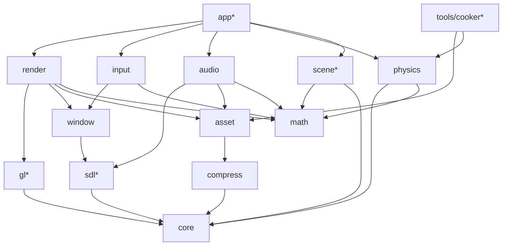

# Jeddy Framework: Architecture & Design

> Status: **Draft v0.1** (2026-10-09). Living document: update it when a decision changes and record why in §17.
> Scope: a Java toolkit for building 3D isometric RPGs in the style of *Pathfinder: Wrath of the Righteous*
> (real-time-with-pause + turn-based combat, party of up to 6, dense lit interiors, AoE spells, fog of war).

---

## 1. Goals and non-goals

### Goals
1. **Performance is the top requirement.** The engine is data-oriented: primitive arrays, struct-of-arrays layout,
   no allocations per frame, multithreaded simulation and command building, and cheap native calls through FFM.
2. **Modular.** Multi-module Gradle build with JPMS modules. Each module is usable on its own and depends only on what it needs.
3. **Native through FFM only.** SDL3, SDL3_mixer, OpenGL, zstd, libktx and meshoptimizer are called through
   `java.lang.foreign` (Panama). There is no JNI code and no third-party Java binding library.
4. **Genre-specific.** Physics, input, camera, rendering and tooling are shaped for isometric CRPGs, not for every kind of game.
5. **Offline asset pipeline.** Source assets (glTF, PNG/TGA/HDR, OGG/WAV) are cooked into GPU-ready, compressed, memory-mappable formats.

### Non-goals (for now)
- macOS, mobile and consoles. Vulkan/D3D12 backends (the renderer is GL 4.6-only at first; §9.8 keeps the door open).
- Rigid-body simulation, ragdolls and destruction (pure-Java *gameplay* physics only, §11).
- A general-purpose editor. Debug UI comes later; a level editor is out of scope.
- Networking/multiplayer.

### Confirmed decisions (from the kickoff Q&A)
| # | Decision | Choice |
|---|----------|--------|
| D1 | Platforms / graphics API | **Windows x64 + Linux x64, OpenGL 4.6 core** (DSA, MDI, compute, SPIR-V capable) |
| D2 | Native bindings | **jextract** for C libraries (generated sources committed) **+ our own GL generator** from Khronos `gl.xml` |
| D3 | Physics scope | **Pure-Java gameplay physics**: kinematic movement, static collision, queries, navmesh, pathfinding, LOS. No rigid bodies |
| D4 | Java features | **Stable APIs only** (no `--enable-preview`, no incubator modules). Math types are **Valhalla-ready** |
| D5 | Perf | Primitive arrays, SoA, job-system multithreading, pools and handles, zero steady-state allocation |

---

## 2. Toolchain baseline (verified 2026-10-09)

| Item | Version | Notes |
|------|---------|-------|
| JDK | **27** (GA 2026-09-15, non-LTS) | FFM final since 22. Compact object headers on by default (JEP 534). Vector API is still incubating (JEP 537), so we don't use it (D4). Value classes (JEP 401) are targeted as a *preview* in JDK 28. Next LTS is JDK 29 (Sep 2027), so plan to move the toolchain forward each release |
| Gradle | **9.8.1** (2026-10-07) | Supports JDK 27 for running Gradle and for toolchains (since 9.8.0). Kotlin DSL, version catalog, configuration cache |
| Toolchain provisioning | `org.gradle.toolchains.foojay-resolver-convention` **1.0.0** | |
| SDL3 | **3.4.18** (2026-10-02) | zlib license |
| SDL3_mixer | **3.2.4** (2026-06-03) | Stable 3.x API (`MIX_*`): tracks, tags, groups, 3D position |
| zstd | **1.5.7** | BSD |
| KTX-Software (libktx) | **4.4.2** stable (5.0 is pre-release) | Tools only. UASTC encode, transcode to BC7/BC5/BC4, zstd supercompression |
| meshoptimizer | **1.2** | Tools only. Vertex cache, overdraw and fetch optimization, simplification (LODs), meshlets |
| jextract | build from `openjdk/jextract` master (needs JDK 23+ and libclang), or the latest prebuilt | Used *offline* only. Generated code targets the final FFM API, so it runs on JDK 27 |
| Tests | JUnit 6.0.1 (BOM) | Plus `junit-platform-launcher` at test runtime, which Gradle 9 requires |
| Benchmarks | JMH 1.37 | Wired by hand in the `jeddy.jmh` convention plugin (a `jmh` JavaExec task). No third-party Gradle plugin |

---

## 3. Module map

### 3.1 Modules

`*` = module added beyond the original request, because the requested ones need it (see the rationale column).

| Gradle project | JPMS module | Responsibility | Depends on | Rationale |
|---|---|---|---|---|
| `core` | `dev.jeddy.core` | Primitive collections, handles, pools, off-heap memory, job system, native loader, profiler, logging, IDs, config | none | Requested ("core utils") |
| `math` | `dev.jeddy.math` | Vectors, matrices, quaternions, geometry, intersection tests, bulk kernels, RNG/dice, packing | none | Requested |
| `compress` | `dev.jeddy.compress` | zstd through FFM: one-shot, streaming and dictionaries; checksums | core | Requested |
| `sdl`* | `dev.jeddy.sdl` | Raw jextract bindings for SDL3 and SDL3_mixer, exported **only** to window, input, audio and app | core | One copy of the SDL bindings shared by four modules |
| `gl`* | `dev.jeddy.gl` | Generated GL 4.6 core bindings, function loader, capability detection | core | Keeps generated code out of `render` and makes it cacheable |
| `window` | `dev.jeddy.window` | SDL video init, windows, displays/DPI, GL context, swap, frame pacing, cursors | core, sdl | Requested |
| `input` | `dev.jeddy.input` | Event pump to lock-free ring, device state, action mapping, contexts, CRPG gestures, gamepads | core, math, sdl, window | Requested |
| `render` | `dev.jeddy.render` | GL resources, frame graph, render packets, MDI submission, PBR, lights, shadows, post, decals, debug draw | core, math, gl, window, asset | Requested |
| `asset` | `dev.jeddy.asset` | Runtime side of the pipeline: VFS, `.jpak` archives, async loader, format readers, hot reload | core, compress | Requested ("PBR asset pipeline") |
| `audio` | `dev.jeddy.audio` | SDL3_mixer wrapper: voice pool, buses, 3D emitters, music and ambience | core, math, sdl, asset | Requested |
| `physics` | `dev.jeddy.physics` | Collision BVH, broadphase grid, queries, navmesh runtime, pathfinding, crowd/formations, visibility, triggers | core, math | Added in kickoff |
| `scene`* | `dev.jeddy.scene` | Entity handles, sparse-set component stores, SoA transform hierarchy | core, math | Gameplay needs one authoritative transform store. `app` sync/extract systems copy from it into render, physics and audio, which never depend on `scene` |
| `app`* | `dev.jeddy.app` | Application lifecycle, thread orchestration, main loop, world integration (scene→render, physics→scene, audio), settings, crash handling | everything above | Ties the leaf modules together so that they stay independent of each other |
| `tools/cooker`* | `dev.jeddy.cooker` | Offline asset cooking: glTF, textures, materials, shaders, navmesh/BVH bake, pak building, CLI and Gradle plugin | core, math, compress, asset, physics + libktx/meshoptimizer bindings | The offline half of "PBR asset pipeline" |
| `natives/*`* | (resource jars) | Prebuilt shared libraries per OS/arch with SHA-256 manifest | none | Distribution |
| `bench`* | none | JMH benchmarks for every hot path | all runtime modules | Required to enforce "performance is a must" |
| `samples/iso-demo`* | `dev.jeddy.samples.iso` | Integration demo and perf scene | app | Acceptance target |

> `dev.jeddy` is the root package and Maven group (confirmed 2026-10-10).

### 3.2 Dependency graph



*(Edges to `core`, and transitive edges, are omitted for readability. The table above is authoritative.)*

**Rules (enforced by `module-info.java`):**
- No cycles, and leaf modules never depend on `app`.
- `physics`, `scene` and `render` don't know about each other. `app` (or the game) copies data between them in explicit *sync/extract* systems. This keeps every leaf testable alone and makes the data flow visible.
- Raw binding packages (`dev.jeddy.sdl.ffi`, `dev.jeddy.gl.ffi`, `dev.jeddy.compress.ffi`) are **qualified exports** (`exports … to …`) or not exported. Games use the idiomatic wrappers.
- Runtime modules have **no third-party dependencies**. `tools/cooker` may use some, but so far needs none: images decode through ImageIO plus built-in TGA and Radiance HDR readers, and JSON through `core.json` (D38).

---

## 4. Performance architecture (cross-cutting rules)

These rules apply to every *runtime* module. Code in the per-frame path (anything called from the game loop, render
loop, job kernels or event pump) must follow them. Section 14 explains how CI enforces them.

### 4.1 Data layout
- **Struct-of-arrays (SoA)** for any collection of things processed per frame: `float[] posX, posY, posZ` rather than
  `Unit[]`. Loops over SoA arrays get bounds-check elimination and C2 auto-vectorization (superword).
- **Handles, not references.** Entities, meshes, textures, sounds, nav queries and so on are `int` handles:
  `index (22–24 bits) | generation (8–10 bits)`. Stale handles are detected, data stays in arrays, and the GC never traces object graphs.
- **Dense plus sparse:** component stores are sparse sets (`int[] sparse`, `int[] dense`, plus SoA data columns). Iteration is dense and contiguous.
- **IDs instead of strings:** asset names, events and tags are 64-bit `StrId` hashes (FNV-1a/xxHash64) computed at cook time. Strings exist only in a dev-build name table.
- **Bit sets** (`long[]`) for flags, masks, visibility and fog of war.

### 4.2 Allocation discipline
- **Zero bytes allocated per frame** on the game thread, main/render thread and job workers in steady state. Allocation is allowed during loading, in cold paths and in tools.
- **Banned in hot paths:** boxing, `java.util` collections of boxed types, streams, iterators (`for (x : list)` over `List`), capturing lambdas (non-capturing lambdas are cached singletons and are fine), varargs, `String.format` / concatenation, exceptions for control flow, `Optional`, records/objects created per element.
- **Object pools** are used only where objects must exist (API holders, `MIX_Track` voices, query contexts, upload requests). Pools are **thread-confined** (one per worker, indexed by `JobContext.workerIndex()`) and avoid `ThreadLocal` in inner loops. Small short-lived objects are not pooled, because pooling them hurts generational GCs. Use SoA buffers or scratch fields instead.
- **Scratch objects:** systems own pre-allocated mutable scratch (`MVec3f tmp = new MVec3f()` as a field), so they don't rely on escape analysis.

### 4.3 Memory: heap vs off-heap
| Data | Where | Why |
|---|---|---|
| CPU-side simulation data (positions, nav nodes, BVH) | **Java primitive arrays** | Best JIT treatment: BCE, vectorization, no explicit free |
| Data shared with native code or the GPU (vertex/instance/indirect buffers, SDL events, zstd I/O, file data) | **`MemorySegment` off-heap** | Zero-copy with native code and the GPU |
| Per-frame native temporaries | `FrameAllocator` (custom bump `SegmentAllocator` over one big segment, reset each frame, one per thread) | No malloc/free per frame |
| Long-lived native objects | `Arena.global()` or an explicit `Arena.ofShared()` owned by a subsystem | Deterministic lifetime |
| Asset archives | `FileChannel.map(READ_ONLY, …, arena)` returns a `MemorySegment` | The OS page cache does the IO, decompress reads straight from the mapping |

Rules: never use `Arena.ofAuto()` in engine code (its release depends on GC). Use `Arena.ofConfined()` only in cold paths (each allocation mallocs).
Keep `ValueLayout` and `VarHandle` constants in `static final` fields.

### 4.4 FFM call performance
- Every downcall `MethodHandle` lives in a **`static final` field** (holder-class idiom), so C2 constant-folds it into a direct call. jextract already does this. Our GL generator does it too (§9.1).
- **`Linker.Option.critical(allowHeapAccess)`** applies only to a curated allow-list of *extremely short* functions that never call back into Java: GL state setters, binds and `glUniform*`. With `allowHeapAccess=true` they accept **heap segments** (`MemorySegment.ofArray(float[])`), so small parameter blocks need no copy.
  Draw, sync, map, buffer-data uploads (they can stall on in-use buffers), swap, poll and anything else that can block are **never** critical, because a critical call delays GC safepoints.
- Measured (M3-05, `FfmBench`/`GlBench`, see `bench/README.md`): a regular downcall costs about 13 ns more than a critical one (16.5 vs 3.6 ns for a trivial C function); a `mat4` upload from a `float[]` through a critical call with heap access is as cheap as from off-heap memory and about 9 ns cheaper than copying off-heap first; the generated `GL46` wrappers cost the same as a raw handle. Under llvmpipe the driver dominates `glUniform*` (33 ns critical vs 37 ns regular), so hardware gains are larger. The allow-list in `gl.properties` stands as designed.
- **In dev builds critical linking is off**, because the synchronous `KHR_debug` callback is an upcall fired *inside* the GL call that raised the message, and an upcall from a critical function can crash the JVM. Holders read a `static final boolean` (`-Djeddy.gl.critical`) when they link, so release builds pay nothing for the switch.
- Heap-segment wrappers for reused arrays are created **once** and cached. `MemorySegment.ofArray` allocates a small object on every call.
- **Few crossings:** batch work per call (multi-draw-indirect, one event poll loop), and skip calls whose inputs haven't changed (state cache, dirty thresholds).
- Upcalls (native code calling Java) only in cold or debug paths, and only the GL debug callback (main thread). **No Java SDL log callback is installed**, because SDL can log from its internal threads (including audio). SDL logs go to its default stderr output. If they are needed in the engine log later, a native shim writes them into a ring buffer. With that rule, no Java code runs on the audio thread.

### 4.5 Concurrency
- A **job system** in `core` runs platform threads (workers = `availableProcessors - 2`, minimum 1). It offers:
  - `parallelFor(kernel, count, grain)`: workers claim chunks with an atomic counter. Simple and very fast for SoA loops.
  - Job graphs with dependency counters (`AtomicIntegerArray`) and continuations, stored as preallocated job *slots* in arrays (no `Runnable` per job).
  - **Help-while-waiting:** a thread waiting on a job executes other jobs instead of blocking.
  - Spin (`Thread.onSpinWait()`), then park (`LockSupport`), for low wake-up latency without burning idle cores.
  - v2 (only if profiling shows queue contention): Chase-Lev work-stealing deques.
- Kernels are stateless singletons or long-lived objects that receive `(begin, end, workerIndex)`. They don't capture per frame.
- **Lock-free handoff:** SPSC/MPMC ring buffers of primitives (`VarHandle` acquire/release). Hot counters are manually padded to avoid false sharing.
- **Virtual threads** only for *blocking IO* (file reads, hot-reload watching). They are never used for CPU work.
- The common `ForkJoinPool` and parallel streams are not used in runtime code.

### 4.6 GC, JIT and startup
- Launcher defaults: `-XX:+UseZGC` (generational), `-Xms = -Xmx` (fixed heap), `-XX:+AlwaysPreTouch`, `-Djava.lang.invoke.MethodHandle.CUSTOMIZE_THRESHOLD=-1` (D69). G1 (the JDK 27 default) is the supported alternative. Compact object headers are on by default in 27.
- JIT-friendly code: `final` classes, small hot methods (stay under the inlining thresholds), no megamorphic interface calls in inner loops (switch on an `int` kind instead), `Float.floatToFloat16` intrinsics. Avoid `Math.fma` in kernels: without hardware FMA it falls back to a very slow software path.
- Determinism: all Java floating point is strict (JDK 17+). Gameplay code that needs bit-exact results across machines uses `StrictMath` for transcendentals.
- **Startup:** an AOT cache (JEP 483/514/515: `-XX:AOTCacheOutput` training run during packaging; JEP 516 in JDK 26 made the AOT object cache work with any GC, ZGC included), a `jlink` runtime image and lazy class init of binding holders. Measured (D72), the iso demo's headless first frame with and without the cache: 0.21 s against 0.37 s on a GitHub Linux runner, 0.40 s against 0.72 s on a Windows runner, 0.45 s against 0.75–0.95 s in a 2-vCPU container; with GL on Mesa llvmpipe 1.2 s against 1.67 s. The reference PC is still to measure. GL program binaries are cached per user (D73).

### 4.7 Measuring (no optimization without numbers)
- `bench/` holds JMH benchmarks for collections, math kernels, FFM call overhead, the job system, culling, sort, pathfinding, BVH queries and zstd.
- An **allocation assertion** (`dev.jeddy.testing.Allocations.assertNoAllocation`, in the `:testing` project that every module's tests get) runs the code in rounds of warm-up plus measurement and asserts that `ThreadMXBean.getCurrentThreadAllocatedBytes()` grows by 0 once the JIT has compiled it.
- **Whole-loop soak tests** (the app's main and game threads) sample each thread's counter from a separate monitor thread, so no measuring code sits in the loop. "0 B per frame" means *steady state*: a thread that requests a C2 compilation resolves every not-yet-resolved string literal of that method's class on the spot (HotSpot's `CompileBroker::compile_method` calls `resolve_string_constants`), so the first C2 compile of each hot class allocates a few hundred bytes on the game or main thread (found with JFR and `-XX:-UseTLAB`; C1-only runs show none). Soak tests therefore run uncapped for at least 30k frames per thread, wait until the JIT is quiet, then measure in four windows: a per-frame allocation shows up in every window, so at most one window may show a one-off late-JIT allocation (under 2 KiB in total; seen once on a Windows runner, 296 B in 6M frames). At a capped 60 FPS in production these one-off allocations happen during the first minutes of play; the AOT cache's method profiles (§4.6) shorten that warm-up.
- **Built-in profiler:** `Profiler.begin(int scopeId)` and `end()` write `long` records into per-thread ring buffers. GPU timer queries run with a 2–3 frame delay, so they never stall. There is an in-game overlay, and JFR custom events in dev builds.
- Optional, later: a Tracy client through FFM.

---

## 5. Threading model and frame pipeline

SDL3 requires that `SDL_PollEvent`, `SDL_GL_MakeCurrent` and `SDL_GL_SwapWindow` run on the **SDL main thread**. On
Windows and Linux that is the thread that called `SDL_Init(SDL_INIT_VIDEO)`. So the **main thread owns the
platform layer and all GL calls**, and simulation runs on a separate **game thread**.

```
              frame N                         frame N+1
Main thread   [poll events]->ring  [render packet N-1 → GL submit][swap] [poll][render N  ][swap]
Game thread   [drain input][fixed ticks: gameplay→physics→nav→FoW][variable: anim, camera][extract → packet N] ...
Workers       ████ parallelFor / job graphs for both threads (culling, sorting, MDI build, nav, crowd, FoW, anim) ████
IO (virtual)  file / pak reads, then decode jobs on workers, then GPU upload queue (main thread, budgeted)
Audio (SDL)   native mixing inside SDL3_mixer. No Java code runs here
```

- **Render packets** are triple-buffered and preallocated as SoA (instance transforms, mesh/material IDs, 64-bit sort keys, lights, decals, camera, debug draw). The game thread fills packet N while the main thread renders N-1. They hand off by swapping an index atomically. There are no allocations and no locks held during work.
- The game thread runs **fixed simulation ticks** (**30 Hz**, confirmed; configurable; turn-based mode advances on demand) plus a **variable-rate update** (camera, animation sampling, VFX). Render interpolates transforms between the last two ticks.
- **Workers can write into persistent-mapped GL buffers.** Command building (instance data, indirect commands) runs in parallel on workers. The main thread only issues a few `glMultiDrawElementsIndirect` calls. Preconditions:
  - The **main thread** waits on the region's fence (`glClientWaitSync`; sync calls need the context thread) *before* it dispatches the workers.
  - Workers write disjoint ranges and **never read back** from the mapping, because it is write-combined memory.
  - Workers publish completion through the job system's counter decrement (a locked atomic RMW, which is a full fence). A plain `setRelease` does not order write-combined stores.
- **Main-thread command queue (game → main):** game-thread code never calls main-thread-only SDL functions (`SDL_SetCursor`, `SDL_StartTextInput`/`StopTextInput`, window mode changes, relative mouse mode). It pushes small encoded commands into an `SpscIntRing` that the main thread drains at frame start.
- Input latency: the event is polled on the main thread at the start of frame N and consumed by the game thread in frame N. The main thread renders that result in frame N+1, so latency is about **2 frames plus the GPU queue**. This is acceptable for a CRPG. Hover and cursor feedback can be drawn on the main thread from the newest mouse position to hide it.

---

## 6. Native layer

### 6.1 Libraries
| Library | Used by | At runtime? |
|---|---|---|
| SDL3 | sdl → window, input, audio | yes |
| SDL3_mixer (with its built-in decoders: Vorbis, WAV, FLAC, MP3; Opus optional) | audio | yes |
| zstd | compress | yes |
| libktx (KTX-Software) | cooker | tools only |
| meshoptimizer (built as a shared library) | cooker | tools only |
| mikktspace (tiny C shim library `jeddy_tools_native`) | cooker | tools only |
| OpenGL | gl (pointers loaded through `SDL_GL_GetProcAddress`) | yes (driver) |

### 6.2 Building natives
- `natives/` holds a **CMake superbuild**: FetchContent/ExternalProject with pinned versions and hashes, producing shared libraries for `windows-x64` (MSVC, `/O2`, static CRT where possible) and `linux-x64` (GCC, old glibc baseline such as manylinux_2_28 or Ubuntu 22.04, `RPATH=$ORIGIN`).
- CI builds natives on each OS and publishes them as `jeddy-natives-windows-x64.jar` and `jeddy-natives-linux-x64.jar`, under `/natives/<os>-<arch>/` with `natives.json` (file names, load order, SHA-256, license files).

### 6.3 Loading (`dev.jeddy.core.natives.NativeLoader`)
1. Detect the OS and arch, then read `natives.json` from the classpath/module path.
2. Extract to the cache (`%LOCALAPPDATA%\Jeddy\natives\<sha>` or `$XDG_CACHE_HOME/jeddy/natives/<sha>`). Write to a temp file, verify the hash, then rename atomically. Skip this step if the files already exist.
3. Load **in dependency order** with `System.load(absPath)` (SDL3 before SDL3_mixer). Windows resolves dependencies by module name from libraries that are already loaded.
   `System.load` makes the symbols visible to `SymbolLookup.loaderLookup()`, which is what jextract-generated code uses when no `-l` is passed.
4. Dev override: `-Djeddy.natives.dir=…` loads locally built or system libraries instead.

**Native access:** the app runs on the module path, and launchers pass `--enable-native-access=dev.jeddy.core,dev.jeddy.sdl,dev.jeddy.gl,dev.jeddy.compress,…`.
Shipped images bake this in with `jlink --add-options`. The `Enable-Native-Access` manifest attribute only accepts `ALL-UNNAMED` and only applies to `java -jar`, so it is not used for named modules.
**Tests:** whitebox unit tests (no `module-info` in `src/test`) run on the classpath, so the convention plugin passes `--enable-native-access=ALL-UNNAMED` to them. Module-path (blackbox) test suites get the named-module list.

### 6.4 Bindings with jextract (SDL3, SDL3_mixer, zstd, libktx, meshoptimizer)
- Curated include lists live in `bindings/<lib>.includes` (generated once with `--dump-includes`, then trimmed to the symbols we use). This keeps the class count and startup time small.
- `./gradlew :sdl:regenerateBindings` is a manual task that needs `jextract` on PATH or `-Pjextract.home`. Its output goes to `src/ffi/java`, which is **committed**. Normal builds never need jextract or libclang.
- Headers are vendored next to the include lists (`bindings/<lib>/include`, pinned to the same commits as `natives/versions.json`), so regeneration does not depend on what is installed on the machine.
- **Portability (D22):** the output is *not* byte-identical across OSes. On Linux jextract maps `int64_t`, `uint64_t` and `size_t` to C `long` (`C_LONG`), which is 32 bits on Windows, where the `C_LONG` initializer throws. So the regenerate task ends with `BindingsPostProcessor` (in `build-logic`), which rewrites `C_LONG` to `C_LONG_LONG` (every 64-bit integer is `long long` on both x64 ABIs), turns `Arena.ofAuto()` into `Arena.global()`, and fails if a bound declaration uses a platform-dependent type (`long`, `wchar_t`, `va_list`). One generated tree serves both platforms. A test in each binding module (`SdlBindingsTest`) initializes every generated class and per-function holder against the shipped natives on the Windows and Linux CI runners, so a missing symbol, a bad descriptor or a non-portable layout fails CI.
- Not bound: callbacks SDL may invoke on its own threads (event filters and watches, timers, hint and log callbacks, audio stream and mixer callbacks), varargs and `va_list` functions, opaque handle structs (they are plain pointers), and platform-only APIs.
- Generated packages are `*.ffi` and stay internal (the cooker's are `dev.jeddy.cooker.ktx.ffi`, `dev.jeddy.cooker.meshopt.ffi` and `dev.jeddy.cooker.shim.ffi`, D40). Hand-written wrappers provide the idiomatic, allocation-free API.
- `BindingsPostProcessor` also repairs jextract 22's indexed accessors of struct array fields, which pass `0L` instead of the field offset to the element var handle and so wrote at the start of the struct (D37).
- jextract doesn't emit `critical` downcalls. The few hot native functions outside GL that need one get a hand-written holder in the wrapper.

---

## 7. `core`

| Package | Contents |
|---|---|
| `collections` | `IntList`, `LongList`, `FloatList`, `IntIntMap`, `LongIntMap`, `IntObjMap<V>`, `IntSet` (open addressing, power-of-two, linear probing, no boxing), `BitSet64`, `SparseSet`, `IntHeap` (binary heap with decrease-key, for A*), `IntRing`/`LongRing` |
| `handle` | `HandlePool` (generational int handles with a free list in `int[]`), `SlotMap<T>` |
| `pool` | `ObjectPool<T>` (array stack, thread-confined, optional reset hook), `PerWorker<T>` |
| `memory` | `FrameAllocator`, `OffHeap` (aligned allocation, `MemoryStats` per category), `Segments` (copy and fill helpers), `CStrings` (cached UTF-8 C strings) |
| `concurrent` | `SpscIntRing`, `MpmcIntQueue` (Vyukov), `PaddedAtomicLong`, `SpinParkWaiter` |
| `job` | `JobSystem`, `JobKernel`, `JobHandle` (int), `JobGraph`, `JobContext` (worker index, per-worker scratch) |
| `natives` | `NativeLoader`, `Platform` (OS/arch detection) |
| `profile` | `Profiler`, `ScopeIds`, `FrameStats`, JFR events (dev) |
| `log` | `Log`: level-gated, lazy formatting, async ring buffer to console/file |
| `id` | `StrId` (64-bit hash), `NameTable` (dev only) |
| `config` | `Settings`: a small TOML-subset reader and writer. User settings and engine config |
| `time` | `Clock` (`System.nanoTime`, or SDL perf counter through `window`), `FixedStepper` |

The single-writer containers are not thread-safe. Thread ownership is part of every API's Javadoc.

---

## 8. `math`

### 8.1 Three layers
1. **Value types**: `record Vec2f/Vec3f/Vec4f/Quatf/Mat3f/Mat4f/Aabb3f/Ray3f/Planef/Spheref/Capsulef`.
   They are immutable, `final`, have no identity-sensitive operations, and implement no interfaces that need identity.
   When JEP 401 is final they become `value record` with a one-word change. They are for APIs, configuration and gameplay code that isn't per-element.
2. **Mutable scratch types**: `MVec3f`, `MQuatf`, `MMat4f` (final, `dest`-style methods returning `this`). They are for per-frame code that needs zero allocation without relying on escape analysis, such as cameras, controllers and builders.
3. **Bulk kernels**: `Vec3Ops`, `QuatOps`, `Mat4Ops`, `AffineOps`, `CullOps`. These are static methods over `float[] + offset` (and `MemorySegment`) for SoA data, for example
   `AffineOps.composeTRS(px,py,pz, qx,qy,qz,qw, sx,sy,sz, int count, float[] out3x4)` or
   `CullOps.spheresVsFrustum(float[] planes, float[] cx, float[] cy, float[] cz, float[] r, int count, int[] outVisible) → int`.
   Every per-entity hot path uses these.

### 8.2 Conventions
Right-handed, **Y-up**, column-major matrices (GL), radians, `float` everywhere (CRPG maps are small). Affine transforms are stored as **row-major 3×4 (12 floats)**: three rows `[r0c0 r0c1 r0c2 tx | ...]`, the same layout as GPU instance data (three `vec4`), so world transforms are copied, never converted.
Projection builders: **reversed-Z** infinite perspective (used with `glClipControl(GL_LOWER_LEFT, GL_ZERO_TO_ONE)`) and orthographic. There is an `IsoCamera` math helper (yaw, pitch, distance, zoom, narrow FOV or ortho).

### 8.3 Contents
- Intersection: ray–AABB (slab), ray–triangle (watertight), ray–sphere/capsule/cylinder, sphere–AABB, **cone–sphere and cone–cylinder** (AoE), frustum–AABB/sphere, segment–circle (threat zones), 2D segment intersection, point-in-polygon.
- 2D geometry for navigation: convex polygon operations, ear-clipping triangulation, polygon offsetting.
- Packing: half-float (`Float.floatToFloat16`), octahedral normals, snorm/unorm 8/16, RGBA8, sRGB↔linear.
- `Rng`: xoshiro256** seeded by SplitMix64. State is 4 `long`s, so it is trivially saved and loaded. Dice helpers (`d(20)`, `roll(n, sides, mod)`), weighted picks, separate streams per subsystem.
- Easing and interpolation, value noise and simplex noise (VFX).
- Every kernel has a reference test against a `double` implementation and a JMH benchmark.

---

## 9. Graphics: `gl` and `render`

### 9.1 `gl`: generated bindings
- The generator (`GlGenerator`, Java, in `build-logic`) runs as the cacheable, configuration-cache-safe task `:gl:generateGlBindings` (convention plugin `jeddy.gl-bindings`). It reads a vendored `bindings/gl/gl.xml` (pinned Khronos commit, recorded in the properties file) and `bindings/gl/gl.properties` (API `gl`, profile `core`, version `4.6`, extra extensions, the critical allow-list, offset parameter names).
- It emits `dev.jeddy.gl.ffi.GL46` (a qualified export to `render`, `app` and samples) with `static final` constants and static methods that take Java primitives and `MemorySegment` pointers. Each method calls a **`static final MethodHandle` held in a per-command holder class**. Holders initialize on first use, after `GLLoader.init(window::glProcAddress)`, which makes the handles JIT constants. The generated wrapper adds no measurable cost over a hand-held handle (M3-05).
- Type mapping that keeps per-frame calls allocation-free: `GLsync` is a `long` address (a returned pointer would allocate a `MemorySegment`), `GLboolean` is `boolean`, and commands whose untyped `void *` parameter is conventionally a buffer offset or a client pointer (`indices`, `indirect`, `pointer`, `offset`, `data`, `pixels`) get a second overload taking a `long`: a buffer offset when a buffer is bound to the matching target (`glDrawElements(mode, count, type, 0L)`, PBO uploads), otherwise a raw native address (`glNamedBufferSubData(buf, off, size, segment.address())`) (D29).
- Commands that only an extension provides link through `GLLinker.link(..., extension)` and become a throwing handle when the context lacks the extension. The address alone cannot tell: GLX returns a stub for any `gl*` name (D24).
- `GLCapabilities` holds the version, the extension set, limits and the driver family (for workarounds), read once at startup. `GLShaders` compiles and links with the info log in the exception.
- In dev builds, `GLDebug` (`KHR_debug`) sets a synchronous debug callback (an upcall created once) that logs with a Java stack trace pointing at the offending call, and labels objects and debug groups. Critical linking must be off in that mode (`-Djeddy.gl.critical=false`, §4.4); `GLDebug.enable` refuses otherwise.
- Extensions needed beyond 4.6 core are listed explicitly in `gl.properties`: `GL_EXT_texture_compression_s3tc` and `GL_EXT_texture_sRGB` (BC1–3, only if ever used), `GL_ARB_bindless_texture`, `GL_KHR_parallel_shader_compile`.
- Output is generated at build time (`build/generated/sources/gl`), so it is not committed.

### 9.2 Render architecture
- **Resource layer:** handle-based buffers, textures (core formats BC4/BC5 (RGTC) and BC6H/BC7 (BPTC), RGBA16F, depth; BC1–3 only through the S3TC extension), samplers, framebuffers, programs and pipeline-state objects, all DSA (`glCreate*`, `glNamed*`, `glTextureStorage*`). A **state cache** removes redundant binds.
- **Memory:** a big **mega vertex/index buffer** per vertex layout, sub-allocated with a free list. Index type is u32. Positions are a separate stream (depth/shadow passes read 12 B per vertex). Attributes are 16 B: a QTangent (normal, tangent and handedness in four snorm16, D27) and half-float UV0/UV1. A skin stream comes later.
- **Dynamic data:** persistent, coherent mapped buffers (`glNamedBufferStorage` and `glMapNamedBufferRange` with `GL_MAP_WRITE_BIT | GL_MAP_PERSISTENT_BIT | GL_MAP_COHERENT_BIT`). They are triple-buffered and fenced with `glFenceSync` / `glClientWaitSync`, which only waits if the GPU is 3 frames behind.
- **Uploads:** a persistent-mapped staging ring (for example 64 MB). Asset decoders write directly into it, then `glCompressedTextureSubImage*` / `glCopyNamedBufferSubData` copy from it, within a **per-frame upload budget**.
- **Submission:** render items are 64-bit sort keys in `long[]`, sorted by a parallel radix sort (`ParallelSort`). Opaque keys are `pass(4) | program slot(12) | mesh(20) | LOD(4) | submesh(8) | depth front-to-back(16)`, so identical draws become runs; translucent keys are `pass | depth back-to-front(32) | program slot | submesh` and never merge (D30). Workers turn batches into `DrawElementsIndirectCommand`s directly in mapped memory. Per-instance data (3×4 transform, material index, flags) and per-material data live in SSBOs, indexed by `gl_DrawID` / `gl_BaseInstance`.
  The result is a few `glMultiDrawElementsIndirect` calls per pass.
- **GPU-driven static scene (M7-11, D49):** instances flagged `FLAG_STATIC` are uploaded once per `staticVersion` into (program slot, mesh, submesh) bins with one indirect command per LOD. Per view (main camera, sun cascades) a compute pass culls each (instance, submesh) item, picks its LOD and appends its record; a second pass packs each slot's non-empty commands, drawn with one `glMultiDrawElementsIndirectCount` per slot. Per frame the CPU only copies the flags and camera-fade arrays. Blended static instances stay on the CPU path (they need sorting).
- **Textures and materials:** the baseline is **texture arrays bucketed by (format, width, height, levels)** with material SSBO indices: a material row is 32 floats (factors, UV transform, alpha cutoff, and per slot the `(bucket << 16 | layer)` reference), and the program slot of a material is (program, feature mask, texture set), where a texture set names the bucket bound for each of the 5 material texture units (D41). `ARB_bindless_texture` is an optional fast path, decided by a spike plus an ADR (M5-11, `docs/adr/0001-texture-binding.md`, proposed until measured on NVIDIA, AMD and Intel).
- **Shaders:** GLSL 4.60 sources with an `#include` preprocessor (`asset.shader.ShaderPreprocessor`, shared by the runtime `ProgramCache` and the cooker's checks, D34). Permutations use 64-bit feature masks. A **program binary cache** on disk (`glGetProgramBinary`, keyed by driver and source hash) handles fast startup. Compilation is async where `KHR_parallel_shader_compile` exists.
- **Frame graph v1:** declarative passes with transient textures pooled by descriptor and automatic barriers (`glMemoryBarrier` between compute and graphics). Passes are declared once and the graph is compiled per resize: unused passes are culled, reads without an earlier writer are rejected, and barrier bits are computed per pass from how it reads what a compute pass wrote (texture fetch, storage, indirect, image). Attachments are transient textures (the backbuffer only alone); there is no transient aliasing yet (D32).
- **Debug and profiling overlays:** `DebugDraw` (§9.5) and a screen-space `Overlay` whose text uses a 5×7 font table in a storage buffer, so overlays need no font asset (D31).

### 9.3 Passes
`SceneRenderer` declares them once as frame-graph passes, in this order:
1. Light and decal cluster assignment (compute; thousands of lights, because spells light up scenes); GPU culling of the static scene for the main view (D49)
2. Shadows: directional (stable, sphere-fitted 2–4 cascades with texel snapping, 3×3 PCF), spot/point **shadow atlas** of 256² tiles (6 per point light) with a per-light **static-caster cache** copied before dynamic casters are drawn (D44)
3. Depth prepass (opaque, position stream only; camera-fade dither)
4. GTAO (half-res, depth-aware blur) → AO texture
5. Opaque forward+ PBR (GEQUAL against the prepass, no depth writes, D42): glTF metallic-roughness, GGX/Smith/Schlick with multiscatter compensation, IBL (prefiltered specular cube, SH9 irradiance, GPU-generated BRDF LUT), **clustered decals** (selection circles, AoE templates, textured marks), camera fade, fog-of-war darkening
6. Sky/background
7. Transparent (blended materials, back to front) and GPU particles (compute simulation, soft sprites)
8. Outline/highlight (hover, selection, hostile, Alt-highlight of interactables) from a style + occlusion mask, as a display-space overlay
9. Post: bloom, GPU auto exposure, tonemap (AgX/ACES), color-grading LUT, overlay, FXAA (SMAA/TAA later) (D46)
10. UI and debug overlay

Bindings shared by the lit passes:

| Kind | Binding | Content |
|---|---|---|
| UBO | 0 | frame constants (`engine/frame.glsl`, 544 B: matrices, eye, viewport, cluster params, sun, environment, counts, reveal points, fog bounds) |
| UBO | 1, 2 | sun cascades, SH9 irradiance |
| SSBO | 0, 1 | instance records, materials |
| SSBO | 2, 3, 4, 6, 7 | lights, cluster ranges, cluster items, decals, cluster bounds |
| SSBO | 5, 8 | exposure state, local shadow views |
| SSBO | 12, 13, 14 | particles, particle lists, emitters |
| Texture | 0–4 | material arrays (base color, normal, ORM, emissive, occlusion) |
| Texture | 5, 6, 7, 8, 9, 10, 12 | environment cube, BRDF LUT, sun cascades, shadow atlas, AO, decal textures, fog of war |

The camera fade dissolves surfaces with a 4×4 ordered dither (same pattern in the prepass and the lit pass, so no sorting): a per-instance fade (a roof while the party is inside) and, for `FLAG_FADE_OCCLUDER` instances, circles around up to 4 reveal points in the line of sight (D48).

### 9.4 Isometric camera
Perspective with a narrow FOV (about 30–35°) or orthographic, with yaw rotation, zoom, edge/drag panning, and clamping to the level bounds. It produces the view/projection plus the frustum planes for CPU culling, as SoA `CullOps`.

### 9.5 Debug draw
Immediate-mode lines, boxes, spheres, capsules, polygons and text that write into primitive buffers. It is available to physics, navigation and gameplay from any thread through per-worker buffers merged at extract time.

### 9.6 GPU profiling
`glQueryCounter(GL_TIMESTAMP)` pairs per pass in a ring, read 3 frames later.

### 9.7 Testing
Pure CPU parts (sorting, packets, allocators) have unit tests. GL tests are tagged `@Tag("gpu")`; `./gradlew test -Pjeddy.gpuTests=true` adds them and `=only` runs just them. The CI `gpu` job runs them under Xvfb with Mesa llvmpipe and `MESA_GL_VERSION_OVERRIDE=4.6` (llvmpipe implements GL 4.5 plus most of 4.6; the override lets the 4.6 core context be created). That catches binding, loader and API-usage errors; performance and driver-specific behaviour still need real GPUs (locally or a self-hosted runner, M10).

### 9.8 Future backend
`render` keeps GL-specific code behind the resource and pass layer, so a Vulkan backend (through FFM) stays possible. No abstraction is built for it now.

---

## 10. Assets: `asset` (runtime) and `tools/cooker` (offline)

### 10.1 Cooked formats (all little-endian, versioned headers, sections aligned to 16/64 B for direct upload)
| Format | Content |
|---|---|
| `.jmesh` | Header, bounds, submeshes, LODs (index ranges), vertex streams (pos f32x3 / attr 16 B / skin), u32 indices, meshlets (future) |
| `.ktx2` | Standard KTX2. **BC7** (base color sRGB, ORM, emissive), **BC5** (normals, Z reconstructed), **BC4** (masks), RGBA16F cube maps (HDR environment: GGX-prefiltered mips, SH9 irradiance in the `jeddy.sh9` key; BC6H later), RG16F (`engine/brdf_lut.ktx2`). Full mip chain. **zstd supercompression per level** |
| `.jmat` | Shading model ID, feature mask (engine bits 0–15 derived from textures, alpha mode, UV transform; custom bits 16–31), factors, texture `StrId`s, alpha mode, double-sided |
| `.jscene` | v1: node hierarchy (parents first) with local TRS, mesh and light references, punctual lights, and skins and animations kept raw (D39). Later versions add material overrides, decals, trigger volumes and nav/collision refs |
| `.jcol` | Flattened static collision BVH plus triangle data and per-triangle flags |
| `.jnav` | Navmesh tiles per agent size class |
| `.jvis` | Occlusion grid for LOS and fog of war |
| audio | `.ogg` / `.wav` stored *uncompressed* in the pak (already compressed) |
| `.jpak` | Archive: header, then TOC as SoA (`long[] id` sorted, `long[] offset`, `int[] stored`, `int[] raw`, `int[] crc32c`, `byte[] codec`), optional name table, then 4 KB-aligned data |

Byte-level specs: `docs/formats/jpak.md`, `jmesh.md`, `jmat.md`, `jscene.md`, `ktx2.md` (the supported KTX2 subset).

### 10.2 Runtime (`asset`)
- **VFS:** mounted loose directory (dev, hot reload) plus `.jpak` files (`FileChannel.map`). Later mounts override earlier ones. Each pak's TOC is a binary search on `StrId`; the VFS merges all mounts into one immutable `long → int` hash index, rebuilt and republished (volatile) when mounts change, so a lookup is one hash probe (≈9 ns) and lock-free. `unmount` waits for reads in flight on that mount before unmapping (D25). Asset paths are normalized (`AssetPaths`: forward slashes, lower case) before hashing.
- **AssetManager:** generational `int` handles (one `HandlePool`, typed through `AssetType<T>`), ref counts, state bytes (`Unloaded|Queued|Loading|Uploading|Ready|Failed`, release/acquire), dependencies declared while decoding (material → textures; loaded with the parent's priority, released with it) and priorities (lower loads first, e.g. distance to camera). Slots are fixed-size SoA arrays, so idle frames allocate nothing.
- **Pipeline (D26):** request (owner thread) → schedule: the most urgent queued asset gets a region of the **staging ring** (64 MiB default; assets larger than half of it get dedicated memory) while fewer than `maxInFlight` loads run → IO on a virtual thread (loose files are read into staging; pak entries are prefetched with `MemorySegment.load()` so workers don't fault on disk) → decode job on the `JobSystem` (zstd decompresses from the mapping **directly into the staging region**, then `AssetLoader.decode`) → `pumpUploads(budget)` on the main thread for GPU types → `Ready` (release-store) → completion on the owner thread frees staging and loads dependencies.
- Readers are zero-copy views over segments where possible (`Ktx2.decodeLevel` decompresses a level straight into the destination; `MeshData` streams are slices of the file memory).
- **Hot reload (dev):** the cooker runs as a separate process in watch mode (`jeddy-cook --watch`) and writes into the mounted loose *cooked* directory. `asset` only watches that output directory (`AssetReloader`, a `WatchService` thread with a debounce) and swaps reloaded data in place behind the same handle: the asset stays `Ready` with the old value until the new one is decoded and uploaded, then the value is swapped, the old one unloaded and `AssetType.version` incremented. A failed reload keeps the old value. `asset` never depends on the cooker, which avoids a module cycle.

### 10.3 Cooker (`tools/cooker`)
- **Entry points:** the `jeddy-cook` CLI (`cook` with `--watch`, `--force`, `--prune`; `pak`) and the Gradle plugin `dev.jeddy.assets`, whose `cookAssets` and `packAssets` tasks run the CLI on the cooker's module path (configuration-cache safe; in this repository the cooker comes from `:cooker`).
- **Settings:** a JSON sidecar per source (`<file>.meta`) merged over `_defaults.meta` files from the source root down to the file's directory (nearer wins): texture `kind` (`color`, `linear`, `normal`, `mask`, `environment`), `maxSize`, `alphaCutoff`, `uastcLevel`, `minPsnr`, mesh `lods`/`lodRatio`/`lodError`/`tangents`, shader `permutations`, and `importer` to force (or with `none` skip) an importer.
- **Incremental and parallel (D35):** one job per source on the job system (importers fan out further, e.g. a glTF's meshes and textures). A content-addressed cache keyed by `sha256(cooker version, importer name and version, source path, canonical settings, source bytes)` stores each output once by its own hash. Dependencies an importer reads (a glTF's external buffers and images, shader includes) are recorded with their hashes and checked on a hit. Outputs are written atomically and only when their bytes changed, so the runtime reloader sees each change once; outputs a source no longer produces and those of deleted sources are removed. `state.json` remembers each source's outputs and dependencies for that and for watch mode. Two sources producing the same output both fail. A failed source keeps its previous outputs. `report.json` and `report.html` list every source with its status, time, warnings and statistics (texture format, PSNR, SSIM, UASTC level; mesh vertices, triangles, LOD triangles and errors, ACMR, ATVR, overdraw; shader permutations compiled).
- **Importers** (first match wins): glTF, hand-written materials (`*.jmat.json`), HDR environments, `.cube` color-grading LUTs (3D KTX2), textures, shaders, and a copy importer for audio, fonts and data files. The BRDF LUT is a built-in output without a source.
- **glTF 2.0** (`.gltf`/`.glb`): meshes, PBR metallic-roughness, `KHR_texture_transform`, `KHR_materials_emissive_strength`, `KHR_lights_punctual`, node hierarchy → `<name>.jscene` plus `<name>/<mesh>.jmesh`, `<name>/<material>.jmat` and `<name>/<image>_<usage>.ktx2`. The glTF *claims* its external buffers and images: they are its dependencies and are not cooked on their own (unless `"standalone": true`). Textures are cooked per (image, usage, wrap, alpha cutoff): base color and emissive BC7 sRGB, normal BC5, occlusion + roughness + metallic packed into one BC7 ORM (resampled to the metallic-roughness size), or occlusion alone as BC4 in its own slot when it reads a different UV set. Only nodes reachable from the default scene are kept, ordered parents first. Skins and animations are stored raw in the `.jscene` for a future animation module.
- **Mesh:** flat normals where the source has none, MikkTSpace tangents (per corner, then re-welded; the bitangent sign is flipped to glTF's convention, D33), weld, meshoptimizer (vertex cache, overdraw, vertex fetch), LODs through `meshopt_simplify` with their geometric error, quantization (QTangent, half UVs), bounds. One submesh per primitive, one material slot per distinct material.
- **Texture:** decode (ImageIO, plus built-in TGA and Radiance HDR readers, D38), **mip generation in Java** (linear space, Kaiser filter, normal renormalization, alpha-coverage preservation; rows in parallel; libktx doesn't generate mips with the Basis encoder), then libktx `ktxTexture2_CompressBasisEx` (UASTC, optional RDO), `ktxTexture2_TranscodeBasis` to BC7/BC5/BC4, `ktxTexture2_DeflateZstd`, `ktxTexture2_WriteToMemory`. UASTC starts at level 0 and is retried one level higher (up to 2) while a color or ORM texture's PSNR is under 40 dB (D36). The usage comes from the `kind` setting or the file name suffix (`_n`/`_normal`, `_orm`, `_ao`/`_rough`/`_mask`, ...).
  The cooker records PSNR and SSIM per texture in its report.
- **HDR environment:** equirect (image center −Z, row 0 up) → RGBA16F cube, GGX-prefiltered mips by filtered importance sampling (`roughness = mip / (levels − 1)`, down to 4×4), SH9 irradiance (already convolved with the cosine lobe) in the KTX2 key `jeddy.sh9`. The split-sum BRDF LUT (RG16F 128², Smith-GGX `k = α/2`) is the built-in output `engine/brdf_lut.ktx2`.
- **Shaders:** stage files are expanded with the runtime preprocessor for every permutation in their `permutations` setting and compiled with `glslangValidator` when it is on the `PATH`; includes become dependencies. The cooked file is the unmodified source (the runtime expands includes and defines itself), so one cooked tree serves every permutation.
- **Physics bakes:** collision BVH, navmesh tiles per size class and occlusion grid (code shared with `physics`, §11; M8).
- **Pak builder:** a layout file (`paks.json`) groups cooked files into paks by glob (first match wins, the rest go to the default pak) with per-pak compression (`auto`, `store`, ...); zstd level 19; a **trained zstd dictionary** per pak from its small entries (materials, scenes, data; already-compressed KTX2 and audio are not samples) when there are enough of them. Every entry is CRC-verified after writing, and `paks.json` in the output lists the paks in mount order.
- **Watch mode** (`--watch`): a `WatchService` over every source directory (new directories are registered as they appear) with a 150 ms debounce; changed files map to the sources to recook through their recorded dependencies, sidecars and directory defaults, and the cook writes into the loose cooked tree that `AssetReloader` watches (D11).

---

## 11. `physics`: gameplay physics for isometric CRPGs

All state is SoA on primitive arrays. Ticks are fixed. Queries are batched and parallel. There is no rigid-body solver.

### 11.1 Static collision
- A **binned SAH BVH** is built at cook time (parallel) and stored flattened: 32-byte nodes `[minXYZ, left/first, maxXYZ, right/count]` in `float[]` with `int` bits. Triangles are `float[] verts` plus `int[] idx` plus `int[] flags`.
- Triangle flags: `WALKABLE`, `BLOCKS_LOS`, `BLOCKS_PROJECTILE`, `CAMERA_FADE` (roofs/walls that fade for the iso camera), `SURFACE_TYPE` (footstep sounds).
- Traversal uses an `int[]` stack, ordered by near child.

### 11.2 Dynamic objects
- Units are **vertical cylinders** (radius from the creature's size class, height). Props are boxes, spheres or cylinders. Everything is SoA.
- **Uniform 2D grid broadphase** on XZ, **rebuilt every tick with a counting sort**: per-worker histograms, prefix sum, then a *stable* scatter (each worker writes its own precomputed offsets). That is O(n + cells), parallel, allocation-free and **deterministic**: the order within each cell is stable, which ORCA and trigger results depend on. It fits mostly-planar iso maps. Multi-floor levels use Y layers.

### 11.3 Queries (single plus batched)
- `raycast` (closest or any) against the static BVH and the dynamic grid, with a layer mask.
- `overlap` for sphere, cylinder, **cone** (cone spells), **line/rect** (lightning bolt), box and polygon prism. Results go into a caller `IntList` of entity IDs.
- `sweepCylinder` (charge, knockback, bull rush) and `lineOfSight(a, b, eyeHeights)`.
- **Picking:** screen ray → closest unit cylinder, interactable or ground point (via the `WALKABLE` triangles or the navmesh).
- `QueryBatch`: SoA inputs and outputs run as one `parallelFor`. Single queries take a reusable mutable `Hit`.

### 11.4 Navigation
- **Bake (cooker), Recast-style in Java:** rasterize walkable triangles into a heightfield, filter (low obstacles, ledges, low ceilings), compact heightfield, erode by agent radius, build a distance field and watershed regions, then contours and convex polygons (≤6 vertices). There is no detail mesh: polygon vertices carry the surface height (D52). The result is **tiles** (for example 32×32 m) baked in parallel; tiles meet at **portal edges** on their sides.
  There is one navmesh per **size class** (Small/Medium/Large/Huge, following Pathfinder sizes). It supports **area types** with cost multipliers (difficult terrain ×2, water, hazard) baked from area volumes, and **off-mesh links** (jumps, ladders, doors, teleports) stored as two-vertex polygons. Where two walkable surfaces meet in a voxel column the higher top's area wins (D51). Closed objects taller than an agent leave unreachable islands inside them, as in Recast; level art closes them or marks them non-walkable.
- **Runtime** (`NavMesh`): tiles are SoA (verts, poly indices, neighbour per edge, area, flags) with a small AABB tree each for nearest-polygon search. Polygons are `int` refs `salt(4) | tile(12) | poly(16)`; removing a tile bumps its slot's salt so stale refs fail `isValid`. Links live in a per-tile SoA pool: internal edges, **partial portal links** (an edge may link to several polygons of the next tile, each over a sub-range), and off-mesh link attachments made when either end's tile loads.
- **Queries** (`NavMeshQuery`, one per thread): nearest polygon, polygon height, closest point, **navmesh raycast** (follows partial portals), `moveAlongSurface` (a small BFS that slides on walls), polygon collection in a box.
- **Pathfinding:** A* over polygons using `IntHeap` with decrease-key and a node pool **reset by generation stamps** (no clearing), node positions at portal midpoints, heuristic scaled by the filter's lowest area cost. Then a funnel (string pulling) with partial portals and off-mesh corners. **Time-sliced** queries (`initSliced/updateSliced/finalizeSliced`, plus a partial variant for corridor re-planning). An unreachable goal returns the corridor to the reached polygon nearest the goal (D55). `NavPathBatch` runs SoA path requests (corridor and corners) as one `parallelFor` with one query per worker. Hierarchical tile-graph pathfinding for long routes comes later.
- **Path corridors** (`PathCorridor`, Detour's design): the agent's polygons to the goal, kept valid as it moves (moved polygons spliced into the start), corners from string pulling, visibility (raycast) and topology (small sliced search) shortening, off-mesh link hand-over, trimming when polygons become invalid.
- **Dynamic changes:** polygon flags (`NavFlags`: `WALK`, `DOOR`, `DISABLED`; default filters exclude `DISABLED`). `NavDoors` maps door boxes to their (area-volume) polygons and toggles `DISABLED` (D56). Temporary obstacles (summoned walls, barricades) go through the **`TileCache`**: it keeps each tile's compact heightfield from before erosion, marks obstacles into a copy (so erosion keeps the agent radius from them), rebuilds the touched tiles on job workers in the background and swaps them into the mesh on the game thread (D54).
- **Crowd** (`Crowd`, structured like Detour's `dtCrowd`): validity checks and repath requests (throttled per tick, solved in parallel), corridor following with turn anticipation, slow-down and arrival, separation (faded with the slow-down, D57), **ORCA** local avoidance (SoA, neighbours from a `UniformGrid` of the agents) instead of Detour's sampled planner (D53), acceleration limits, iterative collision resolution, navmesh-constrained moves, off-mesh link traversal (state and progress for animations), and **stuck detection** (low speed while trying to move → repath, then fail). Every per-agent phase reads others' previous state and writes only its own, so results are identical for any number of workers.
- **Party formations:** slot templates (line, column, wedge, box, circle; editable) relative to the click point and facing, slots pulled back from walls along a navmesh raycast, **slot assignment by minimum total distance** (Hungarian algorithm, so paths never cross), and paced following (`FormationMove`): the member with furthest to go gets catch-up speed, the others slow to arrive together.
- **Turn-based helpers** (`TurnBasedNav`): a **movement-range flood** (Dijkstra limited by the movement budget, area costs included, polygons entered at the closest point of their portal), point costs, a raster of the range for the UI overlay and the boundary polygons; path cost along a string-pulled path split by area; and a **threat-zone crossing query** (where a path enters and leaves enemy reach circles, ordered along the path) for previewing attacks of opportunity.
- **Debug views:** `physics` defines a `DebugSink` (same signature as the renderer's `DebugDraw.line`, so the app passes `debugDraw::line`); the navmesh, crowd, BVH, bodies, triggers and occlusion grid each draw themselves through it without allocating.

### 11.5 Visibility and fog of war
- An **occlusion grid** (for example 0.5 m cells, packed `long[]` bits) baked from `BLOCKS_LOS` geometry.
- Per viewer, **symmetric shadowcasting** on the grid runs in parallel across viewers. Viewers that haven't moved past a threshold are skipped.
- `visible` and `explored` bitsets are combined by OR. They pack into an R8 texture upload (consumed by render, §9.3) and a CPU query `isVisible(x,z)` for AI and stealth.

### 11.6 Triggers and volumes
Convex prisms (polygon footprint and Y range), boxes and spheres. Agents are tested through the grid each tick. **Enter/exit events** are written as `(trigger, entity, kind)` triples into a primitive event buffer, which gameplay consumes (traps, dialogs, area transitions, ambient zones).

---

## 12. Platform: `window`, `input`, `audio`

### 12.1 `window`
- `Platform.init()` calls `SDL_Init(VIDEO | GAMEPAD | EVENTS)` on the **main thread** and records it as the SDL main thread. Calling SDL video functions from another thread fails fast with an assertion.
- A window with GL attributes for **4.6 core** (forward-compatible, a debug context in dev). The default framebuffer is plain RGB8 without depth: the renderer draws into its own targets and the final pass writes sRGB-encoded values itself (D23), `SDL_WINDOW_HIGH_PIXEL_DENSITY` and resizable. It handles window vs pixel size, display enumeration and modes, content scale (DPI) changes, and windowed, borderless and exclusive fullscreen.
- **VSync** off/on/adaptive (`SDL_GL_SetSwapInterval(-1)` with fallback). A **frame limiter** uses `SDL_DelayPrecise` plus a short spin. Rendering pauses when minimized.
- Cursors: a pool of custom color cursors (`SDL_CreateColorCursor`) for move, attack, talk, loot, forbidden and spell targeting, switched by `int` ID. The game thread requests a switch through the main-thread command queue (§5). The window icon, title and message box (for crash reports) also live here.

### 12.2 `input`
- **Event pump (main thread):** `SDL_PollEvent` fills one preallocated 128-byte `SDL_Event` segment. Fields are read through `static final` offsets and encoded into fixed 8-int records in an `SpscIntRing` to the game thread. No objects are created per event.
- **Device state (game thread):** keyboard `byte[]` plus `int[] pressedFrame/releasedFrame` stamps (no per-frame clearing), mouse position/delta/wheel/buttons, up to 8 gamepads (axes `float[]`, buttons).
- **Action mapping:** `int` action IDs, bindings (keys, mouse, gamepad buttons and axes, modifiers, chords such as Shift+Click to queue orders), a **context stack** (UI > Dialogue > Targeting > World > Camera) with consumption rules, rebinding, and persistence to the settings file.
- **CRPG gestures:** click vs drag threshold, double-click, **box selection**, edge scrolling, camera rotate/zoom, hold-to-highlight, pause toggle, and text-input mode for UI fields (`SDL_StartTextInput`/`StopTextInput`, issued on the main thread through the command queue).
- Gamepad support: hotplug, SDL gamepad mapping database, virtual-cursor mode and rumble.
- Input never does picking itself. It outputs screen positions, and `app` or gameplay combines them with the camera and `physics.pick`.

### 12.3 `audio` (on SDL3_mixer)
- One mixer (`MIX_CreateMixerDevice`, opened and closed on the main thread as SDL_mixer requires; `AudioConfig.offline()` uses `MIX_CreateMixer` and `MIX_Generate` for tools and tests). **No Java code runs on the audio thread**, because mixing and decoding happen natively. All control comes from the game thread. `Audio.update` applies each frame's changes inside **`MIX_LockMixer`/`MIX_UnlockMixer`**, which makes them take effect together. Locking does not reduce FFM calls, so we also skip unchanged values (gain and direction thresholds).
- **Loading** (`SoundLoader`, an asset loader): streamed audio (music, ambience, VO; from a size threshold up) uses **`MIX_LoadAudioNoCopy`** over the pak's mapped bytes when the entry is stored uncompressed, which is true zero-copy. The pak mapping must outlive every `MIX_Audio` that points into it, so the clip holds a **`Vfs.Pin`**: unmounting removes the pak from lookups at once but unmaps it only when the last pin closes (D63). Loose development files stream from a native copy. Short SFX are predecoded (`MIX_LoadAudio_IO` over `SDL_IOFromConstMem`, `predecode=true`), which copies the decoded PCM once at load, by design. Pak layouts store audio (it does not compress further).
- **Voices:** N `MIX_Track` objects (for example 64) are created at init. Sounds play into **logical voices** (generation-checked `int` handles, more of them than tracks); each update maps the most important audible ones onto tracks, stealing by priority, then loudness, then age. **Virtual voices** (out of range, or out of tracks) are tracked in Java by time, silent, and resume at the right offset (loop-aware) with a short fade when they get a track back (D60).
- **Buses:** `music`, `sfx`, `voice`, `ambient` and `ui` tag their tracks (`MIX_TagTrack`; pause, resume and stop by bus). Bus gains multiply each voice's gain in Java because `MIX_SetTagGain` sets the tagged tracks' own gain, which would overwrite per-voice and 3D gains (D59). The master uses `MIX_SetMixerGain`. **Ducking** (music under VO) ramps a duck factor while the trigger bus plays. Volumes load from and save to `Settings` (`audio.master`, `audio.music` ...).
- **3D:** emitters are SoA. The listener is the camera focus point and facing. SDL3_mixer's listener is fixed at the origin facing −z (OpenGL convention), so each frame we transform the playing emitters into listener space and pass a **unit** direction: SDL's attenuation is `1 / max(d, 1)` (OpenAL inverse-distance-clamped with reference 1, read from its source), which is exactly 1 at unit distance. The rolloff is ours, applied with `MIX_SetTrackGain`: inverse distance from each emitter's minimum distance, faded to zero at its maximum, so attenuation is never applied twice. `MIX_SetTrack3DPosition` is called only when the direction moved past a threshold.
- **Music system** (`MusicPlayer`): states (exploration, combat, dialogue, area themes) with crossfades (fade-in play option, `MIX_StopTrack` with fade-out frames) and stingers that duck the music while they play.
- **Ambience** (`Ambience`): zone loops entered and left through trigger volumes (`app.audio.AmbienceTriggers` feeds `Triggers` events for the listener's entity; overlapping triggers are counted), plus scheduled random one-shots around the listener on temporary emitters.

---

## 13. `scene` and `app`

### 13.1 `scene`
- `EntityPool` (generational handles) and sparse-set component stores with SoA columns (`FloatColumn`, `IntColumn`, `LongColumn`).
- **Transform store:** local position, rotation and scale in SoA, a parent per entity, and world matrices in `float[] world3x4` (dense slots, swap-remove). `update` walks a **depth-sorted traversal order** (an `int` permutation rebuilt by counting sort after structural changes; parents always come before children) one depth level at a time, in parallel on the job system when a level has ≥ 2048 entities. Only dirty entities and descendants of changed ones are recomputed; levels with nothing dirty and no changed parent level are skipped entirely. Dirty flags are a `byte[]` (workers write them in parallel; bits in a shared `long` would race). Static entities are marked for render extraction and cost nothing while unchanged (D28).
- Scope is deliberately small. Gameplay data models (stats, inventory, spells) belong to the game or a later `rules` module.

### 13.2 `app`
- `JeddyApp.run(AppConfig, Game)`: configure, then init (natives, platform, window, GL, subsystems), then run (main thread and game thread loops from §5), then a clean shutdown in reverse order. The game plugs in a `Game` (game thread: `init`, `fixedUpdate`, `update`, `extract`) and a `FrameRenderer` (main thread: `init`, `render`, `shutdown`).
- **World integration (`dev.jeddy.app.world`, M10-02):**
  - `World` (game thread): entities and transforms (`scene`), plus *renderables* (mesh asset, material override, render flags, outline style, group). `instantiate(scene, ...)` spawns a cooked scene under a root entity; with `flatten` only the mesh nodes become entities, parented to the root with composed transforms (characters without an animation system keep ~10 transforms instead of a 50-bone hierarchy). `NodeFlags` picks flags per node name or leaves nodes out (alternative equipment). Groups (an instantiated root) can be hidden (fog of war) or outlined as a whole.
  - `World.extract(packet)` writes static renderables first in a stable order and bumps `staticVersion` when that set changes (the D49 contract); moving renderables carry the previous tick's transform for interpolation. Statics skip the per-tick copy.
  - `WorldRenderer` (main thread): GL device, mega buffers, shader cache, `SceneRenderer`, the asset manager with mesh, material and texture types, upload pumping under a time budget, mesh→material wiring, the environment cube; then the packet's debug lines and a screen-space `Hud` (overlay text) on top.
  - `WorldAssets`: loaders for `.jscene`, `.jcol`, `.jnav`, `.jocc`. `AgentSync` (crowd → transforms, with a turn rate), `AudioSync` (camera → listener, entities → emitters), `FogOfWarFeed` (visibility → packet), `AmbienceTriggers` (trigger volumes → ambience zones).
- **Ordering instead of a scheduler (D67):** a game calls its systems in an explicit order inside `fixedUpdate` (`world.beginTick`, AI, crowd, sync, collision broadphase, visibility, `world.updateTransforms`), and each system parallelizes internally on the job system. A declarative system DAG is in the backlog until a game needs systems written by several teams.
- **Explicit wiring** with no reflection or DI container. `Settings` (TOML subset) covers graphics, audio, input bindings and gameplay.
- Crash handling: uncaught exceptions on any engine thread log, dump profiler rings and show an SDL message box.

### 13.3 The iso demo and the perf capture (M10)
- `samples/iso-demo`: a KayKit crypt (CC0, fetched from pinned commits and assembled by `tools/kaykit.py` into one glTF level plus character files, D68) with a six-member party, 64 skeletons, formations, box selection, fireballs (decal template, overlap query, light, particles, positional sound), fog of war, torches with shadows and a turn-based movement-range overlay. Sounds are synthesized by `tools/sounds.py`.
- `--perf SECONDS` scripts it (formation tours, wandering skeletons, a fireball every 1.5 s, an orbiting camera; 300 agents, 16k extra static props, 256 point lights with 4 shadowed) and `PerfCapture` measures after a warm-up in time, frames and gameplay: per-frame game and main thread CPU, GPU time per frame-graph pass, allocated bytes of the game, main and worker threads, and GC counts and pauses. It writes `perf.json` and `perf.md` against the §14 budgets; `--fail-on` turns budgets into an exit code for CI. Steady-state allocation is judged on the second half of the window (D66); an allocating frame that coincides with a C2 compile in the run's JIT log is reported as JIT warm-up instead of failing (D70); `--alloc-probe` attributes game-thread bytes to the systems of a frame.
- `--headless` runs the game thread on CPU-only meshes (`MeshAssets.registerHeadless`) with no GL context, so CI measures the game thread budget and allocation on plain runners; GPU numbers need real hardware.

---

## 14. Build and repository layout

```
JeddyFramework/
├─ settings.gradle.kts            # includeBuild("build-logic"), foojay plugin, all projects
├─ build.gradle.kts               # near-empty
├─ gradle.properties              # configuration-cache, caching, parallel, jvmargs
├─ gradle/libs.versions.toml      # all versions (no versions in module scripts)
├─ gradle/wrapper/                # Gradle 9.8.1
├─ build-logic/                   # convention plugins + GL generator + jextract task
│  └─ src/main/kotlin/
│     ├─ jeddy.java-base.gradle.kts      # shared: toolchain 27, --release 27, -Xlint:all,-module,-processing -Werror,
│     │                                  #   JUnit 6, native access for tests, reproducible archives, jeddy-* names
│     ├─ jeddy.java-library.gradle.kts   # java-library + java-base (pure-Java modules keep the `restricted` lint)
│     ├─ jeddy.native-library.gradle.kts # java-library with javac's `restricted` lint off, for FFM modules and modules whose tests load natives (app)
│     ├─ jeddy.ffm-bindings.gradle.kts   # regenerate<Lib>Bindings tasks (jextract), src/ffi/java source set
│     ├─ jeddy.gl-bindings.gradle.kts    # GenerateGlBindings task wired into sourceSets (M3-01)
│     ├─ jeddy.application.gradle.kts    # programs in this repo: launcher flags, natives, packaging (jlink, image, AOT, jpackage)
│     ├─ jeddy.publishing.gradle.kts     # maven-publish as dev.jeddy:jeddy-<name>; GitHub Packages with credentials
│     ├─ jeddy.site.gradle.kts           # aggregated Javadoc site (tools/site)
│     ├─ jeddy.jmh.gradle.kts            # hand-wired JMH `jmh` task
│     ├─ dev.jeddy.assets.gradle.kts     # game projects: cookAssets, packAssets
│     ├─ dev.jeddy.game.gradle.kts       # game projects: application + assets + launcher flags + packaging
│     └─ dev/jeddy/gradle/*.kt           # task and extension classes (Applications.kt, Packaging.kt, ...)
├─ bindings/                      # *.includes for jextract, gl/gl.xml, gl/gl.properties
├─ natives/                       # CMake superbuild + natives-windows-x64, natives-linux-x64 packaging
├─ modules/
│  ├─ core/  math/  compress/  sdl/  gl/  window/  input/
│  ├─ render/  asset/  audio/  physics/  scene/  app/
├─ tools/cooker/  tools/site/
├─ bench/  bench/baseline/          # JMH and the nightly baseline
├─ samples/iso-demo/  samples/hello-triangle/
├─ samples/game-template/         # a standalone game build (composite), docs/getting-started.md
└─ docs/  DESIGN.md  TASKS.md  getting-started.md  adr/  perf/
```

- `settings.gradle.kts` maps **short project paths** to the nested folders (`include(":core")` with `project(":core").projectDir = file("modules/core")`). Tasks are therefore `:core:test`, `:sdl:regenerateBindings`, `:cooker:run` and `:bench:jmh`.
- Each module script has **one line that applies a convention plugin**, plus its `dependencies {}` block. Artifacts are named `jeddy-<name>`.
- `gradle.properties`: `org.gradle.configuration-cache=true`, `org.gradle.caching=true`, `org.gradle.parallel=true`.
- **CI**: GitHub Actions on [github.com/ilumar589/JEddyFramework](https://github.com/ilumar589/JEddyFramework). `ci.yml` on every push and PR: build and tests on `windows-latest` and `ubuntu-latest` (headless SDL, allocation tests, the asset cook), GPU tests and demo smoke runs on Mesa llvmpipe under Xvfb, the two-minute perf capture (§13.3), packaging on both OSes with a cold-start measurement, the game template as a separate composite build, and JMH smoke runs. `nightly.yml`: full JMH with `-prof gc` against the committed baseline (D77) and the ten-minute perf capture. `docs.yml`: the Javadoc site (D76). `release.yml`: tags `v*` publish and attach the demo images (D74). GPU budgets need real hardware (docs/perf/m10.md, O1).
- Formatting: Spotless with google-java-format (AOSP style), plus `.editorconfig`.

### Packaging, publishing and game projects (M11)
- **Image** (`distImage`, D71): `jlinkRuntime` links the application's modules into a trimmed runtime (`--strip-debug --no-header-files --no-man-pages --compress zip-6`) and extracts the platform's natives into `runtime/lib/jeddy/natives`, where `NativeLoader` looks when `jeddy.natives.dir` is unset. The image adds launchers (`bin/<name>` and `bin/<name>.bat` with the launcher flags and `-Djeddy.app.dir`), the content directories (paks) and `aot/<name>.aot`. `distImageZip` zips it as `<name>-<version>-<platform>.zip`.
- **AOT cache** (D72): `distImage` runs the image once with `-XX:AOTCacheOutput` and the launchers' exact flags, configured by `jeddyPackaging { trainingArguments; trainingJvmArguments; trainingEnvironment }`; `-Pjeddy.aot=false` skips it. The iso demo trains headless, so build machines need no GPU.
- **Installers**: `jpackage` wraps the same image (`--runtime-image`, `--app-content`; `$APPDIR` in the Java options): an app image by default, `-Pjeddy.package.type=deb|rpm|msi|exe`.
- **Publishing** (D74): libraries, the cooker, the natives jars (`jeddy-natives-<platform>`) and the Gradle plugins (`jeddy-gradle-plugins` plus plugin markers) publish as `dev.jeddy:jeddy-<name>` at `jeddy.version` with sources and Javadoc jars: `publishToMavenLocal` for local games, GitHub Packages from the release workflow. Applications keep their natives in a `jeddyNatives` configuration outside published metadata.
- **Game projects** (D75): the `dev.jeddy.game` plugin applies `application` and `dev.jeddy.assets`, compiles for 27, adds the natives and cooker at the plugin's own version, runs with the launcher flags (`run` packs first and sets `jeddy.app.dir=build`) and registers the packaging tasks. `Vfs.contentDirectory` and `Vfs.mountContent` find and mount a game's paks the same way under `run` and in an image. `samples/game-template` is such a project, built by CI as a composite build of the checkout; `docs/getting-started.md` walks through it.
- **Docs** (D76): every library's Javadoc (`-Xdoclint:all,-missing`) feeds `:site:javadocSite` (`tools/site/build/site`) with an index page; module READMEs give the key types and threading of each module.

### Perf budgets (to calibrate in M10; reference PC: 8-core desktop CPU, GTX 1660 / RX 6600 class, 1080p, 60 FPS)
| Budget | Target |
|---|---|
| Game thread per frame (300 active agents, pathing, avoidance, FoW) | ≤ 8 ms |
| Main thread CPU (20k visible instances) | ≤ 5 ms |
| GPU (256 dynamic lights, 4 shadowed, full post) | ≤ 12 ms |
| Steady-state allocation (game, main and worker threads) | **0 B/frame** |
| GC pauses (ZGC) | < 1 ms |
| Area load (1 GB cooked, SSD) | ≤ 3 s, and no frame > 33 ms while streaming |
| Cold start to first frame (AOT cache) | ≤ 1.5 s |

---

## 15. Risks and mitigations

| Risk | Mitigation |
|---|---|
| jextract's prebuilt releases are infrequent | Commit generated sources. Build jextract from source when regeneration is needed. Only the regenerate task needs it |
| GL driver differences (Intel, Mesa) | Baseline texture arrays (bindless optional), a capability matrix, and GPU test runs on NV/AMD/Intel plus Mesa |
| GL submission is single-threaded on the main thread | MDI, workers fill mapped buffers, GPU culling, and the state cache |
| No value classes yet (JEP 401 is preview in 28) | Three-layer math (§8.1). Migrate records to `value record` once final |
| Vector API still incubating | Rely on C2 auto-vectorization of simple SoA loops. Revisit when final |
| Navmesh baker is a big subsystem | Follow Recast's published algorithm closely (zlib-licensed reference). Time-box it, with an early milestone on simple maps |
| JDK 27 is non-LTS (superseded March 2027) | Bump the toolchain each release. Target JDK 29 LTS for 1.0 |
| Java code on real-time threads causes audio glitches | SDL3_mixer mixes natively. We never install Java audio callbacks |
| Native packaging (glibc versions, DLL lookup) | Old-glibc build image, `$ORIGIN` RPATH, explicit load order, hash-verified extraction |

---

## 16. Future modules (not scheduled)
- `animation`: skeletal sampling (SoA, parallel), blending, root motion, foot IK, GPU skinning (the skin stream is already reserved).
- `ui`: game UI (inventory, dialogue, character sheet). The debug UI may use Dear ImGui through cimgui and FFM.
- `rules`: Pathfinder-like stats, dice, conditions, initiative, turn-based combat flow.
- `save`: SoA snapshotting, versioned binary save games.
- `script`: dialogue and quest graphs.
- `vfx`: authoring for GPU particles.
- Tracy profiler integration, LZ4 for faster decompression if zstd becomes the bottleneck, BC6H through KTX v5.

## 17. Decision log
| Date | ID | Decision |
|---|---|---|
| 2026-10-09 | D1–D5 | See §1 table |
| 2026-10-09 | D6 | The SDL main thread is also the GL/render thread, and simulation runs on a dedicated game thread (SDL requires `SDL_GL_SwapWindow`/`MakeCurrent`/`PollEvent` on the main thread) |
| 2026-10-09 | D7 | Audio uses SDL3_mixer (native mixing) instead of a Java mixer, to keep Java off the audio thread |
| 2026-10-09 | D8 | Textures are cooked to BCn (desktop only) through libktx UASTC→BC transcoding. There is no runtime transcoding |
| 2026-10-09 | D9 | Added modules: `sdl`, `gl`, `scene`, `app`, `tools/cooker`, `natives`, `bench`, `samples` |
| 2026-10-09 | D10 | A game→main command queue carries main-thread-only SDL calls (cursor, text input, window modes) |
| 2026-10-09 | D11 | Hot reload runs the cooker as a separate `--watch` process. `asset` only watches cooked output, so there is no module cycle |
| 2026-10-09 | D12 | Critical FFM linking is off in dev builds (synchronous GL debug callback upcalls), and there is no Java SDL log callback |
| 2026-10-10 | D13 | Repo and CI: GitHub ([ilumar589/JEddyFramework](https://github.com/ilumar589/JEddyFramework)) with GitHub Actions. Root package and group `dev.jeddy` confirmed. Fixed simulation tick of 30 Hz confirmed |
| 2026-10-10 | D14 | JMH is wired by hand (no Gradle JMH plugin) to avoid third-party plugin compatibility risk with Gradle 9 |
| 2026-10-10 | D15 | `javac` lint is `-Xlint:all,-module,-processing` with `-Werror`. The `module` category is off because qualified exports name downstream modules that aren't visible yet when the exporting module compiles |
| 2026-10-10 | D16 | A module exports a package only once that package has a public type, because javac rejects exporting a package that holds only `package-info.java`. Skeleton `module-info.java` files carry the intended `exports` as a comment |
| 2026-10-10 | D17 | javac's `restricted` lint (warnings on downcalls, `reinterpret`, `System.load`) is off only in modules that apply `jeddy.native-library` or `jeddy.ffm-bindings`. Pure-Java modules (`math`, `physics`, `scene`) keep it, so native code there fails the build |
| 2026-10-10 | D18 | Shared test helpers live in a `:testing` project (classpath, no module) that `jeddy.java-base` adds to every module's test classpath, starting with `Allocations.assertNoAllocation` |
| 2026-10-10 | D19 | Native releases are published by the Natives workflow from `main` (release `natives-v<natives_version>`), not by tag pushes. The natives jars download the pinned release and check its SHA-256 (`gradle.properties`) |
| 2026-10-10 | D20 | Formatting is google-java-format 1.36.1, AOSP style (4-space indent, 100 columns), enforced by Spotless in `check`. Pinned below 1.37.0: that release made `JavaFormatterOptions.Style` a record and Spotless 8.10.0's glue still calls `Style.valueOf`, so every file failed with `InvocationTargetException` |
| 2026-10-10 | D21 | `Mat4` stays column-major for GL uniforms, while affine transforms are row-major 3×4 for direct SSBO upload. `AffineOps.toMat4` converts when a uniform needs one |
| 2026-10-10 | D22 | jextract bindings are generated once (on Linux) and made portable by `BindingsPostProcessor` (`C_LONG` → `C_LONG_LONG`, `Arena.ofAuto()` → `Arena.global()`, platform-dependent C types rejected) instead of diffing Windows and Linux generator output (§6.4). The cross-OS check is a test that initializes every generated holder on both CI runners. SDL and SDL3_mixer bindings are separate packages (`dev.jeddy.sdl.ffi`, `dev.jeddy.sdl.mixer.ffi`) with header classes `SDL3` and `SDL3Mixer` |
| 2026-10-10 | D23 | The window's default framebuffer is not requested sRGB-capable (`SDL_GL_FRAMEBUFFER_SRGB_CAPABLE=0`, no alpha, no depth). Some X servers (Xvfb among them) have no sRGB GLX visuals, so the request made window creation fail; the final post pass encodes sRGB in the shader instead, which also behaves the same on every driver. GL tests run in CI under Mesa llvmpipe with a 4.6 version override (§9.7) |
| 2026-10-10 | D24 | GL bindings: generated into `dev.jeddy.gl.ffi.GL46` (qualified export, §3.2 rule) instead of a public package; `GLsync` maps to `long` and offset-style `const void *` parameters get `long` overloads so per-frame draws allocate nothing; extension-only commands are gated on the extension string, because GLX's `glXGetProcAddress` returns a stub for any name. The generator is Java in `build-logic` so the same code runs in Gradle and by hand |
| 2026-10-10 | D25 | The VFS answers lookups from one merged hash index (`LongIntMap`, rebuilt per mount change and published through a volatile field) rather than binary-searching each mount in turn; pak TOCs stay sorted for binary search and tools. Loose-file sizes are read from disk on each `size()` call (dev only), so loads see the cooker's latest output. Readers count themselves in per mount (Dekker-style with a `closed` flag), and `unmount` waits for them before unmapping, because zstd reads pass raw addresses |
| 2026-10-10 | D26 | Asset IO runs on a few virtual threads (loose reads, pak page prefetch) and decoding on the `JobSystem`, handing slots between stages through `MpmcIntQueue`s; GPU uploads run on the main thread under a per-frame time budget (at least one per call). Staging is a ring with in-order reclamation and out-of-order frees; it bounds memory in flight together with `maxInFlight`. The zstd decompression contexts are pooled per job thread (`PerWorker`, the M4-01 "pooled DCtx per worker") |
| 2026-10-10 | D27 | `.jmesh` vertex attributes are 16 bytes: a QTangent (`snorm16 ×4`, handedness in the sign of `w`) and two half-float UV sets; positions stay `f32 ×3` in their own stream for depth passes; indices are `u32` relative to each submesh's base vertex |
| 2026-10-10 | D28 | The transform store keeps data in dense slots and rebuilds only an `int` traversal order (depth-sorted, counting sort) after structural changes, instead of physically keeping entities sorted parents-before-children (§13.1): spawning or reparenting costs O(n) on `int`s rather than moving every SoA column. Depth levels are the unit of parallelism (each level reads only earlier levels), and dirty flags are a `byte[]` so workers can clear them in parallel |
| 2026-10-10 | D29 | The GL generator's `long` overloads also cover `data` and `pixels` parameters and non-const `void *` (PBO packs/unpacks, `glGetNamedBufferSubData`). A `long` is a buffer offset when a buffer is bound to the target, otherwise a raw address, so uploads and readbacks from native memory allocate nothing |
| 2026-10-10 | D30 | Instance records are written per draw item (instance × submesh), in sorted order, so every indirect command's `baseInstance` addresses a contiguous run; a multi-submesh instance therefore writes its 64-byte record once per submesh. Records are interpolated (prev/curr tick) while they are written on the workers |
| 2026-10-10 | D31 | The debug overlay renders text from a 5×7 font packed into a storage buffer (bits tested in the fragment shader) instead of a font texture, so it works before any asset is loaded and costs one instanced draw |
| 2026-10-10 | D32 | Frame graph v1 compiles a static pass list per resize and allocates one texture per transient (no aliasing); executing a frame allocates nothing. Aliasing and per-frame pass toggles come with the M7 passes when memory pressure shows up |
| 2026-10-10 | D33 | MikkTSpace's bitangent sign is flipped when the cooker generates tangents: MikkTSpace follows +v, but glTF's tangent `w` (and the normal map's +Y) follows −v because its UV origin is the image's top-left corner (the flip the `mikktspace` reference bindings document for glTF output) |
| 2026-10-10 | D34 | `ShaderPreprocessor`, `ShaderSources` and `ShaderException` moved from `render` to `asset` (`dev.jeddy.asset.shader`), so the cooker can check shaders with the exact preprocessor the runtime uses without depending on `render` |
| 2026-10-10 | D35 | Cooker incrementality is a content-addressed cache keyed by versions, path, canonical settings and source bytes, plus recorded dependency hashes, rather than timestamps; outputs live once in the cache by content hash and are restored or rewritten only when their bytes differ. A glTF cooks its own textures (named `<image>_<usage>`, deduplicated per usage) because usage decides the format and ORM packing combines two images; the external files it uses are claimed and not cooked on their own |
| 2026-10-10 | D36 | Texture encoding starts at UASTC level 0 and retries at higher levels (up to 2) while PSNR < 40 dB for color and ORM textures. Measured on 2048² color (2 cores): level 0 52.4 dB, level 1 53.0 dB at 4× the encode time; a saturated synthetic gradient at 256² gave 32 dB at level 0 and 40.6 at level 1, which the retry catches. The 2k cook takes 1.8 s on 2 cores (0.14 s mips, the rest UASTC, BC7 transcode, zstd and metrics) |
| 2026-10-10 | D37 | `BindingsPostProcessor` rewrites jextract 22's indexed struct-array accessors (`FIELD$ELEM_HANDLE.get/set(struct, 0L, i)`) to pass `FIELD$OFFSET`; without it `ktxBasisParams.inputSwizzle(p, i, v)` overwrote `structSize` and libktx rejected the parameters. Affects `SDL_GUID` and the SDL sensor events too |
| 2026-10-10 | D38 | Image decoding uses ImageIO plus small built-in TGA and Radiance HDR readers instead of TwelveMonkeys, so the cooker has no third-party dependencies either. PSD is not supported (export PNG or TGA) |
| 2026-10-10 | D39 | `.jscene` v1 holds nodes (parents first), mesh references, punctual lights, and raw skins and animations; material overrides, decals, trigger volumes and nav/collision references come with level authoring. Environment SH9 travels in the cube map's KTX2 key/value data (`jeddy.sh9`), and the BRDF LUT is a built-in cooker output, so lighting assets need no extra file formats |
| 2026-10-10 | D40 | The cooker's jextract packages are `dev.jeddy.cooker.ktx.ffi`, `dev.jeddy.cooker.meshopt.ffi` and `dev.jeddy.cooker.shim.ffi` (the build requires `*.ffi` names, and each library needs its own package because regeneration replaces the whole package) |
| 2026-10-10 | D41 | Material rows are 32 floats (128 B): factors, UV transform, alpha cutoff, and per texture slot a `(bucket << 16 \| layer)` reference into `TextureArrays`. The texture set (which bucket each of the 5 material units binds) is part of the material's program slot, so draws that share a slot share bindings, and a texture arriving later moves its material to another slot. Standalone textures (cubes, LUTs, 3D) bypass the arrays |
| 2026-10-10 | D42 | After the depth prepass the lit opaque pass tests GEQUAL without depth writes rather than EQUAL: the prepass and lit programs are separate, and without `invariant` their positions may differ in the last bit, which EQUAL turns into holes |
| 2026-10-10 | D43 | The renderer generates its BRDF LUT at startup with a compute shader (128², 512 samples, a few ms) instead of loading the cooker's `engine/brdf_lut.ktx2`, so a renderer works without cooked engine assets; the cooked LUT remains for tools |
| 2026-10-10 | D44 | Packet lights are already in the GPU layout (16 floats) and are copied as one block. A light's shadow is requested by a game key (index 14, an entity id) so the local-shadow atlas can keep tiles and their static-caster cache across frames; the renderer writes the tile index (13) into the frame's copy |
| 2026-10-10 | D45 | Decals share the light clusters: a cluster's index list holds its lights, then its decals, and the range's count packs both (lights in the low 16 bits, decals in the high 16). One cull pass and one lookup per pixel serve both |
| 2026-10-10 | D46 | Post: auto exposure is a GPU histogram (quarter density) and a one-workgroup average with exponential adaptation, kept in a storage buffer the composite reads, so nothing is read back; `RenderPacket.exposure` became a compensation factor. AgX is the default curve. The grading LUT and the outline overlay apply to the sRGB-encoded display image before FXAA. FXAA was chosen over SMAA for v1 (one pass, no lookup textures) |
| 2026-10-10 | D47 | GPU particles v1 use premultiplied alpha (alpha 0 is additive) without sorting, and read the scene depth as a texture for soft edges and occlusion instead of attaching it. Emitter rates become spawn counts on the CPU with random rounding; bursts fire once per game frame (`RenderPacket.frame`), because a packet may be rendered more than once |
| 2026-10-10 | D48 | Fog of war travels in the render packet as a byte grid (0 unexplored, 128 explored, 255 visible) with a game-side version, uploaded only when the version changes. Camera fade is a screen-door dither (no sorting, works in the prepass) from a per-instance fade in the instance record's last word, and reveal circles for `FLAG_FADE_OCCLUDER` instances computed in the shader |
| 2026-10-10 | D49 | GPU-driven culling covers static instances only, with a contract: while `staticVersion` is unchanged, static instances keep their packet index, transform, mesh and material (flags and fade may change; they are copied each frame). Rebuilds also follow material slot changes. Outlines cull highlighted instances themselves (static ones included). On llvmpipe the compute runs on the CPU inside GL calls, so the M7-11 AC is measured on the renderer's frame preparation (85% less for 20k); real-GPU confirmation is part of M10 |
| 2026-10-10 | D50 | `StateCache` forgets a texture, buffer or framebuffer when the resource layer deletes it: GL unbinds deleted objects and reuses their names, so a cached binding could otherwise skip binding a new object that got the old name |
| 2026-10-10 | D51 | Navmesh voxelization: when spans merge, the higher top surface's area wins. Recast keeps the larger area id, which let a walkable floor under a solid block propagate onto the block's top |
| 2026-10-10 | D52 | No detail mesh: polygon vertices carry the surface height and heights inside polygons come from the polygon's triangle fan. Iso CRPG floors are mostly flat; uneven terrain gets more, smaller polygons from the edge-length limit. A detail mesh can be added behind the same `NavTile` API |
| 2026-10-10 | D53 | Crowd avoidance is ORCA (RVO2's linear programs) rather than Detour's sampled velocity planner: cheaper per agent, smooth in dense crowds, and deterministic. Walls are not ORCA lines: agents slide on the navmesh. Agents that do not avoid get full responsibility from the others |
| 2026-10-10 | D54 | Temporary obstacles rebuild whole tiles from cached compact heightfields (before erosion) on job workers, swapped in on the game thread; Detour's compressed tile-cache layers were not ported. Memory is the voxels of every tile; levels that do not need obstacles use the plain baker |
| 2026-10-10 | D55 | A path to an unreachable goal ends in the searched polygon whose closest point is nearest the goal, not the node with the best heuristic (which compares portal midpoints and can stop a tile away) |
| 2026-10-10 | D56 | Doors are polygons with `NavFlags.DOOR`; closing sets `DISABLED`, which `QueryFilter` excludes by default, so creatures that open doors path through them by clearing the exclude mask. Doorways are baked as area volumes so their polygons match the door |
| 2026-10-10 | D57 | Crowd separation is scaled by the arrival slow-down, otherwise neighbours standing at their goals hold an agent short of its own |
| 2026-10-10 | D58 | `.jocc` gained a version field (it had none); the physics outputs are `.jcol`, `.<size>.jnav` and `.jocc` from a `<level>.physics.json` description (docs/formats) |
| 2026-10-10 | D59 | Audio bus gains are multiplied into each voice's track gain in Java: `MIX_SetTagGain` sets every tagged track's own gain (verified in SDL_mixer 3.2), so it cannot be a bus fader on top of per-voice and 3D gains. Tags remain for pause, resume and stop by bus |
| 2026-10-10 | D60 | Audio voices are logical (more than tracks) and start inside `Audio.update` under the mixer lock, so sounds requested in one frame start together. Stealing order: priority, loudness, age. A virtual voice's clock keeps running; when it gets a track it starts at its offset (loop-aware) with a 40 ms fade-in |
| 2026-10-10 | D61 | Audio tests and tools run SDL_mixer offline (`MIX_CreateMixer` + `MIX_Generate`), so voices, panning, rolloff and ducking are checked on real mixed samples without an audio device |
| 2026-10-10 | D62 | `Audio.open`/`close` for a device mixer run on the main thread (SDL_mixer's rule for `MIX_CreateMixerDevice`/`MIX_DestroyMixer`); everything else is game-thread. Clip loading is thread-safe and runs on asset workers |
| 2026-10-10 | D63 | `Vfs.pin` keeps a stored pak entry mapped past `unmount` (lookups stop at once; the last pin unmaps). `DecodeContext.pinStored` lets a loader keep using pak bytes in place; streamed audio is the first user |
| 2026-10-10 | D64 | Engine shaders load through `EngineShaders.sources()` in the render module: on the module path a module's resource directories are encapsulated packages, so `Class.getResourceAsStream` called from `dev.jeddy.asset` (`ShaderSources.classpath`) cannot see them. Tests on the class path hid this until the first modular app ran |
| 2026-10-10 | D65 | One-time linkage moves out of frames: idle asset IO (virtual) threads park untimed (a timed poll remounted them 20×/s, allocating a stack chunk each time) and `Audio.open` creates the SDL_mixer downcall handles its per-frame paths use; game packets are sized up front with `RenderPacket.reserve` |
| 2026-10-10 | D66 | The perf capture reads the allocation counters of the game, main and worker threads on every recorded frame, on the frame's regular path, and judges steady state on the second half of the window, after a warm-up in seconds, frames and gameplay events. Snapshots taken in rarely-run branches measured themselves: the branch's first run deoptimizes compiled code, and `ManagementFactory.getThreadMXBean()` allocates about 1 KB per call (the bean is looked up once) |
| 2026-10-10 | D67 | No declarative system scheduler for now: games order their systems explicitly in `fixedUpdate` and each system parallelizes internally (crowd, transforms, visibility, collision broadphase). Moved to the backlog |
| 2026-10-10 | D68 | Demo content is KayKit (CC0) fetched at pinned commits and assembled by a script into one level glTF (4 m grid, node-name prefixes drive collision, navmesh, fading and shadows) plus one glTF per character with animations stripped (no animation module yet; characters show their bind pose). The generated files are committed so builds need no network |
| 2026-10-10 | D69 | Launchers disable method-handle customization (`java.lang.invoke.MethodHandle.CUSTOMIZE_THRESHOLD=-1`): the JDK compiles a hidden class for a handle at its 127th call from interpreted or C1 code, and for natives called a few times a second (audio 3D positions) that came minutes into the perf run as 40–150 KB of garbage. Our downcall handles are `static final`, so C2 inlines them either way; an unknown property is ignored, so a JDK that drops it costs nothing |
| 2026-10-10 | D70 | The perf capture logs the JIT's compilations (`jcmd VM.log` through the DiagnosticCommand MBean) and reports a second-half allocating frame within 500 ms of a C2 compile as JIT warm-up, not as a failure. A thread that requests a C2 compile resolves every string literal of the method's class on the spot (HotSpot `CompileBroker::compile_method`), so the first C2 compile of a class allocates its unresolved literals (hundreds of bytes to a few KB, once) on whichever thread triggered it. Methods called once per frame reach C2 after about 5000 calls, 80–90 s into a 60 fps run, and rarely called classes minutes later, so no fixed warm-up avoids it; an AOT cache did not either (module-path classes). Any other allocation still fails |
| 2026-10-10 | D71 | One image layout for every distribution: a `jlink` runtime with the natives extracted into `runtime/lib/jeddy/natives` (`NativeLoader` falls back to `${java.home}/lib/jeddy/natives`, so no temp-dir extraction and no `jeddy.natives.dir` in launchers), generated `sh`/`bat` launchers, content directories and the AOT cache. `jpackage` wraps that image with `--runtime-image` and `--app-content` instead of linking its own runtime |
| 2026-10-10 | D72 | The AOT cache is trained at packaging time by one run of the finished image with the launchers' exact JVM flags; the `--enable-native-access` list is filtered to the modules in the runtime (from its `release` file), because a cache trained with different flags is rejected. The iso demo trains headless (`--headless --quit-after 4 --no-audio`), so any build machine can produce it. CI measures cold start with and without the cache on both OSes |
| 2026-10-10 | D73 | `WorldRenderer` caches linked GL program binaries by default under the per-user cache directory (`-Djeddy.shader.cache`, else `%LOCALAPPDATA%\Jeddy\shaders`, `$XDG_CACHE_HOME/jeddy/shaders` or `~/.cache/jeddy/shaders`), keyed by driver identity and preprocessed source. An empty `-Djeddy.shader.cache=` turns it off; drivers without binary formats (Mesa llvmpipe) skip it |
| 2026-10-10 | D74 | Publishing: `dev.jeddy:jeddy-<name>` at `jeddy.version` for libraries, the cooker, natives jars and the Gradle plugins, with sources and Javadoc jars; `publishToMavenLocal` for local work and GitHub Packages on `v*` tags (the release writes the tag's version into `gradle.properties`, which the plugins bake in). Maven Central waits for a license and the `dev.jeddy` namespace. Applications put their natives in a `jeddyNatives` configuration that published metadata does not see, so the cooker's POM never names one platform's natives |
| 2026-10-10 | D75 | Game projects get one plugin, `dev.jeddy.game` (application, asset cooking, launcher flags, natives and cooker at the plugin's version, packaging), shared with the repository's own programs through `configureJeddyApplication`. Until releases are published they build against a checkout as a composite build (`includeBuild` of the framework and of `build-logic`); the template substitutes the framework's projects for `dev.jeddy:jeddy-<name>` (Gradle matches included builds by project name, which lacks the `jeddy-` prefix). CI builds, packages and runs `samples/game-template` that way. `-Djeddy.app.quitAfterFrames` (`AppConfig.quitAfterFrames`) lets CI run a packaged game for a few frames |
| 2026-10-10 | D76 | The Javadoc site is aggregated from the libraries' own `javadoc` outputs through a consumable configuration (usage `jeddy-javadoc-site`), not one combined javadoc run, so each module keeps its JPMS view; doclint runs with `all,-missing` (prose documents behaviour, a `@param` per argument would mostly repeat names). `docs.yml` deploys to GitHub Pages only when the repository variable `PAGES_ENABLED` is `true` |
| 2026-10-10 | D77 | Nightly JMH compares every score against a committed baseline per platform (`bench/baseline/linux-x64.json`, written by a manual run with `write-baseline`, which pushes it as a branch to merge) with a 25% threshold, wide because shared runners are noisy, and sweeps `-prof gc`: benchmarks of hot paths must stay under 16 B/op (JMH's own noise). The ten-minute perf capture runs nightly with `--fail-on alloc,game` |
