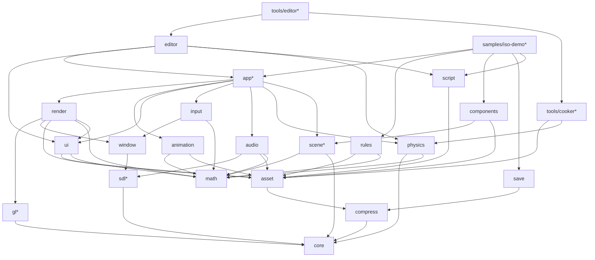

# Jeddy Framework: Architecture & Design

> Status: **Draft v0.1** (2026-10-09). Living document: update it when a decision changes and record why in §17.
> Scope: a Java toolkit for building 3D isometric RPGs in the style of *Pathfinder: Wrath of the Righteous*
> (real-time-with-pause + turn-based combat, party of up to 6, dense lit interiors, AoE spells, fog of war).

---

## 1. Goals and non-goals

### Goals
1. **Performance is the top requirement.** The engine is data-oriented: primitive arrays, struct-of-arrays layout,
   no allocations per frame, multithreaded simulation and command building, and cheap native calls through FFM.
2. **Modular.** Multi-module Gradle build with JPMS modules. Each module is usable on its own and depends only on what it needs.
3. **Native through FFM only.** SDL3, SDL3_mixer, OpenGL, zstd, libktx and meshoptimizer are called through
   `java.lang.foreign` (Panama). There is no JNI code and no third-party Java binding library.
4. **Genre-specific.** Physics, input, camera, rendering and tooling are shaped for isometric CRPGs, not for every kind of game.
5. **Offline asset pipeline.** Source assets (glTF, PNG/TGA/HDR, OGG/WAV) are cooked into GPU-ready, compressed, memory-mappable formats.

### Non-goals (for now)
- macOS, mobile and consoles. Vulkan/D3D12 backends (the renderer is GL 4.6-only at first; §9.8 keeps the door open).
- Rigid-body simulation, ragdolls and destruction (pure-Java *gameplay* physics only, §11).
- A general-purpose editor. Debug UI comes later; a level editor is out of scope.
- Networking/multiplayer.

### Confirmed decisions (from the kickoff Q&A)
| # | Decision | Choice |
|---|----------|--------|
| D1 | Platforms / graphics API | **Windows x64 + Linux x64, OpenGL 4.6 core** (DSA, MDI, compute, SPIR-V capable) |
| D2 | Native bindings | **jextract** for C libraries (generated sources committed) **+ our own GL generator** from Khronos `gl.xml` |
| D3 | Physics scope | **Pure-Java gameplay physics**: kinematic movement, static collision, queries, navmesh, pathfinding, LOS. No rigid bodies |
| D4 | Java features | **Stable APIs only** (no `--enable-preview`, no incubator modules). Math types are **Valhalla-ready** |
| D5 | Perf | Primitive arrays, SoA, job-system multithreading, pools and handles, zero steady-state allocation |

---

## 2. Toolchain baseline (verified 2026-10-09)

| Item | Version | Notes |
|------|---------|-------|
| JDK | **27** (GA 2026-09-15, non-LTS) | FFM final since 22. Compact object headers on by default (JEP 534). Vector API is still incubating (JEP 537), so we don't use it (D4). Value classes (JEP 401) are targeted as a *preview* in JDK 28. Next LTS is JDK 29 (Sep 2027), so plan to move the toolchain forward each release |
| Gradle | **9.8.1** (2026-10-07) | Supports JDK 27 for running Gradle and for toolchains (since 9.8.0). Kotlin DSL, version catalog, configuration cache |
| Toolchain provisioning | `org.gradle.toolchains.foojay-resolver-convention` **1.0.0** | |
| SDL3 | **3.4.18** (2026-10-02) | zlib license |
| SDL3_mixer | **3.2.4** (2026-06-03) | Stable 3.x API (`MIX_*`): tracks, tags, groups, 3D position |
| zstd | **1.5.7** | BSD |
| KTX-Software (libktx) | **4.4.2** stable (5.0 is pre-release) | Tools only. UASTC encode, transcode to BC7/BC5/BC4, zstd supercompression |
| meshoptimizer | **1.2** | Tools only. Vertex cache, overdraw and fetch optimization, simplification (LODs), meshlets |
| jextract | build from `openjdk/jextract` master (needs JDK 23+ and libclang), or the latest prebuilt | Used *offline* only. Generated code targets the final FFM API, so it runs on JDK 27 |
| Tests | JUnit 6.0.1 (BOM) | Plus `junit-platform-launcher` at test runtime, which Gradle 9 requires |
| Benchmarks | JMH 1.37 | Wired by hand in the `jeddy.jmh` convention plugin (a `jmh` JavaExec task). No third-party Gradle plugin |

---

## 3. Module map

### 3.1 Modules

`*` = module added beyond the original request, because the requested ones need it (see the rationale column).

| Gradle project | JPMS module | Responsibility | Depends on | Rationale |
|---|---|---|---|---|
| `core` | `dev.jeddy.core` | Primitive collections, handles, pools, off-heap memory, job system, native loader, profiler, logging, IDs, config | none | Requested ("core utils") |
| `math` | `dev.jeddy.math` | Vectors, matrices, quaternions, geometry, intersection tests, bulk kernels, RNG/dice, packing | none | Requested |
| `compress` | `dev.jeddy.compress` | zstd through FFM: one-shot, streaming and dictionaries; checksums | core | Requested |
| `sdl`* | `dev.jeddy.sdl` | Raw jextract bindings for SDL3 and SDL3_mixer, exported **only** to window, input, audio and app | core | One copy of the SDL bindings shared by four modules |
| `gl`* | `dev.jeddy.gl` | Generated GL 4.6 core bindings, function loader, capability detection | core | Keeps generated code out of `render` and makes it cacheable |
| `window` | `dev.jeddy.window` | SDL video init, windows, displays/DPI, GL context, swap, frame pacing, cursors | core, sdl | Requested |
| `input` | `dev.jeddy.input` | Event pump to lock-free ring, device state, action mapping, contexts, CRPG gestures, gamepads | core, math, sdl, window | Requested |
| `render` | `dev.jeddy.render` | GL resources, frame graph, render packets, MDI submission, PBR, lights, shadows, post, decals, debug draw, the UI draw-list renderer | core, math, gl, window, asset, ui | Requested |
| `asset` | `dev.jeddy.asset` | Runtime side of the pipeline: VFS, `.jpak` archives, async loader, format readers, hot reload | core, compress | Requested ("PBR asset pipeline") |
| `audio` | `dev.jeddy.audio` | SDL3_mixer wrapper: voice pool, buses, 3D emitters, music and ambience | core, math, sdl, asset | Requested |
| `physics` | `dev.jeddy.physics` | Collision BVH, broadphase grid, queries, navmesh runtime, pathfinding, crowd/formations, visibility, triggers | core, math | Added in kickoff |
| `animation` | `dev.jeddy.animation` | Skeletons, baked clips, per-instance animation state (clip, synchronized 1D blend, crossfade), job-parallel pose and skinning-palette evaluation | core, math, asset | Added in M12: characters move like characters. Like `physics`, it knows neither `render` nor `scene`; `app` feeds its palettes and joint matrices to renderables |
| `ui` | `dev.jeddy.ui` | Immediate-mode user interface: element tree, flex layout, SDF text measurement, widgets, draw lists (no GL) | core, math, asset | Added in M13: game screens and the editor from one widget set, in pure Java (§18) |
| `scene`* | `dev.jeddy.scene` | Entity handles, sparse-set component stores, SoA transform hierarchy | core, math | Gameplay needs one authoritative transform store. `app` sync/extract systems copy from it into render, physics and audio, which never depend on `scene` |
| `editor` | `dev.jeddy.editor` | The editor as a library: level model and commands with undo, selection and gizmos, docked panels (outliner, inspector, asset browser, console, dialogue) that any game can embed behind a key | app, ui, physics, asset, script, core, math | Added in M14: level editing and live inspection from the `ui` widgets, in pure Java (§19) |
| `components` | `dev.jeddy.components` | Components and behaviours: the annotations, the store base (sparse set + SoA columns), the view base, the schedule executor on the job system, snapshot I/O; `tools/component-processor` generates the per-game code | scene, asset, core, math | Added in M22: a unified gameplay API without inheritance or reflection (§22) |
| `save` | `dev.jeddy.save` | The save-game container: `.jsave` chunks with versions, the meta block, zstd and CRC-32C, the background job, slots and the user's save directory; knows no game system (each writes itself into `core.io.ByteWriter`) | core, compress | Added in M16: saves as the dynamic state only (§21) |
| `script` | `dev.jeddy.script` | Dialogue and quests: the compiler of the `.dlg`/`.quest` text to a graph with bytecode conditions, the stack-machine interpreter, conversations, quests and journal, flags; reaches the game through `ScriptHost` | core, asset | Added in M17: the narrative layer as text for writers, bytecode for the game thread (§24) |
| `rules` | `dev.jeddy.rules` | The d20 game-mechanics layer: creatures as SoA stats, typed modifiers with stacking, dice and checks, effects as data-driven operation lists, conditions with durations, encounters with initiative and an action economy, real time with pause and turn-based drivers, an event log | core, math, asset | Added in M15: a Pathfinder-1e-shaped core with original names and content, pure Java, deterministic (§20) |
| `app`* | `dev.jeddy.app` | Application lifecycle, thread orchestration, main loop, world integration (scene→render, physics→scene, audio), settings, crash handling | everything above | Ties the leaf modules together so that they stay independent of each other |
| `tools/cooker`* | `dev.jeddy.cooker` | Offline asset cooking: glTF, textures, materials, shaders, navmesh/BVH bake, levels, pak building, CLI and Gradle plugin | core, math, compress, asset, physics + libktx/meshoptimizer bindings | The offline half of "PBR asset pipeline" |
| `tools/component-processor` | `dev.jeddy.components.processor` | The annotation processor: stores, views, loops, registry, schema from `@Component` records and `@Behaviour` classes; JDK only, matches annotations by name | none | A compile-time tool on the processor path; never on the runtime module path (§22) |
| `tools/editor`* | `dev.jeddy.editortool` | The standalone level editor: opens a project (assets and cooked output), runs the `editor` library as its `Game` with the cooker's watch mode | editor, app, cooker | A tool, not a runtime module; games embed `editor` instead (§19) |
| `natives/*`* | (resource jars) | Prebuilt shared libraries per OS/arch with SHA-256 manifest | none | Distribution |
| `bench`* | none | JMH benchmarks for every hot path | all runtime modules | Required to enforce "performance is a must" |
| `samples/iso-demo`* | `dev.jeddy.samples.iso` | Integration demo and perf scene | app, rules, components, save, script | Acceptance target; the only module that depends on `rules` (the editor edits rules content through `asset`'s `RulesSchema`, D97) and the first game of `components` (M22) |

> `dev.jeddy` is the root package and Maven group (confirmed 2026-10-10).

### 3.2 Dependency graph



*(Edges to `core`, and transitive edges, are omitted for readability. The table above is authoritative.)*

**Rules (enforced by `module-info.java`):**
- No cycles, and leaf modules never depend on `app`.
- `physics`, `scene`, `animation` and `render` don't know about each other. `ui` is a leaf like `math`: it computes layouts and draw lists and knows nothing about GL or input devices; `render` draws its lists and `app` feeds it input. `app` (or the game) copies data between them in explicit *sync/extract* systems. This keeps every leaf testable alone and makes the data flow visible.
- Raw binding packages (`dev.jeddy.sdl.ffi`, `dev.jeddy.gl.ffi`, `dev.jeddy.compress.ffi`) are **qualified exports** (`exports … to …`) or not exported. Games use the idiomatic wrappers.
- Runtime modules have **no third-party dependencies**. `tools/cooker` may use some, but so far needs none: images decode through ImageIO plus built-in TGA and Radiance HDR readers, and JSON through `core.json` (D38).

---

## 4. Performance architecture (cross-cutting rules)

These rules apply to every *runtime* module. Code in the per-frame path (anything called from the game loop, render
loop, job kernels or event pump) must follow them. Section 14 explains how CI enforces them.

### 4.1 Data layout
- **Struct-of-arrays (SoA)** for any collection of things processed per frame: `float[] posX, posY, posZ` rather than
  `Unit[]`. Loops over SoA arrays get bounds-check elimination and C2 auto-vectorization (superword).
- **Handles, not references.** Entities, meshes, textures, sounds, nav queries and so on are `int` handles:
  `index (22–24 bits) | generation (8–10 bits)`. Stale handles are detected, data stays in arrays, and the GC never traces object graphs.
- **Dense plus sparse:** component stores are sparse sets (`int[] sparse`, `int[] dense`, plus SoA data columns). Iteration is dense and contiguous.
- **IDs instead of strings:** asset names, events and tags are 64-bit `StrId` hashes (FNV-1a/xxHash64) computed at cook time. Strings exist only in a dev-build name table.
- **Bit sets** (`long[]`) for flags, masks, visibility and fog of war.

### 4.2 Allocation discipline
- **Zero bytes allocated per frame** on the game thread, main/render thread and job workers in steady state. Allocation is allowed during loading, in cold paths and in tools.
- **Banned in hot paths:** boxing, `java.util` collections of boxed types, streams, iterators (`for (x : list)` over `List`), capturing lambdas (non-capturing lambdas are cached singletons and are fine), varargs, `String.format` / concatenation, exceptions for control flow, `Optional`, records/objects created per element.
- **Object pools** are used only where objects must exist (API holders, `MIX_Track` voices, query contexts, upload requests). Pools are **thread-confined** (one per worker, indexed by the `threadIndex` a `JobKernel` receives, or `JobSystem.threadIndex()`) and avoid `ThreadLocal` in inner loops. Small short-lived objects are not pooled, because pooling them hurts generational GCs. Use SoA buffers or scratch fields instead.
- **Scratch objects:** systems own pre-allocated mutable scratch (`MVec3f tmp = new MVec3f()` as a field), so they don't rely on escape analysis.

### 4.3 Memory: heap vs off-heap
| Data | Where | Why |
|---|---|---|
| CPU-side simulation data (positions, nav nodes, BVH) | **Java primitive arrays** | Best JIT treatment: BCE, vectorization, no explicit free |
| Data shared with native code or the GPU (vertex/instance/indirect buffers, SDL events, zstd I/O, file data) | **`MemorySegment` off-heap** | Zero-copy with native code and the GPU |
| Per-frame native temporaries | `FrameAllocator` (custom bump `SegmentAllocator` over one big segment, reset each frame, one per thread) | No malloc/free per frame |
| Long-lived native objects | `Arena.global()` or an explicit `Arena.ofShared()` owned by a subsystem | Deterministic lifetime |
| Asset archives | `FileChannel.map(READ_ONLY, …, arena)` returns a `MemorySegment` | The OS page cache does the IO, decompress reads straight from the mapping |

Rules: never use `Arena.ofAuto()` in engine code (its release depends on GC). Use `Arena.ofConfined()` only in cold paths (each allocation mallocs).
Keep `ValueLayout` and `VarHandle` constants in `static final` fields.

### 4.4 FFM call performance
- Every downcall `MethodHandle` lives in a **`static final` field** (holder-class idiom), so C2 constant-folds it into a direct call. jextract already does this. Our GL generator does it too (§9.1).
- **`Linker.Option.critical(allowHeapAccess)`** applies only to a curated allow-list of *extremely short* functions that never call back into Java: GL state setters, binds and `glUniform*`. With `allowHeapAccess=true` they accept **heap segments** (`MemorySegment.ofArray(float[])`), so small parameter blocks need no copy.
  Draw, sync, map, buffer-data uploads (they can stall on in-use buffers), swap, poll and anything else that can block are **never** critical, because a critical call delays GC safepoints.
- Measured (M3-05, `FfmBench`/`GlBench`, see `bench/README.md`): a regular downcall costs about 13 ns more than a critical one (16.5 vs 3.6 ns for a trivial C function); a `mat4` upload from a `float[]` through a critical call with heap access is as cheap as from off-heap memory and about 9 ns cheaper than copying off-heap first; the generated `GL46` wrappers cost the same as a raw handle. Under llvmpipe the driver dominates `glUniform*` (33 ns critical vs 37 ns regular), so hardware gains are larger. The allow-list in `gl.properties` stands as designed.
- **In dev builds critical linking is off**, because the synchronous `KHR_debug` callback is an upcall fired *inside* the GL call that raised the message, and an upcall from a critical function can crash the JVM. Holders read a `static final boolean` (`-Djeddy.gl.critical`) when they link, so release builds pay nothing for the switch.
- Heap-segment wrappers for reused arrays are created **once** and cached. `MemorySegment.ofArray` allocates a small object on every call.
- **Few crossings:** batch work per call (multi-draw-indirect, one event poll loop), and skip calls whose inputs haven't changed (state cache, dirty thresholds).
- Upcalls (native code calling Java) only in cold or debug paths, and only the GL debug callback (main thread). **No Java SDL log callback is installed**, because SDL can log from its internal threads (including audio). SDL logs go to its default stderr output. If they are needed in the engine log later, a native shim writes them into a ring buffer. With that rule, no Java code runs on the audio thread.

### 4.5 Concurrency
- A **job system** in `core` runs platform threads (workers = `availableProcessors - 2`, minimum 1). It offers:
  - `parallelFor(kernel, count, grain)`: workers claim chunks with an atomic counter. Simple and very fast for SoA loops.
  - Job graphs with dependency counters (`AtomicIntegerArray`) and continuations, stored as preallocated job *slots* in arrays (no `Runnable` per job).
  - **Help-while-waiting:** a thread waiting on a job executes other jobs instead of blocking.
  - Spin (`Thread.onSpinWait()`), then park (`LockSupport`), for low wake-up latency without burning idle cores.
  - v2 (only if profiling shows queue contention): Chase-Lev work-stealing deques.
- Kernels are stateless singletons or long-lived objects that receive `(begin, end, workerIndex)`. They don't capture per frame.
- **Lock-free handoff:** SPSC/MPMC ring buffers of primitives (`VarHandle` acquire/release). Hot counters are manually padded to avoid false sharing.
- **Virtual threads** only for *blocking IO* (file reads, hot-reload watching). They are never used for CPU work.
- The common `ForkJoinPool` and parallel streams are not used in runtime code.

### 4.6 GC, JIT and startup
- Launcher defaults: `-XX:+UseZGC` (generational), `-XX:+AlwaysPreTouch`, `-Djava.lang.invoke.MethodHandle.CUSTOMIZE_THRESHOLD=-1` (D69) and native access for the Jeddy modules. Games that want a fixed heap add `-Xms = -Xmx` themselves (the launcher sets no heap size). G1 (the JDK 27 default) is the supported alternative. Compact object headers are on by default in 27.
- JIT-friendly code: `final` classes, small hot methods (stay under the inlining thresholds), no megamorphic interface calls in inner loops (switch on an `int` kind instead), `Float.floatToFloat16` intrinsics. Avoid `Math.fma` in kernels: without hardware FMA it falls back to a very slow software path.
- Determinism: all Java floating point is strict (JDK 17+). Gameplay code that needs bit-exact results across machines uses `StrictMath` for transcendentals.
- **Startup:** an AOT cache (JEP 483/514/515: `-XX:AOTCacheOutput` training run during packaging; JEP 516 in JDK 26 made the AOT object cache work with any GC, ZGC included), a `jlink` runtime image and lazy class init of binding holders. Measured (D72), the iso demo's headless first frame with and without the cache: 0.21 s against 0.37 s on a GitHub Linux runner, 0.40 s against 0.72 s on a Windows runner, 0.45 s against 0.75–0.95 s in a 2-vCPU container; with GL on Mesa llvmpipe 1.2 s against 1.67 s. The reference PC is still to measure. GL program binaries are cached per user (D73).

### 4.7 Measuring (no optimization without numbers)
- `bench/` holds JMH benchmarks for collections, math kernels, FFM call overhead, the job system, culling, sort, pathfinding, BVH queries and zstd.
- An **allocation assertion** (`dev.jeddy.testing.Allocations.assertNoAllocation`, in the `:testing` project that every module's tests get) runs the code in rounds of warm-up plus measurement and asserts that `ThreadMXBean.getCurrentThreadAllocatedBytes()` grows by 0 once the JIT has compiled it.
- **Whole-loop soak tests** (the app's main and game threads) sample each thread's counter from a separate monitor thread, so no measuring code sits in the loop. "0 B per frame" means *steady state*: a thread that requests a C2 compilation resolves every not-yet-resolved string literal of that method's class on the spot (HotSpot's `CompileBroker::compile_method` calls `resolve_string_constants`), so the first C2 compile of each hot class allocates a few hundred bytes on the game or main thread (found with JFR and `-XX:-UseTLAB`; C1-only runs show none). Soak tests therefore run uncapped for at least 30k frames per thread, wait until the JIT is quiet, then measure in four windows: a per-frame allocation shows up in every window, so at most one window may show a one-off late-JIT allocation (under 2 KiB in total; seen once on a Windows runner, 296 B in 6M frames). At a capped 60 FPS in production these one-off allocations happen during the first minutes of play; the AOT cache's method profiles (§4.6) shorten that warm-up.
- **Built-in profiler:** `Profiler.begin(int scopeId)` and `end()` write `long` records into per-thread ring buffers. GPU timer queries run with a 2–3 frame delay, so they never stall. There is an in-game overlay, and JFR custom events in dev builds.
- Optional, later: a Tracy client through FFM.

---

## 5. Threading model and frame pipeline

SDL3 requires that `SDL_PollEvent`, `SDL_GL_MakeCurrent` and `SDL_GL_SwapWindow` run on the **SDL main thread**. On
Windows and Linux that is the thread that called `SDL_Init(SDL_INIT_VIDEO)`. So the **main thread owns the
platform layer and all GL calls**, and simulation runs on a separate **game thread**.

```
              frame N                         frame N+1
Main thread   [poll events]->ring  [render packet N-1 → GL submit][swap] [poll][render N  ][swap]
Game thread   [drain input][fixed ticks: gameplay→physics→nav→FoW][variable: anim, camera][extract → packet N] ...
Workers       ████ parallelFor / job graphs for both threads (culling, sorting, MDI build, nav, crowd, FoW, anim) ████
IO (virtual)  file / pak reads, then decode jobs on workers, then GPU upload queue (main thread, budgeted)
Audio (SDL)   native mixing inside SDL3_mixer. No Java code runs here
```

- **Render packets** are triple-buffered and preallocated as SoA (instance transforms, mesh/material IDs, 64-bit sort keys, lights, decals, camera, debug draw). The game thread fills packet N while the main thread renders N-1. They hand off by swapping an index atomically. There are no allocations and no locks held during work.
- The game thread runs **fixed simulation ticks** (**30 Hz**, confirmed; configurable; turn-based mode advances on demand) plus a **variable-rate update** (camera, animation sampling, VFX). Render interpolates transforms between the last two ticks.
- **Workers can write into persistent-mapped GL buffers.** Command building (instance data, indirect commands) runs in parallel on workers. The main thread only issues a few `glMultiDrawElementsIndirect` calls. Preconditions:
  - The **main thread** waits on the region's fence (`glClientWaitSync`; sync calls need the context thread) *before* it dispatches the workers.
  - Workers write disjoint ranges and **never read back** from the mapping, because it is write-combined memory.
  - Workers publish completion through the job system's counter decrement (a locked atomic RMW, which is a full fence). A plain `setRelease` does not order write-combined stores.
- **Main-thread command queue (game → main):** game-thread code never calls main-thread-only SDL functions (`SDL_SetCursor`, `SDL_StartTextInput`/`StopTextInput`, window mode changes, relative mouse mode). It pushes small encoded commands into an `SpscIntRing` that the main thread drains at frame start.
- Input latency: the event is polled on the main thread at the start of frame N and consumed by the game thread in frame N. The main thread renders that result in frame N+1, so latency is about **2 frames plus the GPU queue**. This is acceptable for a CRPG. Hover and cursor feedback can be drawn on the main thread from the newest mouse position to hide it.

---

## 6. Native layer

### 6.1 Libraries
| Library | Used by | At runtime? |
|---|---|---|
| SDL3 | sdl → window, input, audio | yes |
| SDL3_mixer (with its built-in decoders: Vorbis, WAV, FLAC, MP3; Opus optional) | audio | yes |
| zstd | compress | yes |
| libktx (KTX-Software) | cooker | tools only |
| meshoptimizer (built as a shared library) | cooker | tools only |
| mikktspace (tiny C shim library `jeddy_tools_native`) | cooker | tools only |
| OpenGL | gl (pointers loaded through `SDL_GL_GetProcAddress`) | yes (driver) |

### 6.2 Building natives
- `natives/` holds a **CMake superbuild**: FetchContent/ExternalProject with pinned versions and hashes, producing shared libraries for `windows-x64` (MSVC, `/O2`, static CRT where possible) and `linux-x64` (GCC, old glibc baseline such as manylinux_2_28 or Ubuntu 22.04, `RPATH=$ORIGIN`).
- CI builds natives on each OS and publishes them as `jeddy-natives-windows-x64.jar` and `jeddy-natives-linux-x64.jar`, under `/natives/<os>-<arch>/` with `natives.json` (file names, load order, SHA-256, license files).

### 6.3 Loading (`dev.jeddy.core.natives.NativeLoader`)
1. Detect the OS and arch, then read `natives.json` from the classpath/module path.
2. Extract to the cache (`%LOCALAPPDATA%\Jeddy\natives\<sha>` or `$XDG_CACHE_HOME/jeddy/natives/<sha>`). Write to a temp file, verify the hash, then rename atomically. Skip this step if the files already exist.
3. Load **in dependency order** with `System.load(absPath)` (SDL3 before SDL3_mixer). Windows resolves dependencies by module name from libraries that are already loaded.
   `System.load` makes the symbols visible to `SymbolLookup.loaderLookup()`, which is what jextract-generated code uses when no `-l` is passed.
4. Overrides, checked first: `-Djeddy.natives.dir=…` (a directory with its own `natives.json`, as `natives/build.py` writes it), then `lib/jeddy/natives` of the running Java image (packaged games, D71). Both are used in place, and every library's SHA-256 is still verified against the manifest before loading.

**Native access:** the app runs on the module path, and launchers pass `--enable-native-access=dev.jeddy.core,dev.jeddy.sdl,dev.jeddy.gl,dev.jeddy.compress,…`.
Shipped images bake this in with `jlink --add-options`. The `Enable-Native-Access` manifest attribute only accepts `ALL-UNNAMED` and only applies to `java -jar`, so it is not used for named modules.
**Tests:** whitebox unit tests (no `module-info` in `src/test`) run on the classpath, so the convention plugin passes `--enable-native-access=ALL-UNNAMED` to them. Module-path (blackbox) test suites get the named-module list.

### 6.4 Bindings with jextract (SDL3, SDL3_mixer, zstd, libktx, meshoptimizer)
- Curated include lists live in `bindings/<lib>.includes` (generated once with `--dump-includes`, then trimmed to the symbols we use). This keeps the class count and startup time small.
- `./gradlew :sdl:regenerateBindings` is a manual task that needs `jextract` on PATH or `-Pjextract.home`. Its output goes to `src/ffi/java`, which is **committed**. Normal builds never need jextract or libclang.
- Headers are vendored next to the include lists (`bindings/<lib>/include`, pinned to the same commits as `natives/versions.json`), so regeneration does not depend on what is installed on the machine.
- **Portability (D22):** the output is *not* byte-identical across OSes. On Linux jextract maps `int64_t`, `uint64_t` and `size_t` to C `long` (`C_LONG`), which is 32 bits on Windows, where the `C_LONG` initializer throws. So the regenerate task ends with `BindingsPostProcessor` (in `build-logic`), which rewrites `C_LONG` to `C_LONG_LONG` (every 64-bit integer is `long long` on both x64 ABIs), turns `Arena.ofAuto()` into `Arena.global()`, and fails if a bound declaration uses a platform-dependent type (`long`, `wchar_t`, `va_list`). One generated tree serves both platforms. A test in each binding module (`SdlBindingsTest`) initializes every generated class and per-function holder against the shipped natives on the Windows and Linux CI runners, so a missing symbol, a bad descriptor or a non-portable layout fails CI.
- Not bound: callbacks SDL may invoke on its own threads (event filters and watches, timers, hint and log callbacks, audio stream and mixer callbacks), varargs and `va_list` functions, opaque handle structs (they are plain pointers), and platform-only APIs.
- Generated packages are `*.ffi` and stay internal (the cooker's are `dev.jeddy.cooker.ktx.ffi`, `dev.jeddy.cooker.meshopt.ffi` and `dev.jeddy.cooker.shim.ffi`, D40). Hand-written wrappers provide the idiomatic, allocation-free API.
- `BindingsPostProcessor` also repairs jextract 22's indexed accessors of struct array fields, which pass `0L` instead of the field offset to the element var handle and so wrote at the start of the struct (D37).
- jextract doesn't emit `critical` downcalls. The few hot native functions outside GL that need one get a hand-written holder in the wrapper.

---

## 7. `core`

| Package | Contents |
|---|---|
| `collections` | `IntList`, `LongList`, `FloatList`, `IntIntMap`, `LongIntMap`, `IntObjMap<V>`, `IntSet` (open addressing, power-of-two, linear probing, no boxing), `BitSet64`, `SparseSet`, `IntHeap` (binary heap with decrease-key, for A*), `IntRing`/`LongRing` |
| `handle` | `HandlePool` (generational int handles with a free list in `int[]`), `SlotMap<T>` |
| `pool` | `ObjectPool<T>` (array stack, thread-confined, optional reset hook), `PerWorker<T>` |
| `memory` | `FrameAllocator`, `OffHeap` (aligned allocation, `MemoryStats` per category), `Segments` (copy and fill helpers), `CStrings` (cached UTF-8 C strings) |
| `concurrent` | `SpscIntRing`, `MpmcIntQueue` (Vyukov), `PaddedAtomicLong`, `SpinParkWaiter` |
| `job` | `JobSystem` (`parallelFor`, `submit` returning `int` job handles, `threadIndex()`, `threadSlots()`), `JobKernel` (`run(start, end, threadIndex)`), `JobGraph`, `ParallelSort`; per-worker scratch is indexed by the thread index (`pool/PerWorker`) |
| `natives` | `NativeLoader`, `Platform` (OS/arch detection) |
| `profile` | `Profiler`, `ScopeIds`, `FrameStats`, JFR events (dev) |
| `log` | `Log`: level-gated, lazy formatting, async ring buffer to console/file |
| `id` | `StrId` (64-bit hash), `NameTable` (dev only) |
| `config` | `Settings`: a small TOML-subset reader and writer. User settings and engine config |
| `time` | `TimeSource` (`System.nanoTime`, or the SDL performance counter through `window`), `FixedStepper` |

The single-writer containers are not thread-safe. Thread ownership is part of every API's Javadoc.

---

## 8. `math`

### 8.1 Three layers
1. **Value types**: `record Vec2f/Vec3f/Vec4f/Quatf/Mat3f/Mat4f/Aabb3f/Ray3f/Planef/Spheref/Capsulef`.
   They are immutable, `final`, have no identity-sensitive operations, and implement no interfaces that need identity.
   When JEP 401 is final they become `value record` with a one-word change. They are for APIs, configuration and gameplay code that isn't per-element.
2. **Mutable scratch types**: `MVec3f`, `MQuatf`, `MMat4f` (final, `dest`-style methods returning `this`). They are for per-frame code that needs zero allocation without relying on escape analysis, such as cameras, controllers and builders.
3. **Bulk kernels**: `Vec3Ops`, `QuatOps`, `Mat4Ops`, `AffineOps`, `CullOps`. These are static methods over `float[] + offset` (and `MemorySegment`) for SoA data, for example
   `AffineOps.composeTRS(px,py,pz, qx,qy,qz,qw, sx,sy,sz, int start, int end, float[] out)` or
   `CullOps.spheres(float[] planes, float[] cx, float[] cy, float[] cz, float[] r, int start, int end, int[] out, int outOffset) → int`.
   Every per-entity hot path uses these.

### 8.2 Conventions
Right-handed, **Y-up**, column-major matrices (GL), radians, `float` everywhere (CRPG maps are small). Affine transforms are stored as **row-major 3×4 (12 floats)**: three rows `[r0c0 r0c1 r0c2 tx | ...]`, the same layout as GPU instance data (three `vec4`), so world transforms are copied, never converted.
Projection builders: **reversed-Z** infinite perspective (used with `glClipControl(GL_LOWER_LEFT, GL_ZERO_TO_ONE)`) and orthographic. There is an `IsoCamera` math helper (yaw, pitch, distance, zoom, narrow FOV or ortho).

### 8.3 Contents
- Intersection: ray–AABB (slab), ray–triangle (watertight), ray–sphere/capsule/cylinder, sphere–AABB, **cone–sphere and cone–cylinder** (AoE), frustum–AABB/sphere, segment–circle (threat zones), 2D segment intersection, point-in-polygon.
- 2D geometry for navigation: convex polygon operations, ear-clipping triangulation, polygon offsetting.
- Packing: half-float (`Float.floatToFloat16`), octahedral normals, snorm/unorm 8/16, RGBA8, sRGB↔linear.
- `Rng`: xoshiro256** seeded by SplitMix64. State is 4 `long`s, so it is trivially saved and loaded. Dice helpers (`d(20)`, `roll(n, sides, mod)`), weighted picks, separate streams per subsystem.
- Easing and interpolation, value noise and simplex noise (VFX).
- Every kernel has a reference test against a `double` implementation and a JMH benchmark.

---

## 9. Graphics: `gl` and `render`

### 9.1 `gl`: generated bindings
- The generator (`GlGenerator`, Java, in `build-logic`) runs as the cacheable, configuration-cache-safe task `:gl:generateGlBindings` (convention plugin `jeddy.gl-bindings`). It reads a vendored `bindings/gl/gl.xml` (pinned Khronos commit, recorded in the properties file) and `bindings/gl/gl.properties` (API `gl`, profile `core`, version `4.6`, extra extensions, the critical allow-list, offset parameter names).
- It emits `dev.jeddy.gl.ffi.GL46` (a qualified export to `render`, `app` and samples) with `static final` constants and static methods that take Java primitives and `MemorySegment` pointers. Each method calls a **`static final MethodHandle` held in a per-command holder class**. Holders initialize on first use, after `GLLoader.init(window::glProcAddress)`, which makes the handles JIT constants. The generated wrapper adds no measurable cost over a hand-held handle (M3-05).
- Type mapping that keeps per-frame calls allocation-free: `GLsync` is a `long` address (a returned pointer would allocate a `MemorySegment`), `GLboolean` is `boolean`, and commands whose untyped `void *` parameter is conventionally a buffer offset or a client pointer (`indices`, `indirect`, `pointer`, `offset`, `data`, `pixels`) get a second overload taking a `long`: a buffer offset when a buffer is bound to the matching target (`glDrawElements(mode, count, type, 0L)`, PBO uploads), otherwise a raw native address (`glNamedBufferSubData(buf, off, size, segment.address())`) (D29).
- Commands that only an extension provides link through `GLLinker.link(..., extension)` and become a throwing handle when the context lacks the extension. The address alone cannot tell: GLX returns a stub for any `gl*` name (D24).
- `GLCapabilities` holds the version, the extension set, limits and the driver family (for workarounds), read once at startup. `GLShaders` compiles and links with the info log in the exception.
- When enabled (`GpuTestContext` in tests, `hello-triangle` with `-Djeddy.gl.debug=true`), `GLDebug` (`KHR_debug`) sets a synchronous debug callback (an upcall created once) that logs with a Java stack trace pointing at the offending call, and labels objects and debug groups. Critical linking must be off in that mode (`-Djeddy.gl.critical=false`, §4.4); `GLDebug.enable` refuses otherwise.
- Extensions needed beyond 4.6 core are listed explicitly in `gl.properties`: `GL_EXT_texture_compression_s3tc` and `GL_EXT_texture_sRGB` (BC1–3, only if ever used), `GL_ARB_bindless_texture`, `GL_KHR_parallel_shader_compile`.
- Output is generated at build time (`build/generated/sources/gl`), so it is not committed.

### 9.2 Render architecture
- **Resource layer:** handle-based buffers, textures (core formats BC4/BC5 (RGTC) and BC6H/BC7 (BPTC), RGBA16F, depth; BC1–3 only through the S3TC extension), samplers, framebuffers, programs and pipeline-state objects, all DSA (`glCreate*`, `glNamed*`, `glTextureStorage*`). A **state cache** removes redundant binds.
- **Memory:** a big **mega vertex/index buffer** per vertex layout, sub-allocated with a free list. Index type is u32. Positions are a separate stream (depth/shadow passes read 12 B per vertex). Attributes are 16 B: a QTangent (normal, tangent and handedness in four snorm16, D27) and half-float UV0/UV1. Skinned meshes add a skin stream (16 B: four `u16` joints, four `unorm16` weights) parallel to the vertex space, created with the first skinned mesh (D80).
- **Known limitation: mirrored instances.** An instance transform with a negative determinant (a mirrored prop) flips the triangles' winding, and the culled pipelines (`PipelineState.OPAQUE` culls back faces) then cull its front faces. The shaders already fix normal and tangent signs (`jeddyMirrored`); the draws would also need a front-face flip, for example a sort-key bit that splits mirrored instances into batches drawn with `glFrontFace(GL_CW)`. Not done yet (backlog).
- **Dynamic data:** persistent, coherent mapped buffers (`glNamedBufferStorage` and `glMapNamedBufferRange` with `GL_MAP_WRITE_BIT | GL_MAP_PERSISTENT_BIT | GL_MAP_COHERENT_BIT`). They are triple-buffered and fenced with `glFenceSync` / `glClientWaitSync`, which only waits if the GPU is 3 frames behind.
- **Uploads:** a persistent-mapped staging ring (for example 64 MB). Asset decoders write directly into it, then `glCompressedTextureSubImage*` / `glCopyNamedBufferSubData` copy from it, within a **per-frame upload budget**.
- **Submission:** render items are 64-bit sort keys in `long[]`, sorted by a parallel radix sort (`ParallelSort`). Opaque keys are `pass(4) | program slot(12) | mesh(20) | LOD(4) | submesh(8) | depth front-to-back(16)`, so identical draws become runs; translucent keys are `pass | depth back-to-front(32) | program slot | submesh` and never merge (D30). Workers turn batches into `DrawElementsIndirectCommand`s directly in mapped memory. Per-instance data (3×4 transform, material index, flags) and per-material data live in SSBOs, indexed by `gl_DrawID` / `gl_BaseInstance`.
  The result is a few `glMultiDrawElementsIndirect` calls per pass.
- **GPU-driven static scene (M7-11, D49):** instances flagged `FLAG_STATIC` are uploaded once per `staticVersion` into (program slot, mesh, submesh) bins with one indirect command per LOD. Per view (main camera, sun cascades) a compute pass culls each (instance, submesh) item, picks its LOD and appends its record; a second pass packs each slot's non-empty commands, drawn with one `glMultiDrawElementsIndirectCount` per slot. Per frame the CPU only copies the flags and camera-fade arrays. Blended static instances stay on the CPU path (they need sorting).
- **Textures and materials:** the baseline is **texture arrays bucketed by (format, width, height, levels)** with material SSBO indices: a material row is 32 floats (factors, UV transform, alpha cutoff, and the array layer of each texture slot), and the program slot of a material is (program, feature mask, texture set), where a texture set names the bucket bound for each of the 5 material texture units (D41). `ARB_bindless_texture` is an optional fast path, decided by a spike plus an ADR (M5-11, `docs/adr/0001-texture-binding.md`, proposed until measured on NVIDIA, AMD and Intel).
- **Shaders:** GLSL 4.60 sources with an `#include` preprocessor (`asset.shader.ShaderPreprocessor`, shared by the runtime `ProgramCache` and the cooker's checks, D34). Permutations use 64-bit feature masks. A **program binary cache** on disk (`glGetProgramBinary`, keyed by driver and source hash) handles fast startup. Compilation is async where `KHR_parallel_shader_compile` exists.
- **Frame graph v1:** declarative passes with transient textures pooled by descriptor and automatic barriers (`glMemoryBarrier` between compute and graphics). Passes are declared once and the graph is compiled per resize: unused passes are culled, reads without an earlier writer are rejected, and barrier bits are computed per pass from how it reads what a compute pass wrote (texture fetch, storage, indirect, image). Attachments are transient textures (the backbuffer only alone); there is no transient aliasing yet (D32).
- **Debug and profiling overlays:** `DebugDraw` (§9.5) and a screen-space `Overlay` whose text uses a 5×7 font table in a storage buffer, so overlays need no font asset (D31).

### 9.3 Passes
`SceneRenderer` declares them once as frame-graph passes, in this order:
1. Light and decal cluster assignment (compute; thousands of lights, because spells light up scenes); GPU culling of the static scene for the main view (D49)
2. Shadows: directional (stable, sphere-fitted 2–4 cascades with texel snapping, 3×3 PCF), spot/point **shadow atlas** of 256² tiles (6 per point light) with a per-light **static-caster cache** copied before dynamic casters are drawn (D44)
3. Depth prepass (opaque, position stream only; camera-fade dither)
4. GTAO (half-res, depth-aware blur) → AO texture
5. Opaque forward+ PBR (GEQUAL against the prepass, no depth writes, D42): glTF metallic-roughness, GGX/Smith/Schlick with multiscatter compensation, IBL (prefiltered specular cube, SH9 irradiance, GPU-generated BRDF LUT), **clustered decals** (selection circles, AoE templates, textured marks), camera fade, fog-of-war darkening
6. Sky/background
7. Transparent (blended materials, back to front) and GPU particles (compute simulation, soft sprites)
8. Outline/highlight (hover, selection, hostile, Alt-highlight of interactables) from a style + occlusion mask, as a display-space overlay
9. Post: bloom, GPU auto exposure, tonemap (AgX/ACES), color-grading LUT, overlay, FXAA (SMAA/TAA later) (D46)
10. UI and debug overlay

Bindings shared by the lit passes:

| Kind | Binding | Content |
|---|---|---|
| UBO | 0 | frame constants (`engine/frame.glsl`, 544 B: matrices, eye, viewport, cluster params, sun, environment, counts, reveal points, fog bounds) |
| UBO | 1, 2 | sun cascades, SH9 irradiance |
| SSBO | 0, 1 | instance records, materials |
| SSBO | 2, 3, 4, 6, 7 | lights, cluster ranges, cluster items, decals, cluster bounds |
| SSBO | 5, 8 | exposure state, local shadow views |
| SSBO | 9 | skinning palettes (D80) |
| SSBO | 12, 13, 14 | particles, particle lists, emitters |
| Texture | 0–4 | material arrays (base color, normal, ORM, emissive, occlusion) |
| Texture | 5, 6, 7, 8, 9, 10, 12 | environment cube, BRDF LUT, sun cascades, shadow atlas, AO, decal textures, fog of war |

The camera fade dissolves surfaces with a 4×4 ordered dither (same pattern in the prepass and the lit pass, so no sorting): a per-instance fade (a roof while the party is inside) and, for `FLAG_FADE_OCCLUDER` instances, circles around up to 4 reveal points in the line of sight (D48).

### 9.4 Isometric camera
Perspective with a narrow FOV (about 30–35°) or orthographic, with yaw rotation, zoom, edge/drag panning, and clamping to the level bounds. It produces the view/projection plus the frustum planes for CPU culling, as SoA `CullOps`.

### 9.5 Debug draw
Immediate-mode lines, boxes, spheres, capsules, polygons and text that write into primitive buffers. It is available to physics, navigation and gameplay from any thread through per-worker buffers merged at extract time.

### 9.6 GPU profiling
`glQueryCounter(GL_TIMESTAMP)` pairs per pass in a ring, read 3 frames later.

### 9.7 Testing
Pure CPU parts (sorting, packets, allocators) have unit tests. GL tests are tagged `@Tag("gpu")`; `./gradlew test -Pjeddy.gpuTests=true` adds them and `=only` runs just them. The CI `gpu` job runs them under Xvfb with Mesa llvmpipe and `MESA_GL_VERSION_OVERRIDE=4.6` (llvmpipe implements GL 4.5 plus most of 4.6; the override lets the 4.6 core context be created). That catches binding, loader and API-usage errors; performance and driver-specific behaviour still need real GPUs (locally or a self-hosted runner, M10).

### 9.8 Future backend
`render` keeps GL-specific code behind the resource and pass layer, so a Vulkan backend (through FFM) stays possible. No abstraction is built for it now.

---

## 10. Assets: `asset` (runtime) and `tools/cooker` (offline)

### 10.1 Cooked formats (all little-endian, versioned headers, sections aligned to 16/64 B for direct upload)
| Format | Content |
|---|---|
| `.jmesh` | Header, bounds, submeshes, LODs (index ranges), vertex streams (pos f32x3 / attr 16 B / skin), u32 indices, meshlets (future) |
| `.ktx2` | Standard KTX2. **BC7** (base color sRGB, ORM, emissive), **BC5** (normals, Z reconstructed), **BC4** (masks), RGBA16F cube maps (HDR environment: GGX-prefiltered mips, SH9 irradiance in the `jeddy.sh9` key; BC6H later), RG16F (`engine/brdf_lut.ktx2`). Full mip chain. **zstd supercompression per level** |
| `.jmat` | Shading model ID, feature mask (engine bits 0–15 derived from textures, alpha mode, UV transform; custom bits 16–31), factors, texture `StrId`s, alpha mode, double-sided |
| `.jscene` | v1: node hierarchy (parents first) with local TRS, mesh and light references, punctual lights, and skins and animations kept raw (D39). Later versions add material overrides, decals, trigger volumes and nav/collision refs |
| `.jcol` | Flattened static collision BVH plus triangle data and per-triangle flags |
| `.jnav` | Navmesh tiles per agent size class |
| `.jvis` | Occlusion grid for LOS and fog of war |
| audio | `.ogg` / `.wav` stored *uncompressed* in the pak (already compressed) |
| `.jpak` | Archive: header, then TOC as SoA (`long[] id` sorted, `long[] offset`, `int[] stored`, `int[] raw`, `int[] crc32c`, `byte[] codec`), optional name table, then 4 KB-aligned data |

Byte-level specs: `docs/formats/jpak.md`, `jmesh.md`, `jmat.md`, `jscene.md`, `ktx2.md` (the supported KTX2 subset).

### 10.2 Runtime (`asset`)
- **VFS:** mounted loose directory (dev, hot reload) plus `.jpak` files (`FileChannel.map`). Later mounts override earlier ones. Each pak's TOC is a binary search on `StrId`; the VFS merges all mounts into one immutable `long → int` hash index, rebuilt and republished (volatile) when mounts change, so a lookup is one hash probe (≈9 ns) and lock-free. `unmount` waits for reads in flight on that mount before unmapping (D25). Asset paths are normalized (`AssetPaths`: forward slashes, lower case) before hashing.
- **AssetManager:** generational `int` handles (one `HandlePool`, typed through `AssetType<T>`), ref counts, state bytes (`Unloaded|Queued|Loading|Uploading|Ready|Failed`, release/acquire), dependencies declared while decoding (material → textures; loaded with the parent's priority, released with it) and priorities (lower loads first, e.g. distance to camera). Slots are fixed-size SoA arrays, so idle frames allocate nothing.
- **Pipeline (D26):** request (owner thread) → schedule: the most urgent queued asset gets a region of the **staging ring** (64 MiB default; assets larger than half of it get dedicated memory) while fewer than `maxInFlight` loads run → IO on a virtual thread (loose files are read into staging; pak entries are prefetched with `MemorySegment.load()` so workers don't fault on disk) → decode job on the `JobSystem` (zstd decompresses from the mapping **directly into the staging region**, then `AssetLoader.decode`) → `pumpUploads(budget)` on the main thread for GPU types → `Ready` (release-store) → completion on the owner thread frees staging and loads dependencies.
- Readers are zero-copy views over segments where possible (`Ktx2.decodeLevel` decompresses a level straight into the destination; `MeshData` streams are slices of the file memory).
- **Hot reload (dev):** the cooker runs as a separate process in watch mode (`jeddy-cook --watch`) and writes into the mounted loose *cooked* directory. `asset` only watches that output directory (`AssetReloader`, a `WatchService` thread with a debounce) and swaps reloaded data in place behind the same handle: the asset stays `Ready` with the old value until the new one is decoded and uploaded, then the value is swapped, the old one unloaded and `AssetType.version` incremented. A failed reload keeps the old value. `asset` never depends on the cooker, which avoids a module cycle.

### 10.3 Cooker (`tools/cooker`)
- **Entry points:** the `jeddy-cook` CLI (`cook` with `--watch`, `--force`, `--prune`; `pak`) and the Gradle plugin `dev.jeddy.assets`, whose `cookAssets` and `packAssets` tasks run the CLI on the cooker's module path (configuration-cache safe; in this repository the cooker comes from `:cooker`).
- **Settings:** a JSON sidecar per source (`<file>.meta`) merged over `_defaults.meta` files from the source root down to the file's directory (nearer wins): texture `kind` (`color`, `linear`, `normal`, `mask`, `environment`), `maxSize`, `alphaCutoff`, `uastcLevel`, `minPsnr`, mesh `lods`/`lodRatio`/`lodError`/`tangents`, glTF `excludeNodes` (name globs; the subtrees lose mesh, light and skin, D104), shader `permutations`, and `importer` to force (or with `none` skip) an importer. A source that loads another source's settings (a level loading a kit) depends on every settings file they were looked for in, present or absent, so a sidecar that appears later recooks it.
- **Incremental and parallel (D35):** one job per source on the job system (importers fan out further, e.g. a glTF's meshes and textures). A content-addressed cache keyed by `sha256(cooker version, importer name and version, source path, canonical settings, source bytes)` stores each output once by its own hash. Dependencies an importer reads (a glTF's external buffers and images, shader includes) are recorded with their hashes and checked on a hit. Outputs are written atomically and only when their bytes changed, so the runtime reloader sees each change once; outputs a source no longer produces and those of deleted sources are removed. `state.json` remembers each source's outputs and dependencies for that and for watch mode. Two sources producing the same output both fail. A failed source keeps its previous outputs. `report.json` and `report.html` list every source with its status, time, warnings and statistics (texture format, PSNR, SSIM, UASTC level; mesh vertices, triangles, LOD triangles and errors, ACMR, ATVR, overdraw; shader permutations compiled).
- **Importers** (first match wins): glTF, hand-written materials (`*.jmat.json`), HDR environments, `.cube` color-grading LUTs (3D KTX2), textures, shaders, and a copy importer for audio, fonts and data files. The BRDF LUT is a built-in output without a source.
- **glTF 2.0** (`.gltf`/`.glb`): meshes, PBR metallic-roughness, `KHR_texture_transform`, `KHR_materials_emissive_strength`, `KHR_lights_punctual`, node hierarchy → `<name>.jscene` plus `<name>/<mesh>.jmesh`, `<name>/<material>.jmat` and `<name>/<image>_<usage>.ktx2`. The glTF *claims* its external buffers and images: they are its dependencies and are not cooked on their own (unless `"standalone": true`). Textures are cooked per (image, usage, wrap, alpha cutoff): base color and emissive BC7 sRGB, normal BC5, occlusion + roughness + metallic packed into one BC7 ORM (resampled to the metallic-roughness size), or occlusion alone as BC4 in its own slot when it reads a different UV set. Only nodes reachable from the default scene are kept, ordered parents first. Skins and animations are stored raw in the `.jscene` for a future animation module.
- **Mesh:** flat normals where the source has none, MikkTSpace tangents (per corner, then re-welded; the bitangent sign is flipped to glTF's convention, D33), weld, meshoptimizer (vertex cache, overdraw, vertex fetch), LODs through `meshopt_simplify` with their geometric error, quantization (QTangent, half UVs), bounds. One submesh per primitive, one material slot per distinct material.
- **Texture:** decode (ImageIO, plus built-in TGA and Radiance HDR readers, D38), **mip generation in Java** (linear space, Kaiser filter, normal renormalization, alpha-coverage preservation; rows in parallel; libktx doesn't generate mips with the Basis encoder), then libktx `ktxTexture2_CompressBasisEx` (UASTC, optional RDO), `ktxTexture2_TranscodeBasis` to BC7/BC5/BC4, `ktxTexture2_DeflateZstd`, `ktxTexture2_WriteToMemory`. UASTC starts at level 0 and is retried one level higher (up to 2) while a color or ORM texture's PSNR is under 40 dB (D36). The usage comes from the `kind` setting or the file name suffix (`_n`/`_normal`, `_orm`, `_ao`/`_rough`/`_mask`, ...).
  The cooker records PSNR and SSIM per texture in its report.
- **HDR environment:** equirect (image center −Z, row 0 up) → RGBA16F cube, GGX-prefiltered mips by filtered importance sampling (`roughness = mip / (levels − 1)`, down to 4×4), SH9 irradiance (already convolved with the cosine lobe) in the KTX2 key `jeddy.sh9`. The split-sum BRDF LUT (RG16F 128², Smith-GGX `k = α/2`) is the built-in output `engine/brdf_lut.ktx2`.
- **Shaders:** stage files are expanded with the runtime preprocessor for every permutation in their `permutations` setting and compiled with `glslangValidator` when it is on the `PATH`; includes become dependencies. The cooked file is the unmodified source (the runtime expands includes and defines itself), so one cooked tree serves every permutation.
- **Physics bakes:** collision BVH, navmesh tiles per size class and occlusion grid (code shared with `physics`, §11; M8).
- **Pak builder:** a layout file (`paks.json`) groups cooked files into paks by glob (first match wins, the rest go to the default pak) with per-pak compression (`auto`, `store`, ...); zstd level 19; a **trained zstd dictionary** per pak from its small entries (materials, scenes, data; already-compressed KTX2 and audio are not samples) when there are enough of them. Every entry is CRC-verified after writing, and `paks.json` in the output lists the paks in mount order.
- **Watch mode** (`--watch`): a `WatchService` over every source directory (new directories are registered as they appear) with a 150 ms debounce; changed files map to the sources to recook through their recorded dependencies, sidecars and directory defaults, and the cook writes into the loose cooked tree that `AssetReloader` watches (D11).

---

## 11. `physics`: gameplay physics for isometric CRPGs

All state is SoA on primitive arrays. Ticks are fixed. Queries are batched and parallel. There is no rigid-body solver.

### 11.1 Static collision
- A **binned SAH BVH** is built at cook time (parallel) and stored flattened: 32-byte nodes `[minXYZ, left/first, maxXYZ, right/count]` in `float[]` with `int` bits. Triangles are `float[] verts` plus `int[] idx` plus `int[] flags`.
- Triangle flags: `WALKABLE`, `BLOCKS_LOS`, `BLOCKS_PROJECTILE`, `CAMERA_FADE` (roofs/walls that fade for the iso camera), `SURFACE_TYPE` (footstep sounds).
- Traversal uses an `int[]` stack, ordered by near child.

### 11.2 Dynamic objects
- Units are **vertical cylinders** (radius from the creature's size class, height). Props are boxes, spheres or cylinders. Everything is SoA.
- **Uniform 2D grid broadphase** on XZ, **rebuilt every tick with a counting sort**: per-worker histograms, prefix sum, then a *stable* scatter (each worker writes its own precomputed offsets). That is O(n + cells), parallel, allocation-free and **deterministic**: the order within each cell is stable, which ORCA and trigger results depend on. It fits mostly-planar iso maps. Multi-floor levels use Y layers.

### 11.3 Queries (single plus batched)
- `raycast` (closest or any) against the static BVH and the dynamic grid, with a layer mask.
- `overlap` for sphere, cylinder, **cone** (cone spells), **line/rect** (lightning bolt), box and polygon prism. Results go into a caller `IntList` of entity IDs.
- `sweepCylinder` (charge, knockback, bull rush) and `lineOfSight(a, b, eyeHeights)`.
- **Picking:** screen ray → closest unit cylinder, interactable or ground point (via the `WALKABLE` triangles or the navmesh).
- `QueryBatch`: SoA inputs and outputs run as one `parallelFor`. Single queries take a reusable mutable `Hit`.

### 11.4 Navigation
- **Bake (cooker), Recast-style in Java:** rasterize walkable triangles into a heightfield, filter (low obstacles, ledges, low ceilings), compact heightfield, erode by agent radius, build a distance field and watershed regions, then contours and convex polygons (≤6 vertices). There is no detail mesh: polygon vertices carry the surface height (D52). The result is **tiles** (for example 32×32 m) baked in parallel; tiles meet at **portal edges** on their sides.
  There is one navmesh per **size class** (Small/Medium/Large/Huge, following Pathfinder sizes). It supports **area types** with cost multipliers (difficult terrain ×2, water, hazard) baked from area volumes, and **off-mesh links** (jumps, ladders, doors, teleports) stored as two-vertex polygons. Where two walkable surfaces meet in a voxel column the higher top's area wins (D51). Closed objects taller than an agent leave unreachable islands inside them, as in Recast; level art closes them or marks them non-walkable.
- **Runtime** (`NavMesh`): tiles are SoA (verts, poly indices, neighbour per edge, area, flags) with a small AABB tree each for nearest-polygon search. Polygons are `int` refs `salt(4) | tile(12) | poly(16)`; removing a tile bumps its slot's salt so stale refs fail `isValid`. Links live in a per-tile SoA pool: internal edges, **partial portal links** (an edge may link to several polygons of the next tile, each over a sub-range), and off-mesh link attachments made when either end's tile loads.
- **Queries** (`NavMeshQuery`, one per thread): nearest polygon, polygon height, closest point, **navmesh raycast** (follows partial portals), `moveAlongSurface` (a small BFS that slides on walls), polygon collection in a box.
- **Pathfinding:** A* over polygons using `IntHeap` with decrease-key and a node pool **reset by generation stamps** (no clearing), node positions at portal midpoints, heuristic scaled by the filter's lowest area cost. Then a funnel (string pulling) with partial portals and off-mesh corners. **Time-sliced** queries (`initSliced/updateSliced/finalizeSliced`, plus a partial variant for corridor re-planning). An unreachable goal returns the corridor to the reached polygon nearest the goal (D55). `NavPathBatch` runs SoA path requests (corridor and corners) as one `parallelFor` with one query per worker. Hierarchical tile-graph pathfinding for long routes comes later.
- **Path corridors** (`PathCorridor`, Detour's design): the agent's polygons to the goal, kept valid as it moves (moved polygons spliced into the start), corners from string pulling, visibility (raycast) and topology (small sliced search) shortening, off-mesh link hand-over, trimming when polygons become invalid.
- **Dynamic changes:** polygon flags (`NavFlags`: `WALK`, `DOOR`, `DISABLED`; default filters exclude `DISABLED`). `NavDoors` maps door boxes to their (area-volume) polygons and toggles `DISABLED` (D56). Temporary obstacles (summoned walls, barricades) go through the **`TileCache`**: it keeps each tile's compact heightfield from before erosion, marks obstacles into a copy (so erosion keeps the agent radius from them), rebuilds the touched tiles on job workers in the background and swaps them into the mesh on the game thread (D54).
- **Crowd** (`Crowd`, structured like Detour's `dtCrowd`): validity checks and repath requests (throttled per tick, solved in parallel), corridor following with turn anticipation, slow-down and arrival, separation (faded with the slow-down, D57), **ORCA** local avoidance (SoA, neighbours from a `UniformGrid` of the agents) instead of Detour's sampled planner (D53), acceleration limits, iterative collision resolution, navmesh-constrained moves, off-mesh link traversal (state and progress for animations), and **stuck detection** (low speed while trying to move → repath, then fail). Every per-agent phase reads others' previous state and writes only its own, so results are identical for any number of workers.
- **Party formations:** slot templates (line, column, wedge, box, circle; editable) relative to the click point and facing, slots pulled back from walls along a navmesh raycast, **slot assignment by minimum total distance** (Hungarian algorithm, so paths never cross), and paced following (`FormationMove`): the member with furthest to go gets catch-up speed, the others slow to arrive together.
- **Turn-based helpers** (`TurnBasedNav`): a **movement-range flood** (Dijkstra limited by the movement budget, area costs included, polygons entered at the closest point of their portal), point costs, a raster of the range for the UI overlay and the boundary polygons; path cost along a string-pulled path split by area; and a **threat-zone crossing query** (where a path enters and leaves enemy reach circles, ordered along the path) for previewing attacks of opportunity.
- **Debug views:** `physics` defines a `DebugSink` (same signature as the renderer's `DebugDraw.line`, so the app passes `debugDraw::line`); the navmesh, crowd, BVH, bodies, triggers and occlusion grid each draw themselves through it without allocating.

### 11.5 Visibility and fog of war
- An **occlusion grid** (for example 0.5 m cells, packed `long[]` bits) baked from `BLOCKS_LOS` geometry.
- Per viewer, **symmetric shadowcasting** on the grid runs in parallel across viewers. Viewers that haven't moved past a threshold are skipped.
- `visible` and `explored` bitsets are combined by OR. They pack into an R8 texture upload (consumed by render, §9.3) and a CPU query `isVisible(x,z)` for AI and stealth.

### 11.6 Triggers and volumes
Convex prisms (polygon footprint and Y range), boxes and spheres. Agents are tested through the grid each tick. **Enter/exit events** are written as `(trigger, entity, kind)` triples into a primitive event buffer, which gameplay consumes (traps, dialogs, area transitions, ambient zones).

---

## 12. Platform: `window`, `input`, `audio`

### 12.1 `window`
- `Platform.init()` calls `SDL_Init(VIDEO | GAMEPAD | EVENTS)` on the **main thread** and records it as the SDL main thread. Calling SDL video functions from another thread fails fast with an assertion.
- A window with GL attributes for **4.6 core** (forward-compatible, a debug context in dev). The default framebuffer is plain RGB8 without depth: the renderer draws into its own targets and the final pass writes sRGB-encoded values itself (D23), `SDL_WINDOW_HIGH_PIXEL_DENSITY` and resizable. It handles window vs pixel size, display enumeration and modes, content scale (DPI) changes, and windowed, borderless and exclusive fullscreen.
- **VSync** off/on/adaptive (`SDL_GL_SetSwapInterval(-1)` with fallback). A **frame limiter** uses `SDL_DelayPrecise` plus a short spin. Rendering pauses when minimized.
- Cursors: a pool of custom color cursors (`SDL_CreateColorCursor`) for move, attack, talk, loot, forbidden and spell targeting, switched by `int` ID. The game thread requests a switch through the main-thread command queue (§5). The window icon, title and message box (for crash reports) also live here.

### 12.2 `input`
- **Event pump (main thread):** `SDL_PollEvent` fills one preallocated 128-byte `SDL_Event` segment. Fields are read through `static final` offsets and encoded into fixed 8-int records in an `SpscIntRing` to the game thread. No objects are created per event.
- **Device state (game thread):** keyboard `byte[]` plus `int[] pressedFrame/releasedFrame` stamps (no per-frame clearing), mouse position/delta/wheel/buttons, up to 8 gamepads (axes `float[]`, buttons).
- **Action mapping:** `int` action IDs, bindings (keys, mouse, gamepad buttons and axes, modifiers, chords such as Shift+Click to queue orders), a **context stack** (UI > Dialogue > Targeting > World > Camera) with consumption rules, rebinding, and persistence to the settings file.
- **CRPG gestures:** click vs drag threshold, double-click, **box selection**, edge scrolling, camera rotate/zoom, hold-to-highlight, pause toggle, and text-input mode for UI fields (`SDL_StartTextInput`/`StopTextInput`, issued on the main thread through the command queue).
- Gamepad support: hotplug, SDL gamepad mapping database, virtual-cursor mode and rumble.
- Input never does picking itself. It outputs screen positions, and `app` or gameplay combines them with the camera and `physics.pick`.

### 12.3 `audio` (on SDL3_mixer)
- One mixer (`MIX_CreateMixerDevice`, opened and closed on the main thread as SDL_mixer requires; `AudioConfig.offline()` uses `MIX_CreateMixer` and `MIX_Generate` for tools and tests). **No Java code runs on the audio thread**, because mixing and decoding happen natively. All control comes from the game thread. `Audio.update` applies each frame's changes inside **`MIX_LockMixer`/`MIX_UnlockMixer`**, which makes them take effect together. Locking does not reduce FFM calls, so we also skip unchanged values (gain and direction thresholds).
- **Loading** (`SoundLoader`, an asset loader): streamed audio (music, ambience, VO; from a size threshold up) uses **`MIX_LoadAudioNoCopy`** over the pak's mapped bytes when the entry is stored uncompressed, which is true zero-copy. The pak mapping must outlive every `MIX_Audio` that points into it, so the clip holds a **`Vfs.Pin`**: unmounting removes the pak from lookups at once but unmaps it only when the last pin closes (D63). Loose development files stream from a native copy. Short SFX are predecoded (`MIX_LoadAudio_IO` over `SDL_IOFromConstMem`, `predecode=true`), which copies the decoded PCM once at load, by design. Pak layouts store audio (it does not compress further).
- **Voices:** N `MIX_Track` objects (for example 64) are created at init. Sounds play into **logical voices** (generation-checked `int` handles, more of them than tracks); each update maps the most important audible ones onto tracks, stealing by priority, then loudness, then age. **Virtual voices** (out of range, or out of tracks) are tracked in Java by time, silent, and resume at the right offset (loop-aware) with a short fade when they get a track back (D60).
- **Buses:** `music`, `sfx`, `voice`, `ambient` and `ui` tag their tracks (`MIX_TagTrack`; pause, resume and stop by bus). Bus gains multiply each voice's gain in Java because `MIX_SetTagGain` sets the tagged tracks' own gain, which would overwrite per-voice and 3D gains (D59). The master uses `MIX_SetMixerGain`. **Ducking** (music under VO) ramps a duck factor while the trigger bus plays. Volumes load from and save to `Settings` (`audio.master`, `audio.music` ...).
- **3D:** emitters are SoA. The listener is the camera focus point and facing. SDL3_mixer's listener is fixed at the origin facing −z (OpenGL convention), so each frame we transform the playing emitters into listener space and pass a **unit** direction: SDL's attenuation is `1 / max(d, 1)` (OpenAL inverse-distance-clamped with reference 1, read from its source), which is exactly 1 at unit distance. The rolloff is ours, applied with `MIX_SetTrackGain`: inverse distance from each emitter's minimum distance, faded to zero at its maximum, so attenuation is never applied twice. `MIX_SetTrack3DPosition` is called only when the direction moved past a threshold.
- **Music system** (`MusicPlayer`): states (exploration, combat, dialogue, area themes) with crossfades (fade-in play option, `MIX_StopTrack` with fade-out frames) and stingers that duck the music while they play.
- **Ambience** (`Ambience`): zone loops entered and left through trigger volumes (`app.audio.AmbienceTriggers` feeds `Triggers` events for the listener's entity; overlapping triggers are counted), plus scheduled random one-shots around the listener on temporary emitters.

---

## 13. `scene`, `app` and `animation`

### 13.1 `scene`
- `EntityPool` (generational handles) and sparse-set component stores with SoA columns (`FloatColumn`, `IntColumn`, `LongColumn`).
- **Transform store:** local position, rotation and scale in SoA, a parent per entity, and world matrices in `float[] world3x4` (dense slots, swap-remove). `update` walks a **depth-sorted traversal order** (an `int` permutation rebuilt by counting sort after structural changes; parents always come before children) one depth level at a time, in parallel on the job system when a level has ≥ 2048 entities. Only dirty entities and descendants of changed ones are recomputed; levels with nothing dirty and no changed parent level are skipped entirely. Dirty flags are a `byte[]` (workers write them in parallel; bits in a shared `long` would race). Static entities are marked for render extraction and cost nothing while unchanged (D28).
- Scope is deliberately small. Gameplay data models (stats, inventory, spells) belong to the game or a later `rules` module.

### 13.2 `app`
- `JeddyApp.run(AppConfig, Game)`: configure, then init (natives, platform, window, GL, subsystems), then run (main thread and game thread loops from §5), then a clean shutdown in reverse order. The game plugs in a `Game` (game thread: `init`, `fixedUpdate`, `update`, `extract`) and a `FrameRenderer` (main thread: `init`, `render`, `shutdown`).
- **World integration (`dev.jeddy.app.world`, M10-02):**
  - `World` (game thread): entities and transforms (`scene`), plus *renderables* (mesh asset, material override, render flags, outline style, group). `instantiate(scene, ...)` spawns a cooked scene under a root entity; with `flatten` only the mesh nodes become entities, parented to the root with composed transforms (characters without an animation system keep ~10 transforms instead of a 50-bone hierarchy); `instantiateAnimated` (§13.4, D81) does the same for animated characters. `NodeFlags` picks flags per node name or leaves nodes out (alternative equipment). Groups (an instantiated root) can be hidden (fog of war) or outlined as a whole.
  - `World.extract(packet)` writes static renderables first in a stable order and bumps `staticVersion` when that set changes (the D49 contract); moving renderables carry the previous tick's transform for interpolation. Statics skip the per-tick copy.
  - `WorldRenderer` (main thread): GL device, mega buffers, shader cache, `SceneRenderer`, the asset manager with mesh, material and texture types, upload pumping under a time budget, mesh→material wiring, the environment cube; then the packet's debug lines and a screen-space `Hud` (overlay text) on top.
  - `WorldAssets`: loaders for `.jscene`, `.jcol`, `.jnav`, `.jocc`. `AgentSync` (crowd → transforms, with a turn rate), `AudioSync` (camera → listener, entities → emitters), `FogOfWarFeed` (visibility → packet), `AmbienceTriggers` (trigger volumes → ambience zones).
- **Ordering instead of a scheduler (D67):** a game calls its systems in an explicit order inside `fixedUpdate` (`world.beginTick`, AI, crowd, sync, collision broadphase, visibility, `world.updateTransforms`), and each system parallelizes internally on the job system. A declarative system DAG is in the backlog until a game needs systems written by several teams.
- **Explicit wiring** with no reflection or DI container. `Settings` (TOML subset) covers graphics, audio, input bindings and gameplay.
- Crash handling: uncaught exceptions on any engine thread log, dump profiler rings and show an SDL message box.

### 13.3 The iso demo and the perf capture (M10)
- `samples/iso-demo`: a KayKit crypt (CC0, fetched from pinned commits and assembled by `tools/kaykit.py` into a prefab library glTF plus a `.jlevel` of placements, and character files, D68) with a six-member party, 64 skeletons, formations, box selection, fireballs (decal template, overlap query, light, particles, positional sound), fog of war, torches with shadows and a turn-based movement-range overlay. Sounds are synthesized by `tools/sounds.py`.
- `--perf SECONDS` scripts it (formation tours, wandering skeletons, a fireball every 1.5 s, an orbiting camera; 300 agents, 16k extra static props, 256 point lights with 4 shadowed) and `PerfCapture` measures after a warm-up in time, frames and gameplay: per-frame game and main thread CPU, GPU time per frame-graph pass, allocated bytes of the game, main and worker threads, and GC counts and pauses. It writes `perf.json` and `perf.md` against the §14 budgets; `--fail-on` turns budgets into an exit code for CI. Steady-state allocation is judged on the second half of the window (D66); an allocating frame that coincides with a C2 compile in the run's JIT log is reported as JIT warm-up instead of failing (D70); `--alloc-probe` attributes game-thread bytes to the systems of a frame and lists the second half's allocating frames by system. The capture also checks that the JVM runs with the launcher flags (`flags`). CI adds a class-load log (classes loaded in the second half are late linkage) and, on request, JFR allocation stacks (`.github/scripts/late-classes.py`, `alloc-stacks.py`).
- `--headless` runs the game thread on CPU-only meshes (`MeshAssets.registerHeadless`) with no GL context, so CI measures the game thread budget and allocation on plain runners; GPU numbers need real hardware.

### 13.4 `animation` (M12)
- **Skeleton** (`Skeleton.of(scene, skin)`): the joints of one glTF skin in skin order (the joint indices of the mesh skin stream), each with its parent joint, bind-pose local TRS and inverse bind matrix (3×4, converted from glTF's column-major 4×4), plus a static *pre-transform* that folds in the non-joint nodes between a joint and its nearest joint ancestor (or the scene root: an armature node with a rotation or a 0.01 scale). Joints are evaluated in scene-node order, which is parents first. Joint names hash to `StrId`s for lookups (attachments, clip binding).
- **Clips** (`Clip.bake(library, animation, skeleton, rate, lockJoint)`, or `Clip.bake(library, name, skeleton)` at 30 Hz without a lock): the raw glTF channels kept in `.jscene` (D39) are resampled at load time, at a fixed rate (30 Hz default), into one contiguous block per frame of joint-local TRS (10 floats per joint). Joints the clip does not animate keep the bind pose; linear channels resample with lerp/slerp, step and cubic-spline channels exactly at the sample times; rotations are kept in one hemisphere from frame to frame. Channels bind to joints **by node name**, so one animation library (a `.jscene` holding a rig and its clips, no meshes) serves every character with that rig. Sampling is two frames and a lerp/nlerp per joint: no key search, sequential memory, about 1.2 KB per joint-second (D79). An optional root lock keeps a joint's horizontal translation at its first frame (clips play in place; crowds and gameplay move the character).
- **Instances** (`Animations`, SoA, game thread): up to `maxInstances` skeleton instances with joint ranges in flat `float[]` arrays sized at creation. Each instance plays a **state**: one clip, or a 1D blend of two clips whose normalized times stay in sync (walk/run by speed); with a playback speed, looping or holding the last frame (one-shots, death), and a **crossfade** from the previous state. `update(dt, jobs)` runs per frame (not per tick, so no pose interpolation is needed) in parallel over instances: advance times, sample and blend up to four clip samples per joint (nlerp blending), local → model joint matrices, skinning palettes (model × inverse bind) and a model-space bounding sphere from the joints. Inactive instances (hidden in the fog of war) keep their last pose and cost nothing. Allocation-free after creation.
- **Rendering (D80):** GPU skinning. The skin stream (`u16 ×4` joints, `unorm16 ×4` weights) gets a mega buffer parallel to the vertex space, allocated with the first skinned mesh (16 B per vertex slot), and attributes 4–5 of the shared vertex array. Each frame the packet carries the palettes of the visible instances (`RenderPacket.addPalette`, three rows per joint) and each skinned instance its palette base in flag bits 12–31 (`setPalette`). The renderer uploads them to a frame-ring storage buffer (binding 9); skinned draws use the `SKINNED` variant (engine feature bit 15) of the lit, depth/shadow and outline programs, which blends four palette rows before the instance transform. Skinned materials get their own program slots, prepared on the render thread before the draw build. GPU-driven static instances never skin.
- **World integration (`app`):** a `World` created with an `Animations` pool spawns animated scenes with `instantiateAnimated(scene, x, y, z, yaw, flags, nodeFlags)`: an `Animations` instance per skin (skeletons built once per scene object and shared), and only mesh nodes become entities, all direct children of the root. Skinned meshes get identity transforms (glTF ignores a skinned mesh node's own transform; the palette places the vertices relative to the scene root); mesh nodes under a joint become **attachments** that follow it (weapons, shields, helmets: root × joint model × static offset, composed at extract time for the previous and the current tick so they interpolate with the root); other meshes keep their composed transform. Animated renderables are never static. `updateAnimations(dt, jobs)` runs per frame before `extract`, which adds each visible instance's palette to the packet once, tags its skinned renderables (`setPalette`) and bounds them by the joint sphere plus a skin margin (0.5 m model space, `setSkinMargin`). `setGroupHidden` on the root freezes its instances (fog of war), `destroy(root)` removes them with the root's renderables, and `AgentSync.face` turns a standing agent toward what it attacks.
- **The iso demo (M12-07):** two animation libraries written by `tools/kaykit.py` (each KayKit rig's nodes and the clips the demo plays) are baked once against a skeleton of each rig; the two rigs share one joint layout. The demo's `Animator` drives 300 characters: idle (a combat stance for engaged skeletons), walk/run blended by crowd speed with the playback rate matched to the clips' measured ground speeds, strikes and casts that face their target, hit reactions, deaths holding the last frame (bodies stay 2.5 s) and the skeletons' awakening on respawn. The perf capture reports the animation update (≤ 1 ms p99, enforced by the nightly).
- **Not yet:** root-motion extraction, foot IK, additive layers, animation events, clip compression, GPU-side palette evaluation, asset-type integration for clips (games bake on the game thread at spawn time and cache by rig).

---

## 14. Build and repository layout

```
JeddyFramework/
├─ settings.gradle.kts            # includeBuild("build-logic"), foojay plugin, all projects
├─ build.gradle.kts               # near-empty
├─ gradle.properties              # configuration-cache, caching, parallel, jvmargs
├─ gradle/libs.versions.toml      # all versions (no versions in module scripts)
├─ gradle/wrapper/                # Gradle 9.8.1
├─ build-logic/                   # convention plugins + GL generator + jextract task
│  └─ src/main/kotlin/
│     ├─ jeddy.java-base.gradle.kts      # shared: toolchain 27, --release 27, -Xlint:all,-module,-processing -Werror,
│     │                                  #   JUnit 6, native access for tests, reproducible archives, jeddy-* names
│     ├─ jeddy.java-library.gradle.kts   # java-library + java-base (pure-Java modules keep the `restricted` lint)
│     ├─ jeddy.native-library.gradle.kts # java-library with javac's `restricted` lint off, for FFM modules and modules whose tests load natives (app)
│     ├─ jeddy.ffm-bindings.gradle.kts   # regenerate<Lib>Bindings tasks (jextract), src/ffi/java source set
│     ├─ jeddy.gl-bindings.gradle.kts    # GenerateGlBindings task wired into sourceSets (M3-01)
│     ├─ jeddy.application.gradle.kts    # programs in this repo: launcher flags, natives, packaging (jlink, image, AOT, jpackage)
│     ├─ jeddy.publishing.gradle.kts     # maven-publish as dev.jeddy:jeddy-<name>; GitHub Packages with credentials
│     ├─ jeddy.site.gradle.kts           # aggregated Javadoc site (tools/site)
│     ├─ jeddy.jmh.gradle.kts            # hand-wired JMH `jmh` task
│     ├─ dev.jeddy.assets.gradle.kts     # game projects: cookAssets, packAssets
│     ├─ dev.jeddy.game.gradle.kts       # game projects: application + assets + launcher flags + packaging
│     └─ dev/jeddy/gradle/*.kt           # task and extension classes (Applications.kt, Packaging.kt, ...)
├─ bindings/                      # *.includes for jextract, gl/gl.xml, gl/gl.properties
├─ natives/                       # CMake superbuild + natives-windows-x64, natives-linux-x64 packaging
├─ modules/
│  ├─ core/  math/  compress/  sdl/  gl/  window/  input/
│  ├─ render/  asset/  audio/  physics/  animation/  scene/  app/
├─ tools/cooker/  tools/site/
├─ bench/  bench/baseline/          # JMH and the nightly baseline
├─ samples/iso-demo/  samples/hello-triangle/
├─ samples/game-template/         # a standalone game build (composite), docs/getting-started.md
└─ docs/  DESIGN.md  TASKS.md  getting-started.md  adr/  perf/
```

- `settings.gradle.kts` maps **short project paths** to the nested folders (`include(":core")` with `project(":core").projectDir = file("modules/core")`). Tasks are therefore `:core:test`, `:sdl:regenerateBindings`, `:cooker:run` and `:bench:jmh`.
- Each module script has **one line that applies a convention plugin**, plus its `dependencies {}` block. Artifacts are named `jeddy-<name>`.
- `gradle.properties`: `org.gradle.configuration-cache=true`, `org.gradle.caching=true`, `org.gradle.parallel=true`.
- Extra JVM arguments for a `run` task go through `jvmArgumentProviders`. `jvmArgs(...)` adds to `jvmArguments`, whose application defaults (the launcher flags) are only a convention, and so drops them.
- **CI**: GitHub Actions on [github.com/ilumar589/JEddyFramework](https://github.com/ilumar589/JEddyFramework). `ci.yml` on every push and PR: build and tests on `windows-latest` and `ubuntu-latest` (headless SDL, allocation tests, the asset cook), GPU tests and demo smoke runs on Mesa llvmpipe under Xvfb, the two-minute perf capture (§13.3), packaging on both OSes with a cold-start measurement, the game template as a separate composite build, and JMH smoke runs. `nightly.yml`: full JMH with `-prof gc` against the committed baseline (D77) and the ten-minute perf capture. `docs.yml`: the Javadoc site (D76). `release.yml`: tags `v*` publish and attach the demo images (D74). GPU budgets need real hardware (docs/perf/m10.md, O1).
- Formatting: Spotless with google-java-format (AOSP style), plus `.editorconfig`.

### Packaging, publishing and game projects (M11)
- **Image** (`distImage`, D71): `jlinkRuntime` links the application's modules into a trimmed runtime (`--strip-debug --no-header-files --no-man-pages --compress zip-6`) and extracts the platform's natives into `runtime/lib/jeddy/natives`, where `NativeLoader` looks when `jeddy.natives.dir` is unset. The image adds launchers (`bin/<name>` and `bin/<name>.bat` with the launcher flags and `-Djeddy.app.dir`), the content directories (paks) and `aot/<name>.aot`. `distImageZip` zips it as `<name>-<version>-<platform>.zip`.
- **AOT cache** (D72): `distImage` runs the image once with `-XX:AOTCacheOutput` and the launchers' exact flags, configured by `jeddyPackaging { trainingArguments; trainingJvmArguments; trainingEnvironment }`; `-Pjeddy.aot=false` skips it. The iso demo trains headless, so build machines need no GPU.
- **Installers**: `jpackage` wraps the same image (`--runtime-image`, `--app-content`; `$APPDIR` in the Java options): an app image by default, `-Pjeddy.package.type=deb|rpm|msi|exe`.
- **Publishing** (D74): libraries, the cooker, the natives jars (`jeddy-natives-<platform>`) and the Gradle plugins (`jeddy-gradle-plugins` plus plugin markers) publish as `dev.jeddy:jeddy-<name>` at `jeddy.version` with sources and Javadoc jars: `publishToMavenLocal` for local games, GitHub Packages from the release workflow. Applications keep their natives in a `jeddyNatives` configuration outside published metadata.
- **Game projects** (D75): the `dev.jeddy.game` plugin applies `application` and `dev.jeddy.assets`, compiles for 27, adds the natives and cooker at the plugin's own version, runs with the launcher flags (`run` packs first and sets `jeddy.app.dir=build`) and registers the packaging tasks. `Vfs.contentDirectory` and `Vfs.mountContent` find and mount a game's paks the same way under `run` and in an image. `samples/game-template` is such a project, built by CI as a composite build of the checkout; `docs/getting-started.md` walks through it.
- **Docs** (D76): every library's Javadoc (`-Xdoclint:all,-missing`) feeds `:site:javadocSite` (`tools/site/build/site`) with an index page; module READMEs give the key types and threading of each module.

### Perf budgets (to calibrate in M10; reference PC: 8-core desktop CPU, GTX 1660 / RX 6600 class, 1080p, 60 FPS)
| Budget | Target |
|---|---|
| Game thread per frame (300 active agents, pathing, avoidance, FoW) | ≤ 8 ms |
| Animation update (300 KayKit rigs, job system), within the game thread budget | ≤ 1 ms |
| Main thread CPU (20k visible instances) | ≤ 5 ms |
| GPU (256 dynamic lights, 4 shadowed, full post) | ≤ 12 ms |
| Steady-state allocation (game, main and worker threads) | **0 B/frame** |
| GC pauses (ZGC) | < 1 ms |
| Area load (1 GB cooked, SSD) | ≤ 3 s, and no frame > 33 ms while streaming |
| Cold start to first frame (AOT cache) | ≤ 1.5 s |

---

## 15. Risks and mitigations

| Risk | Mitigation |
|---|---|
| jextract's prebuilt releases are infrequent | Commit generated sources. Build jextract from source when regeneration is needed. Only the regenerate task needs it |
| GL driver differences (Intel, Mesa) | Baseline texture arrays (bindless optional), a capability matrix, and GPU test runs on NV/AMD/Intel plus Mesa |
| GL submission is single-threaded on the main thread | MDI, workers fill mapped buffers, GPU culling, and the state cache |
| No value classes yet (JEP 401 is preview in 28) | Three-layer math (§8.1). Migrate records to `value record` once final |
| Vector API still incubating | Rely on C2 auto-vectorization of simple SoA loops. Revisit when final |
| Navmesh baker is a big subsystem | Follow Recast's published algorithm closely (zlib-licensed reference). Time-box it, with an early milestone on simple maps |
| JDK 27 is non-LTS (superseded March 2027) | Bump the toolchain each release. Target JDK 29 LTS for 1.0 |
| Java code on real-time threads causes audio glitches | SDL3_mixer mixes natively. We never install Java audio callbacks |
| Native packaging (glibc versions, DLL lookup) | Old-glibc build image, `$ORIGIN` RPATH, explicit load order, hash-verified extraction |

---

## 16. Future modules (not scheduled)
- `animation` beyond M12 (§13.4): root-motion extraction, foot IK, additive layers, events, clip compression.
- `rules`: Pathfinder-like stats, dice, conditions, initiative, turn-based combat flow.
- `vfx`: authoring for GPU particles.
- Tracy profiler integration, LZ4 for faster decompression if zstd becomes the bottleneck, BC6H through KTX v5.

## 18. `ui`: immediate-mode interface (M13)

**Roles.** One widget set serves the game's screens (portraits, inventory, dialogue, tooltips, a combat log) and the editor (M14): panels, trees, property grids, text editing. It is pure Java on top of `render` (D82): no Dear ImGui, no native toolkit, no second window system.

**Model (D82).** The UI is *immediate mode*: every frame the game declares its interface again (`if (ui.button(id, "Save")) ...`) and the module keeps only what it must between frames (which element is hovered, pressed or focused; scroll offsets, open tree nodes, text carets). State lives in the game's own data, so an inspector that shows arbitrary components is a loop, not a mirror tree to keep in sync. Unlike Dear ImGui's cursor layout, elements go into a tree that is laid out at the end of the frame by a flex-like algorithm, as Clay does, so sizes depend on content and on the available space (fit, grow, percent, wrap) without the author computing them. The cost is one frame of latency for hit testing: interaction uses the previous frame's rectangles.

**Elements.** `Ui.box(id)` returns the context's reusable `Box` builder; `open()` pushes an element and `close()` pops it. Each element has per-axis sizing (`FIXED`, `FIT` with min and max, `GROW` with a weight, `PERCENT`), padding, child gap, a layout direction, child alignment, an optional background and border with corner radius, a sprite (plain or nine-slice), a clip flag, scrolling, and for floating elements (popups, tooltips, drag previews) a target (parent, screen or another element's last rectangle), a pair of anchors, an offset and a z-order. Text elements carry a span of the frame's character buffer (`CharSequence`s and `char[]` ranges are copied in; numbers are formatted into it without boxing), a font, size, color, alignment and wrap mode. Everything is SoA in arrays sized at creation (`UiConfig`, grown only on a cold path); elements are appended in declaration order, which is a pre-order traversal, so a forward loop visits parents first and a backward loop children first. Ids are 64-bit (`StrId`) combined with an id-scope stack (`pushId`/`popId`) for lists; every query resolves ids the same way.

**Layout (D82).** Six passes over the tree, each a loop over the SoA arrays in tree order (pre-order) or reverse (post-order):
1. *Fit widths* (post-order): fixed widths are known; a `FIT` element's width is its padding plus, along its axis, the sum of its children plus gaps, or across its axis the largest child; text measures its longest line. Every element also gets a *floor*, the smallest width it can shrink to: wrapping text its longest word, unwrapped text its line, a fit box the sum of its children's floors, a scroll box its padding, a grow box its content (it starts there).
2. *Grow and shrink widths* (pre-order): `PERCENT` children take their share of the parent's inner width; the remaining space goes to `GROW` children *smallest size-per-weight first* (raising the smallest group to the next one, so equal-weight children end up equal when there is room), each capped by its maximum; if the children overflow, shrinkable ones (not fixed, above their floor) give up space *largest first*, each stopping at its floor; a scroll box never shrinks its children along the scroll axis.
3. *Text wrapping*: with final widths, text elements break into lines (greedy, at spaces; `\n` always; a word wider than the line is broken mid-word) and learn their heights.
4. *Fit heights* and 5. *grow heights*: the same with the axes swapped.
6. *Positions* (pre-order): children placed along the axis from the padding edge with the alignment offset when they do not fill the parent, minus the scroll offset (clamped here to the content size recorded in pass 2 and written back to the state store); floating elements attach to their target's rectangle at `target anchor − own anchor + offset`, clamped onto the screen unless told otherwise.
Then the *draw list* is emitted in tree order (floating subtrees after the main tree, sorted by z; a floating element declared `clippedByParent` keeps the clip in force where it was declared): a clip container pushes a clip rectangle (intersected with the enclosing one), backgrounds, borders, sprites and glyphs become quads, and scroll boxes draw their bars after their children. The same walk writes the frame's *records*: for every element with an id or that blocks the pointer, its rectangle, its clip rectangle, its flags, the floating subtree it belongs to and, for scrollbars, the thumb geometry.

**Interaction.** `beginFrame` hit-tests the pointer against the previous frame's records in draw order, so the last hit is the topmost: that element is *hovered* (and the pointer is "over the UI"; anything drawn blocks it unless declared `noHit`, text never does). A press while hovered makes an element *active*; a release while active and still hovered is a *click* (an edge, this frame only; two within 0.35 s a double click); a press on a drag source that moves farther than 4 px starts a *drag* with the source's payload (an int kind and an int value) that the topmost drop target under the pointer receives on release. A press also moves keyboard *focus* to the element if it is focusable or clears it, and records which floating subtree it landed in, which is how popups close on a press outside them. Tab and the arrow keys (unless the focused element captures keys) move focus along the frame's focusable records; Enter and Space activate buttons; Escape blurs; the gamepad's d-pad and face buttons arrive as the same keys through `UiBridge`. The wheel scrolls the innermost scroll box under the pointer; scrollbar thumbs drag and tracks page, resolved from the bar records. `Ui.wantsMouse()` and `wantsKeyboard()` tell the game to ignore input the UI consumed. A small *state store* (four floats and two ints per id, recycled after two unused frames when full) keeps scroll offsets, open flags, caret timers and window positions. Widgets (`Widgets`, on a `Theme`) are compositions of boxes plus this interaction state: a button is a box whose background depends on hover and active and that reports the click; a slider maps the active press's x onto its range using its own last rectangle; a text field is a horizontal scroll box without bars that edits a `TextBuffer` (a `char[]` with a caret and selection, owned by the game) from the frame's keys and text, with the selection and caret as parent-clipped floating boxes.

**Text (D83).** Fonts are signed-distance-field glyph atlases cooked from TTF or OTF by the cooker: glyphs are rasterized with the JDK's `java.desktop` at a reference size (48 px em by default) into a binary mask, an exact Euclidean distance transform (Felzenszwalb–Huttenlocher, separable) gives the signed distance per texel, refined at the outline with the antialiased coverage, and the distance is stored as `0.5 + d / (2R)` with range `R` = 8 px in an R8 KTX2 atlas (shelf packing). `.jfont` holds the line metrics, per-glyph advances, bearings, sizes and atlas rectangles, and the kerning pairs with non-zero adjustment (measured through `java.awt.font` with kerning on). One atlas serves every size: the fragment shader turns the sampled value back into a screen-space distance (`(s − 0.5) · 2R · size / em`) and antialiases it with its screen-space derivative. The default font is Inter (SIL Open Font License), bundled in the cooker and written as a built-in output (`engine/fonts/inter.jfont` and `.ktx2`) of every cook, like the BRDF LUT.

**Draw list and rendering (D84).** The game thread builds the UI inside `extract`, into the render packet's own `UiDrawList`, so the list is triple-buffered with the packet and the main thread never waits. The list is plain arrays: vertices of 10 floats (position, local or atlas coordinates, a packed color, a packed word of kind, clip index and texture layer, and four parameters: rounded rectangles carry their half size, corner radius and border width; glyphs their screen-space distance range), `u32` indices, a clip-rectangle table and commands (an index range plus the font and sprite texture references; a command adopts a texture it had no value for, so a frame with one font and one sprite sheet is one command). `UiRenderer` in `render` copies the list into a frame ring, binds the vertex region and the clip table as storage buffers (the vertex shader pulls vertices by `gl_VertexID`, so the VAO has only an element buffer, the ring itself), binds the two texture arrays (font atlas, sprites, by `TextureArrays` bucket) through the state cache, and issues one indexed draw per command. Clipping is a per-vertex clip index tested in the fragment shader against the table scaled to physical pixels (no scissor changes, no batch splits); rounded rectangles and borders are signed-distance boxes in the shader; glyphs decode the atlas to a screen-space distance antialiased with `fwidth`; colors are sRGB display values blended with premultiplied alpha, as CSS does, and sprites from sRGB arrays are re-encoded after sampling. The UI draws after post-processing and before the debug overlay, in logical pixels (the drawable's pixels over the display scale); `Input.uiScale()` converts SDL's window coordinates (points on macOS, pixels on Windows and X11) into them for the pointer and the window size (D102).

**Threads.** `Ui` is owned by the game thread (declaration, layout, interaction); `UiRenderer` by the render thread. `UiBridge` in `app` copies the frame's input (`Input` → `UiInput`: pointer, buttons, wheel, keys, text, modifiers, window size and scale) before `beginFrame`, and posts `START_TEXT_INPUT` with the focused field's rectangle or `STOP_TEXT_INPUT` to the main thread as keyboard focus comes and goes. The system clipboard is mirrored (D85): SDL's clipboard calls belong to the main thread, so `window.Clipboard` keeps the text in a `volatile String` that the event pump refreshes on `SDL_EVENT_CLIPBOARD_UPDATE`, and a copy posts the text for the main thread to push. `UiFonts` loads a font's `.jfont` (`FontLoader`) and atlas (a texture asset, into a texture-array layer) and swaps them into the context when both are ready; until then the context's built-in metrics-only font keeps layouts stable.

**Budgets.** Declaring, laying out and emitting 2,000 elements ≤ 0.3 ms on the game thread; drawing ≤ 0.3 ms of main-thread CPU; 0 B per frame after the first. Measured (2 vCPUs, `UiBench`): a 2,002-element list with about 13,000 glyph quads takes ≈ 1.0 ms, of which declaration and layout ≈ 0.35 ms and glyph-quad emission the rest; a panel of every widget 13 µs; the demo's screens 0.19 ms avg, 0.36 ms p99 in the perf capture's `ui` row (budget 0.5 ms); 0 B/frame. Text-heavy frames are bound by the draw-list writes, not the layout.

**Not yet.** Rich text (inline styles, links), bidirectional and complex scripts (shaping), IME composition display beyond the caret, animations between layouts, a designer-facing layout file format.

## 19. `editor`: levels, commands, gizmos and panels (M14)

**Roles.** Level editing (place, move, rotate and scale prefabs, lights, spawn points and triggers in the live 3D view, with snapping, undo and redo, multi-selection, save and load), a live entity inspector (the running world's entities, renderables, transforms and animation state), an asset browser with previews, and, with M17, the dialogue and quest graph editor. It is built from the `ui` widgets over the live scene, in pure Java (D88): no native toolkit and no second window.

**Shape (D88).** `editor` is a *library* module. `Editor` is a controller a game creates and drives from its `Game` callbacks (`update`, `extract`); it declares its panels into the game's `Ui`, reads the game's `World`, and edits a `LevelData`. Any game embeds it behind a key (the iso demo: F10) and gets the inspector, the console and level editing of whatever level it loaded. `tools/editor` is the standalone application: a `JeddyApp` whose `Game` opens a *project* (an assets directory and its cooked output), runs the cooker's watch mode so edits re-cook, and hosts the same `Editor` with nothing else running.

**Level model (D86, D87).** A level is a *composition*: placements of prefabs, lights, spawn points, triggers, navigation volumes and links, collision rules and settings, in a compact binary file, `.jlevel` ([docs/formats/jlevel.md](formats/jlevel.md)), read and written by `asset.format.LevelData` (a mutable SoA store: the runtime reads it, the editor edits it and writes it back). A *prefab* is a root node of a cooked scene (`levels/dungeon.jscene`, node `wall_doorway`) or a whole scene, so one glTF library of pieces shares one set of textures and materials (D87). Every object has a stable `u32` id within the level (selection, undo and triggers refer to ids, not indices). The `.jlevel` is the format of record; `LevelData.toJson` dumps it for inspection and review, and nothing reads the JSON back.

**Runtime.** `app.world.LevelLoader` loads a `.jlevel` and the scenes its prefabs need, and once they are ready instantiates every placement through `World.instantiateNode` (the subtree under a named root, flattened, with the placement's transform and flags), keeps the placement → root entity mapping (so the editor can move a placement and the world follows), exposes lights, spawns and triggers, and feeds the packet's lights. The physics outputs a level needs (`.jcol`, `.jnav` per agent size, `.jocc`) are derived by the cooker (D90): `cooker.level.LevelImporter` reads the `.jlevel`, loads the prefab glTFs it references (dependencies, so an edited piece re-bakes the level), composes every placed mesh node's triangles with the placement transform, applies the level's collision rules by placement *layer* (a short string such as `wall`, matched by glob; a placement may override its flags), and runs the same `PhysicsBake` as `<level>.physics.json` does for glTF-only levels, which stays supported. The `.jlevel` itself is copied to the output unchanged (the runtime reads the same bytes the editor wrote).

**Commands (D89).** Every edit is a `Command` with `apply()` and `revert()` on an `UndoStack`; the stack coalesces continuous edits (a gizmo drag is one command, updated while the mouse is held, committed on release). Commands carry the rows they touched (ids and the before/after values of the fields) rather than snapshots of the level, so a drag of three placements stores 3 × 10 floats, and a delete stores the whole row to reinsert at the same index. Commands run on the game thread between frames and allocate (they are user actions, a few per second at most); the per-frame path (declaring panels, gizmo hit tests, drawing handles) allocates nothing.

**Selection and gizmos (D92–D94).** Selection is a set of ids (placements, lights, spawns, triggers) kept in `Selection` (an `IntList` plus an `IntSet`), with a primary. Picking in the viewport region casts the camera's ray (chapter 04) against each renderable's local bounding box through the inverse of its world transform (`World.pick`, a sphere reject first) for placements, and against spheres of a fixed pixel radius for lights, spawns and trigger centers; the closest hit wins, box selection projects positions into the window. Gizmos are overlay debug lines (drawn without the depth test): a translate gizmo of three axis arrows and three plane squares, a rotate gizmo of three rings, a scale gizmo of three axis cubes and a center cube; they act in world axes about the primary's position. Dragging solves the math derived in chapter 14: an axis handle moves along the axis by the parameter of the closest point between the mouse ray and the axis line; a plane handle intersects the ray with the plane; a rotation ring measures the signed angle between the start and current levers about the axis; scale handles use the ratio of axis parameters, the center cube the ratio of screen distances. Snapping rounds the delta to a grid step, the angle to a degree step and the factor to a step, held by the editor's settings (X toggles, Ctrl inverts for one drag). A drag is one `TransformCommand`, pushed on the first change and re-applied each frame; Escape cancels it. Camera: right drag orbits, middle or Shift+right pans, the wheel zooms, F frames the selection. Keyboard: W/E/R choose the gizmo, Delete, Ctrl+D duplicate, Ctrl+Z/Y, Ctrl+S save, Ctrl+A select all, G grid, Esc clears.

**Panels and docking (D95).** A `Dock` holds panels in three edge zones (left, right, bottom) as tabs with draggable splitters under a menu bar; the center is the viewport region, which the camera controller and picking are restricted to (the scene renders full-window beneath the panels, D88). Panels are immediate mode: a name and a `draw(EditorContext, Widgets)` that declares widgets from the level every frame, keeping only scratch. The built-in set: *Outliner* (the level's objects as a tree by kind, with a filter; click selects, double click frames), *Inspector* (a property grid for the primary object: name, layer, prefab, flags, collision override, position, rotation as yaw/pitch/roll degrees, scale; light type, color, intensity, range, cone, flags; spawn kind and facing; trigger kind, payload, extents, flags; every change is a merged command on the whole selection), *Entities* (the live world: entities with parents and static flags, a picked entity's world and local position (editable live), its placement, its animation), *Assets* (the level's prefabs and the cooked tree from `Vfs.paths`, a chosen scene's root nodes with *Place*), *Console* (the log and a command line: `help`, `select`, `goto`, `delete`, `save`, `dump`, `snap`, `stats`), *Settings* (editor snapping and view settings; the level's navmesh, occlusion, sun, exposure, environment and grid settings; collision rules and size classes as tables), *History* (the undo stack, click to seek). The layout string (`left=300:Outliner,Assets|...`) and the editor settings persist in the host's settings file under `editor.*`. The `ui` module gained what the panels need and games can use too: a menu bar with hover switching, splitters, number fields (drag, or double-click to type), vector and color fields, list boxes, selectable rows and a property-grid row helper, with allocation-free float formatting and parsing.

**Threads and performance.** The editor runs on the game thread like any game system; it never touches GL. Declaring its panels is part of the frame budget (a few hundred elements, well under a millisecond); commands and file IO are cold paths. Saving writes the `.jlevel` on a background virtual thread after serializing on the game thread; loading goes through the asset manager. The standalone app runs the cooker's watcher in its own thread and shows its report in the console.

**Shipped in M14.** The level format and `LevelData` (M14-02), `World.instantiateNode`/`LevelLoader` and the crypt as a `.jlevel` of `dungeon.glb` prefabs (M14-03), the cooker's `LevelImporter` on the shared `PhysicsBake` (M14-04), the editor core and commands (M14-05), the viewport with picking and gizmos (M14-06), the dock and panels with the new widgets (M14-07), the demo's F10 editor and `tools/editor` with a CI smoke run (M14-08), and [learn chapter 14](learn/14-editor.md) (M14-09). Measured: the idle editor frame allocates 0 bytes with every panel open over the live crypt; a 372-row Outliner plus Inspector declares about 1,500 UI elements.

**Not yet.** Terrain or mesh editing, prefab editing (a prefab is edited in its DCC tool and re-cooked), material editing, prefab and texture previews in the Assets panel, dragging tabs between dock zones, a local-space gizmo mode, editing navigation areas and off-mesh links in the viewport (the Settings panel edits the tables), multi-user editing, a scripting language (M15/M17 add data-driven rules and graphs that the editor then edits).

## 20. `rules`: a d20 core, content as data, encounters (M15)

**Roles.** The game-mechanics layer of a CRPG in the style of Pathfinder 1e, with original names and content (mechanics are not protected; the published text and names are not reproduced): creatures with six abilities, levels, a base attack bonus, three saving throws, hit points and an armor class made of typed bonuses; d20 checks, attack rolls with critical threats, damage dice, saving throws; conditions with durations; feats, spells and items whose effects are small operation lists the engine interprets; encounters with initiative and an action economy, driven either turn by turn or in real time with pause on six-second rounds; an event log the UI reads. Decided with the owner on 2026-10-11: a PF1e-shaped d20 core (D96), content as JSON cooked to a binary `.jrules` and edited in the editor (D97), and the iso demo fighting with the rules in both modes (M15-07).

**Shape (D96).** `rules` is pure Java and data-oriented. `Creatures` is a SoA store: per creature the ability scores, level and class, base attack bonus and base saves, maximum, current and temporary hit points, size, speed, the equipped weapon and armor, a condition bit set with remaining rounds per condition, the feats known, spell slots, and a team. `Modifiers` is a second SoA store of typed bonuses (`stat`, `BonusType`, value, source, remaining rounds) attached to creatures; `stat(creature, Stat)` resolves a statistic by adding the base and the stacked modifiers, where bonuses of the same type do not stack (the largest applies) except untyped, dodge and circumstance bonuses, and penalties always stack. Everything the rules decide is deterministic for a seed: one `Rng` per encounter, so a fight replays and the tests assert exact numbers.

**Content (D97, D98).** Classes, ancestries, feats, spells, items, monsters and conditions are *definitions* authored as JSON under `assets/rules/` (one file per kind). The cooker's `RulesImporter` validates them (references resolve, dice expressions parse, prerequisites name known things) and writes `rules/<name>.jrules` ([formats/jrules.md](formats/jrules.md)), a binary table per kind with a string table and one flat array of *effect operations*; `asset.format.RulesData` reads it. An effect is a list of operations the engine interprets (`MODIFY stat type value [rounds]`, `DAMAGE dice type`, `HEAL dice`, `TEMP_HP dice`, `CONDITION id rounds`, `REMOVE_CONDITION id`, `GRANT_FEAT id`, `BONUS_ATTACKS n`, ...), never a subclass: a feat is "when active, these operations"; a spell is "on cast, against this save, with this area and duration, these operations"; a class feature is operations at a level. The editor's *Rules* panel edits the JSON definitions through the same generic schema the importer validates with (field types: string, int, dice, enum, reference, operation list) and writes them back; the cooker's watcher re-cooks and the running game hot-reloads the `.jrules`.

**Checks and effects (D99).** `Dice` parses and rolls `NdS+B` without allocating (packed into an `int`). A d20 check is `d20 + modifier` against a difficulty class, a natural 20 succeeds and a natural 1 fails; an attack roll is a check against the target's AC (touch or flat-footed when the situation says), a natural roll in the weapon's threat range is confirmed by a second roll and multiplies the damage dice; iterative attacks come from the base attack bonus (`+6/+1`, `+11/+6/+1`, ...) and a full attack takes a full-round action; saving throws are checks against a spell's DC (10 + spell level + casting ability modifier) with `half` or `negates` outcomes. Damage subtracts temporary hit points first; at 0 or below a creature is *dying* (unconscious, loses a point per round until stable) and dies at negative Constitution. Conditions are definitions like any other (their operations apply while the condition is on) plus engine-known flags (`CANNOT_ACT`, `FLAT_FOOTED`, `PRONE`, `HELPLESS`); durations are in rounds and tick at the end of the affected creature's turn. Every resolution appends an event (`ATTACK`, `DAMAGE`, `SAVE`, `CONDITION`, `TURN`, `DEATH`, ... with actor, target, natural roll, total, DC) to a ring the UI drains.

**Encounters (D100).** An `Encounter` holds the participants, rolls initiative (`d20 + initiative modifier`, ties by Dexterity then by join order), and runs rounds. Each turn gives its creature an action budget (standard, move, swift; a full-round action spends standard and move; a 5-foot step is free once when no other movement was taken) that the game spends through `useAction`; `endTurn` ticks the creature's durations and advances, `startRound` fires round effects. Attacks of opportunity: the game reports threat-zone crossings and provoking actions (casting, ranged attacks, standing up); the engine grants one attack of opportunity per round per threatening creature (more with the *Reflexes* feat) and resolves it. Two drivers share the encounter: the **turn-based** driver waits for the active creature's orders (the player's or the AI's) and the **real-time** driver advances a round clock, starting each creature's turn at its initiative offset within the six-second round, so a fight switches between the modes without losing state (the demo's **T**). Movement itself stays in `physics` (the crowd and `TurnBasedNav`'s movement budget and threat crossings); the rules only know distances and reach.

**Sizing and allocation.** `Rules(content, capacity, seed)` sizes every store from `capacity` (sixteen modifiers and four condition instances per creature; `Encounter` sizes its order lists and the action budget from the same number), because a store that doubles allocates on the game thread. The perf captures of the finished demo caught three such growths — `Conditions` 32 → 64 when a fireball left enough skeletons dead, the encounter lists 133 → 200 when the 134th skeleton joined, and `Conditions` again at 1232 because `Creatures.destroy` did not release condition instances, so every respawned skeleton leaked its `dead` — and `RulesTest.aCrowdedFightWithinCapacityAllocatesNothing`, `destroyedCreaturesReleaseTheirConditionsSoRespawnsDoNotGrowTheStore` and `EncounterTest.everyCreatureJoiningAndLeavingAllocatesNothing` keep each at zero. Building creatures and growing past the capacity are the cold paths.

**Not in M15.** Multiclassing, skills, prepared casting per spell slot (slots per level only), item enchantment beyond flat bonuses, size-based reach beyond a radius, grappling and combat maneuvers, companions' AI beyond attack-the-nearest, a bestiary beyond the demo's.

## 21. `save`: save games as the dynamic state, in chunks (M16)

**Roles.** Save and load at any moment of play: a quick save and quick load on a key, an autosave on a timer or an area change, and named slots the player manages from a menu; a save made by an older build still loads after the game is patched; the frame that saves does not hitch. Decided with the owner on 2026-10-12: a save holds the **dynamic state only** (D112). The level comes back from its `.jlevel` and the paks, the creatures are rebuilt from the rulebook, the paths are re-solved by the crowd, and the save holds what play changed: every component store, the rules' live values, where everyone stands and what they are doing, the party's selection and orders, what the fog has revealed, the random generators.

**The stream (D113).** `core.io.ByteWriter` and `ByteReader` are the one binary stream of the engine: a growable little-endian `byte[]` with `int32`, `int64`, `float32`, `bool`, `string` (a `u16` length and UTF-8) and bulk array methods (`ints`, `floats`, `longs`, `bools`, `bytes`: a count and the elements). They replaced `components.SnapshotWriter`/`SnapshotReader` from M22, since every module that has state to save (`physics`, `scene`, `rules`, `animation`, `components`) depends on `core` and on nothing in common otherwise. The writer keeps its buffer between uses (`reset()`), so a capture that fits the buffer of the previous one allocates nothing; the reader bounds-checks every read and throws `ByteReader.Truncated` (an `IllegalStateException`) rather than reading past the end.

**Each system writes itself.** The `save` module knows no game system. A system with state has `write(ByteWriter)` and `read(ByteReader)` that it owns, next to the arrays they copy: `Crowd` writes every active agent in its slot (position, velocity, parameters, the move target) and re-adds them in the same slots on read, re-requesting their targets and solving the paths at once so the corridors are rebuilt rather than stored; `FormationMove` the walk in progress; `Visibility` writes its explored bits (the visible bits are recomputed by the next update); `AgentSync` its facings; the generated registry its stores (D111); `Rules` its creatures and random generator (below); `Encounter` its order, initiatives, round and turn, the action budget and the real-time driver's clock. Agent and creature indices are **stable across a save**: the game rebuilds its agents and creatures in the same order and the stores read into the same slots, so the demo's `Party.agent[i]`, `Monster.agent` and `Combat.partyCreature[i]` need no translation. Entities are the exception, below.

**Entities have stable ids (D114).** An entity handle is an index and a generation, valid for one run of the program; a save that stored handles would point at whatever the next run allocated. `components.EntityIds` is the game's translation: `long idOf(int entity)` at save time and `int entityOf(long id)` at load time, with a kind in the top byte of the id and a value in the low 56 bits. Kind 1 is a **level object** (the value is its object id, `LevelLoader.placementOf` ⇄ `rootOf`), and kinds 2 and up are the game's own: the demo's `CryptIds` gives party member *i* `PARTY|i`, skeleton *i* `SKELETON|i` (both rebuilt before the load, so `entityOf` looks them up) and a fireball `FIREBALL|n` with a counter (`entityOf` creates one). `Store.write(w, ids)` writes the entity of every row and every `@EntityRef` column as a 64-bit id; `read(r, ids)` asks for the entity back and drops a row whose id resolves to nothing (logged, not fatal: a save from a level that lost an object still loads). `EntityIds.HANDLES` is the identity mapping for tests and tools. The processor marks `@EntityRef` columns (`Store.isEntityRef`), so the translation needs no reflection and no schema at run time.

**The rules write by content id (D115).** `Rules.write` stores, per live creature, its handle, team, name and the *id string* of the character or monster it was built from, then only what play changed: hit points, temporary hit points and their rounds, spell slots used, attacks of opportunity used, whether it acted this round, the feats and spells it knows (as ids), the equipment (as item ids), the active conditions (condition id and rounds left) and the modifiers that no rebuild would recreate (spell and game sources, with the spell as an id; rounds left). `read` recreates each creature **at its handle** (`Creatures.createAt`), rebuilds it from the current content (`fillCharacter`/`fillMonster`, the halves of `buildCharacter`/`buildMonster`), then lays the saved values over it: a monster rebalanced in a patch comes back with the new stat block and its old wounds. Content rows are never stored, because a rulebook edit renumbers them. A creature made by hand (no content row) stores its base fields verbatim. The random generator's state goes with it, so a loaded game rolls the dice the saved one would have.

**The container (D116).** A `.jsave` file ([formats/jsave.md](formats/jsave.md)) is a 48-byte header (magic `JSAV`, format version, flags, the chunk count, the uncompressed and stored payload sizes, the CRC-32C of the stored payload, the size of the meta block), a **meta block** of string pairs that is never compressed (the title, the level, the play time, the save date, whatever the slot list shows: `SaveFile.peek` reads only this far), and the **payload**: chunks of `[tag u32][version u32][length u32][reserved u32]` and bytes padded to 8, compressed as one zstd frame (level 3; a save compresses four to ten times). The reader checks the magic, the version, the CRC and every length before it hands out a chunk, so a truncated or edited file fails with a `SaveFormatException` naming the problem rather than with an exception from deep inside a system's `read`. Each chunk carries its **own version**, and a reader keeps old versions readable with a `switch` next to the current code (D117) — a migration is a function per old version, and a test keeps a fixture of each old version.

**No hitch (D118).** `SaveWriter` is kept by the game, and a save has two halves. The **capture** runs on the game thread between two ticks: every `write` copies arrays into the writer's buffers, which it keeps from the previous save, so a capture allocates nothing after the first (`SaveJob.captureNanos` reports it; the demo's 110 KB capture for 294 skeletons settles at 0.5–0.9 ms on the 2-core CI container once the JIT has compiled the path, 8–10 ms on the first save of a run). The **job** then copies the bytes into buffers of its own (so the writer is free again at once) and wakes its **worker thread**, parked between saves for the life of the job: it compresses, writes a temporary file beside the slot and moves it over the slot atomically, so a crash halfway leaves the previous save intact; the game polls `SaveJob.isDone()` and `error()` from its frame rather than being called back on another thread. The hand-over is a copy, a volatile write and an unpark: 0 B, tested. The worker is a platform daemon thread rather than a virtual one, because unparking a virtual thread submits its continuation to the scheduler's pool, which wraps it in a task object — 24 B per save, measured by the same test — and a thread per save would allocate its object, stack and name. A second save while one is writing waits for it (a player who saves faster than the disk writes gets a short wait, not a lost save). A load is synchronous (it replaces the state the game is running; nothing else can run meanwhile) and reads the whole file in one call.

**Slots (D119).** `SaveDirectory.of("crypt")` is `%APPDATA%\crypt\saves` on Windows and `$XDG_DATA_HOME/crypt/saves` (default `~/.local/share/crypt/saves`) elsewhere; `jeddy.saves.dir` overrides it. `SaveSlots` lists the directory (`quick.jsave`, `auto.jsave`, `slot-<name>.jsave` with the name reduced to letters, digits, dashes and underscores), reads each file's meta for the menu, and saves, loads and deletes by slot name. The demo: **F5** quick saves, **F9** quick loads, `--autosave SECONDS` saves to the auto slot on a timer, and the pause menu's *Saves* section lists the slots with Load and Delete, a text field and *Save as*.

**Measured (M16-08).** The demo's scripted `--save-at` run quick-saves, loads a second later, captures again and compares the bytes chunk by chunk: exact with 294 skeletons mid-fight in both tempos. Getting there found the bugs a visual check would not have: the fog's viewers were not restored before the recompute, the formation walk was dropped, an arrived target was re-requested, and the crowd's re-projection of a position already on the mesh is a few ulps off (the saved bits are kept). A load of that save takes 19 ms cold (every creature rebuilt from content); the save compresses 110 KB to 18 KB.

**Not in M16.** A screenshot in the meta block (the slot list would show it; the render thread would have to read the back buffer at the capture), saving the undo history or the editor's state, cloud sync, a save made while the level is still streaming in (the demo refuses until the level is built), save-game compatibility across levels (a save names its level and is only loaded into it), and a save of the whole world (D112's rejected alternative).

## 22. `components`: components and behaviours, generated (M22)

**Roles.** The unified gameplay API: a way to declare *data per entity* and *behaviour over it* that the editor can author, the save system can snapshot, and the engine runs as plain loops over primitive arrays. Decided with the owner on 2026-10-12: Unity-shaped at the surface (components on entities, lifecycle and per-tick methods, an inspector that shows them), but with **no inheritance model and no reflection at run time**. An annotation processor (`javax.annotation.processing`, in the JDK) generates the stores, the accessors, the loops, the schedule and the schema at compile time; what runs is static calls over SoA arrays. The milestone absorbs the declarative scheduler of the old option 8 and lays the data layer M16 (save) and M23 (the CRPG editor) build on; M22 runs before M16 for that reason (decided 2026-10-12).

**Components are records (D105).** `@Component public record Health(@Default("10") int current, @Default("10") int max) {}`. Field types: `int`, `long`, `float`, `boolean`, an `enum`, `Vec2f`/`Vec3f` (stored as two or three `float` columns), and `int` handles marked `@EntityRef` or `@AssetRef("mesh")` (the editor shows a picker; the loader resolves names). Hints for the editor: `@Range(min, max)`, `@Angle`, `@Color`, `@Doc("...")`. The record is the *cold* form of the component — authored in the editor, given to `add`, returned by `get` for tools — and the processor generates the hot forms from it in the same package: `HealthStore` (a sparse set from entity to dense row plus one primitive array per field, `add(entity)`, `add(entity, Health)`, `remove`, `has`, `indexOf`, `entityAt`, column accessors for hand-written loops, generic `setInt/setFloat/...(row, field, value)` by field index for the loader and the editor, `write`/`read` for snapshots), `HealthView` (a flyweight: a store reference and a row; `current()`, `max()`, `entity()`, `present()`) and `HealthMut` (`HealthView` plus setters). A record keeps a game's data readable and the view keeps its access free: after inlining, `h.current()` is one field load and one array load.

**Behaviours are static methods (D106).** A `@Behaviour public final class Regeneration` holds `@OnFixedUpdate public static void regen(HealthMut h, StatsView s, float dt)`. The component parameters are the *query*: the entities that have every one of them; `@Optional HealthView h` admits entities without it (`h.present()` says), and `@Without({Dead.class})` on the method excludes. Other parameters are matched by type and name: `float dt`, `float alpha` (update), `int entity`, `int trigger` and `int kind` (triggers), `int a`, `int b` (signals); any other type is a **singleton** the registry takes in its constructor (`Crowd`, `Rules`, `Audio`, the game's own classes), so a behaviour reaches the rest of the engine without a service locator or injection framework: the set of singletons is the union of what the behaviours ask for, resolved at compile time. Phases: `@OnSpawn`, `@OnDespawn` (once per entity, from `spawn`/`despawn`), `@OnFixedUpdate` (30 Hz ticks), `@OnUpdate` (per frame, with `alpha`), `@OnTrigger(kind)` (physics trigger enter/exit events for the entity), `@OnTurn` (an encounter turn starts for the entity), `@OnEvent(kind)` (a *signal* the game raises: `signal(kind, entity, a, b)`, the bridge from the rules, animation and dialogue event rings, which stay in their modules). No `@OnCollision`: `physics` has no contact events (bodies are queried, agents are steered), so there is nothing to dispatch.

**Loops and the schedule (D107).** For each behaviour the registry generates one loop: it picks the smallest required store at run time, walks its dense rows **backwards**, tests membership in the other required stores with `indexOf`, positions the pre-allocated views and calls the method; nothing allocates. Backwards is what makes structural changes safe: a behaviour may remove components from, or despawn, *the entity it is visiting* (the swap fills a row already visited); components added during the loop land past the cursor and run next tick; changes to other entities may skip one of them for a tick, which is documented and acceptable. A method marked `@Parallel(grain = 64)` runs as a `JobKernel` over ranges of the driving store with per-thread views, and consecutive parallel behaviours of a phase form one `JobGraph` whose dependencies the processor derives from the declared access (a `Mut` is a write, a `View` a read; a later behaviour depends on an earlier one that writes what it touches or reads what it writes). Behaviours without `@Parallel` run on the game thread in declaration order (`@Behaviour(order)` then source order), between the parallel groups; a parallel behaviour may not change structure and may not take a non-thread-safe singleton (the processor rejects singletons unless the type is marked `@ThreadSafe`). Races are prevented by construction rather than detected: the graph never runs two behaviours that touch the same component with a write at the same time.

**One registry per game (D108).** `@Components(name = "CryptGame")` on a `package-info.java` generates `CryptGame` in that package: a field per store, the singletons as constructor parameters, and the entry points the game calls from its `Game` callbacks: `fixedUpdate(dt)`, `update(dt, alpha)`, `spawn(entity)`, `despawn(entity)`, `trigger(triggerId, entity, kind)` (and `dispatch(Triggers)` over the physics event buffer), `turn(entity)`, `signal(kind, entity, a, b)`, plus `load(LevelData, LevelLoader)` and `loadObject(LevelData, objectId, entity)` for the level's component rows, and `write`/`read` for snapshots. The registry registers every store with the `World`'s `EntityPool`, so destroying an entity drops its rows.

**The schema and the level (D109).** The processor writes `META-INF/jeddy/components.json` into the game's class output: every component with its fields, types, defaults and hints, and every behaviour with its phase and access (for the docs panel). `asset.format.ComponentSchema` reads it; the editor's inspector gets an *Components* section driven by it (add, remove, edit a row with the property grid the rules panel already uses), and the `.jlevel` gains a **components section** (format version 2): rows of `(objectId, componentName, fieldName, type, value)` keyed by *names*, so a renamed or added field does not break a level and the cooker validates rows against the schema with a warning per unknown name. Prefabs carry rows the same way (a placement's rows override its prefab's). At load, the registry adds the rows to the placement's root entity (`LevelLoader.rootOf`) without reflection: the generated `loadRow` is a `switch` over the component and field names.

**Scene bindings (D110).** The cooker generates `<Level>Level.java` (`CryptLevel.SPAWN_PARTY_START`, `CryptLevel.TRIGGER_ENTRANCE`, `CryptLevel.PLACEMENT_ALTAR`: the stable object ids of the named objects as constants) into `build/generated/sources/jeddy/`, which the `dev.jeddy.game` plugin adds to the main source set ahead of `compileJava`, so game code names what the editor placed and the compiler checks it; `LevelLoader.rootOf(id)` turns an id into the entity. This is the "export what the editor created" half of the owner's request; behaviours are the "program in Java from the IDE" half.

**Snapshots (D111).** Every store writes itself: its name, its fields (name and type), its row count, then one column per field, preceded by the entities; `read` matches fields by name, defaults the missing ones and skips the unknown ones, so a save survives a changed record. The registry writes all stores; M16 added the entity translation (`EntityIds`, D114) and the rest of the game state around it (§21).

**The demo (M22-07).** The skeletons are `Monster`, `Mind`, `Sight` and `Flash` records on their root entities and the fireballs one `Fireball` entity per cast; `SkeletonAi` (think in stage 0, a parallel `see` and a sequential `show` in stage 1, an outline per frame, a flinch on the `HURT` signal) and `Fireballs.fly` (stage 2) hold the logic, `CryptGame` is the registry and `Enemies` a facade that spawns and answers lookups (skeleton *i* is row *i*: its stores never remove). `Party` and `Combat` stayed singletons on purpose: six fixed members with a selection, and the orchestrator between the rules and the world, are not many entities with the same fields. `@OnFixedUpdate(stage)` exists because the demo's tick interleaves the behaviours with the crowd and the fog; `fixedUpdateStage(n, dt)` runs one stage. Measured on the 2-core container the parallel `see` over 300 rows costs more than inline (0.14 against 0.11 ms a tick): a dispatch has a fixed cost that 300 cheap rows do not pay for, which chapter 22 §2.5 and lesson L03 §5 turn into the rule for when `@Parallel` is worth it; `--inline-behaviours` compares. The perf capture reports the behaviours as a row and stays at 0 B per frame; `ComponentsBench` (JMH) has the object-per-entity, hand-written SoA and generated shapes over 10,000 entities.

**Not an ECS framework.** No archetype chunks, no command buffers, no deferred structural changes (the backwards loop rule instead), no query objects at run time, no systems as objects: stores are sparse sets over the `World`'s entities (D4), behaviours are functions, the schedule is a `JobGraph` built once. It is the smallest data layout that is fast and readable, which is the owner's criterion for the whole engine.

**Not in M22.** Components on prefab *nodes* below the root (rows attach to level objects); hot reload of behaviours (a Java change is a rebuild); editing rows of runtime-spawned entities in the inspector at play time (M23's play mode); the entity remapping of saves (M16); `Party` and `Combat` as components (see above).

## 24. `script`: dialogue and quests, written as text, run as bytecode (M17)

**Roles.** Branching conversations with conditions, skill checks and consequences, and quests with stages and journal entries — the narrative layer of a party CRPG — written by *writers* in a text format, compiled by the cooker into a compact graph with bytecode conditions, and run by a small interpreter on the game thread that reaches the rest of the game through one host interface. Decided with the owner on 2026-10-12: a writer-facing script format (not JSON graphs), a tiny expression language compiled to bytecode (not flat operation rows), and text editing in M17 with the node-graph panel left to M23. Section 23 stays reserved for the CRPG editor.

**The script format (D120).** One `.dlg` file per conversation, indented, one statement per line, meant to read like a screenplay and diff in git:

```
dialogue ghost
  title: The ghost of the crypt

node start
  ghost: Who disturbs my rest?
  -> seen if quest(ghost) >= 1
  -> intro

node intro
  ghost: You carry steel. Are you here to end me, or to listen?
  choice "I came to listen." -> listen
  choice "End you." if stat(str) >= 12 -> fight
  choice "[Diplomacy] We mean no harm." check cha 12 -> calm else fight

node listen
  ghost: Then hear my tale. My bones lie under the altar, unburied.
  set quest ghost 1
  end
```

A `node` has a speaker line or several (`speaker: text`, the speaker a string id the game maps to a name and a portrait, `player:` for the party), **actions** (`set quest id stage`, `set flag id [true|false]`, `give item [n]`, `take item [n]`, `do name(args)`: the game's own hook), then either **choices** (`choice "text" [if expr] [check ability dc] -> target [else target]`) or **gotos** (`-> target [if expr]`, the first whose condition holds; `end` closes the conversation). A `.quest` file holds quests: `quest id`, `title:`, and `stage n [done|failed]: "journal text"`. Ids are words; strings are quoted; `#` starts a comment. The grammar is small enough to state in a page (chapter 17 §2) and parse by hand.

**Expressions as bytecode (D121).** Conditions are expressions over `int` and `bool`: literals, `+ - * / %`, comparisons, `and or not`, parentheses, and **functions** that read the game: `stat(str)`, `level()`, `quest(id)` (the stage), `flag(id)`, `item(id)` (how many), `gold()`, `random(n)`, `check(ability, dc)` (rolls through the host). The cooker's compiler (`script.compile`, pure Java, also used by the editor for live validation) parses them by recursive descent and emits a **stack machine** program: `PUSH n`, `CALL fn argc`, the operators, `JUMP_IF_FALSE`/`JUMP_IF_TRUE` for short-circuit `and`/`or`, `RETURN`. The interpreter runs a program over an `int[]` stack with no allocation; `true` is 1. Strings in expressions (`quest("ghost")` or the bare `quest(ghost)`) are indices into the file's string table, interned by the host at bind time. Rejected: flat operation rows (every condition a `(kind, ref, op, value)` tuple, no `and`/`or` without more rows, unreadable in the script), and a general scripting language (Lua through FFM is a new native; a Java scripting engine is reflection and allocation).

**One host interface (D122).** `script` depends on `core` and `asset` only. Everything a script reads or does goes through `ScriptHost`: `int stat(int ability)`, `int level()`, `boolean check(int ability, int dc)`, `int item(int id)`, `void give(int id, int n)`, `void take(...)`, `int gold()`, `void gold(int delta)`, `int random(int n)`, `void call(int name, int[] args, int argc)` for `do` statements, plus `speakerName(id)` for the window. The quests and flags live in the module (`Quests`, `Flags`) since every game has them the same way. The demo's `CryptHost` maps `stat` and `check` onto the rules (an ability check: `d20 + modifier ≥ dc`, since M15 has no skills), items onto the inventory and `call("startFight")` onto `Combat`. Rejected: calling `rules` directly from `script` (ties the narrative layer to one rulebook; the host is one small interface the components' singletons already showed works).

**Cooked formats (D123).** `.jdlg` per dialogue ([formats/jdlg.md](formats/jdlg.md)): a header, a string table, the nodes (speaker, lines range, actions program, choices range, gotos range), the choices (text, condition program, check, target, else), the gotos, the lines, and one bytecode blob; `asset.format.DialogueData` reads it. `.jquest` per quest file ([formats/jquest.md](formats/jquest.md)): the quests with their stages and journal texts; `asset.format.QuestData`. Both are little-endian, versioned, sectioned like the engine's other formats (§10.1), and the cooker's `DialogueImporter`/`QuestImporter` validate ids (a goto to a node that does not exist, a quest stage that is not declared, an unknown function) with line and column.

**The runtime (D124).** `Conversation` is the state of one dialogue in progress: the node, the line shown, the visible choices (conditions evaluated once when the node is entered, into an `int[]`), `choose(i)` (runs the check, follows the target or the `else`), `advance()` (the next line, or the gotos, or the choices); it runs actions when a node is entered and allocates nothing. `Quests` holds the stage per quest and the journal (the stage texts in order of reaching them); `Flags` the named booleans and counters. All three have `write`/`read` for M16's saves, including a conversation in progress. Nothing in `script` is per frame: a conversation advances on input.

**The editor (D125).** The `editor` library gets a *Dialogue* panel: the script text in a new multi-line `ui` text area (`Widgets.textArea`: lines, a caret with Up/Down, selection, clipboard, scrolling), compiled on every change with the errors listed by line, and a **preview** that runs the conversation with a stub host (every check passes; quests and flags from a scratch table the panel edits) so a writer walks the branches without the game. The standalone tool opens `assets/dialogue/*.dlg` and `assets/quests/*.quest`; saving writes the text and the cooker's watch re-cooks. The node-graph view is M23's.

**The demo (M17-07).** A ghost in the crypt: a placement with a `Talker` component (`@AssetRef("dialogue") int dialogue`) on the level, the adept's model, clicked to talk; the simulation pauses while the dialogue window (speaker, line, choices as buttons) is open; **J** opens the journal. The ghost asks to be buried: the party can promise (quest stage 1), fight it (`do startFight()`: the ghost joins the encounter) or talk it down with a Charisma check. Everything persists through F5/F9.

**Not in M17.** The node-graph panel (M23); localization (one language; the string table is ready for more); voice and portraits beyond a name; a general scripting language; triggers that start dialogues from the level (M23's interactables); companions reacting to choices.

## 17. Decision log
| Date | ID | Decision |
|---|---|---|
| 2026-10-09 | D1–D5 | See §1 table |
| 2026-10-09 | D6 | The SDL main thread is also the GL/render thread, and simulation runs on a dedicated game thread (SDL requires `SDL_GL_SwapWindow`/`MakeCurrent`/`PollEvent` on the main thread) |
| 2026-10-09 | D7 | Audio uses SDL3_mixer (native mixing) instead of a Java mixer, to keep Java off the audio thread |
| 2026-10-09 | D8 | Textures are cooked to BCn (desktop only) through libktx UASTC→BC transcoding. There is no runtime transcoding |
| 2026-10-09 | D9 | Added modules: `sdl`, `gl`, `scene`, `app`, `tools/cooker`, `natives`, `bench`, `samples` |
| 2026-10-09 | D10 | A game→main command queue carries main-thread-only SDL calls (cursor, text input, window modes) |
| 2026-10-09 | D11 | Hot reload runs the cooker as a separate `--watch` process. `asset` only watches cooked output, so there is no module cycle |
| 2026-10-09 | D12 | Critical FFM linking is off in dev builds (synchronous GL debug callback upcalls), and there is no Java SDL log callback |
| 2026-10-10 | D13 | Repo and CI: GitHub ([ilumar589/JEddyFramework](https://github.com/ilumar589/JEddyFramework)) with GitHub Actions. Root package and group `dev.jeddy` confirmed. Fixed simulation tick of 30 Hz confirmed |
| 2026-10-10 | D14 | JMH is wired by hand (no Gradle JMH plugin) to avoid third-party plugin compatibility risk with Gradle 9 |
| 2026-10-10 | D15 | `javac` lint is `-Xlint:all,-module,-processing` with `-Werror`. The `module` category is off because qualified exports name downstream modules that aren't visible yet when the exporting module compiles |
| 2026-10-10 | D16 | A module exports a package only once that package has a public type, because javac rejects exporting a package that holds only `package-info.java`. Skeleton `module-info.java` files carry the intended `exports` as a comment |
| 2026-10-10 | D17 | javac's `restricted` lint (warnings on downcalls, `reinterpret`, `System.load`) is off only in modules that apply `jeddy.native-library` or `jeddy.ffm-bindings`. Pure-Java modules (`math`, `physics`, `scene`) keep it, so native code there fails the build |
| 2026-10-10 | D18 | Shared test helpers live in a `:testing` project (classpath, no module) that `jeddy.java-base` adds to every module's test classpath, starting with `Allocations.assertNoAllocation` |
| 2026-10-10 | D19 | Native releases are published by the Natives workflow from `main` (release `natives-v<natives_version>`), not by tag pushes. The natives jars download the pinned release and check its SHA-256 (`gradle.properties`) |
| 2026-10-10 | D20 | Formatting is google-java-format 1.36.1, AOSP style (4-space indent, 100 columns), enforced by Spotless in `check`. Pinned below 1.37.0: that release made `JavaFormatterOptions.Style` a record and Spotless 8.10.0's glue still calls `Style.valueOf`, so every file failed with `InvocationTargetException` |
| 2026-10-10 | D21 | `Mat4` stays column-major for GL uniforms, while affine transforms are row-major 3×4 for direct SSBO upload. `AffineOps.toMat4` converts when a uniform needs one |
| 2026-10-10 | D22 | jextract bindings are generated once (on Linux) and made portable by `BindingsPostProcessor` (`C_LONG` → `C_LONG_LONG`, `Arena.ofAuto()` → `Arena.global()`, platform-dependent C types rejected) instead of diffing Windows and Linux generator output (§6.4). The cross-OS check is a test that initializes every generated holder on both CI runners. SDL and SDL3_mixer bindings are separate packages (`dev.jeddy.sdl.ffi`, `dev.jeddy.sdl.mixer.ffi`) with header classes `SDL3` and `SDL3Mixer` |
| 2026-10-10 | D23 | The window's default framebuffer is not requested sRGB-capable (`SDL_GL_FRAMEBUFFER_SRGB_CAPABLE=0`, no alpha, no depth). Some X servers (Xvfb among them) have no sRGB GLX visuals, so the request made window creation fail; the final post pass encodes sRGB in the shader instead, which also behaves the same on every driver. GL tests run in CI under Mesa llvmpipe with a 4.6 version override (§9.7) |
| 2026-10-10 | D24 | GL bindings: generated into `dev.jeddy.gl.ffi.GL46` (qualified export, §3.2 rule) instead of a public package; `GLsync` maps to `long` and offset-style `const void *` parameters get `long` overloads so per-frame draws allocate nothing; extension-only commands are gated on the extension string, because GLX's `glXGetProcAddress` returns a stub for any name. The generator is Java in `build-logic` so the same code runs in Gradle and by hand |
| 2026-10-10 | D25 | The VFS answers lookups from one merged hash index (`LongIntMap`, rebuilt per mount change and published through a volatile field) rather than binary-searching each mount in turn; pak TOCs stay sorted for binary search and tools. Loose-file sizes are read from disk on each `size()` call (dev only), so loads see the cooker's latest output. Readers count themselves in per mount (Dekker-style with a `closed` flag), and `unmount` waits for them before unmapping, because zstd reads pass raw addresses |
| 2026-10-10 | D26 | Asset IO runs on a few virtual threads (loose reads, pak page prefetch) and decoding on the `JobSystem`, handing slots between stages through `MpmcIntQueue`s; GPU uploads run on the main thread under a per-frame time budget (at least one per call). Staging is a ring with in-order reclamation and out-of-order frees; it bounds memory in flight together with `maxInFlight`. The zstd decompression contexts are pooled per job thread (`PerWorker`, the M4-01 "pooled DCtx per worker") |
| 2026-10-10 | D27 | `.jmesh` vertex attributes are 16 bytes: a QTangent (`snorm16 ×4`, handedness in the sign of `w`) and two half-float UV sets; positions stay `f32 ×3` in their own stream for depth passes; indices are `u32` relative to each submesh's base vertex |
| 2026-10-10 | D28 | The transform store keeps data in dense slots and rebuilds only an `int` traversal order (depth-sorted, counting sort) after structural changes, instead of physically keeping entities sorted parents-before-children (§13.1): spawning or reparenting costs O(n) on `int`s rather than moving every SoA column. Depth levels are the unit of parallelism (each level reads only earlier levels), and dirty flags are a `byte[]` so workers can clear them in parallel |
| 2026-10-10 | D29 | The GL generator's `long` overloads also cover `data` and `pixels` parameters and non-const `void *` (PBO packs/unpacks, `glGetNamedBufferSubData`). A `long` is a buffer offset when a buffer is bound to the target, otherwise a raw address, so uploads and readbacks from native memory allocate nothing |
| 2026-10-10 | D30 | Instance records are written per draw item (instance × submesh), in sorted order, so every indirect command's `baseInstance` addresses a contiguous run; a multi-submesh instance therefore writes its 64-byte record once per submesh. Records are interpolated (prev/curr tick) while they are written on the workers |
| 2026-10-10 | D31 | The debug overlay renders text from a 5×7 font packed into a storage buffer (bits tested in the fragment shader) instead of a font texture, so it works before any asset is loaded and costs one instanced draw |
| 2026-10-10 | D32 | Frame graph v1 compiles a static pass list per resize and allocates one texture per transient (no aliasing); executing a frame allocates nothing. Aliasing and per-frame pass toggles come with the M7 passes when memory pressure shows up |
| 2026-10-10 | D33 | MikkTSpace's bitangent sign is flipped when the cooker generates tangents: MikkTSpace follows +v, but glTF's tangent `w` (and the normal map's +Y) follows −v because its UV origin is the image's top-left corner (the flip the `mikktspace` reference bindings document for glTF output) |
| 2026-10-10 | D34 | `ShaderPreprocessor`, `ShaderSources` and `ShaderException` moved from `render` to `asset` (`dev.jeddy.asset.shader`), so the cooker can check shaders with the exact preprocessor the runtime uses without depending on `render` |
| 2026-10-10 | D35 | Cooker incrementality is a content-addressed cache keyed by versions, path, canonical settings and source bytes, plus recorded dependency hashes, rather than timestamps; outputs live once in the cache by content hash and are restored or rewritten only when their bytes differ. A glTF cooks its own textures (named `<image>_<usage>`, deduplicated per usage) because usage decides the format and ORM packing combines two images; the external files it uses are claimed and not cooked on their own |
| 2026-10-10 | D36 | Texture encoding starts at UASTC level 0 and retries at higher levels (up to 2) while PSNR < 40 dB for color and ORM textures. Measured on 2048² color (2 cores): level 0 52.4 dB, level 1 53.0 dB at 4× the encode time; a saturated synthetic gradient at 256² gave 32 dB at level 0 and 40.6 at level 1, which the retry catches. The 2k cook takes 1.8 s on 2 cores (0.14 s mips, the rest UASTC, BC7 transcode, zstd and metrics) |
| 2026-10-10 | D37 | `BindingsPostProcessor` rewrites jextract 22's indexed struct-array accessors (`FIELD$ELEM_HANDLE.get/set(struct, 0L, i)`) to pass `FIELD$OFFSET`; without it `ktxBasisParams.inputSwizzle(p, i, v)` overwrote `structSize` and libktx rejected the parameters. Affects `SDL_GUID` and the SDL sensor events too |
| 2026-10-10 | D38 | Image decoding uses ImageIO plus small built-in TGA and Radiance HDR readers instead of TwelveMonkeys, so the cooker has no third-party dependencies either. PSD is not supported (export PNG or TGA) |
| 2026-10-10 | D39 | `.jscene` v1 holds nodes (parents first), mesh references, punctual lights, and raw skins and animations; material overrides, decals, trigger volumes and nav/collision references come with level authoring. Environment SH9 travels in the cube map's KTX2 key/value data (`jeddy.sh9`), and the BRDF LUT is a built-in cooker output, so lighting assets need no extra file formats |
| 2026-10-10 | D40 | The cooker's jextract packages are `dev.jeddy.cooker.ktx.ffi`, `dev.jeddy.cooker.meshopt.ffi` and `dev.jeddy.cooker.shim.ffi` (the build requires `*.ffi` names, and each library needs its own package because regeneration replaces the whole package) |
| 2026-10-10 | D41 | Material rows are 32 floats (128 B): factors, UV transform, alpha cutoff, and per texture slot the layer in its `TextureArrays` bucket; the bucket itself is part of the slot's texture set. The texture set (which bucket each of the 5 material units binds) is part of the material's program slot, so draws that share a slot share bindings, and a texture arriving later moves its material to another slot. Standalone textures (cubes, LUTs, 3D) bypass the arrays |
| 2026-10-10 | D42 | After the depth prepass the lit opaque pass tests GEQUAL without depth writes rather than EQUAL: the prepass and lit programs are separate, and without `invariant` their positions may differ in the last bit, which EQUAL turns into holes |
| 2026-10-10 | D43 | The renderer generates its BRDF LUT at startup with a compute shader (128², 512 samples, a few ms) instead of loading the cooker's `engine/brdf_lut.ktx2`, so a renderer works without cooked engine assets; the cooked LUT remains for tools |
| 2026-10-10 | D44 | Packet lights are already in the GPU layout (16 floats) and are copied as one block. A light's shadow is requested by a game key (index 14, an entity id) so the local-shadow atlas can keep tiles and their static-caster cache across frames; the renderer writes the tile index (13) into the frame's copy |
| 2026-10-10 | D45 | Decals share the light clusters: a cluster's index list holds its lights, then its decals, and the range's count packs both (lights in the low 16 bits, decals in the high 16). One cull pass and one lookup per pixel serve both |
| 2026-10-10 | D46 | Post: auto exposure is a GPU histogram (quarter density) and a one-workgroup average with exponential adaptation, kept in a storage buffer the composite reads, so nothing is read back; `RenderPacket.exposure` became a compensation factor. AgX is the default curve. The grading LUT and the outline overlay apply to the sRGB-encoded display image before FXAA. FXAA was chosen over SMAA for v1 (one pass, no lookup textures) |
| 2026-10-10 | D47 | GPU particles v1 use premultiplied alpha (alpha 0 is additive) without sorting, and read the scene depth as a texture for soft edges and occlusion instead of attaching it. Emitter rates become spawn counts on the CPU with random rounding; bursts fire once per game frame (`RenderPacket.frame`), because a packet may be rendered more than once |
| 2026-10-10 | D48 | Fog of war travels in the render packet as a byte grid (0 unexplored, 128 explored, 255 visible) with a game-side version, uploaded only when the version changes. Camera fade is a screen-door dither (no sorting, works in the prepass) from a per-instance fade in the instance record's last word, and reveal circles for `FLAG_FADE_OCCLUDER` instances computed in the shader |
| 2026-10-10 | D49 | GPU-driven culling covers static instances only, with a contract: while `staticVersion` is unchanged, static instances keep their packet index, transform, mesh and material (flags and fade may change; they are copied each frame). Rebuilds also follow material slot changes. Outlines cull highlighted instances themselves (static ones included). On llvmpipe the compute runs on the CPU inside GL calls, so the M7-11 AC is measured on the renderer's frame preparation (85% less for 20k); real-GPU confirmation is part of M10 |
| 2026-10-10 | D50 | `StateCache` forgets a texture, buffer or framebuffer when the resource layer deletes it: GL unbinds deleted objects and reuses their names, so a cached binding could otherwise skip binding a new object that got the old name |
| 2026-10-10 | D51 | Navmesh voxelization: when spans merge, the higher top surface's area wins. Recast keeps the larger area id, which let a walkable floor under a solid block propagate onto the block's top |
| 2026-10-10 | D52 | No detail mesh: polygon vertices carry the surface height and heights inside polygons come from the polygon's triangle fan. Iso CRPG floors are mostly flat; uneven terrain gets more, smaller polygons from the edge-length limit. A detail mesh can be added behind the same `NavTile` API |
| 2026-10-10 | D53 | Crowd avoidance is ORCA (RVO2's linear programs) rather than Detour's sampled velocity planner: cheaper per agent, smooth in dense crowds, and deterministic. Walls are not ORCA lines: agents slide on the navmesh. Agents that do not avoid get full responsibility from the others |
| 2026-10-10 | D54 | Temporary obstacles rebuild whole tiles from cached compact heightfields (before erosion) on job workers, swapped in on the game thread; Detour's compressed tile-cache layers were not ported. Memory is the voxels of every tile; levels that do not need obstacles use the plain baker |
| 2026-10-10 | D55 | A path to an unreachable goal ends in the searched polygon whose closest point is nearest the goal, not the node with the best heuristic (which compares portal midpoints and can stop a tile away) |
| 2026-10-10 | D56 | Doors are polygons with `NavFlags.DOOR`; closing sets `DISABLED`, which `QueryFilter` excludes by default, so creatures that open doors path through them by clearing the exclude mask. Doorways are baked as area volumes so their polygons match the door |
| 2026-10-10 | D57 | Crowd separation is scaled by the arrival slow-down, otherwise neighbours standing at their goals hold an agent short of its own |
| 2026-10-10 | D58 | `.jocc` gained a version field (it had none); the physics outputs are `.jcol`, `.<size>.jnav` and `.jocc` from a `<level>.physics.json` description (docs/formats) |
| 2026-10-10 | D59 | Audio bus gains are multiplied into each voice's track gain in Java: `MIX_SetTagGain` sets every tagged track's own gain (verified in SDL_mixer 3.2), so it cannot be a bus fader on top of per-voice and 3D gains. Tags remain for pause, resume and stop by bus |
| 2026-10-10 | D60 | Audio voices are logical (more than tracks) and start inside `Audio.update` under the mixer lock, so sounds requested in one frame start together. Stealing order: priority, loudness, age. A virtual voice's clock keeps running; when it gets a track it starts at its offset (loop-aware) with a 40 ms fade-in |
| 2026-10-10 | D61 | Audio tests and tools run SDL_mixer offline (`MIX_CreateMixer` + `MIX_Generate`), so voices, panning, rolloff and ducking are checked on real mixed samples without an audio device |
| 2026-10-10 | D62 | `Audio.open`/`close` for a device mixer run on the main thread (SDL_mixer's rule for `MIX_CreateMixerDevice`/`MIX_DestroyMixer`); everything else is game-thread. Clip loading is thread-safe and runs on asset workers |
| 2026-10-10 | D63 | `Vfs.pin` keeps a stored pak entry mapped past `unmount` (lookups stop at once; the last pin unmaps). `DecodeContext.pinStored` lets a loader keep using pak bytes in place; streamed audio is the first user |
| 2026-10-10 | D64 | Engine shaders load through `EngineShaders.sources()` in the render module: on the module path a module's resource directories are encapsulated packages, so `Class.getResourceAsStream` called from `dev.jeddy.asset` (`ShaderSources.classpath`) cannot see them. Tests on the class path hid this until the first modular app ran |
| 2026-10-10 | D65 | One-time linkage moves out of frames: idle asset IO (virtual) threads park untimed (a timed poll remounted them 20×/s, allocating a stack chunk each time) and `Audio.open` creates the SDL_mixer downcall handles its per-frame paths use; game packets are sized up front with `RenderPacket.reserve` |
| 2026-10-10 | D66 | The perf capture reads the allocation counters of the game, main and worker threads on every recorded frame, on the frame's regular path, and judges steady state on the second half of the window, after a warm-up in seconds, frames and gameplay events. Snapshots taken in rarely-run branches measured themselves: the branch's first run deoptimizes compiled code, and `ManagementFactory.getThreadMXBean()` allocates about 1 KB per call (the bean is looked up once) |
| 2026-10-10 | D67 | No declarative system scheduler for now: games order their systems explicitly in `fixedUpdate` and each system parallelizes internally (crowd, transforms, visibility, collision broadphase). Moved to the backlog |
| 2026-10-10 | D68 | Demo content is KayKit (CC0) fetched at pinned commits and assembled by a script into one level glTF (4 m grid, node-name prefixes drive collision, navmesh, fading and shadows) plus one glTF per character with animations stripped (no animation module yet; characters show their bind pose; M12-06 adds one animation library per rig). The generated files are committed so builds need no network. *Since M14 (D86) the script writes a prefab library (`levels/dungeon.glb`, one root node per piece) and the crypt as a `.jlevel` of placements with layers instead of name prefixes* |
| 2026-10-10 | D69 | Launchers disable method-handle customization (`java.lang.invoke.MethodHandle.CUSTOMIZE_THRESHOLD=-1`): the JDK compiles a hidden class for a handle at its 127th call from interpreted or C1 code, and for natives called a few times a second (audio 3D positions) that came minutes into the perf run as 40–150 KB of garbage. Our downcall handles are `static final`, so C2 inlines them either way; an unknown property is ignored, so a JDK that drops it costs nothing |
| 2026-10-10 | D70 | The perf capture logs the JIT's compilations (`jcmd VM.log` through the DiagnosticCommand MBean) and reports a second-half allocating frame within 500 ms of a C2 compile as JIT warm-up, not as a failure. A thread that requests a C2 compile resolves every string literal of the method's class on the spot (HotSpot `CompileBroker::compile_method`), so the first C2 compile of a class allocates its unresolved literals (hundreds of bytes to a few KB, once) on whichever thread triggered it. Methods called once per frame reach C2 after about 5000 calls, 80–90 s into a 60 fps run, and rarely called classes minutes later, so no fixed warm-up avoids it; an AOT cache did not either (module-path classes). Any other allocation still fails |
| 2026-10-10 | D71 | One image layout for every distribution: a `jlink` runtime with the natives extracted into `runtime/lib/jeddy/natives` (`NativeLoader` falls back to `${java.home}/lib/jeddy/natives`, so no temp-dir extraction and no `jeddy.natives.dir` in launchers), generated `sh`/`bat` launchers, content directories and the AOT cache. `jpackage` wraps that image with `--runtime-image` and `--app-content` instead of linking its own runtime |
| 2026-10-10 | D72 | The AOT cache is trained at packaging time by one run of the finished image with the launchers' exact JVM flags; the `--enable-native-access` list is filtered to the modules in the runtime (from its `release` file), because a cache trained with different flags is rejected. The iso demo trains headless (`--headless --quit-after 4 --no-audio`), so any build machine can produce it. CI measures cold start with and without the cache on both OSes |
| 2026-10-10 | D73 | `WorldRenderer` caches linked GL program binaries by default under the per-user cache directory (`-Djeddy.shader.cache`, else `%LOCALAPPDATA%\Jeddy\shaders`, `$XDG_CACHE_HOME/jeddy/shaders` or `~/.cache/jeddy/shaders`), keyed by driver identity and preprocessed source. An empty `-Djeddy.shader.cache=` turns it off; drivers without binary formats skip it (recent Mesa llvmpipe has one, so CI caches too). The cache was only wired into `WorldRenderer.init` after M12 |
| 2026-10-10 | D74 | Publishing: `dev.jeddy:jeddy-<name>` at `jeddy.version` for libraries, the cooker, natives jars and the Gradle plugins, with sources and Javadoc jars; `publishToMavenLocal` for local work and GitHub Packages on `v*` tags (the release writes the tag's version into `gradle.properties`, which the plugins bake in). Maven Central waits for the `dev.jeddy` namespace (a verified `jeddy.dev` domain). Applications put their natives in a `jeddyNatives` configuration that published metadata does not see, so the cooker's POM never names one platform's natives |
| 2026-10-10 | D75 | Game projects get one plugin, `dev.jeddy.game` (application, asset cooking, launcher flags, natives and cooker at the plugin's version, packaging), shared with the repository's own programs through `configureJeddyApplication`. Until releases are published they build against a checkout as a composite build (`includeBuild` of the framework and of `build-logic`); the template substitutes the framework's projects for `dev.jeddy:jeddy-<name>` (Gradle matches included builds by project name, which lacks the `jeddy-` prefix). CI builds, packages and runs `samples/game-template` that way. `-Djeddy.app.quitAfterFrames` (`AppConfig.quitAfterFrames`) lets CI run a packaged game for a few frames |
| 2026-10-10 | D76 | The Javadoc site is aggregated from the libraries' own `javadoc` outputs through a consumable configuration (usage `jeddy-javadoc-site`), not one combined javadoc run, so each module keeps its JPMS view; doclint runs with `all,-missing` (prose documents behaviour, a `@param` per argument would mostly repeat names). `docs.yml` deploys to GitHub Pages only when the repository variable `PAGES_ENABLED` is `true` |
| 2026-10-10 | D77 | Nightly JMH compares every score against a committed baseline per platform (`bench/baseline/linux-x64.json`, written by a manual run with `write-baseline`, which pushes it as a branch to merge) with a 25% threshold, wide because shared runners are noisy, and sweeps `-prof gc`: benchmarks of hot paths must stay under 16 B/op plus 64 B per ms of operation time. `gc.alloc.rate.norm` sums every thread of the fork, so long operations pick up the background threads' rate (the first nightly saw 3–29 B per ms, constant within each fork); exact per-thread checks are the `Allocations.assertNoAllocation` tests. The ten-minute perf capture runs nightly with `--fail-on alloc,game` |
| 2026-10-10 | D78 | The framework is MIT-licensed (owner's choice). Published POMs declare it; bundled native libraries keep their own licenses (zlib, BSD-3-Clause, Apache-2.0, MIT), whose files ship next to them in `natives/<platform>/licenses/` and in images, and `THIRD-PARTY-NOTICES.md` lists them with the demo's CC0 content. 0.1.0 is the first tagged release |
| 2026-10-10 | D79 | Animation clips are resampled at load time into fixed-rate frames of joint-local TRS rather than sampled from glTF keys at run time: sampling becomes two frames and a lerp per joint, with no per-channel key search or cursor state, and the memory (about 1.2 KB per joint-second at 30 Hz) is small next to textures. Clips bind to skeletons by joint name, so a rig's clips live once in an animation library. Quantization waits for a measured need |
| 2026-10-10 | D80 | GPU skinning with a skin stream parallel to the vertex space (one vertex array for every mesh; the 16 B per vertex slot is only allocated once a skinned mesh exists) and per-frame palettes in a storage buffer, addressed through flag bits 12–31 of the instance record, so the 64-byte record and the static scene path stay unchanged. Skinned draws are their own program slots (`SKINNED` variant) |
| 2026-10-10 | D81 | Animated scenes are instantiated flat: only mesh nodes become entities (children of the root), joints live in `Animations` rather than in the transform hierarchy, and attachments are composed at extract time from the joint's model matrix. This keeps the transform store at a few entries per character instead of 50, avoids a per-frame joint → transform write-back, and lets attachments interpolate with the root between ticks while the pose itself advances per frame |
| 2026-10-11 | D82 | The UI is immediate mode with an end-of-frame flex layout (elements declared each frame into SoA arrays, laid out by fit/grow/percent passes, hit-tested against the previous frame's rectangles), in pure Java on top of `render`. Rejected: a retained widget tree (needs data binding to mirror game state, and an inspector for arbitrary components becomes a synchronization problem); Dear ImGui through cimgui and FFM (a native library plus upcalls on the hot path, and two UI code paths, one of which could not be skinned for the game); Dear ImGui's single-pass cursor layout (authors compute sizes by hand) |
| 2026-10-11 | D83 | Text is signed-distance-field glyph atlases cooked by the cooker from TTF/OTF with the JDK's `java.desktop` rasterizer and a pure-Java exact distance transform; one atlas per font serves every size. Rejected: bitmap atlases per size (crisp but a texture per size and no scaling for DPI), MSDF (sharper corners, but needs msdfgen or a port of its contour math), runtime rasterization (a TrueType parser and rasterizer in the runtime). Inter (OFL) ships as the default font, written by every cook as a built-in output |
| 2026-10-11 | D84 | The UI draw list is built on the game thread into the render packet (triple-buffered with it) and drawn by `render` with one indexed draw per texture change, clipping by a per-vertex clip-rectangle index tested in the fragment shader. Rejected: scissor rectangles (a draw per clip region and GL state churn), building the UI on the main thread (the game owns the state the UI shows; the main thread must never wait on it), a separate UI vertex format per element kind (one 40-byte vertex with a kind field keeps one program and one buffer) |
| 2026-10-11 | D85 | The system clipboard is mirrored for the game thread: `window.Clipboard` holds the text in a `volatile String` refreshed by the event pump on `SDL_EVENT_CLIPBOARD_UPDATE` (SDL's clipboard calls are main-thread), and a write posts the string for the main thread to push; strings are allocated only for these user actions. Rejected: encoding strings through the int command queue (it carries six ints per record), and polling `SDL_GetClipboardText` every frame on the main thread (an allocation per frame for a value that rarely changes) |
| 2026-10-11 | D86 | Levels are binary `.jlevel` compositions of prefab placements, lights, spawns, triggers, navigation volumes, collision rules and settings (`LevelData`, a mutable SoA store the runtime reads and the editor edits), with stable per-object ids. Rejected: JSON as the format of record (slower to load, no fixed layout, and the owner asked for an engine-native format; a JSON dump remains for review), and editing the level's glTF in place (glTF has no place for triggers, spawns or rules, and round-tripping it is fragile) |
| 2026-10-11 | D87 | A prefab is a named root node of a cooked scene (a *library* glTF holds one root per piece) or a whole scene, rather than one glTF per prefab: the cooker cooks textures per glTF, so a library shares one texture set and material table across its pieces, and the editor's asset browser lists a library's roots as placeable prefabs |
| 2026-10-11 | D88 | The editor is a library (`editor`: level model, commands, gizmos, docked panels) that any game embeds behind a key, plus a thin standalone application (`tools/editor`) that opens a project and runs the cooker's watcher; panels dock over the live scene rendered full-window, with the camera and picking restricted to the uncovered region. Rejected: a standalone-only editor (no live inspection inside a game), an embedded-only editor (every game ships it and levels can only be edited from inside a game), and rendering the scene into a viewport texture (cleaner tabs and multiple views, but render-target plumbing and a copy per frame for no feature the first editor needs) |
| 2026-10-11 | D89 | Edits are commands with explicit inverse data (the touched ids and their before/after fields; a deleted row is kept whole with its index) on an undo stack that coalesces continuous drags into one entry. Rejected: snapshotting the level per command (simple but O(level) per edit), and event sourcing with replay (undo would rebuild the world) |
| 2026-10-11 | D90 | The cooker derives a level's collision BVH, navmeshes and occlusion grid from the `.jlevel` (prefab triangles composed with placement transforms, flags from the level's collision rules by placement layer), through the same `PhysicsBake` the `<level>.physics.json` path uses, so a single-glTF level keeps working. The `.jlevel` is copied to the output unchanged |
| 2026-10-11 | D91 | `LevelData` keeps an id → (kind, row index) map updated by every insert and remove, so lookups by id are O(1) (the gizmo and the Inspector resolve the selection every frame) and duplicate ids are rejected on read. Rejected: linear scans (O(n) per object per frame), and an editor-side cache rebuilt on every level version (every drag frame bumps the version) |
| 2026-10-11 | D92 | Gizmo handles are debug lines in an *overlay* range of the packet (`debugOverlayStart`) that `DebugRenderer` draws without the depth test, thickened by drawing each axis three times offset by a pixel along the camera's right and up; the grid and markers before the range stay depth-tested. Rejected: UI-draw-list triangles for the handles (3D geometry in the 2D list, a second projection path), and `glLineWidth` (unsupported above 1 in core profile) |
| 2026-10-11 | D93 | Picking tests the camera ray against each renderable's local bounding box through the inverse of its world transform (`World.pick`, after a bounding-sphere reject); lights, spawns and triggers are spheres of a fixed pixel radius at their depth. Rejected: world-space boxes around the eight transformed corners (a turned wall picks like a sloppy box), and GPU id buffers (a readback a frame late and a render pass the first editor does not need) |
| 2026-10-11 | D94 | Gizmos act in world axes with the pivot on the primary selected object: translation applies one delta to every object, rotation turns offsets and orientations (`q_drag * q`) about the pivot, scale multiplies offsets and sizes per axis; snapping rounds the delta, angle or factor. A local-space mode is an exercise, not a feature of the first editor |
| 2026-10-11 | D95 | Panels are immediate mode like the game UI: a panel is a `draw` that declares its widgets from the level and keeps only scratch (text buffers, label arrays); the dock pushes an id scope per zone and per panel, panels one per row, and compound widgets (`vector3Field`, `colorField`, `listBox`) one of their own, so fixed widget ids never collide. The layout is a string in the host's settings file. Rejected: retained panel objects with data binding (the inspector would mirror level state), and dragging tabs between zones (deferred: the View menu places panels) |
| 2026-10-11 | D96 | The rules core is a d20 system shaped like Pathfinder 1e (six abilities, base attack bonus, typed AC bonuses, Fortitude/Reflex/Will, levels, feats and spells as data) with original names and content, in a pure-Java `rules` module of SoA stores and a deterministic RNG per encounter. Rejected: a simplified original d20 (faster to ship, but too flat to grow toward WotR-style play) and faithful SRD coverage (skills, size categories, maneuvers and multiclassing from day one would triple the milestone) |
| 2026-10-11 | D97 | Rules content is JSON source (`assets/rules/*.json`, one file per kind) cooked by a `RulesImporter` into a binary `.jrules` the runtime reads, validated at cook time, and edited in the editor through a generic schema-driven panel that writes the JSON back (the owner's choice). Rejected: loading JSON at runtime (no validation before play, parsing at load), and content as Java builders (a recompile per change; designers would need Java) |
| 2026-10-11 | D98 | Effects are flat operation lists interpreted by the engine (`MODIFY`, `DAMAGE`, `HEAL`, `CONDITION`, ...), stored in one array of the `.jrules` and referenced by range; feats, spells, items, class features and conditions all describe themselves with them. Rejected: an effect class hierarchy (every new effect is Java, and data files cannot express it) and a scripting language (M17's graphs will call effects, not replace them) |
| 2026-10-11 | D99 | Checks: `d20 + modifier` against a DC with natural 20/1 auto-results; attacks against typed AC with threat ranges confirmed by a second roll; iterative attacks from the base attack bonus; saves at `10 + spell level + ability modifier` with half/negates; temporary hit points absorb first; dying between 0 and negative Constitution. Durations are rounds ticked at the end of the affected creature's turn (so a one-round effect lasts until the caster's next turn, as in the tabletop convention) |
| 2026-10-11 | D100 | One `Encounter` (initiative, turns, action budgets, attacks of opportunity) behind two drivers, turn-based and real-time with six-second rounds and per-creature initiative offsets, so the demo switches modes mid-fight without losing state. Movement stays in `physics`: the rules consume distances, reach and threat crossings reported by the game. Rejected: separate real-time and turn-based rule sets (two sources of truth for the same numbers) and running real time as "turn-based with instant turns" (a creature's attacks must spread over the six seconds for the animation and the player to follow) |
| 2026-10-11 | D101 | Block-compressed 2D arrays keep a CPU mirror of their sub-block mip levels (2x2, 1x1, written by `uploadLayer`/`uploadLevel`), and `GpuTextures.copyLayers` re-uploads those levels from it when a `TextureArrays` bucket grows; the other levels still copy on the GPU with `glCopyImageSubData`. Intel's Windows driver (32.0.101.8331) rejects both `glCopyImageSubData` and `glGetCompressedTextureSubImage` on regions smaller than a block although the spec allows them at the image's edge, which left every texture loaded after a growth black. Rejected: a readback fallback (the first fix; the same driver rejects it), keeping the whole texture on the CPU (the mirror is 16 bytes per level per layer), and allocating buckets at full size up front (hundreds of MB of layers nobody uses). Uploads through the pixel-unpack buffer cannot be mirrored (the ring is mapped write-only), so a texture uploaded that way keeps the readback path; the engine uploads material layers from client memory |
| 2026-10-11 | D102 | UI logical pixels are the drawable's pixels divided by the display scale, and `Input.uiScale()` (`pixelWidth / windowWidth / displayScale`) is the single conversion from SDL window coordinates, applied by `UiBridge.copy`, the editor's `ViewportInput` and the demo's selection box; the text-input area goes back through its inverse. SDL's window coordinates are points on macOS but pixels on Windows and X11, where the scale is the DPI setting, so a UI laid out in window coordinates was drawn 1.5x too far out on a 150% Windows desktop and lost every edge-anchored panel. Rejected: laying the UI out in physical pixels (text and widgets shrink on dense displays, which is what the scale exists to prevent) and treating window coordinates as logical (right only on macOS) |
| 2026-10-12 | D103 | A buffer the GPU has already read is changed through the frame ring and a GPU-side copy (`FrameRing.upload`: stage in the ring, `glCopyNamedBufferSubData`), never with `glNamedBufferSubData` from the CPU; the material table, the environment's SH9, the light-cluster counter and the exposure flag now do this, and the material buffer is bound whole so its range never changes. Intel's Windows driver (32.0.101.8331) silently dropped CPU writes into a buffer in flight, so every material loaded after the first frame rendered black. Rejected: `glBufferSubData` through a binding (the same driver path), orphaning the buffer each change (a new allocation per material load, and the bound range would have to follow), and mapping the material buffer persistently (rows change while three frames read them; the ring already solves that ordering) |
| 2026-10-12 | D104 | A glTF import setting `excludeNodes` (name globs) detaches the matched subtrees before anything is cooked from the file: the nodes keep their indices and lose mesh, light and skin, so the cooked scene, the collision and every navmesh agree, and an unmatched pattern is a warning. The level importer records the kit's settings files as dependencies, absent ones included (`recordAbsentDependency`), so a sidecar added later recooks the level. Motivation: the dungeon kit's `wall_doorway` carries a closed door leaf as a child node, which walled the crypt's first room off from the skeletons for the rules demo. Rejected: editing the kit's binary glb (a licensed asset we would rather not fork), special-casing node names in the cooker (a convention nobody can see), and modelling doors now (M23-05 does it properly as interactables with dynamic navmesh obstacles; this setting stays useful for any kit part a level does not want) |
| 2026-10-12 | D105 | Components are Java `record`s marked `@Component`; an annotation processor generates per record a SoA sparse-set store, a read-only flyweight `View` and a `Mut` with setters, in the record's package. The record is the cold, authored form; the view is the hot form and inlines to array loads. Rejected: classes with fields per entity (an object per entity, pointer chasing, nothing for the editor to read), a dynamic `ComponentStore` with named columns (`scene` keeps it for ad-hoc data; it cannot type-check behaviours), and reflection over record components at run time |
| 2026-10-12 | D106 | Behaviours are `static` methods in `@Behaviour` classes with a phase annotation; their component parameters are the query (`@Optional`, `@Without`), `float dt`/`int entity`-style parameters by type and name, and any other parameter is a singleton the generated registry takes in its constructor. Rejected: a `MonoBehaviour`-like base class with virtual `update()` (an object per entity-behaviour pair, megamorphic calls), systems as objects implementing an interface (the state they would hold is the singletons), and a DI container (reflection, run-time wiring) |
| 2026-10-12 | D107 | The generated loop drives from the smallest required store, walks it backwards (so removing the visited entity is safe without deferral) and calls the method with pre-positioned views; `@Parallel` behaviours become `JobKernel`s and consecutive ones a `JobGraph` whose edges come from the declared reads (`View`) and writes (`Mut`); parallel behaviours may not change structure and may only take `@ThreadSafe` singletons. Rejected: command buffers for deferred structural changes (more machinery than the backwards rule), run-time race detection (the static derivation prevents races), and parallel-by-default (most gameplay behaviours call singletons that are not thread-safe) |
| 2026-10-12 | D108 | One generated registry per game (`@Components(name)` on a package) owns the stores and the entry points (`fixedUpdate`, `update`, `spawn`, `despawn`, `trigger`, `turn`, `signal`, `load`, `write`/`read`); events from `rules`, `animation` and `physics` reach behaviours as signals the game raises or as trigger dispatch, so `components` depends on `scene`, `asset` and `core` only. Rejected: a registry that reflects over the classpath at start (the no-reflection rule) and per-module adapters inside `components` (it would depend on every leaf module) |
| 2026-10-12 | D109 | The processor emits `META-INF/jeddy/components.json` (components, fields, types, defaults, hints; behaviours, phases, access); `.jlevel` version 2 adds a components section keyed by component and field *names* with typed values, validated by the cooker against the schema; the editor's inspector edits rows from the schema through the property grid. Rejected: rows keyed by field index (a reordered record breaks every level), a schema derived at run time from the records (reflection), and a separate `.jcomp` file per level (one more file to keep in sync) |
| 2026-10-12 | D110 | The cooker generates `<Level>Level.java` with the stable object ids of a level's named spawns, triggers and placements as constants, and the `dev.jeddy.game` plugin compiles it with the game. Rejected: looking objects up by string at run time (no compile-time check, a typo is a runtime bug), and generating entity handles (handles exist only after load; ids are what the file has) |
| 2026-10-12 | D111 | Generated stores snapshot themselves with a self-describing header (fields by name and type) and read back by name with defaults for missing fields, so saves survive record changes; M16 adds entity remapping. Rejected: a hash of the field list that rejects old saves outright (a changed record would invalidate every save), and Java serialization (reflection, no format control) |
| 2026-10-12 | D112 | A save holds the dynamic state only: component stores, the rules' live values, agents, animation state, party, fog, generators; the level is reloaded from its `.jlevel` and the paks and the creatures are rebuilt from the rulebook (decided with the owner). Rejected: a snapshot of the whole world (every renderable, transform and light: ten times the bytes, and a patched level or rulebook could not change what a save contained) |
| 2026-10-12 | D113 | One binary stream for the engine, `core.io.ByteWriter`/`ByteReader` (little-endian, growable, reusable, bounds-checked), replacing `components.SnapshotWriter`; each module writes its own state with `write(ByteWriter)`/`read(ByteReader)` next to the arrays. Rejected: `java.io.DataOutput` (big-endian, stream-shaped, allocates per call through the stream chain), `ByteBuffer` (fixed capacity, a slice per use), and a `save` module that reaches into every system (it would depend on all of them) |
| 2026-10-12 | D114 | Entities are saved as stable 64-bit ids through the game's `EntityIds` (kind in the top byte: level object by object id, then the game's kinds), translated by the stores on write and read; `@EntityRef` columns are marked by the processor. Rejected: saving handles (an index and a generation are only valid for one run), a global registry of names (every spawn would register a string), and an engine-wide id allocator (the engine cannot know that skeleton 7 is skeleton 7 again; the game can) |
| 2026-10-12 | D115 | The rules save creatures by content id plus a dynamic overlay (hit points, slots, conditions, non-rebuildable modifiers) and rebuild the rest from the current rulebook at the saved handle. Rejected: storing content rows (a rulebook edit renumbers them) and dumping the stores verbatim (a patch could not rebalance what the player already met) |
| 2026-10-12 | D116 | The `.jsave` container: a fixed header with sizes and a CRC-32C, an uncompressed meta block of string pairs for the slot list, a zstd-compressed payload of tagged, versioned, 8-byte-aligned chunks. Rejected: one zstd frame over everything (listing twenty slots would decompress twenty saves), JSON (ten times the size, parsing allocates), and the `.jpak` format (built for mapping assets read-only, not for writing a state) |
| 2026-10-12 | D117 | Every chunk carries its own version and its reader keeps old versions readable with a `switch` beside the current code, with a fixture per old version under test; stores need none (D111). Rejected: a global save version (one bump invalidates every reader's test fixtures) and migration scripts run over files on disk (the player's files are never rewritten) |
| 2026-10-12 | D118 | A save captures on the game thread between ticks into buffers kept from the previous save (no allocation after the first), hands the bytes to a job that compresses and writes on a worker thread parked between saves, through a temporary file moved over the slot atomically; the game polls the job. Rejected: writing on the game thread (a file write is milliseconds and unbounded), a thread per save (its object, stack and name allocate), a virtual thread as the worker (unparking one allocates a scheduler task: 24 B per save, measured), and a callback from the writer thread (the game thread owns its state) |
| 2026-10-12 | D119 | Saves live in the user's data directory (`%APPDATA%\<game>\saves`, `$XDG_DATA_HOME/<game>/saves`), overridable by `jeddy.saves.dir`, as quick, auto and named slots listed from their meta blocks. Rejected: the cache directory (a cache may be cleared) and the game's install directory (not writable under Program Files) |
| 2026-10-12 | D120 | Dialogue and quests are authored in a writer-facing text format (`.dlg`, `.quest`: nodes, speaker lines, choices with conditions and checks, gotos, actions; quests with stages and journal texts), compiled by the cooker (decided with the owner). Rejected: JSON graphs edited only in the editor (unreadable in diffs, a node panel before the format exists) and both at once (two sources of truth) |
| 2026-10-12 | D121 | Conditions and actions are a tiny expression language compiled to stack-machine bytecode the game-thread interpreter runs without allocating (decided with the owner). Rejected: flat operation rows (no `and`/`or`, verbose for writers) and a general scripting language (a native or reflection) |
| 2026-10-12 | D122 | `script` reaches the game through one `ScriptHost` interface (stats, checks, items, gold, random, a generic `call`); quests and flags live in the module. Rejected: a direct dependency on `rules` (one rulebook for every narrative) |
| 2026-10-12 | D123 | Cooked `.jdlg` (nodes, choices, gotos, lines, one bytecode blob, a string table) and `.jquest`, read by `asset.format`; the cooker validates ids and functions with line and column. Rejected: shipping the text and parsing at run time (allocation, no validation before the player sees it) |
| 2026-10-12 | D124 | `Conversation` evaluates a node's choices once on entry into an `int[]`, runs actions on entry, and advances on input; `Quests` and `Flags` are stores with `write`/`read` for saves. Rejected: evaluating conditions every frame (a `random` would flicker) |
| 2026-10-12 | D125 | The editor gets a Dialogue panel with a multi-line text area, live compile errors and a preview over a stub host; the node-graph view waits for M23 (decided with the owner). Rejected: a minimal node panel in M17 (a large widget before the format has been used) |
