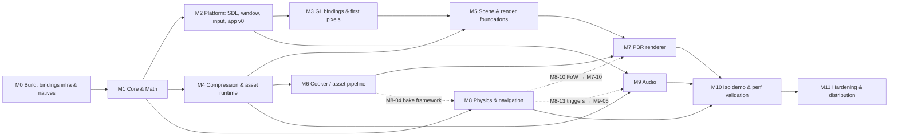

# Jeddy Framework: Task Plan

> This plan goes with [DESIGN.md](DESIGN.md); section references (§) point there.
> **Sizes:** S ≤ 1 day · M = 2–4 days · L = 1–2 weeks · XL = split before starting.
> **Done means:** code, unit tests, an allocation test for hot paths (`Allocations.assertNoAllocation`, §4.7), a JMH benchmark where the task says "bench",
> Javadoc on public API, CI green on Windows and Linux, and the checkbox ticked here.
> If you deviate from DESIGN.md, record it in DESIGN.md §17 (or an ADR in `docs/adr/`) in the same change.

## Overview and critical path

**Parallel tracks after M1:** A: platform → GL → render (M2, M3, M5, M7) · B: physics/nav (M8) · C: assets (M4, M6) · D: audio (M9).
The tracks are *mostly* independent. Dotted edges are the few late cross-track dependencies; only the individual tasks named on them wait.
**First visible milestone:** M3-04 (a triangle in an SDL3 window through FFM GL). **First "game feel" milestone:** M10-03 (click-to-move party).

---

## M0: Repository, build and natives
- [x] **M0-01** Gradle 9.8.1 wrapper, `settings.gradle.kts` with every project from §14 (empty modules), foojay resolver 1.0.0, `gradle.properties` (configuration cache, build cache, parallel) · S · AC: `gradlew build` passes on Windows and Linux with an auto-provisioned JDK 27 toolchain
- [x] **M0-02** `gradle/libs.versions.toml` with all versions pinned (JUnit 6.0.1, JMH 1.37; Spotless joins with M0-05, TwelveMonkeys with the cooker) · S · Deps: M0-01
- [x] **M0-03** `build-logic` convention plugins: `jeddy.java-base` (toolchain 27, `--release 27`, `-Xlint:all,-module,-processing -Werror`, JUnit 6, test `--enable-native-access`, `jeddy-*` archive names), `jeddy.java-library`, `jeddy.native-library` (restricted lint off, D17), `jeddy.application`, `jeddy.jmh` (hand-wired JMH `jmh` task) · M · Deps: M0-02 · AC: module build scripts contain only a plugin id and dependencies (plus `application` main settings for runnable projects)
- [x] **M0-04** `module-info.java` for every module with the §3.2 graph. Exports (including the qualified `sdl` exports) are declared as comments until each package has its first public type (DESIGN §17, D16) · S · Deps: M0-03 · AC: every module compiles in dependency order with `-Werror`. The launchers resolve the full graph
- [x] **M0-05** `.editorconfig` and `CONTRIBUTING.md` (perf rules summary linking §4). Then Spotless: add it, run `spotlessApply` once on a machine with Maven Central access, and enforce `spotlessCheck` in CI · S
- [x] **M0-06** CI workflow: Windows and Linux matrix, Gradle cache, test reports, `SDL_VIDEO_DRIVER=dummy` for headless tests · M · Deps: M0-03 · Host: GitHub Actions on `ilumar589/JEddyFramework`
- [x] **M0-07** `natives/` CMake superbuild with pinned SDL3 3.4.18, SDL3_mixer 3.2.4 (Vorbis, WAV, FLAC, MP3, plus optional Opus), zstd 1.5.7, KTX-Software 4.4.2, meshoptimizer 1.2 (shared), mikktspace shim · L · AC: one command per OS produces all shared libraries. Linux libraries use `RPATH=$ORIGIN` and an old-glibc baseline. Licenses are collected
- [x] **M0-08** Natives packaging: `natives-windows-x64` and `natives-linux-x64` jars with `natives.json` (load order, SHA-256) · M · Deps: M0-07
- [x] **M0-09** CI job that builds natives on tag or manual dispatch and publishes the artifacts · M · Deps: M0-06, M0-08
- [x] **M0-10** `jeddy.ffm-bindings` convention plugin: `regenerateBindings` task (jextract from PATH or `-Pjextract.home`, include lists in `bindings/`, output to committed `src/ffi/java`), plus a Windows/Linux diff helper script · M · Deps: M0-03 · AC: regenerating zstd bindings works end to end on both OS · *Done: exercised end to end on both OSes by the `Bindings` workflow (SDL3 and SDL3_mixer in M2-01; zstd follows in M4-01); the diff helper became `BindingsPostProcessor` plus the cross-OS workflow (D22)*

## M1: Core and Math
- [x] **M1-01** `NativeLoader` + `Platform`: extract to the cache, verify the hash, rename atomically, `System.load` in order, `-Djeddy.natives.dir` override (§6.3) · M · Deps: M0-08 · AC: loads SDL3 and zstd on both OS. The second run skips extraction
- [x] **M1-02** Allocation assertion `Allocations.assertNoAllocation` in `:testing` (measures `getCurrentThreadAllocatedBytes` across rounds after warm-up, D18) · S · AC: catches a deliberate allocation in a sample test
- [x] **M1-03** Primitive collections: `IntList`, `LongList`, `FloatList`, `IntIntMap`, `LongIntMap`, `IntObjMap`, `IntSet`, `BitSet64`, `SparseSet`, `IntHeap` (decrease-key), `IntRing` · L · Deps: M1-02 · bench vs `HashMap<Integer,…>` · AC: no allocation after capacity is reached
- [x] **M1-04** Handles and pools: `HandlePool` (generational), `SlotMap`, `ObjectPool`, `PerWorker` · M · Deps: M1-03
- [x] **M1-05** Off-heap memory: `FrameAllocator` (bump `SegmentAllocator`, reset), `OffHeap` aligned allocation, `MemoryStats`, `CStrings` cache · M · bench
- [x] **M1-06** Concurrency: `SpscIntRing`, `SpscLongRing`, `MpmcIntQueue`, padded atomics, `SpinParkWaiter` · M · AC: stress tests (10⁸ ops, multiple threads) plus a JMH throughput bench
- [x] **M1-07** Job system v1: workers, `parallelFor` (atomic chunk claiming), job graph with dependency counters, help-while-waiting, `JobContext.workerIndex()` (§4.5) · L · Deps: M1-06 · bench · AC: `parallelFor` over 1M elements scales ≥ 6× on 8 cores. Dispatch allocates 0 B
- [x] **M1-08** Profiler: scope IDs, per-thread long rings, frame stats, text/JSON dump, JFR events in dev · M · Deps: M1-06
- [x] **M1-09** `Log` (async ring), `StrId` (FNV-1a/xxHash64) + `NameTable`, `Settings` (TOML subset), `Clock`, `FixedStepper` · M
- [x] **M1-10** Math value types (records): `Vec2f`, `Vec3f`, `Vec4f`, `Quatf`, `Mat3f`, `Mat4f`, `Aabb3f`, `Ray3f`, `Planef`, `Spheref`, `Capsulef` · M · AC: no identity use, ready for `value record`
- [x] **M1-11** Mutable scratch types: `MVec3f`, `MQuatf`, `MMat4f`, with reversed-Z perspective, ortho, lookAt and `IsoCamera` math · M
- [x] **M1-12** Bulk kernels: `Vec3Ops`, `QuatOps`, `AffineOps` (composeTRS, multiply, invert, 3×4), `CullOps` (spheres and AABBs vs frustum) · L · bench · AC: tested against a `double` reference, 0 B allocated, C2 vectorization confirmed with JMH `-prof perfasm` (or `-XX:+PrintAssembly` with hsdis) and noted in the bench README
- [x] **M1-13** Geometry and intersection suite (§8.3), including cone/AoE and 2D polygon utilities · L
- [x] **M1-14** Packing (half, octahedral, snorm/unorm, sRGB), `Rng` (xoshiro256**, SplitMix64, dice), easing, noise · M
- [x] **M1-15** `bench` module wired up, with baseline benchmarks committed and a results README · S · Deps: M0-03

## M2: Platform (SDL3, window, input, app v0)
- [x] **M2-01** SDL3 and SDL3_mixer include lists. Generate with `regenerateBindings`, diff Windows vs Linux output, commit `src/ffi/java` (§6.4) · M · Deps: M0-10, M0-08 · *Done: `bindings/sdl3.includes`, `bindings/sdl3_mixer.includes`; portability via `BindingsPostProcessor` plus `SdlBindingsTest` on both CI OSes, and the `Bindings` workflow regenerates on Windows and Linux with official jextract and diffs (D22)*
- [x] **M2-02** `sdl` wrapper utilities: error to exception (`SDL_GetError`), properties helper, main-thread assertion · S · Deps: M2-01
- [x] **M2-03** `window`: `Platform.init` on the main thread, window creation, GL 4.6 core context attributes, displays/DPI, windowed/borderless/exclusive modes, VSync modes, frame limiter (`SDL_DelayPrecise`), minimize handling · L · Deps: M2-02 · AC: works on Windows, X11 and Wayland, and handles resize, fullscreen toggles and DPI changes
- [x] **M2-04** Event pump: one preallocated `SDL_Event` segment, `static final` field offsets, 8-int encoded records into an `SpscIntRing` · M · Deps: M2-03, M1-06 · AC: 0 B/frame while moving the mouse and typing
- [x] **M2-05** `input` device state: keyboard/mouse with frame-stamp edges, text input mode · M · Deps: M2-04
- [x] **M2-06** Action mapping: actions, bindings, chords, axes, context stack, rebinding and persistence · L · Deps: M2-05
- [x] **M2-07** CRPG gestures: click vs drag, double-click, box select, edge scroll, camera rotate/zoom/pan inputs. Cursor manager (custom color cursors) in `window`, switched through the main-thread command queue · M · Deps: M2-06, M2-10
- [x] **M2-08** Gamepads: hotplug, mapping DB, virtual cursor, rumble · M · Deps: M2-05
- [x] **M2-09** `app` v0: main thread and game thread split, fixed-step loop, clean shutdown, crash message box · M · Deps: M2-03, M1-07 · AC: an empty app runs 10 minutes at 0 B/frame on both threads
- [x] **M2-10** Main-thread command queue (game → main): encoded commands for cursor, text input start/stop, window mode and relative mouse. Assertions that main-thread-only SDL calls never run elsewhere (§5) · S · Deps: M2-09

## M3: GL bindings and first pixels
- [x] **M3-01** Vendor `gl.xml` (pinned commit) and `gl.properties`. Write the `GenerateGlBindings` task in build-logic: constants, functions, per-function holders with `static final MethodHandle`, critical allow-list, segment and primitive signatures (§9.1) · L · AC: the task is cacheable and configuration-cache safe, and the generated `GL46` compiles
- [x] **M3-02** `GLLoader` (`SDL_GL_GetProcAddress`), `GLCapabilities` (version, extensions, limits) · S · Deps: M3-01, M2-03
- [x] **M3-03** `KHR_debug` callback (upcall created once, synchronous in dev), object labels · S · Deps: M3-02
- [x] **M3-04** Hello triangle sample using DSA · S · Deps: M3-03 · AC: renders on NVIDIA, AMD and Intel on Windows, and on Mesa (radeonsi/iris) on Linux · *Done: `samples/hello-triangle` plus `GLTest` (renders and reads back pixels); CI runs both under Mesa llvmpipe. Hardware vendors still need a manual run (question for the M10 hardware pass)*
- [x] **M3-05** FFM call-overhead benchmarks (critical vs regular, heap vs off-heap args, `glUniform*`, `glNamedBufferSubData`). Finalize the critical allow-list and document the numbers · M · Deps: M3-04, M1-15

## M4: Compression and asset runtime
- [x] **M4-01** jextract zstd. `Zstd` facade: one-shot segment API, pooled CCtx/DCtx per worker, streaming in chunks, dictionaries (CDict/DDict) · M · Deps: M0-10, M1-04 · bench · AC: round-trip fuzz test, throughput within 10% of the native CLI, 0 B allocated per call · *Done: `Zstd`, `ZstdCompressor`/`ZstdDecompressor` (pooled per worker, D26), streaming, `ZstdDictionary` (train, CDict/DDict); fuzz round-trip and 0 B/call tests. Same CI runner, facade vs `zstd -b` on the `ZstdBench` corpus: level 1 340 vs 357 MB/s compress, 996 vs 1064 MB/s decompress; level 3 278 vs 268, 1053 vs 1109; level 19 4 vs 3.5, 1442 vs 1606 (an earlier run: 1378 vs 1436), all within 10 % up to run-to-run noise*
- [x] **M4-02** `Checksums` (CRC32C over segments) · S · *Done: `Checksums.crc32c` over segments, byte arrays and slices (the `CRC32C` intrinsic); used for pak TOCs and entries*
- [x] **M4-03** `.jpak` spec doc, reader (mmap, SoA TOC, binary search, optional CRC check) and writer (lives in the cooker, shared code) · M · Deps: M4-01 · *Done: spec `docs/formats/jpak.md`; `Pak` (mmap, SoA TOC copied into primitive arrays, binary search, TOC CRC always checked, per-entry `verify`, allocation-free `read` straight from the mapping) and `PakWriter` (AUTO/STORE/ZSTD/ZSTD_DICTIONARY, trained dictionary entry, entry data in insertion order, 64 B/4 KiB alignment, atomic write); `PakTest`, `AssetBench`*
- [x] **M4-04** VFS: loose directory and pak mounts, override order, `StrId` lookup · M · Deps: M4-03 · *Done: `Vfs` with pak and loose directory mounts, later mounts override, one merged hash index published per change (D25), rescans for the cooker, `unmount` waits for reads in flight; `AssetPaths` normalization; `VfsTest` (0 B per lookup and pak read)*
- [x] **M4-05** `AssetManager`: typed handles, refcounts, state bytes, dependencies, priorities, async pipeline (IO, decode jobs, upload queue with a per-frame budget) · L · Deps: M4-04, M1-07 · *Done: `AssetManager` + `AssetType<T>` + `AssetLoader<T>`: generational handles, ref counts, release/acquire state bytes, dependencies declared in `decode`, priority heap, staging ring, IO virtual threads, decode jobs, budgeted main-thread uploads (D26); `AssetManagerTest` (0 B per idle frame)*
- [x] **M4-06** Format readers: KTX2 (header, levels, per-level zstd into the destination segment), `.jmesh`, `.jmat` (specs in `docs/formats/`) · M · Deps: M4-05 · *Done: `Ktx2` (none/zstd supercompression, size checks, key/value data, `decodeLevel` into any segment, 0 B), `MeshData`/`MeshWriter` (QTangent attributes, D27), `MaterialData`; specs `docs/formats/ktx2.md`, `jmesh.md`, `jmat.md`; `FormatsTest`*
- [x] **M4-07** Reload hook (dev): `WatchService` on the mounted loose *cooked* directory, then an in-place swap behind the same handle. No dependency on the cooker (§10.2) · M · Deps: M4-05 · *Done: `AssetReloader` (WatchService over the cooked tree including new directories, debounce, rescan, `AssetManager.reload`): the asset stays ready on the old value until the new one is decoded and uploaded, failed reloads keep the old value; `AssetReloaderTest`*

## M5: Scene and render foundations
- [x] **M5-01** `scene`: `EntityPool`, sparse-set stores, SoA columns · M · Deps: M1-04 · *Done: `EntityPool` (generational handles, store notification on destroy), `ComponentStore` (sparse set + `FloatColumn`/`IntColumn`/`LongColumn`, swap-remove), `ComponentStoreTest`*
- [x] **M5-02** Transform hierarchy: parent-sorted SoA, parallel world 3×4 update, dirty bits, static flag · M · Deps: M5-01, M1-12 · bench (100k transforms) · *Done: `TransformStore` with a depth-sorted traversal order (counting sort, D28), per-level parallel updates, dirty propagation, level skipping, static marks; `TransformStoreTest` against a recursive reference, `TransformBench` (100k: all dirty ≈ 2.5 ms, 10 % of roots ≈ 0.65 ms on a 2-core sandbox)*
- [x] **M5-03** GL resource layer (handles, DSA): buffers, textures (BCn), samplers, framebuffers, programs, pipeline state and state cache · L · Deps: M3-04 · *Done: `GpuDevice` with `GpuBuffers`, `GpuTextures` (2D, arrays, cubes; BCn from KTX2 via `GpuFormats`), `GpuSamplers` (cached by packed `SamplerDesc`), `GpuFramebuffers`, `PipelineState` + `StateCache`; generator `long` overloads for `data`/`pixels` (D29); `GpuDeviceTest`*
- [x] **M5-04** Persistent mapped rings: triple-buffered dynamic data with fences, staging upload ring with a budget · M · Deps: M5-03 · *Done: `FrameRing` (persistent mapped, triple-buffered, fenced, lock-free `allocate` for workers) and `UploadRing` (fence-reclaimed staging with a per-frame byte budget, buffer and PBO texture copies); `RingsTest`*
- [x] **M5-05** Shader system: `#include` preprocessor, permutation masks, program binary cache, async compile when `KHR_parallel_shader_compile` is available · M · Deps: M5-03 · *Done: `ShaderPreprocessor` (`#include`, `#pragma once`, defines, `#line` mapping), `ShaderFeatures`, `ProgramCache` (variants by mask, `KHR_parallel_shader_compile`), `ProgramBinaryCache` (SHA-256 of driver + sources); tests*
- [x] **M5-06** Render packets: preallocated SoA, triple buffer, atomic handoff, transform interpolation · M · Deps: M2-09, M5-02 · *Done: `RenderPacket` (SoA instances with prev/curr transforms, bounds, camera, debug lines) and `RenderPackets` over the app's triple buffer; `RenderPacketTest` (cross-thread, 0 B)*
- [x] **M5-07** Mega vertex/index buffers with free-list sub-allocation, mesh registry, upload from the asset pipeline · M · Deps: M5-04, M4-06 · *Done: `RangeAllocator` (core), `MeshRegistry` (positions/attributes/indices mega buffers, free lists, growth, one VAO), `MeshLoader` for the asset manager; `MeshRegistryTest`*
- [x] **M5-08** Submission: 64-bit sort keys, parallel radix sort, worker-built MDI commands in mapped memory, instance and material SSBOs · L · Deps: M5-06, M5-07 · bench · AC: 20k instances, main thread ≤ 2 ms submit, 0 B/frame · *Done: `MaterialTable`, `ParallelSort` (core), `DrawBuilder` (keys, LOD, sorted interpolated records, indirect commands, batches, D30), engine shader includes; `DrawBuilderTest` (20k instances → 2 multi-draws, 0 B/frame), `DrawBench`. Cull + build for 20k: ≈ 1.7–2.6 ms on the 2-core sandbox; the ≤ 2 ms AC needs confirming on the reference PC (M10)*
- [x] **M5-09** Isometric camera controller, reversed-Z (`glClipControl`), parallel SoA frustum culling · M · Deps: M5-08, M2-07 · *Done: `IsoCameraController` (view-relative and edge pan, drag pan keeping the ground point, smoothed zoom/rotate, follow, bounds), `GpuDevice.useReversedZ` (`glClipControl`), parallel `Culling`; tests*
- [x] **M5-10** Frame graph v1 (passes, transient pool, barriers), GPU timer queries, debug draw (per-worker buffers), profiler overlay · L · Deps: M5-08 · *Done: `FrameGraph` v1 (culling, validation, transients, barriers, D32), `GpuTimers`, `DebugDraw` + `DebugRenderer`, `Overlay` (5×7 font, D31) and `ProfilerOverlay`; `FrameGraphTest` (compute → indirect → scene → post, 0 B/frame)*
- [ ] **M5-11** Spike: texture arrays vs `ARB_bindless_texture`. Measure on 3 vendors and write an ADR · M · Deps: M5-08 · *In progress: `TextureBindingBench` spike and ADR 0001 (proposed). Needs runs on NVIDIA, AMD and Intel hardware*

## M6: Cooker (offline asset pipeline)
- [x] **M6-01** jextract libktx and meshoptimizer. Build the mikktspace shim binding · M · Deps: M0-07, M0-10 · *Done: `bindings/ktx.includes`, `meshoptimizer.includes`, `jeddy_tools.includes` → `dev.jeddy.cooker.{ktx,meshopt,shim}.ffi` (D40), canonical output of the official jextract 22; `BindingsPostProcessor` fixes jextract's struct-array accessors (D37); the MikkTSpace shim ships in the natives release*
- [x] **M6-02** Cooker framework: CLI, `.meta` sidecars, content-addressed incremental cache, parallel jobs, HTML/JSON report · M · Deps: M1-07 · *Done: `Cooker` (scan, `.meta` + `_defaults.meta` settings, importer selection and claims, one job per source on the `JobSystem`), `CookCache` (content-addressed SHA-256 entries and objects, dependency hashes, state, prune, D35), atomic writes of changed outputs only, stale-output removal, `CookReport` (JSON + HTML), `CookerMain` (`cook`, `pak`, `--watch`); `CookerTest`*
- [x] **M6-03** glTF 2.0 importer (gltf/glb, accessors, PBR materials, extensions in §10.3, node hierarchy). Keep skins and animations raw · L · Deps: M6-02 · *Done: `GltfDocument` (`.gltf` with data/external URIs, `.glb`, strided, normalized and sparse accessors), `GltfImporter` (primitives, PBR materials, `KHR_texture_transform`, `KHR_materials_emissive_strength`, `KHR_lights_punctual`, node TRS and matrix decomposition, raw skins and animations), `GltfSceneImporter` → `.jscene` (`SceneData`, `docs/formats/jscene.md`); `GltfImporterTest`, `GltfSceneImporterTest`*
- [x] **M6-04** Mesh processing: weld, MikkTSpace, meshopt (vertex cache, overdraw, fetch), LODs, quantization, bounds, then `.jmesh` · L · Deps: M6-01, M6-03 · *Done: `MeshProcessor`: flat normals, per-corner MikkTSpace with the glTF sign (D33), weld, vertex cache / overdraw / fetch optimization, `meshopt_simplify` LODs with errors, ACMR/ATVR/overdraw stats, `.jmesh` via `MeshWriter`; `MeshProcessorTest`*
- [x] **M6-05** Texture processing: decode, Java mipgen (linear, Kaiser, normal renormalize), ORM packing, UASTC→BC7/BC5/BC4, zstd, then KTX2. PSNR/SSIM in the report · L · Deps: M6-01 · AC: base color PSNR ≥ 40 dB on the reference set, 2k² texture in ≤ 1.5 s on 8 cores · *Done: decode (ImageIO, TGA, Radiance HDR; D38), parallel Kaiser mips, ORM packing, UASTC → BC7/BC5/BC4 with PSNR-driven level escalation (D36), zstd, PSNR/SSIM in the report; `TextureTest`. 2048² color: 52.4 dB; `TextureCookBench` 1.24 s on the 4-core CI runner (1.8 s on the 2-core sandbox), so within 1.5 s on 8 cores*
- [x] **M6-06** Materials (`.jmat`) and shader preprocessing and validation · M · Deps: M6-03 · *Done: `MaterialImporter` (`*.jmat.json`), glTF materials with derived feature bits (`MaterialData.FEATURE_*`), `ShaderImporter` (runtime preprocessor per permutation, moved to `asset`, D34; `glslangValidator` when present; includes as dependencies)*
- [x] **M6-07** HDR environment processing (cube, prefiltered mips, SH9, BRDF LUT) · M · Deps: M6-05 · *Done: `EnvironmentBaker` (equirect → cube, GGX filtered importance sampling, SH9 irradiance, split-sum BRDF LUT), `EnvironmentImporter` (RGBA16F cube + `jeddy.sh9`), built-in `engine/brdf_lut.ktx2`; `EnvironmentTest`*
- [x] **M6-08** Pak builder with area grouping and trained zstd dictionaries for small assets · M · Deps: M4-03, M6-04..06 · *Done: `PakBuilder` (glob layout, per-pak compression, trained dictionaries from small entries, level 19, CRC verification, `paks.json` manifest); `PakBuilderTest`*
- [x] **M6-09** Gradle plugin `dev.jeddy.assets` (`cookAssets`, incremental, configuration-cache safe) · M · Deps: M6-08 · *Done: `dev.jeddy.assets` (`cookAssets`, `packAssets`, `jeddyAssets {}` extension, cooker on the module path); the iso-demo's procedural assets cook and pack in CI on Linux and Windows, and a rerun is served entirely from the cooker cache*
- [x] **M6-10** `jeddy-cook --watch`: watch the source directories and incrementally recook into the loose cooked directory that M4-07 watches. Hot reload works end to end · M · Deps: M6-02, M4-07 · *Done: `SourceWatcher` (all directories, new ones as they appear, debounce), `Cooker.affectedBy` (dependencies, sidecars, directory defaults), `jeddy-cook --watch`; `HotReloadTest` edits a source and sees the running asset swap behind its handle*

## M7: PBR renderer
- [x] **M7-01** Forward+ PBR (glTF metallic-roughness, GGX/Smith/Schlick, multiscatter), BC5 normals · L · Deps: M5-10, M6-06 · *Done: `SceneRenderer` (frame graph: light cull, shadows, prepass, GTAO, opaque, sky, transparent, particles, outlines, post), `MaterialSystem` (32-float rows, feature-mask programs, texture sets in program slots, D41), `TextureArrays`, `TextureLoader` + `MaterialAssets` (asset manager load and hot reload), `pbr/pbr.vert/frag` and `engine/*.glsl`; GEQUAL lit pass after the prepass (D42); `SceneRendererTest` (furnace ≈ 1, textures from array layers, reload, 0 B/frame)*
- [x] **M7-02** IBL: prefiltered specular, SH irradiance, BRDF LUT · M · Deps: M7-01, M6-07 · *Done: `Environment` (cooked prefiltered cube + SH9 from the KTX2 key, or a uniform environment), BRDF LUT generated by `pbr/brdf_lut.comp` at startup (D43), multiscatter energy compensation; white furnace test*
- [x] **M7-03** Clustered light culling (compute), light SSBO, 1000+ point/spot lights · L · Deps: M7-01 · *Done: `LightClusters` (64 px tiles × 24 slices, exponential or linear slicing, bounds recomputed on projection change, per-cluster ranges into one index list; decals share it, D45), lights in the packet in GPU layout (D44); test with 1500 lights*
- [x] **M7-04** Shadows: directional (stable, 2–3 cascades), spot/point atlas with static-caster caching · L · Deps: M7-01 · *Done: `SunShadows` (stable sphere-fit cascades with texel snapping, 3×3 PCF), `LocalShadows` (2048² atlas of 256² tiles, cube faces for points, a static-caster cache per light key copied before dynamic casters, D44); shadow tests on llvmpipe*
- [x] **M7-05** Depth prepass and half-res GTAO · M · Deps: M7-01 · *Done: `Gtao` (`post/gtao.frag`: view-space reconstruction, slices with horizon search and tangent-plane falloff; `gtao_blur.frag` depth-aware), applied to indirect light and specular occlusion (`SCREEN_AO`); contact-shadow test (crease 0.76 vs open 0.96, analytic ≈ 0.74)*
- [x] **M7-06** Post: bloom, exposure, AgX/ACES tonemap, grading LUT, SMAA or FXAA · L · Deps: M7-01 · *Done: `PostProcess` (13-tap/Karis bloom pyramid with tent upsamples, GPU histogram auto exposure with no read-back, AgX or ACES, display-space 3D LUT, dither, FXAA; D46), `.cube` LUT cooking (`CubeLutImporter` → RGBA16F 3D KTX2), 3D textures in `GpuTextures`; `PostProcessTest` checks the curves against a Java reference*
- [x] **M7-07** Clustered decals: selection circles, AoE templates (circle, cone, line), scorch · M · Deps: M7-03 · *Done: packet decals (box projectors, ring/disc/cone/line shapes with AA outlines, textures, tint or glow, `FLAG_NO_DECALS`), clustered with the lights (D45), `DecalTextures` (sRGB array; GPU copy from any texture); `DecalTest` (300 decals, 0 B/frame)*
- [x] **M7-08** Outlines and highlight (hover, selection, Alt-highlight) · M · Deps: M7-01 · *Done: `Outlines` (style per instance in flags, mask pass with occlusion bit, anti-aliased outline + x-ray fill overlay composited in display space before FXAA, 15 configurable styles); `OutlinesTest`*
- [x] **M7-09** Transparency sorting and GPU particles v1 (compute) · L · Deps: M7-01 · *Done: transparent pass (blended materials sorted back to front, back faces culled unless double-sided), `GpuParticles` (pool + dead stack + ping-pong alive lists, emit/simulate/args compute, indirect soft sprites, packet emitters with rates and bursts, D47); `ParticlesTest`*
- [ ] **M7-10** Fog-of-war composite from the physics visibility texture, plus roof/wall camera-fade · M · Deps: M7-01, M8-10 · *Render side done: `FogOfWar` (packet grid 0/128/255, uploaded on version change, dims and desaturates explored areas), camera fade (per-instance dither + reveal circles for `FLAG_FADE_OCCLUDER`, D48); `FogAndFadeTest`. Tick once M8-10 feeds the grid*
- [x] **M7-11** GPU-driven culling with `glMultiDrawElementsIndirectCount` · L · Deps: M5-08 · AC: ≥ 30% main-thread CPU reduction on the 20k scene · *Done: `StaticScene` (static instances resident on the GPU in (slot, mesh, submesh) bins, per-view compute cull + LOD + packing, one MDI-count per slot; main view and sun cascades; D49). 20k instances: frame preparation 2.2 ms → 0.33 ms (85% less, `StaticSceneTest`), `DrawBench.gpuPrepare` 9 µs vs `cullAndBuild` 2.1 ms; llvmpipe runs the compute on the CPU, so the driver side is confirmed on real GPUs in M10*

## M8: Physics and navigation (pure Java, §11)
- [ ] **M8-01** Binned SAH BVH builder (parallel, used by the cooker), flattened runtime BVH, raycast closest/any, triangle flags · L · Deps: M1-12, M1-13 · bench (1M rays/s/core target)
- [ ] **M8-02** Dynamic broadphase: counting-sort uniform grid rebuilt per tick, SoA unit cylinders and prop shapes · M · Deps: M1-07 · bench (5k units < 0.3 ms)
- [ ] **M8-03** Queries: ray, overlap (sphere, cylinder, cone, line/rect, box, prism), sweep cylinder, line of sight, picking. `QueryBatch` on the job system · L · Deps: M8-01, M8-02
- [ ] **M8-04** Navmesh baker part 1: heightfield rasterization, filters, compact heightfield, erosion · L · Deps: M8-01, M6-02
- [ ] **M8-05** Navmesh baker part 2: distance field, regions, contours, polygon mesh, detail mesh, tiles, size classes, area types, off-mesh links → `.jnav` · L · Deps: M8-04
- [ ] **M8-06** Navmesh runtime: SoA tiles, per-tile BVH, nearest polygon, navmesh raycast · M · Deps: M8-05
- [ ] **M8-07** Pathfinding: A* (`IntHeap`, generation-stamped nodes), funnel, corridors, time-sliced and parallel queries · L · Deps: M8-06 · bench (1000 paths across a 200×200 m map)
- [ ] **M8-08** Crowd: following, steering, ORCA avoidance, arrival, stuck detection and repath · L · Deps: M8-07, M8-02
- [ ] **M8-09** Party formations: templates, slot assignment, followers · M · Deps: M8-08
- [ ] **M8-10** Visibility: occlusion grid bake, parallel symmetric shadowcasting, visible/explored bitsets, texture packing · M · Deps: M8-01
- [ ] **M8-11** Dynamic navigation: door flags, temporary obstacles with async tile rebuild · M · Deps: M8-06
- [ ] **M8-12** Turn-based helpers: movement-range flood, path cost, threat-zone crossing query · M · Deps: M8-07
- [ ] **M8-13** Triggers and volumes with enter/exit event buffer · S · Deps: M8-02
- [ ] **M8-14** Physics and nav debug draw hooks · S · Deps: M5-10 (cross-track; can land late, and the rest of M8 is tested headless)

## M9: Audio (SDL3_mixer)
- [ ] **M9-01** Mixer device init. Loading from pak memory: streamed audio via `MIX_LoadAudioNoCopy` over the mapping (the pak is pinned while referenced), SFX predecoded via `SDL_IOFromConstMem` + `MIX_LoadAudio_IO`. Stream vs predecode policy · M · Deps: M2-02, M4-04
- [ ] **M9-02** Voice pool of N pre-created `MIX_Track`s, priorities and stealing, virtual voices · M · Deps: M9-01
- [ ] **M9-03** Buses through tags, master gain, ducking ramps, settings integration · S · Deps: M9-02
- [ ] **M9-04** 3D emitters (SoA), listener-space transform, dirty-threshold `MIX_SetTrack3DPosition`, optional custom rolloff (constant-distance direction plus gain, §12.3), per-frame `MIX_LockMixer` atomic updates · M · Deps: M9-02 · AC: 0 B/frame with 64 active voices
- [ ] **M9-05** Music state machine with crossfades and stingers. Ambient zones and random one-shots (via M8-13 triggers) · M · Deps: M9-03, M8-13

## M10: Iso demo and performance validation
- [ ] **M10-01** Source a CC0 test level and characters (for example Kenney/KayKit/glTF sample assets), cook them into a pak · M · Deps: M6-09
- [ ] **M10-02** `app` integration systems: scene→render extract, physics→scene sync, audio listener and emitters · M · Deps: M5-06, M8-03, M9-04
- [ ] **M10-03** Gameplay slice: 6-member party, click-to-move with formations, box select, camera controls, pause (RTwP) · L · Deps: M10-02, M8-09
- [ ] **M10-04** Combat slice: 64 enemies pathing and avoiding, AoE targeting decal + overlap query, spell lights, fog of war, turn-based movement-range overlay · L · Deps: M10-03, M7-07, M7-10, M8-12
- [ ] **M10-05** Perf scene and automated capture (10-minute run): frame times, GC logs, allocation, GPU timings checked against the §14 budgets. Write a fix list · M · Deps: M10-04
- [ ] **M10-06** Fix-list burn-down until all budgets pass · L · Deps: M10-05

## M11: Hardening and distribution
- [ ] **M11-01** `jlink` runtime image plus `jpackage` (Windows installer and Linux package) · M
- [ ] **M11-02** AOT cache training run in packaging (`-XX:AOTCacheOutput`). Check compatibility with the chosen GC and measure cold start · M · AC: ≤ 1.5 s to first frame
- [ ] **M11-03** Nightly JMH with regression thresholds, allocation test sweep · M
- [ ] **M11-04** Javadoc site, module READMEs, a getting-started guide for game projects · M
- [ ] **M11-05** Versioning and publishing (Maven local, then GitHub Packages or Central) · S

---

## Backlog (unscheduled)
`animation` module · game UI / Dear ImGui debug UI via FFM · `rules` (Pathfinder-like) · save system · dialogue and quest scripting · VFX authoring · Tracy integration · LZ4 codec · BC6H via KTX v5 · Chase-Lev work stealing (if M1-07 shows contention) · `value record` migration once JEP 401 is final · Vector API once final · hierarchical pathfinding
