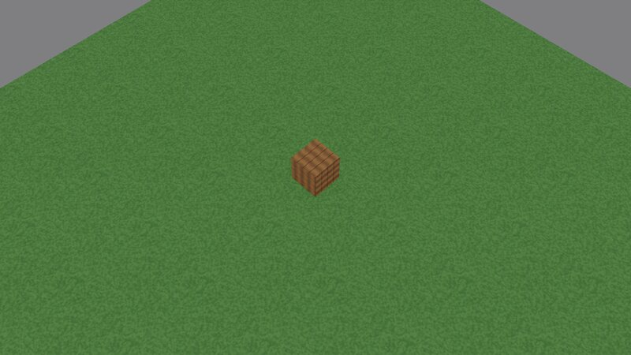

# Getting started: a game on Jeddy

This guide builds a small game project on the framework: a window with a cooked glTF level under an
isometric camera, the asset pipeline wired into Gradle, and a packaged build with its own Java
runtime. The finished project is [`samples/game-template`](../samples/game-template), which CI
builds, packages and runs on every push.



## Requirements

- Windows x64 or Linux x64 with an OpenGL 4.6 driver.
- JDK 27. Gradle provisions it through the foojay toolchain resolver when another JDK runs Gradle.
- Gradle 9.8.1 through the framework's wrapper.
- Optional: `glslangValidator` on the `PATH`. The cooker then compiles every shader permutation
  while cooking (DESIGN §10.3).

## 1. Create the project

Clone the framework and copy the template next to it:

```
git clone https://github.com/ilumar589/JEddyFramework
cp -r JEddyFramework/samples/game-template my-game
cp JEddyFramework/gradlew JEddyFramework/gradlew.bat my-game/
mkdir -p my-game/gradle && cp -r JEddyFramework/gradle/wrapper my-game/gradle/
```

In `my-game/settings.gradle.kts`, point both `includeBuild` paths at the checkout:

```kotlin
pluginManagement {
    includeBuild("../JEddyFramework/build-logic")   // dev.jeddy.game, dev.jeddy.assets
    repositories { gradlePluginPortal(); mavenCentral() }
}
// ...
includeBuild("../JEddyFramework") {                 // dev.jeddy:jeddy-* from source
    dependencySubstitution {
        for (name in listOf("core", "math", /* ... */ "app", "cooker", "natives-linux-x64")) {
            substitute(module("dev.jeddy:jeddy-$name")).using(project(":$name"))
        }
    }
}
```

This is a **composite build**. Gradle builds the framework's modules from source and substitutes
them for the `dev.jeddy:jeddy-*` dependencies, so a change in the framework shows up in the game
on the next build. Gradle matches an included build's projects by project name (`:app`), so the
template lists the substitutions for the `jeddy-` artifact names. The project looks like this:

```
my-game/
├─ settings.gradle.kts    # the composite build
├─ build.gradle.kts       # the dev.jeddy.game plugin, dependencies, main class, packaging
├─ assets/                # source assets (glTF, PNG, HDR, WAV/OGG, GLSL, JSON)
│  └─ levels/yard.gltf    #   cooked to levels/yard.jscene
└─ src/main/java/
   ├─ module-info.java    # module com.example.mygame { requires dev.jeddy.app; }
   └─ com/example/mygame/MyGame.java
```

`build.gradle.kts` is short:

```kotlin
plugins {
    id("dev.jeddy.game")
}

version = "0.1.0"

dependencies {
    implementation("dev.jeddy:jeddy-app:0.1.0-SNAPSHOT")
}

application {
    mainModule = "com.example.mygame"
    mainClass = "com.example.mygame.MyGame"
}

jeddyPackaging {
    name = "my-game"
}
```

The `dev.jeddy.game` plugin does the rest:

- It applies `application` and `dev.jeddy.assets`.
- It compiles for Java 27.
- It puts this platform's native libraries (SDL3, SDL3_mixer, zstd, libktx, meshoptimizer) on
  the runtime classpath.
- It runs with the framework's JVM flags: native access for the Jeddy modules, ZGC, and no
  method-handle customization (DESIGN §4.6).
- It adds the packaging tasks.

`dev.jeddy:jeddy-app` brings the whole runtime with it: math, window, input, render, asset, audio,
physics and scene.

### Published artifacts instead of a composite build

The framework can be published to the local Maven repository:

```
cd JEddyFramework
./gradlew publishToMavenLocal
./gradlew -p build-logic publishToMavenLocal
```

Tagged releases also go to GitHub Packages (`https://maven.pkg.github.com/ilumar589/JEddyFramework`).
GitHub Packages asks for a token with `read:packages`, even for public packages. Then drop the
`includeBuild` calls and resolve everything from repositories:

```kotlin
// settings.gradle.kts
pluginManagement {
    repositories { mavenLocal(); gradlePluginPortal() }
}
dependencyResolutionManagement {
    repositories { mavenLocal(); mavenCentral() }
}

// build.gradle.kts
plugins {
    id("dev.jeddy.game") version "0.1.0-SNAPSHOT"
}
```

The plugin's version picks the cooker and native libraries, so keep it equal to the `jeddy-app`
version.

## 2. The game class

A Jeddy game runs on two threads (DESIGN §5):

| Thread | Runs |
|---|---|
| **Main** | The thread that calls `main`. It owns SDL and OpenGL: it pumps events, renders, and swaps buffers. |
| **Game** | Your `Game` callbacks. Rendering happens on the main thread from a *render packet* that the game fills at the end of each frame and hands over through a triple buffer. |

The game thread never calls OpenGL or SDL. Window and cursor requests go to the main thread
through `ctx.mainThread()`.

`main` mounts the cooked content, creates the renderer and starts the app:

```java
public static void main(String[] args) throws IOException {
    // build/paks under `gradle run`, <image>/paks in a packaged game.
    Vfs vfs = new Vfs();
    vfs.mountContent(Vfs.contentDirectory(Path.of("build", "paks")));
    RenderPackets packets = new RenderPackets(4096);
    WorldRenderer renderer = new WorldRenderer(vfs, packets, new WorldRenderer.Config());
    MyGame game = new MyGame(packets, renderer);
    AppConfig config =
            new AppConfig()
                    .app("My game", "0.1.0", "com.example.mygame")
                    .window(new WindowConfig().title("My game").size(1600, 900))
                    .renderer(renderer);
    System.exit(JeddyApp.run(config, game));
}
```

`WorldRenderer` is the renderer for a `World`: PBR forward+ shading, shadows, decals, particles,
fog of war, outlines and post-processing (DESIGN §9). It also owns the asset manager, the mesh
registry and GPU uploads. `WorldRenderer.Config` sets the environment cube, the upload budget,
a HUD and more.

The `Game` callbacks run on the game thread:

```java
@Override
public void init(AppContext ctx) {
    // The game thread owns the asset manager: register types, then load.
    scenes = renderer.assets().register("scene", WorldAssets.scenes());
    level = scenes.load("levels/yard.jscene");
    world = new World(16_384, renderer.meshes());
}

@Override
public void fixedUpdate(AppContext ctx, float dt) {   // 30 Hz simulation tick
    if (!spawned) {
        return;
    }
    world.beginTick();
    // Gameplay, physics and AI move entities here (world.transforms()).
    world.updateTransforms(ctx.jobs());
}

@Override
public void update(AppContext ctx, float dt, float alpha) {   // once per frame
    renderer.assets().update();
    if (!spawned && scenes.isReady(level)) {
        world.instantiate(scenes.get(level), 0, 0, 0, 0, RenderPacket.FLAG_STATIC);
        world.updateTransforms(ctx.jobs());
        spawned = true;
    }
    var g = ctx.gestures();   // edge scroll, wheel zoom, middle-mouse drag to rotate
    controller.pan(g.edgeScrollX(), -g.edgeScrollY());
    controller.zoom(g.zoomDelta());
    controller.rotate(g.rotateDelta() * 0.006f);
    var in = ctx.input();
    controller.update(dt, in.pixelHeight() > 0 ? (float) in.pixelWidth() / in.pixelHeight() : 1);
}

@Override
public void extract(AppContext ctx, int index) {   // fill the frame's render packet
    RenderPacket p = packets.packet(index);
    p.reset();
    p.frame = ctx.frame();
    p.alpha = ctx.simulation().alpha();
    p.setCamera(camera.view, camera.projection, camera.viewProjection,
            camera.inverseViewProjection, camera.frustumPlanes,
            camera.eye().x, camera.eye().y, camera.eye().z);
    p.near = camera.near;
    p.far = camera.distance * 2 + 60;
    p.orthographic = camera.orthographic;
    if (spawned) {
        world.extract(p);
    }
}
```

`World` keeps renderable entities as struct-of-arrays transforms with parent links. It flattens
glTF scenes into them, interpolates between ticks with `alpha`, and culls into the packet on the
job system.

The full source is
[`MyGame.java`](../samples/game-template/src/main/java/com/example/mygame/MyGame.java). For
gameplay on top of this, see the [iso demo](../samples/iso-demo): a party with formations and box
selection, a crowd of skeletons on a navmesh, fog of war, fireballs with area queries, decals,
lights and positional sound, and a turn-based movement overlay.

## 3. Assets

Source assets live in `assets/`. The `dev.jeddy.assets` plugin adds two tasks:

- `cookAssets` turns sources into engine formats in `build/cooked`. It is incremental through the
  cooker's content-addressed cache.
- `packAssets` packs the cooked tree into zstd-compressed `.jpak` archives in `build/paks`.

| Source | Cooked |
|---|---|
| glTF 2.0 (`.gltf`, `.glb`) | `.jscene` with meshes (meshoptimizer), materials and lights |
| PNG, JPEG, TGA, BMP, GIF | KTX2 textures, BCn-compressed, with mipmaps |
| Radiance HDR (`.hdr`) | Prefiltered environment cube with irradiance (`.ktx2`) |
| GLSL | Validated when `glslangValidator` is available |
| WAV, OGG, FLAC, MP3, JSON, fonts | Copied |

Asset paths are lower-case and relative to `assets/`. Cooking changes the extension:
`levels/yard.gltf` becomes `levels/yard.jscene`. A `paks.json` next to the build script splits the
content into several paks, for example one per area (see the iso demo's). Without one, everything
goes into `data.jpak`. Import settings, such as an environment cube's size (`{"size": 64}`), go
into a JSON sidecar next to the file (`<file>.meta`) or into a folder's `_defaults.meta`.

**Hot reload.** Run the cooker in watch mode in one terminal:

```
./gradlew cookAssets -Pjeddy.cook.args=--watch
```

Run the game on the loose cooked tree in another:

```
./gradlew run -Pjeddy.assets.dir=build/cooked
```

To reload changed assets in place, create an `AssetReloader` for the directory mount and call
`poll()` from `update`:

```java
int[] mounts = vfs.mountContent(dir);                       // in main
reloader = new AssetReloader(vfs, mounts[0], renderer.assets(), 100);   // in init
reloader.poll();                                            // in update
```

## 4. Run

```
./gradlew run
```

`run` packs the assets and starts the game with the framework's JVM flags. It sets
`-Djeddy.app.dir=build`, so `Vfs.contentDirectory` finds `build/paks`, just as a packaged game
finds the `paks/` folder of its image.

For smoke tests and CI, `-Djeddy.app.quitAfterFrames=N` quits after N frames. A packaged game
accepts it through the `JDK_JAVA_OPTIONS` environment variable.

## 5. Package

| Task | Output |
|---|---|
| `distImage` | `build/dist/my-game/`: a `jlink` runtime with the game's modules and native libraries (`runtime/`), launchers (`bin/my-game`, `bin/my-game.bat`), the paks, and an optional AOT cache |
| `distImageZip` | The image zipped as `build/distributions/my-game-0.1.0-linux-x64.zip` |
| `jpackage` | A self-contained app image in `build/jpackage`, or an installer with `-Pjeddy.package.type=deb`, `rpm`, `msi` or `exe` (`fakeroot` for `.deb`; WiX for Windows installers) |

Images are per platform: build the Windows package on Windows.

**AOT cache.** An AOT cache from a training run roughly halves cold start: the iso demo (headless)
reaches its first frame in 0.21 s instead of 0.37 s on a GitHub Linux runner, and in 0.40 s
instead of 0.72 s on Windows. The cache needs a training run of the image at build time:

```kotlin
jeddyPackaging {
    name = "my-game"
    trainingArguments = listOf("--some-scripted-mode")       // program arguments of the training run
    trainingJvmArguments = listOf("-Djeddy.app.quitAfterFrames=600")
    trainingEnvironment = mapOf("SDL_AUDIO_DRIVER" to "dummy")
}
```

The training run is a real run of the game, so a windowed game needs a display on the build
machine. The iso demo trains headless instead (`--headless`: no GL context). `-Pjeddy.aot=false`
skips training. The launchers use the cache when `aot/<name>.aot` exists and fall back silently
when it does not. The cache only loads with the exact JVM flags it was trained with, so leave the
flags to the plugin.

## 6. Performance rules

The framework's hot paths allocate nothing per frame (DESIGN §4). Games should follow the same
rules in per-frame and per-tick code:

- Keep state in primitive arrays (struct of arrays) indexed by `int` handles, and pool what comes
  and goes.
- Allocate scratch space up front: `IntList`, `FloatList` and `QueryContext` sized for the peak,
  and `RenderPacket.reserve` for lights, decals and emitters.
- In code that runs every frame, avoid streams, iterators over collections, boxing, capturing
  lambdas, varargs, string building and logging.
- Never block the main thread on the game thread, or the reverse. Long work goes to `ctx.jobs()`,
  and loading goes through the asset manager.

To check code, `dev.jeddy:jeddy-testing` has `Allocations.assertNoAllocation(...)` for tests. JFR
with small TLABs (`-XX:TLABSize=256 -XX:MinTLABSize=256 -XX:-ResizeTLAB`) shows any allocation's
stack.

Expect a little allocation during warm-up. When a method first reaches the C2 compiler, the JVM
resolves the string literals of its class on the calling thread. That is a one-time cost per class
of a few hundred bytes to a few KB, which comes minutes into play for rarely called classes
(D70). The iso demo's perf capture separates it from real allocation.

## Where next

- Module guides: [core](../modules/core/README.md), [math](../modules/math/README.md),
  [window](../modules/window/README.md), [input](../modules/input/README.md),
  [render](../modules/render/README.md), [asset](../modules/asset/README.md),
  [audio](../modules/audio/README.md), [physics](../modules/physics/README.md),
  [scene](../modules/scene/README.md), [app](../modules/app/README.md).
- API reference: `./gradlew :site:javadocSite` writes the Javadoc of every module to
  `tools/site/build/site`. The docs workflow publishes it to GitHub Pages when Pages is enabled.
- Architecture and decisions: [DESIGN.md](DESIGN.md).
