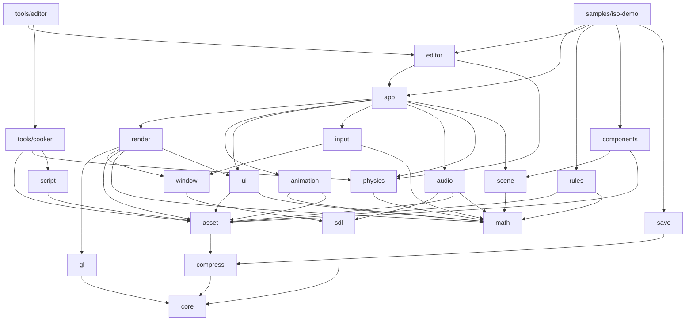
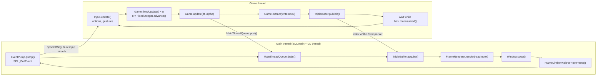

# 01 — Architecture: how a frame happens

*A game is a loop: read the player's input, move the world forward, draw it, show it, and do it
again, sixty or more times a second. In Jeddy that loop is split across threads that never wait
for each other: a main thread that owns the window and every OpenGL call, a game thread that runs
the simulation at a fixed 30 ticks a second, and a pool of workers that both of them borrow for big
loops. This chapter follows one frame through that machinery. It builds, from empty files, the
three pieces that hold it together: the triple buffer that hands a finished frame from the game
thread to the main thread, the fixed-step clock that turns real time into ticks and an
interpolation factor, and the job system that spreads a loop over every core without allocating.
Then it reads the two loops of `JeddyApp`, the command queue to the main thread, the render packet,
the transform hierarchy and the app layer, and it ends with two complete games built on them: the
game template and the iso demo.*

**Before you start.** You need [Lesson 0](lessons/00-foundations.md): `mod`, floor and ceiling
(§2.4–2.5), overflow (§4.3), masks, shifts and packing (§6), float precision (§7.3), the heap and
the zero-allocation rule (§8.2), and above all §9 on the CPU: caches (§9.2–9.3), threads (§9.4) and
`volatile` and compare-and-set (§9.5), which sections 6 and 10–13 build on. Section 9 of this
chapter uses L00 §10–11 (the GPU, the driver, the context, the swap, frames and ticks). Two lessons
go deeper into parts this chapter only summarizes: [Lesson 3](lessons/03-data-layout.md) builds the
handles, sparse sets and component stores of §7 from empty files, and
[Lesson 1](lessons/01-buffers-in-flight.md) builds the frame ring the job workers write into (§9.3,
§19). No earlier chapter is needed. The little trigonometry §5 uses is introduced where it is used.

**What you will build**

| Piece | File | What it does |
|---|---|---|
| The triple buffer | [`core.concurrent.TripleBuffer`](../../modules/core/src/main/java/dev/jeddy/core/concurrent/TripleBuffer.java) | hands frame indices 0, 1, 2 between one producer and one consumer with one atomic exchange each, without either side ever waiting |
| The fixed-step clock | [`core.time.FixedStepper`](../../modules/core/src/main/java/dev/jeddy/core/time/FixedStepper.java) | turns real elapsed time into a whole number of 30 Hz ticks and an interpolation factor `alpha`, capped against stalls, with pause and time scale |
| The job system | [`core.job.JobKernel`](../../modules/core/src/main/java/dev/jeddy/core/job/JobKernel.java), [`JobSystem`](../../modules/core/src/main/java/dev/jeddy/core/job/JobSystem.java), [`JobGraph`](../../modules/core/src/main/java/dev/jeddy/core/job/JobGraph.java) | splits `[0, count)` into chunks that worker threads claim with one compare-and-set; jobs in 1,024 preallocated slots, dependencies, help-while-waiting, no allocation |
| Per-thread scratch | [`core.pool.PerWorker`](../../modules/core/src/main/java/dev/jeddy/core/pool/PerWorker.java), [`ObjectPool`](../../modules/core/src/main/java/dev/jeddy/core/pool/ObjectPool.java) | one object per job-system thread slot; a thread-confined pool |
| The two loops | [`app.JeddyApp`](../../modules/app/src/main/java/dev/jeddy/app/JeddyApp.java) | the main loop (events, requests, render, swap, pacing) and the game loop (input, ticks, update, extract, publish), startup and shutdown |
| The command queue | [`window.MainThreadQueue`](../../modules/window/src/main/java/dev/jeddy/window/MainThreadQueue.java), [`WindowCommands`](../../modules/window/src/main/java/dev/jeddy/window/WindowCommands.java) | carries main-thread-only SDL requests from the game thread as six-`int` records |
| The frame data | [`render.RenderPacket`](../../modules/render/src/main/java/dev/jeddy/render/RenderPacket.java), [`RenderPackets`](../../modules/render/src/main/java/dev/jeddy/render/RenderPackets.java) | everything the main thread needs to draw one frame, as preallocated arrays, three times over |
| The transform hierarchy | [`scene.TransformStore`](../../modules/scene/src/main/java/dev/jeddy/scene/TransformStore.java) | parent-child transforms in struct-of-arrays columns, updated level by level, in parallel when a level is large |
| The app layer | [`app.Game`](../../modules/app/src/main/java/dev/jeddy/app/Game.java), [`FrameRenderer`](../../modules/app/src/main/java/dev/jeddy/app/FrameRenderer.java), [`AppContext`](../../modules/app/src/main/java/dev/jeddy/app/AppContext.java), [`MainContext`](../../modules/app/src/main/java/dev/jeddy/app/MainContext.java), [`world.World`](../../modules/app/src/main/java/dev/jeddy/app/world/World.java), [`WorldRenderer`](../../modules/app/src/main/java/dev/jeddy/app/world/WorldRenderer.java), [`AgentSync`](../../modules/app/src/main/java/dev/jeddy/app/world/AgentSync.java) | the callbacks a game implements, the two threads' views of the app, the game-side scene and the systems that copy data between modules |
| Two games | [`MyGame`](../../samples/game-template/src/main/java/com/example/mygame/MyGame.java), [`DemoGame`](../../samples/iso-demo/src/main/java/dev/jeddy/samples/iso/DemoGame.java) | the smallest complete game, and the integration test of the whole engine |

Performance rules (zero allocation per frame, FFM) appear here only as far as they shape the
architecture. Chapter [12](12-java-performance.md), on fast Java, covers them in depth.

**Contents**

- Part A — The ideas
  1. [One frame, in one page](#1-one-frame-in-one-page)
  2. [Modules: who may know whom](#2-modules-who-may-know-whom)
  3. [Threads: who may call what](#3-threads-who-may-call-what)
  4. [Time: fixed ticks and a variable frame rate](#4-time-fixed-ticks-and-a-variable-frame-rate)
  5. [Interpolation: drawing between two ticks](#5-interpolation-drawing-between-two-ticks)
  6. [Handing a frame from one thread to another](#6-handing-a-frame-from-one-thread-to-another)
  7. [Data-oriented design, in summary](#7-data-oriented-design-in-summary)
  8. [Parallel loops, and what they cost](#8-parallel-loops-and-what-they-cost)
  9. [The GPU at the end of the frame](#9-the-gpu-at-the-end-of-the-frame)
- Part B — Building it
  10. [Step 1: the triple buffer handoff](#10-step-1-the-triple-buffer-handoff)
  11. [Step 2: the fixed-step clock](#11-step-2-the-fixed-step-clock)
  12. [Step 3: the job system's pieces](#12-step-3-the-job-systems-pieces)
  13. [Step 4: running a job](#13-step-4-running-a-job)
  14. [Step 5: graphs, per-thread scratch and a parallel sort](#14-step-5-graphs-per-thread-scratch-and-a-parallel-sort)
  15. [Step 6: the two loops](#15-step-6-the-two-loops)
  16. [Step 7: the main-thread command queue](#16-step-7-the-main-thread-command-queue)
- Part C — Using it and proving it
  17. [One frame, end to end](#17-one-frame-end-to-end)
  18. [The render packet](#18-the-render-packet)
  19. [Interpolation in the engine](#19-interpolation-in-the-engine)
  20. [The transform store](#20-the-transform-store)
  21. [The app layer](#21-the-app-layer)
  22. [Worked example: the game template](#22-worked-example-the-game-template)
  23. [Worked example: the iso demo](#23-worked-example-the-iso-demo)
  24. [Tests and things to run](#24-tests-and-things-to-run)
- [Exercises](#exercises)
- [Glossary](#glossary)
- [Further reading](#further-reading)

---

# Part A — The ideas

## 1. One frame, in one page

Here is what happens between the moment the player moves the mouse and the moment the result
appears on screen. You will meet every name in this list again; for now, read it as a story.

1. The **main thread** asks SDL (the library that talks to the operating system's windows and input
   devices) for every pending event. It writes each event as eight `int`s into a ring buffer for
   the game thread.
2. It runs the requests the game thread posted during its last frame: change the cursor, start
   text input, go fullscreen.
3. It takes the newest frame the game thread has finished, draws it with OpenGL and **swaps**: the
   finished image goes to the display (L00 §10.6).
4. Meanwhile the **game thread** reads the input ring, runs as many fixed 1/30-second **ticks** of
   simulation as real time requires (gameplay, crowds, collision, fog of war, the transform
   hierarchy), then the once-per-frame work (camera, animation, audio), and finally **extracts**
   what the main thread needs to draw into a **render packet**: transforms, meshes, lights, the
   camera. It **publishes** the packet and starts the next frame.
5. Both threads hand their biggest loops to the **job workers**, which split them across the
   cores.
6. A native **audio** thread inside SDL3_mixer mixes sound on its own. No Java code ever runs on it.

DESIGN §5 draws the same story as a timeline. Each row is a thread; time goes to the right:

```
              frame N                         frame N+1
Main thread   [poll events]->ring  [render packet N-1 → GL submit][swap] [poll][render N  ][swap]
Game thread   [drain input][fixed ticks: gameplay→physics→nav→FoW][variable: anim, camera][extract → packet N] ...
Workers       ████ parallelFor / job graphs for both threads (culling, sorting, MDI build, nav, crowd, FoW, anim) ████
IO (virtual)  file / pak reads, then decode jobs on workers, then GPU upload queue (main thread, budgeted)
Audio (SDL)   native mixing inside SDL3_mixer. No Java code runs here
```

The main thread draws frame N−1 while the game thread computes frame N. The two threads share
exactly three channels, and each carries data one way:

| Channel | From → to | What travels | Built in |
|---|---|---|---|
| The input ring | main → game | one 8-`int` record per SDL event | §16.5 |
| The command queue | game → main | one 6-`int` record per request | §16 |
| The frame triple buffer | game → main | the index (0, 1 or 2) of the newest finished frame | §10 |

Everything else in this chapter explains why the work is cut this way, and builds the pieces that
make it safe and fast. Part A gives the ideas: modules (§2), threads (§3), time (§4–5), handing data
between threads (§6), data layout (§7), parallel loops (§8) and the GPU end of the frame (§9). Part B
builds the code. Part C shows the rest of the engine using it.

---

## 2. Modules: who may know whom

### 2.1 The problem

A game engine has many parts that are each easy to test alone and hard to test together: math,
physics, rendering, audio, input. If the renderer can reach into the physics world, and physics can
reach into the scene graph, every change ripples through everything, and nothing can be tested
without starting everything. Jeddy fixes the direction of every dependency up front, and lets the
compiler enforce it with the **Java Platform Module System** (JPMS, the `module-info.java` files).

### 2.2 The graph

Each box is a module; an arrow means "depends on" (may use the public types of). As in DESIGN §3.2,
edges to `core` and edges implied by others are left out. This graph is drawn from the
`module-info.java` files as they are today (M17 in progress):



(DESIGN §3.2 also draws `editor → script` and `iso-demo → script`: the dialogue panel and the
demo's ghost of milestone M17 will add them.)

One line per runtime module, from DESIGN §3.1:

| Module | Responsibility |
|---|---|
| `core` | Primitive collections, handles, pools, off-heap memory, the job system, the native loader, the profiler, logging |
| `math` | Vectors, matrices, quaternions, intersection tests, struct-of-arrays bulk kernels (no dependencies at all) |
| `compress` | zstd through FFM |
| `sdl` | Raw jextract bindings for SDL3 and SDL3_mixer, exported only to `window`, `input`, `audio` and `app` |
| `gl` | Generated OpenGL 4.6 bindings, the function loader, capabilities |
| `window` | SDL video, the window and GL context, swap, frame pacing, cursors, the main-thread queue |
| `input` | The event pump, device state, action mapping, CRPG gestures |
| `asset` | The virtual file system, `.jpak` archives, async loading, format readers |
| `ui` | The immediate-mode user interface: layout, text measurement, widgets, draw lists (no GL) |
| `render` | GL resources, render packets, culling, sorting, multi-draw-indirect, PBR, shadows, post-processing, the UI renderer |
| `audio` | The SDL3_mixer wrapper: voices, buses, 3D emitters |
| `physics` | Collision, queries, navmesh, pathfinding, crowds, visibility, triggers |
| `animation` | Skeletons, baked clips, per-instance animation state, skinning palettes |
| `scene` | Entity handles, sparse-set component stores, the struct-of-arrays transform hierarchy |
| `components`, `rules`, `save`, `script` | Gameplay layers added from M15 on: generated component stores, the d20 rules, save games, dialogue (chapters [22](22-components.md), [15](15-rules.md), [16](16-saves.md)) |
| `app` | The application loop and the glue between the leaf modules |
| `editor` | The level editor as a library (chapter [14](14-editor.md)) |

### 2.3 The rules, and how they are enforced

DESIGN §3.2 lists the rules. The one that shapes this chapter most:

> `physics`, `scene`, `animation` and `render` don't know about each other. […] `app` (or the
> game) copies data between them in explicit *sync/extract* systems.

This is not a convention someone has to remember. Each module declares what it reads, and the
compiler refuses everything else. Here is
[`modules/scene/src/main/java/module-info.java`](../../modules/scene/src/main/java/module-info.java)
without its Javadoc:

```java
module dev.jeddy.scene {
    requires transitive dev.jeddy.core;
    requires transitive dev.jeddy.math;

    exports dev.jeddy.scene;
}
```

- **`requires`** names the modules `scene` may use. `scene` reads `core` and `math` and nothing else.
- **`transitive`** passes the dependency on: a module that requires `scene` can use `core` and `math`
  types too, without listing them. That matters because `scene`'s public methods take and return
  `core` types (a `JobSystem` parameter, for example).
- **`exports`** names the packages other modules may see. A package that is not exported is
  invisible outside the module, however `public` its classes are.

Two layers enforce the boundary. Gradle compiles `scene` against the projects its build script
lists (`api(project(":core"))`, `api(project(":math"))`), and javac checks the `module-info.java`.
If someone writes `import dev.jeddy.render.RenderPacket;` inside `TransformStore`, javac stops with
`package dev.jeddy.render does not exist`, because `render` is not even on `scene`'s module path.
If they also added `render` to the build script but not to `module-info.java`, the message
becomes `package dev.jeddy.render is not visible (package dev.jeddy.render is declared in module
dev.jeddy.render, but module dev.jeddy.scene does not read it)`. Either way the mistake cannot be
merged.

The second rule is about raw native bindings. Games never see them; only the engine modules that
wrap them do. That is a **qualified export** (`exports … to …`), from
[`modules/gl/src/main/java/module-info.java`](../../modules/gl/src/main/java/module-info.java):

```java
module dev.jeddy.gl {
    requires transitive dev.jeddy.core;

    exports dev.jeddy.gl;
    exports dev.jeddy.gl.ffi to
            dev.jeddy.render,
            dev.jeddy.app,
            dev.jeddy.samples.triangle,
            dev.jeddy.samples.iso,
            dev.jeddy.editortool;
}
```

The last three modules on that list are exceptions by choice: the triangle sample draws with raw GL
on purpose (chapter [05](05-opengl-from-java.md)), and the iso demo and the standalone editor call
`glFinish` and `glReadPixels` to take screenshots. A game built on `app` does not get the package.

And `app` sits on top. It `requires transitive` every leaf module a game needs (`core`, `math`,
`window`, `input`, `render`, `audio`, `physics`, `scene`, `asset`, `animation`, `ui`) and plain
`requires dev.jeddy.sdl`, so a game whose `module-info.java` says only `requires dev.jeddy.app;`
gets the whole public API but not the raw SDL bindings.

### 2.4 Why this shape, and what it costs

- **Every leaf is testable alone.** `physics` tests need no GPU, `render` tests need no navmesh.
  CI runs most tests on plain runners, with SDL's dummy video driver where a window is needed.
- **Data flow is visible.** When the crowd moves an agent, nothing magic happens: `AgentSync` (in
  `app`) reads the crowd's position arrays and writes the transform store (§21.5). Every place where
  data crosses a module boundary is in `app` or in the game.
- **No cycles.** JPMS refuses a cycle of `requires` outright, so the graph stays a graph.

The cost is some copying: crowd positions are copied into transforms, transforms into render
packets, render packets into GPU memory. Copies of contiguous primitive arrays are cheap: they
stream through the cache (L00 §9.3). Chasing references across a shared object graph is not.

Rejected alternatives:

- **One big module.** Simpler builds, but nothing would stop `physics` from importing `render`, and
  in a year every part would depend on every other.
- **A shared scene graph that every system reads and writes** (objects with a transform, a mesh, a
  collider, a sound). Convenient, but every system then depends on the scene's classes, the data is
  scattered objects (§7.1), and two threads touching the same object need locks.
- **Conventions instead of JPMS.** Packages named `internal` and code review. It works until the
  first deadline; the compiler does not get tired.

---

## 3. Threads: who may call what

### 3.1 Two rules you cannot change

Two outside facts decide how Jeddy uses threads.

1. **SDL's main thread.** On Windows and Linux, SDL3 requires `SDL_PollEvent`, `SDL_GL_MakeCurrent`
   and `SDL_GL_SwapWindow` to run on the thread that called `SDL_Init(SDL_INIT_VIDEO)` (DESIGN §5).
   Window-mode changes, cursors and text input have the same rule. (On Windows, for example, the
   operating system delivers a window's messages to the thread that created the window, and SDL's
   video functions assume they run there.)
2. **The GL context is current on one thread.** All of OpenGL's state belongs to a **context**
   (L00 §10.5), and a context is *current* on at most one thread at a time. A GL call from any other
   thread goes to no context at all: depending on the driver it does nothing, sets an error, or
   crashes.

Neither rule can be worked around, so Jeddy makes one decision that satisfies both (**D6**):

> The SDL main thread is also the GL/render thread, and simulation runs on a dedicated game thread.

### 3.2 Four kinds of threads

| Thread | Created by | Runs | Must never |
|---|---|---|---|
| **Main** (the thread that calls `JeddyApp.run`) | the JVM | event polling, the command queue, every GL call, swap, frame pacing | run gameplay |
| **Game** (`jeddy-game`) | `JeddyApp` | input processing, fixed ticks, the per-frame update, extraction | call SDL video functions or GL |
| **Workers** (`jeddy-worker-N`) | `JobSystem` | parallel slices of work for either thread | block on IO |
| **Audio** | SDL3_mixer, natively | mixing and decoding | run Java code |

One more kind appears around assets: a few **virtual threads** (Java threads that the JVM schedules
on a small pool of real threads, cheap to block) for blocking file IO. Their results are decoded on
the workers and uploaded to the GPU on the main thread under a time budget (**D26**; chapter
[10](10-assets.md)).

The main-thread rule is enforced in code, not left to memory.
[`Platform.init`](../../modules/window/src/main/java/dev/jeddy/window/Platform.java) initializes SDL
and marks the calling thread:

```java
        Sdl.check(SDL_Init(SDL_INIT_VIDEO() | SDL_INIT_EVENTS() | SDL_INIT_GAMEPAD()), "SDL_Init");
        SdlThread.markMainThread();
```

Every main-thread-only call then starts with a check, for example in
[`Window`](../../modules/window/src/main/java/dev/jeddy/window/Window.java):

```java
    /** Presents the back buffer. Allocates nothing. */
    public void swap() {
        SdlThread.assertMainThread("SDL_GL_SwapWindow");
        Sdl.check(SDL_GL_SwapWindow(handle), "SDL_GL_SwapWindow");
    }
```

[`SdlThread`](../../modules/sdl/src/main/java/dev/jeddy/sdl/SdlThread.java) keeps the marked thread
in a `volatile` field (L00 §9.5: any thread that reads it sees the value the main thread wrote):

```java
    private static volatile Thread mainThread;
    ...
    public static void assertMainThread(String call) {
        if (Thread.currentThread() != mainThread) {
            throw wrongThread(call);
        }
    }
```

The check is one field read and one comparison (`Thread.currentThread()` is an *intrinsic*: the JIT
replaces the call with one load from the running thread's own bookkeeping). The error message is
built only in `wrongThread`, when the check fails, so it allocates nothing on the normal path. The
message tells you what to do: "… called from 'jeddy-game'. Send it through the main-thread command
queue (DESIGN §5)." A bug that would otherwise be a driver crash on one platform becomes a clear
exception on all of them.

### 3.3 Why a separate game thread

The alternative is one thread that does everything: poll, simulate, render, swap. It is simpler, and
many engines start that way. Its problem is that the two halves then take turns:

```
one thread:     [simulate N][render N][swap][simulate N+1][render N+1][swap] ...
                 the GPU idles while the CPU simulates; a slow tick delays the swap

two threads:    main  [render N-1][swap][render N  ][swap] ...
                game  [simulate N      ][simulate N+1    ] ...
```

With two threads, the game thread computes frame N while the main thread submits frame N−1, so on a
multi-core CPU the frame takes about as long as the *longer* of the two halves instead of their
sum. Both threads borrow the same job workers for their heavy loops (§8).

The price is that the two halves can no longer touch the same data freely. Everything the main
thread needs from the simulation must be handed over in a packet (§6, §18), and everything the game
thread wants done on the main thread must be asked for in a queue (§16). That price is what most of
this chapter is about.

### 3.4 Why no Java on the audio thread

Audio is a **real-time** task: the sound card consumes samples at a fixed rate, and the mixer must
refill its buffer every few milliseconds or the speaker clicks. A mixer written in Java would run
Java code on that thread, and any pause there is an audible glitch: a **safepoint** (a moment when
the JVM stops every Java thread, for example for some garbage-collection phases or to replace
compiled code), or the JIT throwing away compiled code and falling back to the interpreter.

So Jeddy uses SDL3_mixer, which mixes and decodes natively (**D7**). The game thread only *controls*
the mixer: `Audio.update` applies one frame's changes inside `MIX_LockMixer`/`MIX_UnlockMixer` so
they take effect together (DESIGN §12.3). Opening and closing the audio device is the one exception:
SDL_mixer wants it on the main thread (**D62**), so the iso demo's `DemoRenderer.init` opens it
there (§23). The engine also installs no SDL log callback, because SDL can log from its internal
threads, the audio thread included, and a callback would run Java there (**D12**, DESIGN §4.4).

---

## 4. Time: fixed ticks and a variable frame rate

### 4.1 Why the simulation takes fixed steps

The simplest game loop moves everything by the time since the last frame: `x += speed * dt`. Then
the simulation depends on the frame rate. A crowd agent at 4 m/s moves 6.7 cm per frame at 60 Hz
and 2.8 cm at 144 Hz; collision against a thin wall, avoidance between agents and pathfinding all
behave slightly differently for different step sizes, and a frame that took 100 ms (a hitch) moves
everything 40 cm in one jump, through walls. The same inputs on two machines give two different
games, replays and tests cannot be exact, and bugs reproduce only on some monitors.

The fix is to advance the simulation in **ticks** of a fixed length $h$, however often the screen
refreshes. Every tick is computed with the same `dt`, so the same inputs give the same results.
Pathfinding, crowd avoidance, collision and fog of war in Jeddy run at a fixed **30 Hz** (confirmed
in **D13**): $h = 1/30$ s. Rendering, on the other hand, should follow the display: 60, 144 or 240
frames per second. The two rates are independent, and something has to translate between them.

### 4.2 The accumulator, derived

The standard translation (Glenn Fiedler's "Fix Your Timestep!") keeps a single number. Let

- $h$ be the tick length, in nanoseconds;
- $T$ be the real time since the game started;
- $S$ be the simulated time: the number of ticks run so far, times $h$;
- $A = T - S$ be the **accumulator**: real time that has passed but has not been simulated yet.

We want the simulation never to run ahead of real time and never to fall a whole tick behind:
after each frame, $0 \le A < h$.

A frame begins: real time has advanced by $\Delta t$ since the previous frame, so $A$ grows to
$A + \Delta t$. To bring it back below $h$, run as many ticks as fit: each tick advances $S$ by $h$
and so lowers $A$ by $h$. The number that fits is the quotient of a division with remainder (L00
§2.4–2.5), and what is left over is the remainder:

$$
n = \left\lfloor \frac{A + \Delta t}{h} \right\rfloor, \qquad
A' = (A + \Delta t) - n\,h, \qquad
\alpha = \frac{A'}{h} \in [0, 1)
$$

$n$ is the number of ticks to run this frame, $A'$ the new accumulator, and $\alpha$ ("alpha") is how
far real time has moved past the last tick, as a fraction of a tick. §5 uses $\alpha$ to draw
between ticks.

In Jeddy $h = \operatorname{round}(10^9 / 30) = 33\,333\,333$ ns. (Rounding to a whole nanosecond
makes the true rate $10^9 / 33\,333\,333 = 30.0000003$ Hz: about one extra tick every 38 days.)

### 4.3 Two worked examples

**A 60 Hz display.** Each frame is $\Delta t = \operatorname{round}(10^9/60) = 16\,666\,667$ ns.
Starting from $A = 0$:

| Frame | $A + \Delta t$ (ns) | $n$ | $A'$ (ns) | $\alpha$ |
|---|---|---|---|---|
| 1 | 16 666 667 | 0 | 16 666 667 | 0.50 |
| 2 | 33 333 334 | 1 | 1 | ≈ 0.00 |
| 3 | 16 666 668 | 0 | 16 666 668 | 0.50 |
| 4 | 33 333 335 | 1 | 2 | ≈ 0.00 |

Every other frame runs one tick, and $\alpha$ alternates between about 0.5 and 0.

**A 144 Hz display.** $\Delta t = \operatorname{round}(10^9/144) = 6\,944\,444$ ns. A tick comes every
$144 / 30 = 4.8$ frames on average, so some gaps are 5 frames and some 4:

| Frame | 1 | 2 | 3 | 4 | 5 | 6 | 7 | 8 | 9 | 10 |
|---|---|---|---|---|---|---|---|---|---|---|
| $n$ | 0 | 0 | 0 | 0 | 1 | 0 | 0 | 0 | 0 | 1 |
| $\alpha$ | 0.208 | 0.417 | 0.625 | 0.833 | 0.042 | 0.250 | 0.458 | 0.667 | 0.875 | 0.083 |

(Computed with exactly the stepper's arithmetic. Frame 5, for example: $4 \cdot 6\,944\,444 + 6\,944\,444
= 34\,722\,220 \ge h$, so one tick, leaving $34\,722\,220 - 33\,333\,333 = 1\,388\,887$, and
$1\,388\,887 / 33\,333\,333 = 0.042$.)

### 4.4 The spiral of death, and the cap

Suppose one frame takes 2 seconds: a level loads, or you stopped in a debugger. The accumulator now
holds 60 ticks. If the game tried to run all of them in the next frame, that frame would take even
longer, the next one would owe even more ticks, and the game would never recover: the **spiral of
death**. So the accumulator is capped at $k$ ticks, where $k$ is `maxStepsPerFrame`
(`AppConfig.maxTicksPerFrame`, 4 by default):

$$A + \Delta t \;\longrightarrow\; \min(A + \Delta t,\; k\,h)$$

After a 1-second stall the cap holds $4h = 133\,333\,332$ ns, which is exactly 4 ticks: $n = 4$ and
$\alpha = 0$. The other 0.87 seconds are simply dropped; the game pauses for that moment instead of
racing to catch up.

### 4.5 Pause and time scale

A real-time-with-pause CRPG must freeze the world at a key press while the camera and the menus
keep working. With the accumulator that is trivial: while paused, run no ticks and leave $A$ alone,
so $\alpha$ freezes too and the interpolated picture (§5) stands still. Slow motion multiplies the
real time by a **time scale** $s$ before adding it: $A + s\,\Delta t$. At $s = 0.5$, 15 ticks run per
real second, each still advancing the game by $h$.

### 4.6 Why whole nanoseconds

The stepper keeps every time as a `long` count of nanoseconds, never as `float` seconds. The
arithmetic above is then exact: subtracting $n h$ from a `long` loses nothing, so $A$ cannot drift
however long the game runs. A `float` has 24 significant bits (L00 §7.3), so its spacing grows with
the value: an absolute time near one hour (3,600 s) can only be stored to the nearest
$2^{-12}$ s = 244 µs, and near one day to the nearest $2^{-7}$ s = 7.8 ms, which is a quarter of a
tick.

---

## 5. Interpolation: drawing between two ticks

### 5.1 The stutter

If the renderer drew the state of the last tick, a character walking at 30 Hz on a 144 Hz screen
would move on one frame out of 4.8 and stand still on the others: at 3 m/s it would jump 10 cm every
33 ms. The eye sees that as judder, however high the frame rate.

### 5.2 The formula, and the one-tick delay

Instead the renderer **interpolates**: it keeps two states of everything that moves, after the tick
before last ($M_{\text{prev}}$) and after the last tick ($M_{\text{curr}}$), and draws the point
the fraction $\alpha$ of the way between them. For two numbers $a$ and $b$, the points on the straight
line between them are $(1 - \alpha)\,a + \alpha\,b$ for $\alpha$ from 0 to 1, and rearranging gives
the form with one multiplication:

$$(1 - \alpha)\,a + \alpha\,b \;=\; a - \alpha a + \alpha b \;=\; a + \alpha\,(b - a)$$

This is **linear interpolation**, "lerp". Applied to every number of a transform:

$$M(\alpha) = M_{\text{prev}} + \alpha\,(M_{\text{curr}} - M_{\text{prev}})$$

**Worked example** (it is exactly
[`RenderPacketTest.interpolatesBetweenTicks`](../../modules/render/src/test/java/dev/jeddy/render/RenderPacketTest.java)):
a translation that was $x = 0$ at the previous tick and $x = 10$ at the current one, drawn at
$\alpha = 0.25$, is drawn at $x = 0 + 0.25 \cdot (10 - 0) = 2.5$.

**What time does the picture show?** $M_{\text{curr}}$ is the world at simulated time $S$ and
$M_{\text{prev}}$ at $S - h$. From §4.2, the frame happens at real time $T = S + A' = S + \alpha h$.
The interpolated state is the world at

$$S - h + \alpha h \;=\; (S + \alpha h) - h \;=\; T - h$$

So the screen always shows the world exactly one tick (33.3 ms) in the past. That delay is the
price. What it buys: the displayed time $T - h$ advances exactly as fast as real time, every frame,
at any frame rate, so motion is perfectly smooth.

### 5.3 Interpolating a matrix element by element

A world transform in Jeddy is a 3×4 matrix of 12 floats (a rotation-and-scale part and a translation
column; chapter [02](02-math-foundations.md) explains the layout). The engine lerps the 12 numbers
one by one. For the translation column that is exact: positions move in a straight line. For the
rotation part it is an approximation, and it is worth knowing how good.

Take a character turning about the vertical axis. In the horizontal plane, a rotation by an angle
$\theta$ moves the point $(1, 0)$ to $(\cos\theta, \sin\theta)$: that is the definition of cosine and
sine, the coordinates of the point at angle $\theta$ on the circle of radius 1. Since that point is at
distance 1 from the centre, Pythagoras gives $\cos^2\theta + \sin^2\theta = 1$.

Let the previous tick have no rotation (the image of $(1, 0)$ is $(1, 0)$) and the current tick a
rotation by $\theta$ (the image is $(c, s)$ with $c = \cos\theta$, $s = \sin\theta$). Lerping the matrix
lerps the image: $(1 - \alpha + \alpha c,\; \alpha s)$. Its length $L$:

$$
\begin{aligned}
L^2 &= (1 - \alpha + \alpha c)^2 + (\alpha s)^2 \\
    &= (1-\alpha)^2 + 2\alpha(1-\alpha)\,c + \alpha^2 c^2 + \alpha^2 s^2 \\
    &= (1-\alpha)^2 + \alpha^2 + 2\alpha(1-\alpha)\,c \qquad (c^2 + s^2 = 1)\\
    &= 1 - 2\alpha(1-\alpha) + 2\alpha(1-\alpha)\,c \\
    &= 1 - 2\alpha(1-\alpha)(1 - c)
\end{aligned}
$$

At $\alpha = 0$ and $\alpha = 1$ the length is 1, as it should be. In between it is less than 1: the
object is drawn slightly **thinner** in the plane of the rotation. The worst case is
$\alpha = \tfrac12$, where $L = \sqrt{(1 + c)/2}$.

**Worked example.** `AgentSync` turns characters at most 10 rad/s (§21.5), so at most
$\theta = 10 / 30 = 0.333$ rad (19.1°) per tick. Then $c = \cos 0.333 = 0.94496$ and
$L = \sqrt{1.94496 / 2} = 0.98614$: halfway between two ticks of the fastest turn, a character is
drawn 1.4 % thinner, and the effect fades to zero at each tick. Most turns are slower. The engine
accepts that error, and [`AffineOps.lerp`](../../modules/math/src/main/java/dev/jeddy/math/AffineOps.java)
says so in its Javadoc: "fine for render interpolation between two close simulation ticks; not a
true rotation blend". In exchange, the blend costs 12 subtract-multiply-adds per object.

### 5.4 Alternatives, and what was chosen

| Option | Why not (or why) |
|---|---|
| Draw the last tick | The judder of §5.1 |
| Run the simulation every frame with a variable `dt` | The problems of §4.1, and the simulation's cost grows with the frame rate |
| **Extrapolate**: predict ahead from the velocity | No delay, but wrong whenever something stops or turns: characters overshoot into walls for a frame |
| Interpolate position and rotation separately, the rotation by **slerp** of quaternions | Exact, but it needs the rotation as a quaternion per object per frame and trigonometry per blend. Chapter [03](03-rotations-and-transforms.md) derives slerp |
| **Element-wise lerp of the 12 floats, done while the renderer writes each object's GPU record** | Chosen: one tick of delay, a 1.4 % worst case shrink during fast turns, 12 multiply-adds, and the blend happens on the job workers that write the records anyway (**D30**; §19) |

Skeletal animation is the exception: poses advance once per *frame*, not per tick, so they need no
interpolation at all (**D81**, DESIGN §13.4).

---

## 6. Handing a frame from one thread to another

### 6.1 What goes wrong without care

The game thread fills a render packet: 20,000 transforms, meshes, lights. The main thread reads it
to draw. If they simply shared one packet:

- the main thread could read it while the game thread is halfway through: half of this frame and
  half of the last, a **torn** frame;
- worse, the Java memory model does not promise that the main thread sees the game thread's writes
  at all, or in the order they were made, unless the threads synchronize (L00 §9.5). The JIT may
  keep a value in a register and never read it again, the compiler and the CPU may reorder
  independent loads and stores, and a core's newest writes can wait in its store buffer before other
  cores see them. (The caches themselves are kept coherent by the hardware; the reordering happens
  around them.)

### 6.2 Happens-before

Java's promise is stated through one relation, **happens-before**: if action X happens-before action
Y, then Y sees everything X wrote. Four rules produce the edges this chapter needs:

1. **Program order.** Within one thread, each action happens-before the next.
2. **Volatile.** A write to a `volatile` variable happens-before every later read of that variable
   that sees the written value. **Atomic read-modify-write** operations such as
   `AtomicInteger.getAndSet`, `compareAndSet` and `getAndAdd` count as both a volatile read and a
   volatile write.
3. **Transitivity.** If X happens-before Y and Y happens-before Z, then X happens-before Z.
4. **Monitors.** `synchronized (x) { … }` is Java's built-in lock: only one thread at a time can be
   inside a block that locks the same object `x` (its *monitor*); the others wait. Leaving such a
   block happens-before every later entry into a block locked on the same object.

So a handoff needs only one volatile variable between the two threads:

```
game thread                                    main thread
  write packet fields (plain stores)
          │ program order
          ▼
  volatile write: "packet 0 is ready"  ───────▶  volatile read sees "packet 0 is ready"
                                                         │ program order
                                                         ▼
                                                 read packet fields (plain loads)
```

By transitivity, every write before the volatile write happens-before every read after the
volatile read: the main thread sees the whole packet. This is L00 §9.5's "handing work over whole",
made precise.

### 6.3 One, two or three buffers

- **One packet and a lock.** The game thread holds the lock while it fills the packet (milliseconds),
  the main thread while it reads it. Each waits for the other: the two threads take turns again,
  which is what §3.3 split them to avoid.
- **Two packets.** The game thread fills one while the main thread reads the other; then they swap.
  But a swap needs *both* to be finished with their packet, so whichever finishes first waits for
  the other.
- **Three packets.** One belongs to the writer, one to the reader, and the third holds the **latest**
  finished frame. When the writer finishes, it exchanges its packet with the latest one and goes on
  writing into what it got back. When the reader wants a new frame, it exchanges its packet with the
  latest one, if that one is newer. Each exchange is a single atomic instruction, and neither side
  ever waits for the other.
- **A queue of frames.** Every frame reaches the reader, in order. But a renderer wants the *newest*
  frame, not every frame; frames waiting in a queue are latency and memory.

Jeddy uses three (DESIGN §5: "Render packets are triple-buffered … They hand off by swapping an
index atomically. There are no allocations and no locks held during work").

### 6.4 Wait-free, and a policy on top

The triple buffer is **wait-free**: each operation finishes in a fixed number of steps, whatever the
other thread is doing. If the writer is faster than the reader, it simply replaces the unread latest
frame with a newer one; the reader always gets the newest, and the replaced frame was computed for
nothing.

`JeddyApp` puts a **policy** on top: the game thread does not start a new frame while its last
published frame has not been taken (§15.5). The game thread therefore stays at most one frame ahead
of the main thread and runs at the main thread's rate, and no frame is simulated that is never
shown. The data structure stays wait-free; the waiting is a choice of the loop that uses it.
(Exercise 6 asks whether, under that policy, two packets would have been enough.)

---

## 7. Data-oriented design, in summary

The packets of §6, the transform store of §20 and almost every system in the engine store their
data the same way. [Lesson 3](lessons/03-data-layout.md) measures why and builds the core pieces
from empty files; this section summarizes what you need for the rest of the chapter.

### 7.1 Struct of arrays

The object-oriented way to store 300 agents is `Agent[] agents`, each object with `x`, `y`, `z`,
`vx`, `vz`, `health`, `target` and so on. In memory that is an array of references to objects
scattered over the heap. A loop that only needs positions pulls every object's header and all its
other fields into the cache (L00 §9.3), follows a reference per agent, and the garbage collector
has to trace all of them.

**Struct of arrays** (SoA) stores one primitive array per field instead:

```
Array of structs (Agent[]):            Struct of arrays:
  agents ─► [ref][ref][ref][ref]         px  [x0 x1 x2 x3 x4 ...]   one cache line = 16 floats
              │    │    │                py  [y0 y1 y2 y3 y4 ...]
              ▼    ▼    ▼                pz  [z0 z1 z2 z3 z4 ...]
            ┌────┐┌────┐┌────┐           hp  [h0 h1 h2 h3 h4 ...]
            │hdr ││hdr ││hdr │
            │x y ││x y ││x y │   (objects anywhere on the heap,
            │z vx││z vx││z vx│    each load pulls in fields
            │hp..││hp..││hp..│    the loop does not need)
            └────┘└────┘└────┘
```

A loop over `px[i]`, `py[i]`, `pz[i]` reads three dense streams that the prefetcher follows, each
64-byte line bringing 16 useful floats. The JIT's C2 compiler removes the bounds checks when it can
prove the index stays in range, and can process several elements per instruction in simple loops
(*superword* vectorization). The GC sees three arrays, not 300 objects. DESIGN §4.1 makes SoA the
rule "for any collection of things processed per frame" (decision **D5**). L03 §2 measures the
difference: the same additions run twenty times slower in a shuffled order, and hundreds of times
slower as a chain of dependent loads.

### 7.2 Handles instead of references

If data lives in arrays, "agent 17" is just the index 17. But when agent 17 dies and slot 17 is
reused for a new agent, an old index held somewhere (a spell's target) would silently point at the
new agent. A **generational handle** packs the slot index together with a **generation** counter
that changes every time the slot is freed (L00 §6.4 for packing).
[`Handles`](../../modules/core/src/main/java/dev/jeddy/core/handle/Handles.java) defines the layout:

| Bits | 31 … 22 | 21 … 0 |
|---|---|---|
| Field | generation (10 bits, 1–1,023) | slot index (22 bits, up to 4,194,303) |

```java
    public static int pack(int index, int generation) {
        return (generation << INDEX_BITS) | (index & INDEX_MASK);
    }

    public static int index(int handle) {
        return handle & INDEX_MASK;
    }

    public static int generation(int handle) {
        return handle >>> INDEX_BITS;
    }

    public static int nextGeneration(int generation) {
        return generation == MAX_GENERATION ? 1 : generation + 1;
    }
```

Example: slot 5 in generation 3 is $3 \cdot 2^{22} + 5 = 12\,582\,917$ (hex `0x00C00005`). Valid
handles never use generation 0, so the handle `0` is always `Handles.NULL`, and an `int` field that
was never set means "no entity". Generations of 512 and above set bit 31 and make the `int`
negative, which is why `generation` uses the unsigned shift `>>>` (L00 §6.3).

[`HandlePool`](../../modules/core/src/main/java/dev/jeddy/core/handle/HandlePool.java) hands out and
validates handles: one generation per slot in an `int[]`, and a first-in-first-out ring of free slot
indices, so a slot is reused only after every other freed slot. With 10 bits a slot's generation
repeats only after 1,023 reuses, and first-in-first-out reuse makes those take as long as possible
(L03 §6–7 builds both classes). The pool stores no data: the
caller keeps its own arrays indexed by `Handles.index(h)`. The render module's buffer, texture,
framebuffer and mesh tables, the asset manager and the entity pool all use it that way.
[`SlotMap<T>`](../../modules/core/src/main/java/dev/jeddy/core/handle/SlotMap.java) is the variant
that maps handles to objects, for coarse resources only; its Javadoc: "per-entity data belongs in
primitive arrays". The job system uses the same idea for its own job handles, with a different
split (§12.3).

### 7.3 Sparse sets and component stores

Not every entity has every component: only some have health, only some an AI state. A **sparse
set** maps entity indices to a dense, gap-free range, so a loop visits exactly the members.
[`SparseSet`](../../modules/core/src/main/java/dev/jeddy/core/collections/SparseSet.java) has two
arrays: `sparse[id]` gives the member's dense position (or −1), `dense[pos]` gives the id back.

```
ids added: 7, 2, 9                           remove(2): the last member (9) moves into the hole
sparse: [-1 -1  1 -1 -1 -1 -1  0 -1  2]      sparse: [-1 -1 -1 -1 -1 -1 -1  0 -1  1]
dense:  [ 7  2  9 ]                          dense:  [ 7  9 ]
```

Add, remove and lookup are $O(1)$ (L00 §2.8); iteration is a plain loop over `dense[0..size)`. The
price is that removal moves the last member into the hole, so the dense order is not stable, and
every parallel data column must make the same move. L03 §8 builds the class, with every case of
`remove`.

[`ComponentStore`](../../modules/scene/src/main/java/dev/jeddy/scene/ComponentStore.java) (in
`scene`) is a sparse set plus SoA data columns (`FloatColumn`, `IntColumn`, `LongColumn`) kept in the
same dense order. Its Javadoc shows the intended use:

```java
 * ComponentStore health = new ComponentStore(pool, "health");
 * FloatColumn hp = health.floatColumn("hp", 0f);
 * ...
 * float[] h = hp.data();
 * for (int i = 0, n = health.size(); i < n; i++) h[i] = Math.min(h[i] + regen, max);
```

The store also keeps the full handle of each member in `entities[dense]`, so `has(entity)` compares
generations and a stale handle never matches a newer entity in the same slot. Since M22 games mostly
use the *generated* stores of the `components` module, which are typed records with one column per
field (L03 §9–12, chapter [22](22-components.md)); `scene` keeps `ComponentStore` for ad-hoc data
(**D105**).

[`EntityPool`](../../modules/scene/src/main/java/dev/jeddy/scene/EntityPool.java) is a `HandlePool`
plus a list of registered stores. Destroying an entity removes it from every store, then frees its
handle:

```java
    /** Destroys {@code entity}: removes it from every store, then frees the handle. */
    public void destroy(int entity) {
        if (!handles.isValid(entity)) {
            throw new IllegalArgumentException(
                    "stale or invalid entity " + Handles.toString(entity));
        }
        for (int i = 0; i < storeCount; i++) {
            stores[i].remove(entity);
        }
        handles.free(entity);
    }
```

An entity is only an `int`. It has no class, no fields and no methods.

### 7.4 Pools

Objects that must exist (native-backed contexts, query objects with internal buffers) are kept in
**pools** and never created per frame. Small short-lived objects are *not* pooled: pooling them works
against a generational garbage collector, and SoA arrays or scratch fields do the job better
(DESIGN §4.2). §14.2 shows the engine's two pools, one of which, `PerWorker`, exists because of the
job system.

---

## 8. Parallel loops, and what they cost

### 8.1 Chunks and grain

Most per-frame work is "do the same thing to $N$ items": update 300 agents, cull 20,000 instances,
recompute 100,000 transforms, write 20,000 GPU records. A **data-parallel loop** splits the range
$[0, N)$ into **chunks** of a fixed size $g$, the **grain**, and lets several threads take chunks
until none are left. The number of chunks is a ceiling division (L00 §2.5):

$$\text{chunks} = \left\lceil \frac{N}{g} \right\rceil = \left\lfloor \frac{N + g - 1}{g} \right\rfloor$$

Example: 20,000 instances with a grain of 512 make $\lceil 20\,000 / 512 \rceil = 40$ chunks, the
last one holding $20\,000 - 39 \cdot 512 = 32$ items.

The grain is a trade-off. Too small, and threads spend their time claiming chunks instead of working
(each claim is an atomic instruction on a shared counter, which moves a cache line between cores).
Too large, and there are fewer chunks than threads, or one slow chunk finishes long after the
others.

### 8.2 Claiming chunks dynamically

The chunks are not dealt out in advance. A shared counter holds the next unclaimed chunk; a thread
that wants work increments it atomically and takes the chunk it got. A thread that was given slow
chunks, or was paused by the operating system, simply claims fewer; the others take up the slack.
With 40 chunks, 6 workers and the thread that asked for the loop, each thread runs about
$40 / 7 \approx 6$ chunks on average, but nobody has to know that in advance.

### 8.3 Help while waiting

The thread that starts a parallel loop needs the result before it can go on. Instead of sleeping
until the workers finish, it **helps**: it claims chunks of its own loop like any worker, and when
none are left it runs chunks of *other* ready jobs, then spins and **parks** (`LockSupport.parkNanos`:
the thread sleeps in the operating system until another thread calls `LockSupport.unpark` on it or
the time runs out; DESIGN §4.5,
"help-while-waiting"). A waiting thread is never idle while there is work. One consequence worth
knowing: the main thread waiting for its culling job may run a chunk of the game thread's crowd
update, and the other way round. That is fine because chunks are short, and because kernels never
assume which thread runs them (§12.1).

### 8.4 The dispatch cost, and when a loop is worth splitting

Starting parallel work costs something before the first item is processed: publish the job, wake
workers that are asleep (the operating system's scheduler, microseconds each, L00 §9.4), let each
claim chunks, and detect the end. Call that fixed cost $d$. With $N$ items of $t$ nanoseconds each
and $p$ threads, the loop takes $N t$ inline and about $d + N t / p$ in parallel, so splitting pays
when

$$N t \left(1 - \frac{1}{p}\right) > d .$$

[Lesson 3](lessons/03-data-layout.md) §15 derives this and works examples. Measured numbers for
Jeddy's job system, from the committed JMH baseline of a CI runner
([`bench/baseline/linux-x64.json`](../../bench/baseline/linux-x64.json), benchmark
[`JobBench`](../../bench/src/main/java/dev/jeddy/bench/JobBench.java)):

| Benchmark | Time per call | What it measures |
|---|---|---|
| `dispatchEmpty64` | 2.39 µs | a `parallelFor` of 64 empty chunks while the workers are awake: the floor of $d$ |
| `sequential1M` | 870 µs | $2^{20}$ square roots on one thread |
| `parallel1M` | 381 µs | the same in 64 chunks of 16,384 on the job system: 2.3× faster |

The 2.39 µs is the best case, with workers spinning because the benchmark calls back to back; a
worker that has gone to sleep adds a scheduler wake-up. The 2.3× is what a shared CI runner gives,
with fewer cores than the reference machine; the target on an 8-core machine is at least 6×
(TASKS M1-07, noted in the benchmark's Javadoc). The engine's systems choose their thresholds with
this in mind: the transform store splits a depth level only from 2,048 entities on, in chunks of 512
(§20.4); the crowd splits once it has more than 16 active agents (§23).

---

## 9. The GPU at the end of the frame

### 9.1 Swap and VSync: what the driver and the display do

The GPU draws into an off-screen image, the **back buffer**; `SDL_GL_SwapWindow` asks for it to be
shown (L00 §10.6). What "shown" means is decided by the display hardware. A monitor refreshes at a
fixed rate, for example every 16.7 ms at 60 Hz. During each refresh the display controller reads the
image to show (the **front buffer**) line by line from the top, a process called **scan-out**; after
the last line there is a short pause, the **vertical blank**, before the next refresh starts at the
top again.

If the front and back buffers were exchanged in the middle of a scan-out, the top of the screen
would show the old frame and the bottom the new one, with a visible seam: **tearing**. The **swap
interval** decides when the exchange happens:

| `VSync` | Swap interval | What the driver does | Consequence |
|---|---|---|---|
| `ON` (the `WindowConfig` default) | 1 | exchanges only during the vertical blank | no tearing; the loop is paced by the display; a frame that misses a blank waits for the next one, so the previous image stays on screen for 33.3 ms instead of 16.7 at 60 Hz |
| `ADAPTIVE` | −1 | waits for the blank unless the frame is late, then exchanges at once | tears only on late frames; falls back to `ON` where the driver lacks it |
| `OFF` | 0 | exchanges at once | tearing possible; nothing paces the loop |

With VSync on, the swap call queues the exchange and returns, but the driver lets the CPU run only a
limited number of frames ahead of the display (typically one to three, a driver setting). When that
queue is full, the swap (or the next GL call) blocks until the display catches up. That blocking is
what paces the main loop: the main thread needs no timer of its own (§15.3). It is also why every
frame queued in the driver adds a frame of input latency (§17.3).

### 9.2 Pacing without VSync

With VSync off, or with no GL context at all (headless runs, tests), nothing blocks, and an
unpaced loop would spin as fast as the CPU allows, burning a core to draw frames nobody sees. A
**frame limiter** then sleeps until the next frame is due. The same happens when the window is
minimized: nothing is drawn or swapped, so nothing paces the loop. `JeddyApp` caps the loop at 240
fps without VSync and at 20 fps while minimized (§15.4 builds the limiter).

### 9.3 Workers writing GPU memory

The heaviest per-frame CPU work of the renderer is writing one 64-byte record per drawn object into
GPU-visible memory. Only the main thread may call GL (§3.1), but writing *memory* needs no GL call:
the renderer writes into a **persistently mapped** buffer, the frame ring that
[Lesson 1](lessons/01-buffers-in-flight.md) builds. So the job workers write the records in parallel
(**D30**). DESIGN §5 states the conditions that make it safe; here they are one by one:

1. **The main thread waits for the GPU first.** Before it dispatches the workers, it waits on the
   fence of the ring region it is about to reuse (`glClientWaitSync`, a GL call, so on the main
   thread; L01 §6.1, §10). No command in flight still reads that memory.
2. **Disjoint ranges.** Each worker writes its own chunk of records; no two threads write the same
   bytes.
3. **Never read back.** The mapping is *write-combined* memory (L01 §3.3): writes are gathered into
   bursts, reads are uncached and slow. Workers compute each value in registers and store it once.
4. **Completion through a locked atomic.** Write-combined stores can sit in the core's
   write-combining buffers after later ordinary stores are already visible. The worker that finishes
   a chunk decrements the job's counter with an atomic read-modify-write, which on x86-64 is a
   `lock`-prefixed instruction and a full fence: the core's pending stores, write-combined ones
   included, drain before it completes. DESIGN §5: "A plain `setRelease` does not order
   write-combined stores." Only after the main thread sees the job complete does it issue the draw
   calls, and the coherent mapping makes the CPU's writes visible to commands issued after them
   (L01 §6.2).

In the job system of §12–13 that counter is the job's `remaining`, decremented with `getAndAdd`
(§13.4).


---

# Part B — Building it

## 10. Step 1: the triple buffer handoff

### 10.1 What the class stores

Start a file `TripleBuffer.java` in `dev.jeddy.core.concurrent`. The first decision is what the
class owns. It does **not** own the three packets: the caller has them (three `RenderPacket`s in the
engine, three slots of an array in the iso demo's HUD, three `long[]`s in the test). The class only
decides which of the indices 0, 1 and 2 each thread may touch. That keeps it tiny, generic and free
of any knowledge of `render`, which `core` may not depend on anyway (§2).

```java
public final class TripleBuffer {
    private static final int INDEX_MASK = 3;
    private static final int FRESH = 4;

    private final AtomicInteger latest = new AtomicInteger(2);
    private int writeIndex;
    private int readIndex = 1;
    private long published;
    private long overwritten;

    /** Creates the exchange with nothing published. */
    public TripleBuffer() {}

    /** Producer: returns the index of the buffer to fill now. */
    public int writeIndex() {
        return writeIndex;
    }
```

Line by line:

- **`latest`** is the only state both threads touch. It packs two things into one `int` (L00 §6.4):
  the index of the latest buffer in bits 0–1, and a **FRESH** flag in bit 2 meaning "published but
  not yet taken by the consumer".

  | `latest` | binary | index (`& 3`) | fresh (`& 4`)? |
  |---|---|---|---|
  | 2 | `010` | 2 | no |
  | 4 | `100` | 0 | yes |
  | 6 | `110` | 2 | yes |

  **`INDEX_MASK = 3`** is `0b011`, a mask of the two index bits; **`FRESH = 4`** is `0b100`
  (L00 §6.2). Packing them matters: every change to `latest` must change the index and the flag
  *together*, in one atomic instruction. Two separate atomic variables could be seen half-updated.
- **`writeIndex`** belongs to the producer and **`readIndex`** to the consumer. Each is read and
  written by one thread only, so they are plain fields: no other thread ever looks at them.
- **The initial state** is: producer owns 0, consumer owns 1, buffer 2 is "latest" but not fresh
  (nothing has been published, so `latest` is plain 2). The three are distinct, which is the
  property everything depends on (§10.5).
- **`AtomicInteger`** is the plain way to get an atomic exchange on an `int`. The engine uses
  `VarHandle`s on plain fields where it wants to avoid the extra object or control the layout
  (the input ring, the job system); one `AtomicInteger` per application costs nothing.
- **`published`** and **`overwritten`** are statistics for tests (§10.6).
- The class is **`final`**, like nearly every class in the engine: nobody can override its methods,
  so the JIT can inline every call without a type check (L03 §13.1).

### 10.2 `publish`: the producer hands over its buffer

```java
    /**
     * Producer: publishes the buffer at {@link #writeIndex()} and takes a new one to fill.
     *
     * @return {@code true} if the previous publication had not been acquired and was overwritten
     */
    public boolean publish() {
        int previous = latest.getAndSet(writeIndex | FRESH);
        writeIndex = previous & INDEX_MASK;
        published++;
        if ((previous & FRESH) != 0) {
            overwritten++;
            return true;
        }
        return false;
    }
```

- **`latest.getAndSet(writeIndex | FRESH)`** does, as one indivisible step, "store my buffer's index
  with the fresh flag as the latest, and give me what was there". On x86-64 it is a single `xchg`
  instruction, which is atomic and a full memory fence.
- **`writeIndex = previous & INDEX_MASK`**: the producer takes the old latest buffer as its next one
  to fill. Masking drops the flag.
- **`(previous & FRESH) != 0`**: if the old latest was still fresh, the consumer never took it. Its
  frame is lost, replaced by the newer one; the method counts that and returns `true`.

### 10.3 `acquire` and `hasUnconsumed`: the consumer side

```java
    /** Returns {@code true} while a published buffer has not been acquired yet. */
    public boolean hasUnconsumed() {
        return (latest.get() & FRESH) != 0;
    }

    /**
     * Consumer: takes the newest published buffer if there is one.
     *
     * @return {@code true} if {@link #readIndex()} now refers to a newly published buffer
     */
    public boolean acquire() {
        if ((latest.get() & FRESH) == 0) {
            return false;
        }
        int previous = latest.getAndSet(readIndex);
        readIndex = previous & INDEX_MASK;
        return true;
    }

    /** Consumer: returns the index of the buffer last acquired (to render). */
    public int readIndex() {
        return readIndex;
    }
```

- **The check comes first.** If nothing new was published, the consumer must keep the buffer it has.
  Swapping anyway would hand it the buffer in `latest`, which is the frame it held *before*: the
  picture would jump back in time (exercise 5). The check also makes the common "nothing new" case a
  single read, with no write that would pull the cache line away from the producer's core.
- **Why the check is safe without a lock.** Between the check and the `getAndSet` the producer may
  publish again. That does no harm, because of one rule the code keeps: **only the producer sets
  FRESH, and only the consumer clears it** (by storing its `readIndex` without the flag). So once the
  consumer has seen FRESH, `latest` stays fresh until the consumer's own `getAndSet`, which therefore
  returns a fresh index: the one it saw, or an even newer one.
- **`latest.getAndSet(readIndex)`** gives back the buffer the consumer was reading and takes the
  latest one. Storing `readIndex` *without* FRESH marks the frame as taken.
- **`hasUnconsumed`** reads the flag. Either thread may call it; `JeddyApp`'s game thread spins on it
  to stay one frame ahead (§15.5).

### 10.4 A walk-through

From the initial state, with `*` marking FRESH:

| Step | write | latest | read | What happened |
|---|---|---|---|---|
| start | 0 | 2 | 1 | nothing published |
| game `publish()` | 2 | 0* | 1 | the game hands over 0 and takes the old latest (2) to fill next |
| main `acquire()` | 2 | 1 | 0 | main renders 0 and gives back 1 |
| game `publish()` | 1 | 2* | 0 | |
| main `acquire()` | 1 | 0 | 2 | |
| main `acquire()` | 1 | 0 | 2 | nothing fresh: returns `false`, main draws 2 again |

At every moment the three indices are distinct, so the two threads never touch the same buffer.

### 10.5 Why it is correct

**The indices stay distinct.** Call the three values $w$ (`writeIndex`), $r$ (`readIndex`) and
$\ell$ (the index in `latest`). At the start $\{w, r, \ell\} = \{0, 1, 2\}$. `publish` exchanges $w$
and $\ell$; `acquire` exchanges $r$ and $\ell$. An exchange moves values between variables but never
creates or destroys one, so the three values stay a rearrangement of $\{0, 1, 2\}$. Each exchange is
atomic (`getAndSet`), so no other thread can see a moment in between where two variables hold the
same value. By induction over the operations, the property holds forever.

**The consumer sees the whole frame.** The producer's plain writes into buffer $w$ come before its
`getAndSet` in program order; the consumer's `getAndSet` returns that value, so the producer's
exchange happens-before it (§6.2); the consumer's reads of the buffer come after. By transitivity
every write is visible. This is the *only* synchronization in the whole handoff (DESIGN §5).

**The producer never overwrites a buffer still being read.** The same argument in the other
direction: the consumer finishes reading buffer $r$, then hands it back in its next `acquire`
(`getAndSet(r)`); the producer only receives $r$ from a later `getAndSet` that returns it, so the
consumer's reads happen-before the producer's next writes. In `JeddyApp` the main thread renders
buffer $r$ during one frame and calls `acquire` at the start of the next, so it really is finished
with it. And the GPU never reads a packet: the renderer copies what it needs into GPU memory while
it renders (§19), so the packet is free the moment `render` returns.

### 10.6 The counters

```java
    /** Producer: returns how many buffers were published. */
    public long publishedCount() {
        return published;
    }

    /** Producer: returns how many publications were overwritten before the consumer saw them. */
    public long overwrittenCount() {
        return overwritten;
    }
```

Both are plain `long`s written only by the producer and meant to be read by it (or by a test after
the threads have joined). They exist so a test can count dropped frames (exercise 4).

**The tests**, in
[`TripleBufferTest`](../../modules/core/src/test/java/dev/jeddy/core/concurrent/TripleBufferTest.java):

- `indicesAreAlwaysDistinct` walks the first steps of §10.4, then publishes twice in a row and checks
  that the second `publish` returns `true`, `overwrittenCount()` is 1 and `publishedCount()` is 3;
- `consumerSeesWholeFramesInOrder` lets a producer thread publish 200,000 frames, each filling a
  `long[16]` with the frame number, while the consumer checks that every frame it acquires has all 16
  values equal (not torn) and that frame numbers only increase;
- `exchangesAllocateNothing` runs `publish` and `acquire` under `Allocations.assertNoAllocation`.

---

## 11. Step 2: the fixed-step clock

### 11.1 Fields and constructor

Start `FixedStepper.java` in `dev.jeddy.core.time`. It is §4 written as a class, used by one
thread, the game thread.

```java
public final class FixedStepper {
    private final long stepNanos;
    private final int maxStepsPerFrame;
    private long last = Long.MIN_VALUE;
    private long accumulator;
    private long ticks;
    private double timeScale = 1.0;
    private boolean paused;

    /**
     * Creates a stepper.
     *
     * @param ticksPerSecond simulation rate, for example 30
     * @param maxStepsPerFrame most ticks returned by one {@link #advance(long)}
     */
    public FixedStepper(double ticksPerSecond, int maxStepsPerFrame) {
        if (!(ticksPerSecond > 0) || maxStepsPerFrame < 1) {
            throw new IllegalArgumentException("invalid rate or step cap");
        }
        this.stepNanos = Math.round(1e9 / ticksPerSecond);
        this.maxStepsPerFrame = maxStepsPerFrame;
    }
```

- **`stepNanos`** is $h$ and **`accumulator`** is $A$ from §4.2, both in whole nanoseconds (§4.6).
  For 30 ticks a second, `Math.round(1e9 / 30)` is 33,333,333.
- **`last`** is the time of the previous call. `Long.MIN_VALUE` is a **sentinel**: a value that can
  never be a real time, meaning "never called".
- **`ticks`** counts the ticks run so far, for the game (`AppContext.simulation().ticks()`).
- **`!(ticksPerSecond > 0)`** rather than `ticksPerSecond <= 0`: every comparison with NaN is false
  (L00 §7.3), so this form rejects NaN as well as zero and negative rates.

Two small accessors give the tick length to the loop:

```java
    /** Returns the duration of one tick in seconds. */
    public float stepSeconds() {
        return (float) (stepNanos / 1e9);
    }

    /** Returns the duration of one tick in nanoseconds. */
    public long stepNanos() {
        return stepNanos;
    }
```

`stepSeconds()` is the `dt` every `fixedUpdate` receives: `(float) 0.033333333` prints as
`0.03333333`.

### 11.2 `advance`: how many ticks now?

```java
    /**
     * Accounts for the time since the previous call and returns the number of ticks to simulate now
     * (0 while paused).
     */
    public int advance(long nowNanos) {
        if (last == Long.MIN_VALUE) {
            last = nowNanos;
            return 0;
        }
        long elapsed = Math.max(0, nowNanos - last);
        last = nowNanos;
        if (paused) {
            return 0;
        }
        long scaled = timeScale == 1.0 ? elapsed : (long) (elapsed * timeScale);
        accumulator = Math.min(accumulator + scaled, stepNanos * (long) maxStepsPerFrame);
        int steps = (int) (accumulator / stepNanos);
        accumulator -= steps * stepNanos;
        ticks += steps;
        return steps;
    }
```

Line by line, against the formulas of §4:

- **The first call** only records the time: there is no previous frame to measure from.
- **`Math.max(0, nowNanos - last)`** is $\Delta t$, clamped so that a caller who passes an earlier
  time by mistake cannot make the accumulator go down. `System.nanoTime` itself never goes backwards.
- **`last = nowNanos` before the pause check.** While paused, `last` still follows the clock, so the
  paused time is *dropped*, not saved up: on resume the game continues from where it stopped instead
  of running a burst of ticks for the whole pause.
- **`scaled`** is $s\,\Delta t$ (§4.5). The common case `timeScale == 1.0` skips the conversion to
  `double` and back, so it stays exact integer arithmetic.
- **`Math.min(…, stepNanos * (long) maxStepsPerFrame)`** is the cap of §4.4. (`stepNanos` is already
  a `long`, so the multiplication is done in 64 bits; the cast only makes that visible.)
- **`steps = (int) (accumulator / stepNanos)`** is $n = \lfloor A / h \rfloor$: integer division
  rounds towards zero, which for non-negative numbers is the floor (L00 §2.4). It is at most
  `maxStepsPerFrame`, so the cast to `int` is safe.
- **`accumulator -= steps * stepNanos`** leaves the remainder, $0 \le A' < h$.

### 11.3 `alpha`

```java
    /** Returns the fraction of the next tick already elapsed, in {@code [0, 1)}. */
    public float alpha() {
        return (float) accumulator / stepNanos;
    }
```

The cast binds to `accumulator` alone; Java then converts the `long` divisor to `float` too, and the
division is done in `float`. It is $\alpha = A' / h$. One detail, which exercise 3 works through: a
`float` holds 24 significant bits, so both numbers are rounded before dividing, and for the last two
nanoseconds of a tick (accumulator 33,333,331 or 33,333,332) the result rounds to exactly `1.0f`, not
to something below 1. Interpolating at 1.0 instead of 0.99999994 draws the current tick a few
nanoseconds early, which nobody can see, but it is a reason never to write code that relies on
`alpha < 1` strictly.

### 11.4 Pause, time scale and reset

```java
    /** Pauses or resumes simulation time. While paused, {@link #advance(long)} returns 0. */
    public void setPaused(boolean paused) {
        this.paused = paused;
    }

    /** Returns {@code true} while paused. */
    public boolean isPaused() {
        return paused;
    }

    /** Sets the speed multiplier (1 = real time, 0.5 = slow motion). */
    public void setTimeScale(double scale) {
        if (!(scale >= 0)) {
            throw new IllegalArgumentException("negative time scale");
        }
        timeScale = scale;
    }

    /** Drops accumulated time and restarts timing at {@code nowNanos}. */
    public void reset(long nowNanos) {
        last = nowNanos;
        accumulator = 0;
    }
```

`AppContext.simulation()` gives the game this object, so a game pauses with
`ctx.simulation().setPaused(true)`. `reset` is what `JeddyApp` calls right before its first frame, so
the time spent in `Game.init` (loading, often seconds) is not counted as time to simulate (§15.5). A
time scale of 0 is allowed: nothing is added to the accumulator, so no ticks run, as when paused.

**The test.** `UtilitiesTest.fixedStepperCapsAndInterpolates` in
[`UtilitiesTest`](../../modules/core/src/test/java/dev/jeddy/core/UtilitiesTest.java) walks the
whole class with $h$ = `step`:

| Call | Elapsed | Result | Why |
|---|---|---|---|
| `advance(0)` | — | 0 | first call: records the time |
| `advance(step + step / 2)` | 1.5 $h$ | 1, `alpha()` = 0.5 | one tick fits, half a tick is left |
| `advance(step * 100)` | 98.5 $h$ | 4 | the cap (§4.4) |
| paused, `advance(step * 200)` | 100 $h$ | 0 | paused time is dropped |
| resumed at scale 0.5, `advance(step * 202)` | 2 $h$ → 1 $h$ scaled | 1 | |
| `ticks()` | | 6 | 1 + 4 + 1 |

and finally runs `advance` plus `alpha` a third of a tick at a time under
`Allocations.assertNoAllocation`.

---

## 12. Step 3: the job system's pieces

The job system is the largest class in this chapter, 471 lines in
[`JobSystem.java`](../../modules/core/src/main/java/dev/jeddy/core/job/JobSystem.java). This section
builds its data: what a piece of work is, where jobs live, how they are named and which thread is
which. §13 then builds the code that runs them.

### 12.1 The kernel: what a piece of work is

Start with the interface every parallel loop implements,
[`JobKernel`](../../modules/core/src/main/java/dev/jeddy/core/job/JobKernel.java):

```java
/**
 * The work of a job: processes items {@code [start, end)} on the calling thread.
 *
 * <p>Kernels should be long-lived objects (often the system that owns the data), configured through
 * fields before submission, so submitting allocates nothing. Use {@code threadIndex} to pick
 * per-thread scratch data ({@code PerWorker}); it is unique among threads running at the same time
 * and lies in {@code [0, JobSystem.threadSlots())}.
 *
 * <p>Thread ownership: called concurrently from several threads for disjoint ranges.
 */
@FunctionalInterface
public interface JobKernel {
    /**
     * Processes items {@code [start, end)}.
     *
     * @param start first item, inclusive
     * @param end last item, exclusive
     * @param threadIndex slot of the running thread
     */
    void run(int start, int end, int threadIndex);
}
```

Three decisions are in that one method:

- **A range, not an item.** The job system calls the kernel once per *chunk*. A call per item (a
  `Runnable` or an `IntConsumer` per index) would put a call through an interface in the innermost
  loop, which the JIT often cannot inline (L03 §13.1), and would cost more than the work of a small
  item. With a range, the kernel's own loop is a plain `for` that the JIT compiles like any other.
- **`threadIndex`.** A kernel often needs scratch memory: a matrix to compose into, a query object
  with its own buffers. Sharing one between threads would race; allocating one per call would break
  the zero-allocation rule. `threadIndex` is a small number, unique among the threads running at the
  same time, that picks the calling thread's own scratch (§12.6, §14.2).
- **No result.** The kernel writes its results into arrays the caller owns, each chunk into its own
  range. Nothing is returned, so nothing is boxed or allocated.

**Kernels are long-lived objects.** The Javadoc's rule is that a kernel is created once and
configured through fields. In practice almost every system stores a method reference in a `final`
field. From [`Animations`](../../modules/animation/src/main/java/dev/jeddy/animation/Animations.java):

```java
    private float dt;
    private final JobKernel kernel = this::updateRange;
    // ...

    public void update(float dt, JobSystem jobs) {
        this.dt = dt;
        if (jobs != null && highWater > GRAIN) {
            jobs.parallelFor(kernel, highWater, GRAIN);
        } else {
            updateRange(0, highWater, 0);
        }
    }
```

`this::updateRange` captures `this`, so evaluating it creates an object. Evaluated once in a field
initializer, it costs nothing per frame; evaluated inside `update`, it would allocate every frame
(DESIGN §4.2 bans capturing lambdas in hot paths). Inputs that change per call, like `dt`, go into
fields *before* the dispatch. The workers see them because of happens-before (§6.2): the field write
comes before the job system's volatile publication of the job in program order, and a worker reads
the job's state (a volatile read) before it calls the kernel (§13.3–13.4). Chapter
[12](12-java-performance.md) explains why this pattern matters for the JIT.

### 12.2 Jobs live in slots

A job needs some state while it runs: the kernel, the item count, the grain, how many chunks are
claimed and how many are finished, who depends on it, whether it failed. Creating a `Job` object per
`parallelFor` would allocate every call. So the system preallocates **1,024 job slots** at startup
and recycles them through a queue of free slot numbers. A slot is busy from `submit` until the job
completes, then goes back to the queue.

### 12.3 The handle

Callers name a running job by an `int` **handle**, built exactly like the entity handles of §7.2,
with a different split:

```java
    /** Handle meaning "no job"; {@link #isDone(int)} is always {@code true} for it. */
    public static final int NO_JOB = 0;

    /** Non-worker threads (main, game, tests) that can submit and wait. */
    public static final int MAX_EXTERNAL_THREADS = 8;

    private static final int SLOT_BITS = 10;
    private static final int MAX_JOBS = 1 << SLOT_BITS;
    private static final int SLOT_MASK = MAX_JOBS - 1;
    private static final int MAX_GENERATION = (1 << (31 - SLOT_BITS)) - 1;
    private static final int MAX_DEPENDENTS = 32;
    private static final int EXHAUSTED = Integer.MAX_VALUE;
```

| Bits | 31 | 30 … 10 | 9 … 0 |
|---|---|---|---|
| Field | always 0 | generation (21 bits, 1 … 2,097,151) | slot (10 bits, 0 … 1,023) |

- **`SLOT_BITS = 10`** gives `MAX_JOBS` = $2^{10}$ = 1,024 slots and `SLOT_MASK` = 1,023 =
  `0x3FF`, ten ones (L00 §6.5).
- **`MAX_GENERATION`** is $2^{21} - 1$: the generation gets every remaining bit except the sign bit,
  so the largest handle is $(2^{21} - 1) \cdot 2^{10} + 1023 = 2^{31} - 1$, still a positive `int`.
- **Generations start at 1**, so a valid handle is never 0, and `NO_JOB = 0` can mean "nothing to
  wait for" (a submission with `count <= 0` returns it).
- **The split favours generations** (entity handles are the other way round: 22 bits of index, 10
  of generation). A job lives only from `submit` until its last chunk finishes, usually inside one
  `parallelFor` call, so 1,024 slots are a generous ceiling; but the slots are reused constantly. A
  stale handle could only be confused with a new job after its slot came round $2^{21}$ times; with
  first-in-first-out reuse of 1,024 slots that is about $2^{31}$ submissions.

Example: slot 5 in generation 3 is `(3 << 10) | 5` = 3,077.

`MAX_DEPENDENTS` and `EXHAUSTED` appear in §13.

### 12.4 The fields of a job

```java
    private static final class Job {
        volatile long state;
        volatile int remaining;
        volatile int pendingDeps;
        volatile Throwable failure;
        volatile Throwable upstreamFailure;
        volatile int completedGeneration;
        volatile Thread waiter;
        int generation;
        JobKernel kernel;
        int count;
        int grain;
        int chunkCount;
        // Guarded by synchronized (this):
        final int[] dependents = new int[MAX_DEPENDENTS];
        int dependentCount;
        boolean completed = true;

        Job() {
            state = EXHAUSTED; // generation 0, nothing claimable
        }
    }
```

Field by field:

- **`state`** packs the job's generation (high 32 bits) and the **next unclaimed chunk** (low 32
  bits) into one `long`:

  $$\texttt{state} = \texttt{generation} \cdot 2^{32} + \texttt{nextChunk}$$

  Threads claim a chunk by incrementing `state` with a compare-and-set (§13.4). Keeping the
  generation in the same word means one CAS checks both "is this still the job I think it is?" and
  "is this chunk still free?". `EXHAUSTED` (`Integer.MAX_VALUE`) as the chunk part means "nothing to
  claim": a fresh slot starts that way, in generation 0, which no handle uses.
- **`remaining`**: chunks not yet *finished*. The thread that finishes the last one completes the
  job.
- **`pendingDeps`**: dependencies not yet completed, plus a hold (§13.2). The job becomes ready when
  it reaches 0.
- **`failure`**: the first exception a kernel threw; **`upstreamFailure`**: the failure of a
  dependency, inherited so this job fails without running.
- **`completedGeneration`**: the generation that most recently completed in this slot. `isDone`
  compares it with the handle's generation.
- **`waiter`**: a thread parked in `wait` for this job, to unpark on completion.
- **`generation`, `kernel`, `count`, `grain`, `chunkCount`**: plain fields, written by the submitting
  thread before the job is published and only read afterwards (§13.3 shows the publication).
- **`dependents`, `dependentCount`, `completed`**: the list of jobs waiting for this one. They are
  changed under `synchronized (this)` (the lock of §6.2, rule 4), because "add me to your
  dependents" and "I have completed, wake my dependents" must not interleave (§13.2). That lock is taken only when a dependency is
  registered and when a job completes, never per chunk.

**Why `volatile` on the counters?** Several threads update them, and their updates are
**read-modify-writes** (`getAndAdd`, `compareAndSet`) done through `VarHandle`s on these fields:

```java
    private static final VarHandle STATE; // long: generation << 32 | next chunk
    private static final VarHandle REMAINING;
    private static final VarHandle PENDING;
    private static final VarHandle FAILURE;

    static {
        try {
            MethodHandles.Lookup l = MethodHandles.lookup();
            STATE = l.findVarHandle(Job.class, "state", long.class);
            REMAINING = l.findVarHandle(Job.class, "remaining", int.class);
            PENDING = l.findVarHandle(Job.class, "pendingDeps", int.class);
            FAILURE = l.findVarHandle(Job.class, "failure", Throwable.class);
        } catch (ReflectiveOperationException e) {
            throw new ExceptionInInitializerError(e);
        }
    }
```

A **`VarHandle`** is the JDK's typed handle to a field, which offers atomic operations on it
(L00 §9.5). It lives in a `static final` field, so the JIT treats it as a constant and compiles
`STATE.compareAndSet(j, s, s + 1)` to the bare CPU instruction (`lock cmpxchg` on x86-64) with no
object per job (DESIGN §4.3). An `AtomicLong` per job would work too, at the price of a second
object per slot and an extra pointer hop on every claim.

### 12.5 The system's fields and constructor

```java
    private final Job[] jobs = new Job[MAX_JOBS];
    private final MpmcIntQueue freeSlots = new MpmcIntQueue(MAX_JOBS);
    private final MpmcIntQueue ready;
    private final Worker[] workers;
    private final AtomicIntegerArray sleeping;
    private final SpinParkWaiter waiter = new SpinParkWaiter(256, 32, 50_000);
    private final AtomicInteger nextExternal;
    private final ThreadLocal<int[]> externalIndex = new ThreadLocal<>();
    private volatile boolean running = true;
```

- **`jobs`**: the 1,024 slots.
- **`freeSlots`** and **`ready`** are [`MpmcIntQueue`](../../modules/core/src/main/java/dev/jeddy/core/concurrent/MpmcIntQueue.java)s:
  bounded, lock-free, first-in-first-out queues of non-negative `int`s that any number of threads may
  offer to and poll from at once (Dmitry Vyukov's algorithm; chapter [12](12-java-performance.md), on
  lock-free concurrency, takes it apart). `freeSlots` holds the numbers of unused slots, `ready`
  the handles of jobs that have chunks to claim.
- **`sleeping`**: one flag per worker, 1 while it is parked, so a submitter knows whom to wake.
- **`waiter`**: the idle strategy (spin, then yield, then park; §13.7).
- **`nextExternal`**, **`externalIndex`**: thread indices for threads that are not workers (§12.6).
- **`running`**: cleared by `close`. `volatile`, so the workers see it.

The worker thread is a small inner class:

```java
    private final class Worker extends Thread {
        final int index;

        Worker(int index) {
            super("jeddy-worker-" + index);
            this.index = index;
            setDaemon(true);
        }

        JobSystem system() {
            return JobSystem.this;
        }

        @Override
        public void run() {
            workerLoop(index);
        }
    }
```

It is a **platform thread** (a real operating-system thread), named for thread dumps and profilers,
and a **daemon**, so a forgotten `close` never keeps the JVM alive. `system()` lets `threadIndex`
tell whether a worker belongs to *this* job system (tests create several).

The constructor:

```java
    public JobSystem(int workerCount) {
        if (workerCount < 0 || workerCount > 256) {
            throw new IllegalArgumentException("workerCount out of range: " + workerCount);
        }
        for (int i = 0; i < MAX_JOBS; i++) {
            jobs[i] = new Job();
            freeSlots.offer(i);
        }
        ready = new MpmcIntQueue(Integer.highestOneBit(MAX_JOBS * Math.max(1, workerCount)) << 1);
        nextExternal = new AtomicInteger(workerCount);
        sleeping = new AtomicIntegerArray(Math.max(1, workerCount));
        workers = new Worker[workerCount];
        for (int i = 0; i < workerCount; i++) {
            workers[i] = new Worker(i);
        }
        for (Worker w : workers) {
            w.start();
        }
    }

    /** Returns the default worker count: available processors minus 2 (main and game thread). */
    public static int defaultWorkerCount() {
        return Math.max(1, Runtime.getRuntime().availableProcessors() - 2);
    }
```

- **Every allocation happens here**: 1,024 `Job` objects, each with its 32-entry `dependents` array,
  and the queues. Nothing in §13 allocates.
- **The ready queue's capacity.** A ready job is offered to the queue up to once per worker (§13.3),
  and up to 1,024 jobs can be alive, so the queue may need $1024 \times \text{workers}$ entries. The
  queue requires a power of two (it indexes with a mask, L00 §6.5), and
  `Integer.highestOneBit(x) << 1` is a power of two above $x$: for 6 workers,
  $x = 6\,144$, `highestOneBit` gives 4,096, and the capacity is 8,192.
- **`workerCount = 0`** is allowed: every job then runs on the threads that wait for it. Tests and
  single-core machines use it.
- **Create all workers, then start them.** `Thread.start` happens-before everything the new thread
  does, so a started worker always sees a complete `workers` array.
- **`defaultWorkerCount`** leaves two cores for the main and game threads (DESIGN §4.5): 6 workers on
  an 8-core machine, at least 1.

### 12.6 Thread indices

```java
    /**
     * Returns the number of distinct thread indices: workers plus external threads. Size per-thread
     * data ({@code PerWorker}) with this.
     */
    public int threadSlots() {
        return workers.length + MAX_EXTERNAL_THREADS;
    }

    /** Returns the calling thread's index, registering it as an external thread on first use. */
    public int threadIndex() {
        if (Thread.currentThread() instanceof Worker w && w.system() == this) {
            return w.index;
        }
        int[] holder = externalIndex.get();
        if (holder == null) {
            int index = nextExternal.getAndIncrement();
            if (index >= threadSlots()) {
                throw new IllegalStateException(
                        "more than "
                                + MAX_EXTERNAL_THREADS
                                + " external threads use this JobSystem");
            }
            holder = new int[] {index};
            externalIndex.set(holder);
        }
        return holder[0];
    }
```

Workers are numbered 0 to `workerCount − 1`. Any other thread that calls into the job system (the
main thread, the game thread, a test) is an **external** thread: the first time it asks, it gets the
next number from `workerCount` upward, remembered in a `ThreadLocal` (a variable that holds a
separate value for each thread that reads it) holding a one-element `int[]`.
Up to `MAX_EXTERNAL_THREADS` = 8 such threads may use one system, so the indices fill
$[0,\ \text{workers} + 8)$, and `threadSlots()` is the size to give every per-thread table. With 6
workers: indices 0–5 for workers, 6 and 7 for whichever of the main and game threads asked first,
14 slots in all. The registration allocates once per thread (the array and the `ThreadLocal`'s
entry); after that `threadIndex` is a type check, a `ThreadLocal` lookup and an array read.

---

## 13. Step 4: running a job

### 13.1 `parallelFor`: the one call most code makes

```java
    /**
     * Runs {@code kernel} over {@code [0, count)} in chunks of {@code grain} and returns when all
     * are done. The calling thread runs chunks too. Rethrows a kernel failure as {@link
     * JobFailedException}.
     */
    public void parallelFor(JobKernel kernel, int count, int grain) {
        if (count <= 0) {
            return;
        }
        if (count <= grain || workers.length == 0) {
            int t = threadIndex();
            int g = Math.max(1, grain);
            try {
                for (int start = 0; start < count; start += g) {
                    kernel.run(start, Math.min(count, start + g), t);
                }
            } catch (RuntimeException | Error e) {
                throw new JobFailedException(e);
            }
            return;
        }
        wait(submit(kernel, count, grain));
    }
```

- **Small jobs run inline.** If everything fits in one chunk (`count <= grain`), or there are no
  workers, the caller runs the chunks itself, in order, with its own thread index. No slot, no queue,
  no atomic instruction: the dispatch cost of §8.4 is not paid for work that could not be shared
  anyway.
- **`Math.max(1, grain)`** guards against a grain of 0, which would loop forever.
- **The inline path wraps failures** in [`JobFailedException`](../../modules/core/src/main/java/dev/jeddy/core/job/JobFailedException.java),
  like the parallel path, so callers see one kind of exception either way.
- **Everything else** is `wait(submit(...))`: start the job, then help until it is done.

### 13.2 `submit` and dependencies

`submit` starts a job without waiting, optionally after other jobs have completed. Four overloads
cover zero, one, two or an array of dependencies, so the common cases need no array (and no
varargs, which allocate):

```java
    /** Starts {@code kernel} over {@code [0, count)} asynchronously. Returns its handle. */
    public int submit(JobKernel kernel, int count, int grain) {
        return submitInternal(kernel, count, grain, null, 0, NO_JOB, NO_JOB);
    }

    /** Starts {@code kernel} once job {@code dependency} has completed. */
    public int submit(JobKernel kernel, int count, int grain, int dependency) {
        return submitInternal(kernel, count, grain, null, 0, dependency, NO_JOB);
    }

    /** Starts {@code kernel} once jobs {@code dep1} and {@code dep2} have completed. */
    public int submit(JobKernel kernel, int count, int grain, int dep1, int dep2) {
        return submitInternal(kernel, count, grain, null, 0, dep1, dep2);
    }

    /** Starts {@code kernel} once the first {@code depCount} jobs in {@code deps} completed. */
    public int submit(JobKernel kernel, int count, int grain, int[] deps, int depCount) {
        return submitInternal(kernel, count, grain, deps, depCount, NO_JOB, NO_JOB);
    }
```

They all lead to one method:

```java
    private int submitInternal(
            JobKernel kernel, int count, int grain, int[] deps, int depCount, int dep1, int dep2) {
        if (!running) {
            throw new IllegalStateException("JobSystem is closed");
        }
        if (count <= 0) {
            return NO_JOB;
        }
        int g = Math.max(1, grain);
        int slot = allocateSlot();
        Job j = jobs[slot];
        int gen = j.generation == MAX_GENERATION ? 1 : j.generation + 1;
        j.generation = gen;
        STATE.setVolatile(j, ((long) gen << 32) | EXHAUSTED); // not claimable until ready
        j.kernel = kernel;
        j.count = count;
        j.grain = g;
        j.chunkCount = (int) ((count + (long) g - 1) / g);
        j.failure = null;
        j.upstreamFailure = null;
        synchronized (j) {
            j.dependentCount = 0;
            j.completed = false;
        }
        REMAINING.setVolatile(j, j.chunkCount);
        PENDING.setVolatile(j, 1); // our own hold while registering dependencies
        int handle = (gen << SLOT_BITS) | slot;
        addDependency(dep1, j, handle);
        addDependency(dep2, j, handle);
        for (int i = 0; i < depCount; i++) {
            addDependency(deps[i], j, handle);
        }
        if ((int) PENDING.getAndAdd(j, -1) == 1) {
            makeReady(j, handle);
        }
        return handle;
    }
```

Line by line:

- **`allocateSlot()`** takes a free slot from `freeSlots` (§13.7).
- **The new generation** is the old one plus one, wrapping from $2^{21} - 1$ back to 1 (never 0).
- **`STATE.setVolatile(j, (gen << 32) | EXHAUSTED)`** moves the slot to the new generation but with
  nothing claimable yet. A worker still holding a stale handle of the slot's previous generation now
  sees a different generation and backs off (§13.4). `(long) gen << 32`: the cast comes first, so
  the shift happens in 64 bits; shifting an `int` by 32 would shift by 0 (L00 §6.3).
- **`chunkCount = (count + g − 1) / g`** is the ceiling division of §8.1, computed in `long` so that
  a `count` near `Integer.MAX_VALUE` cannot overflow (L00 §4.3).
- **The `synchronized` block** resets the dependents list under the same lock other threads use to
  add to it (§12.4).
- **`REMAINING = chunkCount`**: every chunk must finish before the job completes.
- **`PENDING = 1`: the hold.** This is the subtle line. The job must not start until all its
  dependencies have completed. Each dependency that is still running adds 1 to `PENDING`
  (`addDependency`, below) and subtracts 1 when it completes. Without the hold, the counter could
  reach 0 *while the submitter is still registering*: register dependency Y (`PENDING` = 1), Y
  completes on a worker at that very moment (`PENDING` = 0, the job starts), and dependency Z, not
  yet registered, has not even been looked at. Starting the count at 1 and removing the hold only
  after every dependency is registered makes that impossible.
- **`PENDING.getAndAdd(j, -1) == 1`**: dropping the hold. `getAndAdd` returns the value *before* the
  addition, so "it was 1" means "it is now 0": every dependency has already completed (or there were
  none), and this thread makes the job ready. Otherwise the last dependency to complete will.

Registering one dependency:

```java
    private void addDependency(int depHandle, Job dependent, int dependentHandle) {
        if (depHandle == NO_JOB) {
            return;
        }
        Job d = jobs[depHandle & SLOT_MASK];
        int gen = depHandle >>> SLOT_BITS;
        synchronized (d) {
            if (d.generation != gen || d.completed) {
                if (d.completedGeneration == gen && d.failure != null) {
                    dependent.upstreamFailure = d.failure;
                }
                return; // already complete
            }
            if (d.dependentCount == MAX_DEPENDENTS) {
                throw new IllegalStateException(
                        "more than " + MAX_DEPENDENTS + " jobs depend on one job");
            }
            d.dependents[d.dependentCount++] = dependentHandle;
            PENDING.getAndAdd(dependent, 1);
        }
    }
```

- **`depHandle & SLOT_MASK`** and **`depHandle >>> SLOT_BITS`** unpack the slot and the generation.
- **Under the dependency's lock**, one of two things is true. Either it has already completed (its
  slot moved to another generation, or `completed` is set): then there is nothing to wait for, except
  to inherit its failure. Or it is still running: then the new job is added to its `dependents` and
  `PENDING` goes up by one. Because `complete` sets `completed` under the same lock (§13.5), no
  dependent can be added after the completing thread has read the list: it would wait forever.
- **`MAX_DEPENDENTS` = 32** dependents per job, a fixed array so that nothing allocates.

### 13.3 `makeReady`: publishing a job

```java
    private void makeReady(Job j, int handle) {
        int gen = handle >>> SLOT_BITS;
        if (j.upstreamFailure != null) {
            j.failure = j.upstreamFailure;
            complete(j, handle);
            return;
        }
        STATE.setVolatile(j, (long) gen << 32); // chunk 0 is now claimable
        int entries = Math.max(1, Math.min(j.chunkCount, workers.length));
        for (int i = 0; i < entries; i++) {
            while (!ready.offer(handle)) {
                helpOnce();
            }
        }
        wakeWorkers(entries);
    }
```

- **A failed dependency** makes the job fail without running: it inherits the failure and completes
  at once, which passes the failure on to *its* dependents in turn.
- **`STATE.setVolatile(j, gen << 32)`** sets the next chunk to 0: from this instant the chunks can be
  claimed. This volatile write is the **publication**: everything the submitter wrote before it (the
  kernel, the count, the grain, and any fields the kernel reads, like `Animations.dt`) happens-before
  a worker's volatile read of `state` that sees it (§6.2).
- **The handle goes into the ready queue `entries` times**, once per worker that could usefully
  help, at most one per chunk. A worker that polls an entry joins the job and claims chunks until
  none are left (§13.4); a single entry would let only one worker find the job. Entries for a job
  that has already finished are harmless: the worker sees nothing to claim and moves on.
- **`while (!ready.offer(handle)) helpOnce();`**: if the queue is full, run some ready work until
  there is room, rather than block.
- **`wakeWorkers(entries)`** unparks up to that many sleeping workers (§13.7).

### 13.4 `runChunks`: claiming chunks with one compare-and-set

This is the loop every thread that helps with a job runs: workers, the waiting caller, a thread
helping while it waits for something else.

```java
    /** Claims and runs chunks of one job until none are left. Returns whether it ran any. */
    private boolean runChunks(int handle, int threadIndex) {
        Job j = jobs[handle & SLOT_MASK];
        int gen = handle >>> SLOT_BITS;
        boolean ran = false;
        while (true) {
            long s = j.state;
            if ((int) (s >>> 32) != gen) {
                return ran;
            }
            int chunk = (int) s;
            if (chunk >= j.chunkCount) {
                return ran;
            }
            if (!STATE.compareAndSet(j, s, s + 1)) {
                continue;
            }
            ran = true;
            int start = chunk * j.grain;
            int end = (int) Math.min(j.count, (long) start + j.grain);
            try {
                j.kernel.run(start, end, threadIndex);
            } catch (Throwable t) {
                FAILURE.compareAndSet(j, null, t);
            }
            if ((int) REMAINING.getAndAdd(j, -1) == 1) {
                complete(j, handle);
                return true;
            }
        }
    }
```

Line by line:

- **`long s = j.state`** is a volatile read (the field is `volatile`): the publication edge of §13.3.
- **`(int) (s >>> 32) != gen`**: the high half is the slot's current generation. If it differs from
  the handle's, this handle is stale (its job finished and the slot was reused): stop.
- **`int chunk = (int) s`**: casting a `long` to `int` keeps the low 32 bits, the next chunk.
- **`chunk >= j.chunkCount`**: every chunk is claimed (this also covers `EXHAUSTED`, which is larger
  than any chunk count): stop.
- **`STATE.compareAndSet(j, s, s + 1)`**: "if the state is still exactly `s`, make it `s + 1`". Adding
  1 to the `long` adds 1 to the chunk part and leaves the generation alone (the chunk never exceeds
  `chunkCount`, so it cannot carry into the high half). If another thread claimed this chunk first,
  or the slot changed generation, the CAS fails and the loop reads `state` again. If it succeeds,
  chunk `chunk` belongs to this thread and nobody else will run it. One instruction checks the
  generation and claims the chunk together; two separate fields would need two steps, with a window
  between them in which the slot could be reused (the **ABA problem**: the value looks the same, but
  the job is a different one).
- **Can the slot be reused while this thread runs its chunk?** No. The job completes only when
  `remaining` reaches 0, and this thread's chunk has not been counted off yet, so the slot stays
  this job's. That is why `j.kernel`, `j.count` and `j.grain` can be read as plain fields after the
  CAS.
- **`start = chunk * j.grain`** cannot overflow (it is below `count`); **`end`** is computed in `long`
  and capped at `count`, so the last chunk is short (§8.1).
- **A failing kernel** does not stop the job: its exception is recorded if it is the first
  (`FAILURE.compareAndSet(j, null, t)`, "set if still null"), and the chunk still counts as finished.
  Otherwise `remaining` would never reach 0 and the waiter would hang.
- **`REMAINING.getAndAdd(j, -1) == 1`**: this thread finished the last chunk, so it completes the job.
  This decrement is also the **completion fence** of §9.3: an atomic read-modify-write, `lock xadd`
  on x86-64, after which everything this thread wrote in its chunks, write-combined GPU memory
  included, is visible.

**Worked example.** 20,000 instances, grain 512: `chunkCount` = 40. With 6 workers, `makeReady`
puts the handle in the queue $\min(40, 6) = 6$ times. The submitter and up to 6 workers each run
`runChunks`; every CAS hands out the next chunk number, 0 to 39; the threads finish at different
times, and the thread that is the 40th to finish a chunk (it takes `remaining` from 1 to 0)
completes the job.

### 13.5 `complete`

```java
    private void complete(Job j, int handle) {
        int gen = handle >>> SLOT_BITS;
        int n;
        synchronized (j) {
            j.completed = true;
            n = j.dependentCount;
        }
        Throwable failure = j.failure;
        for (int i = 0; i < n; i++) {
            int depHandle = j.dependents[i];
            Job d = jobs[depHandle & SLOT_MASK];
            if (failure != null) {
                d.upstreamFailure = failure;
            }
            if ((int) PENDING.getAndAdd(d, -1) == 1) {
                makeReady(d, depHandle);
            }
        }
        j.kernel = null;
        j.completedGeneration = gen;
        Thread w = j.waiter;
        if (w != null) {
            LockSupport.unpark(w);
        }
        freeSlots.offer(handle & SLOT_MASK);
    }
```

- **Under the lock**: mark the job completed and read how many dependents it has. After this, no
  `addDependency` can add another (§13.2), so reading `dependents[0..n)` outside the lock is safe:
  every entry was written inside an earlier block locked on `j`, and by rule 4 of §6.2 that block
  happens-before this one.
- **Each dependent** inherits a failure, and loses one from its `PENDING`; the one that reaches 0
  becomes ready, on this thread.
- **`j.kernel = null`** drops the reference, so a finished job does not keep a kernel (and whatever it
  references) alive in a slot.
- **`completedGeneration = gen`** is a volatile write: the moment `isDone` turns true. Everything
  before it (every chunk's results, because each chunk's `REMAINING.getAndAdd` read the previous
  one's write) happens-before a waiter's read that sees it.
- **Unpark the waiter**, if one is parked (§13.6).
- **Return the slot** to `freeSlots`, *last*, after the completion is visible. Once offered, the slot
  can be reused at any moment.

### 13.6 `isDone` and `wait`: help while waiting

```java
    /** Returns {@code true} once the job has completed (or {@code handle} is {@link #NO_JOB}). */
    public boolean isDone(int handle) {
        if (handle == NO_JOB) {
            return true;
        }
        Job j = jobs[handle & SLOT_MASK];
        int gen = handle >>> SLOT_BITS;
        return j.completedGeneration == gen || (int) (j.state >>> 32) != gen;
    }
```

A job is done if its slot says this generation completed, *or* if the slot has already moved on to a
later generation (it can only be reused after completing).

```java
    /**
     * Waits for the job, running its chunks and other ready jobs meanwhile. Rethrows a kernel
     * failure as {@link JobFailedException}.
     */
    public void wait(int handle) {
        if (handle == NO_JOB) {
            return;
        }
        Job j = jobs[handle & SLOT_MASK];
        int gen = handle >>> SLOT_BITS;
        int t = threadIndex();
        int idle = 0;
        while (!isDone(handle)) {
            if (runChunks(handle, t)) {
                idle = 0;
                continue;
            }
            int other = ready.poll();
            if (other != MpmcIntQueue.EMPTY) {
                runChunks(other, t);
                idle = 0;
                continue;
            }
            if (waiter.isParking(idle)) {
                j.waiter = Thread.currentThread();
                if (!isDone(handle)) {
                    LockSupport.parkNanos(this, 200_000);
                }
                j.waiter = null;
                idle = 0;
            } else {
                idle = waiter.idle(idle);
            }
        }
        Throwable f = j.completedGeneration == gen ? j.failure : null;
        if (f != null) {
            throw new JobFailedException(f);
        }
    }
```

The loop is §8.3 in code, in order of preference:

1. **Run chunks of the awaited job.** The caller is usually the fastest helper: its caches already
   hold the data it just prepared.
2. **Run another ready job's chunks.** When every chunk of its own job is claimed but some are still
   running on workers, the caller takes other work from the ready queue rather than sit idle. This is
   how the main thread can end up running a chunk of the game thread's crowd update (§8.3).
3. **Spin, then yield** (the waiter's first phases, §13.7), checking again each time.
4. **Park** for at most 200 µs, after registering as the job's `waiter` so that `complete` can unpark
   it early. The second `isDone` check *after* registering closes the gap where the job completes
   between the first check and the registration (then nobody would unpark this thread, and only the
   timeout would). `parkNanos(this, …)` names the job system as the "blocker", which thread dumps
   show.

After the loop, a failure recorded for *this* generation is rethrown, wrapped in
`JobFailedException`.

### 13.7 The workers, and sleeping and waking

The remaining helpers:

```java
    private int allocateSlot() {
        int slot;
        while ((slot = freeSlots.poll()) == MpmcIntQueue.EMPTY) {
            if (!helpOnce()) {
                Thread.onSpinWait();
            }
        }
        return slot;
    }

    private boolean helpOnce() {
        int h = ready.poll();
        return h != MpmcIntQueue.EMPTY && runChunks(h, threadIndex());
    }

    private void wakeWorkers(int count) {
        int woken = 0;
        for (int i = 0; i < workers.length && woken < count; i++) {
            if (sleeping.get(i) == 1) {
                LockSupport.unpark(workers[i]);
                woken++;
            }
        }
    }
```

- **`allocateSlot`**: when all 1,024 slots are busy, the submitter runs ready work until one frees up.
  It never blocks, and since the work it runs is exactly what frees slots, it cannot deadlock.
  (`JobSystemTest.nestedParallelForAndManyJobs` submits 3,000 jobs before waiting for any, more than
  there are slots, so it can reach this path.) `Thread.onSpinWait()` tells the CPU this is a spin
  loop (on x86-64 the `pause` instruction, which saves power and frees resources for the other
  hyper-thread).
- **`wakeWorkers`** unparks only workers that flagged themselves as sleeping. Unparking an awake
  thread would be wasted work, and waking a thread through the operating system costs microseconds
  (L00 §9.4).

Each worker runs this loop until `close`:

```java
    private void workerLoop(int index) {
        int idle = 0;
        while (running) {
            int h = ready.poll();
            if (h != MpmcIntQueue.EMPTY) {
                runChunks(h, index);
                idle = 0;
                continue;
            }
            if (waiter.isParking(idle)) {
                sleeping.set(index, 1);
                if (ready.isEmpty() && running) {
                    LockSupport.parkNanos(this, 2_000_000);
                }
                sleeping.set(index, 0);
                idle = 0;
            } else {
                idle = waiter.idle(idle);
            }
        }
    }
```

A worker polls the ready queue and runs what it finds. With nothing to do it goes through the
phases of [`SpinParkWaiter`](../../modules/core/src/main/java/dev/jeddy/core/concurrent/SpinParkWaiter.java):

```java
    /** Waits a little according to how long the caller has been idle; returns the next counter. */
    public int idle(int counter) {
        if (counter < spins) {
            Thread.onSpinWait();
        } else if (counter < spins + yields) {
            Thread.yield();
        } else {
            LockSupport.parkNanos(parkNanos);
        }
        return counter == Integer.MAX_VALUE ? counter : counter + 1;
    }

    /** Returns {@code true} once the counter has reached the parking phase. */
    public boolean isParking(int counter) {
        return counter >= spins + yields;
    }
```

The job system's waiter is `new SpinParkWaiter(256, 32, 50_000)`: 256 rounds of spinning (the
fastest reaction, but it occupies a core), then 32 `Thread.yield()` calls (give the core to another
thread if one is waiting), and then the parking phase. The job system does its own parking there,
because a worker must first raise its `sleeping` flag: it sets the flag, checks the queue once more,
and parks for at most 2 ms. The counter saturates at `Integer.MAX_VALUE` instead of overflowing to a
negative number, which would restart the spinning phase.

**Why the parks have timeouts.** "Set a flag, check, then sleep" on one side and "publish, check the
flag, then wake" on the other is the classic place for a **lost wake-up**: if the two checks pass
each other in the wrong order, the worker sleeps through a submission. The timeout bounds that: a
worker that misses a wake-up sleeps at most 2 ms, a waiting caller at most 200 µs, and in the meantime
the caller is running chunks itself (§13.6), so a job can be slower but never stuck.

### 13.8 `close`

```java
    /** Stops the workers. Pending jobs are abandoned. */
    @Override
    public void close() {
        running = false;
        for (Worker w : workers) {
            LockSupport.unpark(w);
        }
        for (Worker w : workers) {
            try {
                w.join(2_000);
            } catch (InterruptedException e) {
                Thread.currentThread().interrupt();
                return;
            }
        }
    }
```

Clear the flag, wake every worker so it sees it, and wait up to 2 seconds for each. `JobSystem`
implements `AutoCloseable`, so a test writes `try (JobSystem jobs = new JobSystem(0)) { … }`.

### 13.9 What was not built, and why

| Alternative | Why not |
|---|---|
| `ForkJoinPool` and parallel streams | DESIGN §4.5: "The common `ForkJoinPool` and parallel streams are not used in runtime code." The reasons, in this chapter's terms: streams allocate per call, the common pool is shared with whatever else runs in the JVM, and neither gives a stable worker index for per-thread scratch |
| An `ExecutorService` with a `Runnable` and a `Future` per task | An object per task and per result, every frame; blocking `Future.get` instead of helping |
| A lock and a condition variable per job | Every wait and wake goes through the operating system; no help-while-waiting |
| Virtual threads | DESIGN §4.5 keeps them for blocking IO only. CPU work on them would be multiplexed onto the same few carrier threads, with no gain and no stable index |
| Work-stealing deques (Chase–Lev) per worker | Better under heavy contention on a single queue, but more complex. DESIGN §4.5 lists them as "v2 (only if profiling shows queue contention)" |
| **Preallocated slots, `int` handles, chunks claimed by one CAS, one shared MPMC ready queue, help-while-waiting, spin-yield-park** | **Chosen**: no allocation, low wake-up latency, a stable `threadIndex` |

**The tests**, in [`JobSystemTest`](../../modules/core/src/test/java/dev/jeddy/core/job/JobSystemTest.java)
(three workers):

- `parallelForVisitsEveryIndexOnce`: 100,003 items, grain 97 (not a multiple, so the last chunk is
  short), every index hit exactly once;
- `dependenciesRunInOrder`: a diamond (a slow job A, B and C after A, D after B and C), checked with
  an atomic clock;
- `failuresPropagateToWaitersAndDependents`: a throwing kernel fails its waiter and its dependent,
  which never runs; an inline `parallelFor` failure is wrapped too;
- `nestedParallelForAndManyJobs`: a `parallelFor` inside a kernel, and 3,000 jobs at once (more than
  the 1,024 slots);
- `zeroWorkersRunsOnCaller`, `graphRunsRepeatedly` (§14.1);
- `dispatchDoesNotAllocate`: `parallelFor` over 4,096 items in chunks of 256, under
  `Allocations.assertNoAllocation`.

---

## 14. Step 5: graphs, per-thread scratch and a parallel sort

### 14.1 `JobGraph`: a reusable DAG

`submit` with dependencies is enough to build any **DAG** (directed acyclic graph: jobs with "after"
arrows and no cycles), but building it every frame means calling `submit` in the right order with
the right handles each time. [`JobGraph`](../../modules/core/src/main/java/dev/jeddy/core/job/JobGraph.java)
records the shape once and replays it:

```java
 * JobGraph g = new JobGraph();
 * int broadphase = g.add(broadphaseKernel, 1, 1);
 * int crowd = g.add(crowdKernel, agentCount, 64, broadphase);
 * ...
 * g.setCount(crowd, agentCount); // per frame, if it changed
 * g.run(jobs);
```

Building it, a cold path:

```java
    public int add(JobKernel kernel, int count, int grain, int... dependsOn) {
        for (int d : dependsOn) {
            if (d < 0 || d >= size) {
                throw new IllegalArgumentException("dependency " + d + " is not an earlier node");
            }
        }
        if (size == kernels.length) {
            int n = size * 2;
            kernels = Arrays.copyOf(kernels, n);
            counts = Arrays.copyOf(counts, n);
            grains = Arrays.copyOf(grains, n);
            deps = Arrays.copyOf(deps, n);
            handles = Arrays.copyOf(handles, n);
        }
        kernels[size] = kernel;
        counts[size] = count;
        grains[size] = grain;
        deps[size] = dependsOn.clone();
        if (dependsOn.length > depScratch.length) {
            depScratch = new int[dependsOn.length];
        }
        return size++;
    }
```

- **Nodes are added in dependency order**: a node may only depend on nodes added before it, which
  makes a cycle impossible by construction.
- **`int... dependsOn`** is varargs, which allocates an array per call, and `clone()` another. That is
  fine here: graphs are built once, at startup.
- **`depScratch`** is grown to the largest dependency list, so running needs no allocation.

Running it, every frame:

```java
    public void run(JobSystem jobs) {
        for (int i = 0; i < size; i++) {
            int[] d = deps[i];
            for (int k = 0; k < d.length; k++) {
                depScratch[k] = handles[d[k]];
            }
            handles[i] = jobs.submit(kernels[i], counts[i], grains[i], depScratch, d.length);
        }
        JobFailedException failure = null;
        for (int i = size - 1; i >= 0; i--) {
            try {
                jobs.wait(handles[i]);
            } catch (JobFailedException e) {
                if (failure == null) {
                    failure = e;
                }
            }
        }
        if (failure != null) {
            throw failure;
        }
    }
```

- **Submit everything first**, translating node numbers into this run's job handles. Nodes whose
  dependencies are still running wait inside the job system (§13.2), not here.
- **A node with count 0** is submitted as `NO_JOB` (§13.2), and `addDependency` ignores `NO_JOB`, so
  its dependents still run.
- **Wait in reverse order.** The last nodes depend on the earlier ones, so waiting for the last one
  first lets the caller help with the whole graph (§13.6); by the time it gets to the earlier handles
  they are done and `wait` returns at once.
- **Every node is waited for** even after a failure, so no job of this run is still running when
  `run` returns; then the first failure caught is rethrown.

The engine's own systems mostly order their work explicitly (§21.6, **D67**). Graphs appear where
dependencies are derived automatically: the component processor turns consecutive `@Parallel`
behaviours into a `JobGraph` whose edges come from what each behaviour reads and writes (**D107**,
chapter [22](22-components.md)). `JobSystemTest.graphRunsRepeatedly` builds a three-node graph and
runs it 50 times, checking the order each time.

### 14.2 Per-thread scratch: `PerWorker`, and `ObjectPool`

`threadIndex` (§12.6) exists so that kernels can find per-thread objects without locks.
[`PerWorker`](../../modules/core/src/main/java/dev/jeddy/core/pool/PerWorker.java) is the table they
live in, one object per thread slot:

```java
    public PerWorker(int threadSlots, IntFunction<? extends T> factory) {
        slots = new Object[threadSlots];
        for (int i = 0; i < threadSlots; i++) {
            slots[i] = factory.apply(i);
        }
    }

    /** Returns the value of slot {@code threadIndex}. */
    @SuppressWarnings("unchecked")
    public T get(int threadIndex) {
        return (T) slots[threadIndex];
    }
```

- **`Object[]` and an unchecked cast**: Java cannot create a `T[]` for a type parameter `T`, so the
  slots are `Object`s and `get` casts. Because generic types are erased when Java compiles, the
  `(T)` inside `get` performs no check at all; the compiler puts the real check (a `checkcast`
  instruction, a cheap comparison of the object's class) at the caller, where the result is used as
  its concrete type.
- **`threadSlots`** should be `JobSystem.threadSlots()` (§12.6), so every thread that can run a kernel
  has its own entry.

Users: the crowd gives every thread its own navigation query scratch,
`new PerWorker<>(slots, i -> new Scratch(mesh, maxAgents))` in
[`Crowd`](../../modules/physics/src/main/java/dev/jeddy/physics/crowd/Crowd.java), and the asset
manager keeps a zstd decompression context per thread (the "pooled DCtx per worker" of **D26**) and
a decode context per thread. Because each
thread only ever touches its own slot, there are no locks and no `ThreadLocal` lookups in inner loops
(DESIGN §4.2). The transform store does the same thing with a plain array of scratch matrices
(§20.4).

[`ObjectPool<T>`](../../modules/core/src/main/java/dev/jeddy/core/pool/ObjectPool.java) is the other
pool in `core`: an array stack with a factory and an optional reset hook, for one owner thread
(`obtain` pops or creates, `release` resets and pushes, `prefill` creates up front so later `obtain`
calls do not allocate). No engine system needs it today; `HandleAndPoolTest` shows its use. DESIGN
§4.2 says what to pool and what not: objects that *must* exist and are expensive or native-backed,
never small short-lived ones.

### 14.3 A parallel algorithm: radix sort

[`ParallelSort`](../../modules/core/src/main/java/dev/jeddy/core/job/ParallelSort.java) shows the job
system on an algorithm that is not a plain loop. It sorts the renderer's 64-bit sort keys (chapter
[06](06-renderer-architecture.md)) together with an `int` payload, by **least-significant-digit
radix sort**: eight passes, one per byte of the key from the lowest, each a stable counting sort on
that byte. Each pass runs two kernels over 32 chunks of the keys:

1. **Histogram, in parallel.** Each chunk counts how many of its keys have each of the 256 byte
   values, into its own row of `chunkHistograms` (32 rows of 256 `int`s), so no two threads write the
   same counter.
2. **Offsets, on one thread.** Walking the counts bucket by bucket and, within a bucket, chunk by
   chunk turns them into the position where each chunk's keys of each byte value start. That order
   (bucket-major, chunk-minor) keeps equal bytes in their original order, which is what makes the sort
   stable:

   ```java
            // Offsets: bucket-major, chunk-minor, so equal keys keep their order (stable).
            int sum = 0;
            for (int b = 0; b < 256; b++) {
                for (int c = 0; c < CHUNKS; c++) {
                    int n = chunkHistograms[c * 256 + b];
                    chunkHistograms[c * 256 + b] = sum;
                    sum += n;
                }
            }
   ```

3. **Scatter, in parallel.** Each chunk moves its keys to their final positions for this pass. The
   positions are disjoint by construction.

Two shortcuts: a pass whose byte is equal in every key is skipped (one sequential sweep ORs together
`key ^ keys[0]` to find the bytes that vary), and below 16,384 keys the sequential
`LongSort.radixSort` is faster than any dispatch (§8.4). The two kernels are, again, method
references stored once in fields:

```java
    private final JobKernel histogramKernel = this::histogramChunk;
    private final JobKernel scatterKernel = this::scatterChunk;
```

---

## 15. Step 6: the two loops

[`JeddyApp`](../../modules/app/src/main/java/dev/jeddy/app/JeddyApp.java) puts §10–14 to work. Its
Javadoc draws both loops:

```
main thread  [pump events → ring][drain requests][acquire frame N-1][render][swap][limit]
game thread  [input, actions, gestures][fixed ticks @ 30 Hz][update][extract frame N][publish]
```

### 15.1 Fields and the entry point

```java
    public static final boolean GL_DEBUG = Boolean.getBoolean("jeddy.gl.debug");

    private static final Logger LOG = Log.logger("app");
    private static final SpinParkWaiter WAITER = new SpinParkWaiter(100, 20, 50_000);

    private final AppConfig config;
    private final Game game;
    private final TripleBuffer frames = new TripleBuffer();
    private volatile boolean running = true;
    private volatile Throwable failure;
    private volatile String failedThread;

    private JeddyApp(AppConfig config, Game game) {
        this.config = config;
        this.game = game;
    }

    public static int run(AppConfig config, Game game) {
        return new JeddyApp(config, game).runMain();
    }
```

- **`frames`** is the triple buffer of §10. `JeddyApp` never sees a packet: it only passes indices
  to the game and the renderer (§18.3).
- **`running`** is the one flag both loops check. It is `volatile`, so a stop requested on one thread
  is seen by the other. **`failure`** and **`failedThread`** record a crash.
- **`WAITER`**: the game thread's idle strategy while it waits for the main thread: 100 spins, 20
  yields, then parks of 50 µs.
- **`run` is static and the constructor private**: a game calls `System.exit(JeddyApp.run(config,
  game))` from `main`, and the thread that calls it becomes the main thread.

### 15.2 Starting up

`runMain` builds everything in dependency order, on the main thread:

```java
    private int runMain() {
        Window window = null;
        Cursors cursors = null;
        EventPump pump = null;
        JobSystem jobs = null;
        Thread gameThread = null;
        MainContext main = null;
        boolean rendererStarted = false;
        try {
            Platform.init(config.name, config.version, config.identifier);
            if (GL_DEBUG) {
                // A debug context, and the KHR_debug callback the renderer installs needs the
                // non-critical downcalls (DESIGN §4.4): decided here, before any GL class loads.
                config.window.glDebug(true);
                System.setProperty("jeddy.gl.critical", "false");
            }
            window = Window.create(config.window);
            cursors = new Cursors();
            SpscIntRing ring = new SpscIntRing(ringCapacity(config.inputRingRecords));
            pump = new EventPump(window, ring);
            MainThreadQueue queue = new MainThreadQueue(config.commandQueueRecords);
            queue.addHandler(new WindowCommands(window, cursors));
            queue.addHandler(pump);
            jobs =
                    new JobSystem(
                            config.workerThreads >= 0
                                    ? config.workerThreads
                                    : JobSystem.defaultWorkerCount());
            Settings settings = loadSettings();
            Input input = new Input(ring, window.width(), window.height());
            FixedStepper stepper = new FixedStepper(config.tickRate, config.maxTicksPerFrame);
            AppContext ctx =
                    new AppContext(
                            this,
                            input,
                            queue,
                            window.clipboard(),
                            jobs,
                            stepper,
                            pump.keyLabels(),
                            settings,
                            config.settingsFile);
            main = new MainContext(window, cursors, pump, queue, jobs);
            if (config.renderer != null) {
                config.renderer.init(main);
                rendererStarted = true;
            }
            gameThread = new Thread(() -> runGame(ctx), "jeddy-game");
            gameThread.setUncaughtExceptionHandler((t, e) -> fail(t.getName(), e));
            gameThread.start();
            mainLoop(main);
        } catch (Throwable t) {
            fail(Thread.currentThread().getName(), t);
        } finally {
            // ... §15.6
        }
        return failure == null ? 0 : 1;
    }
```

The order matters:

1. **`Platform.init`** initializes SDL and marks this thread as the SDL main thread (§3.2).
2. **The GL debug decision** is taken before any GL class is loaded, because the generated GL holders
   read `jeddy.gl.critical` once, when they link (DESIGN §4.4; chapter [12](12-java-performance.md)).
3. **`Window.create`** creates the window and its GL context, current on this thread.
4. **The input ring** (§16.5) and **the event pump** that fills it; **the command queue** (§16) with
   the two built-in handlers, for window requests and for gamepad requests.
5. **The job system**, `AppConfig.workerThreads` workers or the default (§12.5).
6. **The game thread's side**: settings, `Input` (which reads the ring), the `FixedStepper`
   (§11), and the `AppContext` that wraps them for the game (§21.2). **The main thread's side**: the
   `MainContext`.
7. **`renderer.init(main)`**, with the GL context current and *before* the game thread exists. So
   anything the renderer creates (the asset manager, the mesh table) is ready when `Game.init` runs,
   and `Thread.start` makes it visible to the game thread (§12.5's happens-before rule again).
8. **The game thread**, named `jeddy-game`, with an uncaught-exception handler as a second line of
   defence behind `runGame`'s own `catch`. The lambda `() -> runGame(ctx)` captures `ctx` and
   allocates, once.
9. **`mainLoop`**: this thread now stays in the loop until the app stops.

The input ring's size is rounded up to a power of two (the ring indexes with a mask):

```java
    private static int ringCapacity(int records) {
        int ints = Math.max(2, records * EventPump.recordInts());
        return Integer.highestOneBit(ints - 1) << 1;
    }
```

`Integer.highestOneBit(x)` keeps only the highest 1 bit of `x`: the largest power of two not above
`x`. Applied to `ints − 1` and doubled, it gives the smallest power of two that is at least `ints`.
With the default 8,192 records of 8 `int`s: `ints` = 65,536, `highestOneBit(65,535)` = 32,768, and
the capacity is 65,536 `int`s, 256 KiB. (Subtracting 1 first is what keeps an exact power of two from
being doubled.)

### 15.3 The main loop

```java
    private void mainLoop(MainContext main) {
        Window window = main.window;
        FrameLimiter limiter = new FrameLimiter();
        int cap = -1;
        while (running) {
            main.pump.pump();
            main.queue.drain();
            boolean fresh = frames.acquire();
            int wantedCap;
            if (window.shouldSkipRendering()) {
                wantedCap = config.backgroundFps;
            } else {
                if (config.renderer != null) {
                    config.renderer.render(main, frames.readIndex(), fresh);
                }
                if (window.hasGlContext()) {
                    window.swap();
                }
                boolean pacedBySwap = window.hasGlContext() && window.vsync() != VSync.OFF;
                wantedCap = pacedBySwap ? 0 : config.maxFps;
            }
            if (wantedCap != cap) {
                limiter.setTargetFps(wantedCap);
                cap = wantedCap;
            }
            limiter.waitForNextFrame();
            main.frame++;
            if (main.frame == config.quitAfterFrames) {
                requestStop();
            }
            if (config.observer != null) {
                config.observer.onMainFrame(main);
            }
        }
    }
```

Step by step:

1. **Pump events.** `EventPump.pump()` calls `SDL_PollEvent` until SDL's queue is empty, reads each
   event's fields at fixed offsets out of one preallocated native `SDL_Event`, and writes one 8-`int`
   record per event into the input ring (§16.5). No object is created per event (DESIGN §12.2).
2. **Drain requests.** `MainThreadQueue.drain()` runs the cursor, text-input, window-mode and rumble
   requests the game thread posted since the last frame (§16.3).
3. **Acquire a frame.** `frames.acquire()` takes the newest packet the game thread published.
   `fresh` is `false` when nothing new arrived; the renderer then draws the same packet again, with
   the same `alpha`, so the scene does not move. (That is why GPU particle bursts
   fire once per *game* frame, `RenderPacket.frame`, not once per render: **D47**.)
4. **Render and swap.** The `FrameRenderer` issues every GL call for the frame (§18.5), then the back
   buffer is presented (§9.1). A window without a GL context (headless runs, tests) skips the swap.
   While the window is minimized (`shouldSkipRendering()`), nothing is drawn or swapped; the loop
   still acquires frames, so the game thread keeps running, only slower.
5. **Pace.** With VSync on and a context, the swap already waits for the display, so the limiter is
   off (`wantedCap = 0`). Without VSync, or without a context, the limiter caps the loop at `maxFps`
   (240 by default), and while minimized at `backgroundFps` (20). `setTargetFps` is called only when
   the cap changes, because it restarts the limiter's schedule (§15.4).
6. **Count, and the hooks.** `quitAfterFrames` (also `-Djeddy.app.quitAfterFrames=N`) stops the app
   after N frames, which is how CI runs a packaged game for a few frames (**D75**). The `observer` is a
   test hook called once per main frame.

### 15.4 The frame limiter

[`FrameLimiter`](../../modules/window/src/main/java/dev/jeddy/window/FrameLimiter.java) (excerpt:
the accessor `periodNanos()` and the Javadoc of `waitForNextFrame` are left out):

```java
    /** Sets the cap in frames per second; 0 or less removes it. */
    public void setTargetFps(int fps) {
        periodNanos = fps > 0 ? 1_000_000_000L / fps : 0;
        next = 0;
    }

    // ...

    public long waitForNextFrame() {
        if (periodNanos == 0) {
            return 0;
        }
        long now = SDL3.SDL_GetTicksNS();
        if (next == 0 || now - next > periodNanos) {
            next = now + periodNanos;
            return 0;
        }
        long wait = next - now;
        if (wait > 0) {
            SDL3.SDL_DelayPrecise(wait);
        }
        next += periodNanos;
        return Math.max(wait, 0);
    }
```

- **The period** is $10^9 / \text{fps}$ in whole nanoseconds: 4,166,666 ns at 240 fps (a true rate of
  240.00004), 50,000,000 ns at 20.
- **A fixed grid.** The deadlines are `next`, `next + period`, `next + 2·period`…, not "now plus a
  period". If one sleep wakes 0.2 ms late, the next deadline does not move, so the next wait is 0.2 ms
  shorter: errors cancel instead of adding up, and the average rate is exact.
- **Restart after a hitch.** If the loop is more than a whole period behind the grid
  (`now - next > periodNanos`), the grid restarts from now. Otherwise, after a 30 ms hitch at 240 fps,
  the next seven frames would all be "late" and run back to back with no wait: a burst of frames
  nobody needs.
- **`SDL_DelayPrecise`** sleeps until shortly before the deadline and spins for the rest, because an
  operating-system sleep alone can overshoot by a millisecond or more.

### 15.5 The game loop

```java
    private void runGame(AppContext ctx) {
        try {
            game.init(ctx);
            ctx.actions.update(ctx.input); // builds binding indexes before the first frame
            long last = System.nanoTime();
            ctx.stepper.reset(last);
            float dt = ctx.stepper.stepSeconds();
            while (running) {
                int idle = 0;
                while (frames.hasUnconsumed() && running) {
                    idle = WAITER.idle(idle);
                }
                if (!running) {
                    break;
                }
                long now = System.nanoTime();
                ctx.frameNanos = now - last;
                last = now;
                ctx.frame++;
                ctx.input.update();
                ctx.actions.update(ctx.input);
                ctx.virtualCursor.update(ctx.input, ctx.frameNanos * 1e-9f);
                ctx.gestures.update(ctx.input);
                if (ctx.input.isQuitRequested() || ctx.input.isCloseRequested()) {
                    if (game.onQuitRequested(ctx)) {
                        requestStop();
                    }
                    ctx.input.clearQuitRequest();
                }
                int ticks = ctx.stepper.advance(now);
                for (int i = 0; i < ticks; i++) {
                    game.fixedUpdate(ctx, dt);
                }
                game.update(ctx, ctx.frameNanos * 1e-9f, ctx.stepper.alpha());
                game.extract(ctx, frames.writeIndex());
                frames.publish();
            }
        } catch (Throwable t) {
            fail(Thread.currentThread().getName(), t);
        } finally {
            try {
                game.shutdown(ctx);
            } catch (Throwable t) {
                fail(Thread.currentThread().getName(), t);
            }
        }
    }
```

Step by step:

1. **`game.init` on the game thread**, then the action map builds its binding indexes, so the first
   frame's input lookups allocate nothing.
2. **`stepper.reset(last)`**: time spent in `init` (often seconds of loading) is not simulated
   (§11.4). **`dt`** is read once: every tick gets the same `dt`, 1/30 s, whatever the time scale
   (the scale changes how *many* ticks run, §4.5).
3. **Wait for the main thread.** While the frame published last time has not been acquired, spin,
   yield, then park 50 µs at a time. This is the policy of §6.4: the game thread is **at most one
   frame ahead** of rendering, so it runs at the main thread's rate, which is the display's rate with
   VSync on. Without it the game thread would simulate frames that are never shown.
4. **Measure the frame.** `frameNanos` includes the wait, so in steady state it equals the main
   thread's frame period: the real time between two displayed frames, which is what `update` must
   advance the camera and the animations by. `ctx.frameNanos * 1e-9f` converts to seconds.
5. **Input.** `Input.update()` drains the ring into device state (keys, mouse, pads; §16.5); the action
   map, the gamepad virtual cursor and the CRPG gestures (click or drag, box selection, edge
   scrolling) update from it.
6. **Quit requests.** Closing the window or an operating-system quit asks the game first:
   `onQuitRequested` returns `false` to keep running (to show an "are you sure?" dialog, then call
   `ctx.quit()`).
7. **Fixed ticks.** `advance(now)` says how many ticks are due (§11.2); the game runs that many
   `fixedUpdate` calls with the constant `dt`.
8. **The per-frame update** gets the real frame time and `alpha` (§4.2).
9. **Extract and publish.** `extract` fills the frame buffer at `writeIndex` (normally a
   `RenderPacket`, §18), and `publish` hands it to the main thread (§10.2).

### 15.6 Shutdown and crashes

Any thread can stop the app:

```java
    /** Stops both loops after their current frame. Any thread. */
    void requestStop() {
        running = false;
    }

    private void fail(String thread, Throwable t) {
        if (failure == null) {
            failedThread = thread;
            failure = t;
        }
        running = false;
    }
```

`AppContext.quit()` calls `requestStop`. An exception on either thread goes to `fail`, which records
the first failure and stops both loops. (If both threads crashed in the same instant, the check and
the two writes are not one atomic step, so the report could name the second crash; it does not
matter for a crash report.) The `finally` block of `runMain` then tears everything down in reverse
order of creation:

```java
        } finally {
            running = false;
            joinQuietly(gameThread);
            if (rendererStarted) {
                try {
                    config.renderer.shutdown(main);
                } catch (Throwable t) {
                    fail(Thread.currentThread().getName(), t);
                }
            }
            closeQuietly(pump);
            closeQuietly(cursors);
            closeQuietly(window);
            closeQuietly(jobs);
            if (failure != null) {
                reportCrash();
            }
            Platform.shutdown();
            Log.flush();
        }
```

1. **Stop and join the game thread** (waiting up to 10 s): nothing it uses may be closed under it.
   Its own `finally` has run `Game.shutdown` on the game thread.
2. **`FrameRenderer.shutdown`** on the main thread, while the window and its GL context still exist:
   GL objects can only be deleted with their context current.
3. **Close** the event pump, the cursors, the window (and its context) and the job system.
4. **Report a crash**: log it with its stack trace and show it in an SDL message box, unless
   `AppConfig.crashDialog(false)` (tests turn it off).
5. **Shut SDL down** and flush the log.

`run` returns 0 after a clean exit and 1 after a crash. `JeddyAppTest.aCrashOnTheGameThreadStopsTheAppWithExitCode1`
throws from `update` on the 10th frame and checks the 1.

---

## 16. Step 7: the main-thread command queue

### 16.1 The problem

The game thread decides that the cursor should become a sword (the player hovers an enemy), that
text input should start (a name field got focus), or that the window should go fullscreen (the
options menu). Each of those is an SDL call only the main thread may make (§3.1). Taking a lock and
calling SDL from the game thread is not allowed at all, and making the game thread wait until the
main thread has done it would tie the two loops together again. Instead the game thread *describes*
the request as a few integers and puts it into a lock-free queue; the main thread executes it at the
start of its next frame (**D10**, TASKS M2-10).

### 16.2 The ring underneath

The queue is built on [`SpscIntRing`](../../modules/core/src/main/java/dev/jeddy/core/concurrent/SpscIntRing.java),
a **single-producer, single-consumer** ring of `int`s: exactly one thread writes, exactly one reads.
It is an `int[]` whose length is a power of two, a `tail` counter (the next slot to write, advanced
only by the producer) and a `head` counter (the next slot to read, advanced only by the consumer).
Chapter [12](12-java-performance.md), on lock-free concurrency, builds it in full, including the
padding fields that keep the two counters on different cache lines. The part this queue relies on is
the record version of `offer`:

```java
    public boolean offer(int[] src, int offset, int n) {
        if (n > buffer.length) {
            throw new IllegalArgumentException("record larger than the ring: " + n);
        }
        long t = tail;
        long wrap = t + n - buffer.length;
        if (headCache < wrap) {
            headCache = (long) HEAD.getAcquire(this);
            if (headCache < wrap) {
                return false;
            }
        }
        for (int i = 0; i < n; i++) {
            buffer[(int) (t + i) & mask] = src[offset + i];
        }
        TAIL.setRelease(this, t + n);
        return true;
    }
```

- **Full check.** The ring is full for this record if writing `n` more values would pass the reader:
  `t + n - capacity > head`. The producer first checks against its cached copy of `head`, and reads
  the real one (an acquire read) only when the cache says "full", so most offers do not touch the
  consumer's cache line.
- **All or nothing.** The `n` values are written first, and only then is `tail` advanced by `n` with a
  **release** write. A release write is the one-directional half of a volatile write: every write
  before it is visible to a thread whose **acquire** read sees the new value. The consumer's `poll`
  reads `tail` with an acquire read and takes a record only when all `n` values are there, so it never
  sees half a record.
- **`& mask`**: the counters grow forever (a `long` will not overflow in the life of a game), and
  `& (capacity − 1)` maps them to a slot (L00 §6.5).

### 16.3 `MainThreadQueue`

[`MainThreadQueue`](../../modules/window/src/main/java/dev/jeddy/window/MainThreadQueue.java) stores
fixed records of an opcode and five `int` arguments:

```java
public final class MainThreadQueue {
    /** {@code int}s per record: opcode plus five arguments. */
    public static final int RECORD_INTS = 6;

    /** Executes one kind of request on the main thread. */
    @FunctionalInterface
    public interface Handler {
        /**
         * Executes {@code opcode} if this handler owns it.
         *
         * @return {@code true} if handled; the queue then stops asking other handlers
         */
        boolean handle(int opcode, int a, int b, int c, int d, int e);
    }

    private final SpscIntRing ring;
    private final int[] producerScratch = new int[RECORD_INTS];
    private final int[] consumerScratch = new int[RECORD_INTS];
    private Handler[] handlers = new Handler[0];
    private long dropped;
    private long unhandled;

    /** Creates a queue holding at least {@code capacityRecords} pending requests. */
    public MainThreadQueue(int capacityRecords) {
        int ints = Math.max(2, capacityRecords * RECORD_INTS);
        this.ring = new SpscIntRing(Integer.highestOneBit(ints - 1) << 1); // next power of two
    }
```

- **Six `int`s** are enough for every request so far: a cursor id, a rectangle and a caret, a window
  mode with a resolution and a refresh rate.
- **Two scratch arrays**, one for the producer and one for the consumer, so neither side allocates
  and they never share an array.
- **Capacity.** The default 1,024 records are 6,144 `int`s, rounded up to 8,192 (§15.2's trick): room
  for 1,365 records.

Registering handlers is a startup operation:

```java
    /** Adds a handler; handlers are asked in registration order. Main thread, during startup. */
    public synchronized void addHandler(Handler handler) {
        Handler[] next = new Handler[handlers.length + 1];
        System.arraycopy(handlers, 0, next, 0, handlers.length);
        next[handlers.length] = handler;
        handlers = next;
    }
```

It builds a new, one-longer array each time. That allocates, which is fine: handlers are added during
startup, never per frame.

Posting, on the game thread:

```java
    public boolean post(int opcode, int a, int b, int c, int d, int e) {
        int[] r = producerScratch;
        r[0] = opcode;
        r[1] = a;
        r[2] = b;
        r[3] = c;
        r[4] = d;
        r[5] = e;
        if (ring.offer(r, 0, RECORD_INTS)) {
            return true;
        }
        dropped++;
        return false;
    }

    /** Queues a request with no arguments. */
    public boolean post(int opcode) {
        return post(opcode, 0, 0, 0, 0, 0);
    }

    /** Queues a request with one argument. */
    public boolean post(int opcode, int a) {
        return post(opcode, a, 0, 0, 0, 0);
    }
```

- The record is assembled in the scratch array and offered whole.
- **A full queue drops the request** and counts it, instead of blocking. A full queue means the main
  thread has not drained for a long time (thousands of requests); blocking the game thread would only
  freeze the simulation too.
- **Overloads instead of varargs**, because a varargs call allocates an array.

Draining, on the main thread:

```java
    public int drain() {
        SdlThread.assertMainThread("MainThreadQueue.drain");
        int[] r = consumerScratch;
        Handler[] hs = handlers;
        int count = 0;
        while (ring.poll(r, 0, RECORD_INTS)) {
            boolean handled = false;
            for (int i = 0; i < hs.length && !handled; i++) {
                handled = hs[i].handle(r[0], r[1], r[2], r[3], r[4], r[5]);
            }
            if (!handled) {
                unhandled++;
            }
            count++;
        }
        return count;
    }
```

- **`assertMainThread`**: draining off the main thread is exactly the bug the queue exists to prevent.
- **Each record goes to the handlers in order** until one returns `true`. Opcodes are partitioned so
  that each handler recognizes its own: `window` uses 1–63, `input` 64–127 (gamepad rumble, trigger
  rumble, LED colour and player index, handled by `EventPump`), and games 128 and up. `runMain`
  registers the `WindowCommands` and `EventPump` handlers (§15.2); a game adds its own in
  `FrameRenderer.init` through `MainContext.queue().addHandler(...)` (exercise 8).
- **An unknown opcode** is counted in `unhandled` rather than thrown: a request from a newer game
  module should not crash the frame.

### 16.4 `WindowCommands`: encoding a request

[`WindowCommands`](../../modules/window/src/main/java/dev/jeddy/window/WindowCommands.java) is both
the list of window opcodes and their handler. Game code calls its static helpers, which encode
values as `int`s (an excerpt of three of the eleven):

```java
    /** Requests a cursor switch. */
    public static boolean postSetCursor(MainThreadQueue queue, int cursorId) {
        return queue.post(SET_CURSOR, cursorId);
    }

    // ... postShowCursor, postStartTextInput, postStopTextInput, postRelativeMouse

    /** Requests a cursor warp to window coordinates. */
    public static boolean postWarpMouse(MainThreadQueue queue, float x, float y) {
        return queue.post(
                WARP_MOUSE, Float.floatToRawIntBits(x), Float.floatToRawIntBits(y), 0, 0, 0);
    }

    /** Requests a window mode change (0 = desktop resolution and refresh rate). */
    public static boolean postWindowMode(
            MainThreadQueue queue, WindowMode mode, int width, int height, float refreshRate) {
        return queue.post(
                SET_WINDOW_MODE, mode.ordinal(), width, height, Math.round(refreshRate * 1000), 0);
    }

    // ... postVSync, postMouseGrab
```

and the main-thread side decodes them in a `switch`:

```java
            case WARP_MOUSE -> window.warpMouse(Float.intBitsToFloat(a), Float.intBitsToFloat(b));
            case SET_WINDOW_MODE -> window.setMode(MODES[a], b, c, d / 1000f);
```

Three encodings:

- **A `float` travels as its raw bits** (L00 §7.2): `floatToRawIntBits` gives the 32 bits of the
  float as an `int`, `intBitsToFloat` turns them back. The round trip is exact.
- **A refresh rate travels as an integer in millihertz** (59.94 Hz becomes 59,940), divided by
  1,000 on the other side.
- **An enum travels as its ordinal**, decoded through `MODES`, which is `WindowMode.values()` computed
  once into a `static final` array, because `values()` returns a new array on every call.

`MainThreadQueueTest` checks that a request posted on another thread runs on the main thread, that
`drain` throws off the main thread, that a full queue drops and counts, that posting and draining
allocate nothing, and that `WindowCommands` really change a (hidden) window.

### 16.5 The input ring: the same idea in the other direction

Events flow the other way through a second `SpscIntRing`, created in `runMain` (§15.2). The
[`EventPump`](../../modules/input/src/main/java/dev/jeddy/input/EventPump.java) (main thread)
encodes each SDL event as a fixed record of 8 `int`s, laid out by
[`InputRecord`](../../modules/input/src/main/java/dev/jeddy/input/InputRecord.java):

```
[0] kind   [1] timestamp ns, low 32 bits   [2] timestamp ns, high 32 bits   [3..7] a..e
```

```java
    private void emit(int kind, long time, int a, int b, int c, int d, int e) {
        int[] r = rec;
        r[InputRecord.KIND] = kind;
        r[InputRecord.TIME_LO] = (int) time;
        r[InputRecord.TIME_HI] = (int) (time >>> 32);
        r[InputRecord.A] = a;
        r[InputRecord.B] = b;
        r[InputRecord.C] = c;
        r[InputRecord.D] = d;
        r[InputRecord.E] = e;
        if (!out.offer(r, 0, InputRecord.INTS)) {
            dropped++;
        }
    }
```

The 64-bit timestamp is split in two: `(int) time` keeps the low 32 bits, `(int) (time >>> 32)` the
high 32. [`Input.update`](../../modules/input/src/main/java/dev/jeddy/input/Input.java) (game thread)
polls records and puts the halves back together:

```java
        lastEventNanos =
                (r[InputRecord.TIME_LO] & 0xFFFF_FFFFL) | ((long) r[InputRecord.TIME_HI] << 32);
```

The mask `& 0xFFFF_FFFFL` is the sign-extension fix of L00 §5.4: without it, a low half with its top
bit set would widen to a negative `long` and its 32 extra one bits would overwrite the high half.

### 16.6 Strings: the clipboard

Six `int`s cannot carry a string. The one place the game thread needs text from SDL is the
clipboard, and SDL's clipboard calls are main-thread only. **D85** solves it outside the queue:
`window.Clipboard` keeps the text in a `volatile String`, refreshed by the event pump when SDL reports
a clipboard change, and a copy from the game thread stores the string and posts `SET_CLIPBOARD` for
the main thread to push. Strings are allocated only for these user actions. Rejected: encoding
strings through the `int` queue, and polling `SDL_GetClipboardText` every frame (an allocation per
frame for a value that rarely changes).

### 16.7 Why not a queue of `Runnable`s?

A `ConcurrentLinkedQueue<Runnable>` would be simpler to write: post `() -> window.warpMouse(x, y)`
and run it on the other side. But every post would allocate a queue node and a capturing lambda,
breaking the zero-allocation rule; the lambda could call anything, so the code would no longer say
which SDL calls the game thread can make; and a record of `int`s can be logged or replayed as it is.
The fixed set of opcodes documents exactly what the game thread may ask for.

---

# Part C — Using it and proving it

## 17. One frame, end to end

### 17.1 The shape of the two loops

Here are both loops side by side, with the calls of §15. The arrows between them are the three
channels of §1: the input ring, the command queue and the frame triple buffer.



### 17.2 How the two loops interlock

The game thread's wait (§15.5) ties its frames to the main thread's: it starts frame $g$ the moment
the main thread acquires frame $g - 1$.

```
time ──────────────────────────────────────────────────────────────────────────────────────▶
main  [pump][drain][acquire g-1][render g-1 ................][swap] [pump][drain][acquire g][render g ...
                              │                                                     │
game  ...waiting...           ▼ [input][ticks][update][extract g][publish g][waiting]▼ [input][ticks] ...
```

So while the main thread renders frame $g - 1$, the game thread computes frame $g$: the overlap §3.3
was after. If the game thread is the slower one, the main thread's `acquire` finds nothing fresh and
draws $g - 1$ again (the game's frame rate is then what you see). If the main thread is slower, the
game thread waits after publishing. Either way neither thread ever waits *inside* a frame for the
other, and the game thread never runs more than one frame ahead.

### 17.3 Input latency

An event that arrives just before the main thread's pump in its frame $k$ is consumed by the game
thread in the frame it starts right after that frame's `acquire`; that game frame's packet is
acquired, rendered and swapped in main frame $k + 1$. That is about **two frames plus the GPU queue**
(DESIGN §5): the frames the driver lets the CPU run ahead of the display (§9.1), and the display's
own refresh. For a CRPG, where the player clicks and characters walk, that is fine. Hover and cursor
feedback could be drawn on the main thread from the newest mouse position to hide it.

---

## 18. The render packet

### 18.1 What it holds

[`RenderPacket`](../../modules/render/src/main/java/dev/jeddy/render/RenderPacket.java) is
"everything the main thread needs to draw one frame, written by the game thread" (its Javadoc).
Instances are stored as SoA arrays (§7.1) in public fields:

| Field | Per instance | Meaning |
|---|---|---|
| `prevWorld`, `currWorld` | 12 floats each | world transform at the previous and the current tick (§5, §19) |
| `mesh` | `int` | mesh handle |
| `material` | `int` | material index, or `MESH_MATERIALS` (−1): each submesh uses its mesh's own material |
| `flags` | `int` | `FLAG_STATIC`, `FLAG_CASTS_SHADOW`, `FLAG_TRANSLUCENT`, `FLAG_HIGHLIGHT`, `FLAG_NO_DECALS`, `FLAG_FADE_OCCLUDER` in bits 0–5; the highlight style in bits 8–11; a skinning palette in bits 12–31 |
| `entity` | `int` | the entity it came from (picking, debugging) |
| `bounds` | 4 floats | world bounding sphere: x, y, z, radius |
| `fade` | `float` | camera fade, 0 (solid) to 1 (gone) |

Packing the highlight style and the palette into `flags` is L00 §6.4 again: `HIGHLIGHT_SHIFT = 8`
with a 4-bit style, `PALETTE_SHIFT = 12` with 20 bits, so up to $2^{20} - 1$ palette matrices are
addressable.

Plus values per frame: `alpha`; the camera (`view`, `projection`, `viewProjection`,
`inverseViewProjection`, `frustumPlanes`, `eye`, `near`, `far`, `orthographic`); the sun; lights, 16
floats each already in the GPU's layout so they are copied as one block (**D44**); decals; particle
emitters; reveal points; the fog-of-war grid with a version (**D48**); skinning palettes (**D80**);
debug lines; the frame's user interface as a draw list, built on the game thread (**D84**, chapter
[13](13-ui.md)); `frame`, `time`, `exposure` and `staticVersion` (§21.4). Later chapters explain each.

### 18.2 Filling it without allocating

The arrays are created once, at a capacity, and only grow when that capacity is exceeded:

```java
    /** Creates a packet for {@code capacity} instances (grows on demand). */
    public RenderPacket(int capacity) {
        allocate(Math.max(16, capacity));
    }

    private void allocate(int cap) {
        capacity = cap;
        prevWorld = prevWorld == null ? new float[cap * 12] : Arrays.copyOf(prevWorld, cap * 12);
        currWorld = currWorld == null ? new float[cap * 12] : Arrays.copyOf(currWorld, cap * 12);
        mesh = mesh == null ? new int[cap] : Arrays.copyOf(mesh, cap);
        material = material == null ? new int[cap] : Arrays.copyOf(material, cap);
        flags = flags == null ? new int[cap] : Arrays.copyOf(flags, cap);
        entity = entity == null ? new int[cap] : Arrays.copyOf(entity, cap);
        bounds = bounds == null ? new float[cap * 4] : Arrays.copyOf(bounds, cap * 4);
        fade = fade == null ? new float[cap] : Arrays.copyOf(fade, cap);
    }
```

Every frame the game thread empties the packet and appends instances (two methods that sit far
apart in the file):

```java
    /** Empties the packet before the game thread fills it. */
    public void reset() {
        count = 0;
        ui.reset();
        debugLineCount = 0;
        debugOverlayStart = -1;
        lightCount = 0;
        decalCount = 0;
        emitterCount = 0;
        revealCount = 0;
        paletteCount = 0;
    }

    // ... palettes, lights, decals, emitters, fog of war, reserve, debug lines

    /**
     * Appends an instance. Allocates nothing unless the packet grows.
     *
     * @return its index
     */
    public int add(
            float[] prev,
            int prevOffset,
            float[] curr,
            int currOffset,
            int meshHandle,
            int materialIndex,
            int instanceFlags,
            int entityHandle) {
        if (count == capacity) {
            allocate(capacity * 2);
        }
        int i = count++;
        System.arraycopy(prev, prevOffset, prevWorld, i * 12, 12);
        System.arraycopy(curr, currOffset, currWorld, i * 12, 12);
        mesh[i] = meshHandle;
        material[i] = materialIndex;
        flags[i] = instanceFlags;
        entity[i] = entityHandle;
        fade[i] = 0;
        return i;
    }
```

- **`reset` sets the counts back to zero and clears nothing.** The old values stay in the arrays and
  are overwritten as the new frame is written. Clearing 20,000 transforms would be pointless work.
- **`add` copies two 12-float blocks** with `System.arraycopy`, which the JIT turns into a fast
  memory copy, and returns the instance's index so the caller can set its bounds and highlight.
- **Growth doubles** and allocates. That must not happen in steady play, so a game that knows its peak
  sizes the packets up front with `reserve(instances, lights, decals, emitters, lines,
  paletteMatrices)`, a cold call that only grows. That was perf fix F5 in
  [docs/perf/m10.md](../perf/m10.md): the iso demo's packets grew their light arrays mid-game when
  fireball lights came on top of 256 others (**D65**).
- **`resize(n)`** makes room for `n` instances and sets the count at once, "so extraction jobs can
  fill the arrays in parallel" (exercise 13).

### 18.3 Three packets, and other per-frame data

[`RenderPackets`](../../modules/render/src/main/java/dev/jeddy/render/RenderPackets.java) is the other
half of the triple buffer: three preallocated packets, indexed like the buffer.

```java
public final class RenderPackets {
    private final RenderPacket[] packets = new RenderPacket[3];

    /** Creates three packets for {@code capacity} instances each. */
    public RenderPackets(int capacity) {
        for (int i = 0; i < 3; i++) {
            packets[i] = new RenderPacket(capacity);
        }
    }

    /** Returns the packet at a triple-buffer index (0 to 2). */
    public RenderPacket packet(int index) {
        return packets[index];
    }
}
```

`JeddyApp` never sees a `RenderPacket`. It passes `writeIndex` to `Game.extract` and `readIndex` to
`FrameRenderer.render`; the game and the renderer share the same `RenderPackets` object (§22). `app`
does depend on `render`, but the loop itself is generic: any per-frame data the game wants to hand to
the main thread can ride on the same index. The iso demo does exactly that in
[`DemoHud`](../../samples/iso-demo/src/main/java/dev/jeddy/samples/iso/DemoHud.java), whose fields
are arrays of length 3:

```java
final class DemoHud {
    static final int FRAMES = 3;

    final boolean[] profiler = new boolean[FRAMES];
    final long[] gameNanos = new long[FRAMES];
    final boolean[] measuring = new boolean[FRAMES];
    final boolean[] screenshot = new boolean[FRAMES];
}
```

`DemoGame.extract` writes `hud.gameNanos[index]` and the other slots for the frame it is filling;
`DemoRenderer.render` reads the same slot when it draws that frame (to show the game thread's time
in the profiler and to take a screenshot of exactly the requested frame). Slot `i` belongs to
whichever thread owns frame `i`, and the triple buffer hands it over with the packet.

### 18.4 Packets keep their state between uses

Each packet comes back every three frames, and `reset` clears only counts. The engine uses that.
[`FogOfWarFeed`](../../modules/app/src/main/java/dev/jeddy/app/physics/FogOfWarFeed.java) copies the
fog grid into a packet only when that packet does not already hold the current version:

```java
    /** Copies the fog into {@code packet} unless it already holds this version. */
    public void extract(RenderPacket packet) {
        if (version == 0 || (packet.fogOfWar != null && packet.fogVersion == version)) {
            return;
        }
        OcclusionGrid g = visibility.grid();
        packet.setFogOfWar(
                cells,
                g.width(),
                g.height(),
                g.minX(),
                g.minZ(),
                g.width() * g.cellSize(),
                g.height() * g.cellSize(),
                version);
    }
```

When the fog has not changed, each of the three packets got it once, and later frames copy nothing;
the renderer uploads its fog texture only when the version changes (D48).

### 18.5 What the main thread does with it

[`WorldRenderer.render`](../../modules/app/src/main/java/dev/jeddy/app/world/WorldRenderer.java) is
the standard `FrameRenderer`:

```java
    @Override
    public void render(MainContext ctx, int index, boolean fresh) {
        long start = System.nanoTime();
        int w = ctx.window().pixelWidth();
        int h = ctx.window().pixelHeight();
        if (w != width || h != height) {
            width = w;
            height = h;
            if (w > 0 && h > 0) {
                renderer.resize(w, h);
            }
        }
        upload.beginFrame();
        assets.pumpUploads(config.uploadBudgetNanos);
        materials.update();
        meshes.update();
        upload.endFrame();
        if (!environmentSet && environment != 0 && materials.textures().isReady(environment)) {
            GpuTexture t = materials.textures().get(environment);
            if (t.sh9 != null) {
                renderer.environment().set(t.handle, t.sh9, false);
            }
            environmentSet = true;
        }
        RenderPacket p = packets.packet(index);
        if (w > 0 && h > 0) {
            renderer.render(p);
            // The UI goes over the finished display image, before the debug overlay (DESIGN §18).
            uiRing.beginFrame();
            uiRenderer.draw(
                    device.state(),
                    uiRing,
                    p.ui,
                    renderer.materials().arrays(),
                    w,
                    h,
                    ctx.window().displayScale());
            uiRing.endFrame();
            overlayRing.beginFrame();
            lines.draw(p, device.state(), overlayRing);
            if (config.hud != null) {
                config.hud.draw(overlay, p, index, w, h);
            }
            overlay.draw(device.state(), overlayRing, w, h);
            overlayRing.endFrame();
        }
        lastFrameNanos = System.nanoTime() - start;
    }
```

1. **Resize** the render targets when the window's pixel size changed.
2. **Upload assets** that finished loading, for at most `uploadBudgetNanos` (4 ms by default), so a
   level streaming in never costs a whole frame (D26, chapter [10](10-assets.md)).
3. **Apply the environment cube** once it has loaded.
4. **`SceneRenderer.render(p)`** does the real work: uploads the packet's skinning palettes, culls the
   instances against the camera's frustum, builds sorted draw items and writes their GPU records on
   the job workers (§19.3), prepares outlines, particles, shadows, materials, lights and the frame's
   constants, and executes the frame graph. Chapter [06](06-renderer-architecture.md) covers that
   pipeline.
5. **On top**: the user interface from the packet's draw list, the debug lines, and the HUD overlay.

All of that reads the packet, never the game's `World`. That is the contract that lets the game
thread change the world while the main thread draws.

### 18.6 How big are three packets?

Per instance a packet holds $48 + 48$ bytes of transforms, $4 \times 4$ bytes of `int`s, 16 bytes of
bounds and 4 of fade: **132 bytes**. The game template creates `RenderPackets(4096)`: 540,672 bytes,
about 0.52 MiB per packet before anything grows. The iso demo's performance scene reserves, per
packet, $4096 + 300 \times 12 + 16\,000 = 23\,696$ instances (§23), which is 2.98 MiB, plus 14,400
palette matrices of 48 bytes (0.66 MiB) and 16,384 debug lines of 28 bytes (0.44 MiB): about
4.1 MiB per packet and 12 MiB for the three, before the smaller arrays and the UI draw list. That is
the memory price of never waiting.

**The tests**, in [`RenderPacketTest`](../../modules/render/src/test/java/dev/jeddy/render/RenderPacketTest.java):

- `interpolatesBetweenTicks`: the 2.5 of §5.2, and growth past the initial capacity (41 instances in
  a packet made for 4, which `allocate` rounds up to 16);
- `gameAndMainThreadsExchangePacketsWithoutLocks`: a game thread publishes 20,000 packets through a
  real `TripleBuffer`, packet $f$ holding $1 + f \bmod 500$ instances that all carry the number $f$;
  the main thread checks every packet it acquires for mixed frames and for order;
- `fillingAPacketAllocatesNothing`: `reset` plus 2,000 `add` and `setBounds` calls allocate 0 bytes;
- `palettesAppendAndTagInstancesInTheHighFlagBits`: the palette packing of §18.1.

---

## 19. Interpolation in the engine

§5 derived the blend; this section follows the two transforms from the game's scene to the GPU.

### 19.1 Where the previous transform comes from

The transforms are row-major 3×4 matrices, 12 floats each, the same layout the GPU's instance
records use, so they are copied and never converted (**D21**; chapter [02](02-math-foundations.md)).
The game keeps the "previous" copy itself.
[`World.beginTick`](../../modules/app/src/main/java/dev/jeddy/app/world/World.java) runs at the start
of every tick, before gameplay moves anything, and copies every moving renderable's current world
transform aside:

```java
    public void beginTick() {
        float[] world = transforms.world();
        for (int i = 0, n = renderables.size(); i < n; i++) {
            if ((flags[i] & RenderPacket.FLAG_STATIC) != 0) {
                continue;
            }
            int s = transforms.indexOf(entityOf[i]);
            System.arraycopy(world, s * 12, prev, i * 12, 12);
            hasPrev[i] = true;
        }
    }
```

`prev` is a `float[]` with 12 floats per renderable, in the renderables' dense order. Static
renderables are skipped: they never move, so their previous transform is their current one. That
skip was perf fix F7 in [docs/perf/m10.md](../perf/m10.md): the performance scene's 16,000 static
props were being copied every tick.

### 19.2 Extract passes both

`World.extract` (§21.4) then appends each instance with both transforms. Animated renderables take a
path of their own, `extractAnimated` (§19.4); a static renderable passes its current transform
twice; a moving one passes `prev` and the current transform:

```java
                int k;
                int a = animInstance[i];
                if (a >= 0) {
                    k = extractAnimated(packet, i, s, a, mesh, world);
                } else if (wantStatic) {
                    k =
                            packet.add(
                                    world,
                                    s * 12,
                                    world,
                                    s * 12,
                                    mesh.handle(),
                                    material[i],
                                    flags[i],
                                    entityOf[i]);
                } else {
                    if (!hasPrev[i]) {
                        System.arraycopy(world, s * 12, prev, i * 12, 12);
                        hasPrev[i] = true;
                    }
                    k =
                            packet.add(
                                    prev,
                                    i * 12,
                                    world,
                                    s * 12,
                                    mesh.handle(),
                                    material[i],
                                    flags[i],
                                    entityOf[i]);
                }
```

The `hasPrev` check covers a renderable that appeared since the last tick: it has no previous
transform yet, so it uses its current one for both, rather than sliding in from whatever stale
values the `prev` array held.

### 19.3 Where the blend happens

The packet offers `interpolatedWorld(i, out, o)`, which calls
[`AffineOps.lerp`](../../modules/math/src/main/java/dev/jeddy/math/AffineOps.java):

```java
    /**
     * Linearly interpolates two transforms element-wise (fine for render interpolation between two
     * close simulation ticks; not a true rotation blend).
     */
    public static void lerp(float[] a, int ao, float[] b, int bo, float t, float[] out, int o) {
        for (int i = 0; i < STRIDE; i++) {
            float x = a[ao + i];
            out[o + i] = x + (b[bo + i] - x) * t;
        }
    }
```

The hot path, though, blends while it writes the GPU instance records.
[`DrawBuilder.writeRecords`](../../modules/render/src/main/java/dev/jeddy/render/draw/DrawBuilder.java)
is a job kernel that runs on the workers and writes straight into the persistently mapped frame
ring (**D30**, §9.3):

```java
    private void writeRecords(int start, int end, int thread) {
        RenderPacket p = packet;
        MemorySegment m = memory;
        float[] prev = p.prevWorld;
        float[] curr = p.currWorld;
        float a = p.alpha;
        for (int k = start; k < end; k++) {
            int item = order[k];
            int instance = visible[itemInstance[item]];
            int w = instance * 12;
            long o = instanceBase + (long) k * INSTANCE_BYTES;
            for (int j = 0; j < 12; j++) {
                float x = prev[w + j];
                m.set(F32, o + 4L * j, x + (curr[w + j] - x) * a);
            }
            m.set(I32, o + 48, itemMaterial[item]);
            m.set(I32, o + 52, p.flags[instance]);
            m.set(I32, o + 56, p.entity[instance]);
            m.set(F32, o + 60, p.fade[instance]);
        }
    }
```

`x + (curr[w + j] - x) * a` is the lerp of §5.2, element by element. Each worker gets a range of
records (`[start, end)`, §12.1), reads the packet (which the main thread acquired, §10.5) and writes
its records once each, in order, never reading the mapping back (§9.3). Lesson 1 §14.1 walks through
the 64-byte record and the shader that reads it.

### 19.4 Poses are not interpolated

Animation poses are the exception: `World.updateAnimations` runs once per *frame* in `update`, not
per tick, so poses already move at the display rate and need no interpolation (**D81**). What hangs
off a joint (a sword in a hand) is composed at extract time from the joint's model matrix, once with
the root's previous transform and once with its current one, so it interpolates with the character
(DESIGN §13.4; chapter [09](09-animation-and-skinning.md)).

---

## 20. The transform store

Every entity that can be drawn has a transform, and transforms form a hierarchy: a sword is a child
of a hand, a lantern of a wall, a character's meshes of the character's root. The world transform of
an entity is its parent's world transform times its own local one, so parents must be computed
before children.
[`TransformStore`](../../modules/scene/src/main/java/dev/jeddy/scene/TransformStore.java) (TASKS
M5-02, **D28**) does that for every entity, recomputing only what changed, in parallel where it pays.

### 20.1 What it stores

```java
public final class TransformStore implements EntityStore {
    private static final byte DIRTY = 1;
    private static final byte STATIC = 2;
    private static final int PARALLEL_LEVEL = 2048;
    private static final int GRAIN = 512;
    private static final int STRIDE = AffineOps.STRIDE;

    private final EntityPool pool;
    private final SparseSet members = new SparseSet(1024, 64);
    private int capacity;
    private int[] entities;
    private float[] px, py, pz, qx, qy, qz, qw, sx, sy, sz;
    private int[] parentEntity; // handle of the parent, or NULL
    private int[] parentSlot; // dense index of the parent, or -1 (rebuilt with the order)
    private int[] childCount;
    private byte[] flags;
    private int[] changedFrame; // the update in which the world transform last changed
    private float[] world;

    private int[] order = new int[0];
    private int[] depth = new int[0];
    private int[] levelStart = new int[2];
    private boolean[] levelDirty = new boolean[1]; // a local transform changed in the level
    private int levelCount;
    private boolean orderDirty;
    private int frame;

    private final LevelKernel kernel = new LevelKernel();
```

- **Members are a sparse set** keyed by entity index (§7.3), so each entity's data lives in a dense
  **slot**; `entities[slot]` keeps the full handle to reject stale ones.
- **The local transform is ten SoA columns**: position `px, py, pz`, rotation as a quaternion
  `qx, qy, qz, qw` (chapter [03](03-rotations-and-transforms.md)) and scale `sx, sy, sz`.
- **`parentEntity`** holds the parent's handle; **`parentSlot`** caches the parent's slot, rebuilt
  with the order (§20.2).
- **`flags`** is one `byte` per slot with the `DIRTY` and `STATIC` bits.
- **`changedFrame`** records in which update each world transform last changed; **`frame`** counts
  updates.
- **`world`** holds the world transforms, 12 floats per slot, in the GPU's row-major 3×4 layout, so
  extraction copies and never converts (D21).
- **`order`, `depth`, `levelStart`, `levelDirty`, `levelCount`**: the traversal order of §20.2.

### 20.2 Ordering without moving data

Parents must be computed before children. One way is to keep the slots physically sorted, parents
first; but then every spawn or reparenting would move ten columns plus the world matrices around.
Instead the store keeps the data where it is and rebuilds an `int` permutation, `order`, sorted by
depth, plus `levelStart`, the first position of each depth level in it (D28):

```java
    private void rebuildOrder() {
        int n = members.size();
        if (order.length < n) {
            order = new int[capacity];
            depth = new int[capacity];
        }
        for (int s = 0; s < n; s++) {
            int p = parentEntity[s];
            if (p == Handles.NULL) {
                parentSlot[s] = -1;
            } else {
                int ps = members.indexOf(Handles.index(p));
                if (ps < 0 || entities[ps] != p) {
                    parentEntity[s] = Handles.NULL; // the parent was destroyed with no transform
                    parentSlot[s] = -1;
                } else {
                    parentSlot[s] = ps;
                }
            }
            depth[s] = -1;
        }
        int maxDepth = 0;
        for (int s = 0; s < n; s++) {
            maxDepth = Math.max(maxDepth, depthOf(s));
        }
        levelCount = n == 0 ? 0 : maxDepth + 1;
        if (levelStart.length < levelCount + 1) {
            levelStart = new int[levelCount + 1];
            levelDirty = new boolean[levelCount + 1];
        }
        Arrays.fill(levelDirty, true); // conservative after a structural change
        Arrays.fill(levelStart, 0, levelCount + 1, 0);
        for (int s = 0; s < n; s++) {
            levelStart[depth[s] + 1]++;
        }
        for (int l = 0; l < levelCount; l++) {
            levelStart[l + 1] += levelStart[l];
        }
        // Fill using levelStart as cursors, then shift back.
        for (int s = 0; s < n; s++) {
            order[levelStart[depth[s]]++] = s;
        }
        for (int l = levelCount; l > 0; l--) {
            levelStart[l] = levelStart[l - 1];
        }
        levelStart[0] = 0;
        orderDirty = false;
    }
```

It is a **counting sort**, in four moves:

1. **Resolve parents and depths.** Each slot's parent slot is looked up once; `depthOf` walks up the
   parents (iteratively, memoizing every depth on the way, so a deep chain cannot overflow the stack
   and a cycle is reported instead of looping).
2. **Count** how many slots have each depth: `levelStart[d + 1]++`.
3. **Prefix sums**: after `levelStart[l + 1] += levelStart[l]`, `levelStart[d]` is the number of
   slots shallower than $d$, which is where level $d$ starts in `order`.
4. **Place** each slot at its level's cursor and advance the cursor; then shift the cursors back so
   `levelStart` again holds the starts.

**Worked example.** Four entities in dense slots 0–3: A (a root), B (child of A), C (child of B), D
(child of A):

| Slot | Entity | Depth |
|---|---|---|
| 0 | A | 0 |
| 1 | B | 1 |
| 2 | C | 2 |
| 3 | D | 1 |

Counting gives `levelStart` = `[0, 1, 2, 1]` (one slot at depth 0, two at depth 1, one at depth 2,
each stored one place to the right). The prefix sums make it `[0, 1, 3, 4]`. Placing: slot 0 goes to
position 0; slot 1 to position 1 (level 1's cursor becomes 2); slot 2 to position 3; slot 3 to
position 2. So `order = [0, 1, 3, 2]`, that is `[A, B, D, C]`, and after shifting back `levelStart =
[0, 1, 3, 4]`: level 0 is `order[0..1)`, level 1 is `order[1..3)`, level 2 is `order[3..4)`. Within a
level, slots keep their original order, because the placing loop visits them in order (the sort is
**stable**).

This rebuild runs only after a structural change (add, remove, reparent) and costs $O(n)$ on `int`s.

### 20.3 Updating only what changed

Setting a local transform marks the slot dirty and, if the order is current, its level:

```java
    private void markDirty(int s) {
        flags[s] |= DIRTY;
        if (!orderDirty) {
            levelDirty[depth[s]] = true;
        }
    }
```

`update` walks the levels in order and skips a whole level when nothing in it was set and nothing in
the level above changed:

```java
    public int update(JobSystem jobs) {
        if (orderDirty) {
            rebuildOrder();
        }
        frame++;
        kernel.frame = frame;
        int changed = 0;
        boolean previousLevelChanged = false;
        for (int l = 0; l < levelCount; l++) {
            if (!levelDirty[l] && !previousLevelChanged) {
                continue; // nothing set here and no parent moved: skip the scan
            }
            levelDirty[l] = false;
            int start = levelStart[l];
            int end = levelStart[l + 1];
            int n;
            kernel.levelBase = start;
            kernel.changed.set(0);
            if (jobs != null && end - start >= PARALLEL_LEVEL) {
                jobs.parallelFor(kernel, end - start, GRAIN);
                n = kernel.changed.get();
            } else {
                n = kernel.process(start, end);
            }
            changed += n;
            previousLevelChanged = n > 0;
        }
        return changed;
    }
```

Inside a level, the kernel recomputes a slot if it is dirty or its parent's world transform changed
in *this* update (`changedAt[p] == fr`):

```java
        private int process(int start, int end, int threadIndex) {
            float[] local = scratch[threadIndex];
            int[] ord = order;
            int[] parents = parentSlot;
            byte[] f = flags;
            int[] changedAt = changedFrame;
            float[] w = world;
            int fr = frame;
            int n = 0;
            for (int k = start; k < end; k++) {
                int s = ord[k];
                int p = parents[s];
                boolean dirty = (f[s] & DIRTY) != 0;
                if (!dirty && (p < 0 || changedAt[p] != fr)) {
                    continue;
                }
                if (p < 0) {
                    AffineOps.composeTRS(
                            px[s],
                            py[s],
                            pz[s],
                            qx[s],
                            qy[s],
                            qz[s],
                            qw[s],
                            sx[s],
                            sy[s],
                            sz[s],
                            w,
                            s * STRIDE);
                } else {
                    AffineOps.composeTRS(
                            px[s], py[s], pz[s], qx[s], qy[s], qz[s], qw[s], sx[s], sy[s], sz[s],
                            local, 0);
                    AffineOps.mul(w, p * STRIDE, local, 0, w, s * STRIDE);
                }
                if (dirty) {
                    f[s] &= ~DIRTY;
                }
                changedAt[s] = fr;
                n++;
            }
            return n;
        }
```

- **Fields copied into locals** (`ord`, `parents`, `f`, …): the loop reads each array reference
  once instead of through the store object on every iteration. The JIT can often hoist such loads
  itself, but only when it can prove that nothing in the loop writes those fields; locals make it
  obvious.
- **A root** (`p < 0`) composes its translation × rotation × scale straight into its world block.
- **A child** composes its local transform into a per-thread scratch matrix, then multiplies:
  $W_s = W_p \cdot L_s$ (`AffineOps.mul(a, b)` is `a * b`, "apply `b` first"; chapter
  [02](02-math-foundations.md) derives the product of two 3×4 affine matrices).
- **`changedAt[s] = fr`** tells the next level that this slot moved, so its children are recomputed
  even if they are not dirty themselves. A frame number instead of a boolean means nothing has to be
  cleared between updates: an old number simply is not equal to `fr`.
- **The return value** counts recomputed slots; a level that changed nothing lets the next one be
  skipped.

### 20.4 Levels are the unit of parallelism

Everything a level reads (its parents' world transforms) was finished by the previous level, so the
slots of one level are independent and can be split across threads. A level with at least 2,048
slots (`PARALLEL_LEVEL`) runs as a `parallelFor` in chunks of 512 (`GRAIN`); smaller ones run on the
calling thread (§8.4). Three details make that safe and allocation-free:

- **Workers write disjoint slots**: each slot's world block, `changedFrame` entry and flag byte.
- **Dirty flags are a `byte[]`**, not bits packed into a `long[]` (D28). Clearing a bit is a
  read-modify-write of the whole word: two workers clearing different bits of the same `long` would
  each write back the other's bit unchanged, and one clear would be lost. Each `byte` of a `byte[]`
  is a separate variable in Java (the language forbids "word tearing", JLS §17.6), so neighbouring
  bytes can be written by different threads.
- **Per-thread scratch matrices.** The kernel's scratch is an array of 12-float matrices indexed by
  `threadIndex`:

  ```java
        private final float[][] scratch = new float[JobSystem.MAX_EXTERNAL_THREADS + 257][];
  ```

  A job system has at most 256 workers and 8 external threads, so thread indices run from 0 to 263;
  the extra last entry (index 264) is for the sequential path, `process(start, end)`, which runs
  without a thread index. `kernel.changed` is an `AtomicInteger` that each chunk adds its count to
  once (and only if non-zero), not once per slot.

The `parallelFor` returns only when the whole level is done, and its completion (§13.5) makes the
level's writes visible to the threads that compute the next level.

### 20.5 Static entities

`setStatic` only *marks* a slot. Its world transform is computed like any other's, and because a
static entity is never dirty it costs nothing per frame. Render extraction does not read this mark:
`World.extract` decides what is static from the renderable's own `RenderPacket.FLAG_STATIC` flag
(§21.4, D49). `World` keeps the store's mark in step with that flag when it instantiates a scene or
changes a group's flags, and reads it only in `setGroupTransform`, where moving a static group counts
as a structural change; the editor's entity panel shows it. (The store's Javadoc still says the mark
is "for consumers such as render extraction".)

### 20.6 Tests and numbers

[`TransformStoreTest`](../../modules/scene/src/test/java/dev/jeddy/scene/TransformStoreTest.java)
compares the store with a deliberately naive reference: a recursive `world(e) = world(parent(e)) ×
TRS(e)` computed from scratch for every entity.

- `matchesTheReferenceSequentialAndParallel`: a forest of 12,000 entities (each attached to a random
  earlier one, or a root), checked without and with a job system; then 500 random reparentings and
  300 random moves, checked again; then an update with nothing changed must report 0.
- `onlyChangedSubtreesRecompute`: four entities; moving a root recomputes exactly 3 (the root and its
  two descendants), moving the grandchild alone recomputes 1.
- `cyclesAreRejected`, `removingAParentMovesChildrenUp` (destroying a parent hands its children to
  the grandparent, keeping their local transforms).
- `updatesAllocateNothing`: 64 moves and an update on a 10,000-entity forest, under
  `Allocations.assertNoAllocation`.

[`TransformBench`](../../bench/src/main/java/dev/jeddy/bench/TransformBench.java) measures 100,000
transforms in a CRPG-like forest (40 % roots, 40 % children of roots, 20 % grandchildren: three
levels of about 40,000, 40,000 and 20,000), every transform moving or 10 % of the roots moving, on one
thread or on the job system. From the committed baseline
([`bench/baseline/linux-x64.json`](../../bench/baseline/linux-x64.json), a CI runner):

| Case | Sequential | Parallel |
|---|---|---|
| all 100,000 dirty | 1.82 ms | 1.24 ms |
| 10 % of the roots moved | 0.40 ms | 0.31 ms |

---

## 21. The app layer

### 21.1 `Game` and `FrameRenderer`

A game plugs two objects into `JeddyApp.run(AppConfig, Game)`: a
[`Game`](../../modules/app/src/main/java/dev/jeddy/app/Game.java) for the game thread and, through
`AppConfig.renderer(...)`, a [`FrameRenderer`](../../modules/app/src/main/java/dev/jeddy/app/FrameRenderer.java)
for the main thread. Both are interfaces with default methods, so a game implements only what it
needs:

| Callback | Thread | When | Typical work |
|---|---|---|---|
| `Game.init(ctx)` | game | once | register actions and asset types, start loads, size pools and packets |
| `Game.fixedUpdate(ctx, dt)` | game | 0–4 times per frame, `dt` = 1/30 s | gameplay, AI, crowd, collision, visibility, transforms |
| `Game.update(ctx, dt, alpha)` | game | once per frame | assets, input handling, animation, camera, audio, UI |
| `Game.extract(ctx, index)` | game | once per frame, last | fill frame buffer `index` (0 to 2) |
| `Game.onQuitRequested(ctx)` | game | window closed or OS quit | return `false` to show a dialog first |
| `Game.shutdown(ctx)` | game | once, after the last frame | save settings, stop captures |
| `FrameRenderer.init(main)` | main | once, GL context current, before the game thread starts | create GL resources, register cursors and command handlers |
| `FrameRenderer.render(main, index, fresh)` | main | once per frame | draw frame buffer `index`; `fresh` is `false` when it is the same as last time |
| `FrameRenderer.shutdown(main)` | main | once, before the window is destroyed | delete GL resources |

Only `fixedUpdate` and `render` have no default: a game must simulate, and a renderer must render.

### 21.2 The two contexts

The game thread sees an [`AppContext`](../../modules/app/src/main/java/dev/jeddy/app/AppContext.java):
`input()`, `actions()`, `gestures()`, `virtualCursor()`, `mainThread()` (the command queue of §16),
`clipboard()` (§16.6), `jobs()`, `simulation()` (the `FixedStepper`, §11), `keyLabels()`,
`settings()` and `saveSettings()`, `frame()`, `frameNanos()` and `quit()`. Its Javadoc: "game
thread only, except `quit()`, which any thread may call".

The main thread sees a [`MainContext`](../../modules/app/src/main/java/dev/jeddy/app/MainContext.java):
`window()`, `cursors()`, `pump()`, `queue()`, `jobs()` and `frame()`.

The split makes the thread rule of §3 visible in the types: `AppContext` has no accessor for the
`Window`, so game code has no direct way to reach it. It is a guard rail rather than a wall:
`Window` is an exported public type, and a `FrameRenderer` could hand it to the game; if one did, a
call such as `window.setMode` from the game thread would still fail at run time on
`SdlThread.assertMainThread` (§3.2). The job system is in both, because both threads use it (§8.3).

### 21.3 `AppConfig`

[`AppConfig`](../../modules/app/src/main/java/dev/jeddy/app/AppConfig.java) holds the knobs, each set
by a method that returns the config for chaining:

| Method | Default | Meaning |
|---|---|---|
| `app(name, version, identifier)` | "Jeddy", "0.1.0", "dev.jeddy.app" | identity, used for the window and the per-user directories |
| `window(WindowConfig)` | `new WindowConfig()`: "Jeddy", 1600×900, windowed, VSync on | title, size, mode, GL, VSync (§9.1) |
| `tickRate(ticksPerSecond)` | 30 | §4 |
| `maxTicksPerFrame(n)` | 4 | the spiral-of-death cap (§4.4) |
| `frameCaps(maxFps, backgroundFps)` | 240, 20 | the limiter without VSync and while minimized (§15.3) |
| `queues(inputRecords, commandRecords)` | 8,192, 1,024 | ring sizes (§15.2, §16.3) |
| `workerThreads(n)` | −1: `defaultWorkerCount()` | §12.5 |
| `crashDialog(show)` | `true` | the SDL message box on a crash (§15.6) |
| `quitAfterFrames(n)` | `-Djeddy.app.quitAfterFrames`, else 0 (never) | for CI (D75) |
| `settingsFile(path)` | none | the user settings file |
| `renderer(FrameRenderer)` | none | the main-thread half |
| `observer(MainFrameObserver)` | none | a test hook called once per main frame |

### 21.4 `World`: the game-side scene

[`World`](../../modules/app/src/main/java/dev/jeddy/app/world/World.java) (TASKS M10-02) is what most
games use as their scene. It owns an `EntityPool` and a `TransformStore` (§20) and adds
**renderables**: per entity, a mesh asset, a material override, render flags, an outline style and a
*group* (the instantiated root it belongs to, so a whole character can be hidden or outlined at
once). The renderables are, again, a sparse set keyed by entity index plus parallel columns
(condensed: the animation columns are left out):

```java
    private final EntityPool pool;
    private final TransformStore transforms;
    private final AssetType<GpuMesh> meshes;
    private final SparseSet renderables = new SparseSet(1024, 256); // keyed by entity index
    private int[] entityOf = new int[256];
    private int[] meshAsset = new int[256];
    private int[] material = new int[256];
    private int[] flags = new int[256];
    private int[] style = new int[256];
    private int[] group = new int[256];
    private boolean[] hiddenGroup = new boolean[1024];
    private float[] prev = new float[256 * 12];
    private boolean[] hasPrev = new boolean[256];
    private int staticStructure;
    private int lastStaticReady = -1;
    private int staticVersion;
```

The main operations:

- **`create(parent, x, y, z, yaw)`**: an entity with a transform.
- **`addRenderable(entity, meshId, materialIndex, renderFlags)`**: starts loading the mesh; the entity
  appears in packets once the mesh is ready.
- **`instantiate(scene, x, y, z, yaw, flags, nodeFlags, flatten)`**: spawns a cooked `.jscene` under a
  new root entity, one entity per node with its parent kept; or, with `flatten`, only the mesh nodes,
  as direct children of the root with their transforms composed down the hierarchy ("keeps a few
  transforms per instance instead of a whole bone hierarchy"). `NodeFlags` chooses the flags per node
  name, or −1 to leave a node out (alternative equipment). A cold path: it allocates freely.
- **`instantiateAnimated(...)`**: the same for skinned characters, with an `Animations` instance per
  skin (D81, chapter [09](09-animation-and-skinning.md)).
- **`beginTick()`**, **`updateTransforms(jobs)`** (the store's `update`, §20.3),
  **`updateAnimations(dt, jobs)`**: the per-tick and per-frame steps.
- **`extract(packet)`**: writes every ready renderable into the packet.
- **`setGroupHidden`**, **`setHighlight`**, **`destroy`**, **`pick`** (chapter
  [14](14-editor.md)), **`position`**.

`extract` makes two passes over the renderables, statics first, then the moving ones:

```java
    public int extract(RenderPacket packet) {
        float[] world = transforms.world();
        int n = renderables.size();
        int staticReady = 0;
        if (++extractStamp == 0) {
            Arrays.fill(paletteStamp, 0); // after 2^32 extracts
            extractStamp = 1;
        }
        for (int pass = 0; pass < 2; pass++) {
            boolean wantStatic = pass == 0;
            for (int i = 0; i < n; i++) {
                if (((flags[i] & RenderPacket.FLAG_STATIC) != 0) != wantStatic) {
                    continue;
                }
                int h = meshAsset[i];
                if (!meshes.isReady(h)) {
                    continue;
                }
                int g = Handles.index(group[i]);
                if (g < hiddenGroup.length && hiddenGroup[g] && !wantStatic) {
                    continue;
                }
                GpuMesh mesh = meshes.get(h);
                int s = transforms.indexOf(entityOf[i]);
                // ... add the instance with its two transforms (§19.2), or an animated one,
                //     then its bounding sphere and its highlight style
                if (wantStatic) {
                    staticReady++;
                }
            }
        }
        if (staticReady != lastStaticReady || staticStructure != 0) {
            staticVersion++;
            lastStaticReady = staticReady;
            staticStructure = 0;
        }
        packet.staticVersion = staticVersion;
        return packet.count();
    }
```

(Shown in stages: the middle is §19.2's excerpt plus the bounds and highlight lines.)

- **Statics first, in a stable order.** This is a contract with the renderer (**D49**): while
  `staticVersion` is unchanged, every static instance keeps its packet index, transform, mesh and
  material, so the renderer can keep the static instances on the GPU and cull them there instead of
  re-uploading them every frame. Any structural change bumps the version: a static renderable added,
  removed, or moved in the dense order by a swap-removal; a mesh finishing loading (`staticReady`
  changes); an outline style on a static (the counter `staticStructure` collects those events).
- **Meshes still loading are skipped**, so the game can add renderables right away and they appear
  when ready.
- **Hidden groups** (characters in the fog of war) skip their moving renderables; statics are never
  hidden this way, so the static set stays stable.
- **`extractStamp`** marks which animation palettes were already added to this packet, so a character
  with ten meshes adds its palette once. It wraps after $2^{32}$ extracts, and the code resets the
  stamps then rather than let an old stamp match by accident.

### 21.5 Sync systems: copying between leaf modules

Because `physics`, `scene`, `animation`, `audio` and `render` do not know each other (§2.3), `app`
contains small systems that copy data between them, each in one direction:

| System | From → to | When |
|---|---|---|
| [`AgentSync`](../../modules/app/src/main/java/dev/jeddy/app/world/AgentSync.java) | crowd agent positions and velocities → transforms (with a turn rate) | each tick, after `Crowd.update` |
| [`AudioSync`](../../modules/app/src/main/java/dev/jeddy/app/audio/AudioSync.java) | camera → listener, entity positions → emitters | each frame, before `Audio.update` |
| [`FogOfWarFeed`](../../modules/app/src/main/java/dev/jeddy/app/physics/FogOfWarFeed.java) | visibility → fog-of-war bytes → render packet | `update` each tick, `extract` each frame (copies only a new version, §18.4) |
| [`AmbienceTriggers`](../../modules/app/src/main/java/dev/jeddy/app/audio/AmbienceTriggers.java) | trigger-volume events → ambience zones | after each `Triggers.update` |
| `World.extract` | transforms, renderables, animation palettes → render packet | each frame |

`AgentSync.apply` shows how small they are:

```java
    public void apply(float dt) {
        float maxTurn = turnRate * dt;
        for (int a = 0, n = Math.min(entity.length, crowd.capacity()); a < n; a++) {
            int e = entity[a];
            if (e == 0 || !crowd.isActive(a)) {
                continue;
            }
            world.transforms().setPosition(e, crowd.x(a), crowd.y(a), crowd.z(a));
            float vx = crowd.velocityX(a);
            float vz = crowd.velocityZ(a);
            float target;
            if (vx * vx + vz * vz > 0.04f) {
                target = (float) Math.atan2(vx, vz);
                wants[a] = false;
            } else if (wants[a]) {
                target = wantYaw[a];
            } else {
                continue;
            }
            float d = target - yaw[a];
            d -= (float) (Math.PI * 2) * (float) Math.floor((d + Math.PI) / (Math.PI * 2));
            if (Math.abs(d) <= maxTurn) {
                wants[a] = false; // facing reached: stop touching the transform
            }
            yaw[a] += Math.clamp(d, -maxTurn, maxTurn);
            world.setYaw(e, yaw[a]);
        }
    }
```

- **Position**: copied every tick for every active agent bound to an entity (`e == 0` is
  `Handles.NULL`, an unbound agent).
- **Which way to face.** A moving agent faces its velocity: models face +Z, so the yaw of the
  velocity is `atan2(vx, vz)` (the angle whose sine and cosine are proportional to `vx` and `vz`).
  "Moving" means a speed above 0.2 m/s: $v_x^2 + v_z^2 > 0.04 = 0.2^2$, compared squared to avoid a
  square root. A standing agent turns towards the facing last asked with `face` (an attack's target),
  or keeps its yaw.
- **The short way round.** The difference `d` between the target and the current yaw is wrapped into
  $[-\pi, \pi)$:

  $$d' = d - 2\pi \left\lfloor \frac{d + \pi}{2\pi} \right\rfloor$$

  Subtracting a whole number of turns does not change the direction, and this number is chosen so
  that the result lands in $[-\pi, \pi)$. Example: $d = 3\pi/2$ (three quarters of a turn to the
  left): $\lfloor (3\pi/2 + \pi) / 2\pi \rfloor = \lfloor 1.25 \rfloor = 1$, so
  $d' = 3\pi/2 - 2\pi = -\pi/2$, a quarter turn to the right instead.
- **The turn rate.** Each tick turns by at most `turnRate * dt` (10 rad/s by default, so 0.333 rad per
  tick, the number §5.3 used), so characters never snap around. Once the facing is reached, `wants`
  is cleared and the transform is no longer touched, so a standing character costs nothing.

### 21.6 Ordering instead of a scheduler

Many engines have a declarative **system scheduler**: each system declares what it reads and writes,
and the scheduler orders and parallelizes them. Jeddy deliberately does not, for now (**D67**): a game
calls its systems in an explicit order inside `fixedUpdate`, and each system parallelizes
*internally* on the job system (the crowd, the transforms, visibility, the collision broadphase). The
order is plain Java you can read top to bottom, as the iso demo shows (§23). A scheduler is in the
backlog until a game needs systems written by several teams. (The component processor's job graphs
of §14.1 are the one place where order is derived, from what behaviours declare.)

### 21.7 `WorldRenderer`: the main-thread half

[`WorldRenderer`](../../modules/app/src/main/java/dev/jeddy/app/world/WorldRenderer.java) creates
everything GL in `init`, once the window and its context exist (condensed):

```java
    @Override
    public void init(MainContext ctx) {
        caps = GLLoader.init(ctx.window()::glProcAddress);
        LOG.info("GL " + caps.version() + " on " + caps.renderer());
        // ... a warning on Intel GPUs under Windows, GL debug output with -Djeddy.gl.debug
        device = new GpuDevice(caps);
        device.useReversedZ();
        upload = new UploadRing(device, 64L << 20, 32L << 20);
        registry = new MeshRegistry(device, upload, config.meshVertices, config.meshIndices);
        programs = new ProgramCache(EngineShaders.sources(), caps, binaryCache());
        renderer = new SceneRenderer(device, programs, registry, ctx.jobs(), config.scene);
        assets = new AssetManager(vfs, ctx.jobs());
        materials = new MaterialAssets(assets, device, renderer.materials());
        meshes = new MeshAssets(assets, registry, materials);
        // ... debug draw, the overlay and UI rings, the overlay, the environment cube
    }
```

In order: load the GL functions through SDL, create the device (chapter [05](05-opengl-from-java.md)),
an upload ring of 64 MiB handing out at most 32 MiB per frame, the mesh mega buffers, the shader cache
with its on-disk cache of linked programs (**D73**), the scene renderer, and the asset manager with
its material and mesh types.

**Who owns the asset manager.** `WorldRenderer` *creates* it, because uploads need the GL device. But
the **game thread owns it**: the game calls `assets().update()` once per frame to advance loads and
reads results; the main thread only calls `pumpUploads` with its time budget (§18.5). `init` runs
before the game thread starts (§15.2), so `Game.init` can already use `renderer.assets()` and
`renderer.meshes()`.

---

## 22. Worked example: the game template

[`samples/game-template`](../../samples/game-template) is the smallest complete game: a cooked level
under an isometric camera you can pan, zoom and rotate. [`docs/getting-started.md`](../getting-started.md)
walks through building it. Here is the architecture view of
[`MyGame.java`](../../samples/game-template/src/main/java/com/example/mygame/MyGame.java).

**`main`, on the thread that becomes the main thread:**

```java
    public static void main(String[] args) throws IOException {
        // build/paks under `gradle run`, <image>/paks in a packaged game.
        Vfs vfs = new Vfs();
        vfs.mountContent(Vfs.contentDirectory(Path.of("build", "paks")));
        RenderPackets packets = new RenderPackets(4096);
        WorldRenderer renderer = new WorldRenderer(vfs, packets, new WorldRenderer.Config());
        MyGame game = new MyGame(packets, renderer);
        AppConfig config =
                new AppConfig()
                        .app("My game", "0.1.0", "com.example.mygame")
                        .window(new WindowConfig().title("My game").size(1600, 900))
                        .renderer(renderer);
        System.exit(JeddyApp.run(config, game));
    }
```

The same `RenderPackets` object is given to both halves: the game writes into it, the renderer reads
from it, and the triple buffer inside `JeddyApp` decides which index each may touch (§18.3).

**`init`, on the game thread:**

```java
    @Override
    public void init(AppContext ctx) {
        // The game thread owns the asset manager: register types, then load.
        scenes = renderer.assets().register("scene", WorldAssets.scenes());
        level = scenes.load("levels/yard.jscene");
        world = new World(16_384, renderer.meshes());
    }
```

**`fixedUpdate`**: nothing moves yet in the template, but the skeleton of a tick is there:

```java
    @Override
    public void fixedUpdate(AppContext ctx, float dt) {
        if (!spawned) {
            return;
        }
        world.beginTick();
        // Gameplay, physics and AI move entities here (world.transforms()).
        world.updateTransforms(ctx.jobs());
    }
```

`beginTick` first (§19.1), then whatever moves things, then the transform update (§20.3).

**`update`**: pump the asset manager, spawn the level once it has loaded, drive the camera from the
gestures:

```java
    @Override
    public void update(AppContext ctx, float dt, float alpha) {
        renderer.assets().update();
        if (!spawned && scenes.isReady(level)) {
            int flags = RenderPacket.FLAG_STATIC | RenderPacket.FLAG_CASTS_SHADOW;
            world.instantiate(scenes.get(level), 0, 0, 0, 0, flags);
            world.updateTransforms(ctx.jobs());
            spawned = true;
        }
        var g = ctx.gestures();
        controller.pan(g.edgeScrollX(), -g.edgeScrollY());
        controller.zoom(g.zoomDelta());
        controller.rotate(g.rotateDelta() * 0.006f);
        var in = ctx.input();
        controller.update(
                dt, in.pixelHeight() > 0 ? (float) in.pixelWidth() / in.pixelHeight() : 1);
    }
```

The camera runs per frame, not per tick: it should react at the display's rate, and it is not part
of the simulation.

**`extract`**: reset the packet, copy the camera and the frame's values, then let the world write the
instances:

```java
    @Override
    public void extract(AppContext ctx, int index) {
        RenderPacket p = packets.packet(index);
        p.reset();
        p.frame = ctx.frame();
        p.alpha = ctx.simulation().alpha();
        p.setCamera(
                camera.view,
                camera.projection,
                camera.viewProjection,
                camera.inverseViewProjection,
                camera.frustumPlanes,
                camera.eye().x,
                camera.eye().y,
                camera.eye().z);
        p.near = camera.near;
        p.far = camera.distance * 2 + 60;
        p.orthographic = camera.orthographic;
        // Afternoon sun from the camera's left, so shadows fall into view (unit vector).
        p.sunDirection[0] = 0.55f;
        p.sunDirection[1] = -0.7f;
        p.sunDirection[2] = -0.45f;
        if (spawned) {
            world.extract(p);
        }
    }
```

`p.alpha = ctx.simulation().alpha()` is where §4's $\alpha$ enters the packet, to be used by §19.3's
blend on the workers. That is the entire contract between gameplay and rendering: a game never
touches GL, and the renderer never touches the `World`.

Run it from `samples/game-template` with `../../gradlew -p . run` (it builds as a composite build of
the framework checkout, **D75**).

---

## 23. Worked example: the iso demo

The [iso demo](../../samples/iso-demo/src/main/java/dev/jeddy/samples/iso) is the integration test
of the whole engine (DESIGN §13.3): a KayKit crypt, a party of six, 64 skeletons (294 in the
performance scene, 300 characters in all), formations, box selection, fireballs, fog of war, torches
with shadows, a turn-based movement overlay, the rules, saves and the editor. Its structure is the
template's, scaled up.

[`IsoDemo.main`](../../samples/iso-demo/src/main/java/dev/jeddy/samples/iso/IsoDemo.java) builds the
two halves and runs them (excerpt):

```java
        RenderPackets packets = new RenderPackets(8192);
        DemoHud hud = new DemoHud();
        // ... the perf capture
        DemoRenderer renderer = new DemoRenderer(vfs, packets, options, hud, perf);
        DemoGame game = new DemoGame(options, packets, renderer, hud, perf);
        AppConfig config =
                new AppConfig()
                        .app("Jeddy iso demo", "0.1.0", "dev.jeddy.samples.iso")
                        .window(
                                new WindowConfig()
                                        .title("Jeddy – crypt (iso demo)")
                                        .size(options.width, options.height)
                                        .openGl(!options.headless)
                                        .hidden(options.headless)
                                        .vsync(options.vsync ? VSync.ADAPTIVE : VSync.OFF))
                        // Headless frames are paced like a 60 Hz display; rendered perf runs are
                        // uncapped.
                        .frameCaps(options.headless ? 60 : options.perf() ? 0 : 240, 20)
                        .renderer(renderer);
        int code = JeddyApp.run(config, game);
```

`DemoRenderer` wraps a `WorldRenderer` and adds the profiler overlay, screenshots and the main-thread
half of the performance capture; `DemoHud` carries their per-frame flags (§18.3). With `--headless`
there is no GL context and nothing is drawn, but the game thread runs the full simulation on
CPU-only meshes (`MeshAssets.registerHeadless`), which is how CI measures the game thread on plain
runners. Without a context nothing paces the main loop, so headless runs are capped at 60 fps like a
60 Hz display (§9.2).

[`DemoGame.init`](../../samples/iso-demo/src/main/java/dev/jeddy/samples/iso/DemoGame.java) starts
every load and sizes everything for the peak, so nothing grows mid-game:

```java
        int characters = Party.SIZE + options.enemyCount();
        // One animated instance per character (KayKit rigs have 41 joints).
        Animations animations =
                new Animations(characters, characters * JOINTS, ctx.jobs().threadSlots());
        world =
                new World(
                        8192 + characters * 16 + options.instanceCount(),
                        renderer.meshes(),
                        animations);
        levelLoader = new LevelLoader(world, scenes);
        // Size the packets for the peak up front, so nothing grows mid-game (DESIGN §4.2).
        for (int i = 0; i < DemoHud.FRAMES; i++) {
            packets.packet(i)
                    .reserve(
                            4096 + characters * 12 + options.instanceCount(),
                            options.lightCount() + 64 + Spells.MAX,
                            64,
                            8 + Spells.MAX * 3,
                            16_384,
                            characters * JOINTS);
        }
```

`JOINTS` is 48, room for the 41 joints of a KayKit rig. `Animations` is given
`ctx.jobs().threadSlots()` because it keeps per-thread scratch for its parallel update (§12.6,
§14.2). In the performance scene (`--perf`: 294 enemies, 16,000 extra props, 256 lights) the packets
reserve 23,696 instances, 336 lights, 64 decals, 56 emitters, 16,384 debug lines and 14,400 palette
matrices each (§18.6).

`fixedUpdate` is the explicit system order of D67. The `a.mark(...)` calls belong to the allocation
probe (`--alloc-probe`, chapter [12](12-java-performance.md)) and cost one field read when it is off:

```java
    @Override
    public void fixedUpdate(AppContext ctx, float dt) {
        if (frameStart == 0) {
            frameStart = System.nanoTime();
        }
        if (!levelBuilt) {
            return;
        }
        AllocProbe a = probe;
        a.mark(AllocProbe.START);
        world.beginTick();
        a.mark(AllocProbe.BEGIN_TICK);
        if (options.perf()) {
            script(dt);
        }
        a.mark(AllocProbe.SCRIPT);
        long b0 = System.nanoTime();
        game.fixedUpdateStage(0, dt); // the skeletons think (SkeletonAi.think)
        behaviourNanos = System.nanoTime() - b0;
        a.mark(AllocProbe.THINK);
        party.tick();
        party.fight(dt, enemies);
        combat.tick(dt);
        party.updateDown();
        if (options.autoTurns) {
            autoTurn(dt);
        }
        if (options.echoCombat) {
            echoCombatLog();
        }
        a.mark(AllocProbe.PARTY);
        level.crowd.update(dt);
        a.mark(AllocProbe.CROWD);
        sync.apply(dt);
        a.mark(AllocProbe.SYNC);
        level.collision.update();
        a.mark(AllocProbe.COLLISION);
        b0 = System.nanoTime();
        game.fixedUpdateStage(2, dt); // the fireballs fly and explode (Fireballs.fly)
        behaviourNanos += System.nanoTime() - b0;
        a.mark(AllocProbe.SPELLS);
        for (int i = 0; i < Party.SIZE; i++) {
            int m = party.agent[i];
            level.visibility.setViewer(i, level.crowd.x(m), level.crowd.z(m), Party.SIGHT);
        }
        level.fog.update();
        b0 = System.nanoTime();
        game.fixedUpdateStage(1, dt); // see (parallel) and show
        behaviourNanos += System.nanoTime() - b0;
        a.mark(AllocProbe.VISIBILITY);
        world.updateTransforms(ctx.jobs());
        a.mark(AllocProbe.TRANSFORMS);
        markerAge += dt;
    }
```

Read it as a data-flow diagram:


`beginTick` saves the previous transforms (§19.1). Gameplay decides intentions: the skeletons think,
the party and the d20 combat take their turns (chapter [15](15-rules.md)). The crowd (in `physics`,
chapter [11](11-physics-navigation-crowds.md)) turns intentions into positions; `AgentSync` copies
those into the transform store (§21.5); collision and the fireballs query the new positions;
visibility updates the fog of war (`level.fog` is the level's `FogOfWarFeed`, §18.4); and finally the
transform hierarchy is recomputed (§20). Since M22 the skeletons' and the fireballs' logic are
*behaviours* over component stores, run by the generated `CryptGame` registry (`game`) in three
stages at the points where the old calls were (chapter [22](22-components.md)). `Crowd.update` runs
six kernels in sequence (`steerKernel`, `orcaKernel`, `integrateKernel`, then `collideKernel` and
`applyKernel` for a few iterations, `moveKernel`), each a `parallelFor` over the active agents once
there are more of them than one chunk of 16; below that they run inline (§8.4).

`update` then pumps assets, builds the level once everything has loaded, handles input, advances
animation once per frame, moves the camera and syncs audio:

```java
        if (levelBuilt) {
            // Poses advance per frame, not per tick: they need no interpolation.
            long t0 = System.nanoTime();
            animator.update(dt);
            world.updateAnimations(dt, ctx.jobs());
            animationNanos = System.nanoTime() - t0;
        }
        probe.mark(AllocProbe.ANIMATION);
        if (!editor.isShown()) {
            updateCamera(ctx, in, dt);
        }
        probe.mark(AllocProbe.CAMERA);
        if (audio != null) {
            if (audioSync != null) {
                audioSync.update(camera);
            }
            audio.update(dt);
        }
```

And `extract` writes the camera and the lighting, then `world.extract(p)`, the torch lights, spell
effects, selection circles, up to four reveal points for party members, the fog-of-war grid, the
debug lines and the UI, and finally the HUD slot for this index (`hud.gameNanos[index]`, §18.3).

The demo also shows the thread rules for audio: `DemoRenderer.init` opens the audio device **on the
main thread** (`Audio.open`, which SDL_mixer requires, D62), and `DemoGame` only calls `audio.play`
and `audio.update` from the game thread.

**Try it**

```
# play (cooks and packs assets first)
./gradlew :iso-demo:run
# game thread only, with a performance report
./gradlew :iso-demo:run --args="--headless --perf 60"
# profiler overlay on (F3 toggles it)
./gradlew :iso-demo:run --args="--profiler"
```

Press Space to pause the simulation and move the camera: positions freeze, because
`FixedStepper.advance` returns 0 ticks and `alpha` stands still, while `update` and `extract` keep
running every frame. Watch a character that was walking, though: its walk cycle keeps playing on the
spot. Poses advance in `update` with the real frame time (§19.4), and the demo does not stop them
when the simulation is paused. `--help` prints every option and control
([`DemoOptions`](../../samples/iso-demo/src/main/java/dev/jeddy/samples/iso/DemoOptions.java)).

---

## 24. Tests and things to run

On Linux CI the tests that open a window run with SDL's dummy video driver (`SDL_VIDEO_DRIVER=dummy`
in the workflow); set the same variable to run them on a machine without a display.

| Command | What it proves |
|---|---|
| `./gradlew :core:test --tests 'dev.jeddy.core.concurrent.TripleBufferTest'` | distinct indices, overwrite counting, 200,000 frames never torn or out of order, no allocation (§10.6) |
| `./gradlew :core:test --tests 'dev.jeddy.core.UtilitiesTest'` | `fixedStepperCapsAndInterpolates`: the cap, pause and time scale, no allocation (§11.4) |
| `./gradlew :core:test --tests 'dev.jeddy.core.job.JobSystemTest'` | every index once, dependencies in order, failures propagated, nesting, 3,000 jobs, zero workers, repeated graphs, `dispatchDoesNotAllocate` (§13.9) |
| `./gradlew :render:test --tests 'dev.jeddy.render.RenderPacketTest'` | interpolation, 20,000 packets through a real triple buffer, filling allocates nothing (§18.6) |
| `./gradlew :window:test --tests 'dev.jeddy.window.MainThreadQueueTest'` | requests run on the main thread, `drain` refuses other threads, a full queue drops and counts, no allocation, `WindowCommands` change a real window (§16.4) |
| `./gradlew :scene:test --tests 'dev.jeddy.scene.TransformStoreTest'` | the store against a recursive reference, sequential and parallel; only changed subtrees recompute; no allocation (§20.6) |
| `./gradlew :app:test --tests 'dev.jeddy.app.JeddyAppTest'` | a real app under the dummy driver: `runsTicksAtThirtyHertzAndQuitsCleanly` (25 to 35 ticks in one second, `alpha` spanning the tick), `quitsAfterTheConfiguredNumberOfFrames` (12), `aCrashOnTheGameThreadStopsTheAppWithExitCode1`, and `bothThreadsAllocateNothingPerFrame` (a soak of both loops measured from a monitor thread; `-Pjeddy.soakSeconds=600` for ten minutes) |
| `./gradlew :bench:jmh -Pjmh.includes=JobBench` | dispatch cost and scaling (§8.4) |
| `./gradlew :bench:jmh -Pjmh.includes=TransformBench` | the transform update, sequential and parallel (§20.6) |

**The module graph (§2.2).** Open any `module-info.java` under `modules/*/src/main/java` and compare
its `requires` lines with the graph.

**An experiment with the module rules (§2.3).** Add `import dev.jeddy.render.RenderPacket;` to
`modules/scene/src/main/java/dev/jeddy/scene/TransformStore.java` and run
`./gradlew :scene:compileJava`: javac reports `package dev.jeddy.render does not exist`. Revert it
afterwards.

**Measured numbers in this chapter** come from the committed JMH baseline
([`bench/baseline/linux-x64.json`](../../bench/baseline/linux-x64.json), written on a CI runner):
`JobBench` 2.39 µs per empty 64-chunk dispatch, 870 µs against 381 µs for $2^{20}$ square roots
(§8.4); `TransformBench` 1.82 ms against 1.24 ms for 100,000 dirty transforms (§20.6). Your machine
will give other absolute numbers; compare the ratios.

---

## Exercises

**1. Tick rate.** Run the game template with `new AppConfig().tickRate(60)` and print
`ctx.simulation().ticks()` once a second from `update`. Then write a test like
`JeddyAppTest.runsTicksAtThirtyHertzAndQuitsCleanly` that checks roughly 60 ticks in one second.

<details><summary>Hint</summary>

Copy the `headless()` config of `JeddyAppTest` and add `.tickRate(60)`. `CountingGame` already counts
ticks and quits after a given time. Loosen the bounds for slow CI machines.
</details>

<details><summary>Solution</summary>

In `MyGame`, a field `float second;` and in `update`:

```java
second += dt;
if (second >= 1) {
    second -= 1;
    System.out.println("ticks " + ctx.simulation().ticks()); // allocates a String: debugging only
}
```

Each line should grow by about 60. The test, added to `JeddyAppTest` (same class, so it can use the
private `headless()` and the nested `CountingGame`):

```java
@Test
void runsTicksAtSixtyHertz() {
    CountingGame game = new CountingGame(1_000_000_000L);
    int code = JeddyApp.run(headless().tickRate(60), game);
    assertEquals(0, code);
    assertTrue(game.ticks >= 50 && game.ticks <= 70, "60 Hz for ~1 s: " + game.ticks);
}
```

The count is not exactly 60: the game quits in the first frame after one second has passed (up to a
frame late), the stepper is reset after `init` (§11.4), and a loaded machine may hit the 4-tick cap
(§4.4) on a slow frame. ±10 keeps the test meaningful (30 Hz would fail it) without flakiness.
</details>

**2. Alpha by hand.** Without running code, compute the `ticks` and `alpha` sequence of
`new FixedStepper(30, 4)` for 10 frames at 144 Hz (6,944,444 ns each), after a first call at time 0.
Then check it with a unit test that calls `advance` with your timestamps.

<details><summary>Hint</summary>

The first call to `advance` only records the time and returns 0. After that, a tick happens whenever
the accumulator reaches 33,333,333: about every 4.8 frames.
</details>

<details><summary>Solution</summary>

Frame $f$ is at time $6\,944\,444 f$. The accumulator grows by 6,944,444 per frame and loses
33,333,333 at each tick: frames 1–4 have $\alpha = 0.208, 0.417, 0.625, 0.833$; at frame 5 the
accumulator is $34\,722\,220$, so one tick and $\alpha = 1\,388\,887 / 33\,333\,333 = 0.042$; then
0.250, 0.458, 0.667, 0.875; at frame 10, $29\,166\,663 + 6\,944\,444 = 36\,111\,107$, one tick,
$\alpha = 2\,777\,774 / 33\,333\,333 = 0.083$ (the table of §4.3).

```java
@Test
void alphaAtOneHundredFortyFourHertz() {
    FixedStepper st = new FixedStepper(30, 4);
    long dt = 6_944_444;
    assertEquals(0, st.advance(0));
    int[] ticks = {0, 0, 0, 0, 1, 0, 0, 0, 0, 1};
    float[] alpha = {0.208f, 0.417f, 0.625f, 0.833f, 0.042f, 0.250f, 0.458f, 0.667f, 0.875f, 0.083f};
    for (int f = 1; f <= 10; f++) {
        assertEquals(ticks[f - 1], st.advance(f * dt), "frame " + f);
        assertEquals(alpha[f - 1], st.alpha(), 1e-3f, "frame " + f);
    }
}
```
</details>

**3. Is `alpha` really below 1?** `FixedStepper.alpha()`'s Javadoc promises $[0, 1)$. Compute
`(float) accumulator / stepNanos` for `stepNanos` = 33,333,333 and accumulator 33,333,330, 33,333,331
and 33,333,332. What do you get, why, and how would you make the promise hold?

<details><summary>Hint</summary>

L00 §7.3: between $2^{24}$ = 16,777,216 and $2^{25}$ = 33,554,432 a `float` can only hold even
numbers. Which `float` does 33,333,333 become? Ties go to the neighbour whose last mantissa bit is 0.
</details>

<details><summary>Solution</summary>

Both operands are converted to `float` before dividing. 33,333,333 is odd, halfway between the
`float`s 33,333,332 and 33,333,334; the tie goes to 33,333,332. Then:

- 33,333,332 is exact, and $33\,333\,332 / 33\,333\,332 = 1.0$;
- 33,333,331 is also a tie and also becomes 33,333,332: again 1.0;
- 33,333,330 is exact: $1 - 2/33\,333\,332 \approx 1 - 6.0 \times 10^{-8}$, which rounds to the largest
  `float` below 1, $1 - 2^{-24}$ = 0.99999994.

So for the last two nanoseconds of a tick `alpha()` returns exactly `1.0f` (you can check it in
`jshell`: `long s = Math.round(1e9 / 30); (float) (s - 1) / s` prints `1.0`). Interpolating at 1 instead
of 0.99999994 is invisible, so this is a documentation detail, not a bug a player could see. To keep
the promise, clamp: `return Math.min((float) accumulator / stepNanos, Math.nextDown(1f));`. Dividing
in `double` first is not enough in general: with a slow tick rate (one tick a second) an accumulator
one nanosecond short of the tick gives $1 - 10^{-9}$, which still rounds to `1.0f`.
</details>

**4. Triple buffer bookkeeping.** Extend the table of §10.4 by two more publish/acquire pairs, then by
a case where the game publishes twice before the main thread acquires. Confirm your table with a test
using `publishedCount()` and `overwrittenCount()`.

<details><summary>Hint</summary>

The second `publish` returns `true`, and the consumer then receives only the second frame. In
`JeddyApp` this never happens, because the game thread waits on `hasUnconsumed()`.
</details>

<details><summary>Solution</summary>

Continuing from (write 1, latest 0, read 2):

| Step | write | latest | read | Returns |
|---|---|---|---|---|
| `publish()` | 0 | 1* | 2 | `false` |
| `acquire()` | 0 | 2 | 1 | `true` |
| `publish()` | 2 | 0* | 1 | `false` |
| `acquire()` | 2 | 1 | 0 | `true` |
| `publish()` | 1 | 2* | 0 | `false` |
| `publish()` | 2 | 1* | 0 | `true`: the frame in buffer 2 was overwritten |
| `acquire()` | 2 | 0 | 1 | `true`: the consumer gets buffer 1, the newer frame |

From the start, that is 6 publications and 1 overwrite. (`TripleBufferTest.indicesAreAlwaysDistinct`
checks the overwrite case on a shorter sequence.)

```java
@Test
void doublePublishDropsAFrame() {
    TripleBuffer tb = new TripleBuffer();
    int[] frameIn = new int[3];        // which frame number each buffer holds
    for (int f = 1; f <= 4; f++) {     // four publish/acquire pairs
        frameIn[tb.writeIndex()] = f;
        assertFalse(tb.publish());
        assertTrue(tb.acquire());
        assertEquals(f, frameIn[tb.readIndex()]);
    }
    frameIn[tb.writeIndex()] = 5;
    assertFalse(tb.publish());
    frameIn[tb.writeIndex()] = 6;
    assertTrue(tb.publish());          // frame 5 is dropped
    assertTrue(tb.acquire());
    assertEquals(6, frameIn[tb.readIndex()]);
    assertEquals(6, tb.publishedCount());
    assertEquals(1, tb.overwrittenCount());
}
```
</details>

**5. Why `acquire` checks first.** Suppose `acquire` swapped unconditionally, without the FRESH check.
Starting from the state after the first publish/acquire pair of §10.4 (write 2, latest 1, read 0),
what would two calls to `acquire` in a row, with no publish in between, show on screen?

<details><summary>Hint</summary>

Write out what `getAndSet(readIndex)` returns each time, and which frame each buffer holds.
</details>

<details><summary>Solution</summary>

Buffer 0 holds the newest frame $N$ and buffer 1 the frame before it, $N - 1$ (in steady state; in
this first example it holds nothing yet). The first unconditional `acquire` stores 0 and gets 1: the
main thread now draws frame $N - 1$, older than what it drew last time. The second stores 1 and gets 0
back: frame $N$ again. While the game thread is slower than the display, the picture would flicker
between the last two frames, one step back in time on every other frame. The check keeps the
consumer on its buffer until something newer exists, and the rule "only the producer sets FRESH"
makes the check safe without a lock (§10.3).
</details>

**6. Could two buffers do?** `JeddyApp` makes the game thread wait until its last frame was acquired
(§15.5). Under that policy, would a double buffer with the same handoff (the consumer swaps buffers
when it acquires) give a different schedule? What does the third buffer buy, and what does it cost?

<details><summary>Hint</summary>

With two buffers, when can the producer start writing frame $g + 1$? Compare with §17.2.
</details>

<details><summary>Solution</summary>

The same schedule. With two buffers X and Y, the main thread draws X while the game thread fills Y;
when the main thread acquires Y it releases X, and the game thread can start the next frame in X. That
is the same moment at which `JeddyApp`'s game thread stops waiting (`hasUnconsumed()` turns false at
the acquire). What the third buffer buys is that the *exchange itself* never waits: with two buffers
the producer must find out when the consumer has released its buffer, so the waiting would live
inside the data structure, and a producer that runs ahead (the producer thread of
`RenderPacketTest`, a headless simulation without the policy) would be impossible. With three, the
policy is a choice of the loop and the class stays wait-free. The cost is one more buffer: one more
`RenderPacket`, about 4 MiB in the demo's performance scene (§18.6).
</details>

**7. Turning and shrinking.** Using §5.3, compute the worst-case shrink at mid-tick for characters
turning at 5, 10 and 20 rad/s at 30 Hz. At what turn rate would the shrink reach 5 %?

<details><summary>Hint</summary>

Per tick $\theta = \text{rate} / 30$, and at $\alpha = \tfrac12$ the length is $\sqrt{(1 + \cos\theta)/2}$,
which equals $\cos(\theta/2)$.
</details>

<details><summary>Solution</summary>

| Rate | $\theta$ per tick | $L = \sqrt{(1 + \cos\theta)/2}$ | Shrink |
|---|---|---|---|
| 5 rad/s | 0.167 rad (9.5°) | 0.99653 | 0.35 % |
| 10 rad/s (the default) | 0.333 rad (19.1°) | 0.98614 | 1.39 % |
| 20 rad/s | 0.667 rad (38.2°) | 0.94496 | 5.5 % |

($\sqrt{(1 + \cos\theta)/2} = \cos(\theta/2)$ is the half-angle formula; you can check it numerically
from the table.) A 5 % shrink needs $\cos(\theta/2) = 0.95$, so $\theta = 2 \arccos 0.95 = 0.635$ rad
per tick, about 19 rad/s. Below that, element-wise lerp is good enough; a game that spins things
faster (a spinning blade, a wheel) should interpolate those rotations properly with slerp (chapter
[03](03-rotations-and-transforms.md)) or run them per frame like animation poses.
</details>

**8. A game opcode.** Add a main-thread request with opcode 128 that sets the window title from a
preregistered list of titles (the game posts an index). Register the handler in a `FrameRenderer.init`
through `MainContext.queue().addHandler(...)`, post it from `Game.update`, and write an allocation
test for the post.

<details><summary>Hint</summary>

Handlers return `false` for opcodes they do not own. Look at
`MainThreadQueueTest.postingAndDrainingAllocateNothing` for the test shape. The title change itself is
a cold main-thread call and may allocate (`Window.setTitle` makes a C string).
</details>

<details><summary>Solution</summary>

`WorldRenderer` is `final`, so wrap it the way `DemoRenderer` does:

```java
final class TitleRenderer implements FrameRenderer {
    static final int SET_TITLE = 128;
    static final String[] TITLES = {"My game", "My game (paused)", "My game (loading)"};

    private final WorldRenderer world;

    TitleRenderer(WorldRenderer world) {
        this.world = world;
    }

    @Override
    public void init(MainContext main) {
        world.init(main);
        main.queue().addHandler((op, a, b, c, d, e) -> {
            if (op != SET_TITLE) {
                return false;
            }
            if (a >= 0 && a < TITLES.length) {
                main.window().setTitle(TITLES[a]);
            }
            return true;
        });
    }

    @Override
    public void render(MainContext main, int index, boolean fresh) {
        world.render(main, index, fresh);
    }

    @Override
    public void shutdown(MainContext main) {
        world.shutdown(main);
    }
}
```

The lambda captures `main` and allocates once, in `init`. In `MyGame.update`, post only on a change:

```java
boolean paused = ctx.simulation().isPaused();
if (paused != wasPaused) {
    wasPaused = paused;
    ctx.mainThread().post(TitleRenderer.SET_TITLE, paused ? 1 : 0);
}
```

The allocation test, added to `MainThreadQueueTest` in the `window` module (its `@BeforeAll` calls
`Platform.init`, which marks the test thread as the main thread, so `drain` is allowed):

```java
@Test
void titleRequestsAllocateNothing() {
    MainThreadQueue queue = new MainThreadQueue(64);
    int[] last = new int[1];
    queue.addHandler((op, a, b, c, d, e) -> {
        if (op != 128) {
            return false;
        }
        last[0] = a; // stands in for setTitle, which allocates by design
        return true;
    });
    Allocations.assertNoAllocation("title post", () -> {
        queue.post(128, 1);
        queue.drain();
    });
    assertEquals(1, last[0]);
}
```
</details>

**9. Job handles and chunks.** (a) What is the handle of a job in slot 7, generation 5? (b) A
`parallelFor` of 1,000 items with grain 64 on a system with 6 workers: how many chunks, how big is the
last one, and how many times is the handle put into the ready queue? (c) What is the value of the
job's `state` right after `makeReady`, and after three chunks have been claimed? (d) Why must
`PENDING` start at 1?

<details><summary>Hint</summary>

§12.3 for the handle, §8.1 for the chunks, §12.4 for `state`, §13.2 for the hold.
</details>

<details><summary>Solution</summary>

(a) `(5 << 10) | 7` = 5,120 + 7 = **5,127**. (b) $\lceil 1000 / 64 \rceil = 16$ chunks; the first 15
cover 960 items, so the last holds **40**; the handle is offered $\min(16, 6) = 6$ times. (c) `state` =
`(long) 5 << 32` = 21,474,836,480 (generation 5, next chunk 0); three successful CAS operations add 3:
21,474,836,483. (d) Without the hold, a dependency that completes while the submitter is still
registering the others could take `PENDING` from 1 to 0 and start the job before the remaining
dependencies were even registered (§13.2). With the hold, the count cannot reach 0 until the submitter
has registered everything and dropped its own 1.
</details>

**10. A lost wake-up.** In `workerLoop` a worker sets `sleeping[i] = 1`, checks `ready.isEmpty()`,
then parks; `makeReady` offers to `ready`, then `wakeWorkers` unparks the workers whose flag is 1.
Describe an interleaving in which a worker could sleep through a new job if the memory operations
were reordered, and explain why the engine still never hangs.

<details><summary>Hint</summary>

Each side writes one thing and then reads the other's. What if each read could see the value from
before the other side's write?
</details>

<details><summary>Solution</summary>

Worker: write `sleeping = 1`, read "queue empty". Submitter: write the handle into the queue, read
`sleeping`. If the worker's read of the queue happened before the submitter's write *and* the
submitter's read of `sleeping` happened before the worker's write, the worker would see an empty
queue and park, and the submitter would see an awake worker and not unpark it. Whether a given CPU and
JIT can produce that order depends on the fences on both sides (the flag is written through an
`AtomicIntegerArray`, a volatile write; the queue's emptiness is read with plain-ordered "opaque"
reads). The design does not depend on the answer: the park has a 2 ms timeout, so a missed wake-up
costs at most 2 ms for that worker, and the submitting thread is not waiting idly in the meantime:
`wait` runs the job's chunks itself (§13.6). A job can become slower, never stuck.
</details>

**11. Counting skipped levels.** Add a package-private counter to `TransformStore` of the levels
processed in the last `update`. Write a test: build a chain of depth 5 plus 1,000 roots, update once,
then move only the deepest leaf and assert that exactly one level was processed.

<details><summary>Hint</summary>

Setting a local transform marks `levelDirty[depth[s]]` (when the order is not dirty). Levels above it
are skipped because nothing in them is dirty and `previousLevelChanged` is false.
</details>

<details><summary>Solution</summary>

In `TransformStore`:

```java
    int levelsProcessed; // for tests

    public int update(JobSystem jobs) {
        // ... as before, then:
        levelsProcessed = 0;
        for (int l = 0; l < levelCount; l++) {
            if (!levelDirty[l] && !previousLevelChanged) {
                continue;
            }
            levelsProcessed++;
            // ... as before
        }
        return changed;
    }
```

The test, in `TransformStoreTest` (same package):

```java
@Test
void movingTheDeepestLeafProcessesOneLevel() {
    EntityPool pool = new EntityPool();
    TransformStore t = new TransformStore(pool, 16);
    int parent = Handles.NULL;
    int leaf = Handles.NULL;
    for (int d = 0; d < 5; d++) {        // a chain: depths 0 to 4
        leaf = pool.create();
        t.add(leaf, parent);
        parent = leaf;
    }
    for (int i = 0; i < 1000; i++) {     // 1,000 more roots at depth 0
        t.add(pool.create());
    }
    t.update(null);
    assertEquals(5, t.levelsProcessed);  // after a structural change every level is scanned
    t.setPosition(leaf, 1, 0, 0);
    assertEquals(1, t.update(null));     // one transform recomputed
    assertEquals(1, t.levelsProcessed);  // and only level 4 was scanned at all
}
```

Level 0 holds 1,001 entities and is not even looked at in the second update: that is the saving the
level skip buys.
</details>

**12. A new sync system.** Write `HealthBarSync` in `app` that, for every entity in a
`ComponentStore` with an `hp` and a `max` column, adds a debug line above the entity whose length is
proportional to its health, during `extract`. Keep it allocation-free and prove it with
`Allocations.assertNoAllocation`.

<details><summary>Hint</summary>

`World.position(entity, out)` gives the world position (check `transforms().has(entity)` first);
`RenderPacket.addDebugLine` appends a line and grows the arrays only past their capacity (256 lines
by default, or what `reserve` set). Preallocate the `float[3]` scratch as a field.
</details>

<details><summary>Solution</summary>

```java
package dev.jeddy.app.world;

import dev.jeddy.render.RenderPacket;
import dev.jeddy.scene.ComponentStore;
import dev.jeddy.scene.FloatColumn;

/** Health bars as debug lines (game thread, at extract time). Allocates nothing. */
public final class HealthBarSync {
    private static final float WIDTH = 1f;
    private static final float HEIGHT = 2.2f;

    private final World world;
    private final ComponentStore health;
    private final FloatColumn hp;
    private final FloatColumn max;
    private final float[] point = new float[3];

    public HealthBarSync(World world, ComponentStore health, FloatColumn hp, FloatColumn max) {
        this.world = world;
        this.health = health;
        this.hp = hp;
        this.max = max;
    }

    public void extract(RenderPacket packet) {
        float[] h = hp.data();
        float[] m = max.data();
        for (int i = 0, n = health.size(); i < n; i++) {
            int e = health.entityAt(i);
            if (!world.transforms().has(e)) {
                continue;
            }
            world.position(e, point);
            float fraction = m[i] > 0 ? Math.clamp(h[i] / m[i], 0f, 1f) : 0f;
            float x0 = point[0] - WIDTH / 2;
            float y = point[1] + HEIGHT;
            packet.addDebugLine(x0, y, point[2], x0 + WIDTH * fraction, y, point[2], 0xFF20E040);
        }
    }
}
```

The columns are read through `data()` once, outside the loop, and indexed by the dense row `i`, the
same row `entityAt(i)` names (§7.3). The test, in `app`'s tests:

```java
@Test
void healthBarsAllocateNothing() {
    World world = new World(64, null); // no meshes: the test never extracts renderables
    ComponentStore health = new ComponentStore(world.entities(), "health");
    FloatColumn hp = health.floatColumn("hp", 0f);
    FloatColumn max = health.floatColumn("max", 10f);
    for (int i = 0; i < 20; i++) {
        int e = world.create(Handles.NULL, i, 0, 0, 0);
        hp.set(health.add(e), i % 10);
    }
    world.updateTransforms(null);
    RenderPacket p = new RenderPacket(16);
    HealthBarSync bars = new HealthBarSync(world, health, hp, max);
    Allocations.assertNoAllocation("health bars", () -> {
        p.reset();
        bars.extract(p);
    });
    assertEquals(20, p.debugLineCount);
}
```
</details>

**13. Parallel extraction (hard).** `RenderPacket.resize(n)` exists "so extraction jobs can fill the
arrays in parallel". Make `World.extract` fill the *moving* renderables with a `JobKernel` stored in a
field: first decide sequentially which renderables are drawn and where each one goes (its output
index), then let the kernel copy transforms, mesh, flags and bounds. Keep statics first and in order
(D49). Verify with `WorldTest` and an allocation test, and measure with the performance capture.

<details><summary>Hint</summary>

The output index of a renderable must not depend on which thread handles it, so compute it before the
dispatch. `meshes.isReady` and `meshes.get` read the asset manager, which the game thread owns: read
them in the sequential pass and store the mesh handle and bounding sphere per planned instance.
</details>

<details><summary>Solution</summary>

New fields in `World`:

```java
    private static final int EXTRACT_GRAIN = 256;
    private int[] planRow = new int[256];            // renderable row of each planned instance
    private int[] planSlot = new int[256];           // its transform slot
    private int[] planMesh = new int[256];           // its mesh handle
    private float[] planSphere = new float[256 * 4]; // its mesh's bounding sphere
    private float[][] points = new float[0][];       // per-thread scratch for transformPoint
    private RenderPacket extractPacket;
    private float[] extractWorld;
    private int extractBase;
    private final JobKernel extractKernel = this::extractRange;
```

`extract(packet, jobs)` keeps the static pass and the animated renderables exactly as before
(sequential), and replaces the moving pass with a plan and a dispatch:

```java
        // Plan the moving, non-animated renderables (sequential: reads the asset manager).
        int m = 0;
        for (int i = 0; i < n; i++) {
            if ((flags[i] & RenderPacket.FLAG_STATIC) != 0 || animInstance[i] >= 0) {
                continue; // statics: pass 0; animated: added sequentially before this loop
            }
            int h = meshAsset[i];
            if (!meshes.isReady(h)) {
                continue;
            }
            int g = Handles.index(group[i]);
            if (g < hiddenGroup.length && hiddenGroup[g]) {
                continue;
            }
            int s = transforms.indexOf(entityOf[i]);
            if (!hasPrev[i]) {
                System.arraycopy(world, s * 12, prev, i * 12, 12);
                hasPrev[i] = true;
            }
            if (m == planRow.length) { // rare: grows like every other array here
                planRow = Arrays.copyOf(planRow, m * 2);
                planSlot = Arrays.copyOf(planSlot, m * 2);
                planMesh = Arrays.copyOf(planMesh, m * 2);
                planSphere = Arrays.copyOf(planSphere, m * 8);
            }
            GpuMesh mesh = meshes.get(h);
            planRow[m] = i;
            planSlot[m] = s;
            planMesh[m] = mesh.handle();
            for (int c = 0; c < 4; c++) {
                planSphere[m * 4 + c] = mesh.sphere(c);
            }
            m++;
        }
        // Fill: the output index of plan entry k is base + k, whatever thread writes it.
        int base = packet.count();
        packet.resize(base + m);
        extractPacket = packet;
        extractWorld = world;
        extractBase = base;
        if (jobs != null && m > EXTRACT_GRAIN) {
            if (points.length < jobs.threadSlots()) { // once
                points = new float[jobs.threadSlots()][3];
            }
            jobs.parallelFor(extractKernel, m, EXTRACT_GRAIN);
        } else {
            extractRange(0, m, -1);
        }
        extractPacket = null;
        extractWorld = null;
```

The kernel writes disjoint output indices and reads only arrays nobody writes during the dispatch:

```java
    private void extractRange(int start, int end, int thread) {
        RenderPacket p = extractPacket;
        float[] world = extractWorld;
        float[] pt = thread < 0 ? point : points[thread];
        for (int k = start; k < end; k++) {
            int i = planRow[k];
            int s = planSlot[k];
            int out = extractBase + k;
            System.arraycopy(prev, i * 12, p.prevWorld, out * 12, 12);
            System.arraycopy(world, s * 12, p.currWorld, out * 12, 12);
            p.mesh[out] = planMesh[k];
            p.material[out] = material[i];
            p.flags[out] = flags[i];
            p.entity[out] = entityOf[i];
            p.fade[out] = 0;
            int q = k * 4;
            AffineOps.transformPoint(
                    world, s * 12, planSphere[q], planSphere[q + 1], planSphere[q + 2], pt, 0);
            p.setBounds(out, pt[0], pt[1], pt[2], planSphere[q + 3] * maxScale(world, s * 12));
            if (style[i] != 0) {
                p.setHighlight(out, style[i]);
            }
        }
    }
```

What to check: statics still come first and in the same order, because pass 0 is unchanged (D49
constrains only statics; the moving instances may come in any order, here animated ones first). A
good test extracts the same world into two packets, once with `extract(packet)` and once with
`extract(packet, jobs)`, and compares the arrays element by element; with no animated renderables
they must be identical. The
inputs a kernel reads (`prev`, `world`, the plan) are written before `parallelFor` publishes the job
(§13.3), and the job's completion publishes the packet's arrays back to the game thread (§13.5). The
allocation test is `Allocations.assertNoAllocation` around `packet.reset(); world.extract(packet,
jobs);` after one warm-up call (which creates `points`). Whether it pays: the per-instance work is a
few hundred nanoseconds at most, so by §8.4 it needs thousands of moving renderables; the demo's
performance scene has about 300 characters with a few meshes each, so measure before keeping it.
</details>

**14. The limiter's grid.** At 240 fps, what is the limiter's period, and what rate does it really
give? A frame's work takes 3 ms, and one `SDL_DelayPrecise` wakes 0.5 ms late: how long is the next
wait? What happens after a 30 ms hitch?

<details><summary>Hint</summary>

`next` only ever moves by whole periods, except when the loop is more than a period behind.
</details>

<details><summary>Solution</summary>

$10^9 / 240$ = 4,166,666 ns in integer division, a rate of $10^9 / 4\,166\,666 = 240.00004$ fps. Say a
frame starts at a deadline $D$: its work ends at $D + 3$ ms, so it waits 1.167 ms, until
$D + 4.167$ ms, but wakes at $D + 4.667$ ms. The next deadline is still $D + 8.333$ ms; that frame's
work ends at $D + 7.667$ ms, so it waits only 0.667 ms. The half millisecond is absorbed, and over two
frames the average period is exact. After a 30 ms hitch the loop is more than one period behind
(`now - next > periodNanos`), so the grid restarts at now plus one period: no burst of seven
back-to-back frames to "catch up" with a schedule nobody needs.
</details>

---

## Glossary

- **Accumulator:** real time that has passed but has not been simulated yet, in nanoseconds (§4.2).
- **Acquire / release (memory ordering):** a read that sees everything written before the matching
  release write; the two halves of a volatile access (§16.2).
- **`alpha` (α):** how far a frame is between the last two ticks, from 0 to 1 (§4.2).
- **Atomic read-modify-write:** an operation such as `getAndSet`, `getAndAdd` or `compareAndSet` that
  reads and writes one variable as one indivisible step; counts as a volatile read and write (§6.2).
- **Chunk, grain:** a piece of a parallel loop; the number of items per chunk (§8.1).
- **Command queue (main-thread queue):** the game thread's requests for main-thread-only SDL calls,
  as six-`int` records (§16).
- **Daemon thread:** a thread that does not keep the JVM alive (§12.5).
- **Data race:** two threads accessing one variable without synchronization, at least one writing
  (L00 §9.5; what can go wrong, §6.1).
- **Dispatch cost:** the fixed time to start and finish a parallel job (§8.4).
- **Extract:** the game thread's last step each frame: copying what the main thread needs into the
  render packet (§1, §21.4).
- **FRESH:** the triple buffer's flag for "published and not yet acquired" (§10.1).
- **Frame limiter:** sleeps until the next frame is due when nothing else paces the loop (§9.2,
  §15.4).
- **Game thread, main thread:** the simulation's thread; the thread that called `SDL_Init` and owns
  every SDL video and GL call (§3).
- **Happens-before:** Java's guarantee that one action's writes are visible to another (§6.2).
- **Help-while-waiting:** a waiting thread runs pending work instead of sleeping (§8.3, §13.6).
- **Interpolation (lerp):** drawing a point between two states, $a + \alpha(b - a)$ (§5.2).
- **Job, job handle, job slot:** one parallel loop; the `int` naming it (generation and slot); one of
  1,024 preallocated records (§12.2–12.3).
- **Kernel (`JobKernel`):** the code a job runs, called with a range and a thread index (§12.1).
- **Lost wake-up:** a thread going to sleep just as the work that should wake it arrives (§13.7).
- **Module (JPMS), qualified export:** a unit with declared dependencies and exported packages; an
  export to named modules only (§2.3).
- **Persistently mapped buffer:** GPU-visible memory the CPU writes through a pointer, without GL
  calls (§9.3).
- **Render packet:** everything the main thread needs to draw one frame (§18).
- **Safepoint:** a moment when the JVM can stop Java threads, for example for parts of garbage
  collection (§3.4).
- **Scan-out, vertical blank, tearing:** the display reading the image line by line; the pause
  between refreshes; a visible seam from swapping during scan-out (§9.1).
- **Sentinel:** a value that can never be real data, used to mean "none yet" (§11.1).
- **SPSC / MPMC queue:** a queue for one producer and one consumer; for many of each (§16.2, §12.5).
- **Spiral of death:** a simulation that falls ever further behind because catching up takes longer
  than the time it catches up (§4.4).
- **Struct of arrays (SoA):** one array per field instead of one object per thing (§7.1).
- **Swap interval, VSync:** when the driver presents a finished frame relative to the display's
  refresh (§9.1).
- **Sync system:** a small `app` system that copies data in one direction between modules that do not
  know each other (§21.5).
- **Thread index, thread slots:** a small number unique among running threads, for per-thread
  scratch; how many there can be (§12.6).
- **Tick:** one fixed 1/30-second step of the simulation (§4.1).
- **Time scale:** a multiplier on real time before it enters the accumulator (§4.5).
- **Triple buffer:** three buffers, one for the writer, one for the reader and one holding the latest
  finished frame, exchanged with one atomic instruction each (§6.3, §10).
- **Wait-free:** every operation finishes in a bounded number of steps whatever the other threads do
  (§6.4).
- **Write-combined memory:** memory whose writes are gathered into bursts and whose reads are slow;
  how mapped GPU buffers usually look to the CPU (§9.3, L01 §3.3).

## Further reading

- Jason Gregory, *Game Engine Architecture* (3rd edition): the chapters on the game loop and real-time
  simulation, and on multiprocessor game loops and job systems.
- Robert Nystrom, *Game Programming Patterns*: "Game Loop", "Double Buffer", "Data Locality", "Object
  Pool" and "Component".
- Glenn Fiedler, "Fix Your Timestep!" (Gaffer On Games): the accumulator and interpolation scheme
  `FixedStepper` implements.
- Richard Fabian, *Data-Oriented Design*: SoA, existence-based processing, sparse sets.
- Mike Acton, "Data-Oriented Design and C++" (CppCon 2014 talk).
- Dmitry Vyukov, "Bounded MPMC queue" (1024cores): the algorithm behind `MpmcIntQueue`, the job
  system's ready queue.
- The Java Language Specification, chapter 17 ("Threads and Locks"): happens-before (§17.4.5) and
  word tearing (§17.6).
- The SDL3 wiki's notes on threads and on `SDL_PollEvent`, `SDL_GL_MakeCurrent` and
  `SDL_GL_SwapWindow`.

---

*Code this chapter builds or quotes: `core.concurrent.TripleBuffer`, `SpscIntRing`, `MpmcIntQueue`,
`SpinParkWaiter`; `core.time.FixedStepper`; `core.job.JobKernel`, `JobSystem`, `JobGraph`,
`ParallelSort`, `JobFailedException`; `core.pool.PerWorker`, `ObjectPool`; `core.handle.Handles`,
`HandlePool`; `core.collections.SparseSet`; `sdl.SdlThread`; `window.Platform`, `Window`,
`FrameLimiter`, `MainThreadQueue`, `WindowCommands`; `input.EventPump`, `InputRecord`, `Input`;
`scene.EntityPool`, `ComponentStore`, `TransformStore`; `math.AffineOps`; `render.RenderPacket`,
`RenderPackets`, `draw.DrawBuilder`; `animation.Animations`; `app.JeddyApp`, `Game`, `FrameRenderer`,
`AppContext`, `MainContext`, `AppConfig`, `world.World`, `WorldRenderer`, `AgentSync`,
`physics.FogOfWarFeed`; `MyGame`; `IsoDemo`, `DemoGame`, `DemoHud`, `DemoRenderer`; the tests
`TripleBufferTest`, `UtilitiesTest`, `JobSystemTest`, `RenderPacketTest`, `MainThreadQueueTest`,
`TransformStoreTest`, `JeddyAppTest`; the benchmarks `JobBench` and `TransformBench`. Decisions: D5,
D6, D7, D10, D12, D13, D21, D26, D28, D30, D44, D47, D48, D49, D62, D65, D67, D73, D75, D80, D81, D84,
D85, D105, D107 in [DESIGN §17](../DESIGN.md); DESIGN §3 (modules), §4 (performance rules), §5
(threads and the frame pipeline), §13 (scene and app). Lessons: [L00](lessons/00-foundations.md),
[L01](lessons/01-buffers-in-flight.md) (the frame ring the workers write into),
[L03](lessons/03-data-layout.md) (handles, sparse sets, stores, the parallel break-even). Chapters:
[06](06-renderer-architecture.md) (what the main thread does with a packet),
[12](12-java-performance.md) (FFM, zero allocation, the lock-free queues in depth),
[22](22-components.md) (generated stores and behaviours).*

[Index](README.md) · [02 Math foundations →](02-math-foundations.md)
