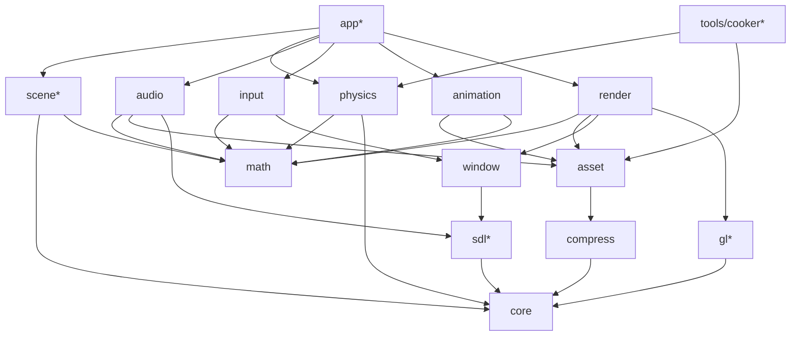
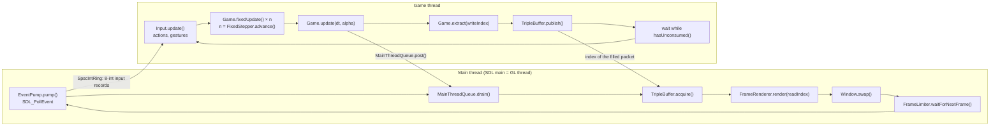
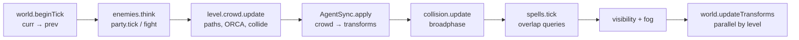

# 01. Architecture: how a frame happens

This chapter follows one frame through Jeddy, from the moment SDL hands over a mouse event to the
moment the image is swapped onto the screen. On the way you will meet every structural idea the
rest of the guide builds on:

- the **module map** and the rules that keep modules apart (`module-info.java`, DESIGN §3);
- the **threads**: the SDL main thread that also renders, the game thread with its fixed 30 Hz
  ticks, the job workers, and the native audio thread (DESIGN §5, decisions D6 and D7);
- the **frame pipeline**: input pump, fixed ticks, per-frame update, extraction into a
  `RenderPacket`, the lock-free `TripleBuffer` handoff, rendering and swap;
- the **main-thread command queue** that carries SDL calls the game thread may not make (D10);
- **data-oriented design** as this codebase practises it: struct-of-arrays, generational `int`
  handles, sparse sets, the transform hierarchy;
- the **job system** that both threads use for parallel loops;
- the **app layer** (`JeddyApp`, `Game`, `World`, `WorldRenderer`) and two worked examples, the
  game template and the iso demo.

Where it lives:

| What | Where |
|---|---|
| Application loop | [`modules/app/.../JeddyApp.java`](../../modules/app/src/main/java/dev/jeddy/app/JeddyApp.java), [`Game.java`](../../modules/app/src/main/java/dev/jeddy/app/Game.java), [`FrameRenderer.java`](../../modules/app/src/main/java/dev/jeddy/app/FrameRenderer.java), [`AppContext.java`](../../modules/app/src/main/java/dev/jeddy/app/AppContext.java), [`MainContext.java`](../../modules/app/src/main/java/dev/jeddy/app/MainContext.java) |
| Thread handoff | [`core/concurrent/TripleBuffer.java`](../../modules/core/src/main/java/dev/jeddy/core/concurrent/TripleBuffer.java), [`SpscIntRing.java`](../../modules/core/src/main/java/dev/jeddy/core/concurrent/SpscIntRing.java), [`window/MainThreadQueue.java`](../../modules/window/src/main/java/dev/jeddy/window/MainThreadQueue.java) |
| Simulation clock | [`core/time/FixedStepper.java`](../../modules/core/src/main/java/dev/jeddy/core/time/FixedStepper.java) |
| Frame data | [`render/RenderPacket.java`](../../modules/render/src/main/java/dev/jeddy/render/RenderPacket.java), [`RenderPackets.java`](../../modules/render/src/main/java/dev/jeddy/render/RenderPackets.java) |
| Data layout | [`core/handle`](../../modules/core/src/main/java/dev/jeddy/core/handle), [`core/collections/SparseSet.java`](../../modules/core/src/main/java/dev/jeddy/core/collections/SparseSet.java), [`modules/scene`](../../modules/scene/src/main/java/dev/jeddy/scene) |
| Parallelism | [`core/job`](../../modules/core/src/main/java/dev/jeddy/core/job), [`core/pool/PerWorker.java`](../../modules/core/src/main/java/dev/jeddy/core/pool/PerWorker.java) |
| World integration | [`app/world/World.java`](../../modules/app/src/main/java/dev/jeddy/app/world/World.java), [`WorldRenderer.java`](../../modules/app/src/main/java/dev/jeddy/app/world/WorldRenderer.java), [`AgentSync.java`](../../modules/app/src/main/java/dev/jeddy/app/world/AgentSync.java), [`app/audio/AudioSync.java`](../../modules/app/src/main/java/dev/jeddy/app/audio/AudioSync.java) |
| Examples | [`samples/game-template/.../MyGame.java`](../../samples/game-template/src/main/java/com/example/mygame/MyGame.java), [`samples/iso-demo/.../DemoGame.java`](../../samples/iso-demo/src/main/java/dev/jeddy/samples/iso/DemoGame.java) |

Performance rules (zero allocation per frame, FFM) appear here only as far as they shape the
architecture. [12 Fast Java](12-java-performance.md) covers them in depth.

---

## The module map

### Concept

A game engine has many parts that are each easy to test alone and hard to test together: math,
physics, rendering, audio, input. If the renderer can reach into the physics world, and physics can
reach into the scene graph, every change ripples through everything. Jeddy fixes the direction of
every dependency up front and lets the Java module system (JPMS) enforce it.

### The graph

This is the graph from DESIGN §3.2. An arrow means "depends on". Edges to `core` and transitive
edges are left out, as in DESIGN.



A one-line summary of each runtime module:

| Module | Responsibility |
|---|---|
| `core` | Primitive collections, handles, pools, off-heap memory, job system, native loader, profiler, logging |
| `math` | Vectors, matrices, quaternions, intersection tests, SoA bulk kernels (no dependencies at all) |
| `compress` | zstd through FFM |
| `sdl` | Raw jextract bindings for SDL3 and SDL3_mixer, exported only to engine modules |
| `gl` | Generated OpenGL 4.6 bindings, the function loader, capabilities |
| `window` | SDL video, the window and GL context, swap, frame pacing, cursors, the main-thread queue |
| `input` | Event pump, device state, action mapping, CRPG gestures |
| `asset` | Virtual file system, `.jpak` archives, async loading, format readers |
| `render` | GL resources, render packets, culling, sorting, multi-draw-indirect, PBR, shadows, post |
| `audio` | SDL3_mixer wrapper: voices, buses, 3D emitters |
| `physics` | Collision, queries, navmesh, pathfinding, crowds, visibility, triggers |
| `animation` | Skeletons, baked clips, per-instance animation state, skinning palettes |
| `scene` | Entity handles, sparse-set component stores, the SoA transform hierarchy |
| `app` | The application loop and the glue between all of the above |

### The rules, and how they are enforced

DESIGN §3.2 lists the rules. The most important one for this chapter:

> `physics`, `scene`, `animation` and `render` don't know about each other. `app` (or the game)
> copies data between them in explicit *sync/extract* systems.

The rule is not a convention someone has to remember. Each module declares what it reads, and the
compiler refuses everything else. Here is
[`modules/scene/src/main/java/module-info.java`](../../modules/scene/src/main/java/module-info.java)
(Javadoc cut):

```java
module dev.jeddy.scene {
    requires transitive dev.jeddy.core;
    requires transitive dev.jeddy.math;

    exports dev.jeddy.scene;
}
```

`scene` reads `core` and `math` and nothing else. If someone writes
`import dev.jeddy.render.RenderPacket;` inside `TransformStore`, javac fails: the package
`dev.jeddy.render` is not visible to a module that does not read `dev.jeddy.render`.

The second rule is about raw native bindings. Games never see them; only the engine modules that
wrap them do. That is a *qualified export*, from
[`modules/gl/src/main/java/module-info.java`](../../modules/gl/src/main/java/module-info.java):

```java
module dev.jeddy.gl {
    requires transitive dev.jeddy.core;

    exports dev.jeddy.gl;
    exports dev.jeddy.gl.ffi to
            dev.jeddy.render,
            dev.jeddy.app,
            dev.jeddy.samples.triangle,
            dev.jeddy.samples.iso;
}
```

The two `samples` modules on that list are exceptions by choice: the triangle sample draws with
raw GL on purpose, and the iso demo calls `glFinish` and reads pixels back for its screenshots. A
game built on `app` does not get the package.

And `app` sits on top, reading everything (`requires transitive` for the leaf modules, plain
`requires dev.jeddy.sdl`), so a game that requires `dev.jeddy.app` gets the whole public API.

### Why this shape

- **Every leaf is testable alone.** `physics` tests need no GPU, `render` tests need no navmesh.
  The CI runs most tests on plain runners with SDL's dummy video driver.
- **Data flow is visible.** When the crowd moves an agent, nothing magic happens: `AgentSync`
  (in `app`) reads the crowd's position arrays and writes the transform store. You can find every
  place where data crosses a module boundary by looking at `app`.
- **No cycles.** A module graph with cycles cannot be built as JPMS modules at all.

The cost is some copying: physics positions are copied into transforms, transforms into render
packets. Copies of contiguous primitive arrays are cheap. Chasing pointers across a shared object
graph is not.

### Try it

Open any `module-info.java` under `modules/*/src/main/java` and compare its `requires` lines
with the graph. Then add `import dev.jeddy.render.RenderPacket;` to
`modules/scene/src/main/java/dev/jeddy/scene/TransformStore.java` and run
`./gradlew :scene:compileJava`. Revert afterwards.

---

## The threads

### Concept: who may call what

SDL3 has a hard rule on Windows and Linux: `SDL_PollEvent`, `SDL_GL_MakeCurrent` and
`SDL_GL_SwapWindow` must run on the thread that called `SDL_Init(SDL_INIT_VIDEO)` (DESIGN §5). An
OpenGL context is also current on exactly one thread at a time. You cannot sidestep either rule,
so Jeddy makes a decision (D6):

> The SDL main thread is also the GL/render thread, and simulation runs on a dedicated game thread.

That gives four kinds of threads:

| Thread | Created by | Runs | Must never |
|---|---|---|---|
| **Main** (the thread that calls `JeddyApp.run`) | the JVM | event polling, the command queue, all GL calls, swap, frame pacing | run gameplay |
| **Game** (`jeddy-game`) | `JeddyApp` | input processing, fixed ticks, per-frame update, extraction | call SDL video functions or GL |
| **Workers** (`jeddy-worker-N`) | `JobSystem` | parallel slices of work for either thread | block on IO |
| **Audio** | SDL3_mixer, natively | mixing and decoding | run Java code |

One more kind appears around assets: a few **virtual threads** for blocking file IO, whose
results are decoded on the workers and uploaded on the main thread under a time budget (D26).

### The SDL main thread, enforced

[`modules/window/.../Platform.java`](../../modules/window/src/main/java/dev/jeddy/window/Platform.java)
initializes SDL and marks the calling thread:

```java
        Sdl.check(SDL_Init(SDL_INIT_VIDEO() | SDL_INIT_EVENTS() | SDL_INIT_GAMEPAD()), "SDL_Init");
        SdlThread.markMainThread();
```

Every main-thread-only call then starts with a check, for example in
[`Window.java`](../../modules/window/src/main/java/dev/jeddy/window/Window.java):

```java
    /** Presents the back buffer. Allocates nothing. */
    public void swap() {
        SdlThread.assertMainThread("SDL_GL_SwapWindow");
        Sdl.check(SDL_GL_SwapWindow(handle), "SDL_GL_SwapWindow");
    }
```

[`SdlThread.assertMainThread`](../../modules/sdl/src/main/java/dev/jeddy/sdl/SdlThread.java) is
one field read and one comparison. If it fails, the exception message tells you what to do:
"Send it through the main-thread command queue (DESIGN §5)". A bug that would otherwise be a
driver crash on one platform becomes a clear error on all of them.

### Why a separate game thread

If the main thread did both simulation and rendering, a slow GL frame would slow the simulation
and a slow simulation frame would stall the GPU feed. With two threads, the game thread computes
frame N while the main thread submits frame N−1 to the GPU. On an 8-core machine both run in
parallel, and both borrow the same job workers for the heavy loops.

### Why no Java on the audio thread (D7)

Audio is a real-time task: the mixer must fill a buffer every few milliseconds, or the speaker
clicks. A Java mixer would run Java code on that thread, and any pause there (a safepoint, a JIT
deoptimization, a GC phase) is an audible glitch. Jeddy uses SDL3_mixer, which mixes natively.
The game thread only *controls* the mixer: `Audio.update` applies a frame's changes inside
`MIX_LockMixer`/`MIX_UnlockMixer` (DESIGN §12.3). The engine also installs no SDL log callback,
because SDL can log from its internal threads, including audio (DESIGN §4.4).

The DESIGN §5 timeline puts it together:

```
              frame N                         frame N+1
Main thread   [poll events]->ring  [render packet N-1 → GL submit][swap] [poll][render N  ][swap]
Game thread   [drain input][fixed ticks: gameplay→physics→nav→FoW][variable: anim, camera][extract → packet N] ...
Workers       ████ parallelFor / job graphs for both threads (culling, sorting, MDI build, nav, crowd, FoW, anim) ████
IO (virtual)  file / pak reads, then decode jobs on workers, then GPU upload queue (main thread, budgeted)
Audio (SDL)   native mixing inside SDL3_mixer. No Java code runs here
```

---

## One frame, end to end

### The shape of the loop

Here are both loops side by side. Arrows between the subgraphs are the three channels the
threads share: the input ring, the command queue and the frame triple buffer.



### The main loop

From [`JeddyApp.java`](../../modules/app/src/main/java/dev/jeddy/app/JeddyApp.java):

```java
    private void mainLoop(MainContext main) {
        Window window = main.window;
        FrameLimiter limiter = new FrameLimiter();
        int cap = -1;
        while (running) {
            main.pump.pump();
            main.queue.drain();
            boolean fresh = frames.acquire();
            int wantedCap;
            if (window.shouldSkipRendering()) {
                wantedCap = config.backgroundFps;
            } else {
                if (config.renderer != null) {
                    config.renderer.render(main, frames.readIndex(), fresh);
                }
                if (window.hasGlContext()) {
                    window.swap();
                }
                boolean pacedBySwap = window.hasGlContext() && window.vsync() != VSync.OFF;
                wantedCap = pacedBySwap ? 0 : config.maxFps;
            }
            if (wantedCap != cap) {
                limiter.setTargetFps(wantedCap);
                cap = wantedCap;
            }
            limiter.waitForNextFrame();
            main.frame++;
            if (main.frame == config.quitAfterFrames) {
                requestStop();
            }
            if (config.observer != null) {
                config.observer.onMainFrame(main);
            }
        }
    }
```

Step by step:

1. **Pump events.** `EventPump.pump()` calls `SDL_PollEvent` until the queue is empty, reads each
   event's fields at fixed offsets out of one preallocated `SDL_Event` segment, and writes a fixed
   8-`int` record per event into an `SpscIntRing` for the game thread. No objects are created per
   event (DESIGN §12.2).
2. **Drain requests.** `MainThreadQueue.drain()` runs the cursor, text-input and window-mode
   requests that the game thread posted during its last frame (see below).
3. **Acquire a frame.** `frames.acquire()` swaps in the newest packet the game thread published.
   `fresh` is `false` when nothing new arrived; the renderer then draws the same packet again.
4. **Render and swap.** The `FrameRenderer` issues all GL calls; then the back buffer is presented.
   When the window is minimized (`shouldSkipRendering()`), nothing is drawn and the loop is capped
   at `backgroundFps` (20 by default).
5. **Pace.** With VSync on, `SDL_GL_SwapWindow` already waits for the display, so the limiter is
   off (`wantedCap = 0`). Without VSync, or without a GL context, the
   [`FrameLimiter`](../../modules/window/src/main/java/dev/jeddy/window/FrameLimiter.java) caps the
   rate at `maxFps` (240 by default) on a fixed time grid with `SDL_DelayPrecise`.

### The game loop

Also from `JeddyApp.java`:

```java
    private void runGame(AppContext ctx) {
        try {
            game.init(ctx);
            ctx.actions.update(ctx.input); // builds binding indexes before the first frame
            long last = System.nanoTime();
            ctx.stepper.reset(last);
            float dt = ctx.stepper.stepSeconds();
            while (running) {
                int idle = 0;
                while (frames.hasUnconsumed() && running) {
                    idle = WAITER.idle(idle);
                }
                if (!running) {
                    break;
                }
                long now = System.nanoTime();
                ctx.frameNanos = now - last;
                last = now;
                ctx.frame++;
                ctx.input.update();
                ctx.actions.update(ctx.input);
                ctx.virtualCursor.update(ctx.input, ctx.frameNanos * 1e-9f);
                ctx.gestures.update(ctx.input);
                if (ctx.input.isQuitRequested() || ctx.input.isCloseRequested()) {
                    if (game.onQuitRequested(ctx)) {
                        requestStop();
                    }
                    ctx.input.clearQuitRequest();
                }
                int ticks = ctx.stepper.advance(now);
                for (int i = 0; i < ticks; i++) {
                    game.fixedUpdate(ctx, dt);
                }
                game.update(ctx, ctx.frameNanos * 1e-9f, ctx.stepper.alpha());
                game.extract(ctx, frames.writeIndex());
                frames.publish();
            }
        } catch (Throwable t) {
            fail(Thread.currentThread().getName(), t);
        } finally {
            // ...
        }
    }
```

1. **Wait for the main thread.** While the previously published frame has not been acquired, the
   game thread spins, yields, then parks briefly (`WAITER` is a
   `SpinParkWaiter(100, 20, 50_000)`: 100 spins, 20 yields, then 50 µs parks). This keeps the game
   thread **at most one frame ahead** of rendering, so it runs at the main thread's rate. Without
   it, the game thread would simulate frames that are never shown.
2. **Input.** `Input.update()` drains the ring into device state (keys, mouse, pads); the action
   map, the gamepad virtual cursor and the CRPG gestures (click vs drag, box select, edge scroll)
   update from it.
3. **Fixed ticks.** `FixedStepper.advance(now)` says how many 30 Hz ticks are due. The game runs
   that many `fixedUpdate` calls with a constant `dt` of one tick (1/30 s).
4. **Per-frame update.** `update` gets the real frame time and `alpha`, the position of this frame
   between the last two ticks.
5. **Extract and publish.** `extract` fills the frame buffer at `writeIndex` (normally a
   `RenderPacket`), and `publish()` hands it to the main thread.

### Input latency

An event polled at the start of main frame N is consumed by the game thread in its frame N, and
that frame's packet is rendered in main frame N+1. That is about two frames plus the GPU queue
(DESIGN §5), which is fine for a CRPG. Hover feedback could be drawn on the main thread from the
newest mouse position to hide it.

### Shutdown and crashes

Any thread can stop the app (`AppContext.quit()` sets the volatile `running` flag). An uncaught
exception on either thread goes to `fail(...)`, which records the first failure and stops both
loops. The `finally` block in `runMain` then tears things down in reverse order: join the game
thread, `FrameRenderer.shutdown`, close the event pump, cursors, window and job system, and show
an SDL message box with the stack trace (unless `AppConfig.crashDialog(false)`). `run` returns 0
after a clean exit and 1 after a crash.

---

## Fixed ticks and alpha

### Concept

Simulation code is much easier to write, test and keep deterministic if every step has the same
length. Pathfinding, crowd avoidance and fog of war in Jeddy run at a fixed **30 Hz**
(confirmed in D13). Rendering, on the other hand, should run as fast as the display allows: 60,
144 or 240 frames per second.

The standard answer (Glenn Fiedler's "Fix Your Timestep!") is an **accumulator**. Each frame you
add the real elapsed time to an accumulator and run as many fixed ticks as fit into it. The
remainder, divided by the tick length, is how far the frame is into the *next* tick:

```math
\text{ticks} = \left\lfloor \frac{A + \Delta t}{h} \right\rfloor, \qquad
A' = (A + \Delta t) - \text{ticks}\cdot h, \qquad
\alpha = \frac{A'}{h} \in [0, 1)
```

where $A$ is the accumulator before the frame, $\Delta t$ the real time since the last frame, $h$
the tick length and $A'$ the accumulator after the ticks.

### Numeric example

At 30 Hz, $`h = \operatorname{round}(10^9 / 30) = 33\,333\,333`$ ns. Suppose the display runs at 60
Hz, so $`\Delta t \approx 16\,666\,667`$ ns:

| Frame | $A + \Delta t$ (ns) | ticks | $A'$ (ns) | $\alpha$ |
|---|---|---|---|---|
| 1 | 16 666 667 | 0 | 16 666 667 | 0.50 |
| 2 | 33 333 334 | 1 | 1 | ≈ 0.00 |
| 3 | 16 666 668 | 0 | 16 666 668 | 0.50 |
| 4 | 33 333 335 | 1 | 2 | ≈ 0.00 |

Every other frame runs one tick, and `alpha` alternates between about 0.5 and 0. At 144 Hz,
`alpha` walks through roughly 0, 0.21, 0.42, 0.62, 0.83 between ticks.

### The spiral of death

If one frame takes 2 seconds (loading, a debugger breakpoint), the accumulator holds 60 ticks. If
the game then tried to run all of them, that frame would take even longer, and the next one would
owe even more ticks. To prevent that "spiral of death", the accumulator is capped at
`maxStepsPerFrame` ticks (4 by default, `AppConfig.maxTicksPerFrame`). The game simply slows down
for a moment instead.

### Jeddy's implementation

[`FixedStepper.advance`](../../modules/core/src/main/java/dev/jeddy/core/time/FixedStepper.java):

```java
    public int advance(long nowNanos) {
        if (last == Long.MIN_VALUE) {
            last = nowNanos;
            return 0;
        }
        long elapsed = Math.max(0, nowNanos - last);
        last = nowNanos;
        if (paused) {
            return 0;
        }
        long scaled = timeScale == 1.0 ? elapsed : (long) (elapsed * timeScale);
        accumulator = Math.min(accumulator + scaled, stepNanos * (long) maxStepsPerFrame);
        int steps = (int) (accumulator / stepNanos);
        accumulator -= steps * stepNanos;
        ticks += steps;
        return steps;
    }

    /** Returns the fraction of the next tick already elapsed, in {@code [0, 1)}. */
    public float alpha() {
        return (float) accumulator / stepNanos;
    }
```

Three details matter:

- Time is kept in `long` nanoseconds, not `float` seconds, so the accumulator never drifts after
  hours of play.
- **Pause** (the real-time-with-pause of a CRPG) returns 0 ticks and leaves the accumulator alone,
  so `alpha` freezes and the rendered image stays still. `AppContext.simulation()` exposes
  `setPaused`, `setTimeScale` and `ticks()` to the game.
- After a 1-second stall the cap holds $`4h = 133\,333\,332`$ ns, which is exactly 4 ticks, so
  `advance` returns 4 and `alpha` is 0.

### Try it

`./gradlew :core:test --tests 'dev.jeddy.core.UtilitiesTest'` runs
`fixedStepperCapsAndInterpolates`, which checks the cap, pause and time scale. The app-level test
`./gradlew :app:test --tests 'dev.jeddy.app.JeddyAppTest'` runs a real loop under SDL's dummy
driver for one second and asserts between 25 and 35 ticks and an `alpha` that spans the tick
(`runsTicksAtThirtyHertzAndQuitsCleanly`).

---

## Interpolation between ticks

### Concept

If the renderer drew the state of the last tick, a character walking at 30 Hz would visibly jump
every 33 ms on a 144 Hz screen. Instead the renderer **interpolates** between the last two ticks.
For every moving instance the packet carries two world transforms, $`M_{\text{prev}}`$ (after the
tick before last) and $`M_{\text{curr}}`$ (after the last tick), and the renderer draws

```math
M(\alpha) = M_{\text{prev}} + \alpha \,(M_{\text{curr}} - M_{\text{prev}})
```

with $\alpha$ from `FixedStepper.alpha()`. The price is that the screen shows the world up to one
tick (33 ms) in the past. The gain is perfectly smooth motion at any frame rate.

Numeric example (it is exactly
[`RenderPacketTest.interpolatesBetweenTicks`](../../modules/render/src/test/java/dev/jeddy/render/RenderPacketTest.java)):
a translation that was $x = 0$ at the previous tick and $x = 10$ at the current one, drawn at
$\alpha = 0.25$, is drawn at $x = 0 + 0.25 \cdot (10 - 0) = 2.5$.

### Where prev and curr come from

The transforms are row-major 3×4 affine matrices, 12 floats each (the layout is explained in
[03 Rotations and transforms](03-rotations-and-transforms.md)). The game keeps the "previous"
copy itself. [`World.beginTick`](../../modules/app/src/main/java/dev/jeddy/app/world/World.java)
copies every moving renderable's world transform before gameplay moves anything:

```java
    public void beginTick() {
        float[] world = transforms.world();
        for (int i = 0, n = renderables.size(); i < n; i++) {
            if ((flags[i] & RenderPacket.FLAG_STATIC) != 0) {
                continue;
            }
            int s = transforms.indexOf(entityOf[i]);
            System.arraycopy(world, s * 12, prev, i * 12, 12);
            hasPrev[i] = true;
        }
    }
```

`World.extract` then appends each instance with both transforms. A static renderable passes its
current transform twice, because it never moves (that skip was perf fix F7 in
[docs/perf/m10.md](../perf/m10.md): 16k props were being copied every tick):

```java
                } else if (wantStatic) {
                    k =
                            packet.add(
                                    world,
                                    s * 12,
                                    world,
                                    s * 12,
                                    mesh.handle(),
                                    material[i],
                                    flags[i],
                                    entityOf[i]);
                } else {
                    // ...
                    k =
                            packet.add(
                                    prev,
                                    i * 12,
                                    world,
                                    s * 12,
                                    mesh.handle(),
                                    material[i],
                                    flags[i],
                                    entityOf[i]);
                }
```

### Where the blend happens

The packet offers `interpolatedWorld(i, out, o)`, which calls
[`AffineOps.lerp`](../../modules/math/src/main/java/dev/jeddy/math/AffineOps.java) element-wise
over the 12 floats. The hot path, though, does the blend while it writes GPU instance records.
[`DrawBuilder.writeRecords`](../../modules/render/src/main/java/dev/jeddy/render/draw/DrawBuilder.java)
runs on the job workers and writes straight into persistently mapped GPU memory (D30):

```java
    private void writeRecords(int start, int end, int thread) {
        RenderPacket p = packet;
        MemorySegment m = memory;
        float[] prev = p.prevWorld;
        float[] curr = p.currWorld;
        float a = p.alpha;
        for (int k = start; k < end; k++) {
            int item = order[k];
            int instance = visible[itemInstance[item]];
            int w = instance * 12;
            long o = instanceBase + (long) k * INSTANCE_BYTES;
            for (int j = 0; j < 12; j++) {
                float x = prev[w + j];
                m.set(F32, o + 4L * j, x + (curr[w + j] - x) * a);
            }
            m.set(I32, o + 48, itemMaterial[item]);
            m.set(I32, o + 52, p.flags[instance]);
            m.set(I32, o + 56, p.entity[instance]);
            m.set(F32, o + 60, p.fade[instance]);
        }
    }
```

Element-wise lerp of a rotation matrix is not a true rotation blend: halfway between two rotations
it shrinks the object slightly. The `AffineOps.lerp` Javadoc says so: "fine for render
interpolation between two close simulation ticks; not a true rotation blend". Characters turn at
most a few degrees in 33 ms, so the error is invisible, and the blend costs 12 multiply-adds.
[03 Rotations and transforms](03-rotations-and-transforms.md) shows the exact alternative (slerp).

Animation poses are the exception: `World.updateAnimations` runs per *frame*, not per tick, so
poses need no interpolation at all (D81, §13.4).

---

## The triple buffer handoff

### Concept

The game thread writes packet N while the main thread reads packet N−1. If they shared one
packet, they would need a lock and would wait for each other. With two packets they could swap,
but the swap needs both threads to agree on the moment. With **three** buffers neither ever waits:
one belongs to the writer, one to the reader, and the third holds the newest finished frame.

### Implementation

[`TripleBuffer`](../../modules/core/src/main/java/dev/jeddy/core/concurrent/TripleBuffer.java)
does not own the buffers; it only exchanges the indices 0, 1 and 2. Its whole state is one
`AtomicInteger` plus two plain fields:

```java
public final class TripleBuffer {
    private static final int INDEX_MASK = 3;
    private static final int FRESH = 4;

    private final AtomicInteger latest = new AtomicInteger(2);
    private int writeIndex;
    private int readIndex = 1;
    // ...

    public boolean publish() {
        int previous = latest.getAndSet(writeIndex | FRESH);
        writeIndex = previous & INDEX_MASK;
        published++;
        if ((previous & FRESH) != 0) {
            overwritten++;
            return true;
        }
        return false;
    }

    public boolean hasUnconsumed() {
        return (latest.get() & FRESH) != 0;
    }

    public boolean acquire() {
        if ((latest.get() & FRESH) == 0) {
            return false;
        }
        int previous = latest.getAndSet(readIndex);
        readIndex = previous & INDEX_MASK;
        return true;
    }
    // ...
}
```

`latest` packs an index (bits 0–1) and a FRESH flag (bit 2, the value 4) that means "published
but not yet acquired". `writeIndex` is touched only by the producer, `readIndex` only by the
consumer, so they need no synchronization. A walk-through from the initial state (`*` marks
FRESH):

| Step | write | latest | read | Notes |
|---|---|---|---|---|
| start | 0 | 2 | 1 | nothing published |
| game `publish()` | 2 | 0* | 1 | the game takes the old `latest` (2) to fill next |
| main `acquire()` | 2 | 1 | 0 | main renders 0, gives back 1 |
| game `publish()` | 1 | 2* | 0 | |
| main `acquire()` | 1 | 0 | 2 | |

At every moment the three indices are distinct, so the threads never touch the same packet.

**Memory ordering.** The game thread writes plain fields of the packet, then calls `getAndSet`;
the main thread calls `getAndSet` (or reads `latest`), then reads the packet. An atomic
read-modify-write on an `AtomicInteger` has volatile semantics, so everything the producer wrote
before `publish()` *happens before* everything the consumer reads after `acquire()` saw that
index. That is the only synchronization in the whole handoff (DESIGN §5).

**Overwrites.** If the producer publishes twice before the consumer acquires, the first frame is
dropped and `publish()` returns `true`. `JeddyApp` prevents that by waiting while
`hasUnconsumed()` is true, as you saw in the game loop.

### Three packets

[`RenderPackets`](../../modules/render/src/main/java/dev/jeddy/render/RenderPackets.java) is the
other half: three preallocated `RenderPacket`s, indexed the same way.

```java
public final class RenderPackets {
    private final RenderPacket[] packets = new RenderPacket[3];

    /** Creates three packets for {@code capacity} instances each. */
    public RenderPackets(int capacity) {
        for (int i = 0; i < 3; i++) {
            packets[i] = new RenderPacket(capacity);
        }
    }

    /** Returns the packet at a triple-buffer index (0 to 2). */
    public RenderPacket packet(int index) {
        return packets[index];
    }
}
```

Note that `JeddyApp` never sees a `RenderPacket`. It passes `writeIndex` to `Game.extract` and
`readIndex` to `FrameRenderer.render`. `app` does depend on `render`, but the loop itself is
generic: any per-frame data the game wants to hand over can ride on the same index. The iso demo
does exactly that for its HUD values in
[`DemoHud`](../../samples/iso-demo/src/main/java/dev/jeddy/samples/iso/DemoHud.java), whose
fields are arrays of length 3:

```java
final class DemoHud {
    static final int FRAMES = 3;

    final boolean[] loading = new boolean[FRAMES];
    final float[] loadProgress = new float[FRAMES];
    // ...
    final long[] gameNanos = new long[FRAMES];
    // ...
}
```

`DemoGame.extract` writes `hud.gameNanos[index]`; `DemoRenderer.render` reads the same slot for
the same frame.

### What is in a RenderPacket

[`RenderPacket`](../../modules/render/src/main/java/dev/jeddy/render/RenderPacket.java) is
"everything the main thread needs to draw one frame". Instances are stored as SoA arrays with
public fields:

| Field | Per instance | Meaning |
|---|---|---|
| `prevWorld`, `currWorld` | 12 floats | world transform at the previous and current tick |
| `mesh` | int | mesh handle |
| `material` | int | material index or `MESH_MATERIALS` (-1) |
| `flags` | int | `FLAG_STATIC`, `FLAG_CASTS_SHADOW`, ..., highlight style in bits 8–11, palette in bits 12–31 |
| `entity` | int | the entity it came from (picking) |
| `bounds` | 4 floats | world bounding sphere |
| `fade` | float | camera fade |

Plus per-frame values: `alpha`, the camera matrices (`view`, `projection`, `viewProjection`,
`inverseViewProjection`, `frustumPlanes`, `eye`), lights (16 floats each in GPU layout), decals,
particle emitters, reveal points, the fog-of-war grid, skinning palettes, debug lines, `frame`,
`time` and `staticVersion`. Later chapters explain each.

Two methods make it safe to fill on the game thread without allocating: `reset()` sets the
counts back to zero without clearing the arrays, and `reserve(...)` grows the arrays once, up
front, to the game's known peak (fix F5 in [docs/perf/m10.md](../perf/m10.md); D65).

### What the main thread does with it

[`WorldRenderer.render`](../../modules/app/src/main/java/dev/jeddy/app/world/WorldRenderer.java)
is the standard `FrameRenderer`:

```java
    @Override
    public void render(MainContext ctx, int index, boolean fresh) {
        long start = System.nanoTime();
        int w = ctx.window().pixelWidth();
        int h = ctx.window().pixelHeight();
        if (w != width || h != height) {
            // ... resize
        }
        upload.beginFrame();
        assets.pumpUploads(config.uploadBudgetNanos);
        materials.update();
        meshes.update();
        upload.endFrame();
        // ... environment cube once it is loaded
        RenderPacket p = packets.packet(index);
        if (w > 0 && h > 0) {
            renderer.render(p);
            overlayRing.beginFrame();
            lines.draw(p, device.state(), overlayRing);
            if (config.hud != null) {
                config.hud.draw(overlay, p, index, w, h);
            }
            overlay.draw(device.state(), overlayRing, w, h);
            overlayRing.endFrame();
        }
        lastFrameNanos = System.nanoTime() - start;
    }
```

First it spends up to `uploadBudgetNanos` (4 ms by default) uploading assets that finished
loading. Then
[`SceneRenderer.render`](../../modules/render/src/main/java/dev/jeddy/render/SceneRenderer.java)
culls the packet's instances against the frustum, builds sorted draw items on the workers, writes
lights, shadows and frame constants, and executes the frame graph. Debug lines and the HUD overlay
go on top. [06 Renderer architecture](06-renderer-architecture.md) covers that pipeline; here it
is enough to know that the main thread reads only the packet, never the game's `World`.

### Try it

- `./gradlew :core:test --tests 'dev.jeddy.core.concurrent.TripleBufferTest'`:
  `consumerSeesWholeFramesInOrder` publishes 200 000 frames from one thread and checks that the
  other never sees a torn or out-of-order frame.
- `./gradlew :render:test --tests 'dev.jeddy.render.RenderPacketTest'`:
  `gameAndMainThreadsExchangePacketsWithoutLocks` does the same with real `RenderPacket`s, and
  `fillingAPacketAllocatesNothing` proves that `reset` plus 2000 `add` calls allocate 0 bytes.

---

## The main-thread command queue

### Concept

The game thread decides that the cursor should become a sword (the player hovers an enemy), that
text input should start (a name field got focus), or that the window should go fullscreen (the
options menu). All of those are SDL calls that only the main thread may make. Locking a mutex
around them would make the game thread wait for rendering. Instead the game thread *describes*
the request as a few integers and puts it into a lock-free queue; the main thread executes it at
the start of its next frame (D10, TASKS M2-10).

### Implementation

[`MainThreadQueue`](../../modules/window/src/main/java/dev/jeddy/window/MainThreadQueue.java)
stores fixed records of an opcode and five `int` arguments in an `SpscIntRing`:

```java
    public boolean post(int opcode, int a, int b, int c, int d, int e) {
        int[] r = producerScratch;
        r[0] = opcode;
        r[1] = a;
        r[2] = b;
        r[3] = c;
        r[4] = d;
        r[5] = e;
        if (ring.offer(r, 0, RECORD_INTS)) {
            return true;
        }
        dropped++;
        return false;
    }

    public int drain() {
        SdlThread.assertMainThread("MainThreadQueue.drain");
        int[] r = consumerScratch;
        Handler[] hs = handlers;
        int count = 0;
        while (ring.poll(r, 0, RECORD_INTS)) {
            boolean handled = false;
            for (int i = 0; i < hs.length && !handled; i++) {
                handled = hs[i].handle(r[0], r[1], r[2], r[3], r[4], r[5]);
            }
            if (!handled) {
                unhandled++;
            }
            count++;
        }
        return count;
    }
```

Things to notice:

- `SpscIntRing.offer(int[], int, int)` publishes all six ints or none, so the main thread never
  sees half a record. The producer and consumer each have their own scratch array, so neither
  allocates.
- A full queue drops the request and counts it, rather than blocking the game thread. A full queue
  means the main thread has stalled for a long time anyway.
- Opcodes are partitioned: `window` uses 1–63, `input` 64–127 (gamepad rumble and LEDs, handled by
  `EventPump`), and games 128 and up. `JeddyApp.runMain` registers the `WindowCommands` and
  `EventPump` handlers; a game adds its own in `FrameRenderer.init` through
  `MainContext.queue().addHandler(...)`.

[`WindowCommands`](../../modules/window/src/main/java/dev/jeddy/window/WindowCommands.java) is both
the opcode list and the handler. Game code calls the static helpers, which encode values as ints.
A float travels as its raw bits:

```java
    /** Requests a cursor warp to window coordinates. */
    public static boolean postWarpMouse(MainThreadQueue queue, float x, float y) {
        return queue.post(
                WARP_MOUSE, Float.floatToRawIntBits(x), Float.floatToRawIntBits(y), 0, 0, 0);
    }
```

and the main-thread side decodes them in a `switch`:

```java
            case WARP_MOUSE -> window.warpMouse(Float.intBitsToFloat(a), Float.intBitsToFloat(b));
            case SET_WINDOW_MODE -> window.setMode(MODES[a], b, c, d / 1000f);
```

The input ring is the same idea in the other direction: `EventPump` (main) encodes each SDL event
as an 8-int record, and `Input.update` (game) decodes it.

### Why not just a `Runnable` queue?

A `ConcurrentLinkedQueue<Runnable>` would be simpler to write, but every `post` would allocate a
node and usually a capturing lambda, and it would hide which SDL calls are being made. A fixed
record of ints allocates nothing, is trivially serializable for a replay log, and the set of
opcodes documents exactly what the game thread can ask for.

### Try it

`./gradlew :window:test --tests 'dev.jeddy.window.MainThreadQueueTest'` checks that
`drain()` throws off the main thread, that a full queue drops and counts, that posting and
draining allocate nothing, and that `WindowCommands` really change the window.

---

## Data-oriented design in practice

### Why struct-of-arrays

The object-oriented way to store 300 agents is `Agent[] agents`, each object with `x`, `y`, `z`,
`vx`, `vz`, `health`, `target` and so on. In memory that is an array of pointers to objects
scattered over the heap. A loop that only needs positions loads every object's header and all its
other fields into the cache, and the garbage collector has to trace all of them.

Struct-of-arrays (SoA) stores one primitive array per field instead:

```
Array of structs (Agent[]):            Struct of arrays:
  agents ─► [ref][ref][ref][ref]         px  [x0 x1 x2 x3 x4 ...]   one cache line = 16 floats
              │    │    │                py  [y0 y1 y2 y3 y4 ...]
              ▼    ▼    ▼                pz  [z0 z1 z2 z3 z4 ...]
            ┌────┐┌────┐┌────┐           hp  [h0 h1 h2 h3 h4 ...]
            │hdr ││hdr ││hdr │
            │x y ││x y ││x y │   (objects anywhere on the heap,
            │z vx││z vx││z vx│    each load pulls in fields
            │hp..││hp..││hp..│    the loop does not need)
            └────┘└────┘└────┘
```

A loop over `px[i]`, `py[i]`, `pz[i]` reads three dense streams. C2 removes the bounds checks
when the loop index provably stays in range and can vectorize simple loops (superword). The GC
sees three arrays, not 300 objects. DESIGN §4.1 makes SoA the rule "for any collection of things
processed per frame". You have already seen SoA in `RenderPacket`; the rest of this section shows
how entities and transforms are stored the same way.

### Handles with generations

If data lives in arrays, a reference to "agent 17" is just the index 17. But when agent 17 dies
and slot 17 is reused for a new agent, an old index held by, say, a spell's target field would
silently point at the new agent. A **generational handle** packs the index with a generation
counter that changes every time the slot is freed.
[`Handles`](../../modules/core/src/main/java/dev/jeddy/core/handle/Handles.java) defines the bit
layout:

| Bits | 31 … 22 | 21 … 0 |
|---|---|---|
| Field | generation (10 bits, 1–1023) | slot index (22 bits, up to 4 194 303) |

```java
    public static int pack(int index, int generation) {
        return (generation << INDEX_BITS) | (index & INDEX_MASK);
    }

    public static int index(int handle) {
        return handle & INDEX_MASK;
    }

    public static int generation(int handle) {
        return handle >>> INDEX_BITS;
    }

    public static int nextGeneration(int generation) {
        return generation == MAX_GENERATION ? 1 : generation + 1;
    }
```

Example: slot 5 in generation 3 is $`3 \cdot 2^{22} + 5 = 12\,582\,917`$ (hex `0x00C00005`). Valid
handles never use generation 0, so the handle `0` is always `Handles.NULL`. Generations above 511
set bit 31 and make the `int` negative, which is why `generation()` uses the unsigned shift
`>>>`.

[`HandlePool`](../../modules/core/src/main/java/dev/jeddy/core/handle/HandlePool.java) allocates
and validates them. It keeps one generation per slot in an `int[]` and a FIFO free list of slot
indices:

```java
    public void free(int handle) {
        if (!isValid(handle)) {
            throw new IllegalArgumentException(
                    "stale or invalid handle " + Handles.toString(handle));
        }
        int index = Handles.index(handle);
        alive[index] = false;
        generations[index] = Handles.nextGeneration(generations[index]);
        free.addLast(index);
        liveCount--;
    }

    public boolean isValid(int handle) {
        int index = Handles.index(handle);
        return handle != Handles.NULL
                && index < highWater
                && alive[index]
                && generations[index] == Handles.generation(handle);
    }
```

Reusing freed slots in FIFO order (oldest freed first) spreads generation wrap-around over all
slots: with 10 bits, a slot can be reused 1023 times before an ancient handle could match again,
and FIFO makes that take as long as possible.

The pool stores no data. Data lives in the caller's own arrays, indexed by `Handles.index(h)`:
the GPU buffer, texture and mesh tables in `render` use `HandlePool` exactly like this.
[`SlotMap<T>`](../../modules/core/src/main/java/dev/jeddy/core/handle/SlotMap.java) is the variant
that maps handles to objects, for coarse resources only (its Javadoc: "per-entity data belongs in
primitive arrays").

The job system uses the same trick for its job handles with a different split: 10 bits of slot
(1024 job slots) and the generation above them, `(gen << SLOT_BITS) | slot`.

### Sparse sets and component stores

Not every entity has every component: only some have health, only some have an AI state. A
**sparse set** maps entity indices to a dense, gap-free range, so systems iterate over exactly the
members with no holes.
[`SparseSet`](../../modules/core/src/main/java/dev/jeddy/core/collections/SparseSet.java) has two
arrays: `sparse[id]` gives the dense position (or -1), `dense[pos]` gives the id back.

```
ids added: 7, 2, 9          remove(2): last member (9) moves into the hole
sparse: [-1 -1  1 -1 -1 -1 -1  0 -1  2]      sparse: [-1 -1 -1 ... 0 -1  1]
dense:  [ 7  2  9 ]                          dense:  [ 7  9 ]
```

```java
    public int remove(int id) {
        int index = indexOf(id);
        if (index == ABSENT) {
            return ABSENT;
        }
        int last = dense[--size];
        dense[index] = last;
        sparse[last] = index;
        sparse[id] = ABSENT;
        return index;
    }
```

Add, remove and lookup are O(1); iteration is a plain loop over `dense[0..size)`. The price is
that removal swaps the last member into the hole, so dense order is not stable, and any parallel
data column must do the same swap.

[`ComponentStore`](../../modules/scene/src/main/java/dev/jeddy/scene/ComponentStore.java) is a
sparse set plus SoA data columns (`FloatColumn`, `IntColumn`, `LongColumn`) kept in the same
dense order. Its Javadoc shows the intended use:

```java
 * ComponentStore health = new ComponentStore(pool, "health");
 * FloatColumn hp = health.floatColumn("hp", 0f);
 * ...
 * float[] h = hp.data();
 * for (int i = 0, n = health.size(); i < n; i++) h[i] = Math.min(h[i] + regen, max);
```

The store also keeps the full handle of each member in `entities[dense]`, so `has(entity)` can
compare generations and a stale handle never matches a newer entity in the same slot.

[`EntityPool`](../../modules/scene/src/main/java/dev/jeddy/scene/EntityPool.java) is a
`HandlePool` plus a list of registered `EntityStore`s. Destroying an entity removes it from every
store, then frees its handle:

```java
    public void destroy(int entity) {
        // ... validity check
        for (int i = 0; i < storeCount; i++) {
            stores[i].remove(entity);
        }
        handles.free(entity);
    }
```

An entity is only an `int`. It has no class, no fields and no methods.

### The transform store

Every entity that can be drawn has a transform, and transforms form a hierarchy (a sword is a
child of a hand, a lantern of a wall). The transform store
([`TransformStore`](../../modules/scene/src/main/java/dev/jeddy/scene/TransformStore.java),
TASKS M5-02, D28) keeps:

- local position, rotation (quaternion) and scale as ten SoA `float[]` columns
  (`px, py, pz, qx, qy, qz, qw, sx, sy, sz`),
- a parent handle per entity,
- world transforms as 12-float row-major 3×4 blocks in one `float[] world`, the same layout the
  GPU instance records use, so extraction copies and never converts,
- a `byte[] flags` with `DIRTY` and `STATIC` bits.

**Ordering without moving data.** A world transform is `parentWorld × local`, so parents must be
computed before children. The store does not keep entities physically sorted, which would mean
moving ten columns on every reparent. Instead it rebuilds an `int` permutation, `order`, sorted by
depth with a counting sort, plus `levelStart`, the first position of each depth level. Example
with four entities in dense slots 0–3: A (root), B (child of A), C (child of B), D (child of A):

| Slot | Entity | Depth |
|---|---|---|
| 0 | A | 0 |
| 1 | B | 1 |
| 2 | C | 2 |
| 3 | D | 1 |

Counting entities per depth gives 1, 2, 1, so `levelStart = [0, 1, 3, 4]` and
`order = [A, B, D, C]` (slots `[0, 1, 3, 2]`). Level 1 is `order[1..3)`, level 2 is
`order[3..4)`. This rebuild runs only after structural changes (add, remove, reparent) and costs
O(n) on `int`s (D28).

**Updating only what changed.** `update` walks the levels in order and skips a whole level when
nothing in it was set and nothing in the level above changed:

```java
    public int update(JobSystem jobs) {
        if (orderDirty) {
            rebuildOrder();
        }
        frame++;
        kernel.frame = frame;
        int changed = 0;
        boolean previousLevelChanged = false;
        for (int l = 0; l < levelCount; l++) {
            if (!levelDirty[l] && !previousLevelChanged) {
                continue; // nothing set here and no parent moved: skip the scan
            }
            levelDirty[l] = false;
            int start = levelStart[l];
            int end = levelStart[l + 1];
            int n;
            kernel.levelBase = start;
            kernel.changed.set(0);
            if (jobs != null && end - start >= PARALLEL_LEVEL) {
                jobs.parallelFor(kernel, end - start, GRAIN);
                n = kernel.changed.get();
            } else {
                n = kernel.process(start, end);
            }
            changed += n;
            previousLevelChanged = n > 0;
        }
        return changed;
    }
```

Inside a level, an entity is recomputed if it is dirty or its parent's world transform changed in
this update (`changedFrame[parent] == frame`):

```java
            for (int k = start; k < end; k++) {
                int s = ord[k];
                int p = parents[s];
                boolean dirty = (f[s] & DIRTY) != 0;
                if (!dirty && (p < 0 || changedAt[p] != fr)) {
                    continue;
                }
                if (p < 0) {
                    AffineOps.composeTRS(
                            px[s], /* ... */ sz[s], w, s * STRIDE);
                } else {
                    AffineOps.composeTRS(
                            px[s], py[s], pz[s], qx[s], qy[s], qz[s], qw[s], sx[s], sy[s], sz[s],
                            local, 0);
                    AffineOps.mul(w, p * STRIDE, local, 0, w, s * STRIDE);
                }
                if (dirty) {
                    f[s] &= ~DIRTY;
                }
                changedAt[s] = fr;
                n++;
            }
```

(The first `composeTRS` call is shortened here; the real code passes all ten columns.)

**Levels are the unit of parallelism.** Everything a level reads (its parents' world transforms)
was finished by the previous level, so a level with at least 2048 entities (`PARALLEL_LEVEL`) is
split across the workers in chunks of 512 (`GRAIN`). Workers write disjoint slots. Dirty flags
are a `byte[]` rather than bits in a `long`, because two workers clearing different bits of the
same `long` would race (D28). Each thread gets its own 12-float scratch matrix
(`scratch[threadIndex]`), so the kernel allocates nothing.

**Static entities** (`setStatic`) are only *marked*; their world transform is computed like any
other, and because they never become dirty they cost nothing per frame. Render extraction uses
the mark to treat them specially (D49, below).

Try it: `./gradlew :scene:test --tests 'dev.jeddy.scene.TransformStoreTest'` compares the store
against a straightforward reference implementation and runs `updatesAllocateNothing` on a forest
of 10 000 transforms. `./gradlew :bench:jmh -Pjmh.includes=TransformBench` measures 100k
transforms, all dirty versus 10 % of the roots moved, sequential versus parallel. The committed
nightly baseline ([`bench/baseline/linux-x64.json`](../../bench/baseline/linux-x64.json)) has, for
example, 1.82 ms sequential and 1.24 ms parallel for 100k all-dirty transforms on a GitHub
runner.

### Pools

Objects that must exist (native-backed contexts, query objects with internal buffers) are kept
in pools, never created per frame. Jeddy has two kinds:

- [`ObjectPool<T>`](../../modules/core/src/main/java/dev/jeddy/core/pool/ObjectPool.java): an
  array stack with a factory and an optional reset hook, for one owner thread.
- [`PerWorker<T>`](../../modules/core/src/main/java/dev/jeddy/core/pool/PerWorker.java): exactly
  one instance per job-system thread slot, indexed by the `threadIndex` that kernels receive.

```java
    public PerWorker(int threadSlots, IntFunction<? extends T> factory) {
        slots = new Object[threadSlots];
        for (int i = 0; i < threadSlots; i++) {
            slots[i] = factory.apply(i);
        }
    }

    public T get(int threadIndex) {
        return (T) slots[threadIndex];
    }
```

`PerWorker` is how the crowd gives every worker its own nav query scratch
(`new PerWorker<>(slots, i -> new Scratch(mesh, maxAgents))` in
[`Crowd`](../../modules/physics/src/main/java/dev/jeddy/physics/crowd/Crowd.java)) and how the
asset manager pools zstd decompression contexts (D26). Pools are thread-confined, so there are no
locks and no `ThreadLocal` lookups in inner loops. DESIGN §4.2 also says what *not* to pool:
small short-lived objects, because pooling them fights a generational GC. Use SoA arrays or
scratch fields instead.

---

## The job system

### Concept

Most per-frame work is "do the same thing to N items": update 300 agents, cull 20 000 instances,
compute 100 000 transforms, write 30 000 instance records. A **data-parallel loop** splits
$[0, N)$ into chunks and lets several threads take chunks until none are left. Jeddy's
[`JobSystem`](../../modules/core/src/main/java/dev/jeddy/core/job/JobSystem.java) is built around
that one operation, and it does it without allocating.

### The kernel

Work is described by a [`JobKernel`](../../modules/core/src/main/java/dev/jeddy/core/job/JobKernel.java):

```java
@FunctionalInterface
public interface JobKernel {
    void run(int start, int end, int threadIndex);
}
```

A kernel processes items `[start, end)` on whatever thread calls it. `threadIndex` is unique among
threads running at the same time and lies in `[0, threadSlots())`, so it can pick per-thread
scratch (`PerWorker`). The Javadoc's rule is that kernels are long-lived objects configured
through fields. In practice almost every system stores a method reference once in a `final`
field. From [`Animations`](../../modules/animation/src/main/java/dev/jeddy/animation/Animations.java):

```java
    private float dt;
    private final JobKernel kernel = this::updateRange;
    // ...

    public void update(float dt, JobSystem jobs) {
        this.dt = dt;
        if (jobs != null && highWater > GRAIN) {
            jobs.parallelFor(kernel, highWater, GRAIN);
        } else {
            updateRange(0, highWater, 0);
        }
    }
```

`this::updateRange` captures `this`, so evaluating it creates an object. Evaluated once in a field
initializer, it costs nothing per frame. Inputs that change per call (`dt`) go into fields before
the dispatch; the job system's queue publication orders those writes before the workers read
them. [12 Fast Java](12-java-performance.md) explains why this pattern matters.

### `parallelFor`

```java
    public void parallelFor(JobKernel kernel, int count, int grain) {
        if (count <= 0) {
            return;
        }
        if (count <= grain || workers.length == 0) {
            int t = threadIndex();
            int g = Math.max(1, grain);
            try {
                for (int start = 0; start < count; start += g) {
                    kernel.run(start, Math.min(count, start + g), t);
                }
            } catch (RuntimeException | Error e) {
                throw new JobFailedException(e);
            }
            return;
        }
        wait(submit(kernel, count, grain));
    }
```

Small jobs run inline. Larger ones are submitted and the caller **waits by helping**. A job lives
in one of 1024 preallocated `Job` slots. Its `state` is a `long` with the job's generation in the
high 32 bits and the next unclaimed chunk in the low 32 bits. Every thread that wants work
claims a chunk with one compare-and-set:

```java
    private boolean runChunks(int handle, int threadIndex) {
        Job j = jobs[handle & SLOT_MASK];
        int gen = handle >>> SLOT_BITS;
        boolean ran = false;
        while (true) {
            long s = j.state;
            if ((int) (s >>> 32) != gen) {
                return ran;
            }
            int chunk = (int) s;
            if (chunk >= j.chunkCount) {
                return ran;
            }
            if (!STATE.compareAndSet(j, s, s + 1)) {
                continue;
            }
            ran = true;
            int start = chunk * j.grain;
            int end = (int) Math.min(j.count, (long) start + j.grain);
            try {
                j.kernel.run(start, end, threadIndex);
            } catch (Throwable t) {
                FAILURE.compareAndSet(j, null, t);
            }
            if ((int) REMAINING.getAndAdd(j, -1) == 1) {
                complete(j, handle);
                return true;
            }
        }
    }
```

The generation check protects against a slow worker claiming a chunk of a slot that has since been
reused for another job. The thread that finishes the last chunk completes the job. Example: 20 000
instances with a grain of 512 make $`\lceil 20\,000 / 512 \rceil = 40`$ chunks; on 6 workers plus
the waiting caller that is about six chunks per thread on average. Claiming is dynamic, so a
thread that got slow chunks (or was descheduled) simply claims fewer.

When a job becomes ready, its handle is put into the shared ready queue (an `MpmcIntQueue`) once
per worker that could help, and sleeping workers are unparked. Idle workers spin
(`Thread.onSpinWait()`), then yield, then park for up to 2 ms. A waiting thread runs chunks of its
own job, then other ready jobs, then spins and parks. The waiting thread is never idle while there
is work, which is DESIGN §4.5's "help-while-waiting".

### Thread slots

`JobSystem.defaultWorkerCount()` is `availableProcessors - 2` (at least 1), leaving room for the
main and game threads. Non-worker threads that call into the job system (main, game, tests) get
an index on first use, from `workerCount` upward; up to `MAX_EXTERNAL_THREADS = 8` such threads
are allowed. `threadSlots()` is therefore `workerCount + 8`, and that is the size to give every
`PerWorker`.

### Dependencies and graphs

`submit(kernel, count, grain, dep1, dep2)` starts a job once others have completed. Dependency
counts live in the job slots, and failures propagate to dependents, which then fail without
running. [`JobGraph`](../../modules/core/src/main/java/dev/jeddy/core/job/JobGraph.java) is a
reusable DAG built once at startup:

```java
 * JobGraph g = new JobGraph();
 * int broadphase = g.add(broadphaseKernel, 1, 1);
 * int crowd = g.add(crowdKernel, agentCount, 64, broadphase);
 * ...
 * g.setCount(crowd, agentCount); // per frame, if it changed
 * g.run(jobs);
```

`add` takes varargs and copies arrays, which is fine because it is a build-time call; `run`
reuses a scratch array and allocates nothing. The engine itself mostly orders work explicitly
(D67, below) and uses graphs where a system wants internal overlap.

### A parallel algorithm: radix sort

[`ParallelSort`](../../modules/core/src/main/java/dev/jeddy/core/job/ParallelSort.java) sorts the
64-bit render sort keys (chapter 06) with an `int` payload. Each of up to 8 byte-passes runs two
kernels: every one of 32 chunks counts its bytes into its own 256-entry histogram in parallel; one
thread turns the histograms into scatter offsets (bucket-major, chunk-minor, which keeps the sort
stable); then the chunks scatter in parallel. Passes in which a byte is the same in every key are
skipped. Below 16 384 keys it falls back to the sequential `LongSort.radixSort`. The two kernels
are, again, method references in fields:

```java
    private final JobKernel histogramKernel = this::histogramChunk;
    private final JobKernel scatterKernel = this::scatterChunk;
```

### Why not `ForkJoinPool` or parallel streams?

DESIGN §4.5 rules them out in runtime code: streams allocate per call, the common pool is shared
with whatever else runs in the JVM, and neither gives you a stable worker index for per-thread
scratch. Virtual threads are for blocking IO only; CPU work on them would just be multiplexed
onto the same carrier threads.

### Try it

- `./gradlew :core:test --tests 'dev.jeddy.core.job.JobSystemTest'`: every index visited once,
  dependencies in order, failures propagated, nested `parallelFor`, zero workers, repeated graphs,
  and `dispatchDoesNotAllocate`.
- `./gradlew :bench:jmh -Pjmh.includes=JobBench`: one million elements sequential versus
  parallel (the M1-07 target is at least 6× on 8 cores), and the cost of dispatching an empty job.

---

## The app layer

### `Game`, `FrameRenderer` and their contexts

A game plugs two objects into `JeddyApp.run(AppConfig, Game)`: a
[`Game`](../../modules/app/src/main/java/dev/jeddy/app/Game.java) and, through
`AppConfig.renderer(...)`, a
[`FrameRenderer`](../../modules/app/src/main/java/dev/jeddy/app/FrameRenderer.java).

| Callback | Thread | When | Typical work |
|---|---|---|---|
| `Game.init(ctx)` | game | once | register actions and asset types, start loads, size pools |
| `Game.fixedUpdate(ctx, dt)` | game | 0–4 times per frame, `dt` = 1/30 s | gameplay, AI, crowd, collision, visibility, transforms |
| `Game.update(ctx, dt, alpha)` | game | once per frame | assets, input handling, animation, camera, audio |
| `Game.extract(ctx, index)` | game | once per frame, last | fill packet `index` |
| `Game.onQuitRequested(ctx)` | game | window closed | return `false` to show a dialog first |
| `Game.shutdown(ctx)` | game | once | |
| `FrameRenderer.init(main)` | main | once, GL context current | create GL resources, register cursors and handlers |
| `FrameRenderer.render(main, index, fresh)` | main | once per frame | draw packet `index` |
| `FrameRenderer.shutdown(main)` | main | once | delete GL resources |

The game thread sees an
[`AppContext`](../../modules/app/src/main/java/dev/jeddy/app/AppContext.java): `input()`,
`actions()`, `gestures()`, `virtualCursor()`, `mainThread()` (the command queue), `jobs()`,
`simulation()` (the `FixedStepper`), `settings()`, `frame()`, `frameNanos()` and `quit()`. The
main thread sees a [`MainContext`](../../modules/app/src/main/java/dev/jeddy/app/MainContext.java):
`window()`, `cursors()`, `pump()`, `queue()`, `jobs()`, `frame()`. The split makes the thread
rule visible in the types: there is no way to reach the `Window` from the game thread's context.
[`AppConfig`](../../modules/app/src/main/java/dev/jeddy/app/AppConfig.java) holds the knobs:
`tickRate` (30), `maxTicksPerFrame` (4), `frameCaps` (240, 20), `queues` (8192 input records,
1024 commands), `workerThreads`, `crashDialog`, `quitAfterFrames` (also
`-Djeddy.app.quitAfterFrames=N`, D75), `settingsFile` and an `observer` hook for tests.

### The `World`: the game-side scene

[`World`](../../modules/app/src/main/java/dev/jeddy/app/world/World.java) (TASKS M10-02) owns an
`EntityPool` and a `TransformStore` and adds **renderables**: per entity, a mesh asset, a material
override, render flags, an outline style and a *group* (the instantiated root it belongs to, so a
whole character can be hidden or outlined). The renderables are, again, a `SparseSet` keyed by
entity index plus parallel `int[]` and `float[]` columns, including the `prev` transforms for
interpolation.

The main operations:

- **`create(parent, x, y, z, yaw)`**: an entity with a transform.
- **`addRenderable(entity, meshId, materialIndex, renderFlags)`**: starts loading the mesh; the
  entity appears in packets once it is ready.
- **`instantiate(scene, x, y, z, yaw, flags, nodeFlags, flatten)`**: spawns a cooked `.jscene`
  under a new root entity, one entity per node with parents kept, or with `flatten` only the
  mesh nodes, as direct children of the root with composed transforms ("keeps a few transforms
  per instance instead of a whole bone hierarchy"). `NodeFlags` chooses flags per node name, or
  -1 to skip a node. This is a cold path: it allocates freely.
- **`instantiateAnimated(...)`**: the same for skinned characters, with an `Animations` instance
  per skin (D81, chapter 09).
- **`beginTick()`**, **`updateTransforms(jobs)`**, **`updateAnimations(dt, jobs)`**: the
  per-tick and per-frame steps.
- **`extract(packet)`**: writes every ready renderable into the packet.

`extract` makes two passes over the renderables, statics first, then moving ones:

```java
        for (int pass = 0; pass < 2; pass++) {
            boolean wantStatic = pass == 0;
            for (int i = 0; i < n; i++) {
                if (((flags[i] & RenderPacket.FLAG_STATIC) != 0) != wantStatic) {
                    continue;
                }
                // ... skip meshes still loading and the moving renderables of hidden groups,
                //     add to the packet, set the bounding sphere and the highlight style
            }
        }
        if (staticReady != lastStaticReady || staticStructure != 0) {
            staticVersion++;
            lastStaticReady = staticReady;
            staticStructure = 0;
        }
        packet.staticVersion = staticVersion;
```

Writing statics first, in a stable order, is a contract with the renderer (D49): while
`staticVersion` is unchanged, every static instance keeps its packet index, transform, mesh and
material, so the renderer can keep static instances on the GPU and cull them there. Any
structural change (a static renderable added, removed or moved in the dense order, or a mesh
finishing loading) bumps the version and the renderer rebuilds.

### Sync systems: copying between leaf modules

Because `physics`, `scene`, `animation`, `audio` and `render` do not know each other, `app`
contains small systems that copy data between them, each in one direction:

| System | From → to | When |
|---|---|---|
| [`AgentSync`](../../modules/app/src/main/java/dev/jeddy/app/world/AgentSync.java) | crowd agent positions and velocities → transforms (with a turn rate) | each tick, after `Crowd.update` |
| [`AudioSync`](../../modules/app/src/main/java/dev/jeddy/app/audio/AudioSync.java) | camera → listener, entity positions → emitters | each frame, before `Audio.update` |
| [`FogOfWarFeed`](../../modules/app/src/main/java/dev/jeddy/app/physics/FogOfWarFeed.java) | visibility → fog-of-war bytes → render packet | `update` each tick, `extract` each frame (copies only a new version) |
| [`AmbienceTriggers`](../../modules/app/src/main/java/dev/jeddy/app/audio/AmbienceTriggers.java) | trigger volume events → ambience zones | after each `Triggers.update` |
| `World.extract` | transforms, renderables, animation palettes → render packet | each frame |

`AgentSync.apply` is a good example of how small these are:

```java
    public void apply(float dt) {
        float maxTurn = turnRate * dt;
        for (int a = 0, n = Math.min(entity.length, crowd.capacity()); a < n; a++) {
            int e = entity[a];
            if (e == 0 || !crowd.isActive(a)) {
                continue;
            }
            world.transforms().setPosition(e, crowd.x(a), crowd.y(a), crowd.z(a));
            float vx = crowd.velocityX(a);
            float vz = crowd.velocityZ(a);
            float target;
            if (vx * vx + vz * vz > 0.04f) {
                target = (float) Math.atan2(vx, vz);
                wants[a] = false;
            } else if (wants[a]) {
                target = wantYaw[a];
            } else {
                continue;
            }
            float d = target - yaw[a];
            d -= (float) (Math.PI * 2) * (float) Math.floor((d + Math.PI) / (Math.PI * 2));
            if (Math.abs(d) <= maxTurn) {
                wants[a] = false; // facing reached: stop touching the transform
            }
            yaw[a] += Math.clamp(d, -maxTurn, maxTurn);
            world.setYaw(e, yaw[a]);
        }
    }
```

The yaw difference `d` is wrapped to $[-\pi, \pi)$ so the character turns the short way (for
example $d = 3\pi/2$ becomes $3\pi/2 - 2\pi = -\pi/2$: a quarter turn the other way instead of
three quarters), and the turn per tick
is clamped to `turnRate * dt` (10 rad/s by default), so characters never snap around. Models face
+Z, so `atan2(vx, vz)` is the yaw of the velocity.

### Ordering instead of a scheduler (D67)

Many engines have a declarative system scheduler: systems declare what they read and write, and
the scheduler orders and parallelizes them. Jeddy deliberately does not, for now: a game calls its
systems in an explicit order inside `fixedUpdate`, and each system parallelizes *internally* on
the job system (the crowd, transforms, visibility, the collision broadphase). The order is plain
Java you can read top to bottom, as the iso demo below shows. A scheduler is in the backlog until
a game needs systems written by several teams.

### `WorldRenderer`: the main-thread half

[`WorldRenderer`](../../modules/app/src/main/java/dev/jeddy/app/world/WorldRenderer.java) creates
everything GL in `init`, once the window and context exist:

```java
    @Override
    public void init(MainContext ctx) {
        caps = GLLoader.init(ctx.window()::glProcAddress);
        LOG.info("GL " + caps.version() + " on " + caps.renderer());
        device = new GpuDevice(caps);
        device.useReversedZ();
        upload = new UploadRing(device, 64L << 20, 32L << 20);
        registry = new MeshRegistry(device, upload, config.meshVertices, config.meshIndices);
        programs = new ProgramCache(EngineShaders.sources(), caps, binaryCache());
        renderer = new SceneRenderer(device, programs, registry, ctx.jobs(), config.scene);
        assets = new AssetManager(vfs, ctx.jobs());
        // ... materials, meshes, debug draw, overlay, environment
    }
```

(`binaryCache()` returns the on-disk cache of linked shader programs, D73; chapter 05 explains it.)

Note the ownership split for assets: `WorldRenderer` creates the `AssetManager` (it needs the GL
device for uploads), but the **game thread owns it** and calls `assets().update()` once per
frame; the main thread only calls `pumpUploads` with a time budget. `init` runs before the game
thread starts, so the game can use `renderer.assets()` and `renderer.meshes()` from its own
`init`.

---

## Worked example: the game template

[`samples/game-template`](../../samples/game-template) is the smallest complete game: a cooked
level under an isometric camera you can pan, zoom and rotate.
[`docs/getting-started.md`](../getting-started.md) walks through building it. Here is the
architecture view of
[`MyGame.java`](../../samples/game-template/src/main/java/com/example/mygame/MyGame.java).

**`main`, on the thread that becomes the main thread:**

```java
    public static void main(String[] args) throws IOException {
        // build/paks under `gradle run`, <image>/paks in a packaged game.
        Vfs vfs = new Vfs();
        vfs.mountContent(Vfs.contentDirectory(Path.of("build", "paks")));
        RenderPackets packets = new RenderPackets(4096);
        WorldRenderer renderer = new WorldRenderer(vfs, packets, new WorldRenderer.Config());
        MyGame game = new MyGame(packets, renderer);
        AppConfig config =
                new AppConfig()
                        .app("My game", "0.1.0", "com.example.mygame")
                        .window(new WindowConfig().title("My game").size(1600, 900))
                        .renderer(renderer);
        System.exit(JeddyApp.run(config, game));
    }
```

The same `RenderPackets` object is given to both halves: the game writes into it, the renderer
reads from it, and the triple buffer inside `JeddyApp` decides which index each may touch.

**`init`, on the game thread:**

```java
    @Override
    public void init(AppContext ctx) {
        // The game thread owns the asset manager: register types, then load.
        scenes = renderer.assets().register("scene", WorldAssets.scenes());
        level = scenes.load("levels/yard.jscene");
        world = new World(16_384, renderer.meshes());
    }
```

**`fixedUpdate`:** nothing moves yet in the template, but the skeleton of a tick is there:

```java
    @Override
    public void fixedUpdate(AppContext ctx, float dt) {
        if (!spawned) {
            return;
        }
        world.beginTick();
        // Gameplay, physics and AI move entities here (world.transforms()).
        world.updateTransforms(ctx.jobs());
    }
```

**`update`:** pump the asset manager, spawn the level once it has loaded, drive the camera from
the gestures:

```java
    @Override
    public void update(AppContext ctx, float dt, float alpha) {
        renderer.assets().update();
        if (!spawned && scenes.isReady(level)) {
            int flags = RenderPacket.FLAG_STATIC | RenderPacket.FLAG_CASTS_SHADOW;
            world.instantiate(scenes.get(level), 0, 0, 0, 0, flags);
            world.updateTransforms(ctx.jobs());
            spawned = true;
        }
        var g = ctx.gestures();
        controller.pan(g.edgeScrollX(), -g.edgeScrollY());
        controller.zoom(g.zoomDelta());
        controller.rotate(g.rotateDelta() * 0.006f);
        var in = ctx.input();
        controller.update(
                dt, in.pixelHeight() > 0 ? (float) in.pixelWidth() / in.pixelHeight() : 1);
    }
```

The camera runs per frame, not per tick: it should react at display rate.

**`extract`:** reset the packet, copy the camera and frame values, then let the world write the
instances:

```java
    @Override
    public void extract(AppContext ctx, int index) {
        RenderPacket p = packets.packet(index);
        p.reset();
        p.frame = ctx.frame();
        p.alpha = ctx.simulation().alpha();
        p.setCamera(
                camera.view,
                camera.projection,
                camera.viewProjection,
                camera.inverseViewProjection,
                camera.frustumPlanes,
                camera.eye().x,
                camera.eye().y,
                camera.eye().z);
        p.near = camera.near;
        p.far = camera.distance * 2 + 60;
        p.orthographic = camera.orthographic;
        // Afternoon sun from the camera's left, so shadows fall into view (unit vector).
        p.sunDirection[0] = 0.55f;
        p.sunDirection[1] = -0.7f;
        p.sunDirection[2] = -0.45f;
        if (spawned) {
            world.extract(p);
        }
    }
```

That is the entire contract between gameplay and rendering: a game never touches GL, and the
renderer never touches the `World`.

Run it with `../../gradlew -p . run` from `samples/game-template` (it builds as a composite build
of the framework checkout, D75).

---

## Worked example: the iso demo

The [iso demo](../../samples/iso-demo/src/main/java/dev/jeddy/samples/iso) is the integration
test of the whole engine (DESIGN §13.3): a KayKit crypt, a party of six, 64 skeletons (294 in
the perf scene), formations, box selection, fireballs, fog of war, torches with shadows and a
turn-based movement overlay. Its structure is the same as the template's, scaled up.

[`IsoDemo.main`](../../samples/iso-demo/src/main/java/dev/jeddy/samples/iso/IsoDemo.java) builds
the two halves (`DemoGame` and `DemoRenderer`, which wraps a `WorldRenderer` and adds the HUD,
screenshots and perf recording) and passes them to `JeddyApp.run`. With `--headless` there is no
GL context and nothing is drawn, but the game thread runs the full simulation on CPU-only meshes,
which is how CI measures the game-thread budget on plain runners.

[`DemoGame.init`](../../samples/iso-demo/src/main/java/dev/jeddy/samples/iso/DemoGame.java) starts
every load and sizes everything for the peak, so nothing grows mid-game:

```java
        int characters = Party.SIZE + options.enemyCount();
        // One animated instance per character (KayKit rigs have 41 joints).
        Animations animations =
                new Animations(characters, characters * JOINTS, ctx.jobs().threadSlots());
        world =
                new World(
                        8192 + characters * 16 + options.instanceCount(),
                        renderer.meshes(),
                        animations);
        // Size the packets for the peak up front, so nothing grows mid-game (DESIGN §4.2).
        for (int i = 0; i < DemoHud.FRAMES; i++) {
            packets.packet(i)
                    .reserve(
                            4096 + characters * 12 + options.instanceCount(),
                            options.lightCount() + 64 + Spells.MAX,
                            64,
                            8 + Spells.MAX * 3,
                            16_384,
                            characters * JOINTS);
        }
```

`fixedUpdate` is the explicit system order of D67. The `a.mark(...)` calls belong to the
allocation probe (`--alloc-probe`, chapter 12) and cost one field read when it is off:

```java
    @Override
    public void fixedUpdate(AppContext ctx, float dt) {
        // ...
        AllocProbe a = probe;
        a.mark(AllocProbe.START);
        world.beginTick();
        a.mark(AllocProbe.BEGIN_TICK);
        if (options.perf()) {
            script(dt);
        }
        a.mark(AllocProbe.SCRIPT);
        enemies.think(dt, party);
        a.mark(AllocProbe.THINK);
        party.tick();
        party.fight(dt, enemies);
        a.mark(AllocProbe.PARTY);
        level.crowd.update(dt);
        a.mark(AllocProbe.CROWD);
        sync.apply(dt);
        a.mark(AllocProbe.SYNC);
        level.collision.update();
        a.mark(AllocProbe.COLLISION);
        spells.tick(dt, level.collision, enemies);
        a.mark(AllocProbe.SPELLS);
        for (int i = 0; i < Party.SIZE; i++) {
            int m = party.agent[i];
            level.visibility.setViewer(i, level.crowd.x(m), level.crowd.z(m), Party.SIGHT);
        }
        level.fog.update();
        enemies.updateVisibility(level.visibility);
        a.mark(AllocProbe.VISIBILITY);
        world.updateTransforms(ctx.jobs());
        a.mark(AllocProbe.TRANSFORMS);
        markerAge += dt;
    }
```

Read it as a data-flow diagram:



Gameplay decides intentions, the crowd (in `physics`, chapter 11) turns them into positions,
`AgentSync` copies those into the transform store, collision and spells query the new positions,
visibility updates the fog, and finally the transform hierarchy is recomputed. `Crowd.update`
runs six kernels in sequence (`steerKernel`, `orcaKernel`, `integrateKernel`, then
`collideKernel`/`applyKernel` iterations, `moveKernel`), each a `parallelFor` over the active
agents once there are more of them than one chunk (`GRAIN`); below that they run inline.

(`level.fog` is the level's `FogOfWarFeed`.) `update` then pumps assets, builds the level once
everything has loaded, handles input, advances
animation (per frame), moves the camera, and syncs audio:

```java
        if (levelBuilt) {
            // Poses advance per frame, not per tick: they need no interpolation.
            long t0 = System.nanoTime();
            animator.update(dt);
            world.updateAnimations(dt, ctx.jobs());
            animationNanos = System.nanoTime() - t0;
        }
        probe.mark(AllocProbe.ANIMATION);
        updateCamera(ctx, in, dt);
        probe.mark(AllocProbe.CAMERA);
        if (audio != null) {
            if (audioSync != null) {
                audioSync.update(camera);
            }
            audio.update(dt);
        }
```

And `extract` writes the camera and lighting, then `world.extract(p)`, the torch lights, spell
effects, selection circles, up to four reveal points for party members, the fog-of-war grid and
the debug lines, and finally the HUD slot for this index.

The demo also shows the thread rules for audio: `DemoRenderer.init` opens the audio device **on
the main thread** (`Audio.open`, which SDL_mixer requires, D62), and `DemoGame` only calls
`audio.play` and `audio.update` from the game thread.

### Try it

```
./gradlew :iso-demo:run                                     # play (cooks and packs assets first)
./gradlew :iso-demo:run --args="--headless --perf 60"       # game thread only, with a perf report
./gradlew :iso-demo:run --args="--profiler"                 # profiler overlay on (F3 toggles it)
```

Space pauses the simulation: watch the characters freeze mid-step while the camera keeps
moving. That is `FixedStepper.setPaused` returning 0 ticks while `update` and `extract` still run
every frame. `--help` prints all options and controls
([`DemoOptions`](../../samples/iso-demo/src/main/java/dev/jeddy/samples/iso/DemoOptions.java)).

---

## Exercises

1. **Tick rate.** Run the game template with `new AppConfig().tickRate(60)` and print
   `ctx.simulation().ticks()` once a second from `update`. Then write a test like
   `JeddyAppTest.runsTicksAtThirtyHertzAndQuitsCleanly` that checks roughly 60 ticks in one
   second.
   <details><summary>Hint</summary>Copy the <code>headless()</code> config from
   <code>JeddyAppTest</code> and add <code>.tickRate(60)</code>. <code>CountingGame</code>
   already counts ticks; loosen the bounds for slow CI machines.</details>

2. **Alpha by hand.** Without running code, compute the `ticks` and `alpha` sequence of
   `FixedStepper(30, 4)` for frames at 144 Hz (6 944 444 ns each) for 10 frames. Then check it
   with a unit test that calls `advance` with your timestamps.
   <details><summary>Hint</summary>The first call to <code>advance</code> only records the time
   and returns 0. After that, a tick happens whenever the accumulator crosses 33 333 333; about
   every 4.8 frames.</details>

3. **A game opcode.** Add a main-thread request with opcode 128 that sets the window title from
   a preregistered list of titles (the game posts an index). Register the handler in a
   `FrameRenderer.init` through `MainContext.queue().addHandler(...)`, post it from
   `Game.update`, and write an allocation test for the post.
   <details><summary>Hint</summary>Handlers return <code>false</code> for opcodes they do not own.
   Look at <code>MainThreadQueueTest.postingAndDrainingAllocateNothing</code> for the test
   shape. The title change itself is a cold main-thread call and may allocate.</details>

4. **Triple buffer bookkeeping.** Extend the table in "The triple buffer handoff" by two more
   publish/acquire pairs, then by a case where the game publishes twice before the main thread
   acquires. Confirm your table with a test using `publishedCount()` and `overwrittenCount()`.
   <details><summary>Hint</summary>The second publish returns <code>true</code> and the consumer
   then receives only the second frame. In <code>JeddyApp</code> this never happens because the
   game thread waits on <code>hasUnconsumed()</code>.</details>

5. **Counting skipped levels.** Add a package-private counter to `TransformStore` of levels
   processed in the last `update`. Write a test: build a chain of depth 5 plus 1000 roots, update
   once, then move only the deepest leaf and assert that exactly one level was processed.
   <details><summary>Hint</summary>Setting a local transform marks
   <code>levelDirty[depth[s]]</code> (when the order is not dirty). Levels above it are skipped
   because nothing in them is dirty and <code>previousLevelChanged</code> is false.</details>

6. **A new sync system.** Write `HealthBarSync` in `app` that, for every entity in a
   `ComponentStore` with a `hp` column, adds a debug line above the entity whose length is
   proportional to its health, during `extract`. Keep it allocation-free and prove it with
   `Allocations.assertNoAllocation`.
   <details><summary>Hint</summary><code>World.position(entity, out)</code> gives the world
   position; <code>RenderPacket.resizeDebugLines</code> and the <code>debugLines</code> /
   <code>debugColors</code> arrays take the line. Preallocate the <code>float[3]</code>
   scratch as a field.</details>

7. **Parallel extraction (hard).** `RenderPacket.resize(n)` exists "so extraction jobs can fill the
   arrays in parallel". Make `World.extract` fill the *moving* renderables with a
   `JobKernel` stored in a field: first count ready, visible renderables sequentially and compute
   each one's output index (a prefix sum), then let the kernel copy transforms, mesh, flags and
   bounds. Keep statics first and in order (D49). Verify with `WorldTest` and an allocation
   test, and measure with the perf capture.
   <details><summary>Hint</summary>The output index of renderable <code>i</code> must not depend
   on which thread runs it, so compute it before dispatch. <code>meshes.isReady</code> and
   <code>meshes.get</code> read the asset manager, which the game thread owns: read them in the
   sequential pass and store the mesh handle per renderable.</details>

---

## Further reading

- Jason Gregory, *Game Engine Architecture* (3rd edition): the chapters on the game loop and
  real-time simulation, and on multiprocessor game loops and job systems.
- Robert Nystrom, *Game Programming Patterns*: the chapters "Game Loop", "Double Buffer", "Data
  Locality", "Object Pool" and "Component".
- Glenn Fiedler, "Fix Your Timestep!" (Gaffer On Games): the accumulator and interpolation scheme
  `FixedStepper` implements.
- Richard Fabian, *Data-Oriented Design*: SoA, existence-based processing, sparse sets.
- Mike Acton, "Data-Oriented Design and C++" (CppCon 2014 talk).
- Dmitry Vyukov, "Bounded MPMC queue" (1024cores): the algorithm behind `MpmcIntQueue`, used by
  the job system's ready queue.
- The SDL3 wiki's notes on threads and on `SDL_PollEvent`, `SDL_GL_MakeCurrent` and
  `SDL_GL_SwapWindow`.
- In this repository: [DESIGN.md](../DESIGN.md) §3 (modules), §4.5 (concurrency), §5 (threading),
  §13 (scene, app), decisions D6, D7, D10, D28, D49, D67, D81; [docs/perf/m10.md](../perf/m10.md).

---

[Index](README.md) · [02 Math foundations →](02-math-foundations.md)
