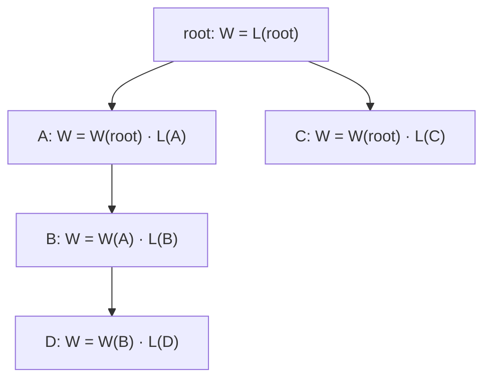
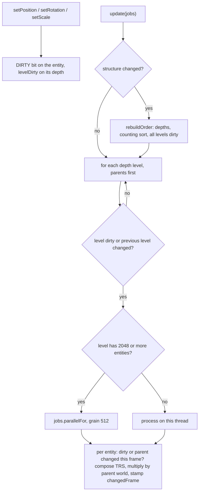
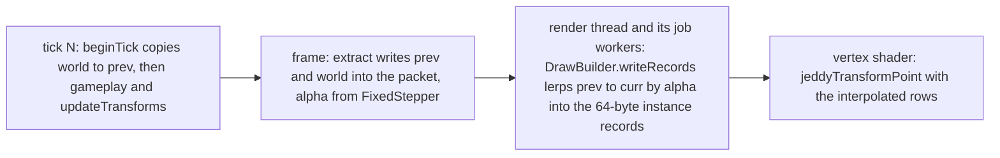

# 03. Rotations, quaternions and transform hierarchies

Translation and scale are easy: add a vector, multiply by a factor. Rotation is where 3D math gets
interesting. Rotations do not commute, the obvious representation (three angles) has a nasty failure
mode, and the representation engines actually use, the quaternion, looks like magic until you derive
it. This chapter derives it. Then it follows rotations through the engine: into transform matrices,
into a compact vertex format, down a hierarchy of parents and children, and between simulation
ticks.

You will learn:

- how to build the rotation matrices about the X, Y and Z axes, and Jeddy's sign conventions (yaw);
- why Euler angles suffer from gimbal lock, and how the engine avoids them;
- axis–angle rotations and Rodrigues' formula;
- quaternions from scratch: the product, the conjugate, why a unit quaternion is a rotation, why
  $q$ and $-q$ are the same rotation, and the fast rotation formula used in Jeddy's shaders;
- converting between quaternions and matrices, and decomposing a matrix into translation, rotation
  and scale;
- nlerp, slerp and the shortest-path sign flip;
- the QTangent: a whole tangent frame (normal, tangent, handedness) in one quaternion;
- transform hierarchies: `TransformStore`, `World.compose`, and interpolating transforms between
  ticks.

It builds on [02 Math foundations](02-math-foundations.md) (matrices as linear maps, column vectors,
the row-major 3×4 layout). Skeletal animation and skinning reuse all of this and are covered in
[09 Animation and skinning](09-animation-and-skinning.md); cameras are in
[04 Cameras and projection](04-cameras-and-projection.md).

**Where it lives.**

| Topic | Code |
|---|---|
| Quaternions | [`Quatf`](../../modules/math/src/main/java/dev/jeddy/math/Quatf.java) (record), [`MQuatf`](../../modules/math/src/main/java/dev/jeddy/math/MQuatf.java) (mutable), [`QuatOps`](../../modules/math/src/main/java/dev/jeddy/math/QuatOps.java) (SoA kernels) |
| Quaternion → matrix | `AffineOps.composeTRS`, `Mat4f.trs` |
| Matrix → TRS | `GltfImporter.decompose` in [`tools/cooker`](../../tools/cooker/src/main/java/dev/jeddy/cooker/gltf/GltfImporter.java) |
| QTangent | [`MeshEncoding`](../../modules/asset/src/main/java/dev/jeddy/asset/format/MeshEncoding.java), [`vertex.glsl`](../../modules/render/src/main/resources/dev/jeddy/render/shaders/engine/vertex.glsl), [`pbr.vert`](../../modules/render/src/main/resources/dev/jeddy/render/shaders/pbr/pbr.vert) |
| Hierarchy | [`TransformStore`](../../modules/scene/src/main/java/dev/jeddy/scene/TransformStore.java), [`World`](../../modules/app/src/main/java/dev/jeddy/app/world/World.java) |
| Interpolation | `RenderPacket.interpolatedWorld`, `DrawBuilder.writeRecords`, `AffineOps.lerp` |

Conventions (from chapter 02): right-handed, Y up, column vectors, radians, quaternions stored as
`(x, y, z, w)` with `w` the scalar part, and `a.mul(b)` applies `b` first.

---

## Rotation in 2D

Start in the plane. A point at distance $r$ from the origin and angle $\varphi$ from the x axis is
$`(x, y) = (r\cos\varphi,\; r\sin\varphi)`$. Rotating it by $\theta$ adds to the angle:

```math
x' = r\cos(\varphi + \theta) = r\cos\varphi\cos\theta - r\sin\varphi\sin\theta = x\cos\theta - y\sin\theta
```

```math
y' = r\sin(\varphi + \theta) = r\sin\varphi\cos\theta + r\cos\varphi\sin\theta = x\sin\theta + y\cos\theta
```

using the angle-sum identities. As a matrix:

```math
R(\theta) = \begin{bmatrix} \cos\theta & -\sin\theta \\ \sin\theta & \cos\theta \end{bmatrix}
```

Check with the "columns are the images of the axes" rule: x goes to $(\cos\theta, \sin\theta)$, y goes
to $(-\sin\theta, \cos\theta)$. A positive $\theta$ turns x towards y: counter-clockwise in the usual
picture with x right and y up.

## Rotations about the coordinate axes

A 3D rotation about a coordinate axis is the 2D rotation applied to the other two coordinates, with
the rotation axis left alone. The sign convention comes from the right-hand rule: **point your right
thumb along the axis; your fingers curl in the direction of positive rotation.** Equivalently, a
positive angle is counter-clockwise when you look from the positive end of the axis back towards the
origin.

The plane that rotates is "the next two axes in cyclic order" x → y → z → x:

- about **Z**, positive rotation turns x towards y;
- about **X**, positive rotation turns y towards z;
- about **Y**, positive rotation turns **z towards x**.

That gives

```math
R_x(\theta) = \begin{bmatrix} 1 & 0 & 0 \\ 0 & c & -s \\ 0 & s & c \end{bmatrix}
\qquad
R_y(\theta) = \begin{bmatrix} c & 0 & s \\ 0 & 1 & 0 \\ -s & 0 & c \end{bmatrix}
\qquad
R_z(\theta) = \begin{bmatrix} c & -s & 0 \\ s & c & 0 \\ 0 & 0 & 1 \end{bmatrix}
```

with $c = \cos\theta$, $s = \sin\theta$. $R_y$ looks as if its signs were swapped. They are not: the
2D rotation acts on the pair (z, x), in that order, so the $-s$ lands in the z row.

**Check against the code.** $R_y(90°)$ sends x = (1, 0, 0) to its first column, (0, 0, −1). Two tests
rely on exactly that. `trsComposition` in `MatrixAndQuatTest` says "(1,0,0) ... rotated 90° about Y
to (0,0,-2)" for a scale of 2, and `mat3NormalMatrixAndMutableTypes` checks the mutable quaternion:

```java
        MVec3f v = new MVec3f(1, 0, 0);
        new MQuatf().fromAxisAngle(0, 1, 0, MathF.HALF_PI).rotate(v);
        assertTrue(v.toVec3f().approxEquals(new Vec3f(0, 0, -1), EPS));
```

### Yaw: turning on the ground

For a top-down game the most important rotation is **yaw**, a rotation about +Y. Seen from above,
with +X to the right and +Z down the screen (chapter 02), a positive yaw turns counter-clockwise:

```
   Seen from above (+Y towards you).  Positive yaw is counter-clockwise.

                     -Z   (yaw = π for a model)
                      ^
                      |
   (yaw = -π/2) -X <--+--> +X  (yaw = +π/2)
                      |
                      v
                     +Z   (yaw = 0: a model's forward)
```

`World.setYaw` builds the yaw quaternion directly (the formula is derived below):

```java
    /** Sets an entity's rotation to {@code yaw} radians about +Y. */
    public void setYaw(int entity, float yaw) {
        float h = yaw * 0.5f;
        transforms.setRotation(entity, 0, (float) Math.sin(h), 0, (float) Math.cos(h));
    }
```

`Quatf.fromYaw` and the batch kernel `QuatOps.fromYaw` write the same four numbers.

Models face +Z, so a model with yaw $\psi$ faces $`R_y(\psi)\,(0, 0, 1) = (\sin\psi,\; 0,\; \cos\psi)`$
(the third column of $R_y$). To face a direction $(d_x, d_z)$ on the ground you need
$\sin\psi \propto d_x$ and $\cos\psi \propto d_z$, which is $\psi = \operatorname{atan2}(d_x, d_z)$.
Note the argument order: x first, then z. That is what
[`AgentSync`](../../modules/app/src/main/java/dev/jeddy/app/world/AgentSync.java) does:

```java
    /** Like {@link #face}, toward the point {@code (x, z)}. */
    public void faceToward(int agent, float x, float z) {
        float dx = x - crowd.x(agent);
        float dz = z - crowd.z(agent);
        if (dx * dx + dz * dz > 1e-6f) {
            face(agent, (float) Math.atan2(dx, dz));
        }
    }
```

The camera uses the same rotation, but cameras look down −Z: `IsoCamera`'s yaw of 0 "looks towards
-Z", and its forward vector is $`(-\sin\psi\cos\phi,\; -\sin\phi,\; -\cos\psi\cos\phi)`$ for yaw
$\psi$ and pitch $\phi$, which is $R_y(\psi)$ applied to −Z, tilted down by the pitch.

---

## Euler angles and gimbal lock

Any orientation can be written as three rotations about coordinate axes, applied in a fixed order.
These three angles are **Euler angles**; for characters and vehicles they are usually called yaw,
pitch and roll. Jeddy has one helper for them:

```java
    /**
     * Returns the rotation from Euler angles applied as yaw (Y), then pitch (X), then roll (Z),
     * i.e. {@code q = qYaw * qPitch * qRoll}.
     */
    public static Quatf fromYawPitchRoll(float yaw, float pitch, float roll) {
        return fromAxisAngle(Vec3f.UNIT_Y, yaw)
                .mul(fromAxisAngle(Vec3f.UNIT_X, pitch))
                .mul(fromAxisAngle(Vec3f.UNIT_Z, roll));
    }
```

As matrices that is $`R = R_y(\text{yaw})\,R_x(\text{pitch})\,R_z(\text{roll})`$. There are two equally
valid ways to read it:

- **Fixed axes, right to left:** roll about the world Z axis first, then pitch about world X, then
  yaw about world Y.
- **Moving axes, left to right:** yaw about Y first, then pitch about the object's *new* X axis,
  then roll about its *newest* Z axis. This is how a pilot thinks, and it is what the Javadoc means by
  "applied as yaw, then pitch, then roll".

Both readings give the same matrix.

### Gimbal lock

Now set the pitch to exactly 90°. Multiply it out with $\alpha$ = yaw and $\gamma$ = roll:

```math
R_x(90°) = \begin{bmatrix} 1 & 0 & 0 \\ 0 & 0 & -1 \\ 0 & 1 & 0 \end{bmatrix},
\qquad
R_x(90°)\,R_z(\gamma) = \begin{bmatrix} \cos\gamma & -\sin\gamma & 0 \\ 0 & 0 & -1 \\ \sin\gamma & \cos\gamma & 0 \end{bmatrix}
```

```math
R_y(\alpha)\,R_x(90°)\,R_z(\gamma) = \begin{bmatrix} \cos(\alpha - \gamma) & \sin(\alpha - \gamma) & 0 \\ 0 & 0 & -1 \\ -\sin(\alpha - \gamma) & \cos(\alpha - \gamma) & 0 \end{bmatrix}
```

(use $\cos\alpha\cos\gamma + \sin\alpha\sin\gamma = \cos(\alpha - \gamma)$ and its sine sibling). The
result depends only on $\alpha - \gamma$. Yaw and roll have become the same rotation; one degree of
freedom is gone. That is **gimbal lock**: at that pitch, no small change of the three angles can tilt
the object sideways. You can see it in the code. `fromYawPitchRoll(0.3f, MathF.HALF_PI, 0.1f)` and
`fromYawPitchRoll(0.8f, MathF.HALF_PI, 0.6f)` return the same quaternion,
(0.7036, 0.0706, −0.0706, 0.7036), because both have $\alpha - \gamma = 0.2$.

Euler angles have two further problems: interpolating the three angles separately gives curved,
uneven paths, and many angle triples describe the same orientation. So Jeddy stores rotations as
quaternions everywhere (`TransformStore` keeps `qx, qy, qz, qw` columns), and only uses angles where a
single angle is the natural input: a yaw for characters on the ground (`setYaw`, `AgentSync`), and the
camera's yaw and pitch, which `IsoCamera` turns into a look-at matrix rather than into an Euler
rotation. A single angle cannot gimbal-lock.

---

## Axis–angle and Rodrigues' formula

Euler's rotation theorem says every rotation in 3D is a rotation by some angle $\theta$ about some
axis $\hat{\mathbf{n}}$ (a unit vector). `Quatf.fromAxisAngle(axis, radians)` takes exactly that.
To rotate a vector $\mathbf{v}$, split it into the part along the axis and the part perpendicular to
it:

```math
\mathbf{v}_\parallel = (\hat{\mathbf{n}} \cdot \mathbf{v})\,\hat{\mathbf{n}},
\qquad
\mathbf{v}_\perp = \mathbf{v} - \mathbf{v}_\parallel
```

The parallel part does not move. The perpendicular part turns in the plane perpendicular to the axis.
That plane has two convenient perpendicular directions of the same length: $`\mathbf{v}_\perp`$ itself
and $\hat{\mathbf{n}} \times \mathbf{v}$ (which equals $`\hat{\mathbf{n}} \times \mathbf{v}_\perp`$,
since the cross product with the parallel part is zero). In that plane the 2D formula applies:

```math
\mathbf{v}_\perp' = \mathbf{v}_\perp\cos\theta + (\hat{\mathbf{n}} \times \mathbf{v})\sin\theta
```

Add the parts back together and expand $`\mathbf{v}_\perp`$:

```math
\mathbf{v}' = \mathbf{v}\cos\theta + (\hat{\mathbf{n}} \times \mathbf{v})\sin\theta + \hat{\mathbf{n}}\,(\hat{\mathbf{n}} \cdot \mathbf{v})(1 - \cos\theta)
```

This is **Rodrigues' rotation formula**. Keep it in mind: the quaternion rotation below turns out to
be exactly this formula, written with half angles.

---

## Quaternions from scratch

### Definition and product

A quaternion is a four-component number

```math
q = w + x\,\mathbf{i} + y\,\mathbf{j} + z\,\mathbf{k}
```

with three imaginary units that obey Hamilton's rules

```math
\mathbf{i}^2 = \mathbf{j}^2 = \mathbf{k}^2 = \mathbf{i}\mathbf{j}\mathbf{k} = -1,
\qquad
\mathbf{i}\mathbf{j} = \mathbf{k},\; \mathbf{j}\mathbf{k} = \mathbf{i},\; \mathbf{k}\mathbf{i} = \mathbf{j},
\qquad
\mathbf{j}\mathbf{i} = -\mathbf{k},\; \mathbf{k}\mathbf{j} = -\mathbf{i},\; \mathbf{i}\mathbf{k} = -\mathbf{j}
```

The products of the units follow the same cyclic pattern as the cross product of the axes, including
the sign flip when you swap the order. That is not a coincidence. Write a quaternion as a scalar
part $w$ and a vector part $\mathbf{v} = (x, y, z)$. Multiplying out two pure vector quaternions term
by term with the rules above gives

```math
\mathbf{v}_1\mathbf{v}_2 = -\,\mathbf{v}_1 \cdot \mathbf{v}_2 + \mathbf{v}_1 \times \mathbf{v}_2
```

(the squares contribute $-x_1x_2 - y_1y_2 - z_1z_2$, the mixed terms the cross product). For general
quaternions $`q_1 = (\mathbf{v}_1, w_1)`$ and $`q_2 = (\mathbf{v}_2, w_2)`$, distribute:

```math
q_1 q_2 = \big(\, w_1\mathbf{v}_2 + w_2\mathbf{v}_1 + \mathbf{v}_1 \times \mathbf{v}_2,\;\; w_1 w_2 - \mathbf{v}_1 \cdot \mathbf{v}_2 \,\big)
```

Compare with `Quatf.mul`, where `this` is $q_1$ and `o` is $q_2$:

```java
    /** Returns {@code this * o} (rotate by {@code o}, then by {@code this}). */
    public Quatf mul(Quatf o) {
        return new Quatf(
                w * o.x + x * o.w + y * o.z - z * o.y,
                w * o.y - x * o.z + y * o.w + z * o.x,
                w * o.z + x * o.y - y * o.x + z * o.w,
                w * o.w - x * o.x - y * o.y - z * o.z);
    }
```

The x component is $w_1 x_2 + x_1 w_2 + (y_1 z_2 - z_1 y_2)$: the two scaled vector parts plus the x
component of the cross product. The last line is $`w_1w_2 - \mathbf{v}_1\cdot\mathbf{v}_2`$. Because of
the cross product term, **quaternion multiplication is not commutative**, just like rotations.
`MQuatf.mul` and the parent–child composition in `World.compose` use the same four lines.

### Norm, conjugate, inverse

- The **norm** is $\lVert q \rVert = \sqrt{x^2 + y^2 + z^2 + w^2}$ (`Quatf.lengthSquared`,
  `normalize`). A **unit quaternion** has norm 1.
- The **conjugate** negates the vector part: $q^{\ast} = (-\mathbf{v}, w)$ (`Quatf.conjugate`).
- Using the product formula,
  $`q q^{\ast} = (w(-\mathbf{v}) + w\mathbf{v} + \mathbf{v} \times (-\mathbf{v}),\; w^2 + \mathbf{v}\cdot\mathbf{v}) = (\mathbf{0}, \lVert q \rVert^2)`$,
  a plain number. So the **inverse** is $q^{-1} = q^{\ast} / \lVert q \rVert^2$, which is
  `Quatf.inverse`. For a unit quaternion, the inverse is just the conjugate. The test checks
  `q.mul(q.inverse()).approxEquals(Quatf.IDENTITY, 1e-5f)`.

### A unit quaternion is a rotation

Here is the central fact. Let

```math
q = \big(\,\hat{\mathbf{n}}\sin\tfrac{\theta}{2},\;\; \cos\tfrac{\theta}{2}\,\big)
```

for a unit axis $\hat{\mathbf{n}}$. This is a unit quaternion, because
$\sin^2 + \cos^2 = 1$; it is exactly `Quatf.fromAxisAngle`:

```java
    public static Quatf fromAxisAngle(Vec3f axis, float radians) {
        float h = radians * 0.5f;
        float s = (float) Math.sin(h);
        return new Quatf(axis.x() * s, axis.y() * s, axis.z() * s, (float) Math.cos(h));
    }
```

Treat a vector $\mathbf{p}$ as the pure quaternion $(\mathbf{p}, 0)$ and compute the "sandwich"
$`q\,\mathbf{p}\,q^{\ast}`$. Write $\mathbf{u}$ for the vector part of $q$ and $w$ for its scalar part. The
first product is

```math
q\,\mathbf{p} = (w\mathbf{p} + \mathbf{u} \times \mathbf{p},\;\; -\mathbf{u}\cdot\mathbf{p})
```

Multiply by $q^{\ast} = (-\mathbf{u}, w)$ on the right with the product formula. The scalar part is
$`(-\mathbf{u}\cdot\mathbf{p})w - (w\mathbf{p} + \mathbf{u}\times\mathbf{p})\cdot(-\mathbf{u}) = -w\,\mathbf{u}\cdot\mathbf{p} + w\,\mathbf{p}\cdot\mathbf{u} + 0 = 0`$,
so the result is again a pure vector. Its vector part is

```math
(\mathbf{u}\cdot\mathbf{p})\,\mathbf{u} + w(w\mathbf{p} + \mathbf{u}\times\mathbf{p}) - (w\mathbf{p} + \mathbf{u}\times\mathbf{p}) \times \mathbf{u}
```

Use $`(\mathbf{u}\times\mathbf{p})\times\mathbf{u} = (\mathbf{u}\cdot\mathbf{u})\,\mathbf{p} - (\mathbf{u}\cdot\mathbf{p})\,\mathbf{u}`$
(the "BAC − CAB" identity) and $\mathbf{p}\times\mathbf{u} = -\mathbf{u}\times\mathbf{p}$, and collect:

```math
\mathbf{p}' = (w^2 - \mathbf{u}\cdot\mathbf{u})\,\mathbf{p} + 2w\,(\mathbf{u}\times\mathbf{p}) + 2(\mathbf{u}\cdot\mathbf{p})\,\mathbf{u}
```

Now substitute $\mathbf{u} = \hat{\mathbf{n}}\sin\frac{\theta}{2}$ and $w = \cos\frac{\theta}{2}$, and use
the double-angle identities:

- $w^2 - \mathbf{u}\cdot\mathbf{u} = \cos^2\frac{\theta}{2} - \sin^2\frac{\theta}{2} = \cos\theta$
- $`2w\,\mathbf{u} = 2\sin\frac{\theta}{2}\cos\frac{\theta}{2}\,\hat{\mathbf{n}} = \sin\theta\,\hat{\mathbf{n}}`$
- $`2(\mathbf{u}\cdot\mathbf{p})\,\mathbf{u} = 2\sin^2\frac{\theta}{2}\,(\hat{\mathbf{n}}\cdot\mathbf{p})\,\hat{\mathbf{n}} = (1 - \cos\theta)(\hat{\mathbf{n}}\cdot\mathbf{p})\,\hat{\mathbf{n}}`$

```math
\mathbf{p}' = \mathbf{p}\cos\theta + (\hat{\mathbf{n}}\times\mathbf{p})\sin\theta + \hat{\mathbf{n}}\,(\hat{\mathbf{n}}\cdot\mathbf{p})(1 - \cos\theta)
```

Rodrigues' formula. **The sandwich $q\mathbf{p}q^{\ast}$ rotates $\mathbf{p}$ by $\theta$ about
$\hat{\mathbf{n}}$**, and the half angle in the definition is there because the sandwich applies $q$
twice.

**Numeric example.** Yaw by 90°: $\hat{\mathbf{n}} = (0, 1, 0)$, $\theta/2 = 45°$, so
$q = (0, 0.7071, 0, 0.7071)$. That is the value `Quatf.fromYaw(MathF.HALF_PI)` returns (printed as
`Quatf[x=0.0, y=0.70710677, z=0.0, w=0.70710677]`).

### $q$ and $-q$ are the same rotation

Negate all four components: $-q = (-\hat{\mathbf{n}}\sin\frac{\theta}{2}, -\cos\frac{\theta}{2})$. In
the sandwich $`(-q)\,\mathbf{p}\,(-q)^{\ast} = q\,\mathbf{p}\,q^{\ast}`$ the two minus signs cancel, so $-q$ is the
same rotation. (Geometrically, $-q$ is the rotation by $\theta + 2\pi$, which ends in the same place.)
Unit quaternions cover the rotations twice: a **double cover**. Three places in the code depend on
this:

- comparing rotations must ignore the sign: `Quatf.approxEquals` tests `1 - Math.abs(dot(o)) <= epsilon`;
- `Quatf.angle()` uses `Math.abs(w)` so it returns an angle in $[0, \pi]$;
- interpolation must pick the sign that gives the short path (below), and the QTangent uses the free
  sign to store one extra bit.

### Composition order

Rotating by $q_1$ and then by $q_2$ is $`q_2(q_1\mathbf{p}q_1^{\ast})q_2^{\ast} = (q_2q_1)\,\mathbf{p}\,(q_2q_1)^{\ast}`$,
using $(q_2q_1)^{\ast} = q_1^{\ast}q_2^{\ast}$. So, as with matrices, **the right-hand factor acts first**:
`a.mul(b)` "rotates by `b`, then by `this`". The test `quaternionsAgreeWithMatrices` checks it with
random rotations:

```java
            assertTrue(q.mul(p).rotate(v).approxEquals(q.rotate(p.rotate(v)), 1e-3f));
```

**Numeric example.** Let `yaw` be 90° about +Y and `pitch` 90° about +X, and rotate the camera's
forward vector (0, 0, −1):

- `yaw.mul(pitch)`: pitch first turns (0, 0, −1) to (0, 1, 0), and the yaw leaves that alone:
  **(0, 1, 0)**.
- `pitch.mul(yaw)`: yaw first turns (0, 0, −1) to (−1, 0, 0), and the pitch leaves that alone:
  **(−1, 0, 0)**.

---

## Rotating a vector fast

Computing the sandwich literally takes two quaternion products. There is a cheaper form. Start from
the result above, before substituting angles:

```math
\mathbf{p}' = (w^2 - \mathbf{u}\cdot\mathbf{u})\,\mathbf{p} + 2w\,(\mathbf{u}\times\mathbf{p}) + 2(\mathbf{u}\cdot\mathbf{p})\,\mathbf{u}
```

The "BAC − CAB" identity also says $`\mathbf{u}\times(\mathbf{u}\times\mathbf{p}) = (\mathbf{u}\cdot\mathbf{p})\,\mathbf{u} - (\mathbf{u}\cdot\mathbf{u})\,\mathbf{p}`$,
so $`2(\mathbf{u}\cdot\mathbf{p})\,\mathbf{u} = 2\,\mathbf{u}\times(\mathbf{u}\times\mathbf{p}) + 2(\mathbf{u}\cdot\mathbf{u})\,\mathbf{p}`$.
Substitute:

```math
\mathbf{p}' = (w^2 + \mathbf{u}\cdot\mathbf{u})\,\mathbf{p} + 2w\,(\mathbf{u}\times\mathbf{p}) + 2\,\mathbf{u}\times(\mathbf{u}\times\mathbf{p})
```

For a unit quaternion $w^2 + \mathbf{u}\cdot\mathbf{u} = 1$, so

```math
\mathbf{p}' = \mathbf{p} + 2w\,(\mathbf{u}\times\mathbf{p}) + 2\,\mathbf{u}\times(\mathbf{u}\times\mathbf{p})
= \mathbf{p} + 2\,\mathbf{u}\times\big(\mathbf{u}\times\mathbf{p} + w\,\mathbf{p}\big)
```

The last step factors $2\mathbf{u}\times$ out of both terms (the cross product is linear). That last
line is word for word the shader function in
[`vertex.glsl`](../../modules/render/src/main/resources/dev/jeddy/render/shaders/engine/vertex.glsl):

```glsl
vec3 jeddyQuatRotate(vec4 q, vec3 v) {
    return v + 2.0 * cross(q.xyz, cross(q.xyz, v) + q.w * v);
}
```

The Java versions use the middle form with $`\mathbf{t} = 2\,(\mathbf{u}\times\mathbf{p})`$, so that
$`\mathbf{p}' = \mathbf{p} + w\,\mathbf{t} + \mathbf{u}\times\mathbf{t}`$. From `Quatf.rotate`:

```java
    /** Rotates {@code v} by this unit quaternion. */
    public Vec3f rotate(Vec3f v) {
        // v' = v + 2w(q×v) + 2q×(q×v)
        float tx = 2 * (y * v.z() - z * v.y());
        float ty = 2 * (z * v.x() - x * v.z());
        float tz = 2 * (x * v.y() - y * v.x());
        return new Vec3f(
                v.x() + w * tx + (y * tz - z * ty),
                v.y() + w * ty + (z * tx - x * tz),
                v.z() + w * tz + (x * ty - y * tx));
    }
```

`MQuatf.rotate` and the SoA kernel `QuatOps.rotate` contain the same arithmetic;
`MeshEncoding`'s private `rotate` (the Java reference for QTangent decoding) uses the shader's
nested form. Two cross products cost 12 multiplies, plus 6 more for the scaling and the `w` term:
about 18 multiplies, against 9 for a matrix–vector product. But building the matrix from a
quaternion first costs about 18 multiplies as well (the nine products below plus one scaling per
entry), so the rule of thumb is: **one quaternion, few vectors → use the formula; one rotation, many
vectors → build the matrix once.** Jeddy follows it. Each mesh instance
gets a matrix (`composeTRS`), shared by all its vertices; each vertex's QTangent is a different
quaternion applied to two vectors, so the shader uses the formula.

The formula requires a **unit** quaternion (the step that dropped $w^2 + \mathbf{u}\cdot\mathbf{u}$).
That is why the shader normalizes the decoded QTangent before using it, and why the test
`quatOpsMatchQuatf` scales its quaternions by 3 and calls `QuatOps.normalize` before `QuatOps.rotate`.

---

## From quaternion to matrix and back

### Quaternion → rotation matrix

The columns of a rotation matrix are the images of the axes, so apply the fast formula to
$`\mathbf{e}_x = (1, 0, 0)`$ with $q = (x, y, z, w)$:

```math
\mathbf{u}\times\mathbf{e}_x = (0,\; z,\; -y),
\qquad
\mathbf{u}\times(\mathbf{u}\times\mathbf{e}_x) = (-y^2 - z^2,\; xy,\; xz)
```

```math
R\,\mathbf{e}_x = (1, 0, 0) + 2w\,(0, z, -y) + 2\,(-y^2 - z^2,\; xy,\; xz) = \big(1 - 2(y^2 + z^2),\;\; 2(xy + wz),\;\; 2(xz - wy)\big)
```

The other two columns follow the same way (or by cycling x → y → z), giving

```math
R(q) = \begin{bmatrix}
1 - 2(y^2 + z^2) & 2(xy - wz) & 2(xz + wy) \\
2(xy + wz) & 1 - 2(x^2 + z^2) & 2(yz - wx) \\
2(xz - wy) & 2(yz + wx) & 1 - 2(x^2 + y^2)
\end{bmatrix}
```

This is the matrix inside `AffineOps.composeTRS`, written row by row into the 3×4 block, with each
column multiplied by its scale factor (chapter 02 explains the column scaling):

```java
        float xx = qx * qx;
        float yy = qy * qy;
        float zz = qz * qz;
        float xy = qx * qy;
        float xz = qx * qz;
        float yz = qy * qz;
        float wx = qw * qx;
        float wy = qw * qy;
        float wz = qw * qz;
        out[o] = (1 - 2 * (yy + zz)) * sx;
        out[o + 1] = 2 * (xy - wz) * sy;
        out[o + 2] = 2 * (xz + wy) * sz;
        out[o + 3] = px;
        out[o + 4] = 2 * (xy + wz) * sx;
        out[o + 5] = (1 - 2 * (xx + zz)) * sy;
        out[o + 6] = 2 * (yz - wx) * sz;
        out[o + 7] = py;
        out[o + 8] = 2 * (xz - wy) * sx;
        out[o + 9] = 2 * (yz + wx) * sy;
        out[o + 10] = (1 - 2 * (xx + yy)) * sz;
        out[o + 11] = pz;
```

Nine products of quaternion components, then each entry is a sum and a scale. No trigonometry.
`Mat4f.trs` writes the same matrix in column-major order.

**Numeric example.** Yaw 90°, $q = (0, 0.7071, 0, 0.7071)$: $y^2 = 0.5$, $wy = 0.5$, everything else
0. The rows are $`(1 - 1,\; 0,\; 2 \cdot 0.5) = (0, 0, 1)`$, then $(0, 1, 0)$, then
$`(-2 \cdot 0.5,\; 0,\; 1 - 1) = (-1, 0, 0)`$: exactly $R_y(90°)$. Plugging
$q = (0, \sin\frac{\theta}{2}, 0, \cos\frac{\theta}{2})$ in general gives
$1 - 2\sin^2\frac{\theta}{2} = \cos\theta$ and $2\sin\frac{\theta}{2}\cos\frac{\theta}{2} = \sin\theta$:
the $R_y(\theta)$ derived at the start of the chapter.

The test `quaternionsAgreeWithMatrices` checks, for 200 random rotations, that `q.rotate(v)` equals
`Mat4f.rotation(q).transformDirection(v)`.

Note that the formula never divides by the norm: it assumes a unit quaternion. A non-unit $q$ would
produce a matrix that also scales and shears. `TransformStore.setRotation` documents its argument as
"a unit quaternion" for that reason.

### Rotation matrix → quaternion

Going back, look at the diagonal. Its sum, the **trace**, is
$3 - 4(x^2 + y^2 + z^2) = 3 - 4(1 - w^2) = 4w^2 - 1$, so

```math
w = \tfrac{1}{2}\sqrt{\operatorname{trace} + 1}
```

The off-diagonal differences isolate the vector part: $m_{21} - m_{12} = 2(yz + wx) - 2(yz - wx) = 4wx$,
and similarly for y and z. With $s = 4w$ that is the first branch of `Quatf.fromMatrix`:

```java
        float trace = m00 + m11 + m22;
        // ...
        if (trace > 0) {
            float s = (float) Math.sqrt(trace + 1.0) * 2;
            w = 0.25f * s;
            x = (m21 - m12) / s;
            y = (m02 - m20) / s;
            z = (m10 - m01) / s;
        } else if (m00 > m11 && m00 > m22) {
            float s = (float) Math.sqrt(1.0 + m00 - m11 - m22) * 2;
            w = (m21 - m12) / s;
            x = 0.25f * s;
            y = (m01 + m10) / s;
            z = (m02 + m20) / s;
        } else if (m11 > m22) {
            // ... the same with y as the largest component
        } else {
            // ... and with z
        }
        return new Quatf(x, y, z, w).normalize();
```

Why the extra branches? When the rotation is close to 180°, $w$ is close to 0, and dividing by
$s = 4w$ would amplify rounding errors enormously. The diagonal also gives
$1 + m_{00} - m_{11} - m_{22} = 4x^2$ (and the same pattern for y and z), and the diagonal entries
are ordered like $x^2$, $y^2$, $z^2$ (because $m_{00} = 2x^2 + 2w^2 - 1$ and so on). So: if the trace
is positive, $`w > 0.5`$ and the first branch is safe. Otherwise $w^2 \le \frac{1}{4}$, the other three
squares sum to at least $\frac{3}{4}$, and the largest diagonal entry picks the largest of $x$, $y$,
$z$, which is then at least 0.5. The code computes that component from the diagonal and gets the
others from sums and differences divided by it. It never divides by anything smaller than about 2.

Remember the naming trap from chapter 02: these parameters are `mRC`, **row first** ("given row by
row"), while `Mat4f`'s components are `mCR`. A copy of the same routine appears in
`MeshEncoding.encodeQTangent` and, in `double`, in the cooker's `GltfImporter.decompose`.

`Quatf.lookRotation(forward, up)` combines the two ideas of this section: it builds right, up and
−forward with cross products (chapter 02), puts them in the columns of a matrix, and calls
`fromMatrix`. It is the rotation "that turns −Z (the forward axis) towards `forward`". For
`lookRotation(Vec3f.UNIT_X, Vec3f.UNIT_Y)` you get (0, −0.7071, 0, 0.7071), which is a yaw of −90°:
turning the −Z forward clockwise (seen from above) by 90° points it at +X.

### Decomposing a matrix into TRS

glTF nodes may give a full 4×4 matrix instead of translation, rotation and scale. The cooker splits
it, because `.jscene` stores TRS per node and animation needs TRS to interpolate. From
[`GltfImporter`](../../tools/cooker/src/main/java/dev/jeddy/cooker/gltf/GltfImporter.java):

```java
    /** Splits a column-major affine matrix into translation, rotation (quaternion) and scale. */
    static void decompose(float[] m, float[] t, float[] r, float[] s) {
        t[0] = m[12];
        t[1] = m[13];
        t[2] = m[14];
        s[0] = (float) Math.sqrt(m[0] * m[0] + m[1] * m[1] + m[2] * m[2]);
        s[1] = (float) Math.sqrt(m[4] * m[4] + m[5] * m[5] + m[6] * m[6]);
        s[2] = (float) Math.sqrt(m[8] * m[8] + m[9] * m[9] + m[10] * m[10]);
        double det =
                m[0] * (m[5] * m[10] - m[9] * m[6])
                        - m[4] * (m[1] * m[10] - m[9] * m[2])
                        + m[8] * (m[1] * m[6] - m[5] * m[2]);
        if (det < 0) {
            s[0] = -s[0];
        }
        double r00 = m[0] / s[0], r10 = m[1] / s[0], r20 = m[2] / s[0];
        // ... then the trace-based matrix-to-quaternion conversion, in double
```

Step by step, for $M = TRS$:

1. **Translation** is the last column (indices 12–14 in column-major storage).
2. **Scale.** Column $j$ of $RS$ is $s_j$ times a unit column of $R$, so $|s_j|$ is the column's
   length.
3. **Mirror.** Lengths are never negative, so a mirror shows up only in the determinant. If it is
   negative, the code assigns the mirror to the x scale. Any single axis would do: a reflection
   across one axis combined with a rotation can represent any mirror. Two negative scales are a
   rotation by 180°, so they come back as positive scales and a different rotation.
4. **Rotation.** Divide each column by its (signed) scale to get $R$, then convert to a quaternion.

The test `decomposesMirroredMatrices` builds a rotation of 30° about Z with scale (−1, 2, 3) and
translation (4, 5, 6), and gets back exactly that: $t = (4, 5, 6)$, $s = (-1, 2, 3)$ and
$r = (0, 0, \sin 15°, \cos 15°)$.

This only works when the matrix *is* a TRS. If the columns of the linear part are not perpendicular
(a **shear**), no rotation-times-scale reproduces it. glTF requires node matrices to be decomposable
into TRS, so the cooker can rely on it. Shear will come back below, in `World.compose`.

---

## Interpolating rotations

Animation, camera motion and blending need "a rotation between $q_0$ and $q_1$". Interpolating
quaternions is much better behaved than interpolating Euler angles or matrices.

### nlerp and slerp

Unit quaternions are points on the unit sphere in 4D. The rotation halfway between two rotations is
halfway along the great arc between them. **Slerp** (spherical linear interpolation, Shoemake 1985)
walks that arc at constant speed. If $\Omega$ is the angle between the two quaternions as 4D vectors,
$\cos\Omega = q_0 \cdot q_1$, then

```math
\operatorname{slerp}(q_0, q_1, t) = \frac{\sin((1 - t)\,\Omega)}{\sin\Omega}\,q_0 + \frac{\sin(t\,\Omega)}{\sin\Omega}\,q_1
```

Because a quaternion uses half angles, $\Omega$ is half the rotation angle between the two
orientations. From `Quatf.slerp`:

```java
        float a;
        float b;
        if (d > 0.9995f) {
            a = 1 - t;
            b = t;
        } else {
            double theta = Math.acos(d);
            double sin = Math.sin(theta);
            a = (float) (Math.sin((1 - t) * theta) / sin);
            b = (float) (Math.sin(t * theta) / sin);
        }
        return new Quatf(a * x + b * ox, a * y + b * oy, a * z + b * oz, a * w + b * ow)
                .normalize();
```

When the quaternions are nearly equal, $\sin\Omega$ approaches 0 and the division becomes unstable;
the code switches to plain linear weights above a dot product of 0.9995 (about 3.6° of rotation).

**Nlerp** (normalized lerp) skips the trigonometry: lerp the four components and normalize. The result
lies on the same great arc, so it reaches the same orientations, but not at constant speed: it moves
slower near the ends and faster in the middle. `Quatf.nlerp`, `MQuatf.nlerp` and the SoA kernel
`QuatOps.nlerp` implement it ("Good enough for animation blending between close keys").

How large is the difference? Interpolating from the identity to a 120° yaw:

| t | slerp angle | nlerp angle |
|---|---|---|
| 0.25 | 30.0° | 27.8° |
| 0.5 | 60.0° | 60.0° |
| 0.75 | 90.0° | 92.2° |

The midpoint is exact (by symmetry), and the largest error over the whole range is about 2.2°. For a
19° step, the most a character turns in one 30 Hz tick at `AgentSync`'s default turn rate of
10 rad/s, the largest error is under 0.01°. The animation system relies on this: clips are resampled
at a fixed rate when they load (30 Hz by default, D79), so neighbouring frames are close together and
the lerp/nlerp it uses between them is indistinguishable from slerp, and much cheaper. The test `slerpAndLookRotation` checks that both give
a 45° rotation halfway between the identity and a 90° yaw.

### The shortest path

There is a catch. Because $q$ and $-q$ are the same rotation, the pair $(q_0, q_1)$ and the pair
$(q_0, -q_1)$ describe the same start and end, but the arcs between them are different: one is the
short way round, the other goes the long way, more than 180°.

**Numeric example** (illustrative, not the engine's code path): $q_0$ = identity = (0, 0, 0, 1) and
$q_1$ = −yaw(90°) = (0, −0.7071, 0, −0.7071), a valid representation of a 90° yaw. Their dot product
is −0.7071. A naive lerp at $t = 0.5$ gives (0, −0.3536, 0, 0.1464), normalized
(0, −0.9239, 0, 0.3827): a rotation of $2\arccos(0.3827) = 135°$ about −Y. The object would swing
−135°, halfway along a 270° turn the long way round, instead of +45°.

The fix: if $`q_0 \cdot q_1 < 0`$, negate one of them first. Every interpolation in Jeddy does it.
`Quatf.slerp` negates `o` when `d < 0`; `Quatf.nlerp` negates the weight instead:

```java
    public Quatf nlerp(Quatf o, float t) {
        float a = 1 - t;
        float b = dot(o) < 0 ? -t : t;
        return new Quatf(x * a + o.x * b, y * a + o.y * b, z * a + o.z * b, w * a + o.w * b)
                .normalize();
    }
```

With the example above, `Quatf.IDENTITY.nlerp(q1, 0.5f)` returns (0, 0.3827, 0, 0.9239), a 45° yaw.

The animation module applies the same idea at two levels (details in chapter 09).
[`Clip.bake`](../../modules/animation/src/main/java/dev/jeddy/animation/Clip.java) fixes the signs
once, at load time, so that each frame's rotation is in the same hemisphere as the previous frame's:

```java
                // Keep consecutive frames in one hemisphere, so frame lerps take the short way.
                if (f[q] * f[prev]
                                + f[q + 1] * f[prev + 1]
                                + f[q + 2] * f[prev + 2]
                                + f[q + 3] * f[prev + 3]
                        < 0) {
                    for (int k = 0; k < 4; k++) {
                        f[q + k] = -f[q + k];
                    }
                }
```

and `Animations.blend`, which sums weighted rotations from up to four clip samples, flips each
contribution's weight against the running sum (`float wq = d < 0 ? -w : w;`) before normalizing.

---

## The QTangent: a tangent frame in one quaternion

### What a tangent frame is

A normal map stores, per texel, a normal direction in **tangent space**: x along the texture's u
direction, y along v, z out of the surface. To use it, the shader needs three vectors per vertex:
the **tangent** $\mathbf{t}$, the **bitangent** $\mathbf{b}$ and the **normal** $\mathbf{n}$. The
matrix with those columns, $`[\,\mathbf{t}\;\mathbf{b}\;\mathbf{n}\,]`$, converts a tangent-space
normal into object space (a change of basis, chapter 02). Chapter
[07 Lighting and shadows](07-lighting-and-shadows.md) shows the shading side.

Stored naively that is 9 floats per vertex, 36 bytes. But the three vectors are orthonormal, so
$`[\,\mathbf{t}\;\mathbf{b}\;\mathbf{n}\,]`$ is a rotation matrix, and a rotation fits in a quaternion:
4 numbers. There is one complication. Texture mapping can be mirrored (artists mirror UVs to reuse
texture space for the two halves of a symmetric model). Then $\mathbf{b} = -(\mathbf{n}\times\mathbf{t})$
and the frame is left-handed, which no rotation can produce. So the frame needs one more bit, the
**handedness** $h = \pm 1$, with $`\mathbf{b} = h\,(\mathbf{n}\times\mathbf{t})`$.

Where to put that bit? In the sign of the quaternion. $q$ and $-q$ are the same rotation, so the sign
carries no information about the frame and is free to carry the handedness. This is the
**QTangent** (decision D27): the frame of each vertex is four `snorm16` values, 8 bytes, sharing a
16-byte attribute with the two half-float UV sets.

### Encoding

[`MeshEncoding.encodeQTangent`](../../modules/asset/src/main/java/dev/jeddy/asset/format/MeshEncoding.java)
does it in five steps.

1. **Normalize the normal, orthogonalize the tangent** (Gram–Schmidt, chapter 02), and pick an
   arbitrary perpendicular vector if the tangent was parallel to the normal.
2. **Build a right-handed frame.** The bitangent is computed, not taken from the input:

   ```java
        // b = cross(n, t): the matrix [t b n] is a rotation.
        float bx = ny * tz - nz * ty;
        float by = nz * tx - nx * tz;
        float bz = nx * ty - ny * tx;

        float m00 = tx, m10 = ty, m20 = tz;
        float m01 = bx, m11 = by, m21 = bz;
        float m02 = nx, m12 = ny, m22 = nz;
   ```

   The names are `mRC` (row, column), so column 0 is $\mathbf{t}$, column 1 is $\mathbf{b}$ and
   column 2 is $\mathbf{n}$. It is a rotation because $\mathbf{t}\times\mathbf{b} = \mathbf{t}\times(\mathbf{n}\times\mathbf{t}) = \mathbf{n}$.
3. **Convert to a quaternion** with the same four-branch routine as `Quatf.fromMatrix`.
4. **Make the sign carry the handedness:**

   ```java
        if (qw < 0) {
            qx = -qx;
            qy = -qy;
            qz = -qz;
            qw = -qw;
        }
        if (qw < W_BIAS) {
            float scale = (float) Math.sqrt(1 - W_BIAS * W_BIAS);
            float len = (float) Math.sqrt(qx * qx + qy * qy + qz * qz);
            qx = qx / len * scale;
            qy = qy / len * scale;
            qz = qz / len * scale;
            qw = W_BIAS;
        }
        if (handedness < 0) {
            qx = -qx;
            qy = -qy;
            qz = -qz;
            qw = -qw;
        }
   ```

   First force $w \ge 0$ (allowed, because $-q$ is the same rotation). Then make sure $w$ is at least
   `W_BIAS` = 1/32767, the smallest positive snorm16 step. Without it, a frame rotated by exactly 180°
   has $w = 0$, which quantizes to the integer 0, and an integer zero has no sign: the handedness
   would be lost. The bias tilts the rotation by a tiny amount and rescales the vector part so the
   quaternion stays unit length. Finally, for a mirrored frame negate the whole quaternion, which
   makes $w$ negative without changing the rotation.
5. **Quantize** each component to `snorm16` (chapter 02).

**Numeric examples** (run against the real encoder):

| Normal | Tangent | h | Stored snorm16 (x, y, z, w) | Why |
|---|---|---|---|---|
| (0, 1, 0) | (1, 0, 0) | +1 | (−23170, 0, 0, 23170) | $`[\mathbf{t}\,\mathbf{b}\,\mathbf{n}]`$ is $R_x(-90°)$, $q = (-0.7071, 0, 0, 0.7071)$ |
| (0, 1, 0) | (1, 0, 0) | −1 | (23170, 0, 0, −23170) | the same rotation, negated |
| (0, 0, −1) | (1, 0, 0) | −1 | (−32767, 0, 0, −1) | a 180° rotation about X: $w$ would be 0, the bias keeps it at 1/32767 before the negation |

The last row decodes to the normal (0, −0.00006, −1): the bias costs a few hundred-thousandths, and
the handedness survives.

### Decoding

The vertex shader reads the attribute with `glVertexArrayAttribFormat(vao, 1, 4, GL_SHORT, true, 0)`
(normalized shorts, chapter 02), so `jeddyQTangent` arrives as floats in [−1, 1]. Then
([`vertex.glsl`](../../modules/render/src/main/resources/dev/jeddy/render/shaders/engine/vertex.glsl)):

```glsl
// Normal, tangent and bitangent sign of the vertex (MeshEncoding is the reference).
void jeddyTangentFrame(out vec3 normal, out vec3 tangent, out float handedness) {
    vec4 q = normalize(jeddyQTangent);
    normal = jeddyQuatRotate(q, vec3(0.0, 0.0, 1.0));
    tangent = jeddyQuatRotate(q, vec3(1.0, 0.0, 0.0));
    handedness = jeddyQTangent.w < 0.0 ? -1.0 : 1.0;
}
```

Rotating $`\mathbf{e}_z`$ gives column 2 of the frame, the normal; rotating $`\mathbf{e}_x`$ gives column
0, the tangent. Normalizing first undoes the quantization error so the fast formula's unit-length
assumption holds. The sign of the raw `w` is the handedness; a negated quaternion rotates identically,
so the normal and tangent do not care. The bitangent is rebuilt in the fragment shader as
`cross(n, t) * vTangent.w` (`pbr.frag`, shown in chapter 02). `MeshEncoding.qtangentNormal`,
`qtangentTangent` and `qtangentHandedness` are the Java reference for the same decoding.

`pbr.vert` adds one more twist:

```glsl
    vWorld = jeddyTransformPoint(inst, position);
    float mirror = jeddyMirrored(inst) ? -1.0 : 1.0;
    vNormal = jeddyTransformNormal(inst, n);
    vTangent = vec4(normalize(jeddyTransformDirection(inst, t)), handedness * mirror);
```

If the *instance* transform mirrors (negative determinant), the handedness flips too. A quick check
with $M = \operatorname{diag}(-1, 1, 1)$, $\mathbf{t} = (1, 0, 0)$, $\mathbf{n} = (0, 0, 1)$ and
$`\mathbf{b} = h\,(\mathbf{n}\times\mathbf{t}) = h\,(0, 1, 0)`$: after the transform
$\mathbf{t}' = (-1, 0, 0)$, $`\mathbf{b}' = M\mathbf{b} = h\,(0, 1, 0)`$, and the outward normal stays
$\mathbf{n}' = (0, 0, 1)$ (`jeddyTransformNormal` takes care of that). But
$\mathbf{n}'\times\mathbf{t}' = (0, -1, 0)$, so $`\mathbf{b}' = -h\,(\mathbf{n}'\times\mathbf{t}')`$: the
stored sign must be multiplied by $\operatorname{sign}(\det M)$, which is what `mirror` does.

One more convention, D33: when the cooker generates tangents with MikkTSpace it flips the bitangent
sign, because MikkTSpace follows +v while glTF's tangent `w` (and the normal map's +Y) follows −v,
since glTF's UV origin is the image's top-left corner.

**Try it.** `./gradlew :asset:test --tests 'dev.jeddy.asset.format.FormatsTest'` runs
`qtangentsKeepTheFrameAndHandedness`: 20,000 random frames with random handedness, encoded and
decoded, with the handedness exact, the normal within 2e-3 per component and the tangent within
3e-3 of the input orthogonalized against the normal.

---

## Transform hierarchies

### Local and world

Objects in a scene form a tree. A torch is attached to a wall bracket, a helmet to a head, the
level's props to the level root. Each node stores a **local** transform relative to its parent, and
its **world** transform is the parent's world transform times its local transform (chapter 02):

```math
W(e) = W(\operatorname{parent}(e)) \cdot L(e),
\qquad
W(\text{root}) = L(\text{root})
```



Move the root and everything under it follows, without touching the children's local transforms.
The cost is that world transforms must be recomputed top-down, and only parents that are already up
to date can be used. Two questions decide the performance of a hierarchy: in what order to visit the
nodes, and how to avoid recomputing nodes that did not change.

### TransformStore: the data

[`TransformStore`](../../modules/scene/src/main/java/dev/jeddy/scene/TransformStore.java) (DESIGN
§13.1, task M5-02) is the engine's hierarchy. Its data is struct-of-arrays, indexed by a **dense
slot** per entity:

```java
    private float[] px, py, pz, qx, qy, qz, qw, sx, sy, sz;
    private int[] parentEntity; // handle of the parent, or NULL
    private int[] parentSlot; // dense index of the parent, or -1 (rebuilt with the order)
    private int[] childCount;
    private byte[] flags;
    private int[] changedFrame; // the update in which the world transform last changed
    private float[] world;
```

Local transforms are stored as TRS (ten floats), not as matrices. Gameplay code sets them directly
(`setPosition`, `setRotation`, `setScale`, or `World.setYaw`), and because the world matrix is
rebuilt from TRS every time, rounding errors never accumulate. `world` holds one row-major 3×4 block
per slot, the same layout the renderer copies into instance records.

Slots are dense: removing an entity moves the last slot into the hole ("swap-remove"), so the arrays
never have gaps. A consequence is that slot order has nothing to do with the hierarchy: a child can
sit in a lower slot than its parent. A classic engine keeps the arrays physically sorted
parents-first, which makes every reparent or spawn move every SoA column. Jeddy instead keeps only an
`int` **traversal order** sorted by depth and rebuilds it after structural changes (D28).

### The traversal order

`rebuildOrder` computes each slot's depth (0 for roots, parent depth + 1 otherwise) with a memoized
walk up the parent chain (`depthOf`, iterative so deep chains cannot overflow the stack), then sorts
the slots by depth with a **counting sort**. An example with five slots:

```
  slot:    0     1     2     3     4
  entity:  A     B     C     D     E
  parent:  -     A     -     B     C
  depth:   0     1     0     2     1

  count per depth:      depth 0: 2   depth 1: 2   depth 2: 1
  prefix sums:          levelStart = [0, 2, 4, 5]
  scatter slots:        order      = [0, 2, 1, 4, 3]   (A C | B E | D)
                                       level 0  level 1  level 2
```

The code does the scatter using `levelStart` itself as the write cursors, then shifts the array back
by one level:

```java
        for (int s = 0; s < n; s++) {
            levelStart[depth[s] + 1]++;
        }
        for (int l = 0; l < levelCount; l++) {
            levelStart[l + 1] += levelStart[l];
        }
        // Fill using levelStart as cursors, then shift back.
        for (int s = 0; s < n; s++) {
            order[levelStart[depth[s]]++] = s;
        }
        for (int l = levelCount; l > 0; l--) {
            levelStart[l] = levelStart[l - 1];
        }
        levelStart[0] = 0;
```

Counting sort is $O(n)$ on `int`s, and the arrays are reused, so a rebuild allocates nothing unless
the store grew. Within a level the order follows slot order, which keeps memory access roughly
sequential.

### update: dirty flags and level skipping

`update` walks the levels in order. Everything a level reads (its parents' world transforms) was
written by an earlier level, so levels are the unit of correctness and of parallelism:

```java
        for (int l = 0; l < levelCount; l++) {
            if (!levelDirty[l] && !previousLevelChanged) {
                continue; // nothing set here and no parent moved: skip the scan
            }
            levelDirty[l] = false;
            int start = levelStart[l];
            int end = levelStart[l + 1];
            int n;
            kernel.levelBase = start;
            kernel.changed.set(0);
            if (jobs != null && end - start >= PARALLEL_LEVEL) {
                jobs.parallelFor(kernel, end - start, GRAIN);
                n = kernel.changed.get();
            } else {
                n = kernel.process(start, end);
            }
            changed += n;
            previousLevelChanged = n > 0;
        }
```

Two pieces of bookkeeping make it cheap:

- Each setter calls `markDirty`, which sets the entity's `DIRTY` bit and marks its depth level in
  `levelDirty`. A level with no dirty entity whose previous level changed nothing is skipped without
  even scanning it.
- Each recomputed entity stamps `changedFrame[s] = frame`. A child is recomputed if it is dirty
  itself or if `changedFrame[parent] == frame`, that is, if its parent changed **in this update**.
  Comparing with a frame counter means there is no "changed" array to clear every frame.

The per-entity work in the level kernel:

```java
            for (int k = start; k < end; k++) {
                int s = ord[k];
                int p = parents[s];
                boolean dirty = (f[s] & DIRTY) != 0;
                if (!dirty && (p < 0 || changedAt[p] != fr)) {
                    continue;
                }
                if (p < 0) {
                    AffineOps.composeTRS(
                            px[s],
                            // ...
                            sz[s],
                            w,
                            s * STRIDE);
                } else {
                    AffineOps.composeTRS(
                            px[s], py[s], pz[s], qx[s], qy[s], qz[s], qw[s], sx[s], sy[s], sz[s],
                            local, 0);
                    AffineOps.mul(w, p * STRIDE, local, 0, w, s * STRIDE);
                }
                if (dirty) {
                    f[s] &= ~DIRTY;
                }
                changedAt[s] = fr;
                n++;
            }
```

A root's TRS goes straight into its world block. A child's TRS goes into a scratch 3×4 (`local`),
then `AffineOps.mul` computes parent world × local into the child's world block. This is the formula
$`W(e) = W(\operatorname{parent}(e))\,L(e)`$ from the beginning of the section, and the reason
`composeTRS` exists.



### Parallel levels

Inside one level the entities are independent: each reads its parent (already final) and writes only
its own world block, flags and stamp. So a big level can be split across workers with
`jobs.parallelFor(kernel, count, GRAIN)` when it has at least `PARALLEL_LEVEL` = 2048 entities, in
chunks of `GRAIN` = 512. Three details make that safe and allocation-free:

- The kernel is a long-lived object (`LevelKernel`), not a lambda created per frame.
- Each worker thread gets its own scratch matrix, `scratch[threadIndex]`, so they never share the
  `local` 3×4.
- Dirty flags are a `byte[]`, not bits packed into `long`s. Two workers clearing bits in the same
  `long` would race (a read-modify-write of a shared word); separate bytes are separate memory
  locations (DESIGN §13.1).

The number of changed transforms is summed with one `AtomicInteger.addAndGet` per chunk, not per
entity.

**Try it.** `./gradlew :scene:test --tests 'dev.jeddy.scene.TransformStoreTest'`. The test compares
the store against a recursive reference implementation (12,000 entities in a random forest, with and
without the job system, before and after random reparenting) and checks the dirty logic precisely:

```java
        assertEquals(4, t.update(null));
        t.setPosition(root, 1, 2, 3);
        assertEquals(3, t.update(null), "root and its two descendants");
        assertTrue(t.changedInLastUpdate(t.indexOf(grandChild)));
        assertFalse(t.changedInLastUpdate(t.indexOf(other)));
```

`updatesAllocateNothing` wraps a 10,000-entity update in `Allocations.assertNoAllocation`, and
`TransformBench` (`./gradlew :bench:jmh -Pjmh.includes=TransformBench`) measures 100,000 transforms.
The bench README records 2.5–3.3 ms with everything dirty and 0.6–0.8 ms when 10% of the roots move,
on a 2-core sandbox.

---

## Flattening scenes: `World.compose`

A cooked `.jscene` is a node tree. A character exported from a modelling tool can have 50 nodes, but
only a handful of them carry meshes; the rest are bones and empty grouping nodes. If the character
never animates those nodes (props, levels, characters without animation), keeping the full tree in
the `TransformStore` would cost 50 transforms per character every time it moves. So
`World.instantiate(..., flatten = true)` keeps only the mesh nodes, makes them direct children of the
instance root, and gives each one its transform **composed down the node hierarchy** at spawn time
(DESIGN §13.2: characters "keep ~10 transforms instead of a 50-bone hierarchy"). Animated scenes are
flattened the same way (`instantiateAnimated`, D81), with joints living in the animation system
instead.

The composition has to produce TRS again, because the transform store stores TRS. Let the parent's
composed transform be $`(\mathbf{t}_p, q_p, \mathbf{s}_p)`$ and the child's local one
$`(\mathbf{t}_c, q_c, \mathbf{s}_c)`$. Their product is

```math
T_p R_p S_p \; T_c R_c S_c
```

- **Translation:** the child's origin is $`\mathbf{t}_c`$ in the parent's space, so it lands at
  $`\mathbf{t}_p + R_p(S_p\,\mathbf{t}_c)`$: scale it by the parent's scale, rotate it by the parent's
  rotation, add the parent's translation.
- **Linear part:** $R_p S_p R_c S_c$. If the parent's scale is uniform, $`S_p = s\,I`$ commutes with
  $R_c$, and this becomes $`(R_pR_c)(s\,S_c)`$: rotation $q_pq_c$, scale $`\mathbf{s}_p \odot \mathbf{s}_c`$
  (component-wise product).

The code is a line-by-line transcription. Note that inside this method `px, py, pz, pw` are the
**parent's quaternion**, and `out[q]`, `out[q + 1]`, `out[q + 2]` the parent's translation:

```java
        int q = p * 10;
        float px = out[q + 3], py = out[q + 4], pz = out[q + 5], pw = out[q + 6];
        // Parent scale, then parent rotation, then parent translation applied to the child's.
        float vx = tx * out[q + 7];
        float vy = ty * out[q + 8];
        float vz = tz * out[q + 9];
        float cx = 2 * (py * vz - pz * vy);
        float cy = 2 * (pz * vx - px * vz);
        float cz = 2 * (px * vy - py * vx);
        out[o] = out[q] + vx + pw * cx + (py * cz - pz * cy);
        out[o + 1] = out[q + 1] + vy + pw * cy + (pz * cx - px * cz);
        out[o + 2] = out[q + 2] + vz + pw * cz + (px * cy - py * cx);
        float rx = pw * qx + px * qw + py * qz - pz * qy;
        float ry = pw * qy - px * qz + py * qw + pz * qx;
        float rz = pw * qz + px * qy - py * qx + pz * qw;
        float rw = pw * qw - px * qx - py * qy - pz * qz;
        float len = (float) Math.sqrt(rx * rx + ry * ry + rz * rz + rw * rw);
        out[o + 3] = rx / len;
        // ...
        out[o + 7] = out[q + 7] * sx;
        out[o + 8] = out[q + 8] * sy;
        out[o + 9] = out[q + 9] * sz;
```

`v` is $`S_p\mathbf{t}_c`$. The `c` vector and the three `out[o + k]` lines are the fast rotation
formula ($`\mathbf{v} + w\,\mathbf{t} + \mathbf{u}\times\mathbf{t}`$ with $`\mathbf{t} = 2\,\mathbf{u}\times\mathbf{v}`$),
plus the parent translation. The `r` lines are the Hamilton product $q_p q_c$ (compare with
`Quatf.mul`), renormalized so rounding cannot accumulate down a deep tree. The last three lines
multiply the scales. Because a `.jscene` lists parents before children ("parents come first"), every
parent is already composed when its children need it.

**Numeric example.** A parent at (0, 1, 0) with yaw 90° and uniform scale 2; a child at local
(1, 0, 0) with no rotation. $`S_p\mathbf{t}_c = (2, 0, 0)`$, rotated by the yaw to (0, 0, −2), plus the
parent translation: the child sits at (0, 1, −2), with a 90° yaw and scale 2.

### Why "no shear"

The Javadoc of `instantiate` warns: "Composition assumes no shear (uniform scale on nodes with
rotated children), which holds for typical exports." Here is what goes wrong otherwise. Take a parent
scale of (2, 1, 1) and a child rotated 45° about Z:

```math
S_p R_c = \begin{bmatrix} 2 & 0 & 0 \\ 0 & 1 & 0 \\ 0 & 0 & 1 \end{bmatrix}
\begin{bmatrix} 0.707 & -0.707 & 0 \\ 0.707 & 0.707 & 0 \\ 0 & 0 & 1 \end{bmatrix}
=
\begin{bmatrix} 1.414 & -1.414 & 0 \\ 0.707 & 0.707 & 0 \\ 0 & 0 & 1 \end{bmatrix}
```

The first two columns have a dot product of $-2 + 0.5 = -1.5$: they are no longer perpendicular. The
child's square has become a parallelogram, a **shear**. Any rotation times a diagonal scale has
perpendicular columns, so no TRS can represent this, and the composed TRS is simply wrong for it. A
quick numerical check (done while writing this chapter, not part of the repository) with a random
parent and child rotation shows it: the composed TRS matches the full matrix product to about
$10^{-15}$ with a uniform parent scale, and is off by up to 0.57 in some matrix entries with a parent
scale of (2, 1, 1). The full `TransformStore` hierarchy does not have this
limitation, because it multiplies full 3×4 matrices, which can represent shear.

---

## Interpolating transforms between ticks

### Fixed ticks, smooth frames

The simulation runs at a fixed **30 Hz** (D13, DESIGN §5), so movement, physics and AI are
deterministic and independent of the frame rate. The display may run at 60, 144 or any other rate.
If every frame showed the latest tick, objects would move in visible 33 ms steps. Instead the
renderer **interpolates between the last two ticks**.

[`FixedStepper`](../../modules/core/src/main/java/dev/jeddy/core/time/FixedStepper.java) accumulates
real time and returns how many ticks to run; what is left over becomes the interpolation factor:

```java
    /** Returns the fraction of the next tick already elapsed, in {@code [0, 1)}. */
    public float alpha() {
        return (float) accumulator / stepNanos;
    }
```

`World` keeps two transforms per moving renderable:

- `beginTick()` runs at the start of each tick and copies every moving renderable's current world
  transform into `prev` (static renderables are skipped: they never move);
- the tick then updates local transforms and calls `updateTransforms`;
- once per frame, `extract` writes both `prev` and the current world transform into the render
  packet with `packet.add(prev, i * 12, world, s * 12, ...)`, and the game sets
  `p.alpha = ctx.simulation().alpha()` (the iso demo's `DemoGame.extract`).



The interpolation itself is an element-wise lerp of the two 3×4 matrices. `RenderPacket` exposes it
as `interpolatedWorld`:

```java
    public void interpolatedWorld(int i, float[] out, int o) {
        AffineOps.lerp(prevWorld, i * 12, currWorld, i * 12, alpha, out, o);
    }
```

and [`DrawBuilder.writeRecords`](../../modules/render/src/main/java/dev/jeddy/render/draw/DrawBuilder.java)
does the same inline while it writes the instance records into mapped GPU memory. The render
(main) thread owns `DrawBuilder`; for 2048 or more items it hands this loop to job workers in
chunks (D30):

```java
            for (int j = 0; j < 12; j++) {
                float x = prev[w + j];
                m.set(F32, o + 4L * j, x + (curr[w + j] - x) * a);
            }
```

The price is latency: the picture shows a state between the previous two ticks, so it is up to one
tick behind the latest simulated state, and exactly one tick (33 ms) behind real time. DESIGN §5
chooses this interpolation and judges a few frames of latency acceptable for a CRPG.

### Why lerping matrices is good enough

`AffineOps.lerp` warns about its own limits: "fine for render interpolation between two close
simulation ticks; not a true rotation blend". What exactly goes wrong? Translation is fine: it lerps
linearly, which is the right answer for motion within one tick. The rotation part is the problem.

Take two rotations about the same axis that differ by $\Delta$. In the plane perpendicular to the
axis, the lerp at $t = \frac{1}{2}$ of $R(0) = I$ and $R(\Delta)$ is

```math
\frac{1}{2}\begin{bmatrix} 1 + \cos\Delta & -\sin\Delta \\ \sin\Delta & 1 + \cos\Delta \end{bmatrix}
= \cos\tfrac{\Delta}{2}\begin{bmatrix} \cos\frac{\Delta}{2} & -\sin\frac{\Delta}{2} \\ \sin\frac{\Delta}{2} & \cos\frac{\Delta}{2} \end{bmatrix}
```

using $1 + \cos\Delta = 2\cos^2\frac{\Delta}{2}$ and $\sin\Delta = 2\sin\frac{\Delta}{2}\cos\frac{\Delta}{2}$.
So the halfway matrix is **the correct halfway rotation, shrunk by $\cos\frac{\Delta}{2}$** in the plane
of rotation (the axis direction keeps its length). For other values of $t$ the angle is also slightly
off, in the same way as nlerp.

How big is $\Delta$ between two ticks? A character turning at `AgentSync`'s default 10 rad/s turns at
most 1/3 rad (19°) per 30 Hz tick: $`\cos(1/6\ \text{rad}) = 0.986`$, a 1.4% shrink at the midpoint,
for one frame, while turning at full speed. An object spinning a full turn per second moves 12° per
tick: 0.5%. Running `AffineOps.lerp` on two yaw matrices 1/3 rad apart gives a column length of
0.98614 at $t = 0.5$, matching the formula. Normals are unaffected in practice because the shader
normalizes them (`jeddyTransformNormal`, and the tangent in `pbr.vert`).

What it buys:

- 12 multiply-adds per instance, no trigonometry, no square roots, no decomposition;
- it works for any affine transform, including attachments composed from joint matrices
  (`World.extractAnimated` builds a previous and a current matrix for a weapon in a hand and hands
  both to the packet);
- the data is already in the GPU layout, so interpolation and the copy to the instance buffer are
  the same loop.

The alternative, storing TRS for both ticks and slerping per instance per frame, would need more
packet data and more arithmetic for a difference nobody can see at 30 Hz. Skeletal animation is a
different case: it is evaluated per frame, not per tick, so poses need no interpolation between ticks
(DESIGN §13.4, chapter 09).

**Try it.** `./gradlew :render:test --tests 'dev.jeddy.render.RenderPacketTest'` runs
`interpolatesBetweenTicks`: with an identity transform as the previous tick, a translation of 10 as
the current one and `alpha = 0.25`, `interpolatedWorld` puts the instance at x = 2.5.

---

## Exercises

1. **Yaw by hand.** Compute the quaternion and the 3×4 matrix for a yaw of 60° on paper, then check
   them with `Quatf.fromYaw` and `AffineOps.composeTRS` in a test. Also check where +Z (a model's
   forward) goes.
   <details><summary>Hint</summary>

   $q = (0, \sin 30°, 0, \cos 30°) = (0, 0.5, 0, 0.866)$. The rows are $(\cos 60°, 0, \sin 60°)$,
   $(0, 1, 0)$, $(-\sin 60°, 0, \cos 60°)$, and +Z goes to the third column,
   $(\sin 60°, 0, \cos 60°) = (0.866, 0, 0.5)$. `Math.atan2(0.866, 0.5)` should give back 60° in
   radians.
   </details>

2. **Demonstrate gimbal lock.** In `MatrixAndQuatTest`, assert that
   `fromYawPitchRoll(a, MathF.HALF_PI, c)` and `fromYawPitchRoll(a + d, MathF.HALF_PI, c + d)` are the
   same rotation for random `a`, `c`, `d`, and that the same is false for a pitch of 0.3.
   <details><summary>Hint</summary>

   Use `Quatf.approxEquals` with an epsilon around 1e-5; it already ignores the sign of the
   quaternion. For the negative case, assert `assertFalse` for at least one sample with a clearly
   non-zero `d`.
   </details>

3. **Shortest-arc rotation.** Add `Quatf.fromTo(Vec3f from, Vec3f to)` returning the smallest
   rotation that turns unit vector `from` into unit vector `to`, with a test that
   `fromTo(a, b).rotate(a)` ≈ `b` for random unit vectors, including nearly opposite ones.
   <details><summary>Hint</summary>

   For unit vectors, $`(\mathbf{a}\times\mathbf{b},\; 1 + \mathbf{a}\cdot\mathbf{b})`$ normalized is the
   answer: it is proportional to $`(\hat{\mathbf{n}}\sin\theta,\; 1 + \cos\theta)`$, and the
   double-angle identities turn that into $`(\hat{\mathbf{n}}\sin\frac{\theta}{2},\; \cos\frac{\theta}{2})`$
   times $2\cos\frac{\theta}{2}$. When $1 + \mathbf{a}\cdot\mathbf{b}$ is near 0 (opposite vectors),
   pick any axis perpendicular to `a` and return a 180° rotation about it.
   </details>

4. **A slerp kernel.** Add `QuatOps.slerp(...)` with the same SoA signature as `QuatOps.nlerp`.
   Test it against `Quatf.slerp` on 64 random pairs and add it to an
   `Allocations.assertNoAllocation` block.
   <details><summary>Hint</summary>

   Copy the structure of `Quatf.slerp`, including the sign flip and the 0.9995 threshold, into the
   loop body. Keep `Math.acos` and `Math.sin` in `double` as `Quatf.slerp` does. Look at
   `kernelsDoNotAllocate` for the allocation test pattern.
   </details>

5. **Round-trip the decomposition.** In `GltfImporterTest` (same package as the package-private
   `GltfImporter.decompose`), build random TRS matrices with `AffineOps.composeTRS` and
   `AffineOps.toMat4`, decompose them, recompose, and compare. Include a negative scale on one axis
   and on two axes. Run `./gradlew :cooker:test --tests 'dev.jeddy.cooker.gltf.GltfImporterTest'`.
   <details><summary>Hint</summary>

   Compare the recomposed matrices, not the TRS values: a scale of (−1, −1, 1) comes back as
   (1, 1, 1) with a different rotation, and $q$ may come back as $-q$. Matrices are unique, TRS
   values are not.
   </details>

6. **A cheaper tangent frame.** The shader calls `jeddyQuatRotate` twice on basis vectors. Using the
   quaternion-to-matrix formula, write the normal (column 2) and tangent (column 0) directly. Add the
   Java version as a second decoder in `MeshEncoding` and test that it matches `qtangentNormal` and
   `qtangentTangent` on random QTangents.
   <details><summary>Hint</summary>

   Column 0 is $`(1 - 2(y^2 + z^2),\; 2(xy + wz),\; 2(xz - wy))`$ and column 2 is
   $`(2(xz + wy),\; 2(yz - wx),\; 1 - 2(x^2 + y^2))`$. Normalize the decoded quaternion first. If you
   port it to `vertex.glsl`, run the GPU tests with `./gradlew :render:test -Pjeddy.gpuTests=true`
   (needs a GL 4.6 driver).
   </details>

7. **Measure the matrix-lerp shrink.** Write a test that lerps two yaw matrices $\Delta$ apart with
   `AffineOps.lerp` and asserts that at $t = 0.5$ the length of column 0 is $\cos\frac{\Delta}{2}$ and
   the length of column 1 (the Y axis) is 1. Then find the largest $\Delta$ for which the shrink stays
   under 1%.
   <details><summary>Hint</summary>

   Column 0 of a row-major 3×4 is at indices 0, 4 and 8. $\cos\frac{\Delta}{2} \ge 0.99$ gives
   $\Delta \le 2\arccos(0.99) \approx 0.28$ rad, about 16°.
   </details>

8. **Flattening versus the hierarchy.** Copy `World.compose` (it is private) into a test helper. Put
   a parent and a child into a `TransformStore` with `add(child, parent)`, compute the child's world
   transform with `update(null)`, and compare it with `composeTRS` of the flattened TRS. Show that
   they agree for a uniform parent scale and disagree for a parent scale of (2, 1, 1) with a rotated
   child.
   <details><summary>Hint</summary>

   `TransformStoreTest` shows how to create an `EntityPool` and entities. Read the child's world
   block with `t.world()` at `t.indexOf(child) * 12`. For the failing case, measure the dot product of
   the first two columns of the hierarchy's result to see the shear directly.
   </details>

---

## Further reading

- Fletcher Dunn and Ian Parberry, *3D Math Primer for Graphics and Game Development*: the chapters on
  orientation compare matrices, Euler angles and quaternions with the same care as this chapter.
- Eric Lengyel, *Foundations of Game Engine Development, Volume 1: Mathematics*: transforms,
  rotations and quaternions, with derivations.
- Tomas Akenine-Möller et al., *Real-Time Rendering* (4th edition), chapter 4 "Transforms":
  quaternions, interpolation and the matrix–quaternion conversions.
- Ken Shoemake, "Animating Rotation with Quaternion Curves", SIGGRAPH 1985: the paper that introduced
  slerp to computer graphics.
- Jonathan Blow, "Understanding Slerp, Then Not Using It" (2004): the case for nlerp.
- Ivo Zoltan Frey, "Spherical Skinning with Dual-Quaternions and QTangents", SIGGRAPH 2011 talk
  (Crytek): the origin of the QTangent encoding, including the sign trick and the bias.
- Jason Gregory, *Game Engine Architecture*: transform hierarchies, scene graphs and the game loop.
- Glenn Fiedler, "Fix Your Timestep!": the fixed-step accumulator and interpolation that
  `FixedStepper` implements.
- The glTF 2.0 specification (node transforms, TRS and the tangent convention):
  https://registry.khronos.org/glTF/specs/2.0/glTF-2.0.html

---

[← 02 Math foundations](02-math-foundations.md) · [Index](README.md) · [04 Cameras and projection →](04-cameras-and-projection.md)
