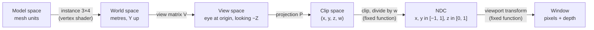

# 04. Cameras, projection, depth and culling

A mesh vertex starts as three floats in a file and ends as a pixel on your screen with a depth value
next to it. This chapter follows that journey step by step. You will learn:

- the chain of coordinate spaces (model, world, view, clip, NDC, window) and which matrix, shader or
  piece of fixed-function hardware moves a point from one to the next;
- how to build a view matrix (look-at) and the two projections Jeddy uses (perspective and
  orthographic), derived from similar triangles;
- why depth precision is poor with the textbook projection, and how reversed-Z with a float depth
  buffer and an infinite far plane fixes it;
- how the isometric CRPG camera is parameterized and driven (orbit, pan, zoom, drag, follow);
- how to pull six frustum planes out of a matrix and cull thousands of bounding spheres with them;
- how to go backwards: from a mouse position to a world ray (picking), and from a depth value to a
  world position (in shaders);
- how a level of detail (LOD) is chosen from its error in pixels, and how interpolation between
  simulation ticks affects all of this.

Where it lives:

| Topic | Code |
|---|---|
| Matrix kernels | [`Mat4Ops`](../../modules/math/src/main/java/dev/jeddy/math/Mat4Ops.java), the value type [`Mat4f`](../../modules/math/src/main/java/dev/jeddy/math/Mat4f.java) |
| Camera math | [`IsoCamera`](../../modules/math/src/main/java/dev/jeddy/math/IsoCamera.java) |
| Camera behaviour | [`IsoCameraController`](../../modules/render/src/main/java/dev/jeddy/render/camera/IsoCameraController.java) |
| Culling kernels | [`CullOps`](../../modules/math/src/main/java/dev/jeddy/math/CullOps.java), [`Intersect`](../../modules/math/src/main/java/dev/jeddy/math/Intersect.java), value types `Planef`, `Ray3f`, `Spheref`, `Aabb3f` |
| Renderer side | [`Culling`](../../modules/render/src/main/java/dev/jeddy/render/draw/Culling.java), [`DrawBuilder`](../../modules/render/src/main/java/dev/jeddy/render/draw/DrawBuilder.java), [`SceneRenderer`](../../modules/render/src/main/java/dev/jeddy/render/SceneRenderer.java), [`GpuDevice`](../../modules/render/src/main/java/dev/jeddy/render/gpu/GpuDevice.java), [`PipelineState`](../../modules/render/src/main/java/dev/jeddy/render/gpu/PipelineState.java) |
| Shaders | [`engine/frame.glsl`](../../modules/render/src/main/resources/dev/jeddy/render/shaders/engine/frame.glsl), [`engine/instance.glsl`](../../modules/render/src/main/resources/dev/jeddy/render/shaders/engine/instance.glsl), [`pbr/pbr.vert`](../../modules/render/src/main/resources/dev/jeddy/render/shaders/pbr/pbr.vert), [`cull/static_cull.comp`](../../modules/render/src/main/resources/dev/jeddy/render/shaders/cull/static_cull.comp) |
| Tests | [`MatrixAndQuatTest`](../../modules/math/src/test/java/dev/jeddy/math/MatrixAndQuatTest.java), [`IsoCameraControllerTest`](../../modules/render/src/test/java/dev/jeddy/render/camera/IsoCameraControllerTest.java), [`DrawBuilderTest`](../../modules/render/src/test/java/dev/jeddy/render/draw/DrawBuilderTest.java), [`StaticSceneTest`](../../modules/render/src/test/java/dev/jeddy/render/cull/StaticSceneTest.java) |

DESIGN §8.2 (math conventions) and §9.4 (isometric camera) are the design references. This chapter
assumes the vector basics (dot and cross products) from [02 Math foundations](02-math-foundations.md)
and the 3×4 affine transforms from [03 Rotations and transforms](03-rotations-and-transforms.md).

## The journey of a vertex

### Six spaces

Every point the renderer draws passes through six coordinate systems. Each arrow is one
transformation:



| Space | What the numbers mean | Who gets you there in Jeddy |
|---|---|---|
| Model | Vertex positions as authored, relative to the mesh's own origin | The `.jmesh` position stream |
| World | One shared frame for the whole level: right-handed, +Y up, metres | Vertex shader: `jeddyTransformPoint` with the instance's 3×4 rows (written by `DrawBuilder`, interpolated between ticks, or by the GPU culling pass for static instances) |
| View | The camera sits at the origin, +X is screen right, +Y is screen up, and it looks down **−Z** | The view matrix `V`, built in Java by `Mat4Ops.lookAt` |
| Clip | Homogeneous 4D coordinates, before the divide | The projection matrix `P`, built in Java. Java multiplies `P·V` once per frame; the shader applies the product |
| NDC | Normalized device coordinates: $x_n, y_n \in [-1, 1]$, $z_n \in [0, 1]$ | GPU fixed function: clipping, then division by $w$ |
| Window | Pixels from the lower-left corner, plus the depth value written to the depth buffer | GPU fixed function: viewport transform (`glViewport`, set per pass by the frame graph) |

The vertex shader of the lit pass shows the split. It applies the instance transform itself, keeps
the world position (lighting needs it), and then applies view and projection in one matrix
([`pbr/pbr.vert`](../../modules/render/src/main/resources/dev/jeddy/render/shaders/pbr/pbr.vert)):

```glsl
void main() {
    JeddyInstance inst = jeddyInstance();
    // ...
    vWorld = jeddyTransformPoint(inst, position);
    // ...
    gl_Position = jViewProjection * vec4(vWorld, 1.0);
}
```

and the instance transform is three dot products, one per row of the row-major 3×4 matrix
([`engine/instance.glsl`](../../modules/render/src/main/resources/dev/jeddy/render/shaders/engine/instance.glsl)):

```glsl
vec3 jeddyTransformPoint(JeddyInstance i, vec3 p) {
    vec4 v = vec4(p, 1.0);
    return vec3(dot(i.row0, v), dot(i.row1, v), dot(i.row2, v));
}
```

Why not one model-view-projection matrix per instance, as many tutorials do? Two reasons. Instances
are stored as 3×4 rows so world transforms are copied, never converted (D21, DESIGN §8.2), and a
3×4 transform takes 48 bytes instead of 64, which leaves room for the material, flags, entity and
fade in a 64-byte instance record. And the lit pass needs the world position anyway, for lights,
shadows, decals and fog of war. Multiplying by `jViewProjection` afterwards costs one more
matrix-vector product per vertex, which is nothing next to the fragment work. (`Mat4Ops.mulAffine`
exists for the cases where you do want `viewProjection × model` on the CPU.)

The depth prepass shader, [`pbr/depth.vert`](../../modules/render/src/main/resources/dev/jeddy/render/shaders/pbr/depth.vert),
does the same but takes the matrix as a plain uniform, `uViewProjection` at location 0, because the
same program also draws shadow casters from each light's point of view.

### Conventions: column vectors, column-major storage

Jeddy writes vectors as columns and puts matrices on the left: $`\mathbf{p}_{clip} = P\,V\,M\,\mathbf{p}`$.
The rightmost matrix applies first. `Mat4Ops.mul(a, ao, b, bo, out, o)` computes $a \cdot b$, so
"$b$ first, then $a$". That is why `IsoCamera` computes the view-projection as
`Mat4Ops.mul(projection, 0, view, 0, viewProjection, 0)`: view first, then projection.

A `Mat4` is 16 floats stored **column-major**, like OpenGL expects: element (row $r$, column $c$) is
at index `c * 4 + r`. Keep this table in mind; every index in this chapter refers to it:

```
              col 0   col 1   col 2   col 3
   row 0  ->  m[0]    m[4]    m[8]    m[12]
   row 1  ->  m[1]    m[5]    m[9]    m[13]
   row 2  ->  m[2]    m[6]    m[10]   m[14]
   row 3  ->  m[3]    m[7]    m[11]   m[15]
```

So the translation of an affine 4×4 is in `m[12..14]`, and row $r$ of a matrix is
`(m[r], m[4 + r], m[8 + r], m[12 + r])`. The math module's `Mat4f` record names its components
`mCR` (column, then row) for the same reason.

### Try it

`SceneRendererTest` builds a camera from scratch with nothing but `Mat4Ops`, which is the whole
pipeline of this chapter in a handful of lines
([`SceneRendererTest`](../../modules/render/src/test/java/dev/jeddy/render/pbr/SceneRendererTest.java)):

```java
// ... four float[16] arrays: view, proj, vp, inv
Mat4Ops.lookAt(0, 0, 4, 0, 0, 0, 0, 1, 0, view, 0);
Mat4Ops.perspectiveReversedZ((float) Math.toRadians(40), 1, 0.1f, proj, 0);
Mat4Ops.mul(proj, 0, view, 0, vp, 0);
Mat4Ops.invert(vp, 0, inv, 0);
float[] planes = new float[CullOps.PLANES_FLOATS];
CullOps.extractPlanes(vp, 0, planes);
packet.setCamera(view, proj, vp, inv, planes, 0, 0, 4);
```

Look-at, projection, product, inverse (for picking and depth reconstruction) and frustum planes (for
culling). The rest of the chapter explains each line.

## The view matrix

### The camera is just an object

Think of the camera as an object placed in the world, with a position $\mathbf{e}$ (the eye) and three
axes: right $\mathbf{r}$, up $\mathbf{u}$, and back $\mathbf{b}$. "Back" because in a right-handed
system with +X right and +Y up, +Z points out of the screen, towards you, so the camera looks along
$-\mathbf{b}$. Call the viewing direction forward, $\mathbf{f} = -\mathbf{b}$.

The camera's own transform (camera to world) is a rotation whose columns are the axes, followed by a
translation to the eye:

```math
C = \begin{pmatrix} r_x & u_x & -f_x & e_x \\ r_y & u_y & -f_y & e_y \\ r_z & u_z & -f_z & e_z \\ 0 & 0 & 0 & 1 \end{pmatrix}
```

The view matrix does the opposite: it takes world points into the camera's frame, so
$V = C^{-1}$. Inverting a rigid transform is cheap. Its rotation part $R$ is orthonormal, so
$R^{-1} = R^T$ (the axes become rows), and the translation becomes $-R^T\mathbf{e}$:

```math
V = \begin{pmatrix} r_x & r_y & r_z & -\mathbf{r}\cdot\mathbf{e} \\ u_x & u_y & u_z & -\mathbf{u}\cdot\mathbf{e} \\ -f_x & -f_y & -f_z & \mathbf{f}\cdot\mathbf{e} \\ 0 & 0 & 0 & 1 \end{pmatrix}
```

Read the rows as questions: "how far along $\mathbf{r}$ is this point from the eye?" (view $x$),
"how far along $\mathbf{u}$?" (view $y$), "how far along $-\mathbf{f}$?" (view $z$, negative in front
of the camera).

### Building the basis from eye, target and up

A look-at camera is given an eye $\mathbf{e}$, a target $\mathbf{t}$ and a rough "up" hint
$\mathbf{w}$ (usually world +Y). Then:

1. $\mathbf{f} = \dfrac{\mathbf{t} - \mathbf{e}}{\lVert \mathbf{t} - \mathbf{e} \rVert}$, the unit viewing direction.
2. $\mathbf{r} = \dfrac{\mathbf{f} \times \mathbf{w}}{\lVert \mathbf{f} \times \mathbf{w} \rVert}$. The cross product is perpendicular to both, so it is horizontal when $\mathbf{w}$ is vertical. In a right-handed system, forward × up points right.
3. $\mathbf{u} = \mathbf{r} \times \mathbf{f}$, the true up, perpendicular to both. It is already unit length because $\mathbf{r} \perp \mathbf{f}$ and both are unit vectors.

`Mat4Ops.lookAt` is exactly this, written out on scalars so it allocates nothing
([`Mat4Ops.java`](../../modules/math/src/main/java/dev/jeddy/math/Mat4Ops.java)):

```java
float fx = tx - ex;
float fy = ty - ey;
float fz = tz - ez;
float fl = (float) (1 / Math.sqrt(fx * fx + fy * fy + fz * fz));
fx *= fl;
fy *= fl;
fz *= fl;
float rx = fy * uz - fz * uy;
float ry = fz * ux - fx * uz;
float rz = fx * uy - fy * ux;
float rl = (float) (1 / Math.sqrt(rx * rx + ry * ry + rz * rz));
rx *= rl;
ry *= rl;
rz *= rl;
float vx = ry * fz - rz * fy;
float vy = rz * fx - rx * fz;
float vz = rx * fy - ry * fx;
out[o] = rx;
out[o + 1] = vx;
out[o + 2] = -fx;
out[o + 3] = 0;
// ... columns 1 and 2 the same way
out[o + 12] = -(rx * ex + ry * ey + rz * ez);
out[o + 13] = -(vx * ex + vy * ey + vz * ez);
out[o + 14] = fx * ex + fy * ey + fz * ez;
out[o + 15] = 1;
```

The parameters `(ux, uy, uz)` are the up hint $\mathbf{w}$, and `v` is the true up $\mathbf{u}$. The
`r` lines are $\mathbf{f} \times \mathbf{w}$ written out component by component, and the `v` lines
are $\mathbf{r} \times \mathbf{f}$. Compare the indices with the storage table: `out[0], out[1],
out[2]` are column 0, so row 0 starts with $r_x$, row 1 with $u_x$ and row 2 with $-f_x$, exactly as
in $V$ above.

### A worked example

Put the eye at $\mathbf{e} = (0, 6, 8)$ looking at the origin. The distance is 10 and the camera is
tilted down by $\arctan(6/8) \approx 36.87°$.

- $\mathbf{f} = (0, -6, -8)/10 = (0, -0.6, -0.8)$
- $`\mathbf{f} \times (0,1,0) = (f_y \cdot 0 - f_z \cdot 1,\; f_z \cdot 0 - f_x \cdot 0,\; f_x \cdot 1 - f_y \cdot 0) = (0.8, 0, 0)`$, normalized $\mathbf{r} = (1, 0, 0)$
- $\mathbf{u} = \mathbf{r} \times \mathbf{f} = (0, 0.8, -0.6)$
- translations: $-\mathbf{r}\cdot\mathbf{e} = 0$, $-\mathbf{u}\cdot\mathbf{e} = -(4.8 - 4.8) = 0$, $\mathbf{f}\cdot\mathbf{e} = -3.6 - 6.4 = -10$

```math
V = \begin{pmatrix} 1 & 0 & 0 & 0 \\ 0 & 0.8 & -0.6 & 0 \\ 0 & 0.6 & 0.8 & -10 \\ 0 & 0 & 0 & 1 \end{pmatrix}
```

Check: the target $(0,0,0)$ goes to $(0, 0, -10)$, ten metres straight ahead. The eye goes to
$(0, 0, 0.6 \cdot 6 + 0.8 \cdot 8 - 10) = (0,0,0)$. A point 2 m to the right of the target,
$(2,0,0)$, goes to $(2, 0, -10)$. A point 5 m further away on the ground, $(0,0,-5)$, goes to
$(0, 3, -14)$: higher on the screen and further from the eye. We will project these two points in the
next section.

### When look-at breaks

If $\mathbf{f}$ is parallel to the up hint (a camera looking straight down), $\mathbf{f} \times \mathbf{w} = \mathbf{0}$,
the normalization divides by zero and the matrix fills with NaN. The isometric camera never gets
there: its pitch is a fixed tilt well below 90° (55° by default). A top-down camera would need a
different up hint, for example the yaw direction on the ground.

### Try it

`lookAtPutsEyeAtOriginLookingDownMinusZ` checks the two properties we just used: the eye maps to the
origin and the target to $(0, 0, -\lVert \mathbf{t} - \mathbf{e} \rVert)$; it also checks that the
`float[]` kernel and the `Mat4f` record agree:

```
./gradlew :math:test --tests 'dev.jeddy.math.MatrixAndQuatTest'
```

## Perspective projection

### Similar triangles

Take a point in view space $(x_v, y_v, z_v)$ in front of the camera, so $`z_v < 0`$, and call its
distance along the view axis $s = -z_v$. A pinhole camera projects it onto an image plane at
distance 1 along the axis. The two triangles below are similar (same angles), so the projected height
is $y' = y_v / s$:

```
        y
        ^                          * (y_v, at depth s)
        |                       .  |
        |                    .     |
        |           y'    .        |  y_v
        |           *  .           |
        |        .  |              |
  eye   *-----------+--------------+------->  -z (view direction)
        0           1              s
```

The vertical field of view $\varphi$ (`fovY`) says how much of the image plane is visible: at
distance 1 the visible half-height is $\tan(\varphi/2)$. Dividing by it maps the visible range to
$[-1, 1]$:

```math
y_n = \frac{y_v}{s \tan(\varphi/2)} = \frac{f\,y_v}{s}, \qquad f = \frac{1}{\tan(\varphi/2)}
```

The screen is wider than tall by the aspect ratio $a = \text{width}/\text{height}$, so the visible
half-width at distance 1 is $a \tan(\varphi/2)$ and

```math
x_n = \frac{(f/a)\, x_v}{s}
```

### Homogeneous coordinates do the division

A matrix can only produce linear combinations of $(x_v, y_v, z_v, 1)$; it cannot divide. The trick
is to output four numbers and let the GPU divide the first three by the fourth after the vertex
shader. That fourth number is $w$, and the projection matrix puts $s = -z_v$ into it with the row
$(0, 0, -1, 0)$:

```math
\begin{pmatrix} x_c \\ y_c \\ z_c \\ w_c \end{pmatrix} =
\begin{pmatrix} f/a & 0 & 0 & 0 \\ 0 & f & 0 & 0 \\ 0 & 0 & A & B \\ 0 & 0 & -1 & 0 \end{pmatrix}
\begin{pmatrix} x_v \\ y_v \\ z_v \\ 1 \end{pmatrix},
\qquad x_n = \frac{x_c}{w_c},\; y_n = \frac{y_c}{w_c},\; z_n = \frac{z_c}{w_c}
```

The GPU clips in this 4D space first (a point is visible when $-w_c \le x_c \le w_c$ and so on) and
divides afterwards. That order matters: points behind the camera have $`w_c < 0`$, and dividing them
would flip them to the front. Clipping removes them first. CPU code that projects points itself must
do the same check; you will see it in the box-selection code later.

### Where does depth come from?

Row 2, $(0, 0, A, B)$, is still free. Whatever we choose, $z_c = A z_v + B$, and after the divide

```math
z_n = \frac{A z_v + B}{-z_v} = -A + \frac{B}{s}
```

So NDC depth is always of the form "constant plus constant over distance". It is a **hyperbola** in
$s$, not a straight line. This is not a design choice; it follows from the matrix being linear and
the divide being by $s$. (It has a benefit: $z_n$ is then linear across a triangle in screen space,
so the hardware can interpolate and compress depth cheaply.)

We pick $A$ and $B$ by saying where the near and far planes go. The textbook choice maps near ($s=n$)
to 0 and far ($s=F$) to 1. Jeddy does the reverse, near to 1 and far to 0 (the next section explains
why):

```math
-A + \frac{B}{n} = 1, \qquad -A + \frac{B}{F} = 0 \quad\Rightarrow\quad B = \frac{nF}{F-n},\; A = \frac{n}{F-n}
```

Now let the far plane go to infinity. $A \to 0$ and $B \to n$, and the depth row becomes
$(0, 0, 0, n)$:

```math
z_n = \frac{n}{s}
```

Depth 1 at the near plane, 0.5 at twice the near distance, approaching 0 at infinity. Nothing is
ever clipped for being too far away. This is the matrix `Mat4Ops.perspectiveReversedZ` writes
([`Mat4Ops.java`](../../modules/math/src/main/java/dev/jeddy/math/Mat4Ops.java)):

```java
/** Writes an infinite reversed-Z perspective projection (see {@link Mat4f}). */
public static void perspectiveReversedZ(
        float fovY, float aspect, float near, float[] out, int o) {
    float f = (float) (1.0 / Math.tan(fovY * 0.5));
    for (int i = 0; i < 16; i++) {
        out[o + i] = 0;
    }
    out[o] = f / aspect;
    out[o + 5] = f;
    out[o + 11] = -1;
    out[o + 14] = near;
}
```

With the storage table: index 0 is (row 0, col 0), 5 is (row 1, col 1), 11 is (row 3, col 2), which
is the $-1$ that copies $-z_v$ into $w$, and 14 is (row 2, col 3), the $B = n$ of the depth row:

```math
P = \begin{pmatrix} f/a & 0 & 0 & 0 \\ 0 & f & 0 & 0 \\ 0 & 0 & 0 & n \\ 0 & 0 & -1 & 0 \end{pmatrix}
```

### Worked example: from world to pixel

Use the `IsoCamera` defaults, $\varphi = 30°$ and $n = 0.5$, with a 1920×1080 window
($a = 16/9$). Then $f = 1/\tan 15° = 2 + \sqrt 3 \approx 3.7321$ and $f/a \approx 2.0993$.
Take the example eye from the previous section and the point $(2, 0, 0)$, which was $(2, 0, -10)$ in
view space:

| Step | Value |
|---|---|
| clip | $`(2.0993 \cdot 2,\; 0,\; 0.5,\; 10) = (4.1986, 0, 0.5, 10)`$ |
| NDC | $`(0.41986,\; 0,\; 0.05)`$ |
| window $x$ | $(0.41986 + 1)/2 \cdot 1920 \approx 1363.1$ |
| window $y$ | $(0 + 1)/2 \cdot 1080 = 540$ (from the bottom) |
| depth | $0.05 = n/s = 0.5/10$ |

And $(0, 0, -5)$, view $(0, 3, -14)$: clip $(0, 11.196, 0.5, 14)$, NDC $(0, 0.7997, 0.0357)$, window
$y \approx 971.9$ from the bottom, which is 108 pixels below the top edge. Five metres of floor
behind the target move the point from the center almost to the top of the screen: a camera tilted
only 37° sees the floor at a grazing angle, so floor depth is squeezed into little screen height.

### The window transform

After the divide, the GPU maps NDC to pixels with the viewport $(x_0, y_0, W, H)$:

```math
x_w = x_0 + \frac{x_n + 1}{2} W, \qquad y_w = y_0 + \frac{y_n + 1}{2} H
```

The origin is the **lower-left** corner (OpenGL's convention, which Jeddy keeps with
`GL_LOWER_LEFT`). Mouse coordinates from SDL start at the top-left, so picking code flips $y$. NDC
does not know about resolution: `FrameGraph` sets each pass's viewport to the size of its target
(the framebuffer size times the target's scale), so the half-resolution AO passes and the
full-resolution passes share the same projection.

### Orthographic projection

An orthographic camera has no perspective: parallel lines stay parallel and things do not shrink
with distance. There is no divide ($w = 1$); the projection is a scale and an offset that maps a box
$[l, r] \times [b, t]$ (and a depth range) onto NDC:

```math
x_n = \frac{2 x_v}{r - l} - \frac{r + l}{r - l}, \qquad
y_n = \frac{2 y_v}{t - b} - \frac{t + b}{t - b}, \qquad
z_n = \frac{z_v + F}{F - n}
```

Check the depth: $z_v = -n$ gives $(F-n)/(F-n) = 1$, and $z_v = -F$ gives 0. Reversed again, but
linear in distance this time. `Mat4Ops.orthoReversedZ` writes exactly these coefficients:

```java
// ... zero all 16 elements
float rl = 1 / (right - left);
float tb = 1 / (top - bottom);
float fn = 1 / (far - near);
out[o] = 2 * rl;
out[o + 5] = 2 * tb;
out[o + 10] = fn;
out[o + 12] = -(right + left) * rl;
out[o + 13] = -(top + bottom) * tb;
out[o + 14] = far * fn;
out[o + 15] = 1;
```

Orthographic projections show up twice in Jeddy: as the optional mode of the isometric camera, and
for the sun's shadow cascades (`SunShadows` calls `Mat4Ops.orthoReversedZ`; see
[07 Lighting and shadows](07-lighting-and-shadows.md)).

### Clip space conventions and `glClipControl`

By default OpenGL clips to $-w \le z_c \le w$, so NDC depth is in $[-1, 1]$, and then maps it to a
window depth with $d = (z_n + 1)/2$. Direct3D and Vulkan use $0 \le z_c \le w$ and store $z_n$
directly. OpenGL 4.5 added `glClipControl` to choose. Jeddy switches to the zero-to-one convention once,
right after creating the context
([`GpuDevice.java`](../../modules/render/src/main/java/dev/jeddy/render/gpu/GpuDevice.java)):

```java
/**
 * Switches clip space to depth [0, 1] with a lower-left origin ({@code glClipControl}), which
 * the reversed-Z projections need (DESIGN §8.2): clear depth to 0 and test {@code GL_GEQUAL}
 * ({@link PipelineState#OPAQUE} does). Call once after creating the context.
 */
public void useReversedZ() {
    dev.jeddy.gl.ffi.GL46.glClipControl(
            dev.jeddy.gl.ffi.GL46.GL_LOWER_LEFT, dev.jeddy.gl.ffi.GL46.GL_ZERO_TO_ONE);
    dev.jeddy.gl.ffi.GL46.glClearDepthf(0f);
}
```

`WorldRenderer.init` calls it after `new GpuDevice(caps)`, and so do the GPU tests. From then on the
clip volume is

```math
-w_c \le x_c \le w_c, \qquad -w_c \le y_c \le w_c, \qquad 0 \le z_c \le w_c
```

and window depth equals NDC depth. Remember the last inequality: frustum-plane extraction is built on
it. The next section shows why the convention matters so much for reversed-Z.

### Try it

`reversedZPerspectiveMapsNearToOneAndFarTowardsZero` in `MatrixAndQuatTest` checks the numbers we
derived: with $n = 0.5$ a point at distance 0.5 gets depth 1, at distance 1 depth 0.5, at a million
metres less than $10^{-6}$. For `orthoReversedZ(-10, 10, -5, 5, 1, 101)` the near top-right corner
$(10, 5, -1)$ lands at $x_n = 1$ with depth 1, and the far corner $(-10, -5, -101)$ at depth 0.

## Depth precision and reversed-Z

### What the depth buffer has to do

The depth test compares, per pixel, the depth of the incoming fragment with the depth already
stored. If two surfaces are a few millimetres apart but get the same stored value, the test cannot
tell which is in front, and they flicker against each other ("z-fighting"). So the question is: how
far apart must two surfaces be, at distance $s$, to get different depth values? Call that the depth
resolution $\Delta s$.

If the stored value is $d(s)$ and the smallest step the format can represent near $d$ is
$\Delta d$, then to first order

```math
\Delta s \approx \frac{\Delta d}{\lvert d'(s) \rvert}
```

Two things decide $\Delta s$: the slope of the mapping $d(s)$, and the spacing $\Delta d$ of the
storage format around $d$.

### The textbook mapping wastes its precision

Standard depth (near to 0, far to 1, finite far $F$) is
$d(s) = \frac{F}{F - n}\left(1 - \frac{n}{s}\right)$ with slope $\frac{Fn}{(F-n)s^2} \approx n/s^2$.
The hyperbola rises steeply near the camera and is almost flat further away. With $n = 0.5$ and
$F = 500$:

- at $s = 2$ m (four times the near distance), $d = 0.75$: three quarters of the range is gone;
- at $s = 20$ m, where an isometric camera looks, $d = 0.976$;
- everything from 20 m to 500 m shares the last 2.4%.

A 24-bit integer depth buffer has a constant step $\Delta d = 2^{-24} \approx 6 \times 10^{-8}$, so
$\Delta s \approx 2^{-24} s^2 / n$: the resolution gets worse with the **square** of the distance.

A 32-bit float buffer does not help here. Floats are dense near 0 and sparse near 1: in $[0.5, 1)$
the spacing is exactly $2^{-24}$, the same as 24-bit integers. The standard mapping puts all the
interesting depths near 1, in the sparse part. In fact, 99.6% of all the float values in $[0, 1)$
lie below $`d(2\,\text{m})`$, so they all describe the first two metres in front of the camera.

### Reversed-Z puts the precision where the distance is

Flip the mapping: $d(s) = n/s$. Now distant points get small depth values, exactly where floats are
dense. The float spacing near $d$ is about $2^{-23} d$ (relative precision), and the slope is
$n/s^2$, so

```math
\Delta s \approx \frac{2^{-23}\, (n/s)}{n/s^2} = 2^{-23}\, s
```

The two non-linearities cancel: resolution is now a constant *fraction* of the distance, about
$10^{-7}$, whatever the near plane. Another way to see it: every doubling of distance, from $s$ to
$2s$, maps to a depth interval $`[n/(2s),\, n/s]`$ whose ends differ by a factor of two, and any such
interval holds exactly $2^{23} \approx 8.4$ million float values (one *binade*'s worth: all floats
that share one exponent, which is what the 23 mantissa bits can count). Counting the
distinct depth values per doubling of distance ($n = 0.5$, $F = 500$ for the standard mapping):

| Distance range | Standard Z, 24-bit or float32 | Reversed-Z, float32 |
|---|---|---|
| 1–2 m | 4,198,503 | 8,388,608 |
| 10–20 m | 419,850 | 8,388,608 |
| 20–40 m | 209,925 | 8,388,608 |
| 100–200 m | 41,985 | 8,388,608 |
| 200–400 m | 20,992 | 8,388,608 |

And the resolution $\Delta s$ at a few distances (same $n$ and $F$):

| Distance $s$ | Standard, 24-bit or float32 | Reversed, float32, `GL_ZERO_TO_ONE` | Reversed, float32, default $[-1,1]$ clip |
|---|---|---|---|
| 5 m | 3.0 µm | 0.37 µm | 1.5 µm |
| 20 m | 48 µm | 1.5 µm | 24 µm |
| 100 m | 1.2 mm | 9.3 µm | 0.6 mm |
| 400 m | 19 mm | 37 µm | 9.5 mm |

(Computed with exact float32 spacing; exercise 2 reproduces it.) Be honest about what this
means for a CRPG: at 20 m even the textbook mapping resolves 0.05 mm, which is plenty for most
geometry. The gains show up at distance, with nearly coplanar surfaces (a rug on a floor, a decal
mesh, overlapping level pieces) and in shadow maps. Reversed-Z costs nothing at run time, so Jeddy
uses it for every depth buffer.

The last column is why `glClipControl` matters. Under the default convention the reversed
projection would put distant points at $z_n$ just above $-1$, where floats are spaced $2^{-24}$
apart, and the hardware's $(z_n + 1)/2$ would turn that into a number near 0 that has already lost
its low bits. Most of the benefit disappears. With `GL_ZERO_TO_ONE` the value $n/s$ is stored as is.

### The rules that go with it

Reversed-Z changes three pieces of state, and Jeddy sets all of them:

1. **Depth format: float.** The scene depth target is a frame-graph texture
   `graph.texture("depth", GL_DEPTH_COMPONENT32F, 1f)` in `SceneRenderer`. (The window's own
   framebuffer has no depth buffer at all, D23.)
2. **Clear value: 0, the far end.** The depth prepass is declared as
   `graph.addPass("depth prepass", this::depthPrepass).depth(depth, 0f)`, and `FrameGraph` clears with
   `glClearNamedFramebufferfv(..., GL_DEPTH, 0, clearValue)`. The shadow maps clear to 0 the same way
   (`SunShadows`: "the far value in reversed-Z"). `useReversedZ` also sets `glClearDepthf(0f)` for any
   plain `glClear`.
3. **Depth test: greater wins.** Closer means larger now. `PipelineState` packs the depth function as
   an index from `GL_NEVER`:

   ```java
   /** Depth function index: never .. always, in GL order ({@code GL_NEVER + i}). */
   public static final int DEPTH_GEQUAL = 6;
   // ...
   /** Opaque geometry: back-face culling, reversed-Z depth test and write, all colors. */
   public static final long OPAQUE =
           ((long) CULL_BACK << CULL_SHIFT)
                   | DEPTH_TEST
                   | DEPTH_WRITE
                   | ((long) DEPTH_GEQUAL << DEPTH_FUNC_SHIFT)
                   | (0xFL << COLOR_MASK_SHIFT);
   ```

   The GL order is NEVER, LESS, EQUAL, LEQUAL, GREATER, NOTEQUAL, GEQUAL, ALWAYS, so index 6 is
   `GL_GEQUAL`. The shadow sampler compares with `GL_GEQUAL` too (`GpuDeviceTest` asserts both).

Why `GEQUAL` and not `GREATER`? (Either works for a plain reversed-Z pass, but the engine uses
`GEQUAL` everywhere.) After the depth prepass, the lit opaque pass
draws the same triangles again with depth writes off (`MaterialSystem.litOpaque` applies
`PipelineState.withDepthWrite(PipelineState.OPAQUE, false)`). It must pass where its depth *equals*
the prepass depth. `EQUAL` alone would leave holes where two separately compiled programs compute
positions that differ in the last bit; `GEQUAL` tolerates that (D42).

The sky uses the far end directly. The full-screen triangle
([`engine/fullscreen.vert`](../../modules/render/src/main/resources/dev/jeddy/render/shaders/engine/fullscreen.vert))
writes $z = 0$, and the sky pass tests `GEQUAL` without writing. A fragment at depth 0 passes only
where the buffer still holds the clear value 0, that is, where no geometry was drawn:

```glsl
gl_Position = vec4(p * 2.0 - 1.0, 0.0, 1.0);
```

### What the infinite far plane changes

With $F = \infty$ nothing is clipped for distance, and the far frustum plane disappears (you will see
it degenerate to "accept everything" in the culling section). Two consequences to remember:

- `RenderPacket.far` is not a clipping distance. It only bounds the light clusters and shadow cascades
  ("Distance up to which lights are clustered and shadows cascade"). The demo sets it to
  `camera.distance * 2 + 60`.
- Depth exactly 0 means "at infinity", which is not a finite point. Shaders that unproject depth
  clamp it first: the sky unprojects at depth `0.0001`, GTAO and particles use
  `max(depth, 1e-7)`. The picking section shows the math.

## The isometric camera

### Orbit parameters

A CRPG camera is not a free-flying camera. It orbits a point on the ground (the **target**) at a
fixed tilt (**pitch**), can turn around it (**yaw**) and zoom in and out (**distance**). That is
`IsoCamera`'s model:

```
  Side view                                   Top view (y towards you)

          eye *                                          -Z
             /|                                           ^   (yaw 0 looks this way)
            / |                                           |
   distance/  | distance * sin(pitch)        -X <---------T---------> +X
          /   |                                           |\
         /    |                                           | \  yaw, from +Z towards +X
  target*-----+                                           |  \
        distance * cos(pitch)                             |   E  eye, at distance * cos(pitch)
                                                          v
                                                         +Z
```

With target $\mathbf{T}$, yaw $\psi$, pitch $\theta$ and distance $D$, the eye is

```math
\mathbf{e} = \mathbf{T} + D\,(\sin\psi\cos\theta,\; \sin\theta,\; \cos\psi\cos\theta)
```

and the view direction is the opposite unit vector. At $\psi = 0$ the eye is on the +Z side and the
camera looks towards −Z. The worked example earlier is this camera with $\psi = 0$,
$\theta = \arctan(6/8)$ and $D = 10$.

`IsoCamera.update` turns the parameters into every matrix the frame needs
([`IsoCamera.java`](../../modules/math/src/main/java/dev/jeddy/math/IsoCamera.java)):

```java
/** Recomputes every matrix for viewport aspect ratio {@code aspect} (width / height). */
public void update(float aspect) {
    float cp = (float) Math.cos(pitch);
    float sp = (float) Math.sin(pitch);
    float sy = (float) Math.sin(yaw);
    float cy = (float) Math.cos(yaw);
    // Forward is (-sin yaw * cos pitch, -sin pitch, -cos yaw * cos pitch); eye is behind it.
    eye.set(
            target.x + sy * cp * distance,
            target.y + sp * distance,
            target.z + cy * cp * distance);
    Mat4Ops.lookAt(eye.x, eye.y, eye.z, target.x, target.y, target.z, 0, 1, 0, view, 0);
    if (orthographic) {
        float h = orthoHeight * 0.5f;
        float w = h * aspect;
        Mat4Ops.orthoReversedZ(-w, w, -h, h, near, orthoFar, projection, 0);
    } else {
        Mat4Ops.perspectiveReversedZ(fovY, aspect, near, projection, 0);
    }
    Mat4Ops.mul(projection, 0, view, 0, viewProjection, 0);
    Mat4Ops.invert(viewProjection, 0, inverseViewProjection, 0);
    CullOps.extractPlanes(viewProjection, 0, frustumPlanes);
}
```

Everything is written into preallocated public arrays (`view`, `projection`, `viewProjection`,
`inverseViewProjection`, `frustumPlanes`), so calling it every frame allocates nothing
(`MatrixAndQuatTest.kernelsDoNotAllocate` checks it). The defaults:

| Field | Default | Meaning |
|---|---|---|
| `yaw` | $\pi/4$ (45°) | Rotation around +Y; 0 looks towards −Z |
| `pitch` | 55° | Downward tilt; $\pi/2$ would look straight down |
| `distance` | 20 | Eye to target |
| `fovY` | 30° | Vertical field of view (perspective) |
| `near` | 0.5 | Near plane |
| `orthographic` | `false` | Orthographic instead of perspective |
| `orthoHeight`, `orthoFar` | 20, 500 | Visible height and far plane in orthographic mode |

### Why a narrow field of view

"Isometric" in the strict sense is an orthographic projection with yaw 45° and pitch
$\arctan(1/\sqrt 2) \approx 35.26°$. Jeddy's design instead defaults to a perspective camera with a
narrow field of view (DESIGN §9.4: about 30–35°, with orthographic as an option), which keeps most of
the clean look while still giving depth cues. The default pitch of 55° is also steeper than true
isometric, closer to looking down on the party.

How much does the field of view matter? Compare the scale of objects at the top and bottom edges of
the screen. At pitch 55°, an object on the ground at the top edge is further away than one at the
bottom edge, so it looks smaller:

| Field of view | Depth at top edge / depth at bottom edge | Top object appears |
|---|---|---|
| 30° | 24.6 / 16.8 = 1.46 | 68% of the size |
| 60° | 33.6 / 14.2 = 2.36 | 42% of the size |

(For $D = 20$; the ratio depends only on pitch and field of view.) A 60° camera exaggerates the
perspective; a 30° camera keeps characters at the top of the screen readable.

The price of a narrow field of view is that the camera must stand further back to frame the same
area, which is fine with reversed-Z, since precision follows relative distance.

### The controller: CRPG behaviour on top of the math

`IsoCamera` is pure math. `IsoCameraController` in `render.camera` adds the behaviour players expect
(TASKS M5-09). It takes plain numbers, not input events, so the game decides which keys do what. Both
live on the game thread; the render packet copies the finished matrices.

The [game template](../../samples/game-template/src/main/java/com/example/mygame/MyGame.java) shows
the minimal wiring, one call per frame and one copy at extraction:

```java
var g = ctx.gestures();
controller.pan(g.edgeScrollX(), -g.edgeScrollY());
controller.zoom(g.zoomDelta());
controller.rotate(g.rotateDelta() * 0.006f);
var in = ctx.input();
controller.update(
        dt, in.pixelHeight() > 0 ? (float) in.pixelWidth() / in.pixelHeight() : 1);
// ...
p.setCamera(
        camera.view,
        camera.projection,
        camera.viewProjection,
        camera.inverseViewProjection,
        camera.frustumPlanes,
        camera.eye().x,
        camera.eye().y,
        camera.eye().z);
p.near = camera.near;
p.far = camera.distance * 2 + 60;
p.orthographic = camera.orthographic;
```

Here is `update`, the heart of it
([`IsoCameraController.java`](../../modules/render/src/main/java/dev/jeddy/render/camera/IsoCameraController.java)):

```java
/** Applies this frame's input and smoothing, then updates the camera matrices. */
public void update(float dt, float aspect) {
    lastAspect = aspect;
    float k = smoothing <= 0 ? 1 : 1 - (float) Math.exp(-dt / smoothing);
    camera.distance += (goalDistance - camera.distance) * k;
    camera.yaw += (goalYaw - camera.yaw) * k;
    if (panX != 0 || panZ != 0) {
        float len = (float) Math.sqrt(panX * panX + panZ * panZ);
        float scale = panSpeed * (camera.distance / 20f) * dt / Math.max(1, len);
        float s = (float) Math.sin(camera.yaw);
        float c = (float) Math.cos(camera.yaw);
        // Forward on the ground is (-sin yaw, -cos yaw); right is (cos yaw, -sin yaw).
        camera.target.x += (panX * c - panZ * s) * scale;
        camera.target.z += (-panX * s - panZ * c) * scale;
        panX = 0;
        panZ = 0;
    } else if (following) {
        camera.target.x += (followX - camera.target.x) * k;
        camera.target.y += (followY - camera.target.y) * k;
        camera.target.z += (followZ - camera.target.z) * k;
    }
    clampTarget();
    camera.update(aspect);
}
```

Four ideas are packed in here.

**Frame-rate independent smoothing.** Zoom, rotation and follow do not jump to their goal $g$; they
glide. The model is "move towards the goal at a speed proportional to the remaining gap", the
differential equation $\dot x = (g - x)/\tau$ with time constant $\tau$ (`smoothing`, 0.12 s). Its
exact solution over one frame of length $\Delta t$ is

```math
g - x(t + \Delta t) = (g - x(t))\, e^{-\Delta t/\tau}
\quad\Longleftrightarrow\quad
x \leftarrow x + (g - x)\,k, \quad k = 1 - e^{-\Delta t/\tau}
```

At 60 FPS, $k = 1 - e^{-0.1389} \approx 0.130$. Because it is the exact solution, two frames of
$\Delta t/2$ give the same result as one frame of $\Delta t$; the naive `x += (g - x) * 0.1` would
make the camera faster at higher frame rates, because it takes more steps per second. After $3\tau = 0.36$ s the camera has covered 95% of the
way.

**Multiplicative zoom.** `zoom(steps)` multiplies the goal distance by $1.15^{-\text{steps}}$ and
clamps it to `[minDistance, maxDistance]` (6 and 60 by default). Every wheel notch changes the view
by the same percentage, which feels uniform whether you are close or far. Three notches in from 20
give $20/1.15^3 \approx 13.15$, which is exactly what `zoomAndRotationAreSmoothedAndClamped` asserts
once the smoothing settles.

**View-relative panning.** "Forward" for the player means "away from the camera, along the ground".
Drop the $y$ component of the camera's forward vector
$(-\sin\psi\cos\theta, -\sin\theta, -\cos\psi\cos\theta)$ and normalize: the ground forward is
$(-\sin\psi, 0, -\cos\psi)$. Right is forward × up $= (\cos\psi, 0, -\sin\psi)$. The target moves by
$(\text{panX}\cdot\text{right} + \text{panZ}\cdot\text{forward})$ times a speed, which is the two
lines with `c` and `s`. The speed is `panSpeed` (18 units per second) times `distance / 20`, so the
ground scrolls at the same speed *on screen* at every zoom level, and diagonal input is divided by its
length so it is not 41% faster.

**Bounds and follow.** `setBounds` clamps the target's $x$ and $z$ to the level rectangle;
`follow(x, y, z)` glides the target to a point (the demo follows the party's center with C) until
the player pans.

Edge panning is a small helper that turns a cursor position in pixels into `pan` input: inside the
outer 1% of the window (`edgeMargin`), the camera pans towards that edge. Note the $y$ sign: screen
$y$ grows downwards, so the top edge means "forward".

### Drag panning: keeping the ground under the cursor

Grab the floor with the mouse and drag: the point you grabbed should stay exactly under the cursor.
The controller remembers the grabbed ground point (`beginDrag`) and, on every move, shifts the target
by how far the ground point under the cursor drifted:

```java
/** Continues a drag pan. */
public void drag(float ndcX, float ndcY) {
    if (dragging && groundPoint(ndcX, ndcY, hit)) {
        camera.target.x += dragAnchor[0] - hit[0];
        camera.target.z += dragAnchor[2] - hit[2];
        clampTarget();
        camera.update(lastAspect);
    }
}
```

Why is this exact and not just approximate? Translating the camera by a horizontal vector
$\Delta$ translates every viewing ray by $\Delta$ and changes nothing else (rotation and projection
stay the same). So the ray through the same cursor position hits the horizontal ground at
$\text{hit} + \Delta$. Choosing $\Delta = \text{anchor} - \text{hit}$ puts the anchor back under the
cursor in one step. `dragKeepsTheGrabbedGroundPointUnderTheCursor` checks it to $10^{-3}$. The
`groundPoint` method is picking against a plane; we look at it in the picking section.

### LOD pixels

The controller also answers one question for the renderer: `lodPixels(heightPixels)`, the number of
pixels one world unit covers at distance 1. We derive it in the LOD section.

### The camera in the demo

The iso demo
([`DemoGame`](../../samples/iso-demo/src/main/java/dev/jeddy/samples/iso/DemoGame.java)) tunes the
defaults: a starting distance of 22 (30 in `--perf` runs), yaw 45°, pitch 52°, zoom limits 8–48 and smoothing 0.15 s. `updateCamera` maps WASD and the arrow keys plus screen edges to `pan`, the wheel to `zoom`,
Q and E (1.6 rad/s) and middle-drag to `rotate`, and C to `follow` of the party center; in `--perf`
runs the camera orbits slowly by itself. The level bounds come from the level's size
(`controller.setBounds(level.minX, level.minZ, ...)`).

### Try it

```
./gradlew :render:test --tests 'dev.jeddy.render.camera.IsoCameraControllerTest'
```

This test needs no GPU. Besides pan, zoom, rotation, drag and follow, it runs a full controller frame
(edge pan, zoom, update) under `Allocations.assertNoAllocation`. Then run the demo
(`./gradlew :iso-demo:run`) and compare Q/E rotation with the wheel zoom: both glide with the same
time constant.

## Frustum culling

The camera sees a truncated pyramid, the **view frustum**. Anything entirely outside it cannot
appear on screen, so there is no point sending it to the GPU. With thousands of props and
characters per level, testing a bounding sphere per object against the frustum on the CPU is much
cheaper than drawing everything.

### Planes from the view-projection matrix

A plane is the set of points $\mathbf{p}$ with $\mathbf{n}\cdot\mathbf{p} + d = 0$. Write it as four
numbers $(a, b, c, d)$ with $\mathbf{n} = (a, b, c)$. For a point not on the plane,
$a x + b y + c z + d$ is positive on one side and negative on the other; if $\mathbf{n}$ has unit
length, the value is the signed distance in world units.

How do we find the frustum's six planes? We could compute its corners and build planes from them,
but there is a much shorter way (Gribb and Hartmann). Let $`\mathbf{m}_0 \ldots \mathbf{m}_3`$ be the
rows of the view-projection matrix $PV$, each a 4-vector, and $\mathbf{p} = (x, y, z, 1)$ a world
point. Then the clip coordinates are dot products with the rows:

```math
x_c = \mathbf{m}_0\cdot\mathbf{p},\quad y_c = \mathbf{m}_1\cdot\mathbf{p},\quad z_c = \mathbf{m}_2\cdot\mathbf{p},\quad w_c = \mathbf{m}_3\cdot\mathbf{p}
```

A point is inside the frustum exactly when it is inside the clip volume. Rewrite each clip
inequality so the right-hand side is 0:

| Clip test | Rewritten | Plane $(a, b, c, d)$ | Name in `CullOps` |
|---|---|---|---|
| $x_c \ge -w_c$ | $`(\mathbf{m}_3 + \mathbf{m}_0)\cdot\mathbf{p} \ge 0`$ | $`\mathbf{m}_3 + \mathbf{m}_0`$ | left |
| $x_c \le w_c$ | $`(\mathbf{m}_3 - \mathbf{m}_0)\cdot\mathbf{p} \ge 0`$ | $`\mathbf{m}_3 - \mathbf{m}_0`$ | right |
| $y_c \ge -w_c$ | $`(\mathbf{m}_3 + \mathbf{m}_1)\cdot\mathbf{p} \ge 0`$ | $`\mathbf{m}_3 + \mathbf{m}_1`$ | bottom |
| $y_c \le w_c$ | $`(\mathbf{m}_3 - \mathbf{m}_1)\cdot\mathbf{p} \ge 0`$ | $`\mathbf{m}_3 - \mathbf{m}_1`$ | top |
| $z_c \le w_c$ | $`(\mathbf{m}_3 - \mathbf{m}_2)\cdot\mathbf{p} \ge 0`$ | $`\mathbf{m}_3 - \mathbf{m}_2`$ | near (reversed-Z) |
| $z_c \ge 0$ | $`\mathbf{m}_2\cdot\mathbf{p} \ge 0`$ | $`\mathbf{m}_2`$ | far (reversed-Z) |

Each row of the table is linear in $\mathbf{p}$, so each is a world-space plane, with "inside" on the
positive side. No divide is needed, so the trick works for points behind the camera too. The last two
rows depend on the clip convention: with OpenGL's default $-w \le z \le w$ the near plane would be
$`\mathbf{m}_3 + \mathbf{m}_2`$. Jeddy uses $[0, w]$, and in reversed-Z, $z_c = w_c$ is the *near* plane.

`CullOps.extractPlanes` is the table in code
([`CullOps.java`](../../modules/math/src/main/java/dev/jeddy/math/CullOps.java)):

```java
public static void extractPlanes(float[] m, int mo, float[] planes) {
    // Row r of the matrix is (m[r], m[4 + r], m[8 + r], m[12 + r]).
    for (int i = 0; i < 6; i++) {
        float a;
        float b;
        float c;
        float d;
        switch (i) {
            case 0 -> { // left: row3 + row0
                a = m[mo + 3] + m[mo];
                b = m[mo + 7] + m[mo + 4];
                c = m[mo + 11] + m[mo + 8];
                d = m[mo + 15] + m[mo + 12];
            }
            // ... right, bottom, top
            case 4 -> { // z <= w (reversed-Z: the near plane)
                a = m[mo + 3] - m[mo + 2];
                b = m[mo + 7] - m[mo + 6];
                c = m[mo + 11] - m[mo + 10];
                d = m[mo + 15] - m[mo + 14];
            }
            default -> { // z >= 0 (reversed-Z: the far plane)
                a = m[mo + 2];
                b = m[mo + 6];
                c = m[mo + 10];
                d = m[mo + 14];
            }
        }
        float len = (float) Math.sqrt(a * a + b * b + c * c);
        if (len > 1e-12f) {
            planes[i * 4] = a / len;
            planes[i * 4 + 1] = b / len;
            planes[i * 4 + 2] = c / len;
            planes[i * 4 + 3] = d / len;
        } else {
            planes[i * 4] = 0;
            planes[i * 4 + 1] = 0;
            planes[i * 4 + 2] = 0;
            planes[i * 4 + 3] = 1;
        }
    }
}
```

The planes come out as 24 floats, `CullOps.PLANES_FLOATS`, in the order left, right, bottom, top,
near, far, each normalized so $(a, b, c)$ is a unit normal and $d$ a distance.

### The degenerate far plane, derived

Look at the `len > 1e-12f` branch. For the infinite perspective, row 2 of $P$ is $(0, 0, 0, n)$, so
row 2 of $PV$ is $n$ times row 3 of $V$, which is $(0, 0, 0, 1)$: $`\mathbf{m}_2 = (0, 0, 0, n)`$. The
"far plane" $0x + 0y + 0z + n \ge 0$ is true everywhere. It has no normal to normalize, so
`extractPlanes` stores `(0, 0, 0, 1)`, a plane that accepts every point. That matches the Javadoc:
"The far plane of an infinite reversed-Z projection is degenerate".

The near plane is just as instructive. Row 3 of $P$ is $(0, 0, -1, 0)$, so
$`\mathbf{m}_3 = -(\text{row 2 of } V) = (\mathbf{f}, -\mathbf{f}\cdot\mathbf{e})`$. Then
$`\mathbf{m}_3 - \mathbf{m}_2 = (\mathbf{f}, -\mathbf{f}\cdot\mathbf{e} - n)`$, and the test says
$\mathbf{f}\cdot(\mathbf{p} - \mathbf{e}) \ge n$: "at least $n$ in front of the eye along the view
direction". The normal is already unit length.

### A worked example

For the example camera (eye $(0,6,8)$, target origin, 30°, 16:9), the planes come out as:

| Plane | $(a, b, c)$ | $d$ |
|---|---|---|
| left | $(0.9028, -0.2580, -0.3440)$ | 4.3005 |
| right | $(-0.9028, -0.2580, -0.3440)$ | 4.3005 |
| bottom | $(0, 0.6174, -0.7866)$ | 2.5882 |
| top | $(0, -0.9280, 0.3725)$ | 2.5882 |
| near | $(0, -0.6, -0.8)$ | 9.5 |
| far | $(0, 0, 0)$ | 1 |

Sanity checks: the target at the origin is 9.5 m from the near plane (10 m minus the near distance
0.5). It is 4.30 m from the left and right planes: at depth 10, the half-width is
$10 \cdot a \tan 15° = 4.763$, and the perpendicular distance to a side plane is that times
$\cos(\text{half horizontal angle}) = 0.9028$, giving 4.30.

### The sphere test

A bounding sphere with center $\mathbf{c}$ and radius $r$ is entirely outside a plane if its center is
further than $r$ on the negative side: $`\mathbf{n}\cdot\mathbf{c} + d < -r`$. If that happens for any
of the six planes, the sphere is invisible:

```java
/** Returns {@code true} if the sphere is at least partly inside the frustum. */
public static boolean sphereVisible(float[] planes, float cx, float cy, float cz, float r) {
    for (int p = 0; p < 24; p += 4) {
        if (planes[p] * cx + planes[p + 1] * cy + planes[p + 2] * cz + planes[p + 3] < -r) {
            return false;
        }
    }
    return true;
}
```

Example: a sphere at $(6, 0, 0)$ with radius 1. Its distance to the right plane is
$`-0.9028 \cdot 6 + 4.3005 = -1.116 < -1`$: culled. Projecting its center confirms it: view
$(6, 0, -10)$ gives $x_n = 2.0993 \cdot 6/10 = 1.26$, off screen. With radius 1.5 the same sphere
reaches back inside ($-1.116 \ge -1.5$) and is kept.

The test is **conservative**. Near a frustum corner a sphere can be outside the frustum and still
not be entirely behind any single plane:

```
                :  left plane, extended past the corner
          .----.:
         /     :\        The sphere crosses the left plane's extension (above the corner)
        |   o  : |       and touches the top plane's extension (left of the corner).
         \     :/        No single plane has it entirely behind, so it is kept,
   .......'----'+------  yet no part of it is inside.   <- top plane
                |
                |   frustum interior (right of the left plane, below the top plane)
                |
```

It never rejects a visible object, which is what matters; a few extra draws cost little.
`CullOps.aabbVisible` does the same for boxes: for each plane it tests only the box corner furthest
along the normal (the "positive vertex"), picked per axis by the sign of the normal component.

### The batch kernel

`CullOps.spheres` tests a range of spheres stored as struct-of-arrays and writes the indices of the
visible ones:

```java
int n = outOffset;
for (int i = start; i < end; i++) {
    float x = cx[i];
    float y = cy[i];
    float z = cz[i];
    float nr = -r[i];
    boolean visible =
            p0a * x + p0b * y + p0c * z + p0d >= nr
                    & p1a * x + p1b * y + p1c * z + p1d >= nr
                    & p2a * x + p2b * y + p2c * z + p2d >= nr
                    & p3a * x + p3b * y + p3c * z + p3d >= nr
                    & p4a * x + p4b * y + p4c * z + p4d >= nr
                    & p5a * x + p5b * y + p5c * z + p5d >= nr;
    out[n] = i;
    n += visible ? 1 : 0; // branch-free compaction
}
return n - outOffset;
```

Three performance habits are visible. The 24 plane values are loaded into locals once, outside the
loop. The six comparisons use the non-short-circuit `&`, so there is no early exit whose outcome the
CPU must predict per sphere. And the compaction always writes the index, then advances the output
cursor by 0 or 1, instead of branching on visibility (which is why `out` needs room for
`end - start` entries). When visibility flips often from one object to the next, a branch on it is
mispredicted often, and a misprediction can cost as much as the sphere test itself.
`MathBench.cullSpheres10k` measures the kernel on 10,000 spheres.

### Culling in the renderer

The renderer's culling works on the render packet. Each instance has a world bounding sphere in
`RenderPacket.bounds` (x, y, z, radius: 4 floats per instance), filled by `World.extract` from the
mesh's bounding sphere, transformed by the instance's world matrix and scaled by its largest axis
scale. `Culling` runs in two phases
([`Culling.java`](../../modules/render/src/main/java/dev/jeddy/render/draw/Culling.java)):

```java
private void cullRange(int start, int end, int thread) {
    float[] pl = planes;
    float[] b = packet.bounds;
    int[] flags = packet.flags;
    int required = requiredFlags;
    int excluded = excludedFlags;
    float r = sphereRadius;
    byte[] f = visibleFlags;
    for (int i = start; i < end; i++) {
        int o = i * 4;
        boolean v =
                (flags[i] & required) == required
                        && (flags[i] & excluded) == 0
                        && CullOps.sphereVisible(pl, b[o], b[o + 1], b[o + 2], b[o + 3]);
        if (v && r >= 0) {
            float dx = b[o] - sphereX;
            float dy = b[o + 1] - sphereY;
            float dz = b[o + 2] - sphereZ;
            float reach = r + b[o + 3];
            v = dx * dx + dy * dy + dz * dz <= reach * reach;
        }
        f[i] = v ? (byte) 1 : 0;
    }
}
```

1. **Parallel test.** From 4096 instances up (`PARALLEL_FROM`), `cullRange` runs on the job workers
   in chunks of 1024 (`GRAIN`). Each worker writes only its own range of the `visibleFlags` byte array,
   so no synchronization is needed.
2. **Sequential compaction.** The calling thread then walks the flags and appends visible indices in
   packet order. A parallel compaction would need an atomic counter and would produce a different
   order every frame; sequential compaction is cheap and deterministic.

The same class serves every view. The general `cull` overload takes the planes to use,
`requiredFlags` (shadow views pass `RenderPacket.FLAG_CASTS_SHADOW`), `excludedFlags`, and an optional
sphere (a light's range: an instance must also touch the light to cast its shadow). The sun cascades
and the local shadow views extract their own planes with `CullOps.extractPlanes` from their own
matrices (`SunShadows`, `LocalShadows`).

For the main view, `SceneRenderer.cullMainView` either culls everything, or, when GPU culling is on,
excludes `FLAG_STATIC` instances and adds back the few static instances the GPU path leaves to the
CPU (blended materials, which must be sorted):

```java
boolean gpu = staticScene != null && staticScene.active();
int n =
        culling.cull(
                p,
                p.frustumPlanes,
                0,
                gpu ? RenderPacket.FLAG_STATIC : 0,
                0,
                0,
                0,
                -1,
                visible);
```

### GPU culling of static instances

Static instances never move, so Jeddy keeps them on the GPU and culls them there with a compute
shader (M7-11, D49). One invocation tests one (instance, submesh) item with the same plane test as
`sphereVisible`, against the same 24 floats uploaded as `uniform vec4 uPlanes[6]`
([`cull/static_cull.comp`](../../modules/render/src/main/resources/dev/jeddy/render/shaders/cull/static_cull.comp)):

```glsl
vec4 b = it.bounds;
for (int p = 0; p < 6; p++) {
    if (dot(uPlanes[p].xyz, b.xyz) + uPlanes[p].w < -b.w) {
        return;
    }
}
```

Surviving items pick their LOD with the formula of the LOD section below and append themselves to an
indirect draw command with `atomicAdd`. `StaticSceneTest` asserts that "GPU and CPU frustum tests
agree" on the number of drawn instances. How the bins, commands and
`glMultiDrawElementsIndirectCount` fit together is the subject of
[06 Renderer architecture](06-renderer-architecture.md).

### Try it

`cameraCullingAndPicking` in `MatrixAndQuatTest` builds a default `IsoCamera` aimed at $(10, 0, -5)$
and checks a sphere at the target (visible), one far behind the camera and one far to the side
(culled), then runs `CullOps.spheres` over 1000 spheres of which every other one is 1000 m away
(exactly half survive). For the renderer side, `DrawBuilderTest` (a GPU test) culls a 200×100 grid
plus a row of 100 instances outside the frustum and expects exactly 20,000 visible:

```
./gradlew :render:test -Pjeddy.gpuTests=true --tests 'dev.jeddy.render.draw.DrawBuilderTest'
./gradlew :bench:jmh -Pjmh.includes=MathBench
```

## Picking: from the mouse to the world

### Window to NDC

Picking runs the pipeline backwards. Start with the cursor at window coordinates $(p_x, p_y)$, origin
top-left, $y$ down, in a window of size $W \times H$. Invert the viewport transform and flip $y$:

```math
x_n = \frac{2 p_x}{W} - 1, \qquad y_n = 1 - \frac{2 p_y}{H}
```

That is the expression in `DemoGame.handleInput`: `g.x() / ww * 2 - 1, 1 - g.y() / wh * 2`. The
cursor is in window coordinates and so is the size it is divided by (`in.windowWidth()`); on a HiDPI
display these differ from framebuffer pixels, but the ratio is the same.

### NDC to a ray: unprojection

A cursor position is not a point but a whole line of points, one per depth. To get the line, unproject
two points on it with the inverse view-projection matrix and divide by $w$:

```math
\mathbf{q}_h = (PV)^{-1} \begin{pmatrix} x_n \\ y_n \\ z_n \\ 1 \end{pmatrix}, \qquad
\mathbf{q} = \frac{(q_{h,x},\, q_{h,y},\, q_{h,z})}{q_{h,w}}
```

The divide undoes the perspective divide. `IsoCamera.screenRay` picks depth 1 (the near plane) and
depth 0.5 and normalizes the difference:

```java
public void screenRay(float ndcX, float ndcY, float[] origin, float[] direction) {
    // Reversed-Z: depth 1 is the near plane; 0.5 is a point further along the ray.
    unproject(ndcX, ndcY, 1f, p0);
    unproject(ndcX, ndcY, 0.5f, p1);
    float dx = p1[0] - p0[0];
    float dy = p1[1] - p0[1];
    float dz = p1[2] - p0[2];
    float inv = (float) (1 / Math.sqrt(dx * dx + dy * dy + dz * dz));
    origin[0] = p0[0];
    // ...
    direction[2] = dz * inv;
}

private void unproject(float x, float y, float depth, float[] out) {
    Mat4Ops.project(inverseViewProjection, 0, x, y, depth, out, 0);
}
```

There is no separate `unproject` kernel: `Mat4Ops.project` means "multiply by a matrix and divide by
$w$", so passing the inverse matrix runs the pipeline backwards.

Why not use depth 0 as the second point? Invert $P$ by hand: from $w_c = -z_v$ and $`z_c = n\,w_v`$
(where $w_v$ is the view-space point's fourth, homogeneous coordinate, 1 for an ordinary point),
the view-space point for clip $(x, y, z, w)$ is $`(x a/f,\; y/f,\; -w,\; z/n)`$. At depth 0 its fourth
component is 0: the point is at infinity, and dividing by $w$ gives infinities. Depth 0.5 lies at
distance $2n = 1$ m, comfortably finite.

For the orthographic camera the same code works: both unprojected points share the same $x$ and $y$
offset from the view axis, so the direction is the camera's forward vector for every pixel, and only
the origin moves.

**Worked example.** Take the example camera and the pixel where $(2, 0, 0)$ appeared, NDC
$(0.4199, 0)$. Unprojecting gives the origin $(0.1, 5.7, 7.6)$ on the near plane and the direction
$(0.1961, -0.5883, -0.7845)$. To hit the ground $y = 0$, solve $`5.7 - 0.5883\,t = 0`$: $t = 9.688$
and the hit point is $`(0.1 + 0.1961 \cdot 9.688,\; 0,\; 7.6 - 0.7845 \cdot 9.688) = (2.0, 0, 0.0)`$.
The round trip closes.

### Hitting the ground and the units

The simplest target is a horizontal plane, which is what the camera controller uses for drag panning
(`IsoCameraController.groundPoint`):

```java
camera.screenRay(ndcX, ndcY, origin, direction);
if (Math.abs(direction[1]) < 1e-6f) {
    return false;
}
float t = (groundY - origin[1]) / direction[1];
if (t < 0) {
    return false;
}
```

This is the ray-plane intersection $\mathbf{o} + t\mathbf{d}$ with $y = y_g$, specialized to a
horizontal plane; `Intersect.rayPlane` and `Planef.intersect(Ray3f)` are the general versions for any
plane $\mathbf{n}\cdot\mathbf{p} + d = 0$: $t = -(\mathbf{n}\cdot\mathbf{o} + d)/(\mathbf{n}\cdot\mathbf{d})$.

The demo needs more than a plane: a cursor over a skeleton must pick the skeleton, and a cursor over
a wall must not pick the floor behind it. `DemoGame.handleInput` sends the ray into the physics module
([`DemoGame.java`](../../samples/iso-demo/src/main/java/dev/jeddy/samples/iso/DemoGame.java)):

```java
// What is under the cursor.
camera.screenRay(g.x() / ww * 2 - 1, 1 - g.y() / wh * 2, rayOrigin, rayDirection);
int kind =
        level.collision.pick(
                rayOrigin[0],
                rayOrigin[1],
                rayOrigin[2],
                rayDirection[0],
                rayDirection[1],
                rayDirection[2],
                400,
                Level.UNITS,
                0,
                0.3f,
                pickQuery);
int unit = kind == CollisionWorld.PICK_UNIT ? pickQuery.entity : -1;
groundValid = kind == CollisionWorld.PICK_GROUND;
```

`CollisionWorld.pick` (in `physics.query`) casts the ray, up to 400 m, against the bodies in the unit
layers (here `Level.UNITS`, with radii grown by 0.3 m so small targets are easy to click), the
interactable layers (none in this call: the mask is 0) and the static collision BVH, and returns the
nearest hit. It reports `PICK_GROUND` only if the nearest surface is a walkable triangle, so clicking
a wall gives `PICK_NONE` instead of a floor point behind it. Body tests use `Intersect.raySphere`,
`Intersect.rayVerticalCylinder` and `Intersect.rayAabb`; the static triangles go through the BVH.
Both are covered in [11 Physics, navigation and crowds](11-physics-navigation-crowds.md).

`handleInput` runs before `updateCamera` in the demo's `update`, so it picks with the matrices of the
previous frame's camera update, the ones closest to what is on screen.

### The forward direction: box selection

Box selection is the opposite problem: given a rectangle on screen, which party members are inside
it? `Party.selectBox` projects each member's chest point (0.9 m above the feet) with the
view-projection matrix, reading the rows straight out of the column-major array
([`Party.java`](../../samples/iso-demo/src/main/java/dev/jeddy/samples/iso/Party.java)):

```java
float cw = vp[3] * x + vp[7] * y + vp[11] * z + vp[15];
if (cw <= 0) {
    continue;
}
float sx = ((vp[0] * x + vp[4] * y + vp[8] * z + vp[12]) / cw + 1) * 0.5f * windowWidth;
float sy =
        (1 - (vp[1] * x + vp[5] * y + vp[9] * z + vp[13]) / cw) * 0.5f * windowHeight;
```

Every piece is in this chapter: $w_c$ from row 3, the check $`w_c > 0`$ that the GPU's clipping would
have done (a point behind the camera would otherwise project to a mirrored position), the divide,
the viewport transform, and the $y$ flip into top-left window coordinates.

### World positions from depth, in shaders

Post-processing and screen-space passes only have a pixel and the depth buffer, not the original
geometry. They reconstruct positions with the same unprojection, written once in
[`engine/frame.glsl`](../../modules/render/src/main/resources/dev/jeddy/render/shaders/engine/frame.glsl):

```glsl
// World-space position of a pixel at window depth d (reversed-Z, depth in [0, 1]).
vec3 jeddyWorldFromDepth(vec2 uv, float d) {
    vec4 p = jInverseViewProjection * vec4(uv * 2.0 - 1.0, d, 1.0);
    return p.xyz / p.w;
}

// Positive view-space distance along -Z of a world position.
float jeddyViewDepth(vec3 world) {
    return -(jView * vec4(world, 1.0)).z;
}
```

`uv * 2.0 - 1.0` turns texture coordinates in $[0, 1]$ into NDC; because of `GL_ZERO_TO_ONE` the
stored depth *is* NDC $z$, so it needs no remapping (with the default convention you would write
`d * 2.0 - 1.0`). `jeddyViewDepth` is the view-space $s$ from the projection section: the lit pass uses
it to find the pixel's light cluster slice, and particles use it for soft edges.

Passes that work in view space use `jInverseProjection` instead, for example the GTAO pass
([`post/gtao.frag`](../../modules/render/src/main/resources/dev/jeddy/render/shaders/post/gtao.frag)):

```glsl
vec3 viewPos(vec2 uv) {
    // Sky texels (reversed-Z 0, infinite far plane) become very distant points, not infinities.
    float d = max(textureLod(uDepth, uv, 0.0).r, 1e-7);
    vec4 p = jInverseProjection * vec4(uv * 2.0 - 1.0, d, 1.0);
    return p.xyz / p.w;
}
```

Note the clamp, which is the "depth 0 is at infinity" rule from above. The sky shader reads the
camera's forward vector straight out of the view matrix for orthographic cameras, where every pixel
looks in the same direction: `-vec3(jView[0][2], jView[1][2], jView[2][2])` is minus row 2 of $V$,
and row 2 is $-\mathbf{f}$.

These matrices reach the shaders through the frame constants block (uniform binding 0, 544 bytes),
which `SceneRenderer.writeFrameConstants` fills once per frame. The camera part:

| Offset | GLSL member | Written from |
|---|---|---|
| 0 | `jView` | `p.view` |
| 64 | `jProjection` | `p.projection` |
| 128 | `jViewProjection` | `p.viewProjection` |
| 192 | `jInverseViewProjection` | `p.inverseViewProjection` |
| 256 | `jInverseProjection` | `Mat4Ops.invert(p.projection, ...)`, computed per frame |
| 320 | `jEye` | eye position, time in `w` |
| 336 | `jViewport` | width, height, 1/width, 1/height |
| 352 | `jClusterZ` | near, far, cluster slice scale and bias |
| 444 | `jCounts.w` | bit 0: orthographic |

### Try it

`cameraCullingAndPicking` casts `screenRay(0, 0, ...)` from a camera aimed at $(10, 0, -5)$,
intersects it with the ground using `Intersect.rayPlane`, and expects the hit at $x = 10$, $z = -5$;
it then switches to the orthographic camera and checks $x = 10$ again. In the demo, hover the floor and units: the outline under
the cursor is the result of the code above, every frame.

## LOD selection by projected error

### The idea

A mesh comes with several levels of detail: LOD 0 is the full mesh, higher LODs are simplified
versions. The cooker records each LOD's **geometric error** $\varepsilon_l$, in mesh units: roughly how
far the simplified surface strays from the original (it comes from meshoptimizer's simplifier; see
[10 Assets](10-assets.md)). A simplification is invisible when that error covers less than about one
pixel on screen. So the question is: how many pixels does a length $\ell$ cover?

### Pixels per world unit

In perspective, a length $\ell$ perpendicular to the view axis at view depth $s$ covers
$f\ell/s$ in NDC (from $y_n = f y_v / s$). NDC spans 2 units over the $H$ pixels of the viewport, so

```math
\text{pixels} = \frac{H}{2}\cdot\frac{f\,\ell}{s} = \ell\cdot\frac{K}{s}, \qquad K = \frac{H f}{2} = \frac{H}{2\tan(\varphi/2)}
```

$K$ is "pixels per world unit at distance 1". In orthographic mode the NDC size is
$2\ell/h_o$ for a visible height $h_o$, so $\text{pixels} = \ell \cdot H/h_o$, independent of distance.

Both cases are the projection's $y$ scale times half the viewport height: `projection[5]` (row 1,
column 1) is $f$ for the perspective matrix and $2/(t - b) = 2/h_o$ for the orthographic one. That is
exactly how `SceneRenderer` computes it:

```java
private float lodPixels(RenderPacket p) {
    // Pixels per world unit: orthographic from the projection's y scale; perspective at
    // distance 1.
    return p.projection[5] * height * 0.5f;
}
```

`IsoCameraController.lodPixels` computes the same number from the camera parameters
($H/h_o$ or $H/(2\tan(\varphi/2))$). For a 1080-pixel-high viewport and a 30° field of view,
$K = 1080/(2 \tan 15°) \approx 2015$. At the demo's distance of 22 m that is 91.6 pixels per metre,
so a LOD whose error is 1 cm projects to 0.9 pixels.

### The selection loop

The rule is "use the coarsest LOD whose projected error is at most $T$ pixels", with $T = 1$. With
instance scale $\sigma$ and eye distance $s$, LOD $l$ is acceptable when

```math
\varepsilon_l \cdot \sigma \cdot \frac{K}{s} \le T \quad\text{(perspective)}, \qquad \varepsilon_l \cdot \sigma \cdot K \le T \quad\text{(orthographic)}
```

([`DrawBuilder.java`](../../modules/render/src/main/java/dev/jeddy/render/draw/DrawBuilder.java)):

```java
private int selectLod(int mesh, float scale, float distance) {
    int lods = meshes.lodCount(mesh);
    float k =
            orthographic
                    ? pixelsPerUnit * scale
                    : pixelsPerUnit * scale / Math.max(distance, 1e-3f);
    int lod = 0;
    for (int l = 1; l < lods; l++) {
        if (meshes.lodError(mesh, l) * k <= thresholdPixels) {
            lod = l;
        } else {
            break;
        }
    }
    return lod;
}
```

Errors grow with the LOD index, so the loop stops at the first LOD that is too coarse. The inputs come
from `buildItems`: the distance is from the eye to the instance's origin (the translation column of
its 3×4 matrix), and the scale is the length of the matrix's first column, the instance's scale along
its local X axis:

```java
float dx = world[w + 3] - eye[0];
float dy = world[w + 7] - eye[1];
float dz = world[w + 11] - eye[2];
float distance = (float) Math.sqrt(dx * dx + dy * dy + dz * dz);
float scale =
        (float)
                Math.sqrt(
                        world[w] * world[w]
                                + world[w + 4] * world[w + 4]
                                + world[w + 8] * world[w + 8]);
```

Two approximations are worth naming. The formula wants view depth $s$; the code uses the Euclidean
distance, which is never smaller, so off-axis objects get a slightly smaller projected error and may
switch LOD slightly earlier. With a 30° vertical field of view on a 16:9 screen the two differ by
3.4% at the top and bottom edges, 10% at the left and right edges and about 12% in the corners. And a
non-uniformly scaled instance is judged by its X scale only. Both are cheap and good enough for
choosing between LODs whose errors differ by large factors.

`SceneRenderer.render` sets it up with `draws.setLod(lod, p.orthographic, 1f)` and hands the same
`lod` value to the outlines, sun shadows and local shadows. The GPU path in `static_cull.comp` uses
the identical formula, with the pixels-per-unit value in `uEye.w` and the scale precomputed per item.
`DrawBuilderTest` uses an orthographic camera where 128 pixels show 200 units (0.64 px per unit), so a
LOD with error 0.5 projects to 0.32 px and is chosen; `StaticSceneTest.farInstancesUseCoarserLods`
checks that a quad 40 m further away gets LOD 1 while the near one keeps LOD 0.

The eye distance also feeds the sort keys: opaque items carry `distance * 64` in 16 bits (front to
back, 1/64 m steps), translucent ones a 32-bit back-to-front distance. Chapter 06 covers the keys.

## Interpolation between simulation ticks

The game simulates at a fixed 30 Hz and renders as fast as the display allows (DESIGN §5; the loop is
described in [01 Architecture](01-architecture.md)). Without interpolation, moving characters would
visibly step 30 times per second on a 60 or 144 Hz screen.

`FixedStepper` keeps the time not yet simulated in an accumulator, and its `alpha()` is the fraction
of the next tick that has already elapsed:

```java
/** Returns the fraction of the next tick already elapsed, in {@code [0, 1)}. */
public float alpha() {
    return (float) accumulator / stepNanos;
}
```

The game copies it into the packet (`p.alpha = ctx.simulation().alpha()`), and the packet carries two
transforms per instance, `prevWorld` (the previous tick) and `currWorld` (the latest tick). While the
workers write the GPU instance records, `DrawBuilder.writeRecords` blends them (D30):

```java
float[] prev = p.prevWorld;
float[] curr = p.currWorld;
float a = p.alpha;
// ...
for (int j = 0; j < 12; j++) {
    float x = prev[w + j];
    m.set(F32, o + 4L * j, x + (curr[w + j] - x) * a);
}
```

$`X = X_{prev} + \alpha\,(X_{curr} - X_{prev})`$ on all 12 floats. If real time is $\alpha$ of a tick past
the latest tick, this shows the world exactly one tick (33 ms) in the past, smoothly.

Blending rotation matrices element-wise is not a true rotation blend (`AffineOps.lerp` says so): the
blend of a vector and its rotated copy is shorter than either. Halfway between two rotations that
differ by angle $\Delta$ the length shrinks to $\cos(\Delta/2)$ (chapter 03 derives this). A
character turning at `AgentSync`'s default 10 rad/s turns $\Delta = 1/3$ rad (19°) per tick, so the
worst case is $`\cos(1/6\ \text{rad}) = 0.986`$, a 1.4% squash for one frame while it turns at full
speed; an object spinning once per second ($\Delta = 12°$) gets $\cos 6° = 0.9945$, 0.5%.
Invisible, and much cheaper than decomposing into quaternions.

What this means for the camera and for culling:

- **The camera is not interpolated.** It is updated once per rendered frame in `Game.update` with the
  real frame time `dt`, so it is already "now". Only simulated objects lag by a tick. When the demo
  follows the party, the follow point is the crowd's current position while the party is drawn
  interpolated; the 0.15 s smoothing hides the difference.
- **Static instances** carry the same transform twice (`World.extract` passes the world matrix as
  both previous and current), and GPU-culled static instances are never interpolated at all.
- **Bounds are not interpolated.** `World.extract` computes each bounding sphere from the current
  tick's transform, while the instance is drawn up to one tick of motion behind it. At 5 m/s that is
  0.17 m. An object leaving the screen edge could in principle be culled a fraction of a frame early;
  one exercise below makes the test conservative.
- **Animation poses** advance per frame, not per tick, so they need no interpolation (DESIGN §13.4).

## Exercises

1. **By hand, then by test.** Set up the example camera with `IsoCamera`: `yaw = 0`,
   `pitch = (float) Math.atan2(6, 8)`, `distance = 10`, target at the origin, `update(16f / 9f)`.
   Compute by hand the NDC of $(0, 1.8, 0)$ (the head of a character standing on the target), then
   check it with `Mat4Ops.project(cam.viewProjection, 0, 0, 1.8f, 0, out, 0)` in a new test next to
   `cameraCullingAndPicking`.
   <details><summary>Hint</summary>

   View space is $`(0,\; 0.8 \cdot 1.8,\; 0.6 \cdot 1.8 - 10) = (0, 1.44, -8.92)`$. Clip $y = 3.7321 \cdot 1.44$,
   $w = 8.92$, so $y_n \approx 0.6025$ and depth $= 0.5/8.92 \approx 0.0561$. Use a tolerance around
   $10^{-4}$: the camera is built from `float` trigonometry.
   </details>

2. **Plot depth precision.** Write a small Java program (or a test that prints) which, for distances
   from 1 to 500 m, computes the stored depth for the standard mapping ($n = 0.5$, $F = 500$) and for
   reversed-Z ($n/s$), takes the spacing of the float format there with `Math.ulp(float)`, and converts
   it to metres. Reproduce the resolution table above, then try $n = 0.05$. Which column changes and
   which does not?
   <details><summary>Hint</summary>

   $\Delta s = \text{ulp}(d) / \lvert d'(s) \rvert$ with $d'(s) = Fn/((F - n)s^2)$ for standard and
   $n/s^2$ for reversed. The reversed column stays within a factor of two when $n$ changes, because
   its relative precision is between $2^{-24}$ and $2^{-23}$ whatever the near plane; the standard
   column gets ten times worse.
   </details>

3. **A finite reversed-Z perspective.** Add
   `Mat4Ops.perspectiveReversedZ(float fovY, float aspect, float near, float far, float[] out, int o)`.
   Test that `near` maps to depth 1 and `far` to 0, and that `CullOps.extractPlanes` now produces a
   real far plane that culls a sphere beyond `far`.
   <details><summary>Hint</summary>

   From the derivation: row 2 is $(0, 0, A, B)$ with $A = n/(F-n)$ and $B = nF/(F-n)$, so
   `out[o + 10] = A` and `out[o + 14] = B`. The far plane is row 2 of $PV$; it is no longer
   degenerate because $A \ne 0$.
   </details>

4. **Inside, intersecting or outside.** Hierarchical culling (test a group's sphere first, then its
   members only if needed) wants three answers, not two. Add
   `CullOps.sphereClassify(planes, cx, cy, cz, r)` returning 0 (outside), 1 (intersecting) or 2 (fully
   inside), and test it with an `IsoCamera`. Remember the infinite far plane.
   <details><summary>Hint</summary>

   Outside as before (distance $`< -r`$ for some plane). Fully inside if the distance is $\ge r$ for
   every plane. The degenerate far plane `(0, 0, 0, 1)` gives distance 1 for every point, so with
   $`r > 1`$ nothing would ever be "fully inside"; skip planes whose normal is zero.
   </details>

5. **A cone against the frustum.** Spot lights and cone spells are cones. Write
   `CullOps.coneVisible(planes, apex, axis, height, halfAngle)` and test it against a sphere-based
   version.
   <details><summary>Hint</summary>

   A cone with apex $\mathbf{a}$, unit axis $\mathbf{v}$, height $h$ and base radius
   $R = h\tan(\text{halfAngle})$ is outside a plane $(\mathbf{n}, d)$ when the apex is outside,
   $`\mathbf{n}\cdot\mathbf{a} + d < 0`$, and so is the whole base disc. The disc's point furthest along
   $\mathbf{n}$ has signed distance
   $\mathbf{n}\cdot(\mathbf{a} + h\mathbf{v}) + d + R\sqrt{1 - (\mathbf{n}\cdot\mathbf{v})^2}$.
   </details>

6. **Conservative culling across the tick.** Make culling safe for interpolated motion: give each
   moving instance a bounding sphere that covers its pose at both ticks, not only at the current one.
   Decide whether this belongs in `World.extract` (game thread, once per instance) or
   `Culling.cullRange` (render thread, every view), and add a test where an instance moving out of the
   frustum stays visible at `alpha = 0`.
   <details><summary>Hint</summary>

   Transform the mesh's sphere center by both `prevWorld` and `currWorld` to get $`\mathbf{c}_0`$ and
   $`\mathbf{c}_1`$. The blend is linear in the matrix entries, so the interpolated center always lies on
   the segment between them, and the sphere centered at $`(\mathbf{c}_0 + \mathbf{c}_1)/2`$ with radius
   $`r + \lVert \mathbf{c}_1 - \mathbf{c}_0 \rVert / 2`$ contains the object at every $\alpha$ (assuming
   its scale does not change). Doing it in `World.extract` keeps the per-view loop unchanged and costs
   one square root per moving instance per frame.
   </details>

7. **Zoom for the orthographic camera.** In orthographic mode `IsoCamera` sizes the view with
   `orthoHeight` only, so `IsoCameraController.zoom` (which changes `distance`) has no visible effect.
   Make zoom work in both modes and keep `lodPixels` consistent. Extend `IsoCameraControllerTest`.
   <details><summary>Hint</summary>

   One option: in orthographic mode derive the visible height from the distance, for example
   $h_o = 2D\tan(\varphi/2)$, which matches what the perspective camera shows at the target. Keep the
   eye far enough back that nothing between the target and the camera crosses the near plane.
   </details>

8. **Goals that follow the camera, and smoothing you can trust.** The controller copies `distance`
   and `yaw` into its goals in its constructor. The demo creates the controller as a field, before
   `init` sets `camera.distance = 22`, so it calls `controller.syncGoals()` afterwards; without
   that call the smoothing would glide the camera back to the default 20 during the first second
   (`IsoCameraControllerTest.syncedGoalsKeepADistanceSetDirectly` shows both cases). Now test the
   claim of the smoothing section: write a test that zooms, then runs `update` once with
   $\Delta t = 0.032$ s on one controller and twice with $0.016$ s on another, and asserts the two
   distances agree to within 1e-4. Then replace $k$ with the naive `dt / smoothing` and watch the
   test fail.
   <details><summary>Hint</summary>

   Two cameras and two controllers with the same settings. After one call with $2\Delta t$ the gap
   is multiplied by $e^{-2\Delta t/\tau}$; after two calls with $\Delta t$ it is multiplied by
   $e^{-\Delta t/\tau}$ twice, the same number. With the naive rate the factors are $1 - 2\Delta t/\tau$
   and $(1 - \Delta t/\tau)^2$, which differ by $(\Delta t/\tau)^2$.
   </details>

## Further reading

- Tomas Akenine-Möller, Eric Haines, Naty Hoffman et al., *Real-Time Rendering*, 4th edition:
  chapter 4 (Transforms), especially the section on projections; chapter 19 (Acceleration
  Algorithms) for culling and LOD; chapter 22 (Intersection Test Methods) for plane, sphere, box and
  frustum tests.
- Nathan Reed, "Depth Precision Visualized" (2015),
  [reedbeta.com/blog/depth-precision-visualized](https://www.reedbeta.com/blog/depth-precision-visualized/):
  the clearest explanation of reversed-Z with float depth, with graphs.
- Gil Gribb and Klaus Hartmann, "Fast Extraction of Viewing Frustum Planes from the World-View-Projection
  Matrix" (2001): the plane-extraction trick, for both clip conventions.
- Paul Upchurch and Mathieu Desbrun, "Tightening the Precision of Perspective Rendering", Journal of
  Graphics Tools (2012): an analysis of infinite and reversed projections in floating point.
- LearnOpenGL, [Coordinate Systems](https://learnopengl.com/Getting-started/Coordinate-Systems) and
  [Camera](https://learnopengl.com/Getting-started/Camera): the same pipeline from the OpenGL side
  (note that they use the default $[-1, 1]$ depth and standard Z).
- The [OpenGL 4.6 core specification](https://registry.khronos.org/OpenGL/specs/gl/glspec46.core.pdf),
  the chapter on fixed-function vertex post-processing (clip control, clipping, coordinate
  transformations), and the
  [`ARB_clip_control` extension](https://registry.khronos.org/OpenGL/extensions/ARB/ARB_clip_control.txt),
  which gives both motivations for the feature: matching Direct3D's conventions and better depth
  precision.
- Eric Lengyel, *Foundations of Game Engine Development, Volume 2: Rendering*: projections, infinite
  and reversed depth, and frustum planes, derived carefully.
- Fletcher Dunn and Ian Parberry, *3D Math Primer for Graphics and Game Development*: the camera and
  clip-space chapters, if the matrix algebra here went too fast.

---

[← 03 Rotations and transforms](03-rotations-and-transforms.md) · [Index](README.md) · [05 OpenGL from Java →](05-opengl-from-java.md)
