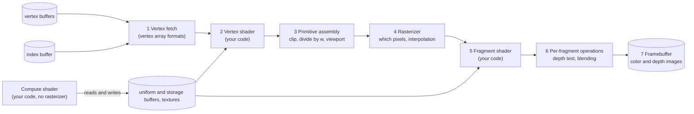

# 05. OpenGL from Java

This chapter teaches OpenGL from the ground up, using Jeddy's own code as the worked example. It
starts with what a GPU does when you ask it to draw, then follows a single GL call from Java down
to the driver, and ends with the building blocks the renderer stands on: buffers, vertex arrays,
textures, samplers, framebuffers, shaders and programs, uniform and storage buffers, and the
state cache that keeps the number of GL calls small.

You will learn:

- the stages of the GPU pipeline, and which ones you program;
- how OpenGL 4.6 core works as a state machine with objects, and why Jeddy uses only *direct state
  access* (DSA);
- how SDL creates the window and the GL context, and why every GL call runs on the main thread;
- how Jeddy turns the Khronos registry file `gl.xml` into a Java class, `GL46`, with one static
  method per GL command, and what a generated method looks like;
- the minimal program, `HelloTriangle`, line by line;
- how Jeddy wraps each kind of GL object, and why.

Where it lives:

| Module | Package | Key classes |
|---|---|---|
| `gl` | `dev.jeddy.gl`, `dev.jeddy.gl.ffi` | `GLLoader`, `GLCapabilities`, `GLDebug`, `GLShaders`, `GLLinker`, generated `GL46` |
| `window` | `dev.jeddy.window` | `Window` (window and GL context) |
| `render` | `dev.jeddy.render.gpu` | `GpuDevice`, `GpuBuffers`, `GpuTextures`, `GpuSamplers`, `SamplerDesc`, `GpuFramebuffers`, `PipelineState`, `StateCache`, `FrameRing`, `UploadRing` |
| `render` | `dev.jeddy.render.shader` | `ProgramCache`, `ShaderFeatures`, `ProgramBinaryCache`, `EngineShaders` |
| `asset` | `dev.jeddy.asset.shader` | `ShaderPreprocessor`, `ShaderSources` |
| `build-logic` | `dev.jeddy.gradle` | `GlGenerator` (Java), `GenerateGlBindings` (Gradle task, Kotlin) |
| `samples/hello-triangle` | `dev.jeddy.samples.triangle` | `HelloTriangle` |

The design background is DESIGN §9.1 (the `gl` module), §9.2 (the resource layer) and §4.4 (FFM
call cost). Clip space, NDC and reversed-Z depth are explained in
[04 Cameras and projection](04-cameras-and-projection.md); this chapter uses them. How the renderer
puts these pieces together is [06 The renderer](06-renderer-architecture.md).

## The GPU pipeline

### What happens when you draw

A GPU is a machine for running the same small program on many inputs at once. To draw, you do not
hand it triangles one by one. You prepare data in GPU memory (vertex positions, indices, textures,
parameters), pick the programs that process it (*shaders*), set some fixed-function switches (depth
test on, blending off, ...), and then issue one command: "draw 36 indices as triangles". The GPU
runs that command through a fixed sequence of stages:



1. **Vertex fetch.** For each vertex the GPU reads its attributes (position, normal, UV ...) from
   buffers. A *vertex array object* (VAO) describes where each attribute lives and how it is
   encoded. With an index buffer, the draw names vertices by index, so a vertex shared by several
   triangles is stored once.
2. **Vertex shader.** Your program runs once per vertex. It must write `gl_Position`, the vertex's
   position in *clip space* (a 4D homogeneous coordinate, see chapter 04), and may output any other
   values (normal, UV, material index) for later stages.
3. **Primitive assembly, clipping and the viewport transform.** Vertices are grouped into
   triangles. Triangles outside the view volume are discarded, those crossing it are clipped. Then
   the GPU divides by `w` to get *normalized device coordinates* (NDC) and maps them to window
   pixels.
4. **Rasterizer.** For each triangle it finds the pixels whose centers it covers and creates one
   *fragment* per covered pixel. Each fragment gets the vertex shader's outputs, interpolated across
   the triangle.
5. **Fragment shader.** Your program runs once per fragment and computes its color (or discards
   it).
6. **Per-fragment operations.** Fixed-function tests and blending: the depth test keeps only the
   nearest surface, blending mixes the new color with the one already in the image.
7. **Framebuffer.** The result lands in a set of images: one or more color images and a depth
   image. The window's back buffer is one framebuffer; your own textures can be another.

**Compute shaders** sit beside this pipeline. They have no vertices and no rasterizer: you
*dispatch* a grid of work groups, and each invocation reads and writes buffers and images directly.
Jeddy uses them for light culling, GPU culling of the static scene, particles, auto exposure and the
BRDF lookup table.

### The math of stages 3 and 4, with numbers

Take a vertex whose shader wrote $`\mathbf{c} = (x_c, y_c, z_c, w_c) = (1.0,\ 0.5,\ 1.6,\ 2.0)`$.

**Perspective divide.** NDC is clip space divided by $w_c$:

```math
(x_n, y_n, z_n) = \left(\frac{x_c}{w_c}, \frac{y_c}{w_c}, \frac{z_c}{w_c}\right) = (0.5,\ 0.25,\ 0.8)
```

A point is inside the view volume when $-1 \le x_n \le 1$, $-1 \le y_n \le 1$ and, with Jeddy's
`glClipControl(GL_LOWER_LEFT, GL_ZERO_TO_ONE)`, $0 \le z_n \le 1$.

**Viewport transform.** With a viewport at $(x_0, y_0)$ of $W \times H$ pixels (set by
`glViewport`), window coordinates are

```math
x_w = x_0 + \frac{(x_n + 1)\,W}{2}, \qquad y_w = y_0 + \frac{(y_n + 1)\,H}{2}, \qquad z_w = z_n
```

For a 960×540 viewport at the origin: $x_w = 1.5 \cdot 480 = 720$, $y_w = 1.25 \cdot 270 = 337.5$,
and the depth written to the depth buffer is $0.8$. Window $y$ grows upward (`GL_LOWER_LEFT`).
$z_w = z_n$ holds because Jeddy uses the zero-to-one clip depth with the default depth range
$[0, 1]$; with GL's traditional $[-1, 1]$ clip depth it would be $(z_n + 1)/2$.

**Interpolation.** Inside a triangle with vertices 0, 1, 2, a fragment has screen-space barycentric
weights $\lambda_0, \lambda_1, \lambda_2$ (non-negative, summing to 1, measuring how close the pixel
is to each vertex). A vertex output $a$ is interpolated *perspective-correctly*:

```math
a = \frac{\lambda_0\, a_0 / w_0 + \lambda_1\, a_1 / w_1 + \lambda_2\, a_2 / w_2}{\lambda_0 / w_0 + \lambda_1 / w_1 + \lambda_2 / w_2}
```

where $a_i$ is the output at vertex $i$ and $w_i$ its clip-space $w$. Dividing by $w$ makes UVs
stay straight on a floor seen at an angle. An output declared `flat` is not interpolated: every
fragment gets the value of one vertex (the *provoking* vertex). Jeddy uses `flat` for integer data
such as the material index.

**Depth test.** Each fragment compares its $z_w$ with the value stored in the depth buffer, using
the depth function. Jeddy uses *reversed-Z* (chapter 04): near is 1, far is 0, the depth buffer is
cleared to 0, and the test is `GL_GEQUAL` ("keep the fragment if it is at least as near as what is
there"). Reversed-Z with a floating-point depth buffer keeps the *relative* depth precision
roughly constant over distance (chapter 04 shows why).

**Blending.** With blending on, the final color is

```math
\mathbf{c}_{out} = \mathbf{c}_{src}\, f_{src} + \mathbf{c}_{dst}\, f_{dst}
```

where $`\mathbf{c}_{src}`$ is the fragment shader's color, $`\mathbf{c}_{dst}`$ is the color already in
the image, and the factors come from `glBlendFunc`. Classic alpha blending uses
$f_{src} = \alpha_{src}$ and $f_{dst} = 1 - \alpha_{src}$. A red fragment with $\alpha = 0.25$ over
a blue pixel gives $`(1,0,0) \cdot 0.25 + (0,0,1) \cdot 0.75 = (0.25,\ 0,\ 0.75)`$.

### Where Jeddy touches each stage

| Stage | Jeddy code |
|---|---|
| Vertex fetch | `MeshRegistry`'s one VAO for every mesh: positions, attributes and skin streams |
| Vertex shader | `pbr/pbr.vert`, `pbr/depth.vert`; they read per-instance data from a storage buffer (`engine/instance.glsl`) |
| Clip and viewport | `GpuDevice.useReversedZ` (`glClipControl`), `StateCache.viewport` |
| Rasterizer | culling mode, polygon offset, wireframe and scissor bits of `PipelineState` |
| Fragment shader | `pbr/pbr.frag` and the post shaders |
| Depth test, blending | `PipelineState` (depth function, blend mode), applied by `StateCache` |
| Framebuffer | `GpuFramebuffers`, allocated per pass by the frame graph (chapter 06) |
| Compute | `ProgramCache.defineCompute`: light culling, `cull/static_cull.comp`, particles, exposure |

## OpenGL 4.6 core: a state machine with objects

### Context, objects and names

OpenGL is an API for a *context*: a big bundle of state (the current program, the bound vertex
array, the blend mode, ...) plus the objects created in it (buffers, textures, programs). Objects
are named by plain `int`s (`GLuint`), which you get from `glCreate*` and give back with
`glDelete*`.

The *core profile* is the modern subset. It removed the old fixed-function pipeline (`glBegin`,
`glVertex3f`, built-in lighting and matrix stacks): in core you must put vertices in buffers and
supply shaders. Jeddy asks for 4.6 core and nothing older (`GLLoader.REQUIRED_MAJOR` and
`REQUIRED_MINOR`). Here is what each GL version added that Jeddy relies on:

| Feature | Core since | Used in Jeddy for |
|---|---|---|
| Uniform buffer objects | 3.1 | per-frame constants (`engine/frame.glsl`) |
| Sampler objects | 3.3 | `GpuSamplers` |
| Program binaries, `glProgramUniform*` | 4.1 | `ProgramBinaryCache`; setting uniforms without binding the program |
| Immutable texture storage, base instance in draws | 4.2 | `GpuTextures`; `baseInstance` in indirect commands |
| Compute shaders, storage buffers, multi-draw-indirect, `KHR_debug`, separate vertex formats, explicit uniform locations | 4.3 | culling and particles; instance and material data; batched draws; `GLDebug`; `MeshRegistry`'s VAO; `layout(location = N) uniform` |
| Immutable buffer storage, persistent mapping | 4.4 | `GpuBuffers`, `FrameRing`, `UploadRing` |
| Direct state access, `glClipControl` | 4.5 | every object Jeddy creates; reversed-Z |
| `glMultiDrawElementsIndirectCount`, `gl_BaseInstance` in GLSL, anisotropic filtering | 4.6 | `StaticScene`; finding instance records; `SamplerDesc` |

### Bind-to-edit versus direct state access

Classic OpenGL edits objects through *binding points*. To fill a buffer you bind it to a target,
then call a function that acts on "whatever is bound to that target". This is illustrative code,
not code from the repository:

```java
// Illustrative, not the real code: classic bind-to-edit.
glGenBuffers(1, ids);
int vbo = ids.get(ValueLayout.JAVA_INT, 0);
glBindBuffer(GL_ARRAY_BUFFER, vbo);              // changes global state
glBufferData(GL_ARRAY_BUFFER, size, data, GL_STATIC_DRAW); // acts on the bound buffer
```

Every edit changes global state as a side effect. Code that edits a buffer can break code that
expected another buffer to be bound, and a state cache cannot tell an edit binding from a draw
binding. GL 4.5 added **direct state access** (DSA): functions that take the object name directly.

```java
// Illustrative: the DSA form Jeddy uses everywhere.
glCreateBuffers(1, ids);                         // creates the object immediately
int vbo = ids.get(ValueLayout.JAVA_INT, 0);
glNamedBufferStorage(vbo, size, data, 0);        // no binding involved
```

Jeddy follows one rule: **objects are created and edited only through DSA** (`glCreate*`,
`glNamed*`, `glTextureStorage*`, `glVertexArray*`), and binding happens only to *use* an object for
drawing (DESIGN §9.2). Bindings then mean exactly one thing, which is what makes the `StateCache`
later in this chapter possible. The few exceptions are binding points that have no DSA form: the
pixel-unpack buffer that `UploadRing.copyToTexture` binds around a texture upload, and the
`GL_PARAMETER_BUFFER` that `StaticScene.submit` binds for `glMultiDrawElementsIndirectCount`.

## Contexts and the main thread

A GL context is *current* on at most one thread at a time, and a GL call acts on the context
current on the calling thread. Call GL on another thread and you get nothing, or a crash. SDL adds
its own rule: on Windows and Linux, `SDL_PollEvent`, `SDL_GL_MakeCurrent` and `SDL_GL_SwapWindow`
must run on the thread that called `SDL_Init(SDL_INIT_VIDEO)`. Jeddy therefore makes that thread,
the *main thread*, the GL thread too (D6). Simulation runs on the separate game thread and hands
the renderer a *render packet* per frame (DESIGN §5, [06](06-renderer-architecture.md)). The
Javadoc of every class in `gl` and `render` that calls GL states it, for example "Thread
ownership: the GL context thread (main thread)".

`Platform.init` calls `SDL_Init(SDL_INIT_VIDEO() | SDL_INIT_EVENTS() | SDL_INIT_GAMEPAD())` and
marks the calling thread with `SdlThread.markMainThread()`. Window methods then check it with
`SdlThread.assertMainThread`.

### Creating the context

`Window.create` sets the context attributes before it creates the window, then creates the context.
From [`Window.java`](../../modules/window/src/main/java/dev/jeddy/window/Window.java):

```java
private static void setGlAttributes(WindowConfig config) {
    SDL_GL_ResetAttributes();
    int contextFlags = SDL_GL_CONTEXT_FORWARD_COMPATIBLE_FLAG();
    if (config.glDebug) {
        contextFlags |= SDL_GL_CONTEXT_DEBUG_FLAG();
    }
    glAttribute(SDL_GL_CONTEXT_MAJOR_VERSION(), 4);
    glAttribute(SDL_GL_CONTEXT_MINOR_VERSION(), 6);
    glAttribute(SDL_GL_CONTEXT_PROFILE_MASK(), SDL_GL_CONTEXT_PROFILE_CORE());
    glAttribute(SDL_GL_CONTEXT_FLAGS(), contextFlags);
    glAttribute(SDL_GL_DOUBLEBUFFER(), 1);
    glAttribute(SDL_GL_RED_SIZE(), 8);
    glAttribute(SDL_GL_GREEN_SIZE(), 8);
    glAttribute(SDL_GL_BLUE_SIZE(), 8);
    glAttribute(SDL_GL_ALPHA_SIZE(), 0); // no desktop compositing; alpha visuals are rarer
    glAttribute(SDL_GL_DEPTH_SIZE(), config.depthBits);
    glAttribute(SDL_GL_STENCIL_SIZE(), 0);
    glAttribute(SDL_GL_MULTISAMPLEBUFFERS(), 0);
    // The final pass writes sRGB-encoded values itself, so the default framebuffer is plain
    // RGB8: sRGB-capable visuals are missing on some X servers (DESIGN D23).
    glAttribute(SDL_GL_FRAMEBUFFER_SRGB_CAPABLE(), 0);
}

// ...

private void createContext(WindowConfig config) {
    MemorySegment context = SDL_GL_CreateContext(handle);
    if (context.address() == 0) {
        throw new SdlException(
                "SDL_GL_CreateContext",
                Sdl.error() + " (Jeddy needs an OpenGL 4.6 core profile driver)");
    }
    glContext = context;
    Sdl.check(SDL_GL_MakeCurrent(handle, glContext), "SDL_GL_MakeCurrent");
    setVSync(config.vsync);
}
```

Things to notice:

- **Core profile, 4.6, forward-compatible.** Forward-compatible removes even the deprecated
  features that a core context might still accept.
- **The debug flag** is set only when asked (`WindowConfig.glDebug`). A debug context reports
  errors and warnings through `KHR_debug` (see [Debug output](#debug-output-labels-and-capabilities)).
- **Double buffering.** You draw into a hidden *back buffer*; `Window.swap()` calls
  `SDL_GL_SwapWindow` to show it. `JeddyApp`'s main loop swaps after the renderer returns.
- **No sRGB default framebuffer (D23).** Displays expect *sRGB-encoded* values, while lighting is
  computed in *linear* values. GL can encode automatically when writing to an sRGB framebuffer, but
  Xvfb (used in CI) offers no sRGB visuals, so window creation would fail there. Jeddy's last post
  pass encodes in the shader instead, which behaves the same on every driver. You will see the
  manual encoding in `HelloTriangle`'s fragment shader.
- `SDL_GL_MakeCurrent` binds the context to this thread. From now on, GL calls on the main thread
  go to this context.

## Loading OpenGL functions

### Why a loader is needed

Your program does not link against the GPU driver. The system GL library exports only old entry
points (on Windows, `opengl32.dll` exports OpenGL 1.1), and the driver provides the rest at run
time. To call `glNamedBufferStorage` you first ask the window system for the function's address.
SDL wraps that as `SDL_GL_GetProcAddress`, and `Window` exposes it:

```java
public MemorySegment glProcAddress(String name) {
    SdlThread.assertMainThread("SDL_GL_GetProcAddress");
    return SDL_GL_GetProcAddress(CStrings.of(name));
}
```

`CStrings.of` caches the UTF-8 C string for each name, so resolving the same name twice does not
allocate twice.

### `GLLoader.init`

[`GLLoader`](../../modules/gl/src/main/java/dev/jeddy/gl/GLLoader.java) installs that function as
the resolver, reads the context's capabilities and refuses anything older than 4.6:

```java
public static GLCapabilities init(Function<String, MemorySegment> procAddress) {
    GLLinker.setResolver(procAddress);
    GLCapabilities caps = readCapabilities();
    if (!caps.atLeast(REQUIRED_MAJOR, REQUIRED_MINOR)) {
        throw new GLException(
                "OpenGL "
                        // ...
                        + ")");
    }
    capabilities = caps;
    GLLinker.setExtensions(caps::has);
    // ...
    return caps;
}
```

Applications call it once, on the main thread, with the context current:
`GLLoader.init(ctx.window()::glProcAddress)`. The method reference turns `Window.glProcAddress`
into the `Function<String, MemorySegment>` the loader wants.

### FFM in one minute

Jeddy calls native code through the Foreign Function & Memory API (`java.lang.foreign`, final since
JDK 22, [JEP 454](https://openjdk.org/jeps/454)), with no JNI. Four types matter here:

- `MemorySegment`: a region of memory with bounds, on the Java heap or off-heap. A C pointer
  becomes a `MemorySegment` (often a zero-length one that you `reinterpret` to a known size).
- `ValueLayout`: how a value is laid out in memory (`JAVA_INT`, `JAVA_FLOAT`, `ADDRESS`, ...).
- `FunctionDescriptor`: the C signature as layouts, for example
  `FunctionDescriptor.ofVoid(JAVA_INT, JAVA_INT)` for `void f(int, int)`.
- `Linker.nativeLinker().downcallHandle(address, descriptor)`: a `MethodHandle` that calls the
  native function at `address`. Calling it with `invokeExact` costs a few nanoseconds once the JIT
  has compiled it.

Chapter [12 Java performance](12-java-performance.md) covers why the handles must sit in
`static final` fields and what the JIT does with them.

### `GLLinker`: linking one command

[`GLLinker`](../../modules/gl/src/main/java/dev/jeddy/gl/ffi/GLLinker.java) is the one place where
GL addresses become method handles:

```java
public static MethodHandle link(String name, FunctionDescriptor descriptor, boolean critical) {
    MemorySegment address = address(name);
    if (address.address() == 0) {
        return missing(name, descriptor.toMethodType());
    }
    if (critical && CRITICAL) {
        return LINKER.downcallHandle(address, descriptor, Linker.Option.critical(true));
    }
    return LINKER.downcallHandle(address, descriptor);
}
```

- A command the driver does not export links to a handle that throws
  `UnsupportedOperationException` *when called*, not when linked. Optional extensions therefore
  never break startup.
- Commands that only an extension provides go through a second `link` overload that first checks
  the extension list. The address alone cannot tell: GLX returns a non-null stub for any `gl*`
  name, even nonsense ones (D24). `GLTest.missingCommandsThrowOnlyWhenCalled` checks this.
- `CRITICAL` is read once from `-Djeddy.gl.critical` (default `true`). See the next section.

## The generated bindings: `GL46`

### From `gl.xml` to Java

Khronos publishes every GL enum and command in one XML file, the *registry*. Jeddy vendors it at a
pinned commit as `bindings/gl/gl.xml`. Its parts:

- `<enums>`: every constant, for example `<enum value="0x0100" name="GL_DYNAMIC_STORAGE_BIT"/>`;
- `<commands>`: every function as a `<proto>` (return type and name) and `<param>`s with C types;
- `<feature api="gl" number="4.6">`: which enums and commands each version `<require>`s, and which
  the core profile `<remove>`s;
- `<extension>`: the same for each extension.

[`GlGenerator`](../../build-logic/src/main/java/dev/jeddy/gradle/GlGenerator.java) (plain Java in
`build-logic`, so it also runs by hand with `java GlGenerator.java <gl.xml> <gl.properties> <out>`)
walks the features with `number <= 4.6` in order, adds what they require and drops what the core
profile removes, then adds the extensions listed in
[`bindings/gl/gl.properties`](../../bindings/gl/gl.properties):

```properties
api=gl
profile=core
version=4.6
package=dev.jeddy.gl.ffi
class=GL46

# Beyond 4.6 core. BCn sRGB formats come from EXT_texture_sRGB; S3TC is only for legacy content.
extensions=GL_ARB_bindless_texture,\
  GL_KHR_parallel_shader_compile,\
  GL_EXT_texture_compression_s3tc,\
  GL_EXT_texture_sRGB

# ...
offset.params=indices,indirect,pointer,offset,data,pixels

# ...
critical=glActiveTexture,\
  glBindBuffer,glBindBufferBase,glBindBufferRange,glBindFramebuffer,glBindImageTexture,\
  # ... (state setters, binds and glUniform*/glProgramUniform* only)
```

The Gradle side is small. [`GlBindings.kt`](../../build-logic/src/main/kotlin/dev/jeddy/gradle/GlBindings.kt)
defines the cacheable task `GenerateGlBindings`, whose action is one call:

```kotlin
GlGenerator.generate(registry.get().asFile.toPath(), settings.get().asFile.toPath(), out.toPath())
```

and the convention plugin
[`jeddy.gl-bindings`](../../build-logic/src/main/kotlin/jeddy.gl-bindings.gradle.kts) registers it as
`:gl:generateGlBindings`, with its output directory added to the `main` source set. The task's
inputs are the two files, so Gradle reruns it only when they (or the generator) change. The output
is written to `modules/gl/build/generated/sources/gl/java/main/dev/jeddy/gl/ffi/GL46.java` at
build time and is not committed (DESIGN §9.1). Run any build (or the task alone) and open it: it
holds about 1,400 constants and about 670 commands, 58 of which also get an offset overload.

The C types map to Java types like this:

| C type in `gl.xml` | Java type | Note |
|---|---|---|
| `GLenum`, `GLbitfield`, `GLuint`, `GLint`, `GLsizei` | `int` | unsigned values just reuse the bits |
| `GLboolean` | `boolean` | |
| `GLfloat`, `GLclampf` | `float` | |
| `GLint64`, `GLuint64`, `GLintptr`, `GLsizeiptr` | `long` | sizes and offsets |
| `GLsync` | `long` | a pointer, kept as a raw address so no `MemorySegment` is created (D24) |
| any `T *` | `MemorySegment` | plus a `long` overload for offset-style `void *` (below) |

### What one generated command looks like

Here is `glMultiDrawElementsIndirect`, exactly as generated (the renderer's main draw call, see
chapter 06):

```java
/**
 * {@code void glMultiDrawElementsIndirect(GLenum mode, GLenum type, const void *indirect, GLsizei drawcount, GLsizei stride)}
 */
public static void glMultiDrawElementsIndirect(int mode, int type, MemorySegment indirect, int drawcount, int stride) {
    try {
        glMultiDrawElementsIndirect.MH.invokeExact(mode, type, indirect, drawcount, stride);
    } catch (Throwable t) {
        throw GLLinker.rethrow(t);
    }
}

private static final class glMultiDrawElementsIndirect {
    static final MethodHandle MH =
            GLLinker.link("glMultiDrawElementsIndirect", FunctionDescriptor.ofVoid(JAVA_INT, JAVA_INT, ADDRESS, JAVA_INT, JAVA_INT), false);
}

/**
 * {@code void glMultiDrawElementsIndirect(GLenum mode, GLenum type, const void *indirect, GLsizei drawcount, GLsizei stride)} with buffer offsets passed as {@code long}
 */
public static void glMultiDrawElementsIndirect(int mode, int type, long indirect, int drawcount, int stride) {
    try {
        glMultiDrawElementsIndirect$offset.MH.invokeExact(mode, type, indirect, drawcount, stride);
    } catch (Throwable t) {
        throw GLLinker.rethrow(t);
    }
}

private static final class glMultiDrawElementsIndirect$offset {
    static final MethodHandle MH =
            GLLinker.link("glMultiDrawElementsIndirect", FunctionDescriptor.ofVoid(JAVA_INT, JAVA_INT, JAVA_LONG, JAVA_INT, JAVA_INT), false);
}
```

Read it from the bottom up:

- **The holder class.** Each command has a tiny nested class whose only field is a
  `static final MethodHandle`. The JVM initializes a class the first time it is used, so the handle
  is linked on the *first call* of the command, which is after `GLLoader.init` installed the
  resolver. Commands an application never calls are never linked, which keeps startup fast.
- **Why `static final`.** The JIT treats a `static final` field of an initialized class as a
  constant. It can then inline the handle and compile the call into a direct native call. A handle
  in a normal field would be an indirect call through an object (DESIGN §4.4).
- **`invokeExact`.** The argument and return types must match the handle's type exactly. The
  generator emits the exact Java types, so there is no conversion or boxing.
- **`GLLinker.rethrow`.** `invokeExact` is declared to throw `Throwable`. The wrapper rethrows
  runtime exceptions and errors unchanged and wraps checked ones, so callers see no checked
  exceptions.
- **The `$offset` overload.** Same function, same address, but the third parameter is described as
  `JAVA_LONG` instead of `ADDRESS`. See below.

### Critical linking

A normal downcall makes the thread leave "Java mode" and enter "native mode" so that the garbage
collector can run while native code executes, and back again afterwards. For calls that take
nanoseconds that transition dominates the cost. `Linker.Option.critical(true)` skips it, and with
`allowHeapAccess = true` the call may even receive heap arrays wrapped with
`MemorySegment.ofArray`. The price: the GC cannot reach a safepoint during the call, so the callee
must be very short, must never block and must never call back into Java.

The `critical=` list in `gl.properties` names only state setters, binds and uniforms. Compare a
generated critical command with the one above:

```java
/**
 * {@code void glUseProgram(GLuint program)} (critical)
 */
public static void glUseProgram(int program) {
    try {
        glUseProgram.MH.invokeExact(program);
    } catch (Throwable t) {
        throw GLLinker.rethrow(t);
    }
}

private static final class glUseProgram {
    static final MethodHandle MH =
            GLLinker.link("glUseProgram", FunctionDescriptor.ofVoid(JAVA_INT), true);
}
```

Draws, syncs, maps, uploads and the swap are never critical, because they can wait on the GPU. The
measured gain (M3-05, DESIGN §4.4) is about 13 ns per call: 16.5 ns regular versus 3.6 ns critical
for a trivial C function.

**Dev builds turn critical linking off** (`-Djeddy.gl.critical=false`, D12). The debug callback
below is an *upcall*: the driver calls Java *from inside* the GL call that raised the message. An
upcall from inside a critical downcall can crash the JVM. `GLLinker` reads the property once when
it initializes, so `HelloTriangle` and the GPU tests set it before touching any GL class.

### Offset overloads (D24, D29)

Many GL parameters are typed `const void *` but are really byte offsets. For example the
`indirect` argument of `glMultiDrawElementsIndirect` is an offset into the buffer bound to
`GL_DRAW_INDIRECT_BUFFER`, and the `indices` argument of `glDrawElements` is an offset into the
element buffer. Passing an offset as a `MemorySegment` would mean `MemorySegment.ofAddress(offset)`,
which allocates an object on every draw. So for parameters named in `offset.params`, whose C type
is exactly `const void *` or `void *`, the generator emits a second overload that takes a `long`.
That `long` is a buffer offset when a buffer is bound to the matching target, and otherwise a raw
native address (D29). This is how `GpuBuffers.update` passes `segment.address()` to
`glNamedBufferSubData`, and how the renderer issues every draw without allocating.
`GLTest.helloTriangleRendersWithDsa` proves it with an allocation assertion around
`glDrawElements(GL_TRIANGLES, 3, GL_UNSIGNED_SHORT, 0L)`.

### Try it

```bash
# writes modules/gl/build/generated/sources/gl/...
./gradlew :gl:generateGlBindings
./gradlew :gl:test -Pjeddy.gpuTests=true --tests 'dev.jeddy.gl.GLTest'
# critical vs regular, heap vs off-heap
./gradlew :bench:jmh -Pjmh.includes=GlBench
```

GPU tests need a GL 4.6 driver. On a Linux machine without a GPU, CI runs them with Mesa llvmpipe
under `xvfb-run -a` and `MESA_GL_VERSION_OVERRIDE=4.6` (DESIGN §9.7).

## Walkthrough: `HelloTriangle`

[`samples/hello-triangle/src/main/java/dev/jeddy/samples/triangle/HelloTriangle.java`](../../samples/hello-triangle/src/main/java/dev/jeddy/samples/triangle/HelloTriangle.java)
is the smallest Jeddy program that draws: one spinning triangle, raw GL calls, no renderer. It was
the first visible milestone (M3-04). Run it with `./gradlew :hello-triangle:run`; set the
environment variable `JEDDY_SAMPLE_QUIT_AFTER=3` to quit after 3 seconds, as CI does. Line numbers
below refer to the file.

### The shaders (lines 40–62)

```glsl
#version 460 core
layout(location = 0) in vec2 position;
layout(location = 1) in vec3 color;
layout(location = 0) uniform float angle;
layout(location = 1) uniform float aspect;
out vec3 vColor;
void main() {
    float c = cos(angle), s = sin(angle);
    vec2 p = mat2(c, s, -s, c) * position;
    gl_Position = vec4(p.x / aspect, p.y, 0.0, 1.0);
    vColor = color;
}
```

- `#version 460 core` selects GLSL 4.60. Every Jeddy shader starts with it.
- `in` variables are vertex attributes. `layout(location = 0)` fixes the attribute number, which
  the Java side uses to describe where the data lives. Without explicit locations you would have to
  ask the linker which number it picked.
- `uniform`s are values that stay the same for the whole draw. `layout(location = 0)` again fixes
  the number, so Java can set it by number.
- `mat2(c, s, -s, c)`: GLSL matrix constructors take *columns*. The first column is $(c, s)$, the
  second $(-s, c)$, so the product is $`(c\,x - s\,y,\ s\,x + c\,y)`$: a counter-clockwise rotation
  by `angle` radians (chapter [03](03-rotations-and-transforms.md)).
- `gl_Position` is the clip-space output. With $w = 1$ the perspective divide changes nothing, so
  these are NDC directly. Dividing $x$ by the aspect ratio keeps the triangle from stretching on a
  wide window: NDC spans $[-1, 1]$ on both axes whatever the window shape.
- `out vec3 vColor` is interpolated across the triangle and arrives in the fragment shader's
  `in vec3 vColor`.

```glsl
#version 460 core
in vec3 vColor;
layout(location = 0) out vec4 color;
void main() { color = vec4(pow(vColor, vec3(1.0 / 2.2)), 1.0); }
```

The fragment shader writes to color attachment 0. `pow(x, 1/2.2)` is an approximate sRGB encoding:
the vertex colors are linear, the window expects sRGB, and the default framebuffer does not encode
for us (D23). The exact sRGB curve, used by the real post pass, is in chapter
[08](08-effects-and-post.md).

### `main` (lines 81–97)

```java
public static void main(String[] args) {
    if (DEBUG) {
        System.setProperty("jeddy.gl.critical", "false");
    }
    HelloTriangle sample = new HelloTriangle();
    AppConfig config =
            new AppConfig()
                    .app("Jeddy hello triangle", "0.1.0", "dev.jeddy.samples.triangle")
                    .window(
                            new WindowConfig()
                                    .title("Jeddy – hello triangle")
                                    .size(960, 540)
                                    .glDebug(DEBUG)
                                    .vsync(VSync.ADAPTIVE))
                    .renderer(sample);
    System.exit(JeddyApp.run(config, sample));
}
```

`DEBUG` comes from `-Djeddy.gl.debug=true`. It must turn critical linking off *before* `GLLinker`
initializes (the reason is in [Critical linking](#critical-linking)). Note that a `-D` on the
`./gradlew` command line sets a property of Gradle, not of the program. To try the debug mode,
pass it through the `java` launcher's environment variable, which the run task inherits:
`JDK_JAVA_OPTIONS=-Djeddy.gl.debug=true ./gradlew :hello-triangle:run`. (Adding
`jvmArgs(...)` to the run task would look simpler, but in Gradle 9 it replaces the application's
default JVM arguments, the launcher flags, instead of adding to them; DESIGN §14 explains.) `JeddyApp.run` creates the
window and context on the main thread, starts the game thread, and calls the `FrameRenderer`
methods (`init`, `render`, `shutdown`) on the main thread. The sample is both the renderer and the
`Game` (its `update` only checks for Escape and the quit timer).

### `init`: program, buffer and vertex array (lines 100–127)

```java
GLCapabilities caps = GLLoader.init(ctx.window()::glProcAddress);
if (DEBUG) {
    GLDebug.enable(true);
}
program = GLShaders.program(VERTEX, FRAGMENT);
```

Load GL, optionally install the debug callback, then compile both shader stages and link them into
a *program* (see [Shaders and programs](#shaders-and-programs)).

```java
float[] vertices = {
    -0.6f, -0.5f, 1f, 0.2f, 0.1f,
    0.6f, -0.5f, 0.1f, 1f, 0.2f,
    0f, 0.7f, 0.2f, 0.3f, 1f
};
MemorySegment id = arena.allocate(ValueLayout.JAVA_INT);
glCreateBuffers(1, id);
vbo = id.get(ValueLayout.JAVA_INT, 0);
glNamedBufferStorage(
        vbo, vertices.length * 4L, arena.allocateFrom(ValueLayout.JAVA_FLOAT, vertices), 0);
```

Each vertex is five floats: $x, y$ then $r, g, b$. `glCreateBuffers(n, ids)` writes `n` new names
into native memory, so the Java side allocates one `int` in an arena and reads it back.
`glNamedBufferStorage` gives the buffer its size (60 bytes) and contents once and for all; flags
`0` means the CPU will never change it again.

```java
glCreateVertexArrays(1, id);
vao = id.get(ValueLayout.JAVA_INT, 0);
glVertexArrayVertexBuffer(vao, 0, vbo, 0, 5 * 4);
glEnableVertexArrayAttrib(vao, 0);
glVertexArrayAttribFormat(vao, 0, 2, GL_FLOAT, false, 0);
glVertexArrayAttribBinding(vao, 0, 0);
glEnableVertexArrayAttrib(vao, 1);
glVertexArrayAttribFormat(vao, 1, 3, GL_FLOAT, false, 2 * 4);
glVertexArrayAttribBinding(vao, 1, 0);
```

The vertex array says where attributes 0 and 1 come from. Binding slot 0 is the buffer `vbo`,
starting at byte 0, one vertex every 20 bytes. Attribute 0 (`position`) is 2 floats at byte 0 of
each vertex; attribute 1 (`color`) is 3 floats at byte 8. In memory:

```
byte:   0    4    8    12   16 | 20   24   28   32   36 | 40 ...
       [ x0 | y0 | r0 | g0 | b0 | x1 | y1 | r1 | g1 | b1 | x2 ...
        attr 0    attr 1         attr 0    attr 1
       |<------ stride 20 ----->|
```

[Vertex arrays](#vertex-arrays-formats-and-bindings) below explains the format/binding split.

### `render`: one frame (lines 130–140)

```java
public void render(MainContext ctx, int index, boolean fresh) {
    int w = ctx.window().pixelWidth();
    int h = ctx.window().pixelHeight();
    glViewport(0, 0, w, h);
    glClearNamedFramebufferfv(0, GL_COLOR, 0, clearColor);
    glUseProgram(program);
    glProgramUniform1f(program, 0, (System.nanoTime() - start) * 1e-9f);
    glProgramUniform1f(program, 1, (float) w / Math.max(1, h));
    glBindVertexArray(vao);
    glDrawArrays(GL_TRIANGLES, 0, 3);
}
```

- `glViewport` maps NDC to the window in *pixels* (`pixelWidth`, which differs from the window size
  on high-density displays).
- `glClearNamedFramebufferfv(0, GL_COLOR, 0, clearColor)` clears draw buffer 0 of framebuffer 0,
  which for the window is its back buffer. `clearColor` is a 4-float segment allocated once in a field, so the call allocates
  nothing per frame.
- `glUseProgram` selects the shaders; `glProgramUniform1f(program, location, value)` sets uniform
  `location` of a given program (the DSA way, no binding needed). Location 0 is `angle` (seconds
  since start, so one radian per second), location 1 is `aspect`.
- `glBindVertexArray` selects the vertex layout; `glDrawArrays(GL_TRIANGLES, 0, 3)` draws vertices
  0, 1, 2 as one triangle.

Nobody swaps here. `JeddyApp`'s main loop does, right after the renderer returns
([`JeddyApp.java`](../../modules/app/src/main/java/dev/jeddy/app/JeddyApp.java)):

```java
while (running) {
    main.pump.pump();
    main.queue.drain();
    boolean fresh = frames.acquire();
    // ...
        if (config.renderer != null) {
            config.renderer.render(main, frames.readIndex(), fresh);
        }
        if (window.hasGlContext()) {
            window.swap();
        }
    // ...
}
```

### `shutdown` (lines 143–150)

The sample deletes its buffer, vertex array and program with `glDeleteBuffers`,
`glDeleteVertexArrays` and `glDeleteProgram`, on the main thread, before the window (and with it
the context) is destroyed.

### What the sample leaves out

It has no depth buffer, no textures, no state cache and no batching, and it calls GL directly. The
rest of this chapter shows how Jeddy's resource layer generalizes each piece; chapter 06 shows how
the renderer draws twenty thousand objects with a handful of calls. `GLTest.helloTriangleRendersWithDsa`
is a similar triangle (indexed, one flat color) as a GPU test that reads pixels back.

## Buffers

### What a buffer is

A buffer is a block of GPU-visible memory with no type of its own. What it means depends on where
you bind it: a vertex buffer, an index (element) buffer, a uniform buffer, a shader storage buffer,
a draw-indirect buffer (draw parameters), a pixel-unpack buffer (texture upload source), a
parameter buffer (draw counts). One Jeddy buffer, the frame ring, is all of these at once, in
different ranges.

### Immutable storage and its flags

`glNamedBufferStorage(buffer, size, data, flags)` fixes a buffer's size and its allowed uses for
its whole life (immutable storage arrived in GL 4.4 as `glBufferStorage`; the `glNamed*` DSA form
is GL 4.5). The driver can then place it well, because it knows the CPU access pattern
up front. The flags Jeddy uses:

| Flags | Meaning | Jeddy |
|---|---|---|
| `0` | Only the GPU changes it (copies, clears, shader writes) | `StaticScene`'s item, bin and command buffers; `HelloTriangle`'s vertices |
| `GL_DYNAMIC_STORAGE_BIT` | The CPU may update it with `glNamedBufferSubData` | `GpuBuffers.DYNAMIC`: mesh mega buffers, material table. Used for the first fill and as a fallback; once the GPU has read a buffer, changes go through a ring and `glCopyNamedBufferSubData` (`FrameRing.upload`), because a driver may drop a CPU write into a buffer in flight (Intel did, D103) |
| `GL_MAP_WRITE_BIT \| GL_MAP_PERSISTENT_BIT \| GL_MAP_COHERENT_BIT` | Mapped once into the CPU's address space, written directly, forever | `GpuBuffers.MAPPED`: `FrameRing`, `UploadRing` |

[`GpuBuffers.create`](../../modules/render/src/main/java/dev/jeddy/render/gpu/GpuBuffers.java) turns
Jeddy's two flags into GL flags:

```java
MemorySegment id = device.scratch();
glCreateBuffers(1, id);
int name = id.get(ValueLayout.JAVA_INT, 0);
int storage = 0;
if ((bufferFlags & DYNAMIC) != 0) {
    storage |= GL_DYNAMIC_STORAGE_BIT;
}
if ((bufferFlags & MAPPED) != 0) {
    storage |= GL_MAP_WRITE_BIT | GL_MAP_PERSISTENT_BIT | GL_MAP_COHERENT_BIT;
}
glNamedBufferStorage(name, size, data, storage);
MemorySegment mapping = MemorySegment.NULL;
if ((bufferFlags & MAPPED) != 0) {
    mapping =
            glMapNamedBufferRange(
                            name,
                            0,
                            size,
                            GL_MAP_WRITE_BIT | GL_MAP_PERSISTENT_BIT | GL_MAP_COHERENT_BIT)
                    .reinterpret(size);
    // ...
}
if (label != null) {
    GLDebug.label(GL_BUFFER, name, label);
}
int h = handles.allocate();
// ... store name, size, flags, mapping in SoA arrays at Handles.index(h)
return h;
```

Two Jeddy patterns show up here and in every resource class:

- **Handles, not GL names.** The caller gets a generational `int` handle from a `HandlePool`
  (DESIGN §4.1, chapter [12](12-java-performance.md)). The GL name, size, flags and mapping live in
  parallel arrays (`names[]`, `sizes[]`, `flags[]`, `mappings[]`) at the handle's index. A handle to
  a destroyed buffer fails `check` with "stale buffer handle" instead of silently using a GL name
  that may have been reused.
- **A 256-byte scratch segment** in `GpuDevice` receives GL out-parameters (new names), so creating
  a resource does not allocate a fresh native `int` each time.

`glMapNamedBufferRange(...)` returns a pointer; `.reinterpret(size)` gives the zero-length FFM
segment its real length so Java code can write into it with bounds checks.

### Persistent coherent mapping and its hazard

A persistent mapping stays valid while the GPU uses the buffer, so you map once at startup and
write every frame with plain memory stores (`MemorySegment.set`, `MemorySegment.copy`). *Coherent*
means those writes become visible to GL commands issued after them, with no explicit flush.

Two rules come with it:

1. **Write, never read.** The mapping is usually *write-combined* memory: the CPU batches writes and
   sends them over the bus, but reads are uncached and very slow. Jeddy's code only writes it
   (DESIGN §5).
2. **Do not overwrite what the GPU is still reading.** The CPU runs ahead of the GPU by a frame or
   two. If frame N writes the same bytes that frame N−1's draws have not consumed yet, frame N−1
   draws garbage. The fix is a *fence*: `glFenceSync(GL_SYNC_GPU_COMMANDS_COMPLETE, 0)` inserts a
   marker into the GPU command stream and returns a `GLsync` (a `long` in Jeddy);
   `glClientWaitSync(fence, flags, timeoutNanos)` waits until the GPU has passed it.

### `FrameRing`: three regions and three fences

[`FrameRing`](../../modules/render/src/main/java/dev/jeddy/render/gpu/FrameRing.java) is one
persistently mapped buffer cut into `frames` regions (3 by default). Frame $N$ writes region
$N \bmod 3$ only, and fences it at the end. When the ring comes back to that region three frames
later, the fence has almost always signaled, so the wait costs nothing:

```
buffer:  [ region 0          | region 1          | region 2          ]
frame 7:   (GPU may read)      writes here          (GPU may read)
frame 8:   (GPU may read)      (GPU may read)       writes here
frame 9:   waits on fence 6,   ...                   ...
           then writes here
```

```java
public void beginFrame() {
    frame = (frame + 1) % frames;
    long fence = fences[frame];
    if (fence != 0) {
        int status = glClientWaitSync(fence, 0, 0);
        if (status == GL_TIMEOUT_EXPIRED) {
            long t0 = System.nanoTime();
            stalls++;
            do {
                status = glClientWaitSync(fence, GL_SYNC_FLUSH_COMMANDS_BIT, 1_000_000_000L);
            } while (status == GL_TIMEOUT_EXPIRED);
            stallNanos += System.nanoTime() - t0;
        }
        glDeleteSync(fence);
        fences[frame] = 0;
    }
    regionBase = frame * regionSize;
    CURSOR.setVolatile(this, 0L);
}

public long allocate(long bytes, long alignment) {
    while (true) {
        long c = cursor;
        long start = (c + alignment - 1) & -alignment;
        long end = start + bytes;
        if (end > regionSize) {
            return -1;
        }
        if (CURSOR.compareAndSet(this, c, end)) {
            return regionBase + start;
        }
    }
}

public void endFrame() {
    fences[frame] = glFenceSync(GL_SYNC_GPU_COMMANDS_COMPLETE, 0);
}
```

- The first `glClientWaitSync` has a zero timeout: a non-blocking poll. Only if the GPU really is
  three frames behind does the loop wait, with `GL_SYNC_FLUSH_COMMANDS_BIT` so the driver sends any
  queued commands (otherwise the fence might never be reached). `stalls()` counts those waits;
  `RingsTest` expects zero.
- `allocate` is a **lock-free bump allocator**: job workers call it concurrently to carve disjoint
  ranges, using a compare-and-set on `cursor` through a `VarHandle`.
- **Alignment.** For a power of two $a$, `(c + a - 1) & -a` rounds $c$ up to a multiple of $a$
  ($-a$ in two's complement is a mask with the low $\log_2 a$ bits cleared). With $c = 1000$ and
  $a = 256$: $`1255 \mathbin{\&} \lnot 255 = 1024`$. Alignment matters because
  `glBindBufferRange` requires offsets that are multiples of
  `GL_UNIFORM_BUFFER_OFFSET_ALIGNMENT` or `GL_SHADER_STORAGE_BUFFER_OFFSET_ALIGNMENT` (read into
  `GLCapabilities`). The constructor rounds each region to a multiple of
  `max(256, uniformBufferOffsetAlignment)`, so region starts are aligned too.
- The returned value is an offset into the *whole buffer*, the same number for writing into
  `memory()` and for binding the range on the GL side.

### `UploadRing`: staging for asset uploads

[`UploadRing`](../../modules/render/src/main/java/dev/jeddy/render/gpu/UploadRing.java) is a second
mapped ring for loading assets. Bytes are copied into it on the CPU, then a GPU-side copy moves
them into their final buffer (`glCopyNamedBufferSubData`) or texture (a texture upload whose
"pointer" is an offset into the bound `GL_PIXEL_UNPACK_BUFFER`, thanks to the `long` overloads).
Space is reclaimed in order as each frame's fence signals, and a per-frame byte budget keeps a big
level load from spiking one frame (`reserve` returns -1 when the budget is spent, except for the
frame's first reservation). `MeshRegistry` uploads through it (chapter 06).

### Try it

`RingsTest` (in `modules/render/src/test/java/dev/jeddy/render/gpu/`) checks disjoint, aligned
ranges per frame, four threads allocating at once, zero stalls and zero allocation per frame, and
an upload of a BC4 block through the pixel-unpack buffer. `GpuDeviceTest.buffersMapUpdateAndReadBack`
writes through a mapping and reads back with `glGetNamedBufferSubData`.

```bash
./gradlew :render:test -Pjeddy.gpuTests=true --tests 'dev.jeddy.render.gpu.*'
```

## Vertex arrays: formats and bindings

### Attributes, formats and binding slots

Since GL 4.3 a vertex array separates two questions:

- **Attribute format**: for attribute location $i$, how many components, of which type, normalized
  or not, and at which byte offset *inside a vertex*
  (`glVertexArrayAttribFormat(vao, i, size, type, normalized, relativeOffset)`), and which binding
  slot feeds it (`glVertexArrayAttribBinding(vao, i, slot)`).
- **Binding slot**: which buffer, from which byte, with which stride
  (`glVertexArrayVertexBuffer(vao, slot, buffer, offset, stride)`).

Several attributes can share one slot (interleaved data, like `HelloTriangle`), or each stream can
have its own slot. Swapping a buffer then touches only the slot, not the formats.

### The mesh vertex array

Every mesh in Jeddy shares one vertex array, created once in the
[`MeshRegistry`](../../modules/render/src/main/java/dev/jeddy/render/mesh/MeshRegistry.java)
constructor:

```java
glEnableVertexArrayAttrib(vao, 0);
glVertexArrayAttribFormat(vao, 0, 3, GL_FLOAT, false, 0);
glVertexArrayAttribBinding(vao, 0, BINDING_POSITIONS);
glEnableVertexArrayAttrib(vao, 1);
glVertexArrayAttribFormat(vao, 1, 4, GL_SHORT, true, 0);
glVertexArrayAttribBinding(vao, 1, BINDING_ATTRIBUTES);
glEnableVertexArrayAttrib(vao, 2);
glVertexArrayAttribFormat(vao, 2, 2, GL_HALF_FLOAT, false, 8);
glVertexArrayAttribBinding(vao, 2, BINDING_ATTRIBUTES);
glEnableVertexArrayAttrib(vao, 3);
glVertexArrayAttribFormat(vao, 3, 2, GL_HALF_FLOAT, false, 12);
glVertexArrayAttribBinding(vao, 3, BINDING_ATTRIBUTES);
// Skin stream: integer joints and normalized weights. Enabled only once the buffer exists.
glVertexArrayAttribIFormat(vao, 4, 4, GL_UNSIGNED_SHORT, 0);
glVertexArrayAttribBinding(vao, 4, BINDING_SKIN);
glVertexArrayAttribFormat(vao, 5, 4, GL_UNSIGNED_SHORT, true, 8);
glVertexArrayAttribBinding(vao, 5, BINDING_SKIN);
```

and `bindBuffers` attaches the three (or four) mega buffers:

```java
glVertexArrayVertexBuffer(
        vao, BINDING_POSITIONS, b.glName(positions), 0, MeshData.POSITION_STRIDE);
glVertexArrayVertexBuffer(
        vao, BINDING_ATTRIBUTES, b.glName(attributes), 0, MeshData.ATTRIBUTE_STRIDE);
glVertexArrayElementBuffer(vao, b.glName(indices));
if (skins != 0) {
    glVertexArrayVertexBuffer(vao, BINDING_SKIN, b.glName(skins), 0, MeshData.SKIN_STRIDE);
}
```

The layout, per vertex:

| Binding slot | Stride | Location | Bytes | GL format | GLSL input |
|---|---|---|---|---|---|
| 0 `BINDING_POSITIONS` | 12 | 0 | 0–11 | 3 × `GL_FLOAT` | `vec3 jeddyPosition` |
| 1 `BINDING_ATTRIBUTES` | 16 | 1 | 0–7 | 4 × `GL_SHORT`, normalized | `vec4 jeddyQTangent` |
| | | 2 | 8–11 | 2 × `GL_HALF_FLOAT` | `vec2 jeddyUv0` |
| | | 3 | 12–15 | 2 × `GL_HALF_FLOAT` | `vec2 jeddyUv1` |
| 2 `BINDING_SKIN` | 16 | 4 | 0–7 | 4 × `GL_UNSIGNED_SHORT`, **integer** (`IFormat`) | `uvec4 jeddyJoints` |
| | | 5 | 8–15 | 4 × `GL_UNSIGNED_SHORT`, normalized | `vec4 jeddyWeights` |

The GLSL side is in
[`engine/vertex.glsl`](../../modules/render/src/main/resources/dev/jeddy/render/shaders/engine/vertex.glsl)
and
[`engine/skinning.glsl`](../../modules/render/src/main/resources/dev/jeddy/render/shaders/engine/skinning.glsl):

```glsl
layout(location = 0) in vec3 jeddyPosition;
layout(location = 1) in vec4 jeddyQTangent; // snorm16 x4, normalized by the vertex fetch
layout(location = 2) in vec2 jeddyUv0;
layout(location = 3) in vec2 jeddyUv1;
// ... in skinning.glsl:
layout(location = 4) in uvec4 jeddyJoints;
layout(location = 5) in vec4 jeddyWeights;
```

### Normalized and integer formats

Vertex fetch converts stored integers in one of three ways:

- **Normalized signed** (`GL_SHORT`, `normalized = true`, "snorm16"): a stored value $v$ becomes
  $`\max(v / 32767,\ -1)`$. The QTangent quaternion stores each component this way: $23170$ arrives as
  $23170 / 32767 \approx 0.7071$. An identity tangent frame is the quaternion $(0, 0, 0, 1)$,
  stored as $(0, 0, 0, 32767)$; the shader's `jeddyTangentFrame` rotates $(0,0,1)$ and $(1,0,0)$
  by it and gets normal $(0,0,1)$ and tangent $(1,0,0)$. The format is D27; the math of
  quaternions is chapter [03](03-rotations-and-transforms.md).
- **Normalized unsigned** (`GL_UNSIGNED_SHORT`, `normalized = true`, "unorm16"): $v / 65535$. A
  skin weight of one half is stored as $32768$ and arrives as $0.500008$; that is why
  `jeddySkin` divides by the sum of the weights.
- **Integer** (`glVertexArrayAttribIFormat`): the value stays an integer and must be read by an
  integer input (`uvec4`). Joint indices are indices into the palette, so `3` must stay `3`, not
  become `3.0` or `3/65535`. Using `glVertexArrayAttribFormat` with an integer `in` variable is a
  classic mistake that gives undefined results.

Half floats (`GL_HALF_FLOAT`, not normalized) are 16-bit floating-point numbers, converted to
`float` by the hardware; they hold UVs with about 3 decimal digits of precision.

### Why separate streams and one array

Depth-only passes (the prepass and shadow maps) read only location 0, except for alpha-tested
variants (which also need the UVs) and skinned ones. With positions in their own stream they fetch
12 bytes per vertex instead of 28 (D27), and the cache lines they load contain
nothing they do not use. And because one VAO with fixed buffers describes *every* mesh, drawing a
different mesh changes only numbers in the draw command (base vertex and first index), never a
binding. That is the precondition for multi-draw-indirect in chapter 06. The element buffer is part
of the VAO's state too (`glVertexArrayElementBuffer`), so binding the VAO also binds the indices.

## Textures and samplers

### Textures, mipmaps and formats

A texture is one or more images the GPU can *sample*: read with filtering at fractional
coordinates. Each image has a chain of *mip levels*, each half the size of the previous; sampling a
far-away surface reads a small level, which avoids shimmer and saves bandwidth. The full chain adds
about a third to the memory ($1 + 1/4 + 1/16 + \dots = 4/3$).

[`GpuTextures`](../../modules/render/src/main/java/dev/jeddy/render/gpu/GpuTextures.java) supports
five kinds, all with immutable storage (`glTextureStorage2D`/`3D`: level count, format and size
fixed at creation):

| Kind | GL target | Typical use |
|---|---|---|
| `KIND_2D` | `GL_TEXTURE_2D` | render targets, LUTs |
| `KIND_2D_ARRAY` | `GL_TEXTURE_2D_ARRAY` | material texture buckets, sun cascades |
| `KIND_CUBE` | `GL_TEXTURE_CUBE_MAP` | environment lighting |
| `KIND_CUBE_ARRAY` | `GL_TEXTURE_CUBE_MAP_ARRAY` | KTX2 cube arrays (no engine feature uses one yet) |
| `KIND_3D` | `GL_TEXTURE_3D` | the color-grading LUT |

The *internal format* says how texels are stored. Jeddy uses three families
([`GpuFormats`](../../modules/render/src/main/java/dev/jeddy/render/gpu/GpuFormats.java) maps the
cooker's KTX2 `vkFormat`s to them):

- **Plain sized formats**: `GL_RGBA8`, `GL_RGBA16F` (half-float HDR color), `GL_R8`,
  `GL_DEPTH_COMPONENT32F` (the depth buffer).
- **sRGB formats** (`GL_SRGB8_ALPHA8`, BC7 sRGB): stored sRGB-encoded, decoded to linear by the
  hardware when sampled, so shaders always see linear values.
- **Block-compressed (BCn)** formats: the image is cut into 4×4 texel blocks of fixed size. BC4
  (one channel, masks) uses 8 bytes per block, BC5 (two channels, normal maps) and BC7 (color) use
  16 bytes. A 1024×1024 BC7 texture is $256 \times 256$ blocks $\times$ 16 bytes $= 1$ MiB, against
  4 MiB for RGBA8. The GPU decodes blocks on the fly (D8, chapter [10](10-assets.md)).

Uploads go through `uploadLevel` and `uploadLayer`, which call `glCompressedTextureSubImage2D/3D`
for BCn and `glTextureSubImage2D/3D` otherwise, with the source as a `long`: a raw address, or an
offset into the bound pixel-unpack buffer when called from `UploadRing.copyToTexture`.
`GpuDeviceTest.compressedAndPlainTexturesUploadPerLevel` uploads four BC4 blocks whose two
endpoints are 200 and 10 and whose indices are all 0, and checks that all 64 texels read back as
200.

**Array textures** hold $N$ layers of the same size, format and level count in one object. A shader
declares `sampler2DArray` and samples with `texture(map, vec3(u, v, layer))`. The material system
keeps all material textures in array "buckets" so that a single binding serves many materials
(chapter 06, ADR 0001).

### Samplers

How a texture is *read* (filtering, wrapping, anisotropy, depth comparison) lives in a separate
*sampler object*. The same texture can be read with different samplers, and one sampler serves many
textures. Jeddy describes a sampler as bits packed into an `int`,
[`SamplerDesc`](../../modules/render/src/main/java/dev/jeddy/render/gpu/SamplerDesc.java):

| Bits | Field | Values |
|---|---|---|
| 0 | magnification filter | `NEAREST` 0, `LINEAR` 1 |
| 1 | minification filter | `NEAREST` 0, `LINEAR` 1 |
| 2–3 | mip mode | `MIP_NONE` 0, `MIP_NEAREST` 1, `MIP_LINEAR` 2 |
| 4–5, 6–7, 8–9 | wrap S, T, R | `REPEAT` 0, `CLAMP` 1, `MIRROR` 2, `BORDER` 3 |
| 10–14 | anisotropy | 0–16 (0 or 1 = off) |
| 15 | depth comparison | 1 = shadow-map compare with `GL_GEQUAL` |

with presets `TRILINEAR_REPEAT`, `LINEAR_CLAMP`, `NEAREST_CLAMP` and `SHADOW`. The comparison
function is `GL_GEQUAL` because of reversed-Z: a shadow-map texel "lets light through" when the
receiver is at least as near to the light as the stored occluder (chapter
[07](07-lighting-and-shadows.md)).

[`GpuSamplers.get(desc)`](../../modules/render/src/main/java/dev/jeddy/render/gpu/GpuSamplers.java)
looks the description up in an `IntIntMap` and creates the GL sampler only the first time:

```java
public int get(int desc) {
    int name = byDesc.get(desc);
    if (name > 0) {
        return name;
    }
    MemorySegment id = device.scratch();
    glCreateSamplers(1, id);
    name = id.get(ValueLayout.JAVA_INT, 0);
    int mip = SamplerDesc.mip(desc);
    boolean minLinear = SamplerDesc.min(desc) == SamplerDesc.LINEAR;
    int min =
            switch (mip) {
                case SamplerDesc.MIP_NEAREST ->
                        minLinear ? GL_LINEAR_MIPMAP_NEAREST : GL_NEAREST_MIPMAP_NEAREST;
                case SamplerDesc.MIP_LINEAR ->
                        minLinear ? GL_LINEAR_MIPMAP_LINEAR : GL_NEAREST_MIPMAP_LINEAR;
                default -> minLinear ? GL_LINEAR : GL_NEAREST;
            };
    glSamplerParameteri(name, GL_TEXTURE_MIN_FILTER, min);
    // ... mag filter, wrap S/T/R, anisotropy (clamped to caps.maxAnisotropy()), compare mode
    byDesc.put(desc, name);
    return name;
}
```

Packing the description into an `int` makes it a free hash key and lets code pass sampler choices
around without objects.

### Texture units

Shaders do not name textures; they name *units*. `glBindTextureUnit(unit, texture)` puts a texture
on a unit, `glBindSampler(unit, sampler)` puts a sampler on the same unit, and a GLSL declaration
like `layout(binding = 0) uniform sampler2DArray jBaseColorMap;` reads unit 0. Jeddy always binds
through `StateCache.bindTexture` and `bindSampler`; the unit numbers are listed in
[Binding points](#jeddys-binding-points).

## Framebuffers

A *framebuffer object* (FBO) is a set of attachments to render into: color attachments 0..n and an
optional depth attachment, each a texture level (or layer). Rendering into textures is how
multi-pass rendering works: the depth prepass writes a depth texture, the lit pass writes an HDR
color texture, post-processing reads that as a texture and writes the window.

[`GpuFramebuffers.create`](../../modules/render/src/main/java/dev/jeddy/render/gpu/GpuFramebuffers.java):

```java
public int create(int[] colorTextures, int depthTexture, String label) {
    MemorySegment ids = device.scratch();
    glCreateFramebuffers(1, ids);
    int name = ids.get(ValueLayout.JAVA_INT, 0);
    GpuTextures textures = device.textures();
    for (int c = 0; c < colorTextures.length; c++) {
        glNamedFramebufferTexture(
                name, GL_COLOR_ATTACHMENT0 + c, textures.glName(colorTextures[c]), 0);
        ids.setAtIndex(ValueLayout.JAVA_INT, c, GL_COLOR_ATTACHMENT0 + c);
    }
    if (colorTextures.length == 0) {
        glNamedFramebufferDrawBuffer(name, GL_NONE);
        glNamedFramebufferReadBuffer(name, GL_NONE);
    } else {
        glNamedFramebufferDrawBuffers(name, colorTextures.length, ids);
    }
    if (depthTexture != Handles.NULL) {
        glNamedFramebufferTexture(name, GL_DEPTH_ATTACHMENT, textures.glName(depthTexture), 0);
    }
    int status = glCheckNamedFramebufferStatus(name, GL_FRAMEBUFFER);
    if (status != GL_FRAMEBUFFER_COMPLETE) {
        // ... delete and throw "incomplete"
    }
    // ... label, handle
}
```

- **Draw buffers** map fragment shader outputs to attachments: `layout(location = 0) out vec4` goes
  to the first entry of the draw-buffer list. A depth-only framebuffer sets `GL_NONE`.
- **Completeness.** GL refuses to render into a framebuffer whose attachments do not fit together
  (different sizes, unrenderable formats). Checking right after creation turns a mysterious black
  screen into an exception with the status code.
- `createDepthLayer` and `createColorLayer` attach a single layer of an array texture
  (`glNamedFramebufferTextureLayer`), which is how each sun cascade renders into its layer.

Framebuffer 0 is the window's default framebuffer; the frame graph calls it `BACKBUFFER`. In the
renderer, nobody creates framebuffers by hand: the frame graph creates one per pass when it
compiles (chapter 06).

## Shaders and programs

### Compile and link

A *shader* is one stage's GLSL source compiled by the driver; a *program* links stages together
(vertex + fragment, or one compute shader), matching each stage's outputs with the next stage's
inputs. [`GLShaders`](../../modules/gl/src/main/java/dev/jeddy/gl/GLShaders.java) is the plain
version, used by the samples, tests and debug renderers:

```java
public static int compile(int type, String source) {
    int shader = glCreateShader(type);
    try (Arena arena = Arena.ofConfined()) {
        MemorySegment text = arena.allocateFrom(source, StandardCharsets.UTF_8);
        MemorySegment strings = arena.allocateFrom(ValueLayout.ADDRESS, text);
        glShaderSource(shader, 1, strings, MemorySegment.NULL);
        glCompileShader(shader);
        MemorySegment status = arena.allocate(ValueLayout.JAVA_INT);
        glGetShaderiv(shader, GL_COMPILE_STATUS, status);
        if (status.get(ValueLayout.JAVA_INT, 0) == GL_FALSE) {
            String log = infoLog(shader, true, arena);
            glDeleteShader(shader);
            throw new GLException("shader compilation failed:\n" + log);
        }
    }
    return shader;
}
```

`glShaderSource` takes an array of C string pointers (`const GLchar *const *`), hence the
`ADDRESS` segment that points at the text. A null `length` pointer means "the strings are
NUL-terminated". On failure the driver's *info log* (with line numbers) goes into the exception.
`link` attaches the shaders, calls `glLinkProgram`, then detaches and deletes them: the program
keeps the compiled code. This is a cold path, so the confined arenas are fine here (DESIGN §4.3).

### The preprocessor: includes, `#pragma once` and feature defines

GLSL itself has no `#include`. Jeddy's shaders share code (vertex layout, instance records, material
rows, frame constants), so
[`ShaderPreprocessor`](../../modules/asset/src/main/java/dev/jeddy/asset/shader/ShaderPreprocessor.java)
expands it before compiling. It lives in `asset`, not `render`, so the offline cooker can check
shaders with the exact same code (D34). The heart of it:

```java
if (t.startsWith("#version")) {
    if (!main) {
        throw new ShaderException(
                path + ":" + (i + 1) + ": #version in an included file");
    }
    out.append(line).append('\n');
    for (String d : defines) {
        out.append("#define ").append(d.indexOf(' ') < 0 ? d + " 1" : d).append('\n');
    }
    out.append("#line ").append(i + 2).append(' ').append(fileIndex).append('\n');
    versionSeen = true;
} else if (t.startsWith("#pragma") && t.substring(7).strip().equals("once")) {
    once.add(path);
    out.append('\n');
} else if (t.startsWith("#include")) {
    // ... parse "file", resolve relative to the including file (a leading / means the root)
    expand(target, defines, false, out, files, once, stack);
    out.append("#line ").append(i + 2).append(' ').append(fileIndex).append('\n');
} else {
    // ... copy the line
}
```

- **Defines go right after `#version`**, because GLSL requires `#version` to come first. A define
  `"SKINNED"` becomes `#define SKINNED 1`.
- **`#pragma once`** records the file; a second include of it expands to nothing. `pbr/pbr.vert`
  includes `/engine/vertex.glsl` directly and again through `/engine/skinning.glsl`, and gets it
  once.
- **`#line N F`** directives keep error messages useful. GLSL's `#line N F` means "the next line is
  line N of source string F", and the driver prints that pair in its messages; here F is an index
  into `Result.files()`, and `Result.annotate` appends the file name to each log line. The
  preprocessor emits `#line` after `#version`, `#line 1 <file>` at the start of each included
  file, and `#line` again when an `#include` returns to the including file, so an error inside an
  included file is reported with that file's number and line (exercise 6). Include cycles and deep
  nesting throw `ShaderException`.

Here is the start of `pbr/pbr.vert`, which you will meet again in chapter 06:

```glsl
#version 460 core
// Forward+ PBR vertex stage (TASKS M7-01): world position, tangent frame and UVs.
#include "/engine/vertex.glsl"
#include "/engine/instance.glsl"
#ifdef SKINNED
#include "/engine/skinning.glsl"
#endif
#include "/engine/frame.glsl"
```

The engine's own shader files ship as resources of the `render` module, read through
`EngineShaders.sources()`. They cannot be read from the `asset` module with
`Class.getResourceAsStream`, because on the module path a module's resource folders are
encapsulated packages (D64).

### Variants by feature mask

One source file serves many materials: with a normal map or without, alpha-tested or not, skinned
or not. Each optional feature is an `#ifdef` in the shader and a bit in a 64-bit *feature mask*.
[`ShaderFeatures`](../../modules/render/src/main/java/dev/jeddy/render/shader/ShaderFeatures.java)
names the bits: bit $i$ set means `#define names[i] 1`. `ShaderFeaturesTest` shows it:

```java
ShaderFeatures f = new ShaderFeatures("NORMAL_MAP", "ALPHA_TEST", "SKINNED");
assertEquals(List.of("NORMAL_MAP", "SKINNED"), f.defines(0b101));
```

The material system's feature table (`MaterialSystem.features()`) is in chapter 06.

### `ProgramCache`: programs by definition and mask

[`ProgramCache`](../../modules/render/src/main/java/dev/jeddy/render/shader/ProgramCache.java)
creates each (definition, mask) program on first request and never blocks a frame on a compile:

```java
public int get(int definition, long mask) {
    LongIntMap map = variants.get(definition);
    int r = map.get(mask);
    if (r < 0) {
        r = create(definition, mask);
        map.put(mask, r);
    }
    if (states[r] == COMPILING) {
        poll(r);
    }
    return switch (states[r]) {
        case READY -> programs[r];
        case FAILED -> throw new ShaderException(labels[r] + " failed to build (see log)");
        default -> 0;
    };
}
```

- `define(name, vertexPath, fragmentPath, features)` (or `defineCompute`) registers a definition
  and returns its id. Nothing compiles yet.
- `get` returns the GL program, or **0 while it compiles**. Callers skip a draw when they get 0;
  the object appears a frame or two later instead of the whole game freezing. `getBlocking` spins
  until ready, for loading screens and tests.
- **Asynchronous compilation.** With `GL_KHR_parallel_shader_compile` the driver compiles on its
  own threads. `create` issues compile and link at once, and `poll` asks
  `glGetProgramiv(program, GL_COMPLETION_STATUS_KHR, ...)`, which never waits. Only then does it
  read the link status, which would block. Without the extension, or with
  `-Djeddy.shaders.sync=true`, `create` polls immediately and compiles synchronously.
- **Lookups allocate nothing** once the variant exists: a primitive `LongIntMap` from mask to
  record index, and state in SoA arrays. `ProgramCacheTest` asserts it.
- **Failures** log every stage's info log, annotated with file names, and the variant stays
  `FAILED`.

### Program binaries

Compiling dozens of variants at startup takes time. GL 4.1 can hand back a linked program as an
opaque driver-specific blob (`glGetProgramBinary`) and accept it later (`glProgramBinary`).
[`ProgramBinaryCache`](../../modules/render/src/main/java/dev/jeddy/render/shader/ProgramBinaryCache.java)
stores those blobs on disk under the SHA-256 of the driver identity (vendor, renderer, version) and
the preprocessed sources, so a driver update or a shader edit simply misses the cache. A binary the
driver rejects is deleted and the program recompiles. `ProgramCache` uses it when one is passed to
its constructor (it then sets `GL_PROGRAM_BINARY_RETRIEVABLE_HINT` before linking).
`ProgramCacheTest.binariesSkipCompilationOnTheNextRun` shows a second cache loading the binary
with zero compiles. `WorldRenderer.init` creates one from `WorldRenderer.Config.shaderCache` (D73:
`-Djeddy.shader.cache`, else `jeddy/shaders` in the per-user cache directory) and leaves it out
when the driver offers no binary format (`ProgramBinaryCache.isSupported`). Recent Mesa llvmpipe
does offer one: on the second run of the iso demo the log still says "program binaries cached in
..." and loading takes seconds less, because no program compiles.

## Getting data to shaders: uniforms, uniform buffers and storage buffers

### Three ways in

| Mechanism | GLSL | Set from Java with | Size | Use in Jeddy |
|---|---|---|---|---|
| Plain uniform | `layout(location = 0) uniform mat4 uViewProjection;` | `glProgramUniform*` | a few values | per-pass values: view-projection in `pbr/depth.vert`, cull parameters in `cull/static_cull.comp` |
| Uniform buffer (UBO) | `layout(std140, binding = 0) uniform JeddyFrame { ... };` | `glBindBufferRange(GL_UNIFORM_BUFFER, ...)` | at least 16 KiB guaranteed (`maxUniformBlockSize`) | frame constants, sun cascades, SH9 irradiance |
| Shader storage buffer (SSBO) | `layout(std430, binding = 0) readonly buffer JeddyInstances { JeddyInstance jeddyInstances[]; };` | `glBindBufferRange(GL_SHADER_STORAGE_BUFFER, ...)` | at least 128 MiB guaranteed (`maxShaderStorageBlockSize`) | instances, materials, lights, palettes, particles, culling data |

- **Plain uniforms** belong to a program. Switching programs means setting them again, so they suit
  values that change per pass, not per object.
- **Uniform buffers** are blocks backed by a buffer range. Many programs can read the same range,
  so per-frame constants are written once per frame into the frame ring and bound once at binding
  point 0. They are fast for data every invocation reads, but small.
- **Storage buffers** are large, can be written by shaders, and can end in a runtime-sized array
  (`jeddyInstances[]`), whose length follows from the bound range. This is how a vertex shader
  reads "instance number $k$" from twenty thousand records.

### Memory layout: std140 and std430

The CPU writes bytes; the shader reads typed fields. Both sides must agree on every offset. GLSL
offers fixed layout rules: `std140` (for uniform blocks) and `std430` (storage blocks only). The
rules that matter:

| | std140 | std430 |
|---|---|---|
| `float`, `int`, `uint` | 4-byte aligned | same |
| `vec2` | 8-byte aligned | same |
| `vec3`, `vec4` | 16-byte aligned (a `vec3` takes 12 bytes; the next scalar may fill the gap) | same |
| array of scalars or `vec2` | each element padded to 16 bytes | tightly packed (stride 4 or 8) |
| struct | aligned to 16 | aligned to its largest member |
| `mat4` | four 16-byte columns | same |

A worked example. For the members `float a; vec3 b; float c[2];`:

| Member | std140 offset | std430 offset |
|---|---|---|
| `a` | 0 | 0 |
| `b` | 16 (rounded up to a multiple of 16) | 16 |
| `c[0]` | 32 (arrays start 16-aligned) | 28 (fits right after `b`) |
| `c[1]` | 48 (16-byte stride) | 32 (4-byte stride) |

Jeddy sidesteps the traps by building its records from `vec4`, `uvec4` and `mat4` members, for
which both layouts agree and offsets are simply multiples of 16. The instance record is three
`vec4` rows and one `uvec4` (64 bytes); a material row is eight 16-byte members (128 bytes,
`MaterialTable.FLOATS = 32`); a light is four `vec4`s; the frame block is five `mat4`s and a run of
`vec4`/`uvec4`s (`SceneRenderer.FRAME_BYTES = 544`). Plain arrays of scalars or pairs appear only in
`std430` storage blocks (for example `uvec2 jClusterRanges[]` and `uint jClusterLights[]`), where
they are tightly packed, exactly like a Java `int[]`. The Java writers then put floats at fixed offsets, for example
`putMatrix(m, o + 64, p.projection)` for the second matrix in
[`engine/frame.glsl`](../../modules/render/src/main/resources/dev/jeddy/render/shaders/engine/frame.glsl):

```glsl
layout(std140, binding = 0) uniform JeddyFrame {
    mat4 jView;
    mat4 jProjection;
    mat4 jViewProjection;
    mat4 jInverseViewProjection;
    mat4 jInverseProjection;
    vec4 jEye;          // xyz camera position (world), w time in seconds
    vec4 jViewport;     // width, height, 1 / width, 1 / height (pixels)
    // ...
};
```

Integers inside a float array travel as their bit patterns: Java writes
`Float.intBitsToFloat(layer)` into a `float[]` row, and GLSL declares the field `uvec4`, which
reinterprets the same 32 bits as an unsigned integer. The full frame layout is in chapter 06.

### Binding points

`glBindBufferRange(target, index, buffer, offset, size)` attaches a range of a buffer to binding
point `index` of a target, and `layout(binding = index)` in GLSL reads it. Uniform-buffer bindings,
storage-buffer bindings and texture units are **three separate numbering spaces**: UBO binding 0
and SSBO binding 0 are different slots. Offsets must be multiples of the alignments in
`GLCapabilities` (`uniformBufferOffsetAlignment`, `shaderStorageBufferOffsetAlignment`), which is why
`FrameRing.allocate` takes an alignment.

### Jeddy's binding points

Collected from the shaders and the Java constants that bind them. Compute passes and the debug
renderers reuse low SSBO numbers for their own data while they run.

**Uniform buffers**

| Binding | GLSL block | Java constant | Content |
|---|---|---|---|
| 0 | `JeddyFrame` (`engine/frame.glsl`) | `SceneRenderer.FRAME_BINDING` | per-frame constants, 544 B |
| 1 | `JeddySunShadows` (`engine/sun_shadows.glsl`) | `SunShadows.BINDING` | sun cascade matrices |
| 2 | `JeddyIrradiance` (`engine/environment.glsl`) | `Environment.SH_BINDING` | SH9 irradiance |

**Shader storage buffers**

| Binding | GLSL block | Java constant | Content |
|---|---|---|---|
| 0 | `JeddyInstances` (`engine/instance.glsl`) | `DrawBuilder.INSTANCE_BINDING` | 64-byte instance records |
| 1 | `JeddyMaterials` (`engine/material.glsl`) | `DrawBuilder.MATERIAL_BINDING` | 128-byte material rows |
| 2 | `JeddyLights` (`engine/lights.glsl`) | `LightClusters.LIGHTS_BINDING` | point and spot lights |
| 3 | `JeddyClusterGrid` | `LightClusters.RANGES_BINDING` | per-cluster ranges |
| 4 | `JeddyClusterItems` | `LightClusters.ITEMS_BINDING` | cluster light and decal lists |
| 5 | `JeddyExposure` (`post/exposure.glsl`) | `PostProcess.EXPOSURE_BINDING` | auto-exposure state |
| 6 | `JeddyDecals` (`engine/decals.glsl`) | `LightClusters.DECALS_BINDING` | decals |
| 7 | `JeddyClusterBounds` | `LightClusters.BOUNDS_BINDING` | cluster bounding boxes |
| 8 | `JeddyShadowViews` (`engine/local_shadows.glsl`) | `LocalShadows.BINDING` | spot and point shadow views |
| 9 | `JeddyPalettes` (`engine/skinning.glsl`) | `SceneRenderer.PALETTE_BINDING` | skinning matrices |
| 12, 13, 14 | `JeddyParticles`, `JeddyParticleLists`, `JeddyEmitters` | `GpuParticles.PARTICLES_BINDING`, `LISTS_BINDING`, `EMITTERS_BINDING` | GPU particles |

**Texture units**

| Unit | GLSL sampler | Java constant | Content |
|---|---|---|---|
| 0–4 | `jBaseColorMap`, `jNormalMap`, `jOrmMap`, `jEmissiveMap`, `jOcclusionMap` (`sampler2DArray`) | `MaterialSystem` texture slots | material texture buckets |
| 5 | `jEnvironmentMap` | `Environment.CUBE_UNIT` | prefiltered environment cube |
| 6 | `jBrdfLut` | `Environment.LUT_UNIT` | BRDF lookup table |
| 7 | `jSunShadowMap` (`sampler2DArrayShadow`) | `SunShadows.UNIT` | sun cascades |
| 8 | `jShadowAtlas` (`sampler2DShadow`) | `LocalShadows.UNIT` | spot and point shadow atlas |
| 9 | `jAmbientOcclusion` | `Gtao.UNIT` | GTAO result |
| 10 | `jDecalTextures` | `DecalTextures.UNIT` | decal texture array |
| 11 | `uSceneDepth` (`pbr/outline_mask.frag`) | `Outlines.SCENE_DEPTH_UNIT` | scene depth for outlines |
| 12 | `jFogOfWar` | `FogOfWar.UNIT` | fog-of-war grid |

DESIGN §9.3 has the same table in short form. What each lighting binding contains is chapter
[07](07-lighting-and-shadows.md); the post bindings are chapter [08](08-effects-and-post.md).

## Fewer GL calls: `PipelineState` and `StateCache`

### Fixed-function state packed into a `long`

Culling, depth test and write, depth function, blending, color mask, polygon offset, wireframe and
scissor are switches, not programs. [`PipelineState`](../../modules/render/src/main/java/dev/jeddy/render/gpu/PipelineState.java)
packs all of them into one `long`:

| Bits | Field | Values |
|---|---|---|
| 0–1 | cull mode | `CULL_NONE` 0, `CULL_BACK` 1, `CULL_FRONT` 2 |
| 2 | depth test | on/off |
| 3 | depth write | on/off |
| 4–6 | depth function | index $i$ means `GL_NEVER + i`: `DEPTH_EQUAL` 2, `DEPTH_GEQUAL` 6, `DEPTH_ALWAYS` 7 |
| 7–9 | blend mode | `BLEND_OPAQUE` 0, `BLEND_ALPHA` 1, `BLEND_PREMULTIPLIED` 2, `BLEND_ADDITIVE` 3, `BLEND_MULTIPLY` 4 |
| 10–13 | color write mask | bit 10 red ... bit 13 alpha |
| 14 | polygon offset | on/off (shadow casters) |
| 15 | wireframe | on/off |
| 16 | scissor test | on/off |

The depth function trick works because GL's comparison enums are consecutive: `GL_NEVER` is
`0x0200`, `GL_LESS` `0x0201`, ..., `GL_GEQUAL` `0x0206`, `GL_ALWAYS` `0x0207`.

The presets, computed by hand:

```math
\texttt{OPAQUE} = \underbrace{1}_{\text{cull back}} + \underbrace{4}_{\text{depth test}} + \underbrace{8}_{\text{depth write}} + \underbrace{6 \cdot 16}_{\text{GEQUAL}} + \underbrace{15 \cdot 1024}_{\text{RGBA}} = \texttt{0x3C6D}
```

`TRANSPARENT` removes depth write and culling and sets alpha blending ($1 \cdot 128$):
$\texttt{0x3C6D} - 8 - 1 + 128 = \texttt{0x3CE4}$. `DEPTH_ONLY` is `OPAQUE` without color writes
($\texttt{0x006D}$), and `FULLSCREEN` is color writes only ($\texttt{0x3C00}$).

### `StateCache.apply`: only the bits that changed

[`StateCache`](../../modules/render/src/main/java/dev/jeddy/render/gpu/StateCache.java) remembers
what GL currently has and issues calls only for differences. For the pipeline state, the
difference is one XOR:

```java
public void apply(long newState) {
    long old = state;
    long diff = old ^ newState;
    if (diff == 0) {
        return;
    }
    boolean full = old == -1;
    if (full || (diff & (3L << PipelineState.CULL_SHIFT)) != 0) {
        int cull = (int) ((newState >>> PipelineState.CULL_SHIFT) & 3);
        if (cull == PipelineState.CULL_NONE) {
            glDisable(GL_CULL_FACE);
            issued++;
        } else {
            glEnable(GL_CULL_FACE);
            glCullFace(cull == PipelineState.CULL_BACK ? GL_BACK : GL_FRONT);
            issued += 2;
        }
    }
    if (full || (diff & PipelineState.DEPTH_TEST) != 0) {
        toggle(GL_DEPTH_TEST, (newState & PipelineState.DEPTH_TEST) != 0);
    }
    // ... depth write, depth function, blend, color mask, polygon offset, wireframe, scissor
    state = newState;
}
```

From `OPAQUE` to `TRANSPARENT`: $\texttt{0x3C6D} \oplus \texttt{0x3CE4} = \texttt{0x0089}$, bits 0
(cull), 3 (depth write) and 7 (blend). `apply` issues `glDisable(GL_CULL_FACE)`, `glDepthMask`,
`glEnable(GL_BLEND)` and `glBlendFunc`: four calls instead of re-sending all nine switches.

The same idea covers bindings: `useProgram`, `bindVertexArray`, `bindFramebuffer`, `bindTexture`,
`bindSampler`, `bindStorage`, `bindUniform`, `bindDrawIndirect` and `viewport` each compare with a
remembered value first:

```java
public void bindStorage(int binding, int buffer, long offset, long size) {
    if (ssbo[binding] != buffer || ssboOffset[binding] != offset || ssboSize[binding] != size) {
        glBindBufferRange(GL_SHADER_STORAGE_BUFFER, binding, buffer, offset, size);
        ssbo[binding] = buffer;
        ssboOffset[binding] = offset;
        ssboSize[binding] = size;
        issued++;
    }
}
```

Rules that keep the cache honest:

- **Everything goes through it.** Code that calls GL directly must call `invalidate()` afterwards,
  which forgets everything and re-applies `PipelineState.GL_DEFAULT` (GL's own defaults: depth
  function `GL_LESS`, depth writes on, all colors).
- **Deleting forgets (D50).** GL unbinds a deleted object and may give its name to the next new
  object. Without `forgetTexture`, `forgetBuffer` and `forgetFramebuffer` (called by the resource
  classes' `destroy`), the cache could believe "name 7 is bound" and skip binding a brand-new
  texture that happens to be named 7.
- `issuedCalls()` counts the GL calls actually made. Tests use it, and the profiler overlay can
  show it.

Why bother? A GL call through FFM costs a few nanoseconds of Java, but the driver's work behind a
state change can be much larger: validation, and sometimes recompiling shader variants internally.
The renderer submits per batch, not per object, so with the cache a frame stays at hundreds of GL
calls, not thousands.

`GpuDeviceTest.stateCacheSkipsRedundantCalls` checks the details:

```java
state.apply(PipelineState.OPAQUE);
long before = state.issuedCalls();
state.apply(PipelineState.OPAQUE);
assertEquals(before, state.issuedCalls(), "no calls for the same state");
// ...
long t0 = state.issuedCalls();
state.apply(
        PipelineState.withBlend(PipelineState.TRANSPARENT, PipelineState.BLEND_ADDITIVE));
assertEquals(t0 + 2, state.issuedCalls(), "only the blend function");
```

(Changing the blend mode re-issues `glEnable(GL_BLEND)` and `glBlendFunc`, hence two.)

## Debug output, labels and capabilities

### `KHR_debug`

A debug context can report errors, undefined behavior, performance warnings and portability issues
as text messages through a callback. [`GLDebug.enable`](../../modules/gl/src/main/java/dev/jeddy/gl/GLDebug.java)
creates the callback once, as an FFM *upcall stub* (a native function pointer that calls a Java
static method), and installs it:

```java
callback =
        Linker.nativeLinker()
                .upcallStub(
                        target,
                        FunctionDescriptor.ofVoid(
                                ValueLayout.JAVA_INT,
                                ValueLayout.JAVA_INT,
                                ValueLayout.JAVA_INT,
                                ValueLayout.JAVA_INT,
                                ValueLayout.JAVA_INT,
                                ValueLayout.ADDRESS,
                                ValueLayout.ADDRESS),
                        Arena.global());
// ...
glEnable(GL_DEBUG_OUTPUT);
if (synchronous) {
    glEnable(GL_DEBUG_OUTPUT_SYNCHRONOUS);
} else {
    glDisable(GL_DEBUG_OUTPUT_SYNCHRONOUS);
}
glDebugMessageCallback(callback, MemorySegment.NULL);
```

- **Synchronous mode** makes the driver call back *inside* the GL call that caused the message, on
  the same thread. The callback logs errors with a `new Throwable("GL call that raised it")`, so
  the log shows the Java stack trace of the offending call. This is why critical linking must be
  off (`enable` throws otherwise).
- **The callback must never throw**: an exception escaping an upcall ends the JVM. `onMessage`
  catches everything.
- **Counters.** `errorCount()` and `warningCount()` let tests assert that a whole scenario produced
  no GL errors: almost every GPU test starts with `long errors = GLDebug.errorCount();` and ends with
  `assertEquals(errors, GLDebug.errorCount());`.
- Notifications (buffer placement hints) are muted with `glDebugMessageControl`.

`GLTest.debugOutputReportsErrorsWithoutThrowing` provokes `GL_INVALID_ENUM` with
`glEnable(0x7FFF_FFFF)` and checks that the counter moved.

### Labels and groups

`GLDebug.label(GL_BUFFER, name, "mesh positions")` names an object, and
`pushGroup("opaque")`/`popGroup()` bracket a range of commands. Both show up in frame debuggers
such as [RenderDoc](https://renderdoc.org/) and Nsight: every Jeddy resource gets a label when
created, and the frame graph wraps each pass in a group named after it. `pushGroup` interns its
name with `CStrings.of`, so a fixed set of pass names costs nothing per frame. Groups are no-ops
unless debug output is enabled.

### `GLCapabilities`

[`GLCapabilities`](../../modules/gl/src/main/java/dev/jeddy/gl/GLCapabilities.java) is an
immutable record read once by `GLLoader`: version, vendor, renderer, GLSL version, the extension
set, whether the context is a debug context, and the limits the engine needs (`maxTextureSize`,
`maxArrayTextureLayers`, `maxUniformBlockSize`, `maxShaderStorageBlockSize`, the two buffer offset
alignments, `maxColorAttachments`, `maxSamples`, `maxVertexAttribs`,
`maxComputeWorkGroupInvocations`, `maxAnisotropy`). `Driver classify(...)` sorts the driver into
`NVIDIA`, `AMD`, `INTEL`, `MESA`, `SOFTWARE` (llvmpipe) or `OTHER` for workarounds. Code asks it
questions like `caps.has("GL_KHR_parallel_shader_compile")` instead of querying GL again.

## Why it is built this way

| Choice | Instead of | Why | Decision |
|---|---|---|---|
| Own generator from `gl.xml`, generated at build time | a third-party binding library; committed output | no runtime dependencies (DESIGN §3), exact control of types, critical list and overloads; the registry pins the API | D2, D24 |
| `static final` handle per command, linked lazily | one handle table | JIT constants, fast startup, missing commands fail only when used | §9.1, M3-05 |
| Critical linking for an allow-list, off in dev | all regular, or all critical | 13 ns saved on hot setters; safety for blocking calls and the debug upcall | §4.4, D12 |
| `long` overloads, `GLsync` as `long` | `MemorySegment` everywhere | zero allocation per draw and per fence | D24, D29 |
| GL on the main thread only | a separate render thread | SDL's main-thread rules; one owner for the context | D6 |
| DSA only, binding only to draw | bind-to-edit | no hidden state, a reliable state cache | §9.2 |
| Handles and SoA arrays for GL objects | wrapper objects per buffer or texture | stale-handle detection, no object graph for the GC | §4.1 |
| No sRGB default framebuffer | `GL_FRAMEBUFFER_SRGB` | Xvfb has no sRGB visuals; same output on every driver | D23 |

## Exercises

1. **An indexed quad.** Change `HelloTriangle` to draw a quad: four vertices, an index buffer
   `{0, 1, 2, 0, 2, 3}` attached with `glVertexArrayElementBuffer`, and
   `glDrawElements(GL_TRIANGLES, 6, GL_UNSIGNED_SHORT, 0L)`.
   <details><summary>Hint</summary>

   `GLTest.helloTriangleRendersWithDsa` builds an index buffer from a `short[]` with
   `glNamedBufferStorage` and draws with the `long` overload. Writing `0L` makes the choice
   explicit; a plain `0` would also select the `long` overload (Java widens `int` to `long`, and an
   `int` can never become a `MemorySegment`). The `MemorySegment` overload would need
   `MemorySegment.NULL` and is the one to avoid in a frame loop.
   </details>

2. **Read the generator's output.** Open the generated `GL46.java` and find both overloads of
   `glDrawElements` and their holder classes. Which `FunctionDescriptor` differs? Then explain why
   `glNamedBufferSubData` has a `long` overload but `glGetIntegerv`, whose last parameter is also
   named `data`, does not.
   <details><summary>Hint</summary>

   Look at the condition in `GlGenerator.emit`: the parameter name must be in `offset.params`
   *and* its C declaration must start with `const void *` or `void *` with a single `*`. The
   registry declares `glGetIntegerv`'s parameter as `GLint *data`.
   </details>

3. **Predict the state cache.** How many GL calls does `StateCache.apply` issue going from
   `PipelineState.OPAQUE` to `DEPTH_ONLY`? From `DEPTH_ONLY` to `TRANSPARENT`? Add assertions on
   `issuedCalls()` to `GpuDeviceTest` and run it with `-Pjeddy.gpuTests=true`.
   <details><summary>Hint</summary>

   XOR the values: $\texttt{0x3C6D} \oplus \texttt{0x006D} = \texttt{0x3C00}$ (color mask only:
   one `glColorMask`). $\texttt{0x006D} \oplus \texttt{0x3CE4} = \texttt{0x3C89}$: cull (one call,
   because the new mode is none), depth write (one), blend (two), color mask (one) = five.
   </details>

4. **A new preset.** Add `PipelineState.ADDITIVE`: depth test `GL_GEQUAL` without depth writes, no
   culling, `BLEND_ADDITIVE`. Test in `GpuDeviceTest` that after `apply(ADDITIVE)`,
   `glGetIntegerv(GL_BLEND_SRC_RGB)` and `glGetIntegerv(GL_BLEND_DST_RGB)` both return `GL_ONE` and
   `GL_DEPTH_WRITEMASK` reads 0.
   <details><summary>Hint</summary>

   Build it from `TRANSPARENT` with `withBlend(TRANSPARENT, BLEND_ADDITIVE)`. The existing test
   already reads `GL_DEPTH_WRITEMASK` and `GL_COLOR_WRITEMASK` into a 16-byte segment; copy that
   pattern.
   </details>

5. **See std140 with your own eyes.** Write a GPU test with a compute shader that reads
   `layout(std140, binding = 0) uniform U { float v[4]; };` and copies `v[i]` into
   `layout(std430, binding = 1) buffer O { float o[]; };`. Fill the uniform buffer from Java with 16
   floats `0, 1, 2, ..., 15` and predict which four values arrive.
   <details><summary>Hint</summary>

   In std140 each array element is padded to 16 bytes, so `v[i]` is float number $4i$: you read
   0, 4, 8, 12. Use `ProgramCacheTest`'s `fill.comp` as a template, `glDispatchCompute(1, 1, 1)`,
   then `glMemoryBarrier(GL_BUFFER_UPDATE_BARRIER_BIT)` before `glGetNamedBufferSubData`. Then
   declare the input as an `std430` storage block instead and watch the stride become 4.
   </details>

6. **Error messages that point at files.** Write a GPU test that preprocesses (with
   `ShaderPreprocessor`) a fragment shader whose *included* file contains an error on its third
   line, compiles the result with `GLShaders.compile` (its `GLException` message contains the
   driver's info log), and asserts that `Result.annotate(message)` names the included file and
   line 3. Then delete the `#line 1` that `ShaderPreprocessor.expand` writes at the start of an
   included file, predict what the test reports now, and run it.
   <details><summary>Hint</summary>

   `ProgramCacheTest` builds `ShaderSources` from a `Map` and already has `broken.frag`; put the
   broken line in an included file instead. (`ProgramCache` only logs the annotated output; the
   `ShaderException` it throws carries just the program name, so call the preprocessor yourself.)
   Without the `#line 1 <fileIndex>` the driver keeps counting in the including file's numbering,
   so the error is reported in the wrong file at the wrong line. (This was a real bug, found while
   writing this guide; `ShaderPreprocessorTest` now checks the directive.) The driver's message
   format varies (Mesa prints `0:12(3): error`), and `annotate` handles a number followed by `(` or
   `:`.
   </details>

7. **A sampler field.** Add a level-of-detail bias to `SamplerDesc` (for example 4 signed bits at
   16–19, in steps of 0.5) and apply it in `GpuSamplers.get` with
   `glSamplerParameterf(name, GL_TEXTURE_LOD_BIAS, bias)`. Test that two descriptions differing only
   in bias return different sampler names and that `glGetSamplerParameterfv` reads the bias back.
   <details><summary>Hint</summary>

   Keep the presets unchanged (bias 0). Sign-extend a 4-bit field with `(d << 12) >> 28` for bits
   16–19 of an `int`.
   </details>

8. **HelloTriangle on the resource layer.** Rewrite `HelloTriangle.init` and `render` with a
   `GpuDevice`: `buffers().create`, `state().useProgram`, `state().bindVertexArray`,
   `state().viewport`. Count `state().issuedCalls()` over two frames and explain why the second
   frame issues fewer calls than the first.
   <details><summary>Hint</summary>

   After frame one the cache already holds the program, VAO and viewport, so in frame two
   `issuedCalls()` does not move at all. The clear, the uniforms and the draw still reach GL every
   frame, but they bypass the cache, which counts only the calls it makes itself. `GpuDevice`
   needs the `GLCapabilities` that `GLLoader.init` returns. Remember to `close()` the device in
   `shutdown`.
   </details>

## Further reading

- *LearnOpenGL* by Joey de Vries, the "Getting started" and "Advanced OpenGL" chapters:
  [Hello Triangle](https://learnopengl.com/Getting-started/Hello-Triangle),
  [Shaders](https://learnopengl.com/Getting-started/Shaders),
  [Textures](https://learnopengl.com/Getting-started/Textures),
  [Depth testing](https://learnopengl.com/Advanced-OpenGL/Depth-testing),
  [Blending](https://learnopengl.com/Advanced-OpenGL/Blending),
  [Framebuffers](https://learnopengl.com/Advanced-OpenGL/Framebuffers) and
  [Advanced GLSL](https://learnopengl.com/Advanced-OpenGL/Advanced-GLSL) (uniform blocks and
  std140). LearnOpenGL uses bind-to-edit; translating its examples to DSA is good practice.
- *The OpenGL 4.6 Core Profile Specification*, Khronos:
  [glspec46.core.pdf](https://registry.khronos.org/OpenGL/specs/gl/glspec46.core.pdf). The
  chapters on buffer objects, vertex specification and drawing commands, rasterization and
  per-fragment operations match the sections of this chapter; the section "Standard Uniform Block
  Layout" holds the exact std140 and std430 rules.
- *The OpenGL Shading Language 4.60*, Khronos:
  [GLSLangSpec.4.60.pdf](https://registry.khronos.org/OpenGL/specs/gl/GLSLangSpec.4.60.pdf), for
  qualifiers (`layout`, `flat`, `binding`) and built-in variables such as `gl_BaseInstance`.
- The Khronos OpenGL wiki pages on
  [Interface Block (GLSL)](https://www.khronos.org/opengl/wiki/Interface_Block_(GLSL)),
  [Buffer Object Streaming](https://www.khronos.org/opengl/wiki/Buffer_Object_Streaming) and
  [Debug Output](https://www.khronos.org/opengl/wiki/Debug_Output).
- [JEP 454: Foreign Function & Memory API](https://openjdk.org/jeps/454).
- *Real-Time Rendering*, 4th edition (Akenine-Möller, Haines, Hoffman, Pesce, Iwanicki, Hillaire),
  chapter 2 (the graphics rendering pipeline) and chapter 23 (graphics hardware).

---

[← 04 Cameras and projection](04-cameras-and-projection.md) · [Index](README.md) · [06 The renderer →](06-renderer-architecture.md)
