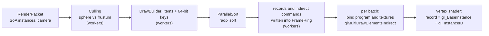

# 06. The renderer: from render packets to draw calls

Chapter [05](05-opengl-from-java.md) showed the OpenGL building blocks one at a time. This chapter
shows how Jeddy's renderer combines them to draw a level with tens of thousands of objects using a
handful of GL calls per pass. The input is a *render packet*, a plain array-of-numbers description
of the frame written by the game thread; the output is a few `glMultiDrawElementsIndirect` calls per
pass, issued from the main thread by a *frame graph*.

You will learn:

- why one draw call per object does not scale, and what *multi-draw-indirect* (MDI) changes;
- how every mesh lives in three shared "mega buffers" so that drawing any mesh is just a few
  numbers in a command;
- how `DrawBuilder` turns visible instances into sorted, batched indirect commands, step by step,
  with the bit layout of its 64-bit sort keys;
- how per-frame data is written into persistently mapped memory without stalling the GPU;
- how materials reach their textures without rebinding between draws (texture arrays, ADR 0001);
- how the frame graph orders passes, allocates render targets and inserts memory barriers;
- the order of passes in one frame, the per-frame constants block, and the GPU-driven path that
  culls static objects in a compute shader.

Where it lives (module `render`, package `dev.jeddy.render` and below, plus `app` for the glue):

| Package | Key classes | Role |
|---|---|---|
| `render` | `RenderPacket`, `RenderPackets`, `SceneRenderer` | the input; the frame |
| `render.gpu` | `GpuDevice`, `FrameRing`, `UploadRing`, `StateCache`, `PipelineState` | resources and per-frame memory |
| `render.mesh` | `MeshRegistry`, `MeshLoader`, `MeshAssets`, `GpuMesh` | mega buffers |
| `render.draw` | `DrawBuilder`, `Culling`, `MaterialTable`, `StaticScene` | culling and submission |
| `render.material` | `MaterialSystem`, `TextureArrays`, `TextureLoader`, `MaterialAssets` | materials and textures |
| `render.graph` | `FrameGraph`, `PassContext`, `PassExecutor`, `GpuTimers` | pass scheduling |
| `render.shader` | `ProgramCache`, `ShaderFeatures`, `EngineShaders` | program variants |
| `render.debug` | `DebugDraw`, `DebugRenderer`, `Overlay`, `ProfilerOverlay` | debug drawing |
| `app.world` | `WorldRenderer` | creates and drives all of the above |

The shaders are under
[`modules/render/src/main/resources/dev/jeddy/render/shaders/`](../../modules/render/src/main/resources/dev/jeddy/render/shaders/):
`engine/*.glsl` (shared includes), `pbr/*` (lit, depth, sky), `cull/*` (GPU culling). Design
background: DESIGN §9.2 and §9.3. Lighting, PBR and shadows are chapter
[07](07-lighting-and-shadows.md); post-processing and effects are chapter
[08](08-effects-and-post.md); skinning is chapter [09](09-animation-and-skinning.md).

## The problem: many objects, few draw calls

### Why one draw per object is slow

The textbook loop draws each object on its own:

```java
// Illustrative, not the real code: one draw per object.
for (Obj o : visible) {
    glUseProgram(o.program);
    glBindVertexArray(o.vao);
    glBindTextureUnit(0, o.albedo);
    glProgramUniformMatrix4fv(o.program, 0, 1, false, o.modelMatrix);
    glDrawElements(GL_TRIANGLES, o.indexCount, GL_UNSIGNED_INT, 0L);
}
```

Each iteration costs the CPU: the Java-to-native call, and much more in the driver, which validates
state, patches descriptors and builds GPU command packets for every draw. That is on the order of
microseconds per draw. An isometric CRPG level has walls, floor tiles, props, characters and their
shadow casters: tens of thousands of draws per frame, more than a 16.6 ms frame allows.

### The idea: data in buffers, parameters in memory

Modern GL ("Approaching Zero Driver Overhead", see [Further reading](#further-reading)) inverts the
loop:

1. Put **all meshes in a few big buffers** with one vertex layout, so no draw needs a different
   VAO. A draw then differs only by numbers: where its indices start, which vertex they are
   relative to, how many instances.
2. Put **per-object data in storage buffers**: the transform, material index and flags of every
   instance in one array, every material in another. The shader finds its record from built-in
   counters, so no uniform changes between objects.
3. Put **the draw parameters themselves in a buffer**: an array of small structs, one per draw.
   One call, `glMultiDrawElementsIndirect`, tells the GPU "run all the draws described there".
4. **Sort** the work so that draws needing the same program and textures are adjacent, then issue
   one multi-draw per such group.

Jeddy's acceptance test for this design (M5-08) is `DrawBuilderTest`: 20,000 instances of a mesh
with two submeshes, in two materials, become **2** `glMultiDrawElementsIndirect` calls, and a frame
allocates zero bytes.

### The pipeline at a glance



The rest of the chapter walks this pipeline from left to right, then zooms out to the whole frame.

## The input: render packets

A [`RenderPacket`](../../modules/render/src/main/java/dev/jeddy/render/RenderPacket.java) is
everything the main thread needs to draw one frame. The game thread writes it during `extract`,
the main thread reads it during `render`, and three packets rotate through a triple buffer so the
two threads never touch the same one (DESIGN §5, chapter [01](01-architecture.md)).
[`RenderPackets`](../../modules/render/src/main/java/dev/jeddy/render/RenderPackets.java) holds the
three.

Instances are struct-of-arrays, all preallocated:

| Field | Per instance | Meaning |
|---|---|---|
| `prevWorld`, `currWorld` | 12 floats | world transform at the previous and current simulation tick, row-major 3×4 (`[r00 r01 r02 tx, r10 r11 r12 ty, r20 r21 r22 tz]`) |
| `mesh` | `int` | `MeshRegistry` handle |
| `material` | `int` | material index, or `MESH_MATERIALS` (-1) to use the mesh's own per-submesh materials |
| `flags` | `int` | bits below |
| `entity` | `int` | the entity it came from (picking, debugging) |
| `bounds` | 4 floats | world bounding sphere x, y, z, radius |
| `fade` | `float` | camera fade, 0 solid to 1 gone |

plus `alpha` (the interpolation factor between the two ticks), the camera (`view`, `projection`,
`viewProjection`, `inverseViewProjection`, `frustumPlanes`, `eye`), lights, decals, emitters, fog of
war, debug lines and skinning palettes. The flag bits:

| Bits | Name | Meaning |
|---|---|---|
| 0 | `FLAG_STATIC` | never moves; may live on the GPU ([GPU-driven static scene](#gpu-driven-culling-of-the-static-scene)) |
| 1 | `FLAG_CASTS_SHADOW` | drawn into shadow maps |
| 2 | `FLAG_TRANSLUCENT` | drawn in the transparent pass |
| 3 | `FLAG_HIGHLIGHT` | outlined (hover, selection) |
| 4 | `FLAG_NO_DECALS` | decals do not project onto it |
| 5 | `FLAG_FADE_OCCLUDER` | dissolves between the camera and reveal points |
| 8–11 | `HIGHLIGHT_SHIFT` | outline style (0 = none) |
| 12–31 | `PALETTE_SHIFT` | skinning palette base + 1 (0 = not skinned) |

The game thread fills instances with `add`, which copies the two transforms and allocates nothing
unless the arrays grow:

```java
public int add(
        float[] prev,
        int prevOffset,
        float[] curr,
        int currOffset,
        int meshHandle,
        int materialIndex,
        int instanceFlags,
        int entityHandle) {
    if (count == capacity) {
        allocate(capacity * 2);
    }
    int i = count++;
    System.arraycopy(prev, prevOffset, prevWorld, i * 12, 12);
    System.arraycopy(curr, currOffset, currWorld, i * 12, 12);
    mesh[i] = meshHandle;
    material[i] = materialIndex;
    flags[i] = instanceFlags;
    entity[i] = entityHandle;
    fade[i] = 0;
    return i;
}
```

The transforms are row-major 3×4 because that is exactly the GPU's instance-record layout: three
`vec4` rows. They are copied, never converted (D21, chapter [02](02-math-foundations.md)).

## The device and the per-frame memory

[`GpuDevice`](../../modules/render/src/main/java/dev/jeddy/render/gpu/GpuDevice.java) is the resource
layer of chapter 05: `buffers()`, `textures()`, `samplers()`, `framebuffers()` behind generational
handles, plus the `StateCache`. `useReversedZ()` calls `glClipControl(GL_LOWER_LEFT, GL_ZERO_TO_ONE)`
and `glClearDepthf(0)` once after context creation. Everything in this chapter receives the device.

Two rings carry the data that changes:

- **`FrameRing`** (chapter 05): one persistently mapped buffer split into 3 regions, one per frame
  in flight, each fenced at the end of its frame. `SceneRenderer.Config.DEFAULT` gives each frame
  32 MiB (`ringBytesPerFrame = 32L << 20`), so the scene ring maps 96 MiB. Everything per frame goes
  in it: skinning palettes, static flags and fades, instance records, indirect commands, lights,
  shadow draws, particle spawns and the frame constants. Workers allocate ranges lock-free and write
  directly into it.
- **`UploadRing`** (chapter 05): staging for assets on their way to their final buffer or texture,
  reclaimed in order by fences, with a per-frame byte budget. `WorldRenderer` creates it with 64 MiB
  and a 32 MiB budget.

A frame of the scene ring, frame $N$ using region $N \bmod 3$:

```
time ──────────────────────────────────────────────────────────────►
CPU   | frame N: wait fence(N-3), write region N%3 | frame N+1: wait fence(N-2), write ... |
GPU         | ... executes frame N-1, reads region (N-1)%3 | executes frame N, reads N%3 |
```

The CPU waits only if it gets three whole frames ahead of the GPU; `FrameRing.stalls()` counts how
often that happens.

## Meshes: the cooked format and the mega buffers

### The cooked mesh: `.jmesh`

The offline cooker turns glTF meshes into `.jmesh` files (chapter [10](10-assets.md), byte layout in
[`docs/formats/jmesh.md`](../formats/jmesh.md)), read in place by
[`MeshData`](../../modules/asset/src/main/java/dev/jeddy/asset/format/MeshData.java). What the
renderer needs from it:

- **Vertex streams**: positions (`POSITION_STRIDE` = 12 bytes, `f32 ×3`), attributes
  (`ATTRIBUTE_STRIDE` = 16 bytes: a QTangent in `snorm16 ×4`, then two half-float UV sets) and,
  for skinned meshes, the skin stream (`SKIN_STRIDE` = 16 bytes: four `u16` joints, four `unorm16`
  weights). Chapter 05 showed how the vertex array decodes them.
- **Indices**: `u32`, *relative to their submesh's base vertex*.
- **Submeshes**: one per material slot, each with a base vertex and vertex count. A submesh is one
  draw.
- **LODs** (levels of detail): LOD 0 is the full mesh; each further LOD is a simplified index list
  over the *same* vertices, with a geometric error in mesh units (how far the simplified surface
  may deviate). The LOD table holds, LOD-major, a `(firstIndex, indexCount)` pair per (LOD,
  submesh).
- **Bounds**: a box and a sphere, and the default material of each slot.

### `MeshRegistry`: three buffers for every mesh

[`MeshRegistry`](../../modules/render/src/main/java/dev/jeddy/render/mesh/MeshRegistry.java) owns
the mega buffers: positions, attributes and indices, plus a skin buffer created with the first
skinned mesh (D80). One vertex array describes them all (chapter 05). Vertex streams share one
*vertex space*: vertex slot $v$ is at byte $12v$ of the positions, $16v$ of the attributes and
$16v$ of the skins. Two [`RangeAllocator`](../../modules/core/src/main/java/dev/jeddy/core/memory/RangeAllocator.java)s
(first-fit over a free list sorted by offset; freed neighbours merge) hand out ranges of the vertex
space and the index space.

```
vertex space          0         4         8                          capacity
                      [ mesh A  | mesh B  |   free ...                ]
  positions  (12 B per slot), attributes (16 B), skins (16 B, if any): same slots

index space           0                  9                  18
                      [ A: LOD0 6 | LOD1 3 | B: LOD0 6 | LOD1 3 | free ... ]
```

`add(MeshData)` reserves the ranges, uploads the streams, and records everything a draw needs in
flat SoA tables:

```java
public int add(MeshData data) {
    int vc = data.vertexCount();
    int ic = data.indexCount();
    int sc = data.submeshCount();
    int lc = data.lodCount();
    long vOff = allocate(vertexSpace, Math.max(1, vc), true);
    long iOff = allocate(indexSpace, Math.max(1, ic), false);
    int sBase = (int) allocateTable(submeshSpace, Math.max(1, sc), 0);
    int dBase = (int) allocateTable(drawSpace, Math.max(1, sc * lc), 1);
    int lBase = (int) allocateTable(lodSpace, lc, 2);
    GpuBuffers b = device.buffers();
    upload(b.glName(positions), vOff * MeshData.POSITION_STRIDE, data.positions());
    upload(b.glName(attributes), vOff * MeshData.ATTRIBUTE_STRIDE, data.attributes());
    upload(b.glName(indices), iOff * 4, data.indices());
    // ... skin stream, mesh handle, per-mesh SoA fields
    for (int s = 0; s < sc; s++) {
        submeshBaseVertex[sBase + s] = (int) vOff + data.submeshBaseVertex(s);
        submeshMaterial[sBase + s] = data.submeshMaterial(s);
        submeshMaterialIndex[sBase + s] = 0;
    }
    for (int l = 0; l < lc; l++) {
        lodError[lBase + l] = data.lodError(l);
        for (int s = 0; s < sc; s++) {
            drawFirstIndex[dBase + l * sc + s] = (int) iOff + data.lodFirstIndex(l, s);
            drawIndexCount[dBase + l * sc + s] = data.lodIndexCount(l, s);
        }
    }
    return h;
}
```

The stored numbers are **absolute**: `baseVertex(mesh, submesh)` is the submesh's first vertex slot
in the mega buffer, `firstIndex(mesh, lod, submesh)` its first index in the index buffer. Those are
exactly the fields of an indirect command, as the next section shows.

**Uploads** go through the `UploadRing` when one is given: reserve 16-aligned staging space, copy
the stream into it, then `glCopyNamedBufferSubData` into the mega buffer on the GPU. If the ring is
full or over budget this frame, `upload` falls back to `glNamedBufferSubData` straight from the
source address ("the driver copies now"); the mega buffers are created `DYNAMIC` for that reason.

**Growth.** When a range allocation fails, the space doubles (or grows by the request, whichever is
larger): a bigger buffer is created, the old contents are copied on the GPU, the old buffer is
deleted (GL keeps it alive until pending draws finish), and the vertex array is re-pointed:

```java
private int regrow(int buffer, long oldBytes, long newBytes, String label) {
    GpuBuffers b = device.buffers();
    int bigger = b.create(newBytes, GpuBuffers.DYNAMIC, label);
    glCopyNamedBufferSubData(b.glName(buffer), b.glName(bigger), 0, 0, oldBytes);
    b.destroy(buffer); // GL defers the delete until pending draws are done
    return bigger;
}
```

All vertex streams grow together because they share the vertex space. In `MeshRegistryTest` the
registry starts with 6 vertex slots; the first quad takes slots 0–3, the second needs 4 more, so the
space grows to $`\max(2 \cdot 6,\ 6 + 4) = 12`$ and the second quad lands at base vertex 4. Removing
the first quad and adding another reuses base vertex 0 (first fit).

**Why mega buffers?** One vertex array and three fixed buffers for every mesh means that no draw in
a pass needs a different binding. A draw becomes the five integers of an indirect command (next
section), which is what makes multi-draw possible. Positions in their own stream let depth-only passes fetch 12 bytes per vertex (D27).

`MeshLoader` connects this to the asset system: decoding and validation on a worker, `add` on the
main thread within the asset upload budget. `MeshAssets` then points each submesh's slot at its
material index once that material is loaded (`setSlotMaterial`), which is what
`RenderPacket.MESH_MATERIALS` instances use.

### Try it

```bash
./gradlew :render:test -Pjeddy.gpuTests=true --tests 'dev.jeddy.render.mesh.MeshRegistryTest'
```

The test draws one quad at LOD 0 and the other at LOD 1 with `glDrawElementsBaseVertex`, and checks
the pixels.

## Multi-draw-indirect

### From one draw to an indirect command

`MeshRegistryTest` draws a single mesh like this:

```java
glDrawElementsBaseVertex(
        GL_TRIANGLES,
        registry.indexCount(left, 0, 0),
        GL_UNSIGNED_INT,
        4L * registry.firstIndex(left, 0, 0),
        registry.baseVertex(left, 0));
```

"Read `count` indices starting at byte `4 × firstIndex` of the element buffer, add `baseVertex` to
each index value, and draw the resulting vertices as triangles." Add "do it `instanceCount` times"
and "tell the shader which instance range this is" and you have the five numbers of a
`DrawElementsIndirectCommand`, the struct GL defines for indirect draws. Each is 4 bytes, 20 in
total (`DrawBuilder.COMMAND_BYTES`):

| Offset | Field | Type | What `DrawBuilder` writes |
|---|---|---|---|
| 0 | `count` | uint | `meshes.indexCount(mesh, lod, submesh)` |
| 4 | `instanceCount` | uint | the run length (how many items share this draw) |
| 8 | `firstIndex` | uint | `meshes.firstIndex(mesh, lod, submesh)`, in indices, not bytes |
| 12 | `baseVertex` | int | `meshes.baseVertex(mesh, submesh)` |
| 16 | `baseInstance` | uint | sorted position of the run's first item |

`glMultiDrawElementsIndirect(mode, type, offset, drawcount, stride)` reads `drawcount` such structs
from the buffer bound to `GL_DRAW_INDIRECT_BUFFER`, starting at byte `offset`, `stride` bytes apart,
and runs each as an instanced draw. One Java-to-driver crossing, any number of draws.

### Finding the per-instance data

Inside an instanced draw, `gl_InstanceID` counts $0, 1, \dots, \text{instanceCount} - 1$, and it
does **not** include `baseInstance`. GLSL 4.60 exposes the command's `baseInstance` as
`gl_BaseInstance`. So the record of the current instance is at index `gl_BaseInstance +
gl_InstanceID` in the instance array, which is what
[`engine/instance.glsl`](../../modules/render/src/main/resources/dev/jeddy/render/shaders/engine/instance.glsl)
does:

```glsl
struct JeddyInstance {
    vec4 row0;
    vec4 row1;
    vec4 row2;
    uvec4 data; // x material, y flags, z entity, w camera fade (float bits)
};

layout(std430, binding = 0) readonly buffer JeddyInstances {
    JeddyInstance jeddyInstances[];
};

JeddyInstance jeddyInstance() {
    return jeddyInstances[gl_BaseInstance + gl_InstanceID];
}

vec3 jeddyTransformPoint(JeddyInstance i, vec3 p) {
    vec4 v = vec4(p, 1.0);
    return vec3(dot(i.row0, v), dot(i.row1, v), dot(i.row2, v));
}
```

A worked example: a run of 3 items starting at sorted position 120, for a submesh whose LOD has 36
indices starting at index 5000, with base vertex 1200, becomes the command
$(36, 3, 5000, 1200, 120)$. For the second instance, `gl_InstanceID` = 1 and the shader reads record 121. An index value
of 7 in the index buffer fetches vertex slot $1200 + 7 = 1207$ of every stream.

Jeddy does not use instanced vertex attributes (attribute divisors). Instance data is pulled from a
storage buffer by index, which is more flexible: records can be any size, and the fragment shader
can receive the material index as a `flat` output.

### The instance record

`DrawBuilder.INSTANCE_BYTES = 64`, laid out for `std430` as three `vec4` rows and one `uvec4`:

| Bytes | GLSL | Content |
|---|---|---|
| 0–15 | `row0` | $`r_{00}\ r_{01}\ r_{02}\ t_x`$ (interpolated) |
| 16–31 | `row1` | $`r_{10}\ r_{11}\ r_{12}\ t_y`$ |
| 32–47 | `row2` | $`r_{20}\ r_{21}\ r_{22}\ t_z`$ |
| 48–51 | `data.x` | material index (a row of the material table) |
| 52–55 | `data.y` | instance flags (including the palette bits) |
| 56–59 | `data.z` | entity |
| 60–63 | `data.w` | camera fade, as float bits (`uintBitsToFloat` in GLSL) |

`jeddyTransformPoint` computes each world coordinate as a dot product of a row with
$(p_x, p_y, p_z, 1)$: the row-major 3×4 affine transform of chapter [02](02-math-foundations.md), with no
fourth row because it is always $(0, 0, 0, 1)$. A 3×4 record saves 16 bytes per instance over a
`mat4`. Records are written per *item* (instance × submesh), in sorted order, so every command's
`baseInstance` addresses a contiguous run; a mesh with three submeshes writes its record three
times (D30). Normals use the cofactor matrix (`jeddyTransformNormal`), which stays correct under
non-uniform scale.

## `DrawBuilder` step by step

[`DrawBuilder`](../../modules/render/src/main/java/dev/jeddy/render/draw/DrawBuilder.java) turns the
indices of visible instances into commands in four steps. Its Javadoc summarizes them; here is each
one in detail.

### Step 0: count the items

`build(packet, visibleIndices, visibleCount, ring)` first walks the visible instances once on the
calling (main) thread. Each instance contributes one *item* per submesh, and `itemFirst` becomes a
prefix sum: instance $v$'s items are `itemFirst[v] .. itemFirst[v + 1] - 1`. That lets workers later
write items for different instances without coordination.

```java
int n = 0;
for (int v = 0; v < visibleCount; v++) {
    itemFirst[v] = n;
    int i = visibleIndices[v];
    int mesh = p.mesh[i];
    if (meshes.isValid(mesh)) {
        int submeshes = meshes.submeshCount(mesh);
        if ((p.flags[i] >>> RenderPacket.PALETTE_SHIFT) != 0 && meshes.isSkinned(mesh)) {
            prepareSkinned(p.material[i], mesh, submeshes);
        }
        n += submeshes;
    }
}
itemFirst[visibleCount] = n;
```

`prepareSkinned` makes sure the `SKINNED` program variant of the material's slot exists. It may
create a slot, which is not thread-safe, so it runs here, before the workers start
([Skinned instances](#skinned-instances)).

### Step 1: items, LOD and sort keys (on workers)

`run(itemKernel, visibleCount)` calls `jobs.parallelFor` with a grain of 512 when there are at least
2048 visible instances, otherwise it runs on the calling thread. The kernel, `buildItems`, computes
for each visible instance:

- its **distance** $d$ to the eye, from the transform's translation column
  ($t_x, t_y, t_z$ at offsets 3, 7, 11 of the 12 floats);
- its **scale** $s$, the length of the transform's first column
  $\sqrt{r_{00}^2 + r_{10}^2 + r_{20}^2}$ (offsets 0, 4, 8);
- its **LOD**, from both (below);
- for each submesh, the material (the instance's, or the mesh slot's when the instance uses
  `MESH_MATERIALS`), the material's **program slot**, and whether the item is **translucent**
  (the instance flag `FLAG_TRANSLUCENT`, or a material with `FEATURE_ALPHA_BLEND`);
- the 64-bit **sort key**.

**LOD selection.** A LOD with geometric error $e$ (mesh units) seen from distance $d$ deviates on
screen by about

```math
e \cdot k \text{ pixels}, \qquad k_{\text{perspective}} = \frac{P\, s}{d}, \qquad k_{\text{orthographic}} = P\, s
```

where $P$ is "pixels per world unit at distance 1" (perspective) or "pixels per world unit"
(orthographic), and $s$ the instance's scale. `SceneRenderer` computes $P$ from the projection
matrix as `p.projection[5] * height * 0.5f`: for a perspective projection, `projection[5]` is
$1/\tan(\text{fovY}/2)$, so $P = H / (2 \tan(\text{fovY}/2))$ for a viewport $H$ pixels high; for
an orthographic projection it is $2/(\text{top} - \text{bottom})$, so $P = H / (\text{top} - \text{bottom})$.
`selectLod` takes the coarsest LOD whose projected error stays within the threshold $\tau$ (1 pixel
in the main view):

```java
private int selectLod(int mesh, float scale, float distance) {
    int lods = meshes.lodCount(mesh);
    float k =
            orthographic
                    ? pixelsPerUnit * scale
                    : pixelsPerUnit * scale / Math.max(distance, 1e-3f);
    int lod = 0;
    for (int l = 1; l < lods; l++) {
        if (meshes.lodError(mesh, l) * k <= thresholdPixels) {
            lod = l;
        } else {
            break;
        }
    }
    return lod;
}
```

With numbers: a 1080-pixel-high view with a 30° vertical field of view gives
$P = 1080 / (2 \tan 15°) \approx 2015$ pixels per unit at distance 1. An unscaled prop 40 units away
has $k \approx 50.4$. If LOD 1 has error 0.01 ($0.5$ px, accepted) and LOD 2 has error 0.05
($2.5$ px, rejected), the prop draws at LOD 1.

**The sort key.** Items are sorted by one unsigned 64-bit number. Its layout decides which items end
up next to each other (DESIGN §9.2, D30). Opaque items:

| Bits | Width | Field | Why here |
|---|---|---|---|
| 60–63 | 4 | pass (0 = opaque) | opaque before translucent |
| 48–59 | 12 | program slot | one program and texture set per batch |
| 28–47 | 20 | mesh (handle index) | same mesh together |
| 24–27 | 4 | LOD | same index range together |
| 16–23 | 8 | submesh | same submesh together |
| 0–15 | 16 | depth, near first: $`\min(65535,\ 64 d)`$ | front-to-back within a run, so early depth testing rejects more |

Translucent items:

| Bits | Width | Field | Why here |
|---|---|---|---|
| 60–63 | 4 | pass (1 = translucent) | after all opaque items |
| 28–59 | 32 | depth, far first: $`\text{0xFFFFFFFF} - \min(\text{0xFFFFFFFF},\ 4096 d)`$ | blending needs back-to-front order |
| 16–27 | 12 | program slot | |
| 8–15 | 8 | submesh | |
| 0–7 | 8 | zero | |

From the code:

```java
if (translucent) {
    // pass | depth, far first (32) | program slot (12) | submesh (8) | 0
    long backToFront =
            0xFFFFFFFFL - Math.min(0xFFFFFFFFL, (long) (distance * 4096f));
    key =
            (long) PASS_TRANSLUCENT << 60
                    | backToFront << 28
                    | (long) slot << 16
                    | (long) s << 8;
} else {
    // pass | program slot (12) | mesh (20) | LOD (4) | submesh (8) | depth, near
    // first (16)
    key =
            (long) PASS_OPAQUE << 60
                    | (long) slot << 48
                    | meshBits
                    | (long) s << 16
                    | depth;
}
```

where `meshBits = (long) (Handles.index(mesh) & 0xFFFFF) << 28 | (long) lod << 24` and
`depth = (int) Math.min(65535f, distance * 64f)`.

Every field starts on a 4-bit boundary, so a key reads naturally in hexadecimal, one group per
field. An opaque item with program slot 3, mesh index 17, LOD 1, submesh 2, at distance 12.5
(depth $12.5 \cdot 64 = 800 = \text{0x320}$):

```
pass slot  mesh   LOD sub  depth
 0   003   00011   1   02  0320      -> key 0x0003000111020320
```

The same submesh as a translucent item: $12.5 \cdot 4096 = 51200 = \text{0xC800}$, so the depth
field is $\text{0xFFFFFFFF} - \text{0xC800} = \text{0xFFFF37FF}$:

```
pass depth     slot sub  zero
 1   FFFF37FF  003  02   00          -> key 0x1FFFF37FF0030200
```

A farther translucent item gets a *smaller* depth field and so sorts first. Resolution and range
follow from the scale factors: opaque depth has 1/64-unit steps up to 1024 units (then it clamps,
which only weakens the front-to-back order), translucent depth 1/4096-unit steps over a range of
about a million units. The field widths also set limits: 4096 program slots (`MaterialTable`
refuses more), 16 LODs, 256 submeshes, and $2^{20}$ mesh indices.

### Step 2: sort

```java
for (int i = 0; i < n; i++) {
    order[i] = i;
}
if (sorter != null) {
    sorter.sort(keys, order, n);
} else {
    LongSort.radixSort(keys, order, n, scratchKeys, scratchOrder, histogram);
}
```

[`ParallelSort`](../../modules/core/src/main/java/dev/jeddy/core/job/ParallelSort.java) is a
least-significant-digit radix sort over 8-bit digits: up to 8 passes, each a counting sort by one
byte. Per pass, 32 chunks build byte histograms in parallel, one thread turns them into scatter
offsets, and the chunks scatter in parallel. Passes whose byte is the same in every key are skipped,
which matters here: the pass field and the high bits of the slot are usually equal for all opaque
items. Below 16,384 items it falls back to the sequential `LongSort.radixSort`. The sort is stable
and moves an `int` payload (`order`) with the keys, so afterwards `order[k]` is the item at sorted
position $k$.

Why radix sort and not `Arrays.sort`? Radix sort runs in $O(n)$ for fixed-size keys, needs no
comparisons, parallelizes cleanly, and works on primitive arrays without allocating.

### Step 3: runs, records and commands

After sorting, equal draws are adjacent. Two consecutive opaque items can share a command when
everything above the depth bits matches; translucent items never merge, because a merged draw
could not keep their back-to-front order with the items between them:

```java
/** Opaque items merge when everything above the depth bits matches; translucent never do. */
private static boolean sameDraw(long a, long b) {
    return (a >>> 60) == PASS_OPAQUE && (b >>> 60) == PASS_OPAQUE && (a >>> 16) == (b >>> 16);
}
```

`build` records where each *run* of equal items starts, reserves ring space for all records (256-byte
aligned) and all commands (16-byte aligned), then writes the records on the workers. Each record's
transform is interpolated between the two ticks while it is written:

```java
private void writeRecords(int start, int end, int thread) {
    RenderPacket p = packet;
    MemorySegment m = memory;
    float[] prev = p.prevWorld;
    float[] curr = p.currWorld;
    float a = p.alpha;
    for (int k = start; k < end; k++) {
        int item = order[k];
        int instance = visible[itemInstance[item]];
        int w = instance * 12;
        long o = instanceBase + (long) k * INSTANCE_BYTES;
        for (int j = 0; j < 12; j++) {
            float x = prev[w + j];
            m.set(F32, o + 4L * j, x + (curr[w + j] - x) * a);
        }
        m.set(I32, o + 48, itemMaterial[item]);
        m.set(I32, o + 52, p.flags[instance]);
        m.set(I32, o + 56, p.entity[instance]);
        m.set(F32, o + 60, p.fade[instance]);
    }
}
```

The interpolation is a plain lerp of all 12 numbers, $`x + (x' - x)\,\alpha`$. For the rotation part
that is not a true rotation in between, but the two ticks are 1/30 s apart (D13), so the difference
is invisible; the game thread does the careful work (chapter [03](03-rotations-and-transforms.md)).
Note the threading rules of DESIGN §5 at work: the main thread already waited on the ring's fence in
`beginFrame` before any worker writes, the workers write disjoint ranges and never read the mapping,
and `parallelFor` returns only after every worker's chunk completed.

Finally one sequential pass turns runs into commands and groups commands into **batches**:
consecutive commands with the same pass and program slot.

```java
long c = commandOffset;
for (int r = 0; r < runs; r++) {
    int first = runStart[r];
    int item = order[first];
    long key = keys[first];
    int v = instanceOfItem(item);
    int instance = visible[v];
    int mesh = packet.mesh[instance];
    int submesh = item - itemFirst[v];
    int lod = itemLod[item];
    memory.set(I32, c, meshes.indexCount(mesh, lod, submesh));
    memory.set(I32, c + 4, runStart[r + 1] - first);
    memory.set(I32, c + 8, meshes.firstIndex(mesh, lod, submesh));
    memory.set(I32, c + 12, meshes.baseVertex(mesh, submesh));
    memory.set(I32, c + 16, first);
    int pass = (int) (key >>> 60);
    int slot = slotOf(key);
    if (batchCount == 0
            || batchPass[batchCount - 1] != pass
            || batchSlot[batchCount - 1] != slot) {
        ensureBatches(batchCount + 1);
        batchPass[batchCount] = pass;
        batchSlot[batchCount] = slot;
        batchOffset[batchCount] = c;
        batchCommands[batchCount] = 0;
        batchCount++;
    }
    batchCommands[batchCount - 1]++;
    c += COMMAND_BYTES;
}
```

Because the slot is the highest field after the pass, every opaque slot forms exactly one batch.
Translucent batches split whenever two depth-adjacent items use different slots; that is the price
of correct blending.

### Step 4: submit

```java
public void submit(StateCache state, FrameRing ring, BatchBinder binder) {
    if (itemCount == 0) {
        return;
    }
    state.bindVertexArray(meshes.vertexArray());
    state.bindStorage(INSTANCE_BINDING, ring.glName(), instanceOffset, instanceBytes);
    state.bindStorage(MATERIAL_BINDING, materials.glBuffer(), 0, materials.byteSize());
    state.bindDrawIndirect(ring.glName());
    for (int b = 0; b < batchCount; b++) {
        if (!binder.bind(state, batchSlot[b], batchPass[b] == PASS_TRANSLUCENT)) {
            continue;
        }
        glMultiDrawElementsIndirect(
                GL_TRIANGLES, GL_UNSIGNED_INT, batchOffset[b], batchCommands[b], COMMAND_BYTES);
    }
}
```

The frame ring is bound three ways at once: the records range as storage buffer 0, the whole ring
as the draw-indirect buffer (so `batchOffset[b]`, an offset into the ring, is the `indirect`
argument, passed through the `long` overload of chapter 05), and other ranges elsewhere. Because the
records range starts at `instanceOffset`, `jeddyInstances[0]` is the first record of this build, and
`baseInstance` (a sorted position) indexes from there. The 256-byte alignment of that offset always
satisfies `GL_SHADER_STORAGE_BUFFER_OFFSET_ALIGNMENT`, which GL caps at 256.

### `BatchBinder`: one draw list, many passes

The same built draws are submitted by several passes with different programs and state: the depth
prepass, the lit opaque pass, the transparent pass. A `BatchBinder` decides, per batch, what to
bind, or to skip it:

```java
@FunctionalInterface
public interface BatchBinder {
    boolean bind(StateCache state, int slot, boolean translucent);
}
```

`MaterialSystem` provides the standard ones as fields created once (so passing them allocates
nothing): `litOpaque` (opaque batches, `GL_GEQUAL` without depth writes after the prepass, D42),
`litOpaqueNoPrepass`, `litTranslucent` (translucent batches, alpha blending, back faces culled) and
`depthOnly` (opaque batches with the depth variant of the material's program). Here is the lit one:

```java
private boolean bindLit(StateCache state, int slot, long pipeline) {
    int program = table.glProgram(slot);
    if (program == 0) {
        return false;
    }
    long mask = table.slotMask(slot);
    state.apply(cullFor(pipeline, mask));
    state.useProgram(program);
    bindSet(state, table.slotTextureSet(slot));
    return true;
}
```

A program still compiling returns 0 and its batch is skipped this frame (chapter 05's
`ProgramCache`). `cullFor` turns culling off for double-sided materials.

### The acceptance test, with numbers

[`DrawBuilderTest`](../../modules/render/src/test/java/dev/jeddy/render/draw/DrawBuilderTest.java)
builds a mesh `splitQuad` with two submeshes (left and right half) and two LODs (LOD 1 has error
0.5), and a program `flat` whose fragment shader reads the material row and, in its `HALF` variant,
halves the color:

```glsl
#version 460 core
layout(std430, binding = 1) readonly buffer Materials { vec4 rows[]; };
layout(location = 0) flat in uint material;
layout(location = 0) out vec4 color;
void main() {
    color = rows[material * 8u];
#ifdef HALF
    color.rgb *= 0.5;
#endif
}
```

(`rows[material * 8u]` because a material row is 8 `vec4`s; the first is the base color.) The red
material uses mask 0, the green one mask 1 (`HALF`), so they get program slots 0 and 1. The packet
holds a 200 × 100 grid of instances in an orthographic view plus 100 instances far outside it.

Follow the numbers:

1. `Culling` keeps the 20,000 grid instances.
2. Each has 2 submeshes: **40,000 items**.
3. LOD: orthographic, $P = 128/200 = 0.64$ pixels per unit, so LOD 1 projects to
   $0.5 \cdot 0.64 = 0.32$ pixels $\le 1$: every item is LOD 1.
4. Distinct (slot, mesh, LOD, submesh) values: 2 slots × 2 submeshes = **4 runs**, each 10,000
   items long, so **4 commands** with `instanceCount` 10,000.
5. Two slots: **2 batches**, two `glMultiDrawElementsIndirect` calls of 2 commands each.

The test checks exactly that, reads back a red pixel on the left and a half-green one on the right,
prints the cull + build time, and asserts zero allocation per frame:

```java
assertEquals(40_000, builder.itemCount(), "20k visible instances x 2 submeshes");
assertEquals(2, builder.batchCount(), "one multi-draw per program variant");
assertTrue(
        builder.commandCount() <= 4,
        "runs per mesh, LOD, submesh: " + builder.commandCount());
// ...
Allocations.assertNoAllocation("cull, build, submit", 10, 20, frame);
```

On the 2-core development sandbox, cull + build for 20k instances took about 1.7–2.6 ms (TASKS
M5-08); the ≤ 2 ms target still has to be confirmed on the reference PC. `DrawBench`
(`./gradlew :bench:jmh -Pjmh.includes=DrawBench`) measures the same path.

```bash
./gradlew :render:test -Pjeddy.gpuTests=true --tests 'dev.jeddy.render.draw.DrawBuilderTest'
```

## Materials without rebinding

### The material table

A batch binds one program and one set of textures, yet its instances may use hundreds of different
materials. The material's *numbers* therefore live in a storage buffer, one row per material,
indexed by the instance record's `data.x`.
[`MaterialTable`](../../modules/render/src/main/java/dev/jeddy/render/draw/MaterialTable.java) keeps
the rows in a native CPU copy and uploads the changed range in `flush(ring)` (once per frame, from
`SceneRenderer.render`) through the frame ring: the bytes are staged in the ring and copied by the
GPU with `glCopyNamedBufferSubData` (`FrameRing.upload`). It used to be a `glNamedBufferSubData`
from the CPU, and the first Intel Windows driver we ran on silently dropped those writes once the
GPU had used the buffer, so every material loaded after the first frame read as zeros: black,
mirror-smooth characters on a correct floor (D103, chapter 05's rule on changing buffers the GPU
is reading). The whole buffer is bound, not the rows in use, so the bound range never changes as
materials arrive. A row is `FLOATS = 32` floats (128 bytes, D41),
in the layout of
[`engine/material.glsl`](../../modules/render/src/main/resources/dev/jeddy/render/shaders/engine/material.glsl):

| Floats | GLSL member | Content |
|---|---|---|
| 0–3 | `vec4 baseColor` | linear RGBA factor |
| 4–7 | `vec4 emissive` | RGB factor, strength |
| 8–11 | `vec4 pbr` | metallic, roughness, normal scale, occlusion strength |
| 12–15 | `vec4 uvScaleOffset` | UV transform scale xy, offset xy |
| 16–19 | `vec4 misc` | x UV rotation, y alpha cutoff |
| 20–23 | `uvec4 layers` | texture array layer of base color, normal, ORM, emissive |
| 24–27 | `uvec4 layers2` | x occlusion layer, y one bit per slot that uses UV1, z material flags |
| 28–31 | `vec4 reserved` | |

`MaterialSystem.write` fills the floats from a `.jmat` (chapter [10](10-assets.md)); `setTexture`
fills the layer fields with `Float.intBitsToFloat(layer)`, so the `uvec4` reads the integer back.

### Program slots

Each material also belongs to a **program slot**: a (program definition, feature mask, texture set)
triple. Slots are what sort keys and batches use; materials that share a slot share a program and
texture bindings, and differ only in their row. `MaterialTable.slot` finds or creates the triple
(at most 4096, the 12 bits of the sort key), `programSlot(material)` maps a material to its slot,
`glProgram(slot)` asks the `ProgramCache` for that variant, and `slotVersion()` changes whenever an
existing material moves to another slot (the GPU-driven static scene rebuilds then).

### Feature masks

[`MaterialSystem`](../../modules/render/src/main/java/dev/jeddy/render/material/MaterialSystem.java)
defines two programs, `pbr` (`pbr/pbr.vert` + `pbr/pbr.frag`) and `depth` (`pbr/depth.vert` +
`pbr/depth.frag`), with one shared feature table (`MaterialSystem.features()`):

| Bits | Defines | Set by |
|---|---|---|
| 0–4 | `BASE_COLOR_MAP`, `NORMAL_MAP`, `ORM_MAP`, `EMISSIVE_MAP`, `OCCLUSION_MAP` | the texture is loaded |
| 5–8 | `ALPHA_MASK`, `ALPHA_BLEND`, `DOUBLE_SIDED`, `UV_TRANSFORM` | the `.jmat` |
| 9 | `UV1` | a loaded texture samples the second UV set |
| 10–14 | `J_RESERVED_10` .. `J_RESERVED_14` | unused |
| 15 | `SKINNED` | `MaterialTable.SKINNED`, skinned variants |
| 16–31 | `MATERIAL_CUSTOM_16` .. `MATERIAL_CUSTOM_31` | game-defined `.jmat` bits |
| 32 | `SUN_SHADOWS` | renderer-wide (`MaterialSystem.SUN_SHADOWS`) |
| 33 | `LOCAL_SHADOWS` | renderer-wide |
| 34 | `SCREEN_AO` | renderer-wide |
| 35 | `DECALS` | renderer-wide |
| 36 | `FOG_OF_WAR` | renderer-wide |

Bits 0–9 come from `MaterialData.FEATURE_NAMES`. A material's texture bits are on only for
textures that have *arrived*: until its normal map loads, a material draws with the variant
without `NORMAL_MAP`, and `setTexture` moves it to the new slot when it does. The global bits are set
by the `SceneRenderer` constructor from its configuration, so every lit variant includes, say,
`SUN_SHADOWS` when sun shadows are on:

```java
if (sunShadows != null) {
    materials.setGlobalFeatures(materials.globalFeatures() | MaterialSystem.SUN_SHADOWS);
    sunShadows.setStaticScene(staticScene);
}
```

The depth program cares about fewer bits (`DEPTH_FEATURES`: alpha mask, base color map, UV
transform, UV1, skinned), so the depth binder masks the slot's mask with them and many lit variants
share one depth variant.

### Texture arrays instead of bindless (ADR 0001)

Materials in one batch need *different textures* without a rebind between draws. GL 4.6 offers two
ways ([ADR 0001](../adr/0001-texture-binding.md)):

1. **Texture arrays.** Textures of the same format, size and mip count are layers of one
   `GL_TEXTURE_2D_ARRAY`, a *bucket*. The material row stores the layer; the shader samples
   `texture(jBaseColorMap, vec3(uv, float(m.layers.x)))`.
2. **`ARB_bindless_texture`.** Every texture gets a 64-bit handle the shader turns into a sampler.
   Nothing is bound at all, but it is an extension: missing on Intel's Windows driver for many
   generations and on Mesa llvmpipe, which CI uses.

Jeddy uses texture arrays as the baseline everywhere (D41). The ADR's measurement on llvmpipe, 256
materials with one 128² texture each: 3525 µs per frame rebinding per draw, 2613 µs with a texture
array; bindless is unsupported there. The hardware rows are still pending, and the ADR stays
*Proposed* until they are measured (TASKS M5-11).

[`TextureArrays`](../../modules/render/src/main/java/dev/jeddy/render/material/TextureArrays.java)
manages the buckets:

- `allocate(format, width, height, levels)` finds a bucket with that exact description (or creates
  one with 4 layers) and returns a reference `bucket << 16 | layer`; `bucket(ref)` and `layer(ref)`
  unpack it.
- A full bucket doubles: a new array texture, `glCopyImageSubData` of the used layers on the GPU
  (the sub-block mip levels, 2x2 and 1x1, are re-uploaded from a CPU copy instead, because one
  driver rejects both copying and reading them back, D101), the old one deleted. `generation()`
  increases so cached bindings refresh.
- Freed layers are reused.

`TextureLoader` uploads each plain 2D `.ktx2` texture into a bucket layer (`uploadLayer`), and gives
cube maps and arrays a texture of their own. The bucket index goes into the material's **texture
set**: for each of the 5 texture slots, which bucket must be bound on units 0–4. The texture set is
part of the program slot, so all draws of a batch need the same buckets, bound once by `bindSet`
before the batch's multi-draw. When a texture arrives in a different bucket than its material's
other textures, the material simply moves to another slot.

The fragment side, from `pbr/pbr.frag`:

```glsl
JeddyMaterial m = jMaterials[vMaterial];
vec4 base = m.baseColor;
#ifdef BASE_COLOR_MAP
base *= texture(jBaseColorMap, vec3(jeddySlotUv(m, 0u, vUv), float(m.layers.x)));
#endif
```

`SceneRendererTest.baseColorTexturesComeFromArrayLayers` checks the whole chain, including that a
second texture of the same size lands in the same bucket.

## The frame graph

### Why a graph

A frame is a sequence of passes: shadow maps, a depth prepass, ambient occlusion, the lit pass, the
sky, transparency, particles, outlines, bloom, exposure, tone mapping, anti-aliasing. Each pass
reads some images and buffers and writes others. Written by hand, the code must create every render
target at the right size, recreate them on resize, bind the right framebuffer before each pass,
clear what needs clearing, and insert `glMemoryBarrier` calls wherever a compute shader's writes are
read later. Forget a barrier and you get flickering on one vendor only.

[`FrameGraph`](../../modules/render/src/main/java/dev/jeddy/render/graph/FrameGraph.java) (v1, D32)
makes all of that declarative. Passes are declared once at startup with the resources they read and
write; `compile(w, h)` (at startup and on resize) derives the rest; `execute(frame)` runs the result
every frame and allocates nothing.

### Declaring resources and passes

- `texture(name, internalFormat, scale)` declares a **transient** texture, `scale` times the frame
  size (0.5 for half resolution). The graph creates it.
- `importedTexture(name)` and `importedBuffer(name)` declare resources owned elsewhere (shadow
  atlas, cluster lists), whose GL names are set with `setTexture`/`setBuffer`.
- `addPass(name, executor)` and `addComputePass(name, executor)` return a `Pass` to declare usage:
  `color(resource)` or `color(resource, r, g, b, a)` (attach and optionally clear),
  `depth(resource, clear)`, `depthReadOnly(resource)`, `readsTexture`, `readsStorage`,
  `readsIndirect`, `readsImage`, `writes` (shader writes), and `sideEffect()` (keep the pass even if
  nothing reads its outputs).
- `FrameGraph.BACKBUFFER` is the window.

From `FrameGraphTest`, a compute pass that writes indirect draw arguments, a pass that draws with
them, an unused pass, and a post pass that writes the window:

```java
int depth = graph.texture("depth", GL_DEPTH_COMPONENT32F, 1f);
int color = graph.texture("color", GL_RGBA8, 1f);
int half = graph.texture("half", GL_RGBA8, 0.5f);
int args = graph.importedBuffer("args");
graph.setBuffer(args, device.buffers().glName(argsBuffer));
graph.addComputePass(
                "fill args",
                ctx -> {
                    ctx.state().useProgram(fill);
                    glBindBufferBase(GL_SHADER_STORAGE_BUFFER, 4, ctx.buffer(args));
                    glDispatchCompute(1, 1, 1);
                })
        .writes(args);
graph.addPass(
                "scene",
                ctx -> {
                    // ... apply state, program, vertex array
                    ctx.state().bindDrawIndirect(ctx.buffer(args));
                    glDrawArraysIndirect(GL_TRIANGLES, 0L);
                })
        .readsIndirect(args)
        .color(color, 0f, 0f, 1f, 1f)
        .depth(depth, 0f);
graph.addPass(
                "unused",
                ctx -> {
                    throw new AssertionError("culled passes never run");
                })
        .color(half, 1, 1, 1, 1);
graph.addPass(
                "post",
                ctx -> {
                    // ... sample `color`, draw a full-screen triangle
                })
        .readsTexture(color)
        .color(FrameGraph.BACKBUFFER);
graph.compile(SIZE, SIZE);
assertEquals(3, graph.livePassCount());
assertFalse(graph.isLive(2));
```

### What `compile` does

1. **Liveness, back to front.** A pass is live if it has a side effect, or writes a resource that a
   later live pass needs, or writes something that is not transient (the backbuffer or an imported
   resource, which the outside world may read). A live pass marks everything it reads, and its
   depth target, as needed. In the test, nothing reads `half`, so "unused" is culled and never runs.
2. **Validation and barriers, front to back.** Reading a transient that no earlier live pass wrote
   throws `IllegalStateException("pass '...' reads '...' before any pass writes it")`
   (`FrameGraphTest.readingBeforeWritingIsAnError`). For each read of a resource whose last writer
   was a *compute* pass, the pass gets the barrier bit for that kind of read:

   | Declared read | Barrier bit |
   |---|---|
   | `readsTexture` | `GL_TEXTURE_FETCH_BARRIER_BIT` |
   | `readsStorage` | `GL_SHADER_STORAGE_BARRIER_BIT` |
   | `readsIndirect` | `GL_COMMAND_BARRIER_BIT` |
   | `readsImage` | `GL_SHADER_IMAGE_ACCESS_BARRIER_BIT` |

   GL orders draw-after-draw and draw-after-copy automatically, but writes from shaders through
   storage buffers or images are *incoherent*: a later read is only guaranteed to see them after a
   matching `glMemoryBarrier`. The graph knows who wrote what, so it inserts exactly those.
3. **Transient textures**: one `KIND_2D` texture per needed transient, sized `round(w × scale)` by
   `round(h × scale)`. There is no aliasing of transients with disjoint lifetimes yet (D32).
4. **Framebuffers**: one per graphics pass with attachments, from its color targets and depth
   target; passes that write the backbuffer use framebuffer 0 (and may not mix it with other
   attachments).
5. **Timers**: a fresh `GpuTimers` with one scope per declared pass.

### What `execute` does

```java
for (Pass p : live) {
    timers.begin(p.index);
    if (p.barrierBits != 0) {
        glMemoryBarrier(p.barrierBits);
        barriers++;
    }
    if (!p.compute && (!p.colorTargets.isEmpty() || p.depthTarget >= 0)) {
        state.bindFramebuffer(p.framebuffer);
        // ... viewport at the target's scale
        if (p.clears) {
            // Clears obey the color mask, depth mask and scissor test: open them up.
            // ...
        }
        // ... glClearNamedFramebufferfv for each color clear and the depth clear
    }
    GLDebug.pushGroup(p.name);
    p.executor.execute(context);
    GLDebug.popGroup();
    timers.end(p.index);
}
```

A [`PassExecutor`](../../modules/render/src/main/java/dev/jeddy/render/graph/PassExecutor.java) is a
functional interface registered once; it receives a
[`PassContext`](../../modules/render/src/main/java/dev/jeddy/render/graph/PassContext.java) with the
device, the state cache, the frame size and number, and `texture(resource)`/`buffer(resource)` to
look up GL names. Note the detail about clears: `glClear*` respects the color mask, the depth mask
and the scissor test, so a pass after a depth-only pass would otherwise silently fail to clear its
color target. The debug group makes each pass a named node in RenderDoc.

### GPU timers

[`GpuTimers`](../../modules/render/src/main/java/dev/jeddy/render/graph/GpuTimers.java) records a
`glQueryCounter(..., GL_TIMESTAMP)` before and after each pass into a ring of 4 frames, and reads the
results 3 frames later (`LATENCY`), only if `GL_QUERY_RESULT_AVAILABLE` says they are ready, so
reading never stalls the CPU (DESIGN §9.6). Times are smoothed as
$`t \leftarrow 0.9\,t + 0.1\,t_{new}`$. `FrameGraph.passMillis(i)` exposes them to the profiler overlay.

## `SceneRenderer`: one frame

[`SceneRenderer`](../../modules/render/src/main/java/dev/jeddy/render/SceneRenderer.java) creates the
subsystems (materials, environment, light clusters, the scene `FrameRing`, `Culling`,
`DrawBuilder`, optional `StaticScene`, sun and local shadows, GTAO, post, decals, outlines, fog of
war, particles), sets the global feature bits, and declares the graph once. The core of the
constructor:

```java
graph = new FrameGraph(device);
hdr = graph.texture("hdr", GL_RGBA16F, 1f);
depth = graph.texture("depth", GL_DEPTH_COMPONENT32F, 1f);
clusterItems = graph.importedBuffer("cluster lights");
sunCascades = graph.importedTexture("sun cascades");
shadowAtlas = graph.importedTexture("shadow atlas");
// ...
graph.addComputePass("light cull", this::lightCull).writes(clusterItems);
if (staticScene != null) {
    int scene = graph.importedBuffer("static scene");
    graph.addComputePass("static cull", this::staticCull).writes(scene);
}
graph.addPass("sun shadows", this::sunShadowPass).writes(sunCascades);
graph.addPass("local shadows", this::localShadowPass).writes(shadowAtlas);
graph.addPass("depth prepass", this::depthPrepass).depth(depth, 0f);
aoRaw = graph.texture("ao raw", GL_R8, 0.5f);
ao = graph.texture("ao", GL_R8, 0.5f);
if (gtao != null) {
    graph.addPass("ao", this::aoPass).readsTexture(depth).color(aoRaw);
    graph.addPass("ao blur", this::aoBlurPass)
            .readsTexture(aoRaw)
            .readsTexture(depth)
            .color(ao);
}
FrameGraph.Pass opaque =
        graph.addPass("opaque", this::opaque)
                .color(hdr, 0, 0, 0, 1)
                .depthReadOnly(depth)
                .readsStorage(clusterItems)
                .readsTexture(sunCascades)
                .readsTexture(shadowAtlas);
// ...
graph.addPass("sky", this::sky).color(hdr).depthReadOnly(depth);
// ... "transparent", then particles, outlines and post declare their own passes
int overlay = outlines == null ? -1 : outlines.declare(graph, depth);
post.declare(graph, hdr, overlay);
```

The passes in order, with the default configuration:

| # | Pass | Kind | Declared I/O | Does | Covered in |
|---|---|---|---|---|---|
| 1 | light cull | compute | writes cluster lights | assigns lights and decals to view-space clusters | [07](07-lighting-and-shadows.md) |
| 2 | static cull | compute | writes static scene | GPU culling of static instances for the main view | [below](#gpu-driven-culling-of-the-static-scene) |
| 3 | sun shadows | graphics (own framebuffers) | writes sun cascades | cascaded shadow maps | 07 |
| 4 | local shadows | graphics (own framebuffers) | writes shadow atlas | spot and point light shadows | 07 |
| 5 | depth prepass | graphics | depth (cleared to 0) | opaque depth with the depth programs | this chapter |
| 6 | ao, ao blur | graphics | reads depth, writes half-res `GL_R8` | GTAO | [08](08-effects-and-post.md) |
| 7 | opaque | graphics | hdr (cleared to black), depth read-only, reads clusters, shadows, AO | lit PBR, `GL_GEQUAL` without depth writes (D42) | 07 |
| 8 | sky | graphics | hdr, depth read-only | environment where nothing was drawn | 07 |
| 9 | transparent | graphics | hdr, depth read-only | sorted translucent batches | 07 |
| 10 | particle emit, simulate, args; particles | compute ×3, graphics | particle pool and lists; hdr | GPU particles | 08 |
| 11 | outline mask, outline | graphics | mask, overlay | selection outlines | 08 |
| 12 | bloom down 0–5, bloom up 4–0, exposure histogram, exposure average, tonemap, fxaa | graphics and compute | hdr to `BACKBUFFER` | post chain to the window | 08 |

Two small tricks worth seeing here. The **sky** draws one full-screen triangle with an empty vertex
array (`engine/fullscreen.vert` builds the corners from `gl_VertexID`: $(0,0)$, $(2,0)$, $(0,2)$,
mapped to clip $(-1,-1)$, $(3,-1)$, $(-1,3)$) at depth 0 with the test `GL_GEQUAL` and no depth
writes. In reversed-Z, depth 0 is the far plane, so it passes exactly where the depth buffer still
holds its clear value. The **opaque** pass tests `GL_GEQUAL` rather than `GL_EQUAL` against the
prepass's depth: the prepass and lit programs are different programs, and nothing guarantees their
positions agree to the last bit (D42).

### `render(packet)` step by step

```java
public void render(RenderPacket p) {
    // ...
    long start = System.nanoTime();
    packet = p;
    frameNumber++;
    ring.beginFrame();
    uploadPalettes(p);
    // ... grow `visible` if needed
    if (staticScene != null) {
        staticScene.update(p, ring);
    }
    int n = cullMainView(p);
    float lod = lodPixels(p);
    draws.setLod(lod, p.orthographic, 1f);
    draws.build(p, visible, n, ring);
    if (outlines != null) {
        outlines.collect(p, ring, lod);
    }
    // ... elapsed time
    if (particles != null) {
        particles.collect(p, ring, elapsed);
    }
    if (sunShadows != null) {
        sunShadows.update(p, ring, lod);
    }
    materials.flush(ring);
    environment.flush(ring);
    if (fogOfWar != null) {
        fogOfWar.update(p);
    }
    clusters.upload(p, ring);
    if (localShadows != null) {
        localShadows.update(p, ring, clusters.lightsOffset(), lod);
    }
    frameOffset = writeFrameConstants(p);
    post.prepare(p.exposure, elapsed);
    StateCache state = device.state();
    state.bindUniform(FRAME_BINDING, ring.glName(), frameOffset, FRAME_BYTES);
    materials.invalidateBindings();
    prepareNanos = System.nanoTime() - start;
    graph.execute(frameNumber);
    ring.endFrame();
    packet = null;
}
```

1. **Wait for the ring region** (`beginFrame`), almost always free.
2. **Palettes** of skinned instances into the ring, bound as storage buffer 9 for every pass.
3. **Static scene**: rebuild if the packet's `staticVersion` changed, then copy this frame's flags
   and fades.
4. **Cull and build the main view** (workers): everything on the CPU, or, with the GPU path active,
   only dynamic instances and blended statics.
5. **Other views**: outlines, sun cascades and local shadow views build their own draws with their
   own `DrawBuilder`s (and `Culling` for the shadow views), into the same ring; particles copy this
   frame's spawns.
6. **Uploads**: material rows, fog of war, lights; frame constants last.
7. **Execute the graph**: every pass records its GL work; nothing waits for the GPU.
8. **Fence the region** (`endFrame`).

`prepareNanos()` reports steps 1–6: the CPU cost that GPU-driven culling reduces.

### Per-frame constants

`writeFrameConstants` writes one `std140` uniform block into the ring, mirroring
[`engine/frame.glsl`](../../modules/render/src/main/resources/dev/jeddy/render/shaders/engine/frame.glsl)
field by field. It is bound at uniform binding 0 (`FRAME_BINDING`) and is `FRAME_BYTES = 544` bytes:

| Offset | GLSL member | Written from |
|---|---|---|
| 0 | `mat4 jView` | `p.view` |
| 64 | `mat4 jProjection` | `p.projection` |
| 128 | `mat4 jViewProjection` | `p.viewProjection` |
| 192 | `mat4 jInverseViewProjection` | `p.inverseViewProjection` |
| 256 | `mat4 jInverseProjection` | `Mat4Ops.invert(p.projection, ...)` |
| 320 | `vec4 jEye` | eye xyz, `p.time` |
| 336 | `vec4 jViewport` | width, height, 1/width, 1/height |
| 352 | `vec4 jClusterZ` | near, far, slice scale, slice bias |
| 368 | `uvec4 jClusterDims` | clusters in x and y, `LightClusters.SLICES` (24), `LightClusters.TILE` (64) |
| 384 | `vec4 jSunDirection` | unit sun direction; w written as 0 |
| 400 | `vec4 jSunColor` | sun color × illuminance; w 1 if the sun is on |
| 416 | `vec4 jEnvironment` | specular scale, diffuse scale, prefiltered mip count, exposure |
| 432 | `uvec4 jCounts` | light count, decal count, frame number, flags (bit 0 orthographic) |
| 448 | `vec4 jReveal[4]` | up to 4 camera-fade reveal points (unused ones $(0,0,0,1)$) |
| 512 | `vec4 jFogBounds` | fog grid min x, min z, 1/size x, 1/size z |
| 528 | `vec4 jFogParams` | explored brightness, explored saturation, on, reveal count |

Every member is a `mat4`, `vec4` or `uvec4`, so the `std140` offsets are just running sums of 64 and
16 (chapter 05). The matrices are column-major 16-float arrays already (chapter
[04](04-cameras-and-projection.md)), so `putMatrix` is one bulk copy.

The cluster slice parameters encode a logarithmic split of view depth $z$ between near $n$ and far
$f$ into $S = 24$ slices. `jClusterZ.z` is the scale and `jClusterZ.w` the bias of

```math
\text{slice}(z) = \ln z \cdot \underbrace{\frac{S}{\ln(f/n)}}_{\text{scale}} \underbrace{- \frac{S \ln n}{\ln(f/n)}}_{\text{bias}} = S\,\frac{\ln(z/n)}{\ln(f/n)}
```

With the packet defaults $n = 0.1$ and $f = 200$, a fragment 10 units away falls in slice
$24 \ln(100)/\ln(2000) \approx 14.5$, so slice 14. Chapter 07 explains why
clusters are sliced this way.

### One frame on the main thread

```mermaid
flowchart TD
    A["JeddyApp main loop:<br/>pump SDL events, drain the game's command queue,<br/>acquire the newest render packet"] --> B["WorldRenderer.render(ctx, index, fresh)"]
    B --> C{"pixel size changed?"}
    C -- yes --> D["SceneRenderer.resize:<br/>LightClusters.resize, FrameGraph.compile"]
    C -- no --> E
    D --> E["UploadRing.beginFrame<br/>AssetManager.pumpUploads(time budget)<br/>MaterialAssets.update, MeshAssets.update<br/>UploadRing.endFrame"]
    E --> F["SceneRenderer.render(packet)"]
    subgraph PREP [CPU preparation measured by prepareNanos]
        F1["FrameRing.beginFrame: fence of frame N-3"] --> F2["uploadPalettes: SSBO 9"]
        F2 --> F3["StaticScene.update: rebuild if staticVersion changed,<br/>copy flags and fades"]
        F3 --> F4["cullMainView: Culling.cull on workers"]
        F4 --> F5["DrawBuilder.build on workers:<br/>items and keys, radix sort, records, commands, batches"]
        F5 --> F6["Outlines.collect, GpuParticles.collect,<br/>SunShadows.update"]
        F6 --> F7["MaterialSystem.flush, FogOfWar.update,<br/>LightClusters.upload, LocalShadows.update"]
        F7 --> F8["writeFrameConstants: UBO 0<br/>PostProcess.prepare"]
    end
    F --> F1
    F8 --> G["FrameGraph.execute"]
    subgraph PASSES [GPU commands recorded by the live passes]
        G1["light cull (compute)"] --> G2["static cull (compute)"]
        G2 --> G3["sun shadows, local shadows"]
        G3 --> G4["depth prepass"]
        G4 --> G5["ao, ao blur"]
        G5 --> G6["opaque"]
        G6 --> G7["sky"]
        G7 --> G8["transparent"]
        G8 --> G9["particles (3 compute + draw)"]
        G9 --> G10["outline mask, outline"]
        G10 --> G11["bloom, exposure, tonemap, fxaa: to the window"]
    end
    G --> G1
    G11 --> H["FrameRing.endFrame: fence"]
    H --> I["overlay ring: DebugRenderer.draw,<br/>Hud, Overlay.draw"]
    I --> J["Window.swap: SDL_GL_SwapWindow"]
```



## Culling

### CPU culling

[`Culling`](../../modules/render/src/main/java/dev/jeddy/render/draw/Culling.java) tests every
instance's world bounding sphere against the six frustum planes (chapter
[04](04-cameras-and-projection.md) derives them; `CullOps.extractPlanes` normalizes them). A plane
is $(a, b, c, d)$ with unit normal $(a, b, c)$, and a point $\mathbf{x}$ is inside when
$a x + b y + c z + d \ge 0$. A sphere with center $\mathbf{c}$ and radius $r$ is completely outside
a plane when its signed distance is below $-r$:

```math
a\,c_x + b\,c_y + c\,c_z + d < -r
```

and it is culled if that holds for any of the six planes (`CullOps.sphereVisible`). For example, the
plane $x \ge -10$ is $(1, 0, 0, 10)$; a sphere at $x = -10.5$ with radius 0.75 has distance $-0.5$,
which is not below $-0.75$, so it is kept (it pokes into the view).

The test is conservative: a sphere near a frustum corner may pass all six planes while being
outside, which only costs a wasted draw. `cull` runs the test in parallel when the packet has at
least 4096 instances (grain 1024), writing one visibility byte per instance, then compacts the
visible indices in a short sequential pass. Compacting sequentially keeps the output in packet
order, so frames are deterministic whatever the thread timing. Overloads add required and excluded
flags (shadow views need `FLAG_CASTS_SHADOW`; with GPU culling the main view excludes
`FLAG_STATIC`) and a sphere (a light's range).

### GPU-driven culling of the static scene

Most of a level never moves: floors, walls, pillars, props. Yet the CPU path re-culls, re-sorts and
re-writes their records every frame. [`StaticScene`](../../modules/render/src/main/java/dev/jeddy/render/draw/StaticScene.java)
(M7-11, D49) keeps them on the GPU and lets compute shaders do the per-frame work.

**The contract (D49).** While `RenderPacket.staticVersion` stays the same, instances flagged
`FLAG_STATIC` keep their packet index, transform, mesh and material; only their flags and fade may
change. `World.extract` in `app` writes static renderables first in a stable order and bumps the
version when that set changes. A material moving to another program slot (`slotVersion`) also
triggers a rebuild. Static instances with blended materials stay on the CPU path, because they need
back-to-front sorting; skinned instances are never static (`setPalette` clears the flag).

**Rebuild (cold path).** Static (instance, submesh) items are grouped into **bins** keyed by
(program slot, mesh, submesh): slot in bits 40 and up, mesh handle index in bits 8–39, submesh in
bits 0–7, sorted so each slot's bins are contiguous. Each bin gets one indirect command **per LOD**
(at most `MAX_LODS` = 8), whose `instanceCount` starts at 0 and whose `baseInstance` points at
room for every item of the bin at that LOD. Several buffers are created with immutable storage and
initial data:

| Buffer | Record | Content |
|---|---|---|
| items | 96 B | world transform (3 rows), world sphere, ids (packet index, bin, material, entity), scale for LOD (length of the transform's first column, as in `DrawBuilder`) |
| bins | 48 B | LOD count, item count, first record, first command; 8 LOD errors |
| command template | 20 B per command | `count`, 0 instances, `firstIndex`, `baseVertex`, `baseInstance` |
| batches | 4 B per command, then per batch | command → batch; each batch's first packed slot |
| per view (5: main + 4 cascades) | | commands, packed commands, per-batch counts; instance records |

**Per frame (main thread).** `update` copies the packet's `flags` and `fade` arrays into the ring:
two bulk copies, whatever the number of static instances.

**Per view (GPU).** `cull(state, view, planes, eye, lodPixels, orthographic, requiredFlags)`
resets the view's commands from the template, then dispatches
[`cull/static_cull.comp`](../../modules/render/src/main/resources/dev/jeddy/render/shaders/cull/static_cull.comp),
one invocation per item in groups of 64:

```glsl
void main() {
    uint i = gl_GlobalInvocationID.x;
    if (i >= uParams.x) {
        return;
    }
    Item it = items[i];
    uint flags = frameFlags[it.ids.x];
    if ((flags & uParams.z) != uParams.z) {
        return;
    }
    vec4 b = it.bounds;
    for (int p = 0; p < 6; p++) {
        if (dot(uPlanes[p].xyz, b.xyz) + uPlanes[p].w < -b.w) {
            return;
        }
    }
    Bin bin = bins[it.ids.y];
    // ... distance, k and the LOD loop, exactly like DrawBuilder.selectLod
    uint command = bin.info.w + lod;
    uint slot = atomicAdd(commands[command * 5u + 1u], 1u);
    uint r = bin.info.z + lod * bin.info.y + slot;
    records[r].rows[0] = it.rows[0];
    records[r].rows[1] = it.rows[1];
    records[r].rows[2] = it.rows[2];
    records[r].data = uvec4(it.ids.z, flags, it.ids.w, floatBitsToUint(frameFades[it.ids.x]));
}
```

The same sphere test and LOD rule as the CPU, then the key move: `atomicAdd` on the command's
`instanceCount` (the second of its five `uint`s) both counts the instance and hands it a unique
slot, and the record is written at `baseInstance + slot`, exactly where the vertex shader will look
for it. The records have the same 64-byte layout as `DrawBuilder`'s, so the same vertex shaders
draw both paths.

Many commands end up with zero instances (for example LOD 2 of a bin seen up close). A second
dispatch,
[`cull/static_compact.comp`](../../modules/render/src/main/resources/dev/jeddy/render/shaders/cull/static_compact.comp),
packs each batch's non-empty commands together and counts them:

```glsl
void main() {
    uint c = gl_GlobalInvocationID.x;
    if (c >= uParams.x || commands[c * 5u + 1u] == 0u) {
        return;
    }
    uint batch = batchTable[c];
    uint at = batchTable[uParams.w + batch] + atomicAdd(commands[uParams.z + batch], 1u);
    uint dst = uParams.y + at * 5u;
    for (uint k = 0u; k < 5u; k++) {
        commands[dst + k] = commands[c * 5u + k];
    }
}
```

Barriers make the steps see each other. A barrier covers every command issued after it, so
`GL_SHADER_STORAGE_BARRIER_BIT` between cull and compact serves both the compact pass (it reads
the counts the atomics wrote) and the later draws (their vertex shaders read the records cull
wrote). After compact, `GL_COMMAND_BARRIER_BIT | GL_SHADER_STORAGE_BARRIER_BIT |
GL_BUFFER_UPDATE_BARRIER_BIT`: the draw reads the commands as indirect arguments, later shaders may
read them as storage, and the next cull of this view resets them with a buffer copy and a clear,
which GL orders after shader writes only with the buffer-update bit (lesson
[L01](lessons/01-buffers-in-flight.md) §15).

**Drawing.** `submit` binds the view's records at storage binding 0 and its command buffer both as
the draw-indirect buffer and as `GL_PARAMETER_BUFFER`, then issues one
`glMultiDrawElementsIndirectCount` (GL 4.6) per batch:

```java
glMultiDrawElementsIndirectCount(
        GL_TRIANGLES,
        GL_UNSIGNED_INT,
        packedOffsetBytes + (long) batchFirst[b] * COMMAND_BYTES,
        countsOffsetBytes + b * 4L,
        batchSize[b],
        COMMAND_BYTES);
```

The fourth argument is an offset into the parameter buffer where the GPU reads how many commands to
run (the count the compact shader produced); `batchSize[b]` is the maximum. The CPU never learns
how many objects are visible, and never needs to.

**Where it plugs in.** The main view culls in the graph's "static cull" pass, and the depth prepass
and opaque pass call `staticScene.submit(...)` after `draws.submit(...)` with the same binders. Sun
cascades use views `VIEW_CASCADES + c`. `cullMainView` excludes `FLAG_STATIC` from the CPU culling
and adds back the blended statics from `cpuInstances()`.

**What it buys.** For 20k static instances, frame preparation on the main thread went from 2.2 ms
to 0.33 ms (85% less, `StaticSceneTest`); `DrawBench.gpuPrepare` measures 9 µs against 2.1 ms for
`cullAndBuild` (TASKS M7-11). On llvmpipe the compute shaders run on the CPU inside the GL calls, so
the GPU side still has to be confirmed on real hardware (M10). `StaticSceneTest` also checks that the
GPU and CPU paths render the same image, that the GPU's visible count equals the CPU's
`sphereVisible` count, that far instances pick coarser LODs, that changing flags and fades needs no
rebuild, and that frames allocate nothing.

## Skinned instances

Animated characters change the path in three small places (D80; the full story is chapter
[09](09-animation-and-skinning.md)):

- The packet carries skinning **palettes** (`addPalette`, 12 floats per joint matrix) and each
  skinned instance stores its palette base + 1 in flag bits 12–31 (`setPalette`, which also clears
  `FLAG_STATIC`). `SceneRenderer.uploadPalettes` copies all palettes into the ring and binds them at
  storage binding 9 (`PALETTE_BINDING`) for every pass.
- Skinned meshes draw with the **`SKINNED` variant** (feature bit 15) of their material's program
  slot. `DrawBuilder.build` calls `MaterialTable.prepareSkinned` on the main thread before the
  workers run, and the kernel then picks `materials.skinnedSlot(slot)`. The variant gets its own
  slot, so skinned and unskinned draws never share a batch.
- In the shaders, `#ifdef SKINNED` includes `engine/skinning.glsl`, whose `jeddySkin(inst.data.y)`
  reads the palette base from the flags and blends four palette matrices with the vertex's joints
  and weights (the skin stream, attributes 4 and 5) before the instance transform.

The 64-byte record and the static path stay unchanged.

## Debug drawing and overlays

- **`DebugDraw`** gives every thread its own line buffer (indexed by the job system's thread slot),
  so physics, navigation and gameplay can draw lines and shapes without locks; the game thread
  merges them into `packet.debugLines` at extract time (DESIGN §9.5).
- **`DebugRenderer`** draws those lines after the scene: it writes two 16-byte vertices per line
  (position plus packed color) into the overlay ring and draws `GL_LINES` with an empty vertex
  array, fetching vertices from a storage buffer by `gl_VertexID`.
- **`Overlay`** draws screen-space text and rectangles as one instanced draw: each glyph is a quad
  whose record sits in a storage buffer, and the fragment shader tests the glyph's bit in a 5×7 font
  table that is itself a storage buffer, so there is no font texture and no asset dependency (D31).
- **`ProfilerOverlay`** queues main and game thread frame times and the GPU time of every live
  frame-graph pass (`FrameGraph.passMillis`) as numbers and bars against a frame budget.

## `WorldRenderer`: tying it together

[`WorldRenderer`](../../modules/app/src/main/java/dev/jeddy/app/world/WorldRenderer.java) in the
`app` module is the `FrameRenderer` a game built on `World` uses (M10-02, DESIGN §13.2). Its `init`,
on the main thread once the window exists, creates the whole stack in dependency order:

```java
public void init(MainContext ctx) {
    caps = GLLoader.init(ctx.window()::glProcAddress);
    LOG.info("GL " + caps.version() + " on " + caps.renderer());
    device = new GpuDevice(caps);
    device.useReversedZ();
    upload = new UploadRing(device, 64L << 20, 32L << 20);
    registry = new MeshRegistry(device, upload, config.meshVertices, config.meshIndices);
    programs = new ProgramCache(EngineShaders.sources(), caps, binaryCache());
    renderer = new SceneRenderer(device, programs, registry, ctx.jobs(), config.scene);
    assets = new AssetManager(vfs, ctx.jobs());
    materials = new MaterialAssets(assets, device, renderer.materials());
    meshes = new MeshAssets(assets, registry, materials);
    debug = new DebugDraw(ctx.jobs().threadSlots(), config.debugLinesPerThread);
    overlayRing = new FrameRing(device, 4L << 20, 3, "overlay ring");
    lines = new DebugRenderer(device);
    overlay = new Overlay(device, config.overlayGlyphs);
    // ... optional environment cube
}
```

The defaults: room for $2^{21}$ vertices and $2^{22}$ indices in the mega buffers (they grow), a
4 ms per-frame budget for asset uploads, `SceneRenderer.Config.DEFAULT`. Its `render`:

```java
public void render(MainContext ctx, int index, boolean fresh) {
    // ...
    if (w != width || h != height) {
        width = w;
        height = h;
        if (w > 0 && h > 0) {
            renderer.resize(w, h);
        }
    }
    upload.beginFrame();
    assets.pumpUploads(config.uploadBudgetNanos);
    materials.update();
    meshes.update();
    upload.endFrame();
    // ... apply the environment cube once it has loaded
    RenderPacket p = packets.packet(index);
    if (w > 0 && h > 0) {
        renderer.render(p);
        overlayRing.beginFrame();
        lines.draw(p, device.state(), overlayRing);
        if (config.hud != null) {
            config.hud.draw(overlay, p, index, w, h);
        }
        overlay.draw(device.state(), overlayRing, w, h);
        overlayRing.endFrame();
    }
    lastFrameNanos = System.nanoTime() - start;
}
```

`index` is the triple-buffer slot of the newest packet the game thread published; `JeddyApp` swaps
after `render` returns. `shutdown` closes everything in reverse order, ending with the device.

## Why it is built this way

| Choice | Instead of | Why | Decision |
|---|---|---|---|
| Mega buffers, one vertex array | a VAO and buffers per mesh | draws differ only in numbers, enabling MDI | §9.2, D27 |
| Records per item in sorted order | records per instance plus an index buffer | each command's `baseInstance` addresses a contiguous run; no extra indirection | D30 |
| 64-bit keys, parallel radix sort | comparator sorts of objects | $O(n)$, parallel, allocation-free | §9.2 |
| Pull instance data from an SSBO | attribute divisors | flexible records, the same records for every pass | §9.2 |
| Texture arrays by bucket | bindless handles | core GL on every driver and in CI; bindless left as an optional fast path pending measurements | D41, ADR 0001 |
| Frame graph compiled per resize | hand-ordered passes | automatic targets, clears and barriers; zero allocation per frame | D32 |
| GPU culling for statics only, with a version contract | everything GPU-driven | statics are most instances; dynamic ones change every frame anyway and blended ones need sorting | D49 |
| `GL_GEQUAL` after the prepass | `GL_EQUAL` | no invariance guarantee between two programs | D42 |

## Exercises

1. **Keys by hand.** Write the 64-bit key, in hex, of an opaque item with program slot 5, mesh index
   300, LOD 2, submesh 1 at distance 3.0, and of the same submesh as a translucent item.
   <details><summary>Hint</summary>

   Opaque depth: $3 \cdot 64 = 192 = \text{0xC0}$; mesh 300 = 0x12C. Groups 0 | 005 | 0012C | 2 |
   01 | 00C0 give `0x00050012C20100C0`. Translucent: $3 \cdot 4096 = \text{0x3000}$, so the depth
   field is `0xFFFFCFFF`, and 1 | FFFFCFFF | 005 | 01 | 00 gives `0x1FFFFCFFF0050100`.
   </details>

2. **One program, one batch.** In `DrawBuilderTest`, give the green material mask 0 like the red
   one. Predict `batchCount()` and `commandCount()`, update the assertions (and the pixel check that
   expects half green), and run the test.
   <details><summary>Hint</summary>

   Same definition, mask and texture set means the same program slot, so one batch. The runs are
   then (slot 0, mesh, LOD 1, submesh 0) and (submesh 1): 2 commands of 20,000 instances each. Green
   is no longer halved, so its pixel reads 255.
   </details>

3. **Reorder the key and watch batches split.** Change the opaque key to
   pass (4) | submesh (8) | program slot (12) | mesh (20) | LOD (4) | depth (16), and adapt `slotOf`.
   Predict and check `batchCount()` in `DrawBuilderTest`, then restore the original layout.
   <details><summary>Hint</summary>

   The slot now sits at bits 40–51, so `slotOf` must read `(key >>> 40) & 0xFFF` for opaque keys.
   Sorted order becomes (sub 0, slot 0), (sub 0, slot 1), (sub 1, slot 0), (sub 1, slot 1): the
   slot changes three times, so 4 batches of one command each. `sameDraw` still works because the
   depth stays in the low 16 bits.
   </details>

4. **Translucency costs commands.** Set `FLAG_TRANSLUCENT` on every instance of the left half in
   `DrawBuilderTest`'s grid and print `commandCount()` and `batchCount()`. Explain the numbers.
   <details><summary>Hint</summary>

   Translucent items never merge (`sameDraw` requires both to be opaque), so the 20,000 left-half
   items become 20,000 commands. They are all red (slot 0), so they still form one translucent
   batch; the right half keeps its 2 opaque commands in one batch. Interleave red and green
   translucent instances and the batch count explodes too.
   </details>

5. **See the LOD in the commands.** Add a package-private accessor to `DrawBuilder` for the ring
   offset of the last build's commands, then in `DrawBuilderTest` read the first command back with
   `glGetNamedBufferSubData(ring.glName(), offset, 20, ...)` after `glFinish()`. Check that `count`
   is 3 (LOD 1); then call `setLod(SIZE / 200f, true, 0.1f)` and check that it becomes 6 (LOD 0).
   <details><summary>Hint</summary>

   Never read the mapped memory itself (it is write-combined and mapped write-only); read through
   GL. `splitQuad`'s LOD 0 has 6 indices per submesh and LOD 1 has 3. With threshold 0.1, LOD 1
   projects to 0.32 px, above the threshold.
   </details>

6. **Frame graph liveness.** Add a test to `FrameGraphTest`: a graphics pass that writes nothing
   is culled, and the same pass with `.sideEffect()` stays live; a compute pass that writes an
   imported buffer read by a later graphics pass with `readsStorage` causes one
   `GL_SHADER_STORAGE_BARRIER_BIT` barrier per frame (`graph.barriers()`).
   <details><summary>Hint</summary>

   Use `graph.isLive(i)` and `graph.livePassCount()` after `compile`. The reading pass must itself
   stay live, so give it an output (for example `.color(FrameGraph.BACKBUFFER)`) or
   `.sideEffect()`; a pass that only reads is culled like any other. Count `barriers()` before and
   after a few `execute` calls; the existing test does the same for its indirect-arguments pass.
   </details>

7. **A batch debug view.** Write a `DrawBuilder.BatchBinder` that draws every opaque batch with one
   flat-color program whose color comes from the program slot (for example a hue from
   `slot * 0.618`), set through `glProgramUniform4f`. Use it in `DrawBuilderTest` instead of the
   default binder and assert that the two halves get different colors.
   <details><summary>Hint</summary>

   Define the program once with `programs.define("slot color", "flat.vert", "slot.frag",
   ShaderFeatures.NONE)` and add `slot.frag` to the test's `ShaderSources`. Location 0 is the
   view-projection uniform of `flat.vert`, so give the color location 1, and set location 0 of the
   new program once, the way the test does for the material programs. Create the binder once (a
   field or a local before the frame loop) so frames stay allocation-free; `MaterialSystem.depthBinder`
   is a model.
   </details>

8. **Test the GPU culler.** In `StaticSceneTest`, place a row of static quads that crosses the
   left frustum plane and assert that the sum of `readInstanceCounts(StaticScene.VIEW_MAIN)` equals
   the number of spheres `CullOps.sphereVisible` accepts. Then change a flag that the cull requires
   and check that the counts follow without a rebuild (`commandCount()` unchanged).
   <details><summary>Hint</summary>

   `gpuCulledStaticInstancesLookLikeTheCpuPath` does the first half for a grid. The main view culls
   with `requiredFlags = 0`, but `SunShadows` culls the cascade views with
   `RenderPacket.FLAG_CASTS_SHADOW`: clear that flag on some static instances (flags are copied every
   frame, D49) and check that `readInstanceCounts(StaticScene.VIEW_CASCADES)` drops while
   `commandCount()` stays the same.
   </details>

## Further reading

- Cass Everitt, Graham Sellers, John McDonald and Tim Foley, "Approaching Zero Driver Overhead in
  OpenGL", GDC 2014: the source of the mega-buffer, persistent-mapping and multi-draw-indirect ideas
  used here.
- *Real-Time Rendering*, 4th edition (Akenine-Möller et al.), chapter 18 "Pipeline Optimization"
  (finding the bottleneck, batching, reducing state changes) and chapter 19 "Acceleration
  Algorithms" (culling, level of detail).
- Christer Ericson, "Order your graphics draw calls around!", realtimecollisiondetection.net blog
  (2008): sort keys as packed integers.
- Yuriy O'Donnell, "FrameGraph: Extensible Rendering Architecture in Frostbite", GDC 2017: the
  frame graph idea, including the transient aliasing Jeddy's v1 does not do yet.
- Ulrich Haar and Sebastian Aaltonen, "GPU-Driven Rendering Pipelines", SIGGRAPH 2015 Advances in
  Real-Time Rendering course: GPU culling and indirect draws at scale.
- *The OpenGL 4.6 Core Profile Specification*,
  [glspec46.core.pdf](https://registry.khronos.org/OpenGL/specs/gl/glspec46.core.pdf): indirect
  commands and `MultiDrawElementsIndirectCount` in the drawing-commands chapter; memory barriers in
  the shader memory access section.
- LearnOpenGL, [Instancing](https://learnopengl.com/Advanced-OpenGL/Instancing) (the attribute-divisor
  approach Jeddy replaces with storage buffers) and
  [Advanced Data](https://learnopengl.com/Advanced-OpenGL/Advanced-Data).
- Jason Gregory, *Game Engine Architecture*, the rendering engine chapter.

---

[← 05 OpenGL from Java](05-opengl-from-java.md) · [Index](README.md) · [07 Lighting and shadows →](07-lighting-and-shadows.md)
