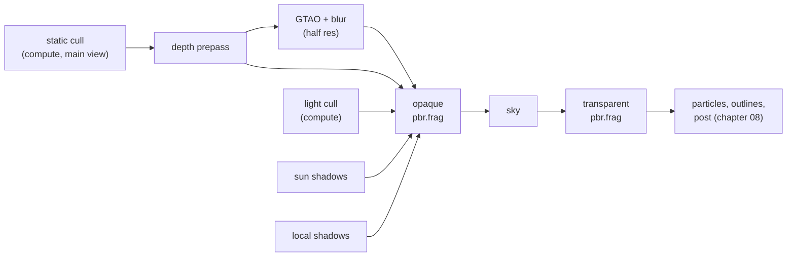
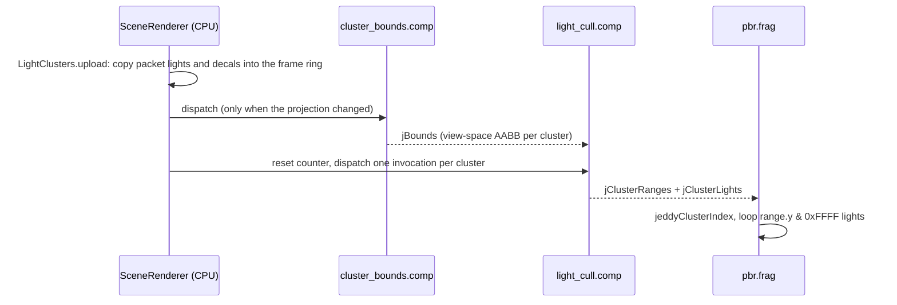

# 07. Lighting: PBR, clustered lights and shadows

This chapter explains how Jeddy decides the color of a lit pixel. You will learn the physics
vocabulary of light (radiance, irradiance), the metallic-roughness material model, the
Cook–Torrance microfacet BRDF term by term, how point, spot and sun lights plug into it, how
image-based lighting (IBL) approximates light from the whole sky with a cube map, a 2D lookup
table and nine numbers per color channel, how thousands of lights are made cheap by clustering,
and how shadows and ambient occlusion are computed. Every formula is followed by the GLSL or
Java that implements it.

Where it lives:

| Topic | Code |
|---|---|
| The lit shader | [`pbr/pbr.vert`](../../modules/render/src/main/resources/dev/jeddy/render/shaders/pbr/pbr.vert), [`pbr/pbr.frag`](../../modules/render/src/main/resources/dev/jeddy/render/shaders/pbr/pbr.frag) |
| BRDF terms | [`engine/brdf.glsl`](../../modules/render/src/main/resources/dev/jeddy/render/shaders/engine/brdf.glsl) |
| Lights and clusters | [`engine/lights.glsl`](../../modules/render/src/main/resources/dev/jeddy/render/shaders/engine/lights.glsl), [`pbr/cluster_bounds.comp`](../../modules/render/src/main/resources/dev/jeddy/render/shaders/pbr/cluster_bounds.comp), [`pbr/light_cull.comp`](../../modules/render/src/main/resources/dev/jeddy/render/shaders/pbr/light_cull.comp), [`light/LightClusters.java`](../../modules/render/src/main/java/dev/jeddy/render/light/LightClusters.java) |
| IBL | [`engine/environment.glsl`](../../modules/render/src/main/resources/dev/jeddy/render/shaders/engine/environment.glsl), [`pbr/brdf_lut.comp`](../../modules/render/src/main/resources/dev/jeddy/render/shaders/pbr/brdf_lut.comp), [`light/Environment.java`](../../modules/render/src/main/java/dev/jeddy/render/light/Environment.java), [`EnvironmentBaker.java`](../../tools/cooker/src/main/java/dev/jeddy/cooker/env/EnvironmentBaker.java) |
| Shadows | [`shadow/SunShadows.java`](../../modules/render/src/main/java/dev/jeddy/render/shadow/SunShadows.java), [`shadow/LocalShadows.java`](../../modules/render/src/main/java/dev/jeddy/render/shadow/LocalShadows.java), [`engine/sun_shadows.glsl`](../../modules/render/src/main/resources/dev/jeddy/render/shaders/engine/sun_shadows.glsl), [`engine/local_shadows.glsl`](../../modules/render/src/main/resources/dev/jeddy/render/shaders/engine/local_shadows.glsl) |
| Ambient occlusion | [`post/Gtao.java`](../../modules/render/src/main/java/dev/jeddy/render/post/Gtao.java), [`post/gtao.frag`](../../modules/render/src/main/resources/dev/jeddy/render/shaders/post/gtao.frag), [`post/gtao_blur.frag`](../../modules/render/src/main/resources/dev/jeddy/render/shaders/post/gtao_blur.frag) |
| Wiring | [`SceneRenderer.java`](../../modules/render/src/main/java/dev/jeddy/render/SceneRenderer.java), [`material/MaterialSystem.java`](../../modules/render/src/main/java/dev/jeddy/render/material/MaterialSystem.java) |

The design is summarized in DESIGN §9.3 ([../DESIGN.md](../DESIGN.md)). This chapter assumes the
frame graph, draw building and material slots from [06 Renderer architecture](06-renderer-architecture.md),
and the reversed-Z projections from [04 Cameras and projection](04-cameras-and-projection.md).
All shader paths below are relative to
`modules/render/src/main/resources/dev/jeddy/render/shaders/`.

## The lit frame at a glance

`SceneRenderer` declares its passes once, in this order. This chapter covers everything up to
the transparent pass; chapter [08](08-effects-and-post.md) covers what follows.



The opaque pass is where the lighting happens. It binds everything the lit shader reads
(`SceneRenderer.bindLighting`): frame constants, AO, decals, fog of war, the environment, the
light clusters and both shadow maps. The bindings it uses are:

| Kind | Binding | Content | Owner |
|---|---|---|---|
| UBO | 0 | frame constants (`engine/frame.glsl`, 544 B) | `SceneRenderer.FRAME_BINDING` |
| UBO | 1 | sun cascades | `SunShadows.BINDING` |
| UBO | 2 | SH9 irradiance | `Environment.SH_BINDING` |
| SSBO | 2, 3, 4, 6 | lights, cluster ranges, cluster items, decals | `LightClusters.*_BINDING` (`bind`) |
| SSBO | 8 | local shadow views | `LocalShadows.BINDING` |
| Texture | 5, 6 | prefiltered environment cube, BRDF LUT | `Environment.CUBE_UNIT`, `LUT_UNIT` |
| Texture | 7, 8 | sun cascade array, local shadow atlas | `SunShadows.UNIT`, `LocalShadows.UNIT` |
| Texture | 9 | ambient occlusion | `Gtao.UNIT` |
| Texture | 10, 12 | decal textures, fog-of-war grid (chapter 08) | `DecalTextures.UNIT`, `FogOfWar.UNIT` |

The cluster bounds (SSBO 7, `BOUNDS_BINDING`) are read only by the culling compute pass, so the lit
pass does not bind them. The instance records and material rows (SSBO 0 and 1) are bound by
`DrawBuilder.submit`, and the material textures (units 0–4) per draw batch by `MaterialSystem`'s
binder (chapter 06).

### The structure of pbr.frag

Read [`pbr/pbr.frag`](../../modules/render/src/main/resources/dev/jeddy/render/shaders/pbr/pbr.frag)
once from top to bottom before the details. Its `main` does this, in order:

1. Takes the screen-space derivatives of the world position (`dFdx`, `dFdy`) while control flow
   is still uniform; decals need them later.
2. Camera fade: discards dithered pixels of faded surfaces (chapter 08).
3. Computes the view depth and finds the pixel's cluster (`jeddyClusterIndex`), which gives the
   range of lights and decals to visit.
4. Reads the material row and its textures: base color, alpha mask, ORM (occlusion, roughness,
   metallic), separate occlusion.
5. Applies decals, which tint the base color and make the surface matte (chapter 08).
6. Clamps roughness to `[0.045, 1]` and metallic to `[0, 1]`.
7. Builds the shading normal: interpolated normal, flipped for back faces of double-sided
   materials, perturbed by the normal map through the tangent frame.
8. Fills a `JeddySurface`: view vector, `N·V`, diffuse color, `F0`, `α`, energy compensation.
9. Adds the sun (with its cascaded shadow).
10. Loops over the cluster's point and spot lights (with their atlas shadows).
11. Adds image-based lighting, weakened by ambient occlusion.
12. Adds emission, applies fog of war, writes `vec4(color, base.a)`.

Everything below explains one of these steps.

## Radiometry in one page

Light is energy. To talk about it precisely you need four quantities.

- **Radiant flux** $\Phi$ (watts): total energy per second, for example everything a bulb emits.
- **Solid angle** $\omega$ (steradians, sr): the 3D version of an angle. A direction cone that
  covers area $A$ on a sphere of radius $r$ has solid angle $A / r^2$. The whole sphere is
  $4\pi$ sr, a hemisphere $2\pi$ sr.
- **Irradiance** $E$ (W/m²): flux arriving per unit area of a surface. It answers "how much
  light falls on this spot".
- **Radiance** $L$ (W/(m²·sr)): flux per unit area per unit solid angle, measured perpendicular
  to the direction of travel. It answers "how bright does this point look from that
  direction". Radiance is what a camera pixel measures, so it is what the shader outputs.

The photometric versions weight by the eye's sensitivity: lumens instead of watts, lux
(lm/m²) for irradiance, candela (lm/sr) for a point light's intensity, nits (cd/m²) for
radiance. Jeddy follows glTF's `KHR_lights_punctual`: a point or spot light's intensity is in
candela (`RenderPacket.addPointLight` documents `intensity` as "luminous intensity in
candela"), and the sun color is "color times illuminance". The math is the same in either
unit system.

**The cosine law.** A beam of irradiance $E_\perp$ (measured perpendicular to the beam) that
hits a surface at angle $\theta$ from the normal spreads over a larger area, $1/\cos\theta$
times larger. So the surface receives $`E = E_\perp \cos\theta = E_\perp\,(\mathbf n\cdot\mathbf l)`$,
where $\mathbf n$ is the unit surface normal and $\mathbf l$ the unit vector towards the light.
This is why "N dot L" appears in every lighting formula.

**The rendering equation.** The radiance leaving a point towards the viewer is what it emits
plus everything it reflects:

```math
L_o(\mathbf v) = L_e(\mathbf v) + \int_{\Omega} f(\mathbf l, \mathbf v)\, L_i(\mathbf l)\, (\mathbf n\cdot\mathbf l)\, d\omega_l
```

- $\mathbf v$: unit vector from the point towards the eye.
- $\Omega$: the hemisphere of directions above the surface.
- $L_i(\mathbf l)$: radiance arriving from direction $\mathbf l$.
- $f(\mathbf l, \mathbf v)$: the **BRDF** (bidirectional reflectance distribution function,
  unit 1/sr): what fraction of light arriving from $\mathbf l$ leaves towards $\mathbf v$.
- $`(\mathbf n\cdot\mathbf l)\,d\omega_l`$: the cosine law applied to a small cone of directions.

Real-time rendering splits the integral by light source type. For a **punctual light** (point,
spot, sun) all incoming light comes from one direction, so the integral collapses to one term:

```math
L_o(\mathbf v) = f(\mathbf l, \mathbf v)\; E_\perp\; (\mathbf n\cdot\mathbf l)
```

For a point light of intensity $I$ (candela) at distance $d$, $E_\perp = I / d^2$ (inverse
square law: the same light spreads over a sphere of area $4\pi d^2$). Example: a torch of
12 cd at 2 m gives $E_\perp = 12/4 = 3$ lux; at 4 m only 0.75 lux.

For light from the whole environment (sky, walls), the integral stays and IBL approximates it.

## The material model: metallic-roughness

Jeddy uses glTF's metallic-roughness model. A material has:

- **Base color** (linear RGB, plus alpha). For a dielectric (plastic, stone, wood, skin) it is
  the diffuse albedo: the fraction of light that enters the surface, scatters and comes back
  out. For a metal it is the specular reflectance color (gold reflects more red than blue).
- **Metallic** in $[0,1]$: 0 for dielectrics, 1 for metals. In-between values are for texture
  filtering and transitions such as rust.
- **Roughness** in $[0,1]$: perceptual roughness. 0 is a mirror, 1 is fully rough. The shader
  squares it, $\alpha = \text{roughness}^2$, because $\alpha$ is what the BRDF formulas use
  and squaring makes the slider feel linear to artists.

From these the shader derives two colors:

```math
c_{\text{diff}} = \text{baseColor}\,(1 - \text{metallic}), \qquad
F_0 = \operatorname{mix}(0.04,\ \text{baseColor},\ \text{metallic})
```

$F_0$ is the specular reflectance at normal incidence (light hitting head-on). For
dielectrics it comes from the index of refraction $\eta$:
$F_0 = \left(\frac{\eta - 1}{\eta + 1}\right)^2$. With $\eta = 1.5$ (glass, most plastics),
$F_0 = (0.5/2.5)^2 = 0.04$, which is why 4% is the dielectric default. Metals absorb all
refracted light, so they have no diffuse term and a colored $F_0$.

Here is the code, from `pbr.frag`:

```glsl
    float metallic = m.pbr.x;
    float roughness = m.pbr.y;
    float occlusion = 1.0;
#ifdef ORM_MAP
    vec3 orm = texture(jOrmMap, vec3(jeddySlotUv(m, 2u, vUv), float(m.layers.z))).rgb;
    occlusion = mix(1.0, orm.r, m.pbr.w);
    roughness *= orm.g;
    metallic *= orm.b;
#endif
// ...
    roughness = clamp(roughness, 0.045, 1.0);
    metallic = clamp(metallic, 0.0, 1.0);
// ...
    s.diffuse = base.rgb * (1.0 - metallic);
    s.f0 = mix(vec3(0.04), base.rgb, metallic);
    s.roughness = roughness;
    s.alpha = roughness * roughness;
```

The ORM texture packs ambient Occlusion, Roughness and Metallic into the R, G and B channels,
as glTF does. The minimum roughness of 0.045 keeps $\alpha^2$ (about $4\times10^{-6}$) far
enough from zero that the GGX highlight of a perfect mirror does not become an infinitely thin
spike that float precision cannot represent.

The material row is 32 floats (D41). `engine/material.glsl` declares it:

| Floats | Field | Content |
|---|---|---|
| 0–3 | `baseColor` | linear RGBA factor |
| 4–7 | `emissive` | RGB factor, strength |
| 8–11 | `pbr` | metallic, roughness, normal scale, occlusion strength |
| 12–15 | `uvScaleOffset` | `KHR_texture_transform` scale and offset |
| 16–19 | `misc` | UV rotation, alpha cutoff |
| 20–23 | `layers` | array layers of base color, normal, ORM, emissive |
| 24–27 | `layers2` | occlusion layer, UV1 bit per slot, material flags |
| 28–31 | `reserved` | |

## The Cook–Torrance BRDF

### Microfacets

A rough surface looks smooth from a distance, but up close it is a field of tiny mirrors
(microfacets) pointing in slightly different directions. A microfacet reflects light from
$\mathbf l$ towards $\mathbf v$ only if its normal is exactly the **half vector**

```math
\mathbf h = \frac{\mathbf l + \mathbf v}{\lVert \mathbf l + \mathbf v \rVert}
```

So the specular BRDF is "how many microfacets point along $\mathbf h$" times "how many of
those are neither hidden from the light nor from the eye" times "how much each mirror
reflects". That is the Cook–Torrance form:

```math
f_{\text{spec}}(\mathbf l, \mathbf v) = \frac{D(\mathbf h)\; G(\mathbf l, \mathbf v)\; F(\mathbf v, \mathbf h)}{4\,(\mathbf n\cdot\mathbf l)\,(\mathbf n\cdot\mathbf v)}
```

- $D$: the **normal distribution function**, the density of microfacet normals around $\mathbf h$.
- $G$: the **geometry** (masking-shadowing) term, in $[0,1]$.
- $F$: the **Fresnel** reflectance of one microfacet.
- The denominator converts from microfacet area to the macroscopic surface and solid angle.

Jeddy folds $G$ and the denominator into a **visibility** term $`V = G / (4\,(\mathbf n\cdot\mathbf l)(\mathbf n\cdot\mathbf v))`$,
so $`f_{\text{spec}} = D\,V\,F`$. Computing $V$ directly avoids dividing by $\mathbf n\cdot\mathbf l$,
which is zero at grazing angles.

### D: GGX (Trowbridge–Reitz)

```math
D_{\text{GGX}}(\mathbf h) = \frac{\alpha^2}{\pi\left((\mathbf n\cdot\mathbf h)^2(\alpha^2 - 1) + 1\right)^2}
```

- $\alpha$: roughness squared.
- $\mathbf n\cdot\mathbf h$: cosine between the surface normal and the half vector.

When $\mathbf h = \mathbf n$ the denominator is $\pi\alpha^4$, so $D = 1/(\pi\alpha^2)$: the
smoother the surface, the taller and narrower the peak. GGX's long tail (it decays slowly away
from the peak) gives highlights a soft glow around a sharp core, which matches measured
materials better than older Blinn-Phong or Beckmann lobes. Numeric example with roughness 0.5
($\alpha = 0.25$, $\alpha^2 = 0.0625$):

| $\mathbf n\cdot\mathbf h$ | 1.0 | 0.95 | 0.9 |
|---|---|---|---|
| $D$ | 5.09 | 0.84 | 0.34 |

From `engine/brdf.glsl`:

```glsl
float jeddyD_GGX(float NoH, float alpha) {
    float a2 = alpha * alpha;
    float f = (NoH * a2 - NoH) * NoH + 1.0;
    return a2 / (3.14159265358979 * f * f);
}
```

`(NoH * a2 - NoH) * NoH + 1.0` is $(\mathbf n\cdot\mathbf h)^2(\alpha^2-1)+1$ rearranged into two
multiply-adds.

### G and V: height-correlated Smith

Microfacets can hide each other: from a grazing view some are masked (not visible), and from a
grazing light some are shadowed (not lit). Smith's model expresses this with a function
$\Lambda$ per direction; for GGX,

```math
\Lambda(\mathbf w) = \frac{-1 + \sqrt{1 + \alpha^2 \tan^2\theta_w}}{2}
```

where $\theta_w$ is the angle between $\mathbf w$ and $\mathbf n$. The *height-correlated*
form (Heitz 2014) accounts for the fact that a microfacet high on the surface is likely both
visible and lit:

```math
G_2(\mathbf l,\mathbf v) = \frac{1}{1 + \Lambda(\mathbf v) + \Lambda(\mathbf l)}
```

Substituting $\tan^2\theta = (1-\cos^2\theta)/\cos^2\theta$ and dividing by
$4(\mathbf n\cdot\mathbf l)(\mathbf n\cdot\mathbf v)$ gives a form with no tangent and no
division by the cosines:

```math
V = \frac{0.5}{(\mathbf n\cdot\mathbf l)\sqrt{(\mathbf n\cdot\mathbf v)^2(1-\alpha^2)+\alpha^2} \;+\; (\mathbf n\cdot\mathbf v)\sqrt{(\mathbf n\cdot\mathbf l)^2(1-\alpha^2)+\alpha^2}}
```

(Derivation sketch: with $c = \mathbf n\cdot\mathbf w$, $`\sqrt{1+\alpha^2\tan^2\theta} = \sqrt{c^2(1-\alpha^2)+\alpha^2}\,/\,c`$;
call the square root $A_w$. Then $`1+\Lambda(\mathbf v)+\Lambda(\mathbf l) = \tfrac12(A_v/c_v + A_l/c_l)`$, so
$`G_2 = 2c_vc_l/(A_vc_l + A_lc_v)`$, and dividing by $`4c_lc_v`$ gives the formula.)

Numeric example, roughness 0.5, $\mathbf n\cdot\mathbf v = 0.8$, $\mathbf n\cdot\mathbf l = 0.6$:
$V = 0.503$. Without any masking $V$ would be $1/(4\cdot0.6\cdot0.8) = 0.521$, so $G_2 \approx 0.965$:
at moderate angles and roughness little light is lost.

```glsl
float jeddyV_SmithGGXCorrelated(float NoV, float NoL, float alpha) {
    float a2 = alpha * alpha;
    float ggxL = NoV * sqrt((NoL - a2 * NoL) * NoL + a2);
    float ggxV = NoL * sqrt((NoV - a2 * NoV) * NoV + a2);
    return 0.5 / max(ggxV + ggxL, 1e-5);
}
```

### F: Fresnel–Schlick

Every surface becomes a mirror at grazing angles: look along a lake and it reflects the sky,
look straight down and you see the bottom. Schlick's approximation of the Fresnel equations:

```math
F(\mathbf v,\mathbf h) = F_0 + (1 - F_0)(1 - \mathbf v\cdot\mathbf h)^5
```

For $F_0 = 0.04$: $F = 0.04$ head-on, $0.07$ at $\mathbf v\cdot\mathbf h = 0.5$, $0.61$ at $0.1$.

```glsl
vec3 jeddyF_Schlick(float VoH, vec3 f0) {
    float f = pow(1.0 - VoH, 5.0);
    return f + f0 * (1.0 - f);
}
```

`f + f0 * (1 - f)` equals $`F_0 + (1-F_0)f`$. The caller passes `LoH`; since $\mathbf h$ bisects
$\mathbf l$ and $\mathbf v$, $\mathbf l\cdot\mathbf h = \mathbf v\cdot\mathbf h$.

### Diffuse: Lambert

Light that enters a dielectric scatters many times and leaves in all directions equally. The
**Lambertian** BRDF is a constant:

```math
f_{\text{diff}} = \frac{c_{\text{diff}}}{\pi}
```

Why $\pi$: under uniform incoming radiance $L$, the reflected radiance is
$`\int_\Omega \frac{c}{\pi} L \cos\theta\,d\omega = \frac{c}{\pi}L\cdot\pi = cL`$, because the
cosine-weighted hemisphere integrates to $\pi$. A white Lambertian surface reflects exactly what
it receives, no more.

### Putting it together: jeddyShade

```glsl
// Radiance reflected towards the viewer from light arriving along l with irradiance-scaled
// color (radiance * NoL is applied here).
vec3 jeddyShade(JeddySurface s, vec3 l, vec3 lightColor) {
    vec3 h = normalize(s.view + l);
    float NoL = clamp(dot(s.normal, l), 0.0, 1.0);
    if (NoL <= 0.0) {
        return vec3(0.0);
    }
    float NoH = clamp(dot(s.normal, h), 0.0, 1.0);
    float LoH = clamp(dot(l, h), 0.0, 1.0);
    float D = jeddyD_GGX(NoH, s.alpha);
    float V = jeddyV_SmithGGXCorrelated(s.NoV, NoL, s.alpha);
    vec3 F = jeddyF_Schlick(LoH, s.f0);
    vec3 specular = D * V * F * s.energy;
    vec3 diffuse = s.diffuse / 3.14159265358979;
    return (diffuse + specular) * lightColor * NoL;
}
```

This is exactly $`L_o = (f_{\text{diff}} + f_{\text{spec}})\,E_\perp\,(\mathbf n\cdot\mathbf l)`$ with
`lightColor` $= E_\perp$. Note two simplifications common in real-time engines: the diffuse term
is not reduced by the light that the specular layer already reflected, and Lambert ignores
roughness. Both are small errors for typical materials.

`JeddySurface` (in `brdf.glsl`) carries everything that does not depend on the light, so the
light loop recomputes only $\mathbf h$ and the dot products.

### Energy compensation for multiple scattering

The single-scattering microfacet model treats a ray that bounces off one microfacet into
another as lost. On rough surfaces that loses a lot of energy: a rough gold ball looks darker
than it should. Define the **directional albedo** of the specular lobe with $F = 1$:

```math
E_{ss}(\mathbf n\cdot\mathbf v, r) = \int_\Omega D\,V\,(\mathbf n\cdot\mathbf l)\,d\omega_l
```

A perfect, lossless mirror-like lobe would give 1; GGX gives less for rough surfaces at grazing
angles (the cooker test `EnvironmentTest.brdfLutIsBoundedAndMatchesKnownValues` checks that
rough grazing values fall below 0.75). The missing $1 - E_{ss}$ is the energy that bounced
again. The approximation Jeddy uses (popularized by Filament, after Turquin) scales the
specular lobe:

```math
f_{\text{spec}}' = f_{\text{spec}} \left(1 + F_0\left(\frac{1}{E_{ss}} - 1\right)\right)
```

For a white metal ($F_0 = 1$) the factor is $1/E_{ss}$, restoring exactly the lost energy; for
dielectrics ($F_0 = 0.04$) it barely matters, because the extra bounces mostly enter the
surface. Example: $E_{ss} = 0.75$, $F_0 = 1$ gives a factor of $1.33$.

$E_{ss}$ is free: it is the sum of the two channels of the split-sum BRDF LUT (see IBL below).

```glsl
    vec2 dfg = jeddyDfg(s.NoV, roughness);
    s.energy = 1.0 + s.f0 * (1.0 / max(dfg.x + dfg.y, 1e-4) - 1.0);
```

**Try it.** The white furnace test is the classic check of energy conservation: a white sphere
inside a uniformly white environment should be invisible, every pixel equal to the background.
`SceneRendererTest.whiteFurnaceReflectsTheEnvironment` renders four white spheres (metallic 0
and 1, roughness 0.2 and 0.8) inside `environment().setUniform(1, 1, 1)` and asserts each
channel is $1 \pm 0.12$:

```bash
./gradlew :render:test -Pjeddy.gpuTests=true --tests 'dev.jeddy.render.pbr.SceneRendererTest'
```

Without the energy term the rough metal sphere would come out visibly darker.

## Punctual lights

### The light record

Lights travel in the render packet already in their GPU layout, 16 floats each, and
`LightClusters.upload` copies the whole array into the frame ring with one
`MemorySegment.copy` (D44). `engine/lights.glsl` reads it:

```glsl
struct JeddyLight {
    vec4 positionRange;  // xyz world position, w range in meters (0 = unlimited)
    vec4 colorType;      // rgb linear color times intensity (candela), w type
    vec4 directionOuter; // xyz unit direction the spot points, w cos(outer angle)
    vec4 params;         // x cos(inner angle), y shadow index (< 0: none), z CPU-side shadow key, w unused
};
```

| Float | Written by | Content |
|---|---|---|
| 0–3 | `addPointLight` | position, range |
| 4–6 | `addPointLight` | color × intensity |
| 7 | `addPointLight` / `addSpotLight` | type as int bits (`LIGHT_POINT` 0, `LIGHT_SPOT` 1) |
| 8–11 | `addSpotLight` | spot direction, cos(outer) (point: `0, -1, 0, -1`) |
| 12 | `addSpotLight` | cos(inner) (point: 1) |
| 13 | renderer | shadow index as int bits; the packet stores -1, `LocalShadows.update` patches the frame's copy |
| 14 | `setLightShadow` | shadow key as int bits (an entity id), read only on the CPU |
| 15 | | 0 |

Shaders never read `params.z`: float 14 is only read on the CPU, by `LocalShadows`. Type and indices are stored as raw int bits in float slots
(`Float.intBitsToFloat` in Java, `floatBitsToUint` / `floatBitsToInt` in GLSL), a common
trick to keep one homogeneous `float[]`.

### Point lights: inverse square and a range window

Pure inverse square, $1/d^2$, never reaches zero, so every light would touch every cluster. Jeddy
multiplies it by a window that reaches exactly zero at the light's `range` $r$ (Karis 2013):

```math
\text{att}(d) = \frac{\operatorname{saturate}\left(1 - (d/r)^4\right)^2}{\max(d^2,\ 10^{-4})}
```

The fourth power keeps the window close to 1 for most of the range, so the light keeps its
physical falloff near the source and only fades at the edge. With $r = 4$ m:

| $d$ (m) | 0.5 | 1 | 2 | 3 | 3.5 | 4 |
|---|---|---|---|---|---|---|
| $1/d^2$ | 4.0 | 1.0 | 0.25 | 0.111 | 0.082 | 0.0625 |
| window | 1.000 | 0.992 | 0.879 | 0.467 | 0.171 | 0 |
| att | 4.0 | 0.99 | 0.22 | 0.052 | 0.014 | 0 |

```glsl
// Smooth inverse-square falloff that reaches 0 at the light's range (Karis 2013).
float jeddyDistanceAttenuation(float d2, float range) {
    float falloff = 1.0 / max(d2, 1e-4);
    if (range > 0.0) {
        float r = d2 / (range * range);
        float window = clamp(1.0 - r * r, 0.0, 1.0);
        falloff *= window * window;
    }
    return falloff;
}
```

Note `r` here is $(d/r)^2$, so `r * r` is $(d/r)^4$, and the function works with squared
distances throughout, avoiding a square root. The `max(d2, 1e-4)` clamps the singularity at
the light's position.

### Spot lights

A spot light is a point light masked by a cone. With $\theta_s$ the angle between the spot's
axis and the direction from the light to the point, inner angle $\theta_i$ and outer angle
$\theta_o$:

```math
t = \operatorname{saturate}\left(\frac{\cos\theta_s - \cos\theta_o}{\cos\theta_i - \cos\theta_o}\right), \qquad \text{att}_{\text{spot}} = t^2
```

Working with cosines avoids `acos` per pixel; `addSpotLight` stores `cos(outer)` and
`cos(min(inner, outer - 1e-3))` so the denominator never vanishes.

```glsl
float jeddySpotAttenuation(JeddyLight light, vec3 l) {
    float cosOuter = light.directionOuter.w;
    float cosInner = light.params.x;
    float cd = dot(-l, light.directionOuter.xyz);
    float t = clamp((cd - cosOuter) / max(cosInner - cosOuter, 1e-4), 0.0, 1.0);
    return t * t;
}
```

`-l` points from the light to the surface, so `cd` is $\cos\theta_s$.

### The sun

The sun is so far away that its rays are parallel and its irradiance does not fall off: a
**directional light**. The packet stores `sunDirection` (the direction sunlight travels) and
`sunColor` (color times illuminance; all zero turns the sun off). `writeFrameConstants`
normalizes the direction into `jSunDirection` and sets `jSunColor.w` to 1 when the sun is on.

The two loops in `pbr.frag`:

```glsl
    // Sun.
    if (jSunColor.w > 0.0) {
        vec3 l = -jSunDirection.xyz;
        float shadow = jeddySunShadow(vWorld, vNormal, l, viewDepth);
        color += jeddyShade(s, l, jSunColor.rgb) * shadow;
    }

    // Clustered point and spot lights.
    uint lightCount = range.y & 0xFFFFu;
    for (uint i = 0u; i < lightCount; i++) {
        JeddyLight light = jLights[jClusterLights[range.x + i]];
        vec3 toLight = light.positionRange.xyz - vWorld;
        float d2 = dot(toLight, toLight);
        vec3 l = toLight * inversesqrt(max(d2, 1e-8));
        float attenuation = jeddyDistanceAttenuation(d2, light.positionRange.w);
        if (floatBitsToUint(light.colorType.w) == J_LIGHT_SPOT) {
            attenuation *= jeddySpotAttenuation(light, l);
        }
        if (attenuation <= 0.0) {
            continue;
        }
        attenuation *= jeddyLocalShadow(light, vWorld, vNormal, l);
        color += jeddyShade(s, l, light.colorType.rgb * attenuation);
    }
```

The default `sunColor` is `{3f, 2.9f, 2.7f}`, which is not a physical lux value (direct sun is
on the order of 100,000 lux). That is fine: automatic exposure (chapter 08) maps whatever
absolute level the scene has to a displayable range, so only the ratios between lights matter.

**Try it.** `SceneRendererTest.sunLightsTheFacingSide` lights a sphere from −X (the sun travels
along +X) in a black environment and checks that the lit side is above 0.5 and the far side
below 0.02. `clusteredPointLightsShadeOnlyWhereTheyReach` puts a red point light with range
1.2 m to the left of a sphere and checks that the right side gets nothing.

## Image-based lighting

Punctual lights model only the strongest, most direct light. The rest arrives from everywhere:
the sky, the ground, the walls. IBL stores the incoming radiance of the surroundings in a cube
map and integrates the rendering equation against it. Doing that integral per pixel would need
hundreds of texture reads, so Jeddy precomputes three things: an irradiance function for
diffuse light, a prefiltered cube for specular light, and a BRDF lookup table.

### Diffuse: irradiance with spherical harmonics

For a Lambertian surface the BRDF is constant, so the diffuse part of the integral depends only
on the normal:

```math
L_{\text{diff}}(\mathbf n) = \frac{c_{\text{diff}}}{\pi}\, E(\mathbf n), \qquad
E(\mathbf n) = \int_{\Omega(\mathbf n)} L(\boldsymbol\omega)\,(\mathbf n\cdot\boldsymbol\omega)\,d\omega
```

$E(\mathbf n)$ is a convolution of the environment with a clamped cosine lobe, which blurs it
enormously: irradiance changes slowly with the normal. A very smooth function on the sphere
can be stored with a few **spherical harmonics** (SH), the sphere's equivalent of Fourier
frequencies. Bands 0, 1 and 2 have 1, 3 and 5 basis functions, nine in total. Ramamoorthi and
Hanrahan showed that the cosine convolution simply scales each band:

```math
E(\mathbf n) = \sum_{l=0}^{2}\sum_{m=-l}^{l} \hat A_l\, L_{lm}\, Y_{lm}(\mathbf n), \qquad
\hat A_0 = \pi,\ \hat A_1 = \tfrac{2\pi}{3},\ \hat A_2 = \tfrac{\pi}{4}
```

- $Y_{lm}$: the real SH basis functions (polynomials in $x, y, z$ of the unit normal).
- $`L_{lm} = \int L(\boldsymbol\omega)\, Y_{lm}(\boldsymbol\omega)\, d\omega`$: the projection of
  the environment onto basis $Y_{lm}$.

The cooker computes $L_{lm}$ by summing over every cube texel, weighted by the texel's solid
angle. A texel at face coordinates $(s, t) \in [-1,1]^2$ of an $N\times N$ face covers area
$(2/N)^2$ on a cube of half-size 1, at distance $\sqrt{1+s^2+t^2}$ and tilted, so its solid
angle is

```math
d\Omega = \frac{4/N^2}{(1 + s^2 + t^2)^{3/2}}
```

From [`EnvironmentBaker.irradianceSh9`](../../tools/cooker/src/main/java/dev/jeddy/cooker/env/EnvironmentBaker.java):

```java
                    direction(f, px, py, n, d);
                    double s = 2.0 * (px + 0.5) / n - 1;
                    double t = 2.0 * (py + 0.5) / n - 1;
                    double solidAngle = (4.0 / (n * n)) / Math.pow(1 + s * s + t * t, 1.5);
                    basis(d[0], d[1], d[2], y);
                    int o = (py * n + px) * 3;
                    for (int i = 0; i < 9; i++) {
                        double w = y[i] * solidAngle;
                        sh[i * 3] += face[o] * w;
                        sh[i * 3 + 1] += face[o + 1] * w;
                        sh[i * 3 + 2] += face[o + 2] * w;
                    }
// ...
        double[] band = {
            Math.PI,
            2 * Math.PI / 3,
            2 * Math.PI / 3,
            2 * Math.PI / 3,
            Math.PI / 4,
            Math.PI / 4,
            Math.PI / 4,
            Math.PI / 4,
            Math.PI / 4
        };
```

The 27 floats (9 coefficients × RGB, already multiplied by $\hat A_l$) travel in the cube's
KTX2 key/value data under `jeddy.sh9` (D39), `TextureLoader` reads them into `GpuTexture.sh9`,
and `Environment.set` writes them into the uniform block at binding 2 (`SH_BINDING`), one
`vec4` per coefficient for std140 alignment. The shader evaluates the sum:

```glsl
vec3 jeddyIrradiance(vec3 n) {
    vec3 e = jSh[0].rgb * 0.282095
        + jSh[1].rgb * (0.488603 * n.y)
        + jSh[2].rgb * (0.488603 * n.z)
        + jSh[3].rgb * (0.488603 * n.x)
        + jSh[4].rgb * (1.092548 * n.x * n.y)
        + jSh[5].rgb * (1.092548 * n.y * n.z)
        + jSh[6].rgb * (0.315392 * (3.0 * n.z * n.z - 1.0))
        + jSh[7].rgb * (1.092548 * n.x * n.z)
        + jSh[8].rgb * (0.546274 * (n.x * n.x - n.y * n.y));
    return max(e, vec3(0.0));
}
```

and `pbr.frag` turns it into diffuse radiance with `jeddyIrradiance(n) * s.diffuse / J_PI`.

**Sanity check.** For a uniform environment of radiance $L$, $E = \pi L$ in every direction.
Only band 0 is non-zero: $`L_{00} = L\cdot Y_{00}\cdot 4\pi`$ and
$`E = \pi L_{00} Y_{00} = 4\pi^2 L Y_{00}^2 = \pi L`$, since $Y_{00}^2 = 1/(4\pi)$.
`Environment.setUniform` uses that shortcut directly (`coefficients[0] = r * scale` with
`scale = (float) Math.PI / Y00`), and the cooker test
`uniformLightGivesPiIrradianceAndAFlatPrefilter` checks $E = \pi\cdot 0.5$ for a cube filled
with 0.5.

### Specular: the split-sum approximation

The specular integral depends on $\mathbf v$, $\mathbf n$ and roughness, too many dimensions to
precompute. Karis's **split sum** (Real Shading in Unreal Engine 4) separates it into two
factors that can each be tabulated:

```math
\int_\Omega L(\mathbf l)\, f_{\text{spec}}(\mathbf l,\mathbf v)\,(\mathbf n\cdot\mathbf l)\,d\omega_l
\;\approx\;
\underbrace{\frac{\int_\Omega L(\mathbf l)\,D(\mathbf h)\,(\mathbf n\cdot\mathbf l)\,d\omega_l}{\int_\Omega D(\mathbf h)\,(\mathbf n\cdot\mathbf l)\,d\omega_l}}_{\text{prefiltered environment}}
\;\cdot\;
\underbrace{\int_\Omega f_{\text{spec}}(\mathbf l,\mathbf v)\,(\mathbf n\cdot\mathbf l)\,d\omega_l}_{\text{environment BRDF}}
```

The first factor is the environment blurred by the GGX lobe. To make it depend on one
direction only, it is computed assuming $\mathbf n = \mathbf v = \mathbf r$ (the reflection
vector), and stored in a cube map whose mip $i$ holds the blur for roughness
$i/(\text{levels}-1)$. At run time:

```glsl
vec3 jeddyPrefiltered(vec3 r, float roughness) {
    return textureLod(jEnvironmentMap, r, roughness * max(jEnvironment.z - 1.0, 0.0)).rgb;
}
```

`jEnvironment.z` is the mip count (`Environment.levels()`), so roughness 0 reads mip 0 and
roughness 1 the last mip. Trilinear filtering blends neighboring mips, and
`GL_TEXTURE_CUBE_MAP_SEAMLESS` (enabled in the `Environment` constructor) filters across
cube face edges. The default cooked cube has 256² faces and 7 levels (256 down to 4×4).

The second factor still depends on $F_0$. Substituting Schlick,
$`F = F_0(1 - F_c) + F_c`$ with $F_c = (1-\mathbf v\cdot\mathbf h)^5$, pulls $F_0$ out:

```math
\int f_{\text{spec}}\,(\mathbf n\cdot\mathbf l)\,d\omega = F_0 \underbrace{\int \frac{f_{\text{spec}}}{F}(1-F_c)(\mathbf n\cdot\mathbf l)\,d\omega}_{A(\mathbf n\cdot\mathbf v,\ r)} + \underbrace{\int \frac{f_{\text{spec}}}{F}\,F_c\,(\mathbf n\cdot\mathbf l)\,d\omega}_{B(\mathbf n\cdot\mathbf v,\ r)}
```

$A$ and $B$ depend only on $\mathbf n\cdot\mathbf v$ and roughness: a 2D table, the **BRDF
LUT**. The shader combines everything:

```glsl
    vec3 r = reflect(-s.view, n);
    vec3 specular = jeddyPrefiltered(r, roughness) * (s.f0 * dfg.x + dfg.y) * s.energy;
```

### Computing the BRDF LUT with Monte Carlo

$A$ and $B$ are integrals without closed form, estimated with **importance sampling**: instead
of uniform directions, draw half vectors distributed like $D$, where the integrand is large.
For GGX, a uniform pair $`(\xi_1, \xi_2)`$ maps to

```math
\phi = 2\pi\xi_1, \qquad \cos\theta_h = \sqrt{\frac{1-\xi_2}{1+(\alpha^2-1)\,\xi_2}}
```

and $\mathbf l$ is $\mathbf v$ reflected about $\mathbf h$. The probability density of $\mathbf l$
is $`p(\mathbf l) = D(\mathbf h)(\mathbf n\cdot\mathbf h)/(4\,\mathbf v\cdot\mathbf h)`$. A Monte
Carlo estimate divides each sample by its density; with
$f_{\text{spec}}/F = DG/(4(\mathbf n\cdot\mathbf l)(\mathbf n\cdot\mathbf v))$ the $D$ cancels:

```math
\frac{(f_{\text{spec}}/F)(\mathbf n\cdot\mathbf l)}{p(\mathbf l)} = \frac{G\,(\mathbf v\cdot\mathbf h)}{(\mathbf n\cdot\mathbf h)(\mathbf n\cdot\mathbf v)}
```

That is `gVis` in [`pbr/brdf_lut.comp`](../../modules/render/src/main/resources/dev/jeddy/render/shaders/pbr/brdf_lut.comp):

```glsl
    float NoV = (float(p.x) + 0.5) / float(size.x);
    float roughness = (float(p.y) + 0.5) / float(size.y);
    float alpha = roughness * roughness;
    float a2 = alpha * alpha;
    float k = alpha * 0.5;
    vec3 v = vec3(sqrt(1.0 - NoV * NoV), 0.0, NoV);
    // ...
    for (uint i = 0u; i < n; i++) {
        vec2 xi = hammersley(i, n);
        float phi = 6.28318530718 * xi.x;
        float cosTheta = sqrt((1.0 - xi.y) / (1.0 + (a2 - 1.0) * xi.y));
        float sinTheta = sqrt(1.0 - cosTheta * cosTheta);
        vec3 h = vec3(sinTheta * cos(phi), sinTheta * sin(phi), cosTheta);
        float VoH = dot(v, h);
        vec3 l = 2.0 * VoH * h - v;
        float NoL = max(l.z, 0.0);
        float NoH = max(h.z, 0.0);
        VoH = max(VoH, 0.0);
        if (NoL > 0.0) {
            float gv = NoV / (NoV * (1.0 - k) + k);
            float gl = NoL / (NoL * (1.0 - k) + k);
            float gVis = gv * gl * VoH / max(NoH * NoV, 1e-6);
            float fc = pow(1.0 - VoH, 5.0);
            scale += (1.0 - fc) * gVis;
            bias += fc * gVis;
        }
    }
    imageStore(uLut, p, vec4(scale / float(n), bias / float(n), 0.0, 0.0));
```

The computation happens in tangent space ($\mathbf n = +Z$), with $\mathbf v$ in the XZ plane:
by symmetry only the angle between $\mathbf v$ and $\mathbf n$ matters. The samples come from
the **Hammersley** set, $`(i/N,\ \text{radicalInverse}_2(i))`$, a low-discrepancy sequence that
covers the square more evenly than random numbers; `bitfieldReverse(i) * 2^-32` is the base-2
radical inverse.

`Environment` dispatches this shader once at startup into a 128² `GL_RG16F` texture with 512
samples (D43: the renderer does not depend on the cooker's `engine/brdf_lut.ktx2`, which
remains for tools). `EnvironmentBaker.brdfLut` is the same algorithm in Java.

One inconsistency is worth knowing: the LUT uses the separable Schlick–Smith geometry term
with $k = \alpha/2$ (as in Karis's notes), while direct lights use the height-correlated Smith
$V$. The difference is small, and exercise 6 asks you to remove it.

### Prefiltering the cube in the cooker

[`EnvironmentBaker.prefilter`](../../tools/cooker/src/main/java/dev/jeddy/cooker/env/EnvironmentBaker.java)
computes the first factor of the split sum for every texel direction $\mathbf n$ of every mip,
importance-sampling GGX around $\mathbf n$ and weighting each sample by $\mathbf n\cdot\mathbf l$
(Karis's weighting). With few samples, a small bright light in the environment (the sun disc)
is hit by one sample and missed by the next, which produces sparkling "fireflies". The cure is
**filtered importance sampling** (Colbert and Křivánek): a sample with low density stands for
a large solid angle, so it should read a blurrier mip of the source. With $N$ samples,
$`\Omega_s = 1/(N\,p)`$ is the solid angle a sample represents and
$\Omega_p = 4\pi/(6W^2)$ the solid angle of a source texel ($W$ the face size):

```math
\text{lod} = \tfrac12 \log_2\frac{\Omega_s}{\Omega_p} + 1
```

```java
            // pdf(L) = D(h) (n·h) / (4 (v·h)) = D / 4 when V = N.
            float nh = cosTheta;
            float d = a2 / (float) (Math.PI * Math.pow(nh * nh * (a2 - 1) + 1, 2));
            float pdf = d / 4;
            float sampleSolidAngle = 1f / (xi.length * pdf + 1e-6f);
            float lod =
                    alpha == 0
                            ? 0
                            : Math.max(0, 0.5f * log2(sampleSolidAngle / texelSolidAngle) + 1);
```

The cooked file ([`EnvironmentImporter`](../../tools/cooker/src/main/java/dev/jeddy/cooker/env/EnvironmentImporter.java))
is an RGBA16F cube KTX2 with the prefiltered mips and the `jeddy.sh9` key.

### Specular occlusion and the final IBL sum

```glsl
    // Image-based lighting, with ambient occlusion from the material and screen space.
    float ao = occlusion * jeddyScreenOcclusion(gl_FragCoord.xy);
    vec3 r = reflect(-s.view, n);
    vec3 specular = jeddyPrefiltered(r, roughness) * (s.f0 * dfg.x + dfg.y) * s.energy;
    vec3 diffuse = jeddyIrradiance(n) * s.diffuse / J_PI;
    // Specular occlusion (Lagarde): AO weakens with gloss and grazing views.
    float so = clamp(pow(s.NoV + ao, exp2(-16.0 * roughness - 1.0)) - 1.0 + ao, 0.0, 1.0);
    color += (diffuse * ao * jEnvironment.y + specular * so * jEnvironment.x);
```

AO darkens diffuse light directly. For specular light that would be wrong: a glossy
reflection comes from a narrow cone, which may be unoccluded even in a crevice. The formula
from "Moving Frostbite to PBR" derives a specular occlusion $so$ from $ao$, $\mathbf n\cdot\mathbf v$
and roughness:

```math
so = \operatorname{saturate}\left((\mathbf n\cdot\mathbf v + ao)^{2^{-16r-1}} - 1 + ao\right)
```

For a glossy surface ($r \to 0$) the exponent is $1/2$, for a rough one it tends to 0. `jEnvironment.x`
and `.y` are the packet's `environmentSpecular` and `environmentDiffuse` scales. Note that AO
only affects environment light: direct lights have their own shadows.

Until a cooked environment is set, `Environment` lights the scene with a uniform gray
(`setUniform(0.3f, 0.3f, 0.32f)`); `WorldRenderer` switches to the level's cube once its texture
and SH are loaded.

## Normal mapping with QTangents

A normal map adds detail that the mesh does not have: bumps, cracks, grain. It stores a normal
per texel in **tangent space**, a frame glued to the surface: $\mathbf t$ (tangent, along the
texture's U axis), $\mathbf b$ (bitangent, along V) and $\mathbf n$ (the surface normal). A
texel $(x, y, z)$ means "this much along $\mathbf t$, $\mathbf b$ and $\mathbf n$".

**Decoding the vertex frame.** Jeddy stores the whole tangent frame per vertex as a
**QTangent**: a unit quaternion in four `snorm16` values whose rotation maps $+X$ to the
tangent and $+Z$ to the normal, with the bitangent handedness in the sign of $w$ (D27; chapter
[03](03-rotations-and-transforms.md) explains quaternions and [10](10-assets.md) the mesh
format). From `engine/vertex.glsl`:

```glsl
vec3 jeddyQuatRotate(vec4 q, vec3 v) {
    return v + 2.0 * cross(q.xyz, cross(q.xyz, v) + q.w * v);
}

// Normal, tangent and bitangent sign of the vertex (MeshEncoding is the reference).
void jeddyTangentFrame(out vec3 normal, out vec3 tangent, out float handedness) {
    vec4 q = normalize(jeddyQTangent);
    normal = jeddyQuatRotate(q, vec3(0.0, 0.0, 1.0));
    tangent = jeddyQuatRotate(q, vec3(1.0, 0.0, 0.0));
    handedness = jeddyQTangent.w < 0.0 ? -1.0 : 1.0;
}
```

`jeddyQuatRotate` is the expanded form of $`\mathbf q\,\mathbf v\,\mathbf q^{*}`$:
$`\mathbf v' = \mathbf v + 2w(\mathbf q_{xyz}\times\mathbf v) + 2\,\mathbf q_{xyz}\times(\mathbf q_{xyz}\times\mathbf v)`$.

**Transforming to world space.** `pbr.vert` moves the tangent with the instance's 3×3 linear
part (`jeddyTransformDirection`), but normals need the **inverse transpose**: under a
non-uniform scale such as $(2, 1, 1)$, a surface tilted 45° in XY gets flatter, and a normal
transformed like a direction would no longer be perpendicular to it (chapter
[02](02-math-foundations.md) derives this). `engine/instance.glsl` uses the cofactor matrix, which
equals $`\det(M)\,M^{-T}`$ and needs no division:

```glsl
// Transforms a normal by the inverse transpose (the cofactor matrix up to scale), so non-uniform
// scale keeps normals perpendicular; mirrored transforms keep their outward direction.
vec3 jeddyTransformNormal(JeddyInstance i, vec3 n) {
    mat3 m = jeddyLinear(i);
    mat3 cofactor = mat3(cross(m[1], m[2]), cross(m[2], m[0]), cross(m[0], m[1]));
    float det = dot(m[0], cross(m[1], m[2]));
    return normalize(cofactor * n) * (det < 0.0 ? -1.0 : 1.0);
}
```

A mirrored instance (negative determinant) also flips the bitangent: `pbr.vert` multiplies the
handedness by `mirror`.

**Building the TBN in the fragment shader.** From `pbr.frag`:

```glsl
#ifdef NORMAL_MAP
    vec2 xy = texture(jNormalMap, vec3(jeddySlotUv(m, 1u, vUv), float(m.layers.y))).rg * 2.0 - 1.0;
    xy *= m.pbr.z;
    vec3 tn = vec3(xy, sqrt(clamp(1.0 - dot(xy, xy), 0.0, 1.0)));
    vec3 t = normalize(vTangent.xyz - n * dot(n, vTangent.xyz));
    vec3 b = cross(n, t) * vTangent.w;
    n = normalize(t * tn.x + b * tn.y + n * tn.z);
#endif
```

Line by line:

1. Normal maps are cooked to BC5, which has only two channels. The texture stores $(x, y)$
   remapped from $[-1,1]$ to $[0,1]$; `* 2.0 - 1.0` undoes that. The normal scale from the
   material (`m.pbr.z`) exaggerates or flattens the bumps.
2. A unit vector satisfies $x^2+y^2+z^2 = 1$ and tangent-space normals point outwards
   ($z \ge 0$), so $z = \sqrt{1 - x^2 - y^2}$.
3. Interpolation across a triangle makes $\mathbf t$ and $\mathbf n$ slightly non-perpendicular;
   **Gram–Schmidt** removes the part of $\mathbf t$ along $\mathbf n$:
   $\mathbf t' = \operatorname{normalize}(\mathbf t - \mathbf n(\mathbf n\cdot\mathbf t))$.
4. $\mathbf b = (\mathbf n\times\mathbf t')\cdot w$. The sign $w$ handles mirrored UVs; the
   cooker computes it in glTF's convention, where the bitangent follows −V (D33).
5. The world normal is the matrix $`[\mathbf t'\ \mathbf b\ \mathbf n]`$ times the tangent-space
   vector.

Only the shading normal uses the normal map. Shadows (`vNormal` for normal offset) and decals
(`normalize(vNormal)` for the facing test) use the interpolated geometric normal, which is what
the geometry actually does.

## Clustered forward+

### Why clusters

A naive forward renderer loops over every light in every pixel. With spells that light up a
battle, hundreds or thousands of lights are normal, and most are far from any given pixel.
The options:

- **Deferred shading** writes material properties to a G-buffer, then lights each pixel with
  only the lights that touch it. It costs bandwidth and makes transparency and MSAA awkward.
- **Tiled forward** (forward+) divides the screen into 2D tiles and builds a light list per
  tile. A tile spans all depths, so a torch near the camera and a wall 50 m behind it share a
  list.
- **Clustered shading** (Olsson, Billeter and Assarsson) also slices each tile in depth. Each
  3D cluster is a small chunk of the view frustum, and its light list holds only the lights
  that overlap that chunk.

Jeddy uses clustered forward: a compute pass builds per-cluster light lists, then the ordinary
forward shader reads its cluster's list. It keeps forward shading's flexibility (any material,
transparency through the same shader) and gets per-pixel light counts close to deferred.

### The grid and the depth slicing

From [`LightClusters`](../../modules/render/src/main/java/dev/jeddy/render/light/LightClusters.java):
`TILE = 64` pixels and `SLICES = 24`. At 1600×900 that is $25\times15$ tiles times 24 slices,
9000 clusters.

How should the depth range $[n, f]$ be sliced? A screen tile's width in world units grows
linearly with depth (perspective), so for clusters to stay roughly cube-shaped their depth
thickness should also grow linearly with depth: $\Delta z \propto z$. That gives geometric
spacing, each slice a constant factor deeper than the previous:

```math
z_k = n\left(\frac{f}{n}\right)^{k/S}
```

where $S$ is the slice count and $k = 0..S$. Solving for the slice of a given view depth $z$:

```math
k(z) = S\,\frac{\ln(z/n)}{\ln(f/n)} = \ln z\cdot\underbrace{\frac{S}{\ln(f/n)}}_{\text{scale}} + \underbrace{\left(-\frac{S\ln n}{\ln(f/n)}\right)}_{\text{bias}}
```

Precomputing scale and bias on the CPU leaves one `log` and one multiply-add per pixel. From
`SceneRenderer.writeFrameConstants`:

```java
        float near = Math.max(1e-3f, p.near);
        float far = Math.max(near * 2, p.far);
        float logRatio = (float) Math.log(far / near);
        float scale = LightClusters.SLICES / logRatio;
        float bias = (float) (-LightClusters.SLICES * Math.log(near) / logRatio);
        putVec4(m, o + 352, near, far, scale, bias);
        m.set(ValueLayout.JAVA_INT, o + 368, clusters.dimX());
        m.set(ValueLayout.JAVA_INT, o + 372, clusters.dimY());
        m.set(ValueLayout.JAVA_INT, o + 376, LightClusters.SLICES);
        m.set(ValueLayout.JAVA_INT, o + 380, LightClusters.TILE);
```

These land in `jClusterZ` (near, far, scale, bias) and `jClusterDims` (x, y, z, tile size) of
the frame constants. The projection is infinite reversed-Z (chapter 04), so `p.far` (default
200 m) is not a clipping plane; it only says how far lights are clustered.

Numeric example with the packet defaults $n = 0.1$, $f = 200$, $S = 24$: scale $= 3.158$,
bias $= 7.270$, and each slice is $2000^{1/24} = 1.373$ times deeper than the previous.

| $k$ | 0 | 3 | 6 | 9 | 12 | 15 | 18 | 21 | 24 |
|---|---|---|---|---|---|---|---|---|---|
| $z_k$ (m) | 0.1 | 0.26 | 0.67 | 1.73 | 4.47 | 11.6 | 29.9 | 77.3 | 200 |

A fragment at $z = 10$ m: $k = \ln 10 \cdot 3.158 + 7.270 = 14.54$, slice 14.

The lit shader finds its cluster with `jeddyClusterIndex` (`engine/lights.glsl`):

```glsl
uint jeddyClusterIndex(vec2 fragCoord, float viewDepth) {
    uvec3 dims = jClusterDims.xyz;
    uvec2 tile = min(uvec2(fragCoord) / jClusterDims.w, dims.xy - 1u);
    float slice;
    if (jeddyOrthographic()) {
        slice = (viewDepth - jClusterZ.x) / (jClusterZ.y - jClusterZ.x) * float(dims.z);
    } else {
        slice = log(max(viewDepth, 1e-4)) * jClusterZ.z + jClusterZ.w;
    }
    uint z = uint(clamp(slice, 0.0, float(dims.z - 1u)));
    return (z * dims.y + tile.y) * dims.x + tile.x;
}
```

With an orthographic camera tiles do not grow with depth, so the slicing is linear. The index
is laid out x fastest, then y, then z.

### Cluster bounds

[`pbr/cluster_bounds.comp`](../../modules/render/src/main/resources/dev/jeddy/render/shaders/pbr/cluster_bounds.comp)
computes each cluster's view-space axis-aligned bounding box (AABB). One invocation per
cluster: the tile's pixel rectangle becomes an NDC rectangle, each of its four corners defines
a ray from the eye, and the ray is cut at the slice's near and far depths. The eight points'
min and max are the AABB.

```glsl
// View-space point on the line through a window position at view depth z (> 0).
vec3 pointAtDepth(vec2 ndc, float z) {
    vec4 a = jInverseProjection * vec4(ndc, 1.0, 1.0); // near plane (reversed-Z)
    vec4 b = jInverseProjection * vec4(ndc, 0.5, 1.0);
    vec3 pa = a.xyz / a.w;
    vec3 pb = b.xyz / b.w;
    float t = (-z - pa.z) / (pb.z - pa.z);
    return pa + t * (pb - pa);
}

float sliceDepth(uint slice) {
    float n = jClusterZ.x;
    float f = jClusterZ.y;
    float k = float(slice) / float(jClusterDims.z);
    return jeddyOrthographic() ? mix(n, f, k) : n * pow(f / n, k);
}
```

`pointAtDepth` unprojects two points on the pixel's ray (NDC depth 1 is the near plane in
reversed-Z, 0.5 is somewhere behind it), then finds the point at view $z = -\text{depth}$ by
linear interpolation along the line. This works for both perspective and orthographic
projections. `sliceDepth` is the inverse of the slicing formula above.

The bounds depend only on the projection and viewport, so `LightClusters.dispatch` reruns this
shader only when `p.projection` differs from the last one or after `resize`.

### Light culling

[`pbr/light_cull.comp`](../../modules/render/src/main/resources/dev/jeddy/render/shaders/pbr/light_cull.comp)
runs every frame, one invocation per cluster. Each tests every light's bounding sphere against
its AABB, then every decal's (decals share the grid, D45; chapter 08):

```glsl
bool touches(vec3 center, float radius, vec3 lo, vec3 hi) {
    vec3 c = (jView * vec4(center, 1.0)).xyz;
    vec3 d = c - clamp(c, lo, hi);
    return dot(d, d) <= radius * radius;
}
```

This is the standard sphere–AABB test: `clamp(c, lo, hi)` is the point of the box closest to
the sphere's center, and the sphere touches the box if that point is within the radius. A light
with range 0 (unlimited) gets radius `1e30` and lands in every cluster.

The hits are collected in a local array, then appended to one global list:

```glsl
    uint count = lights + decals;
    uint offset = atomicAdd(jItemCount, count);
    if (offset + count > jItemCapacity) {
        // Out of room: keep what fits, lights first.
        uint room = offset < jItemCapacity ? jItemCapacity - offset : 0u;
        lights = min(lights, room);
        decals = min(decals, room - lights);
        count = lights + decals;
    }
    for (uint k = 0u; k < count; k++) {
        jClusterLights[offset + k] = hits[k];
    }
    jClusterRanges[index] = uvec2(offset + 4u, lights | decals << 16u);
```

- `atomicAdd` on the counter reserves a contiguous block of the list for this cluster. Many
  invocations do this at the same time; the atomic makes each get a distinct offset. The list
  is compact (no fixed slots per cluster) but its order differs from frame to frame, which
  does not matter.
- The range is `(offset, count)`, with the count packing lights in the low 16 bits and decals
  in the high 16 (D45). A cluster holds at most `MAX_LIGHTS_PER_CLUSTER = 128` lights and
  `MAX_DECALS_PER_CLUSTER = 32` decals.
- Why `offset + 4u`? The items buffer starts with a 16-byte header (`jItemCount`,
  `jItemCapacity` and two pads) that this shader declares before `jClusterLights[]`. The lit
  shader (`engine/lights.glsl`) declares binding 4 as a bare `uint jClusterLights[]` from byte
  0, so it must skip the four header words.

The CPU resets the header every frame before dispatching (`header.set(...)` and
`device.buffers().update(itemsBuffer, 0, header)` in `LightClusters.dispatch`) and never reads
anything back.

Sizes: the list has room for `AVERAGE_PER_CLUSTER = 48` entries per cluster on average, so at
9000 clusters it is 432,000 `uint`s (1.7 MB); the bounds are 32 bytes per cluster and the ranges
8 bytes.

Each invocation loops over all lights, so the cost is clusters × lights sphere tests (13.5
million for 9000 clusters and 1500 lights). That is cheap work for a GPU and keeps the pass
simple; a renderer with tens of thousands of lights would add a coarser culling step first
(exercise 7).

### The whole flow



**Try it.** `clusteredPointLightsShadeOnlyWhereTheyReach` reads the counter back with
`glGetNamedBufferSubData` to check that one small light touches a few clusters (`items > 0 &&
items < 200`), a light behind the camera touches none, and 1500 random lights overlap more
than 1500 cluster entries while the image stays finite. In the iso demo, `--lights N` sets the
number of dynamic point lights:

```bash
./gradlew :iso-demo:run --args="--lights 1000 --profiler"
```

## Shadows

### Shadow mapping

A point is in shadow if something lies between it and the light. Shadow mapping answers that
with two passes:

1. Render the scene's depth **from the light**: a camera at the light, each texel storing the
   distance (as depth) of the closest surface.
2. When shading a point, transform it into that light camera's clip space, and compare its
   depth with the stored one. If something stored is closer to the light, the point is in
   shadow.

```
   light
     *
     |\         stored depth d_map (closest caster along this ray)
     | \
     |  ####  <- caster
     |   \
     |    \
  ---+-----P----  receiver at depth d_P;  shadowed if d_map is nearer than d_P
```

Jeddy's shadow maps use reversed-Z like the main view (chapter 04): depth 1 is near, 0 far,
maps are cleared to 0, and "closer to the light" means "larger". The comparison is done by the
texture unit: `SamplerDesc.SHADOW` sets `GL_TEXTURE_COMPARE_MODE` to
`GL_COMPARE_REF_TO_TEXTURE` with `GL_TEXTURE_COMPARE_FUNC` `GL_GEQUAL` (in `GpuSamplers`), so
`texture(sampler2DShadow, vec3(uv, ref))` returns 1 where $ref \ge d_{map}$ (lit) and 0
otherwise. The shader comment states it as "lit where the fragment is at least as close to the
sun as the stored caster". The sampler uses `BORDER` wrapping and GL's default border color is
0, the far value, so lookups outside a map compare as lit.

### Acne, peter-panning and bias

The map stores depth at texel centers, but the receiver is a continuous surface. Inside one
texel, a surface tilted towards the light is partly in front of and partly behind the stored
sample, so it shadows itself in stripes: **shadow acne**. The cure is to push the comparison
in favor of "lit", called **bias**. Too much bias detaches shadows from their casters: a box
sitting on the floor seems to float, which is called **peter-panning**.

Jeddy combines two biases:

- **Slope-scaled depth offset** on the casters: `glPolygonOffset(-1.5f, -2f)` with polygon
  offset enabled in the pipeline state. GL adds $\text{factor}\cdot DZ + \text{units}\cdot r$ to
  each caster fragment's depth, where $DZ$ is the depth slope of the polygon and $r$ the
  smallest resolvable depth difference. Steep polygons (where acne is worst) get more offset.
  The values are negative because in reversed-Z "farther from the light" means "smaller".
- **Normal offset** on the receivers: before the lookup, the world position moves along the
  geometric normal by one or two texels, so the lookup lands on the lit side of the surface.
  The offset grows at grazing light angles, where acne appears first.

`SceneRendererTest.sunCastsShadowsOnTheGround` checks both failure modes: the ground under the
sphere must be dark (no excessive peter-panning) and the top of the sphere, which faces the
sun, must be lit ("no acne").

### Cascaded shadow maps for the sun

The sun covers the whole level, but one map over 60 m at 2048² would give 3 cm texels near the
camera, where the player looks, and waste resolution far away. **Cascaded shadow maps** split
the view frustum by depth into a few slices and give each its own map, small near the camera
and larger far away. `SunShadows.Config.DEFAULT` is three 2048² cascades over 60 m.

**Split distances.** Uniform splits waste resolution near the camera, logarithmic splits put
almost everything near it. The **practical split scheme** (Zhang et al., Parallel-Split Shadow
Maps) blends the two with $\lambda$:

```math
C_i = \lambda\, n\left(\frac{f}{n}\right)^{i/N} + (1-\lambda)\left(n + (f - n)\frac{i}{N}\right)
```

- $n$: near plane, $f$: shadow distance (`min(p.far, config.distance())`), $N$: cascade count,
  $C_i$: far depth of cascade $i-1$.

With $n = 0.1$, $f = 60$, $N = 3$, $\lambda = 0.75$: the log splits are 0.84, 7.11, 60, the
uniform ones 20.1, 40.0, 60, and the blend gives **5.65 m, 15.3 m, 60 m**.

```java
        for (int c = 0; c < n; c++) {
            float t = (float) (c + 1) / n;
            float log = (float) (near * Math.pow(far / near, t));
            float uni = near + (far - near) * t;
            float split = config.lambda() * log + (1 - config.lambda()) * uni;
            fitCascade(c, previous, split, p);
            splits[c] = split;
            previous = split;
        }
```

**Fitting a cascade.** `fitCascade` computes the eight world-space corners of the camera
frustum between depths $a$ and $b$ (with `viewPointAtDepth`, the CPU twin of
`pointAtDepth` above), then a bounding **sphere** around them: center at their average, radius
the largest distance. A sphere is used instead of a tight box because its size does not change
when the camera rotates. The light camera is an orthographic projection looking along the sun
direction, covering the sphere:

```java
        r = (float) Math.ceil(r * 16) / 16; // quantized so it does not flicker with rounding
        // Center in light space, snapped to whole texels.
        Mat4Ops.project(lightRotation, 0, cx, cy, cz, point, 0);
        float texel = 2 * r / config.size();
        float sx = (float) Math.floor(point[0] / texel) * texel;
        float sy = (float) Math.floor(point[1] / texel) * texel;
        float distance = -point[2];
        Mat4Ops.orthoReversedZ(
                sx - r,
                sx + r,
                sy - r,
                sy + r,
                distance - r - config.pullback(),
                distance + r,
                lightProjection,
                0);
        Mat4Ops.mul(lightProjection, 0, lightRotation, 0, matrices[c], 0);
        CullOps.extractPlanes(matrices[c], 0, planes[c]);
        texelWorld[c] = texel;
```

**Stabilization.** As the camera moves, a naive fit makes the shadow map slide continuously
under the world, and every texel samples a slightly different spot: shadow edges crawl and
shimmer. Two things stop that:

1. The radius depends only on the projection and the split depths (not on the camera
   position or rotation), and is rounded up to 1/16 m, so the world size of a texel,
   $2r/\text{size}$, stays constant.
2. The center is snapped to whole texels in light space (`Math.floor(point[0] / texel) *
   texel`), so when the camera moves, the map moves by whole texels and each world point keeps
   landing on the same texel position.

`lightRotation` is a rotation-only look-at from the origin along the sun direction, so light
space is just the world rotated, and snapping in it is meaningful. Example: a cascade sphere of
radius 4 m at 2048² has texels of $8/2048 = 3.9$ mm.

**Depth range and clamping.** The orthographic near plane is pulled back towards the sun by
`pullback` (60 m by default) beyond the sphere, so casters outside the camera frustum (a tall
tower behind the camera) still cast into it. On top of that, `SunShadows.render` enables
`GL_DEPTH_CLAMP`: casters even closer to the sun than the near plane are not clipped but
flattened onto it, keeping their shadow.

**Rendering.** Each cascade is one layer of a `GL_DEPTH_COMPONENT32F` 2D array texture. Casters
are culled per cascade with the cascade's frustum planes (`FLAG_CASTS_SHADOW` instances only),
and with GPU-driven culling on, static casters are culled and drawn by `StaticScene` per
cascade (`StaticScene.VIEW_CASCADES + c`, D49). The depth programs are the prepass's, with
camera fade disabled (`glProgramUniform1i(program, 1, 0)`).

**Receiving.** [`engine/sun_shadows.glsl`](../../modules/render/src/main/resources/dev/jeddy/render/shaders/engine/sun_shadows.glsl)
picks the first cascade whose far split is beyond the pixel's view depth, offsets the position
along the normal, and filters:

```glsl
float jeddyCascadeSample(int c, vec3 world, vec3 geometricNormal, vec3 l) {
    float NoL = clamp(dot(geometricNormal, l), 0.0, 1.0);
    // Normal offset grows at grazing light, where acne would appear first.
    vec3 offset = geometricNormal * (jSunShadowParams.x * jCascadeTexel[c] * (1.5 - NoL));
    vec4 p = jCascadeMatrix[c] * vec4(world + offset, 1.0);
    vec2 uv = p.xy * 0.5 + 0.5;
    if (any(lessThan(uv, vec2(0.0))) || any(greaterThan(uv, vec2(1.0)))) {
        return 1.0;
    }
    float texel = 1.0 / jSunShadowParams.y;
    float sum = 0.0;
    for (int y = -1; y <= 1; y++) {
        for (int x = -1; x <= 1; x++) {
            sum += texture(jSunShadowMap, vec4(uv + vec2(x, y) * texel, float(c), p.z));
        }
    }
    return sum / 9.0;
}
```

- The normal offset is `normalOffset` texels (1.5 by default) times $(1.5 - \mathbf n\cdot\mathbf l)$:
  0.75 texels facing the sun, 2.25 at grazing angles. Using the cascade's world texel size makes
  the offset match the map's resolution.
- The projection is orthographic, so `p.w` is 1 and there is no perspective divide. With
  `glClipControl(GL_LOWER_LEFT, GL_ZERO_TO_ONE)` the NDC $z$ is directly the depth to compare.
- **PCF** (percentage-closer filtering) averages several comparisons instead of filtering
  depths (averaging depths and then comparing would still give a hard edge). Nine taps on a
  3×3 grid, and because the sampler is `LINEAR`, the hardware typically compares the 2×2 texels
  around each tap and blends the results bilinearly, so each tap is already a small PCF. The
  result is a soft edge three to four texels wide.

The last cascade fades to unshadowed from 90% of its range (`jSunShadowParams.z`, written as
`0.9f`), so the shadow does not end in a hard line at 60 m.

The cascade data lives in uniform block 1 (`BLOCK_BYTES = 4 * 64 + 3 * 16`: four matrices,
then splits, texel sizes and parameters), written into the frame ring by `writeBlock`.

### Local light shadows in an atlas

Spot and point lights cast shadows from
[`LocalShadows`](../../modules/render/src/main/java/dev/jeddy/render/shadow/LocalShadows.java).
A game opts a light in with `RenderPacket.setLightShadow(i, key)`, where `key` must identify
the light across frames (an entity id).

**The atlas.** One 2048² depth texture holds 256² tiles: an 8×8 grid of 64 tiles.
`Config.DEFAULT` has 10 **slots** (shadowed lights per frame), each owning 6 consecutive
tiles: a spot light uses one, a point light all six, one per cube face.

```
 atlas 2048 x 2048, tiles 256 x 256 (tile v = slot * 6 + face,
 x = v % 8, y = v / 8; rows listed from y = 0, the bottom of the texture in GL)
 +----+----+----+----+----+----+----+----+
 | s0 | s0 | s0 | s0 | s0 | s0 | s1 | s1 |   y = 0: tiles 0-7
 | f0 | f1 | f2 | f3 | f4 | f5 | f0 | f1 |
 +----+----+----+----+----+----+----+----+
 | s1 | s1 | s1 | s1 | s2 | s2 | s2 | s2 |   y = 1: tiles 8-15
 | f2 | f3 | f4 | f5 | f0 | f1 | f2 | f3 |
 +----+----+----+----+----+----+----+----+
 ...                                         10 slots use tiles 0-59, 4 spare
```

**Selection and slots.** Each frame `select` keeps the closest shadowed lights to the camera
(insertion into a small sorted array, no allocation). `slotFor` finds the slot already holding
the light's key, or takes the least recently used one, which loses its cache.

**The static-caster cache (D44).** Most shadow casters near a torch never move: walls, floors,
furniture. Each slot keeps its static casters' depth in a second atlas, the "static cache".
The slot is refreshed only when something that changes those depths changes: the light's
position, range, direction or cone (a hash over the record skipping color and type), the
packet's `staticVersion`, or the light switching between point and spot.

```java
            if (!slotValid[s]
                    || slotHash[s] != hash
                    || slotStaticVersion[s] != p.staticVersion
                    || slotPoint[s] != point) {
                slotRefresh[s] = true;
```

`render` then, per tile: draws static casters into the cache tile if the slot is stale, copies
the cache tile into the live atlas with `glCopyImageSubData` (a GPU-side copy, no draw calls),
and draws only the dynamic casters on top. Torches in a tavern cost a copy and the few
characters near them. A scissor rectangle keeps each tile's clear and draws inside the tile.

**Light views.** A spot light gets a perspective projection whose field of view covers its cone
plus a margin: `fov = min(170°, 2·outer + 4°)`. A point light gets six 90° views along ±X, ±Y,
±Z, like the faces of a cube map. All use `perspectiveReversedZ` with a 5 cm near plane:

```java
            float outer = (float) Math.acos(Math.max(-1, Math.min(1, l[o + 11])));
            fov = Math.min((float) Math.toRadians(170), 2 * outer + (float) Math.toRadians(4));
        }
        Mat4Ops.lookAt(px, py, pz, px + dx, py + dy, pz + dz, ux, uy, uz, view, 0);
        Mat4Ops.perspectiveReversedZ(fov, 1, config.near(), projection, 0);
        Mat4Ops.mul(projection, 0, view, 0, matrices[v], 0);
        // World size of one texel at 1 m, for the receiver's normal offset.
        tanHalf[v] = (float) Math.tan(fov / 2) * 2 / config.tileSize();
```

Each view writes a 96-byte record (matrix, atlas rectangle, parameters) into storage buffer 8,
and the light's shadow index (float 13 of its record in the frame's copy) is set to the first
record of its slot: `mem.set(ValueLayout.JAVA_INT, lightsOffset + (long) o * 4 + 13 * 4, s *
FACES)`.

**Receiving.** [`engine/local_shadows.glsl`](../../modules/render/src/main/resources/dev/jeddy/render/shaders/engine/local_shadows.glsl):

```glsl
    vec3 v = world - light.positionRange.xyz;
    if (floatBitsToUint(light.colorType.w) == J_LIGHT_POINT) {
        vec3 a = abs(v);
        int face = a.x >= a.y && a.x >= a.z ? (v.x > 0.0 ? 0 : 1)
                : (a.y >= a.z ? (v.y > 0.0 ? 2 : 3) : (v.z > 0.0 ? 4 : 5));
        index += face;
    }
    JeddyShadowView view = jShadowViews[index];
    float distance = length(v);
    vec3 n = normalize(geometricNormal);
    float NoL = clamp(dot(n, l), 0.0, 1.0);
    vec3 offset = n * (view.params.x * distance * (2.0 - NoL));
```

- The cube face is picked by the major axis of the light-to-point vector, the same rule GPUs
  use to sample cube maps, and the face order (+X, −X, +Y, −Y, +Z, −Z) matches `lightView`.
- With a perspective light view, a texel's world size grows with distance from the light:
  $\text{texel}(d) = d\cdot 2\tan(\text{fov}/2)/\text{tileSize}$. `params.x` stores the size at
  1 m, so the normal offset scales with `distance`. For a point light face, 1 m covers
  $2\tan 45°/256 = 7.8$ mm per texel; at 3 m and $\mathbf n\cdot\mathbf l = 0.5$ the offset
  is $0.0078\cdot3\cdot1.5 = 3.5$ cm.
- After the perspective divide, a 2×2 PCF kernel samples inside the tile; the taps are clamped
  one texel inside the tile rectangle so bilinear filtering never reads a neighbor tile.

**Try it.** `SceneRendererTest.spotAndPointLightsCastCachedShadows` exercises the whole cache:
one static render for the spot light, none after moving a dynamic caster, six after replacing
it with a point light, none on the next frame ("cached again"), six more after
`staticVersion++`.

## The depth prepass and GEQUAL

Before the lit pass, the **depth prepass** draws every opaque instance with a cheap program
(`pbr/depth.vert` and `pbr/depth.frag`: positions only, plus UVs for alpha-tested materials and
the camera-fade inputs). It serves two purposes:

1. **No overdraw in the expensive shader.** After the prepass the depth buffer holds the
   closest surface of every pixel. The lit pass then tests against it, so each pixel runs
   `pbr.frag` (with its light loop) only once, for the visible surface.
2. **Depth for screen-space effects.** GTAO needs the scene depth before the lit pass, because
   the lit pass consumes its result.

The depth target is cleared to 0 (`graph.addPass("depth prepass", ...).depth(depth, 0f)`), the
far value in reversed-Z, and `PipelineState.OPAQUE` tests `GL_GEQUAL` (nearer or equal passes).
The lit pass then uses `depthReadOnly(depth)` and the binder from
[`MaterialSystem`](../../modules/render/src/main/java/dev/jeddy/render/material/MaterialSystem.java):

```java
    /**
     * Binder for the lit opaque pass after a depth prepass: reversed-Z test {@code GL_GEQUAL}
     * without depth writes. (Not {@code GL_EQUAL}: the prepass and lit programs compute the same
     * positions, but nothing guarantees bit-identical depth across two different programs.)
     */
    public final DrawBuilder.BatchBinder litOpaque;
```

```java
        this.litOpaque =
                (state, slot, translucent) ->
                        !translucent
                                && bindLit(
                                        state,
                                        slot,
                                        PipelineState.withDepthWrite(PipelineState.OPAQUE, false));
```

Why not `GL_EQUAL`, the textbook choice? The prepass and lit programs are different shader
programs, and without the GLSL `invariant` qualifier the compiler may evaluate `gl_Position` in
a slightly different order in each. One bit of difference turns `EQUAL` into holes. `GEQUAL`
accepts the visible surface even if its depth came out a hair nearer, and still rejects
everything behind it (D42).

The camera fade dither (chapter 08) runs in both programs with the same pattern, so faded
pixels are missing from the depth buffer too, and the lit pass does not draw them.

## Ambient occlusion with GTAO

### What AO approximates

IBL assumes every direction above a surface sees the environment. In a corner, under a table,
or where a character's feet meet the floor, much of the hemisphere is blocked by nearby
geometry. **Ambient occlusion** is the cosine-weighted fraction of the hemisphere that is open:

```math
AO(\mathbf x) = \frac{1}{\pi}\int_{\Omega} V(\mathbf x, \boldsymbol\omega)\,(\mathbf n\cdot\boldsymbol\omega)\,d\omega
```

$V$ is 1 if direction $\boldsymbol\omega$ is unblocked (within some radius) and 0 otherwise;
dividing by $\pi$ makes an open surface have $AO = 1$.

### Horizon-based integration

Screen-space AO only knows the depth buffer, a height field seen from the camera. **GTAO**
("ground truth" AO, Jimenez et al.) integrates that exactly, under the assumption that the
height field has no holes. It splits the hemisphere into **slices**: half-planes that contain
the view vector, one per screen direction $\phi$. Within a slice, everything below two
**horizon angles** $h_1$ (one side) and $h_2$ (the other) is blocked and the arc between is
open. Measuring angles from the view vector, with $\gamma$ the angle of the normal projected
into the slice, the cosine-weighted open arc has a closed form:

```math
\hat a(h_1,h_2,\gamma) = \tfrac14\left(-\cos(2h_1-\gamma) + \cos\gamma + 2h_1\sin\gamma\right) + \tfrac14\left(-\cos(2h_2-\gamma) + \cos\gamma + 2h_2\sin\gamma\right)
```

Check: an open surface facing the camera has $\gamma = 0$ and horizons at $\mp\pi/2$, so
$\hat a = \tfrac14(1+1) + \tfrac14(1+1) = 1$. Each slice's $\hat a$ is weighted by the length
of the projected normal, and the slices are averaged.

### The shader

[`post/gtao.frag`](../../modules/render/src/main/resources/dev/jeddy/render/shaders/post/gtao.frag)
runs at half resolution (`graph.texture("ao raw", GL_R8, 0.5f)`). Per pixel:

1. **Reconstruct.** The view-space position comes from the depth and `jInverseProjection`
   (`viewPos`). The normal is the cross product of the differences to the neighbors left/right
   and up/down, choosing on each axis the neighbor with the smaller depth difference, so the
   normal of an edge pixel is not polluted by the background.
2. **Radius in pixels.** A world radius $R$ (1 m by default) at view depth $z$ covers
   $R\cdot P_{11}\cdot\tfrac12 H / z$ pixels, where $P_{11}$ is the projection's y scale
   (`jProjection[1][1]`) and $H$ the viewport height. Below one pixel, the result is 1.
3. **Noise.** Each pixel rotates its slice directions by interleaved gradient noise
   (`fract(52.9829189 * fract(dot(gl_FragCoord.xy, vec2(0.06711056, 0.00583715))))`), so two
   slices per pixel cover many directions over a small neighborhood; the blur averages them.
4. **Horizon search.** On each side, step along the slice direction (`steps` samples, jittered),
   and keep the largest cosine between the sample vector and the view vector. Samples count fully
   up to 40% of the radius and then fade linearly towards the tangent plane, reaching it at the
   radius (`falloff`), so distant geometry does not occlude.
5. **Integrate** with the formula above:

```glsl
            float horizon = sgn * acos(clamp(maxCos, -1.0, 1.0));
            h[side] = side == 0 ? max(horizon, angleN - J_PI * 0.5) : min(horizon, angleN + J_PI * 0.5);
        }
        float sinN = sin(angleN);
        float a = -cos(2.0 * h[0] - angleN) + cosN + 2.0 * h[0] * sinN;
        float b = -cos(2.0 * h[1] - angleN) + cosN + 2.0 * h[1] * sinN;
        visibility += projLen * 0.25 * (a + b);
    }
    outAo = pow(clamp(visibility / float(slices), 0.0, 1.0), uParams.y);
```

The `max`/`min` clamp the horizons to the hemisphere around the normal (nothing below the
surface counts). `Gtao.Config.DEFAULT` is a 1 m radius, intensity exponent 1, two slices and
four steps per side: 16 depth samples per pixel plus five for the reconstruction.

**Blur.** [`post/gtao_blur.frag`](../../modules/render/src/main/resources/dev/jeddy/render/shaders/post/gtao_blur.frag)
averages a 4×4 neighborhood with weights $`1/(10^{-3} + 50\,|z_i - z_c|/z_c)`$: samples at a
similar view depth count fully, samples across a depth edge (a character in front of a wall)
hardly at all, so occlusion does not bleed across silhouettes.

**Application.** The lit pass reads the blurred AO at unit 9 (`SCREEN_AO` feature) with a
linear sampler at full-resolution coordinates, which upsamples it bilinearly. As shown in the
IBL section, AO multiplies the diffuse environment light and feeds the specular occlusion; it
does not touch direct lights. Blended surfaces skip it (`engine/effects.glsl`): they lie in
front of the depth the AO was computed from.

**Try it.** `SceneRendererTest.ambientOcclusionDarkensTheContactBetweenSphereAndGround` reads
the AO texture back: the open ground is above 0.9, the crease where a sphere meets the ground
below 0.85, and the sphere's top above 0.85. TASKS M7-05 records the measured values: crease
0.76 against an analytic value of about 0.74.

## Exercises

1. **Visualize the cluster light counts.** In `pbr.frag`, right after `range` is computed,
   temporarily output a heat map of `range.y & 0xFFFFu` and return. Run the iso demo with
   `--lights 512 --screenshot heat.png` and look at where the counts are high.
   <details><summary>Hint</summary>

   A simple heat map: `float t = clamp(float(range.y & 0xFFFFu) / 32.0, 0.0, 1.0);
   outColor = vec4(t, 1.0 - abs(t * 2.0 - 1.0), 1.0 - t, 1.0) * 4.0; return;`. The `* 4.0`
   compensates for exposure and tone mapping, since the value goes into the HDR target. Expect
   tile-shaped blocks, and more lights where the depth range of a tile is large (silhouettes).
   </details>

2. **Change the spot falloff.** Replace `t * t` in `jeddySpotAttenuation` with `smoothstep(0.0,
   1.0, t)` and run `SceneRendererTest`. Which tests still pass and why?
   <details><summary>Hint</summary>

   `smoothstep(0, 1, t)` is $t^2(3-2t)$, brighter than $t^2$ in the transition band and equal
   at both ends. The spot test only compares a fully lit point with a shadowed one, so it keeps
   passing; the change is visible only at the cone edge.
   </details>

3. **Color the cascades.** Make `jeddySunShadow` tint the result by cascade index (red,
   green, blue) in a debug build, and watch the split distances move with the camera's near
   plane.
   <details><summary>Hint</summary>

   `jeddySunShadow` returns a `float`; add a global `vec3 jCascadeTint` in `sun_shadows.glsl`
   that the loop sets and `pbr.frag` multiplies into `color` after the sun term. Compare the
   boundaries with the 5.65 / 15.3 / 60 m computed in this chapter for the default settings.
   </details>

4. **Widen the PCF kernel.** Change the 3×3 loop in `jeddyCascadeSample` to 5×5 (divide by
   25). Check that `sunCastsShadowsOnTheGround` still passes, and compare the frame time that
   `framesAllocateNothing` prints ("scene frame (llvmpipe, ...)").
   <details><summary>Hint</summary>

   The edge gets softer (about five texels instead of three) and the cost grows from 9 to 25
   comparisons per sunlit pixel. On llvmpipe the printed time is CPU time and only roughly
   tracks GPU cost; compare a few runs.
   </details>

5. **Test the slice formula on the CPU.** Write a plain JUnit test that reproduces
   `SceneRenderer.writeFrameConstants`'s `scale` and `bias` and checks that the depth
   $z_k = n(f/n)^{k/S}$ maps to slice index $k$ (within a small epsilon) for every $k$.
   <details><summary>Hint</summary>

   `float k = (float) Math.log(z) * scale + bias;` should be within `1e-3` of the integer.
   Also check orthographic slicing with `(z - n) / (f - n) * S`. This catches mismatches
   between `jeddyClusterIndex` and `sliceDepth` in `cluster_bounds.comp`.
   </details>

6. **Make the BRDF LUT consistent with direct lighting.** Replace the Schlick–Smith `gVis` in
   `pbr/brdf_lut.comp` (and `EnvironmentBaker.brdfLut`) with the height-correlated visibility
   used by `jeddyV_SmithGGXCorrelated`. Run the white furnace test and
   `EnvironmentTest.brdfLutIsBoundedAndMatchesKnownValues`.
   <details><summary>Hint</summary>

   From the derivation in this chapter, the estimator is $`f\,(\mathbf n\cdot\mathbf l)/p`$, which
   with $f/F = DV$ and $`p = D(\mathbf n\cdot\mathbf h)/(4\,\mathbf v\cdot\mathbf h)`$ becomes
   `gVis = 4.0 * V * NoL * VoH / NoH`. The values change slightly; the furnace tolerance of 0.12
   is wide enough.
   </details>

7. **Cull lights against the frustum first (hard).** With 10,000 lights every cluster still
   loops over all of them. Add a compute pass before `light_cull.comp` that writes the indices
   of lights whose sphere touches the view frustum (or the union of all cluster bounds) into a
   compact list, and make `light_cull.comp` loop over that list instead.
   <details><summary>Hint</summary>

   Reuse the `atomicAdd` append pattern of `light_cull.comp` for the compact list, give it a
   new storage binding, and declare the pass in `SceneRenderer` before "light cull" with
   `addComputePass(...).writes(...)` so the frame graph inserts the barrier. The
   1500-light case in `clusteredPointLightsShadeOnlyWhereTheyReach` must still pass, and
   `framesAllocateNothing` must stay at 0 bytes.
   </details>

## Further reading

- Brian Karis, "Real Shading in Unreal Engine 4", SIGGRAPH 2013 course *Physically Based
  Shading in Theory and Practice*: the split sum, the BRDF LUT, the range window.
- Sébastien Lagarde and Charles de Rousiers, "Moving Frostbite to Physically Based Rendering",
  SIGGRAPH 2014: units, punctual lights, specular occlusion, the height-correlated Smith term.
- Tomas Akenine-Möller et al., *Real-Time Rendering*, 4th edition: chapter 9 (physically based
  shading), 10 (local illumination, IBL), 11 (global illumination, ambient occlusion), 7
  (shadows), 20 (efficient shading, clustered methods).
- Ola Olsson, Markus Billeter and Ulf Assarsson, "Clustered Deferred and Forward Shading",
  High-Performance Graphics 2012.
- Jorge Jimenez, Xian-Chun Wu, Angelo Pesce and Adrian Jarabo, "Practical Realtime Strategies
  for Accurate Indirect Occlusion", SIGGRAPH 2016 course *Physically Based Shading in Theory and
  Practice* (GTAO).
- Eric Heitz, "Understanding the Masking-Shadowing Function in Microfacet-Based BRDFs", Journal
  of Computer Graphics Techniques, 2014.
- Bruce Walter, Stephen Marschner, Hongsong Li and Kenneth Torrance, "Microfacet Models for
  Refraction through Rough Surfaces", EGSR 2007 (the GGX distribution).
- Ravi Ramamoorthi and Pat Hanrahan, "An Efficient Representation for Irradiance Environment
  Maps", SIGGRAPH 2001.
- Mark Colbert and Jaroslav Křivánek, "GPU-Based Importance Sampling", *GPU Gems 3*, chapter 20.
- Fan Zhang, Hanqiu Sun, Leilei Xu and Lee Kit Lun, "Parallel-Split Shadow Maps for
  Large-Scale Virtual Environments", 2006 (the practical split scheme).
- Romain Guy and Mathias Agopian, "Physically Based Rendering in Filament" (the Filament
  documentation), for the energy compensation and many of the same formulas, with derivations.
- LearnOpenGL: [PBR theory](https://learnopengl.com/PBR/Theory),
  [diffuse irradiance](https://learnopengl.com/PBR/IBL/Diffuse-irradiance),
  [specular IBL](https://learnopengl.com/PBR/IBL/Specular-IBL),
  [normal mapping](https://learnopengl.com/Advanced-Lighting/Normal-Mapping),
  [shadow mapping](https://learnopengl.com/Advanced-Lighting/Shadows/Shadow-Mapping), and the
  cascaded shadow mapping guest article.
- The [OpenGL 4.6 core specification](https://registry.khronos.org/OpenGL/specs/gl/glspec46.core.pdf)
  (depth comparison for shadow samplers, polygon offset, depth clamping) and the
  [GLSL 4.60 specification](https://registry.khronos.org/OpenGL/specs/gl/GLSLangSpec.4.60.pdf)
  (derivatives in non-uniform control flow, atomic operations).

---

[← 06 The renderer](06-renderer-architecture.md) · [Index](README.md) · [08 Effects and post-processing →](08-effects-and-post.md)
