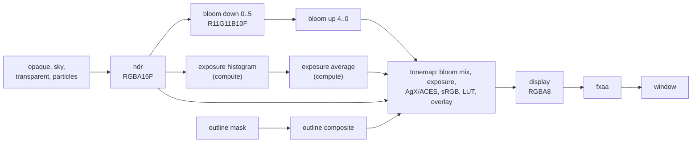

# 08 — Effects and post-processing

*Chapter [07](07-lighting-and-shadows.md) ends with a lit image in a floating-point texture, where a
pixel may hold 0.002 or 3,000. A monitor shows 256 levels per channel. This chapter builds, from
empty files, everything between those two facts — bloom from a pyramid of half-size images, an
exposure the GPU measures and adapts by itself without the CPU ever reading a number back, two tone
curves derived term by term, the sRGB encoding, a color-grading lookup table, a dither against
banding and FXAA anti-aliasing — and then the effects drawn into and around the scene that an
isometric role-playing game needs: outlines and x-ray silhouettes for selected characters, decals
for selection circles and spell templates, walls that dissolve in front of the party, fog of war,
GPU particles, the sky and debug lines. For every full-screen pass it says what is read and written,
at which resolution and how many bytes move. It ends with the tests that check each effect against a
reference, a bandwidth budget for one 1080p frame, and two bugs the rewrite found in the code.*

**Before you start.** You need [Lesson 0](lessons/00-foundations.md): powers and logarithms (§2.3),
floor and rounding up (§2.5), bit operations, masks and shifts (§6), how a `float` is stored (§7;
half floats in §2.2 here are the same idea in 16 bits), native memory (§8.3), atomics and
compare-and-set (§9.5), what a GPU, a driver and OpenGL are (§10) and frame budgets (§11). You need
[Lesson 1](lessons/01-buffers-in-flight.md) for the frame ring every pass here writes into, for
fences, coherent mappings and memory barriers (§6), and for `FrameRing.upload` and decision D103
(§13); this chapter uses them and does not explain them again. From the chapters: [04](04-cameras-and-projection.md),
on reversed-Z depth, unprojecting a pixel back into the world and why the sky sits at depth 0;
[05](05-opengl-from-java.md), on the GPU pipeline stage by stage (rasterization in 2×2 quads,
derivatives, blending, the full-screen triangle), textures, sampling and texture formats, sRGB
textures, framebuffers and the packed `PipelineState`; [06](06-renderer-architecture.md), on the
render packet, the frame graph (transient textures, liveness, automatic barriers) and the
`SceneRenderer` that declares every pass; and [07](07-lighting-and-shadows.md), on what the lit pass
computes and on the light clusters that decals share. Ambient occlusion (`post/Gtao.java`) lives in
the same `post` package but is chapter 07's subject.

**What you will build**

| Piece | File | What it does |
|---|---|---|
| Color helpers | [`engine/color.glsl`](../../modules/render/src/main/resources/dev/jeddy/render/shaders/engine/color.glsl) | sRGB transfer functions, luminance, the ACES and AgX curves, dither noise |
| The post chain | [`post/PostProcess.java`](../../modules/render/src/main/java/dev/jeddy/render/post/PostProcess.java) | settings, the passes in the frame graph, the exposure state, grading LUTs |
| Bloom | [`post/bloom_down.frag`](../../modules/render/src/main/resources/dev/jeddy/render/shaders/post/bloom_down.frag), [`post/bloom_up.frag`](../../modules/render/src/main/resources/dev/jeddy/render/shaders/post/bloom_up.frag) | a 13-tap downsample with a Karis average, a tent upsample |
| Auto exposure | [`post/exposure.glsl`](../../modules/render/src/main/resources/dev/jeddy/render/shaders/post/exposure.glsl), [`post/exposure_histogram.comp`](../../modules/render/src/main/resources/dev/jeddy/render/shaders/post/exposure_histogram.comp), [`post/exposure_average.comp`](../../modules/render/src/main/resources/dev/jeddy/render/shaders/post/exposure_average.comp) | a luminance histogram, a trimmed average, adaptation over time |
| The composite | [`post/tonemap.frag`](../../modules/render/src/main/resources/dev/jeddy/render/shaders/post/tonemap.frag) | bloom mix, exposure, tone curve, sRGB, grading, overlay, dither, luma |
| Anti-aliasing | [`post/fxaa.frag`](../../modules/render/src/main/resources/dev/jeddy/render/shaders/post/fxaa.frag) | FXAA: finds edges and blends across them |
| LUT cooking | [`CubeLut`](../../tools/cooker/src/main/java/dev/jeddy/cooker/lut/CubeLut.java), [`CubeLutImporter`](../../tools/cooker/src/main/java/dev/jeddy/cooker/lut/CubeLutImporter.java) | `.cube` files into RGBA16F 3D textures |
| Outlines | [`outline/Outlines.java`](../../modules/render/src/main/java/dev/jeddy/render/outline/Outlines.java), [`pbr/outline_mask.vert`](../../modules/render/src/main/resources/dev/jeddy/render/shaders/pbr/outline_mask.vert), [`pbr/outline_mask.frag`](../../modules/render/src/main/resources/dev/jeddy/render/shaders/pbr/outline_mask.frag), [`post/outline.frag`](../../modules/render/src/main/resources/dev/jeddy/render/shaders/post/outline.frag) | highlight styles, a mask with an occlusion bit, an anti-aliased overlay |
| Decals | [`RenderPacket.addDecal`](../../modules/render/src/main/java/dev/jeddy/render/RenderPacket.java), [`engine/decals.glsl`](../../modules/render/src/main/resources/dev/jeddy/render/shaders/engine/decals.glsl), [`decal/DecalTextures.java`](../../modules/render/src/main/java/dev/jeddy/render/decal/DecalTextures.java) | boxes projected onto surfaces: rings, discs, cones, lines, textures |
| Camera fade | [`engine/camera_fade.glsl`](../../modules/render/src/main/resources/dev/jeddy/render/shaders/engine/camera_fade.glsl), [`pbr/depth.frag`](../../modules/render/src/main/resources/dev/jeddy/render/shaders/pbr/depth.frag) | occluders dissolve with an ordered dither |
| Fog of war | [`app.physics.FogOfWarFeed`](../../modules/app/src/main/java/dev/jeddy/app/physics/FogOfWarFeed.java), [`fog/FogOfWar.java`](../../modules/render/src/main/java/dev/jeddy/render/fog/FogOfWar.java), [`engine/fog_of_war.glsl`](../../modules/render/src/main/resources/dev/jeddy/render/shaders/engine/fog_of_war.glsl) | a visibility grid as a texture; dimmed and hidden ground |
| GPU particles | [`particle/GpuParticles.java`](../../modules/render/src/main/java/dev/jeddy/render/particle/GpuParticles.java), [`particle/particles.glsl`](../../modules/render/src/main/resources/dev/jeddy/render/shaders/particle/particles.glsl) and the shaders next to it | a pool simulated by compute shaders, drawn with a GPU-written count |
| The sky | [`pbr/sky.frag`](../../modules/render/src/main/resources/dev/jeddy/render/shaders/pbr/sky.frag) | the environment where nothing was drawn |
| Debug lines | [`debug/DebugDraw.java`](../../modules/render/src/main/java/dev/jeddy/render/debug/DebugDraw.java), [`debug/DebugRenderer.java`](../../modules/render/src/main/java/dev/jeddy/render/debug/DebugRenderer.java) | lines from any thread, drawn by vertex pulling |

Shader paths in the text are relative to `modules/render/src/main/resources/dev/jeddy/render/shaders/`.
Design background: DESIGN §9.3, passes 5 to 10 ([../DESIGN.md](../DESIGN.md)); the decisions are
D23, D45, D46, D47, D48, D49 and D103 in DESIGN §17.

**Contents**

- Part A — The ideas
  1. [The problem: from light values to pixels](#1-the-problem-from-light-values-to-pixels)
  2. [Numbers for light](#2-numbers-for-light)
  3. [sRGB and gamma: the transfer functions](#3-srgb-and-gamma-the-transfer-functions)
  4. [Exposure](#4-exposure)
  5. [Tone curves](#5-tone-curves)
  6. [Bloom](#6-bloom)
  7. [Color grading with a 3D lookup table](#7-color-grading-with-a-3d-lookup-table)
  8. [Anti-aliasing with FXAA](#8-anti-aliasing-with-fxaa)
  9. [Decals](#9-decals)
  10. [Outlines and x-ray silhouettes](#10-outlines-and-x-ray-silhouettes)
  11. [Camera fade: a screen-door dither](#11-camera-fade-a-screen-door-dither)
  12. [Fog of war](#12-fog-of-war)
  13. [GPU particles](#13-gpu-particles)
  14. [The sky](#14-the-sky)
- Part B — Building it
  15. [Step 1: the color helpers](#15-step-1-the-color-helpers)
  16. [Step 2: PostProcess — settings, fields, constructor](#16-step-2-postprocess--settings-fields-constructor)
  17. [Step 3: declaring the post passes](#17-step-3-declaring-the-post-passes)
  18. [Step 4: the bloom passes](#18-step-4-the-bloom-passes)
  19. [Step 5: auto exposure](#19-step-5-auto-exposure)
  20. [Step 6: the composite and the grading LUT](#20-step-6-the-composite-and-the-grading-lut)
  21. [Step 7: FXAA](#21-step-7-fxaa)
  22. [Step 8: cooking LUTs](#22-step-8-cooking-luts)
  23. [Step 9: outlines](#23-step-9-outlines)
  24. [Step 10: decals](#24-step-10-decals)
  25. [Step 11: camera fade](#25-step-11-camera-fade)
  26. [Step 12: fog of war](#26-step-12-fog-of-war)
  27. [Step 13: GPU particles](#27-step-13-gpu-particles)
  28. [Step 14: the sky pass](#28-step-14-the-sky-pass)
  29. [Step 15: debug lines](#29-step-15-debug-lines)
- Part C — Using it and proving it
  30. [How the renderer wires it](#30-how-the-renderer-wires-it)
  31. [One frame of post at 1080p](#31-one-frame-of-post-at-1080p)
  32. [The tests, walked through](#32-the-tests-walked-through)
  33. [Things to run](#33-things-to-run)
  34. [Why it is built this way](#34-why-it-is-built-this-way)
  35. [Further reading](#35-further-reading)
  36. [Exercises](#36-exercises)
  37. [Glossary](#37-glossary)

---

# Part A — The ideas

## 1. The problem: from light values to pixels

### 1.1 What the lit pass leaves behind

When the opaque, sky, transparent and particle passes of chapter [06](06-renderer-architecture.md)
have run, the frame graph holds two full-size images:

- **`hdr`**, declared `graph.texture("hdr", GL_RGBA16F, 1f)`: four 16-bit floating-point numbers per
  pixel. Each holds how much red, green and blue light reaches the camera from that pixel, in the
  same units the lights were given in. A pixel in shadow may hold 0.002, a lamp flame 30, a lightning
  bolt 3,000.
- **`depth`**, `GL_DEPTH_COMPONENT32F`: the reversed-Z depth of the nearest opaque surface, 1 near,
  0 far (chapter [04](04-cameras-and-projection.md)).

The window cannot show either. Its back buffer stores 8 bits per channel, so it can hold 256 levels
from 0 to 1, nothing above 1 and nothing negative; it expects those levels in the **sRGB** encoding
that monitors understand (§3); and it is not sRGB-capable, so the GPU will not encode for us (D23).
Four gaps separate the two images:

1. **Range.** From 0.002 to 3,000 is a ratio of 1,500,000, about 20.5 doublings (§2.1). The display
   shows 0 to 1. Something must decide which part of the range becomes "white", and squeeze the rest
   in gracefully: **exposure** (§4) and a **tone curve** (§5).
2. **Encoding.** The light values are **linear** (twice the number, twice the light). The display
   wants **encoded** values that spend more of the 256 levels on dark tones (§3).
3. **Edges.** Every triangle edge is a staircase of whole pixels (**aliasing**); post-processing
   smooths it (§8).
4. **Look.** Bright lights should glow (**bloom**, §6), and an artist may want a warmer or colder
   picture (**color grading**, §7).

An image whose numbers are proportional to the light in the scene is called **scene-referred**; one
whose numbers are what a display should show is **display-referred**. The **post-processing chain**
turns the first into the second. It runs after everything has been drawn into `hdr`, as a sequence
of passes that each read images and write one, so it is cheap to rearrange and easy to test pass by
pass.

### 1.2 The display chain at a glance



`PostProcess.declare` (§17) adds these passes to the frame graph after everything that draws into
`hdr`. With the default settings, at a 1920 × 1080 window:

| Pass | Kind | Reads | Writes | Resolution |
|---|---|---|---|---|
| bloom down 0 | full-screen draw | `hdr` | `bloom down 0` (R11G11B10F) | 960 × 540 |
| bloom down 1–5 | full-screen draws | the level above | the next level | 480 × 270 down to 30 × 17 |
| bloom up 4–0 | full-screen draws | the smaller level, the downsample of this size | `bloom up i` | 60 × 34 up to 960 × 540 |
| exposure histogram | compute | `hdr` | the exposure buffer's 256 bins | one sample per 2 × 2 pixels |
| exposure average | compute | the bins | the exposure, and clears the bins | one workgroup |
| outline mask | draw of highlighted objects | scene depth | `outline mask` (RG8), its own depth | 1920 × 1080 |
| outline | full-screen draw | `outline mask` | `outline overlay` (RGBA8) | 1920 × 1080 |
| tonemap | full-screen draw | `hdr`, `bloom up 0`, overlay, LUT, exposure | `display` (RGBA8) | 1920 × 1080 |
| fxaa | full-screen draw | `display` | the window | 1920 × 1080 |

The sizes come from the frame graph rounding $1920 \cdot 2^{-i}$ and $1080 \cdot 2^{-i}$ to the
nearest integer (chapter [06](06-renderer-architecture.md), on transient textures): $1080/16 = 67.5$
becomes 68, $1080/32 = 33.75$ becomes 34 and $1080/64 = 16.875$ becomes 17. Without FXAA the tonemap
pass writes the window directly; without outlines there is no overlay.

### 1.3 A full-screen pass, as a pipeline

Most passes in this chapter are **full-screen passes**: one triangle that covers the target, and a
fragment shader that computes each output pixel from texture reads. Chapter
[05](05-opengl-from-java.md) followed one triangle through the GPU pipeline; here is what the same
stages do for the `tonemap` pass at 1920 × 1080, so that later sections can just say "a full-screen
pass".

1. **The command processor** reads the draw: `glDrawArrays(GL_TRIANGLES, 0, 3)` with an empty vertex
   array. Before it starts, the GPU must make the earlier passes' results readable (step 7).
2. **The vertex shader** `engine/fullscreen.vert` runs three times. It makes the corners
   $(-1,-1)$, $(3,-1)$, $(-1,3)$ out of `gl_VertexID` alone (chapter 05 derives the bit trick): one
   triangle twice the size of the screen whose visible part is exactly the viewport, with `vUv`
   running from 0 to 1 across it.
3. **Clipping** cuts nothing: the parts outside the viewport fall in the rasterizer's **guard band**
   and are simply never turned into pixels.
4. **The rasterizer** produces one fragment per pixel center: 2,073,600 fragments, in 518,400 quads of
   2 × 2. A single triangle shades no pixel twice; two triangles forming a quad would shade the quads
   along their shared diagonal twice.
5. **The fragment shader** runs 2,073,600 times. Its texture reads go to the **texture units**,
   which compute addresses, fetch texels through the **texture cache** and filter them. Neighbouring
   pixels read neighbouring texels, so almost every texel comes from memory once and is then reused
   from the cache.
6. **The render output unit (ROP)** converts the shader's 32-bit floats to the target's format and
   writes them. Without blending it only writes; with blending it must also read the old value
   (a read-modify-write, chapter 05).
7. **Between passes.** The `tonemap` pass samples `hdr`, which the earlier passes *rendered into*.
   OpenGL orders that by itself: when a texture that was a render target is sampled by a later draw,
   the driver makes the GPU finish writing it, flush the ROP's caches and invalidate the texture
   cache (on many GPUs also decompress the target, see §1.4). What OpenGL does *not* order are writes
   made by shaders through storage buffers or images: `tonemap` reads the exposure that a compute
   pass wrote, so it needs a `glMemoryBarrier` (L01 §6.3). The frame graph places that barrier from
   the declarations (§17).

What can go wrong in a full-screen pass:

- **A feedback loop**: sampling a texture that is also attached to the framebuffer being drawn is
  undefined in OpenGL (the shader may read old, new or half-written texels). That is why every bloom
  level is its own texture and the composite writes a new `display` texture instead of `hdr`.
- **A wrong viewport**: a half-size target drawn with a full-size viewport covers only a quarter of
  the triangle's area and stretches the result. The frame graph sets the viewport from the target's
  scale before each pass (chapter 06).
- **Derivatives**: `texture()` in a fragment shader picks a mip level from the change of the
  coordinates across the 2 × 2 quad. Post shaders call `textureLod(..., 0.0)` or `texelFetch`
  instead: the level is given, no derivative is needed, and the result cannot depend on neighbouring
  pixels.

### 1.4 What it costs: bandwidth

A full-screen pass does little arithmetic per pixel and moves a lot of memory. A first-order
estimate of its cost is its **memory traffic**: every texel it reads, once, plus every pixel it
writes, once. For the `tonemap` pass at 1920 × 1080 ($N = 2{,}073{,}600$ pixels):

| | Format | Bytes per pixel | Pixels | Bytes |
|---|---|---|---|---|
| read `hdr` | RGBA16F | 8 | $N$ | 16,588,800 |
| read `bloom up 0` | R11G11B10F | 4 | $N/4$ | 2,073,600 |
| read the overlay | RGBA8 | 4 | $N$ | 8,294,400 |
| write `display` | RGBA8 | 4 | $N$ | 8,294,400 |
| **total** | | | | **35,251,200** |

About 35 MB. The whole post chain, added up the same way in §31, moves about 109 MB per frame at
1080p, 6.6 GB/s at 60 frames per second. Compare with what memory can deliver:

- a graphics card of the DESIGN reference class (§14 of DESIGN names a GTX 1660 or an RX 6600): its
  memory bandwidth follows from its published memory specification, data rate × bus width: GDDR5 at
  8 Gbit/s per pin on a 192-bit bus is $8 \cdot 192 / 8 = 192$ GB/s; GDDR6 at 14 Gbit/s on 128 bits
  is 224 GB/s;
- an integrated GPU shares the CPU's memory: dual-channel DDR4-3200 is
  $3200 \cdot 10^6 \cdot 8 \text{ bytes} \cdot 2 = 51.2$ GB/s, shared with the CPU.

At 192 GB/s the 109 MB take about 0.57 ms; at 51.2 GB/s about 2.1 ms of a 16.7 ms frame (L00 §11).
These are **predictions**: real GPUs keep part of the traffic in their caches, many compress render
targets losslessly in hardware (which cuts the bytes for smooth images), and a pass can be limited by
something other than memory. The engine measures each pass's GPU time with timestamp queries
(chapter 06; F3 in the demo shows them), and no per-pass measurement on real hardware exists yet
(DESIGN's perf report, `docs/perf/m10.md`, lists GPU budgets on the reference PC as open item O1).

The estimate still guides the design: it explains why bloom works on half-size images in a 4-byte
format (§6), why auto exposure samples a quarter of the pixels (§4.3), and why the composite does
five jobs in one pass instead of five passes (§20).

### 1.5 The scene effects around the chain

The other effects of this chapter are not separate post passes. They live where they are cheapest:

| Effect | Where it runs | Why there |
|---|---|---|
| Decals (§9) | inside the lit shader `pbr.frag`, from the light clusters | no extra geometry or pass; one cull and one lookup serve lights and decals (D45) |
| Camera fade (§11) | inside `depth.frag` and `pbr.frag` (a `discard`) | the prepass and the lit pass must drop the same pixels (D48) |
| Fog of war (§12) | the last line of `pbr.frag` | one texture read per pixel, from a grid uploaded only when it changes (D48) |
| Outlines (§10) | two passes of their own, composited by `tonemap` | composited on the display image before FXAA, so their colors are exact (D46) |
| Particles (§13) | three compute passes and one draw after the transparent pass | the CPU only turns emitter rates into spawn counts (D47) |
| The sky (§14) | a full-screen pass after the opaque pass | only where no geometry was drawn |
| Debug lines (§29) | after the whole frame, into the window | development only |

## 2. Numbers for light

### 2.1 Radiance, ratios and stops

Chapter [07](07-lighting-and-shadows.md) defines **radiance** precisely; here it is enough to know
that a pixel of `hdr` holds a number proportional to the light energy arriving at the camera from
that point, per color channel. Twice the number is twice the light.

Our eyes do not judge light by differences but by **ratios**. Going from 1 to 2 looks like about the
same step as going from 2 to 4 or from 100 to 200. Photographers count in **stops**: one stop is a
factor of 2, and the number of stops between two amounts $a$ and $b$ is

$$\text{stops} = \log_2 \frac{b}{a}$$

(L00 §2.3). From 0.002 to 3,000: $\log_2 1{,}500{,}000 \approx 20.5$ stops. A sunlit wall is roughly
a thousand times brighter than the same wall in shade: $\log_2 1000 \approx 10$ stops. Everything in
this chapter that adapts or compresses brightness works in stops — on $\log_2$ of the value — because
equal steps in stops look like equal steps.

### 2.2 Floating-point render targets

An 8-bit target stores $\text{round}(255\,v)$ for $v$ clamped to $[0, 1]$ (chapter 05). A lit scene
written there would lose everything above 1 before exposure could decide what "white" is, and it
would round every shadow value below $0.5/255 \approx 0.002$ to black. So the lit pass writes floats.

**Half floats.** `GL_RGBA16F` stores each channel as a 16-bit float: the design of L00 §7.2 with
1 sign bit, 5 exponent bits (bias 15) and 10 fraction bits:

```
bit:   15 | 14 ... 10 | 9 ................ 0
      sign | exponent | fraction
value = (-1)^sign × 1.fraction × 2^(exponent − 15)
```

From that layout:

- **Largest value.** The exponent field 31 (all ones) is reserved for infinity and NaN, so the largest
  exponent is $30 - 15 = 15$, and with all fraction bits set the value is
  $(2 - 2^{-10}) \cdot 2^{15} = 65{,}504$.
- **Smallest normal value.** Exponent field 1: $2^{1-15} = 2^{-14} \approx 6.1 \times 10^{-5}$.
  Below it, **subnormals** (no hidden 1) go down to $2^{-24} \approx 6 \times 10^{-8}$.
- **Precision.** 10 fraction bits plus the hidden 1 give 11 significant bits: the gap between two
  neighbouring values is $2^{-10} \approx 0.1\,\%$ of the value, about three decimal digits. Near 1
  the step is 0.00098, near 1,000 it is 0.5, near 0.05 it is 0.0000305.
- **Range.** From $2^{-14}$ to 65,504 is 30 stops of normal numbers, enough for any scene this engine
  draws.

*Worked example.* 0.05 is not exact in binary (L00 §7.1). As a half float it becomes
0.0499878 (the nearest value with 11 significant bits); `PostProcessTest` computes its expected
values from that rounded number with `Float.float16ToFloat(Float.floatToFloat16(v))`. 1.5 is exact:
sign 0, exponent $0 + 15 = 15$ (`01111`), fraction `1000000000`, bits `0x3E00`.

**Packed small floats.** `GL_R11F_G11F_B10F` stores three **unsigned** floats in 32 bits: red and
green with 5 exponent and 6 fraction bits, blue with 5 and 5. There is no sign and no alpha. With the
same rules: the largest red or green value is $(2 - 2^{-6}) \cdot 2^{15} = 65{,}024$, the largest blue
$(2 - 2^{-5}) \cdot 2^{15} = 64{,}512$; the steps are $2^{-6} \approx 1.6\,\%$ and
$2^{-5} \approx 3.1\,\%$ of the value. That is coarse for a picture but fine for a blur, and it is
half the bytes of `RGBA16F`. The bloom pyramid uses it (§6).

**Memory.** At 1920 × 1080, an `RGBA16F` image is $1920 \cdot 1080 \cdot 8 = 16{,}588{,}800$ bytes
(15.8 MiB); `RGBA8` and `R11F_G11F_B10F` are 8,294,400 (7.9 MiB); `RG8` is 4,147,200.

**What the hardware does.** The fragment shader always computes in 32-bit floats. The ROP converts
on write: to a half float by rounding to the nearest representable value, to an 8-bit channel by
clamping, scaling by 255 and rounding (chapter 05). The texture unit converts back on read, so a
shader sampling `hdr` sees ordinary floats. Above 65,504 the next half-float value would be 65,536,
which is the encoding of infinity, so round-to-nearest sends anything below the midpoint 65,520 down
to 65,504 and anything at or above it to infinity (65,520 is a tie, and ties go to the even
significand, which is infinity's). An infinity or a NaN in one pixel spreads to every pixel a blur
touches; §18 shows where the bloom shader guards against that.

### 2.3 Luminance and luma

Exposure needs one number for "how bright" a pixel is. Our eyes are most sensitive to green and
least to blue, so a plain average of R, G and B would be wrong. For linear values with the sRGB (Rec.
709) primaries, the **luminance** is

$$Y = 0.2126\,R + 0.7152\,G + 0.0722\,B .$$

The weights come from the definition of those primaries (ITU-R BT.709): they are how much each
primary at full strength contributes to perceived brightness, and they add up to 1, so a grey
$(g, g, g)$ has $Y = g$. Pure green $(0, 1, 0)$ has $Y = 0.7152$, pure blue $0.0722$: a blue lamp
looks about ten times darker than a green one of the same strength. `jeddyLuminance` in
`engine/color.glsl` is exactly this dot product (§15).

**Luma** is a cheaper cousin used on *encoded* values: $Y' = 0.299\,R' + 0.587\,G' + 0.114\,B'$
(the older Rec. 601 weights, applied after the sRGB encoding of §3). It is not a physical quantity,
but it grows when the visible brightness grows, which is all FXAA needs to find edges (§8). The
composite stores it in the alpha channel of the display image (§20).

### 2.4 Middle grey

A grey card that reflects 18 % of the light looks about halfway between black and white to us. The
CIE **lightness** scale, built to match perception, makes that precise:

$$L^* = 116 \left(\frac{Y}{Y_n}\right)^{1/3} - 16 \qquad (\text{for } Y/Y_n > 0.008856)$$

where $Y_n$ is the luminance of white. For $Y/Y_n = 0.18$: $116 \cdot 0.18^{1/3} - 16 = 116 \cdot 0.5646 - 16 = 49.5$,
the middle of the 0–100 scale. (For comparison, 50 % reflectance gives $L^* = 76$: it
looks much lighter than "half".) Exposure targets this **middle grey**, the **key value** 0.18: after
exposure, the scene's typical brightness should be 0.18 (§4).

## 3. sRGB and gamma: the transfer functions

### 3.1 Why the display wants encoded values

Suppose the window stored linear values in its 8 bits. Code 1 is $1/255 = 0.0039$ and code 2 is
$0.0078$: a step of 100 %, a whole stop, between two neighbouring codes. Code 10 to 11 is a 10 %
step, code 254 to 255 is 0.4 %. Our eyes see steps of roughly 1 % in brightness, so the darks would
show coarse bands while the brights waste codes on differences nobody sees. Only 46 of the 255 codes
($0.18 \cdot 255 = 45.9$) would lie below middle grey.

An **encoding** (a **transfer function**) fixes this: before quantizing, it bends the value so that
equal code steps are roughly equal *perceived* steps; the display bends it back when it emits light.
With the sRGB encoding, middle grey 0.18 becomes code $0.4614 \cdot 255 = 117.6$: 118 codes for the
darker half of perception, as it should be. The neighbouring-code steps become 3.8 % at code 50,
1.7 % at code 128 and 0.9 % at code 254.

Two things the encoding is *not*: it does not make the picture brighter (the display decodes it,
so the light that comes out is the light that went in), and it is not optional (a monitor decodes
whatever it receives, so linear values sent to it look far too dark in the mid-tones).

### 3.2 The sRGB encoding, derived

A pure power curve $v = c^{1/\gamma}$ with $\gamma$ about 2.2 to 2.4 would do most of the job. Its
problem is at 0: it gets steeper without limit as $c$ shrinks. With $\gamma = 2.4$, $v/c$ is 14.7 at
$c = 0.01$, 56 at $0.001$, 215 at $0.0001$ and 825 at $0.00001$ (the formula in step 2 below says why:
the slope is proportional to $c^{1/\gamma - 1} = c^{-0.583}$, which grows as $c \to 0$). So the
tiniest noise in the darks becomes large code differences, and the inverse curve is flat there. The
sRGB standard (IEC 61966-2-1) therefore joins a **straight line** near 0 to a **shifted power
curve**:

$$\text{enc}(c) = \begin{cases} 12.92\,c & c \le 0.0031308 \\ 1.055\,c^{1/2.4} - 0.055 & c > 0.0031308 \end{cases}$$

Where do the numbers come from?

1. **The curve.** Take $f(c) = (1 + a)\,c^{1/\gamma} - a$ with $\gamma = 2.4$ and $a = 0.055$. For any
   $a$, $f(1) = (1 + a) - a = 1$: white stays white. The shift $a$ lowers the curve near 0 so a line
   can meet it.
2. **The ideal joint.** We want the line through the origin that just *touches* the curve (a
   **tangent**) rather than crossing it, so the two branches meet with no corner. "Touches" means the
   line has the same steepness as the curve at the joint. The steepness of a curve at a point is its
   **derivative**, written $f'(c)$: the slope of the straight line the curve looks like when you zoom
   in far enough, measured as rise over run, $(f(c + h) - f(c))/h$ for a tiny step $h$. For a power
   there is a formula (the one fact from calculus this chapter uses, and you can check it with the
   rise-over-run quotient): $\frac{d}{dc}c^{n} = n\,c^{n-1}$, so $f'(c) = \frac{1 + a}{\gamma}c^{1/\gamma - 1}$.
   *Numerically*, at $c = 0.0030399$: $f'(c) = \frac{1.055}{2.4} \cdot 0.0030399^{-0.58333} = 12.9233$,
   and the rise over run with $h = 10^{-6}$ is $(f(0.0030409) - f(0.0030399))/10^{-6} = 12.922$ — the
   same number to three places, which is all a derivative is. The tangent through the origin meets
   the curve where the line's slope $f(c_0)/c_0$ equals the curve's slope $f'(c_0)$, that is
   $(1 + a)\,c_0^{1/\gamma} - a = \frac{1+a}{\gamma}\,c_0^{1/\gamma}$. Solving for $c_0^{1/\gamma}$:
   $$c_0^{1/\gamma} = \frac{a}{(1 + a)(1 - 1/\gamma)} = \frac{0.055}{1.055 \cdot 0.58333} = 0.089374,$$
   so $c_0 = 0.089374^{2.4} = 0.0030399$, and the slope is $f(c_0)/c_0 = 0.039285/0.0030399 = 12.9232$.
3. **The published constants.** The standard rounded the slope to 12.92. A line of slope 12.92 no
   longer touches the curve; it crosses it twice, at $c = 0.002953$ and $c = 0.0031307$. The standard
   uses the upper crossing, written 0.0031308. At the joint the two branches agree to about
   $10^{-8}$ ($12.92 \cdot 0.0031308 = 0.0404499$ and $f(0.0031308) = 0.0404499$) but their slopes
   differ (the line's 12.92 against the curve's $f'(0.0031308) = 12.70$): the curve is continuous,
   with a tiny kink nobody can see.

*Worked examples.* $\text{enc}(0.18) = 1.055 \cdot 0.18^{0.41667} - 0.055 = 0.4614$ (middle grey lands
in the middle of the code range). $\text{enc}(0.001) = 12.92 \cdot 0.001 = 0.0129$ (the linear part).
$\text{enc}(0.5) = 0.7354$. A pure power $0.18^{1/2.2} = 0.4587$ is close to the sRGB value above the
toe, which is why "gamma 2.2" is a common approximation; AgX uses it inside its curve (§5.4).

### 3.3 Decoding, and where each happens in Jeddy

The inverse, from an encoded $v$ back to linear light:

$$\text{dec}(v) = \begin{cases} v / 12.92 & v \le 0.04045 \\ \left(\dfrac{v + 0.055}{1.055}\right)^{2.4} & v > 0.04045 \end{cases}$$

where $0.04045 = 12.92 \cdot 0.0031308$, the encoded value of the joint. $\text{dec}(0.5) = 0.214$: a
stored mid-grey is only 21 % of white in light, as chapter 05 noted for sRGB textures.

Where the two directions happen:

- **Decoding, in the texture unit.** Color textures are stored sRGB-encoded (`GL_SRGB8_ALPHA8`, the
  sRGB BC7 formats). The texture unit decodes every texel to linear *before* filtering, so shaders
  only ever see linear values (chapter 05).
- **Encoding, in the composite shader.** The window is not sRGB-capable (D23: some X servers, Xvfb
  in CI among them, have no sRGB visuals, and asking for one made window creation fail). So
  `tonemap.frag` encodes with `jeddyLinearToSrgb` and writes the encoded numbers into plain 8-bit
  targets; the `display` texture between the composite and FXAA is plain `GL_RGBA8` holding encoded
  values. Doing it in the shader also behaves the same on every driver.
- **Encoding, in the ROP.** One place lets the hardware encode: `DecalTextures.copy` (§24) draws
  into an sRGB array texture with `GL_FRAMEBUFFER_SRGB` enabled, so the ROP encodes each written
  value (and would decode before blending).

### 3.4 Quantization, banding and dither

The last write into an 8-bit target rounds: code $= \text{round}(255\,v)$. In a smooth gradient that
changes slowly, many neighbouring pixels round to the same code and the image shows flat **bands**
with visible steps between them. A dark sky that goes from encoded 0.10 to 0.12 across 1,920 pixels
spans $0.02 \cdot 255 = 5.1$ codes: five or six bands, each about 380 pixels wide.

**Dither** trades the bands for fine grain. Add a little noise before the rounding: a value
$u - 0.5$ codes, with $u$ spread evenly over $[0, 1)$. Write the value as $v = (k + f)/255$ with a
whole number $k$ and a fraction $0 \le f < 1$. Then

$$\text{round}(k + f + u - 0.5) = \lfloor k + f + u \rfloor = \begin{cases} k + 1 & \text{if } u \ge 1 - f \\ k & \text{otherwise} \end{cases}$$

(rounding is "add 0.5 and take the floor", L00 §2.5). The upper case happens for a fraction $f$ of
the pixels, so the *average* code over a small area is $k + f$: exactly the unrounded value. The eye
averages neighbouring pixels, sees the right brightness, and the steps are gone. The noise amplitude
is one code, $1/255$, invisible on its own.

The noise must be cheap and evenly spread over small areas. Jeddy uses **interleaved gradient
noise** (Jimenez 2014):

$$\text{IGN}(x, y) = \operatorname{fract}\big(52.9829189 \cdot \operatorname{fract}(0.06711056\,x + 0.00583715\,y)\big)$$

where $\operatorname{fract}$ keeps the part after the point. At the pixel centers $(0.5, 0.5)$,
$(1.5, 0.5)$, $(2.5, 0.5)$, $(0.5, 1.5)$ it gives 0.9325, 0.4882, 0.0439, 0.2418: neighbours land far
apart in $[0, 1)$, which is what a dither needs. It costs two multiply-adds and two `fract`s, and it
is fixed per pixel, so the grain does not crawl from frame to frame.

## 4. Exposure

### 4.1 A multiplier and a key

**Exposure** is one number $e$ that multiplies every pixel before the tone curve: $x = e \cdot c$. A
camera's shutter time, aperture and sensitivity together do exactly that to the light. **Auto
exposure** chooses $e$ so that the scene's typical luminance $\bar Y$ lands on the key value of §2.4:

$$e = \frac{\text{key}}{\bar Y}, \qquad \text{key} = 0.18 .$$

A cellar whose typical luminance is 0.05 gets $e = 0.18/0.05 = 3.6$; a street at noon with
$\bar Y = 5$ gets $0.036$. The same tone curve then shows both well. On top, the game can bias the
result: `RenderPacket.exposure` is a **compensation** factor that multiplies the automatic exposure
(D46: before auto exposure existed it *was* the exposure).

### 4.2 Which average

Take a room where 99 % of the pixels have luminance 0.05 and 1 % show a fire at 1,000.

- **The arithmetic mean** is $0.99 \cdot 0.05 + 0.01 \cdot 1000 = 10.05$, so $e = 0.0179$: the room
  turns black so that the fire does not saturate. A few very bright pixels own the mean.
- **The geometric mean** averages in stops: $\exp\big(\tfrac{1}{N}\sum \ln Y\big) = \exp(0.99 \ln 0.05 + 0.01 \ln 1000) = 0.0552$,
  so $e = 3.26$. Much better: the fire costs only a
  tenth of a stop.
- **A trimmed average** ignores the brightest and darkest fractions of the pixels before averaging.
  Sort all the pixels by luminance; the **$p$-th percentile** is the value $p$ % of the way along
  that sorted list (the 95th percentile has 95 % of the pixels below it and 5 % above), and the
  **median** is the 50th percentile, the middle pixel. Averaging $\log_2 Y$ over the pixels between
  the median and the 95th percentile (the defaults, `lowFraction = 0.5`, `highFraction = 0.95`) gives
  exactly 0.05 here, $e = 3.6$: the fire is in the top 1 % and does not count at all.

Jeddy uses the last: the mean of $\log_2 Y$ over a percentile window, then $\bar Y = 2^{\text{mean}}$.
The lower bound at the median also matters: a scene that is half pitch-black shadow and half lit
floor is exposed for the floor, not brightened until the shadows look grey. Black pixels ($Y \le 10^{-6}$,
which have no logarithm) never count.

**The window as an overlap.** Sort the $N$ pixels by luminance and lay them on a line from 0 to $N$.
The window keeps positions $[\text{low}, \text{high}] = [0.5N, 0.95N]$. If the pixels are grouped in
bins and bin $b$ holds $n_b$ pixels starting at position $\text{below}_b$ (the count of all darker
bins), the bin occupies $[\text{below}_b, \text{below}_b + n_b]$ and contributes the length of its
overlap with the window:

$$w_b = \max\big(\min(\text{below}_b + n_b,\ \text{high}) - \max(\text{below}_b,\ \text{low}),\ 0\big).$$

The trimmed mean is $\sum_b w_b \ell_b / \sum_b w_b$, where $\ell_b$ is the bin's $\log_2$ luminance.
*Example*: 100 pixels in three bins of 40, 50 and 10 pixels; the window is $[50, 95]$. Bin 1 spans
$[0, 40]$: overlap 0. Bin 2 spans $[40, 90]$: overlap $90 - 50 = 40$. Bin 3 spans $[90, 100]$:
overlap $95 - 90 = 5$. Weights 0, 40, 5. §19 shows this exact line in the shader.

### 4.3 Histograms on the GPU

Percentiles need sorted data, and sorting two million pixels every frame is expensive. A
**histogram** is enough: count how many pixels fall into each of a fixed set of luminance ranges
(**bins**), then walk the bins in order, which is the sorted order of the bins.

**Bins in stops.** Jeddy's histogram has 256 bins over a range of $\log_2$ luminance from
$\text{min} = -8$ to $\text{max} = 10$ (`AutoExposure.DEFAULT`), that is from $2^{-8} = 0.0039$ to
$2^{10} = 1024$, 18 stops. With

$$t = \operatorname{clamp}\left(\frac{\log_2 Y - \text{min}}{\text{max} - \text{min}},\ 0,\ 1\right), \qquad \text{bin} = \lfloor 254\,t \rfloor + 1 ,$$

bins 1 to 254 each cover $18/254 = 0.071$ stop, values at or above the top of the range land in bin
255, values below its bottom in bin 1, and bin 0 is reserved for black pixels. Bin $b$ covers
$t \in [(b-1)/254,\ b/254)$, so its center is $t = (b - 0.5)/254$, and its center luminance is
$2^{\text{min} + (b - 0.5)/254 \cdot (\text{max} - \text{min})}$.

*Worked example.* $Y = 0.05$: $\log_2 0.05 = -4.3219$, $t = 3.6781/18 = 0.20434$, $254t = 51.90$, bin
52. Its center: $t = 51.5/254 = 0.20276$, $\log_2 Y = -8 + 18 \cdot 0.20276 = -4.350$, $Y = 0.0490$.
The histogram measures 0.0490 for a scene of 0.05: an error of 2 %, a quarter of a bin.

**Quarter density.** The histogram's *shape* barely changes if only one pixel of every 2 × 2 block is
counted, and the counting work drops four-fold: 518,400 samples at 1080p instead of 2,073,600 (D46,
"quarter density"). Whether the *memory* traffic drops as much depends on how the GPU lays the
texture out: textures are stored in tiles, and skipping every other texel of a tile still fetches
the tile. §31 counts it at a quarter, as the best case.

**Atomics and contention.** Many invocations increment the same counters at the same time. Each
increment must be an **atomic** read-modify-write (`atomicAdd`, chapter 06), or two invocations that
read the same old count would lose one increment (the race of L00 §9.5). The memory system performs
atomics on the same address one after another, so if every invocation of a uniform image hit one
global counter, 518,400 atomics would queue on one address. The histogram uses two levels:

1. each **workgroup** of 16 × 16 = 256 invocations first counts into a private copy of the 256 bins
   in **shared memory**, fast on-chip memory visible only inside the workgroup;
2. then each invocation adds one bin of that copy to the global histogram, only if it is non-zero.

For a uniform image that is 2,040 global atomics (one per workgroup) instead of 518,400. Neighbouring
pixels tend to be similar, so in real images a workgroup touches a handful of bins.

### 4.4 Adapting over time, derived

If the exposure jumped to its target every frame, walking from a dark corridor into a lit hall
would flash, and a torch passing the camera would make the whole room pump. Eyes and cameras
**adapt**: they move toward the right exposure over a fraction of a second. Jeddy adapts in stops,
so that going from exposure 1 to 2 takes as long as going from 4 to 8.

Let $L = \log_2 e$ be the current exposure in stops and $T = \log_2(\text{target})$. Ask for $L$ to
approach $T$ at a speed proportional to the remaining gap, with a **rate** $r$ (per second):

$$\frac{dL}{dt} = r\,(T - L).$$

$dL/dt$ is the derivative of §3.2 with time as the variable: how many stops $L$ changes per second at
this instant. The equation says: far from the target, move fast; close to it, creep. With $r = 3$ and
a gap of $3.32$ stops the speed is $-9.97$ stops per second (downward); at a gap of $0.1$ stop it is
$-0.3$.

**Solving it.** An equation about a rate is solved by a *function of time*, and the claim is that for
a constant target it is

$$L(t) = T + (L_0 - T)\,e^{-rt},$$

where $L_0$ is the exposure at $t = 0$. You do not need to know how to find this; you need to check
it, which takes two facts. First, at $t = 0$, $e^0 = 1$, so $L(0) = T + (L_0 - T) = L_0$: it starts
in the right place. Second, the number $e = 2.71828\ldots$ is defined so that $e^{t}$ changes at a
rate equal to its own value, and so $e^{-rt}$ changes at the rate $-r\,e^{-rt}$ (check: at $t = 0.1$
with $r = 3$, $e^{-0.3} = 0.74082$, rise over run with $h = 10^{-4}$ gives $-2.2221$, and
$-3 \cdot 0.74082 = -2.2225$). Then the rate of $L(t)$ is
$(L_0 - T)(-r)\,e^{-rt} = -r\,(L(t) - T) = r\,(T - L(t))$, which is exactly the equation. So the gap
$L - T$ shrinks by the factor $e^{-rt}$, smoothly, never overshooting (the factor is always positive
and below 1).

*Checking against the code's step.* The shader (§19.3) does not solve anything; it applies one
step per frame. Take the worked example below, $L_0 = 1.848$, $T = -1.474$, $r = 3$. The
*formula* for $t = 0.1$ s gives
$L = -1.474 + 3.322 \cdot e^{-0.3} = -1.474 + 3.322 \cdot 0.74082 = 0.9870$. The *step the code
performs* is $\operatorname{mix}(L_0, T, k)$ with $k = 1 - e^{-0.3} = 0.25918$:
$1.848 + 0.25918 \cdot (-3.322) = 0.9870$. The same number, because the step is the formula
rearranged, which is the next line. (For contrast, the naive step "move by rate × time",
$1.848 - 9.966 \cdot 0.1 = 0.851$, is far off; it is only right for tiny steps, $1.8380$ against the
formula's $1.8380$ at $\Delta t = 0.001$ s, which is what "rate" means.) After one frame of $\Delta t$
seconds:

$$L_1 = T + (L_0 - T)\,e^{-r\Delta t} = L_0 + (T - L_0)\,\big(1 - e^{-r\Delta t}\big) = \operatorname{mix}(L_0,\ T,\ k), \qquad k = 1 - e^{-r\Delta t},$$

where $\operatorname{mix}(a, b, k) = a + (b - a)\,k$ is GLSL's linear blend. Two properties follow:

- **Frame-rate independence.** Two frames of $\Delta t$ leave the gap $(L_0 - T)\,e^{-r\Delta t}\,e^{-r\Delta t} = (L_0 - T)\,e^{-2r\Delta t}$,
  exactly what one frame of $2\Delta t$ leaves. A game at 30 fps and one
  at 144 fps adapt in the same time. The tempting shortcut $k = r\Delta t$ does not have this
  property: with $r = 3$, two steps of 0.05 s leave $(1 - 0.15)^2 = 0.7225$ of the gap and one step
  of 0.1 s leaves 0.7, while the exact value is $e^{-0.3} = 0.7408$ for both; and for $r\Delta t > 1$
  the shortcut overshoots the target.
- **Half-life.** The gap halves when $e^{-rt} = \tfrac12$, at $t = \ln 2 / r$: 0.231 s for $r = 3$,
  0.693 s for $r = 1$.

**Two rates.** Jeddy uses $r = 3$/s (`brightenRate`) when the scene got brighter and the exposure
must fall, and $r = 1$/s (`darkenRate`) when the scene got darker and the exposure must rise. In
code: if the target exposure is *above* the current one, the scene got darker. Human eyes adapt to
bright light within seconds and to darkness over minutes; the asymmetry imitates that at game
speed.

**Snapping.** An exposure of 0 means "no history": the next frame takes the target directly. Turning
auto exposure on, or calling `resetExposure` after a camera cut, writes 0 (§19).

*Worked example* (the scenario of `autoExposureMapsTheAverageToTheKeyAndAdapts`, §32). A uniform scene
of luminance 0.05 snaps to $e = 0.18/0.05 = 3.6$. The scene becomes ten times brighter, 0.5, so the
target is $0.18/0.5 = 0.36$. One frame of $\Delta t = 0.1$ s at the brightening rate:
$k = 1 - e^{-0.3} = 0.2592$; $L_0 = \log_2 3.6 = 1.848$, $T = \log_2 0.36 = -1.474$;
$L_1 = 1.848 + 0.2592 \cdot (-3.322) = 0.987$, so $e = 2^{0.987} = 1.98$, a quarter of the way in
stops. After 40 more such frames the gap is $e^{-12} \approx 6 \times 10^{-6}$ of the 3.32 stops: the
exposure is 0.36. (These are the ideal values. The GPU uses bin centers, 0.0490 and 0.4932, so it
measures 3.67 and 0.365; the test allows 8 %.)

## 5. Tone curves

### 5.1 What a curve must do

After exposure, middle grey is 0.18, but a lamp may be 10 and the sun's highlight 100. The display
shows $[0, 1]$. **Clamping** (keeping $\min(x, 1)$) is the simplest mapping and the worst: every value
above 1 becomes the same white, so a sunlit wall at 2.5 and at 6 look identical and lose all detail;
a bright orange flame whose red channel clips while green does not changes color on its way to
white, with hard edges where the clipping starts.

A **tone curve** $f$ maps $[0, \infty)$ smoothly into $[0, 1]$. Its parts have names:

```
 1 |                         ______________   shoulder: highlights roll off
   |                  _,-'''
   |              _,-'
   |           ,-'        linear part: mid-tones, the slope is the "contrast"
   |        ,-'
   |     ,-'
   | _.-'                 toe: shadows, slightly compressed
 0 +------------------------------------------>  x (after exposure)
```

It must be **monotonic** (brighter in, brighter out, or gradients would fold back), close to linear
around middle grey, and its shoulder decides how many stops above middle grey keep visible detail.

### 5.2 The simplest curve: Reinhard

$$f(x) = \frac{x}{1 + x}$$

$f(0) = 0$; its slope at 0 is 1 (for small $x$, $f(x) \approx x$); $f(1) = 0.5$; it approaches 1 as
$x$ grows but never reaches it, so nothing ever clips. Its weakness is the middle: $f(0.18) = 0.153$,
the mid-tones are pulled down and the image looks flat, and whites need enormous values. Jeddy does
not use it; exercise 1 adds it as a third choice.

### 5.3 ACES, the Narkowicz fit

The film industry's ACES system defines a carefully engineered reference rendering. Krzysztof
Narkowicz fitted its overall shape with a ratio of two quadratics, applied to each channel on its
own:

$$f(x) = \operatorname{saturate}\left(\frac{x\,(2.51\,x + 0.03)}{x\,(2.43\,x + 0.59) + 0.14}\right)$$

where $\operatorname{saturate}$ clamps to $[0, 1]$. What the numbers do:

- **Near 0** the $x^2$ terms vanish: $f(x) \approx 0.03x / 0.14 = 0.214\,x$. A strong **toe**: deep
  shadows come out at a fifth of their value.
- **Middle grey**: $f(0.18) = \dfrac{0.18 \cdot 0.4818}{0.18 \cdot 1.0274 + 0.14} = 0.267$. Mid-tones
  come out *brighter* than linear, so the curve is an S: dark toe, steep middle (contrast), shoulder.
- **Far right**: the $x^2$ terms dominate, $f(x) \to 2.51/2.43 = 1.033$. The ratio overshoots 1, which
  is why the clamp is needed. Solving $f(x) = 1$, that is $2.51x^2 + 0.03x = 2.43x^2 + 0.59x + 0.14$,
  or $0.08x^2 - 0.56x - 0.14 = 0$, gives $x = (0.56 + \sqrt{0.3136 + 0.0448})/0.16 = 7.24$: everything
  more than $\log_2(7.24/0.18) = 5.3$ stops above middle grey is pure white.

**The per-channel hue shift.** Two words for describing a color by its three channels. Its **hue**
is *which* color it is, as an angle around the color wheel: 0° red, 60° yellow, 120° green, 180°
cyan, 240° blue, 300° magenta, and in between for mixtures. For a color whose largest channel is R
and whose second largest is G, $\text{hue} = 60° \cdot (G - B)/(\max - \min)$: the share of the way
from red toward yellow that the green channel has climbed. Its **saturation** is how far it is from
grey, $(\max - \min)/\max$: 0 for any grey, 1 when the smallest channel is 0. Applying the curve to
R, G and B separately compresses the largest channel most, so the ratios between the channels shrink
as a color gets brighter: its saturation falls (it moves toward white), and its hue drifts toward
the nearest **secondary** color (yellow, cyan or magenta) on the side of its second-largest channel.
Computed for an orange $(1, 0.35, 0.05)$ multiplied by $k$, with hue and saturation measured on the
encoded result:

| $k$ | ACES output | encoded | hue | saturation |
|---|---|---|---|---|
| 1 | (0.804, 0.494, 0.044) | (0.908, 0.731, 0.233) | 44° | 0.74 |
| 4 | (0.973, 0.866, 0.300) | (0.988, 0.939, 0.583) | 53° | 0.41 |
| 16 | (1.000, 0.990, 0.752) | (1.000, 0.996, 0.882) | 58° | 0.12 |

(First row: $60° \cdot (0.731 - 0.233)/(0.908 - 0.233) = 44.3°$ and $(0.908 - 0.233)/0.908 = 0.74$.)
Yellow is 60°: a bright orange fire turns yellow. A blue with a little red drifts toward magenta
("blue turns purple"), one with a little green toward cyan. ACES gives contrast and punch, at the
price of these shifts.

### 5.4 AgX

Troy Sobotka's **AgX** was designed to avoid them: saturated colors should move toward white as they
brighten, keeping their hue, the way overexposed film does. Jeddy's `jeddyTonemapAgx` uses Benjamin
Wrensch's compact fit of AgX's default look, in five steps:

1. **Inset.** A 3 × 3 matrix mixes about 4–8 % of the other two channels into each one. Each row of it
   sums to almost exactly 1 (1.000136, 0.999963, 0.999952), so a grey stays grey; but a saturated
   color is pulled slightly toward grey, which leaves its channels room to converge on white
   instead of clipping one at a time.
2. **Log encoding.** Each channel becomes $\log_2$ of itself, clamped to $[\text{minEv}, \text{maxEv}] = [-12.47393,\ 4.026069]$
   and rescaled to $[0, 1]$. The constants are middle grey plus and minus a
   number of stops: $\log_2 0.18 = -2.47393$, so minEv is 10 stops below middle grey and maxEv 6.5
   stops above; the window is 16.5 stops wide. Middle grey lands at $10/16.5 = 0.606$.
3. **Sigmoid.** A degree-6 polynomial approximates AgX's S-shaped contrast curve on that $[0,1]$
   input:
   $$p(x) = 15.5x^6 - 40.14x^5 + 31.96x^4 - 6.868x^3 + 0.4298x^2 + 0.1191x - 0.00232 .$$
4. **Outset.** A second matrix, close to the inverse of the inset, restores most of the saturation.
5. **Power 2.2.** The sigmoid's output is meant for a display with a 2.2 power curve; raising it to
   2.2 turns it back into linear display light, so the shader can then apply the exact sRGB encoding
   of §3.2 like it does for ACES.

*Worked example*, grey 0.18: inset ≈ $(0.18002, 0.17999, 0.17999)$; $\log_2 \approx -2.4740$;
normalized $(−2.4740 + 12.47393)/16.5 = 0.6061$; $p(0.6061) = 0.4967$; outset ≈ 0.4967;
$0.4967^{2.2} = 0.2145$. For grey 1: normalized 0.7560, sigmoid 0.7869, output $0.7867^{2.2} = 0.590$.

The orange of §5.3 through AgX keeps more of itself (same measures, on the encoded result): hue
35° at $k = 1$, 40° at $k = 4$, 45° at $k = 16$, while its saturation falls smoothly from 0.54 to
0.15 — it still drifts, less than ACES, and fades to white instead of turning yellow. AgX is the
default curve (D46).

### 5.5 The curves side by side

Linear display output for grey inputs (computed from the formulas; AgX from a port of the shader
code, the same port `PostProcessTest` uses):

| Input (after exposure) | 0.02 | 0.18 | 1 | 4 | 30 |
|---|---|---|---|---|---|
| Reinhard | 0.0196 | 0.153 | 0.500 | 0.800 | 0.968 |
| ACES | 0.0105 | 0.267 | 0.804 | 0.973 | 1.000 |
| AgX | 0.0182 | 0.214 | 0.590 | 0.861 | 0.997 |

ACES is the most contrasty: darker shadows, brighter mid-tones, white reached at 7.24. AgX is flatter
and keeps highlight detail longer (30 is still not quite 1). After sRGB encoding, middle grey shows
as 0.5535 with ACES and 0.5005 with AgX: AgX puts middle grey almost exactly in the middle of the
display range.

## 6. Bloom

### 6.1 What it imitates

Very bright lights seem to glow: a torch at night has a halo, a sunlit window bleeds into the dark
frame around it. Lenses and eyes are not perfect: a small fraction of strong light is scattered into
neighbouring directions (**veiling glare**), falling off with angle but with a long tail. A display
cannot be bright enough to make our own eyes do it, so the image does it for them. **Bloom** adds a
heavily blurred copy of the image to itself: wherever the image is very bright, its surroundings get
a little of that light.

### 6.2 A wide blur from a pyramid

A glow must reach far: tens to hundreds of pixels at 1080p. Blurring directly with a kernel 201
pixels wide costs 201 × 201 = 40,401 texture reads per pixel, or 402 if the blur is separable — far
too many for two million pixels. The trick is a **mip pyramid**:

```
 scale  size        downsample chain           upsample chain
 full   1920×1080   hdr
                     │ 13-tap, Karis average
 1/2     960×540    down 0 ──────────────────► up 0 = down 0 + tent(up 1) ──► composite
                     │ 13-tap                     ▲
 1/4     480×270    down 1 ──────────────────► up 1 = down 1 + tent(up 2)
                     │                            ▲
 1/8     240×135    down 2 ──────────────────► up 2 = down 2 + tent(up 3)
                     │                            ▲
 1/16    120×68     down 3 ──────────────────► up 3 = down 3 + tent(up 4)
                     │                            ▲
 1/32     60×34     down 4 ──────────────────► up 4 = down 4 + tent(down 5)
                     │                            ▲
 1/64     30×17     down 5 ───────────────────────┘
```

1. **Downsample** six times, each level half the width and half the height of the one above, with a
   small filter (§6.3). One texel of level $i$ stands for $2^{i+1} \times 2^{i+1}$ pixels of the
   screen: a 3-texel blur at the 30 × 17 level covers about 190 screen pixels.
2. **Upsample** from the smallest level back up: blur the smaller level slightly (§6.5) and add this
   size's downsample. The result at the top is the sum of the blurs of every level: a narrow, bright
   core from the large levels and a wide, faint tail from the small ones — the shape of real glare.

**Cost.** Each level has a quarter of the pixels of the one above, so all levels together have at
most $\tfrac14 + \tfrac1{16} + \dots < \tfrac13$ of the screen's pixels (the geometric series of
chapter 05's mip-memory derivation, without its first term). At 1080p the six down levels have
691,110 pixels and the five up levels 690,600: each chain is a third of one full-screen pass. And
each level is stored as `R11F_G11F_B10F`, 4 bytes per pixel (§2.2). `PostProcess.Config.DEFAULT`
uses 6 levels and a mix of 4 %.

### 6.3 The 13-tap downsample, derived

The obvious way to halve an image is to average each 2 × 2 block: one bilinear read exactly at the
corner shared by four texels returns their average (chapter 05 derives bilinear weights; at a
corner they are all $\tfrac14$). That **box filter** aliases: a small bright feature counts fully
into one output pixel or the next depending on where it sits, so as it moves by one pixel the
half-size image jumps, and the bloom flickers.

[`post/bloom_down.frag`](../../modules/render/src/main/resources/dev/jeddy/render/shaders/post/bloom_down.frag)
uses the 13-tap filter Jorge Jimenez presented for *Call of Duty: Advanced Warfare*. Work in source
texels, with the output pixel's center at a texel corner (for an even source size, output pixel $i$
centers at $u = (i + 0.5)/W_{\text{out}} = (2i + 1)/W_{\text{src}}$: the corner between source texels
$2i$ and $2i + 1$). Thirteen bilinear taps sit at whole-texel offsets from it, so each lands on a
corner and returns the average of a 2 × 2 block:

```
offsets in source texels          the five boxes of four taps
  a(-2,2)   b(0,2)   c(2,2)         center:      j k l m       weight 0.5
      j(-1,1)   k(1,1)              top-left:    a b d e       weight 0.125
  d(-2,0)   e(0,0)   f(2,0)         top-right:   b c e f       weight 0.125
      l(-1,-1)  m(1,-1)             bottom-left: d e g h       weight 0.125
  g(-2,-2)  h(0,-2)  i(2,-2)        bottom-right: e f h i      weight 0.125
```

The five boxes overlap. A box's weight is shared by its four taps, so each tap's weight is the sum
over the boxes it belongs to of $(\text{box weight})/4$:

| Taps | In which boxes | Weight per tap |
|---|---|---|
| e | all four corner boxes | $4 \cdot 0.125/4 = 0.125$ |
| b, d, f, h | two corner boxes | $2 \cdot 0.125/4 = 0.0625$ |
| a, c, g, i | one corner box | $0.125/4 = 0.03125$ |
| j, k, l, m | the center box | $0.5/4 = 0.125$ |

The weights add up to $0.125 + 4(0.03125) + 4(0.0625) + 4(0.125) = 1$, so the average brightness is
preserved. Expanding every tap into its four source texels gives the filter's weights per source
texel, a 6 × 6 footprint (computed with a Python port of the shader applied to a single texel of 1
at each position, times 128; the port is listed in exercise 7's solution, §36, so you can run it):

```
 1 1 2 2 1 1
 1 5 6 6 5 1
 2 6 8 8 6 2        sum = 128, so the weights are these numbers / 128
 2 6 8 8 6 2
 1 5 6 6 5 1
 1 1 2 2 1 1
```

A smooth hill instead of a box: a feature moving by one texel moves the weight gradually from one
output pixel to the next. Thirteen reads give a 6 × 6 footprint because the bilinear hardware
averages four texels per read for free.

The bloom chain uses the linear-clamp sampler, so taps beyond the image edge repeat the edge texels
instead of wrapping around to the opposite side (chapter 05, on wrap modes): a bright window at the
left edge does not glow on the right edge.

### 6.4 Fireflies and the Karis average

A **firefly** is a single pixel far brighter than its neighbours: a specular glint on a sword, a
pixel of a tiny emissive, a value that the lighting produced in one pixel by chance. Such pixels are
unstable — they appear in one frame and vanish in the next as the object moves by a fraction of a
pixel — and an energy-preserving blur faithfully turns each one into a large, faint disc of glow.
The disc pulses with the glint.

Brian Karis's remedy, used on the **first** downsample only (where full-resolution fireflies still
exist), weights each box $b$ by

$$w_b = \frac{1}{1 + Y(\bar c_b)}$$

where $\bar c_b$ is the box's average color and $Y$ its luminance (§2.3), and normalizes by the
weights:

$$\text{out} = \frac{\sum_b k_b\, w_b\, \bar c_b}{\sum_b k_b\, w_b}$$

with $k_b$ the box weights 0.5 and 0.125. The product $w_b\,\bar c_b = \bar c_b / (1 + Y)$ is a
Reinhard-compressed box (§5.2): an ordinary box with $Y$ around 1 counts about as usual, but a box
containing a firefly with $Y = 250$ counts with weight $1/251$. It behaves like averaging in a
tone-mapped space.

What it does, computed with the same Python port (exercise 7) on a 32 × 32 image of 0.5 with one
texel of strength $v$ ("excess" is the sum, over the 16 × 16 output, of each output pixel minus 0.5):

| Glint $v$ | 2 | 10 | 100 | 1,000 | 10,000 |
|---|---|---|---|---|---|
| plain 13-tap: excess | 0.38 | 2.38 | 24.9 | 249.9 | 2,499.9 |
| with the Karis average | 0.37 | 2.12 | 13.6 | 74.6 | 638 |

Ordinary brightness passes almost unchanged; extreme pixels lose most of their glow (70 % at 1,000).
The plain filter conserves energy exactly: each output pixel stands for four source texels, and
$4 \cdot 249.9 = 999.5 = 1000 - 0.5$. The Karis average deliberately does not, for outliers.

### 6.5 The tent upsample

[`post/bloom_up.frag`](../../modules/render/src/main/resources/dev/jeddy/render/shaders/post/bloom_up.frag)
reads the next *smaller* level with nine bilinear taps at offsets of one of its texels, weighted

$$\frac{1}{16}\begin{bmatrix}1 & 2 & 1\\ 2 & 4 & 2\\ 1 & 2 & 1\end{bmatrix}$$

The weights are the products of $(1, 2, 1)/4$ along each axis, a **tent** (triangle) filter. A
tent is what you get by averaging twice: average each pair of neighbours, $(1, 1)/2$, then average
the averages. Running one filter over the output of another is called **convolution**, and the
combined weights come from sliding one over the other and summing products: pixel $i$ of the second
average is $\tfrac12(a_i + a_{i+1})$ where $a_i = \tfrac12(x_i + x_{i+1})$, so it is
$\tfrac14 x_i + \tfrac12 x_{i+1} + \tfrac14 x_{i+2}$ — the weights $(1, 2, 1)/4$. The weights add up to
$16/16 = 1$, so brightness is preserved. Then it adds this size's downsample. Writing $D_i$ for the downsample of level $i$, $U_i$ for the upsample and $T$ for
the tent blur, with $L = 6$ levels:

$$U_4 = D_4 + T(D_5), \quad U_3 = D_3 + T(U_4), \quad \dots, \quad U_0 = D_0 + T(U_1),$$

so $U_0 = D_0 + T\big(D_1 + T(D_2 + T(D_3 + T(D_4 + T(D_5))))\big)$: every level appears once, blurred
once more for each level it climbed. Each $D_i$ is an average of the image, so $U_0$ is about $L$ times
as bright as the image on average.

### 6.6 Mixing it in without adding light

The composite (§20) blends rather than adds:

$$c' = (1 - k)\,c + k\,\frac{U_0}{L}, \qquad k = 0.04 .$$

$U_0/L$ has the image's average brightness, and a blend of two images with the same average has that
average too: bloom moves light from bright areas into their surroundings without creating any.
There is **no threshold** ("only pixels above 1 bloom"): everything blooms 4 %, and it is only
*visible* where a very bright area sits next to a dark one, which is how real glare behaves. A pixel
of 40 spreads $0.04 \cdot 40 = 1.6$ units of light into its neighbourhood; a pixel of 0.5 spreads 0.02,
lost in the image. (Exercise 7 adds an optional threshold anyway.)

## 7. Color grading with a 3D lookup table

### 7.1 A table indexed by color

**Grading** gives a picture its look: warmer, colder, more contrast, desaturated for a flashback, teal
shadows and orange highlights. Colorists build it in tools with curves and color wheels, and the
result is some function $g$ from a color to a color, $[0,1]^3 \to [0,1]^3$, that can be arbitrarily
complicated. A game cannot run the tool's math per pixel, so the function is **sampled**: on an
$n \times n \times n$ grid of input colors, store the output:

$$T[i, j, k] = g\left(\frac{i}{n-1}, \frac{j}{n-1}, \frac{k}{n-1}\right), \qquad i, j, k \in \{0, \dots, n-1\}.$$

That is a **3D lookup table** (LUT). It is stored as a 3D texture, red along $x$, green along $y$,
blue along $z$, so "red varies fastest" in memory: entry $(i, j, k)$ is element $(k\,n + j)\,n + i$.
As `RGBA16F` (8 bytes per entry) a 16³ table is 32 KiB, 32³ is 256 KiB and 64³ is 2 MiB. Colorists'
tools export such tables as `.cube` text files (§22).

### 7.2 Trilinear interpolation

Any input color falls between eight grid points. One dimension first: between entries $T_0$ at grid
position 0 and $T_1$ at 1, an input at fraction $\alpha$ gets $(1 - \alpha)\,T_0 + \alpha\,T_1$ (the
same linear interpolation as bilinear filtering in chapter 05). In three dimensions with fractions
$\alpha, \beta, \gamma$ along red, green and blue, corner $(d_x, d_y, d_z)$, each $d$ being 0 or 1,
gets the weight

$$w = \alpha^{d_x}(1 - \alpha)^{1 - d_x} \cdot \beta^{d_y}(1 - \beta)^{1 - d_y} \cdot \gamma^{d_z}(1 - \gamma)^{1 - d_z}$$

(each factor is $\alpha$ for the far corner along that axis and $1 - \alpha$ for the near one), and the
eight weights add up to $(\alpha + 1 - \alpha)(\beta + 1 - \beta)(\gamma + 1 - \gamma) = 1$. A 3D texture sampled with a linear
filter does exactly this in the texture unit: it reads the eight texels around the point and blends
them. (For a 3D texture this is still called "linear" filtering; "trilinear" in chapter 05 meant
blending two mip levels of a 2D texture, a different thing.) The cooker's `CubeLut.sample` does the
same on the CPU with exactly this formula (§22).

### 7.3 Hitting texel centers

A texture with $n$ texels along an axis puts texel $i$'s center at coordinate $(i + 0.5)/n$ (chapter
05). Input $x = 0$ must read the center of entry 0 and input $x = 1$ the center of entry $n - 1$.
Entry $i$ belongs to input $x = i/(n-1)$, that is $i = x\,(n - 1)$, and must be read at
$(i + 0.5)/n$:

$$u = \frac{x\,(n-1) + 0.5}{n} = x\,\frac{n-1}{n} + \frac{0.5}{n}.$$

For $n = 16$: input 0 reads at 0.03125, input 1 at 0.96875. *Without* the remap, the filter would
treat input $x$ as grid position $x\,n - 0.5$, which is input $(x\,n - 0.5)/(n - 1)$ of the table. For
$x = 0.25$ that is $(4 - 0.5)/15 = 0.2333$: an identity table would return 0.2333 instead of 0.25, an
error of more than four 8-bit codes. With the remap the filter's grid position is exactly
$x\,(n - 1)$.

### 7.4 Why display space

Jeddy applies the LUT after tone mapping and sRGB encoding, to display values in $[0, 1]$ (D46). The
decision entry records the choice, not its reasons; three follow from §3 and §7.1:

- **That is what the tables are.** Grading tools export LUTs for display-encoded images; applied
  anywhere else they do not produce the look the colorist saw.
- **A bounded domain.** HDR values have no upper limit; a table must stop somewhere.
- **Grid points where they matter.** Encoded values are spaced roughly evenly for the eye (§3.1). In a
  16-point table the first point after black is encoded $1/15 = 0.0667$, linear 0.006. A table over
  *linear* $[0, 1]$ would put its first point at linear 0.0667, which is encoded 0.29: the whole dark
  third of the picture between two grid points.

## 8. Anti-aliasing with FXAA

### 8.1 Aliasing, and the options

The rasterizer decides coverage by testing one point per pixel, its center (chapter 05). Along a
slanted edge, pixels are either fully in or fully out: a **staircase**, which crawls when the edge
moves. That is **aliasing**. The options:

- **Supersampling**: render at twice the width and height, then average. Four times the shading.
- **MSAA** (multisample anti-aliasing): the rasterizer tests coverage at several sample points per
  pixel, the fragment shader still runs about once per pixel per triangle, and color and depth are
  stored per sample, then averaged ("resolved"). With 4 samples at 1080p, `hdr` and `depth` alone
  become $4 \cdot (16.6 + 8.3) = 99.5$ MB instead of 24.9 MB; every pass that reads depth as a texture
  (ambient occlusion, outlines, particles) must then handle samples; and edges *inside* a texture
  (alpha-tested leaves) are not smoothed. Jeddy's window asks for no multisampling (chapter 05).
- **Post-process anti-aliasing**: look at the finished image, find edges by their contrast, and blend
  across them. One pass, no extra memory, works on every kind of edge; but it guesses, and can soften
  fine detail. **FXAA** (Timothy Lottes, NVIDIA) is one pass with no tables; **SMAA** is sharper but
  needs three passes and two precomputed lookup textures.
- **Temporal anti-aliasing** jitters the camera by a sub-pixel amount every frame and blends with
  reprojected history: the best quality, but it needs motion vectors and history buffers.

D46 chose FXAA over SMAA for v1: one pass, no lookup textures. DESIGN §9.3 lists SMAA and TAA as
later options.

### 8.2 The FXAA algorithm, step by step

[`post/fxaa.frag`](../../modules/render/src/main/resources/dev/jeddy/render/shaders/post/fxaa.frag)
follows the "quality" algorithm of FXAA 3.11. It works on luma (§2.3), which the composite stored in
the display image's alpha channel so that each of the many reads gets it for free. Write $m$ for the
pixel's luma, $n, s, e, w$ for its four neighbours (north is $+y$, up), $ne, nw, se, sw$ for the
diagonals.

1. **Early out.** Let $\text{hi}$ and $\text{lo}$ be the largest and smallest of $m, n, s, e, w$ and
   $\text{range} = \text{hi} - \text{lo}$. If $\text{range} < \max(0.0833,\ 0.166\,\text{hi})$, there is
   no edge worth smoothing and the pixel is copied. The relative threshold (16.6 % of the brightest)
   ignores faint texture detail in bright areas; the absolute one (0.0833) ignores noise in dark ones.
   Most pixels of a frame leave here.
2. **Sub-pixel aliasing.** A one-pixel-wide feature (a thin line, a distant pole) has no long edge to
   follow, but it differs from its whole neighbourhood. With the weighted average of the eight
   neighbours $a = (2(n + s + e + w) + ne + nw + se + sw)/12$, the pixel gets a blend amount
   $$\text{sub} = 0.75 \cdot \operatorname{smoothstep}\Big(0, 1, \operatorname{clamp}\big(\tfrac{|a - m|}{\text{range}}, 0, 1\big)\Big)^2,$$
   where $\operatorname{smoothstep}(0, 1, t) = t^2(3 - 2t)$, an S-shaped ramp. 0.75 is the "sub-pixel
   amount" (`uParams.x`).
3. **Orientation.** A horizontal edge (bright below, dark above) changes in the *vertical* direction.
   FXAA 3.11 measures that with second differences down the three columns:
   $|nw + sw - 2w| + 2\,|n + s - 2m| + |ne + se - 2e|$ is large across a horizontal edge, and the same
   expression along the rows, $|nw + ne - 2n| + 2\,|w + e - 2m| + |sw + se - 2s|$, is large across a
   vertical edge. The larger one says which way the edge runs. (§21 shows that Jeddy's shader has the
   two measures swapped, and what that costs.)
4. **Which side.** Of the two neighbours across the edge (south and north for a horizontal edge), the
   one that differs more from $m$ is on the other side. The **edge luma** is the average of $m$ and
   that neighbour, and the search line is placed half a pixel toward it: exactly on the edge, where a
   bilinear read averages the two sides.
5. **Walk along the edge** in both directions, reading the luma on the search line, until it departs
   from the edge luma by more than a quarter of the gradient across the edge: the edge has ended
   there (the staircase steps to the next row). The steps grow — 1, 1, 1, 1, 1.5, 2, 2, 2, 4, 8
   pixels — so ten reads per direction reach 23.5 pixels.
6. **Blend.** If the pixel is $d_1$ from one end and $d_2$ from the other, it sits on a staircase step
   of length $d_1 + d_2$. The true edge crosses the step diagonally, so near an end it passes half a
   pixel away and in the middle it passes through the pixel row:
   $$\text{offset} = 0.5 - \frac{\min(d_1, d_2)}{d_1 + d_2}.$$
   *Example*: a step 8 pixels long, a pixel 1.5 from its near end: $0.5 - 1.5/8 = 0.3125$; the pixel in
   the middle (4 and 4): 0. The blend is applied only if the luma at the nearer end goes the "right
   way" relative to the pixel (otherwise this pixel is on the side of the step that the edge does not
   cross). The final blend is the larger of the edge offset and the sub-pixel amount.
7. **One read.** Instead of mixing two colors by hand, FXAA reads the image once more, shifted across
   the edge by the blend amount: the bilinear filter does the mixing.

**What the GPU does.** Steps 1–2 read nine texels with `textureLodOffset`, whose offsets are
compile-time constants the texture unit applies for free (the specification guarantees at least the
range −8 to 7, `GL_MIN_PROGRAM_TEXEL_OFFSET` and `GL_MAX_PROGRAM_TEXEL_OFFSET`; the actual limit is
the implementation's, and FXAA uses only ±1).
The walk is a loop whose length differs per pixel. Pixels run in lockstep groups of 32 or 64 (chapter
05), so a group in which one pixel walks ten steps keeps the others waiting, masked off; pixels on
long edges cost the most, and the early out of step 1 keeps most groups short.

## 9. Decals

### 9.1 Projecting onto surfaces

Selection circles under the party, spell templates (the fireball's circle, a cone of cold, a
lightning bolt's line), scorch marks and blood: images that lie on whatever surface is under them,
following floors, stairs and rubble. These are **decals**. Three ways to draw them:

- **Decal meshes**: cut the level's triangles inside the decal's area on the CPU and draw them again
  with the decal's texture, slightly offset in depth. Exact, but each new decal costs geometry
  processing, and moving templates (a cone that follows the mouse) would rebuild every frame.
- **Deferred decals**: draw the decal's box, read the scene's depth under each covered pixel,
  reconstruct the surface position, and blend into a G-buffer of material properties before lighting.
  This needs a G-buffer, and Jeddy shades in one forward pass.
- **Clustered decals**: treat decals like lights. A compute pass assigns each decal's bounding sphere
  to the screen's light clusters; the lit shader, which already loops over its cluster's lights, also
  loops over its decals, projects its own position into each decal's box, and changes the surface's
  color *before* lighting it (D45).

Jeddy uses the third. No geometry, no extra pass, decals are lit like the surface they lie on, and
"one cull pass and one lookup per pixel serve both" (D45). The price: every opaque pixel pays a loop
over its cluster's decals (at most 32 per cluster, the cull shader's limit), and blended surfaces get
none (§24).

### 9.2 The box and its world-to-box matrix

`RenderPacket.addDecal(shape, x, y, z, halfWidth, halfDepth, halfLength, yaw, r, g, b, a)` describes a
box centered at $\mathbf c = (x, y, z)$, turned by `yaw` $\psi$ about $+Y$, with half extents $w$
(along its local X), $h$ (vertical) and $l$ (along its local Z). The shader needs the reverse: given a
world point $\mathbf p$, where is it inside the box, in coordinates where the box is $[-1, 1]^3$?

The box's local axes in world space are the columns of the rotation about $Y$ by $\psi$ (chapter
[03](03-rotations-and-transforms.md)):

$$\mathbf X = (\cos\psi,\ 0,\ -\sin\psi), \qquad \mathbf Y = (0,\ 1,\ 0), \qquad \mathbf Z = (\sin\psi,\ 0,\ \cos\psi).$$

They are unit length and perpendicular, so the coordinate of $\mathbf p - \mathbf c$ along each axis is
a dot product (chapter 06's projection property), and dividing by the half extent scales the box to
$[-1, 1]$:

$$p'_x = \frac{\mathbf X\cdot(\mathbf p - \mathbf c)}{w}, \qquad p'_y = \frac{\mathbf Y\cdot(\mathbf p - \mathbf c)}{h}, \qquad p'_z = \frac{\mathbf Z\cdot(\mathbf p - \mathbf c)}{l}.$$

Expanding $\mathbf X \cdot (\mathbf p - \mathbf c) = \mathbf X \cdot \mathbf p - \mathbf X \cdot \mathbf c$
makes each line a dot product of a fixed row with $(p_x, p_y, p_z, 1)$, so the map is an affine
transform stored as three rows of a row-major 3 × 4 matrix, the same layout as instance transforms
(D21, chapter 06):

$$\begin{bmatrix} p'_x \\ p'_y \\ p'_z \end{bmatrix} = \begin{bmatrix} \cos\psi/w & 0 & -\sin\psi/w & -(x\cos\psi - z\sin\psi)/w \\ 0 & 1/h & 0 & -y/h \\ \sin\psi/l & 0 & \cos\psi/l & -(x\sin\psi + z\cos\psi)/l \end{bmatrix} \begin{bmatrix} p_x \\ p_y \\ p_z \\ 1 \end{bmatrix}$$

*Worked example.* A decal at $(2, 0, 3)$ with $\psi = 90°$ ($\cos = 0$, $\sin = 1$) and half extents
$w = 1$, $h = 0.5$, $l = 2$. The rows are $(0, 0, -1, 3)$, $(0, 2, 0, 0)$ and $(0.5, 0, 0, -1)$.

- The center $(2, 0, 3)$ maps to $(-3 + 3,\ 0,\ 1 - 1) = (0, 0, 0)$.
- $(4, 0, 3)$ maps to $(0, 0, 1)$: at this yaw local Z points along world $+X$, and 2 m is the half
  length.
- $(2, 0, 2)$ maps to $(1, 0, 0)$: local X points along world $-Z$.
- $(2, 0.25, 3)$ maps to $(0, 0.5, 0)$: halfway up the box.

The half extents can be recovered from the matrix: row 0's first three numbers have length
$\sqrt{\cos^2\psi + \sin^2\psi}/w = 1/w$, so $w = 1/\lVert\text{row}_0\rVert$, and likewise
$l = 1/\lVert\text{row}_2\rVert$. Here $1/\lVert(0, 0, -1)\rVert = 1$ and $1/\lVert(0.5, 0, 0)\rVert = 2$.

### 9.3 Shapes as signed distances

Each procedural shape is described by a **signed distance** $d$: the distance in meters from a point
to the shape's edge, negative inside and positive outside. One function then draws a crisp fill and
an outline of any width for every shape (§9.4). With $\mathbf q$ the point's local XZ position in
meters ($q_x = p'_x\,w$, $q_z = p'_z\,l$):

| Shape | Signed distance |
|---|---|
| `DECAL_DISC`, radius $w$ | $\lVert\mathbf q\rVert - w$ |
| `DECAL_LINE`, a rectangle $2w \times 2l$ | $\max(\lvert q_x\rvert - w,\ \lvert q_z\rvert - l)$ |
| `DECAL_CONE`, apex at the center, axis $+Z$, half-angle $\theta$, length $l$ | $\max\big(\lVert\mathbf q\rVert - l,\ \lvert q_x\rvert\cos\theta - q_z\sin\theta\big)$ |
| `DECAL_RING` | not a distance: a smooth band between an inner radius (fraction $p_0$ of $w$) and $w$, with softness $p_1$ |

- **The disc** is the definition of a circle: points closer than $w$ to the center are inside.
- **The rectangle.** $\lvert q_x\rvert - w$ is the signed distance to the pair of long sides,
  $\lvert q_z\rvert - l$ to the short ones; a point is inside only if it is inside both, and the
  **maximum** of two signed distances is exactly "inside both" (negative only when both are). Inside
  the rectangle and beside its sides it is the true distance; diagonally beyond a corner it is
  smaller than the true distance (the length of the offset from the corner), so the soft outer edge
  has square corners instead of rounded ones. That edge is one pixel wide (§9.4), so nobody sees it.
- **The cone's side.** The right side edge is the ray from the apex at angle $\theta$ from the $+Z$
  axis, direction $(\sin\theta, \cos\theta)$ in $(x, z)$. A unit vector perpendicular to it, pointing
  out of the wedge, is $\mathbf n = (\cos\theta, -\sin\theta)$ (its dot product with the direction is
  $\sin\theta\cos\theta - \cos\theta\sin\theta = 0$). The signed distance of $\mathbf q$ to that line
  is $\mathbf n \cdot \mathbf q = q_x\cos\theta - q_z\sin\theta$ (chapter 06's plane distance in 2D).
  Using $\lvert q_x\rvert$ mirrors the left side onto the right, so one term covers both. The cone is
  the intersection of the wedge and the disc of radius $l$: the maximum again. Points behind the apex
  have $q_z < 0$, so $-q_z\sin\theta > 0$: outside, as they should be.

*Worked example*, a 30° cone of length 1.2 ($\cos 30° = 0.866$, $\sin 30° = 0.5$):
$\mathbf q = (0.3, 0.5)$: side $0.3 \cdot 0.866 - 0.5 \cdot 0.5 = 0.0098$, radial $0.583 - 1.2 = -0.617$,
distance $\max = 0.0098$: 1 cm outside the side edge. $\mathbf q = (0, 0.5)$: side $-0.25$, radial
$-0.7$, distance $-0.25$: inside. $\mathbf q = (0, -0.3)$ (behind the apex): side $+0.15$, outside.

**From distance to opacity.** GLSL's $\operatorname{smoothstep}(e_0, e_1, x)$ is 0 below $e_0$, 1
above $e_1$, and $t^2(3 - 2t)$ with $t = (x - e_0)/(e_1 - e_0)$ in between: a ramp with zero slope at
both ends. With $a$ the width of the soft edge (§9.4), an outline width $o$ and a fill opacity $f$:

$$\text{inside} = 1 - \operatorname{smoothstep}(-a, a, d), \qquad \text{rim} = 1 - \operatorname{smoothstep}(o - a, o + a, -d), \qquad \alpha = \text{inside} \cdot \max(f, \text{rim}).$$

`inside` is 1 well inside the edge and 0 outside, with a transition $2a$ wide centered on the edge.
`rim` is 1 within $o$ of the edge, measured inward ($-d$ is the depth inside). The interior shows at
the fill opacity, the rim at full opacity. For a disc of radius 0.6 with a 6 cm outline, 30 % fill and
$a = 1$ cm:

| $d$ (m) | −0.30 | −0.07 | −0.06 | −0.05 | −0.03 | 0 | 0.005 | 0.01 |
|---|---|---|---|---|---|---|---|---|
| $\alpha$ | 0.3 | 0.3 | 0.5 | 1 | 1 | 0.5 | 0.16 | 0 |

### 9.4 Edges one pixel wide: the footprint

A soft edge must be about one *pixel* wide whatever the zoom: 1 cm would be invisible on a distant
floor and a smear up close. So $a$ is the **pixel footprint**: how far the surface point moves in the
world when the pixel moves by one. The fragment shader has it from **derivatives** (chapter 05): in a
2 × 2 quad, `dFdx(vWorld)` is the difference of the world position between this pixel and its
horizontal neighbour, `dFdy(vWorld)` the vertical one, and

$$a = \max\big(\lVert\partial \mathbf p / \partial x\rVert,\ \lVert\partial \mathbf p / \partial y\rVert\big).$$

*Example*: in `DecalTest`'s view (camera 7.2 m away, a 40° field of view over 160 pixels) a surface
facing the camera moves $2 \cdot 7.2 \cdot \tan 20° / 160 = 0.033$ m per pixel; the floor, seen at a
slant, moves more along the depth direction.

**Where derivatives are allowed.** A derivative subtracts values computed by the four pixels of a
quad, so all four must be running the same instruction. Inside the decal loop they are not: one pixel
may `continue` past a decal that does not cover it while its neighbour evaluates it. After a
`discard` that only some pixels of the quad take, likewise. GLSL calls derivatives in such
**non-uniform control flow** undefined. That is why `pbr.frag` computes `dFdx(vWorld)` and
`dFdy(vWorld)` as its very first lines, while all four pixels still run together, and passes them
down. For the same reason a textured decal cannot call `texture()` inside the loop (its mip level
comes from implicit derivatives) and calls `textureGrad`, giving the gradients explicitly. The chain
rule gives them: the decal's texture coordinate is $u = \tfrac12 p'_x + \tfrac12$ and
$p'_x = \text{row}_0 \cdot \mathbf p + t_0$, so

$$\frac{\partial u}{\partial x} = \frac12\,\text{row}_{0,xyz} \cdot \frac{\partial \mathbf p}{\partial x},$$

and the same for $v$ with row 2 and for the $y$ direction.

### 9.5 Tint and glow

Two kinds of decal need different treatment:

- A **tint** (a painted rune, blood, a scorch mark) is part of the surface: it changes the surface's
  base color *before* lighting, so it is shadowed and lit like the floor and invisible in the dark.
- A **glow** (a selection circle, a spell template) must be visible in darkness: its color is added as
  emitted light.

`setDecalEmission(d, e)` chooses: 0 tints, 1 glows, values between do some of each. Several tints in
one place compose like layers of paint, each **over** the result so far, with premultiplied colors
(chapter 05): with $\alpha_t = \alpha\,(1 - e)$,

$$\mathbf t' = \mathbf t\,(1 - \alpha_t) + (\mathbf c, 1)\,\alpha_t ,$$

where $\mathbf t$ is the accumulated tint (RGB already multiplied by its coverage, plus that coverage
in $w$), and the base color becomes $\text{base}\,(1 - t_w) + \mathbf t_{rgb}$. Glows simply add
$\mathbf c\,\alpha\,e$. *Example*, the test's 30 % red tint over a white floor: $\alpha_t = 0.3$,
$\mathbf t = (0.3, 0, 0, 0.3)$, base $(1, 1, 1) \cdot 0.7 + (0.3, 0, 0) = (1, 0.7, 0.7)$: green over red
is 0.7 after lighting, which is what `areaTemplatesTintTheirShapes` measures.

Two more factors keep decals where they belong. Decals project **downward**, so a surface whose
normal points sideways (a wall, the side of a crate) should not take them:
$\text{facing} = \operatorname{smoothstep}(0.35, 0.65, n_y)$ is 0 for normals tilted more than about
70° from up, 1 within about 50°. And the top and bottom quarter of the box fade out,
$1 - \operatorname{smoothstep}(0.75, 1, \lvert p'_y\rvert)$, so a decal on a slope does not end in a
hard horizontal line.

## 10. Outlines and x-ray silhouettes

### 10.1 What a CRPG needs

A party-based role-playing game marks things constantly: the creature under the cursor (hover), the
selected party members, the hostile target, every object you can interact with while a key is held.
And because the camera looks down at an angle, characters often stand behind walls; the player still
needs to see where they are. Jeddy draws all of it as **outlines** (a colored rim around the shape)
and **fills** (a tint over the shape), where a fill shown only on the *hidden* parts of a character is
an **x-ray silhouette**.

Each instance gets a **style** (1 to 15; 0 means none) with `RenderPacket.setHighlight(i, style)`. A
style is an sRGB color and opacity, an outline width in pixels (up to 8), a fill opacity where the
shape is visible, a fill opacity where it is hidden and an outline opacity where it is hidden. The
defaults, set by `Outlines`' constructor:

| Style | Color (sRGB), opacity | Width | Visible fill | Hidden fill | Hidden outline |
|---|---|---|---|---|---|
| `HIGHLIGHT_HOVER` (1) | white, 0.9 | 2 | 0 | 0.25 | 0.6 |
| `HIGHLIGHT_SELECTED` (2) | (0.35, 1, 0.45), 1 | 2 | 0 | 0.3 | 0.7 |
| `HIGHLIGHT_HOSTILE` (3) | (1, 0.25, 0.2), 1 | 2 | 0 | 0.3 | 0.7 |
| `HIGHLIGHT_INTERACTABLE` (4) | (1, 0.8, 0.3), 1 | 1.5 | 0.12 | 0 | 0 |

### 10.2 A mask and a distance search

Three common ways to draw outlines:

- **An inverted hull**: draw the mesh a second time, pushed outward along its normals, with front
  faces culled, in the outline color. Cheap, but the width is in world units (thin far away, thick up
  close), hard edges crack, and nothing shows through walls.
- **A stencil mask**: draw the shape into the stencil buffer, then draw a fattened version only where
  the stencil is empty. Jeddy has no stencil buffer (chapter 05).
- **A screen-space mask**: draw the highlighted objects into a texture, then a full-screen pass finds,
  for each pixel, whether a highlighted shape is nearby. Widths are in pixels, any mesh works, and
  comparing depths in the mask pass gives the x-ray for free.

Jeddy uses the third, in two passes:

1. **The mask pass** draws only the highlighted instances into an `RG8` texture with its own depth
   buffer (cleared to 0, the far value in reversed-Z, and tested `GEQUAL` with writes), so where two
   highlighted objects overlap the nearer one wins. Each fragment writes its style in R (as
   $\text{style}/255$, which 8-bit storage returns exactly) and, in G, whether the *scene* hides it:
   the scene's depth at this pixel, from the depth prepass, compared with the fragment's own depth.
   In reversed-Z larger is nearer, so the fragment is hidden when
   $$d_{\text{scene}} > z + \max(2 \times 10^{-4}\,z,\ 10^{-7}).$$
   The tolerance plays the same role as `GEQUAL` in the lit pass (D42): the mask program and the
   prepass program are different, and their depths for the same surface may differ in the last bits;
   without the tolerance a visible character would flicker between "visible" and "hidden".
2. **The outline pass**, a full-screen pass, turns the mask into an **overlay**: a premultiplied
   `RGBA8` image of outline and fill colors, composited by the tone-map pass (§10.4). A pixel inside
   a shape gets the fill; a pixel outside searches its neighbourhood for the nearest shape pixel and
   draws the outline if it is close enough.

**The search.** With $r$ the widest style's width rounded up, the pass looks at every offset
$(x, y)$ with $-r \le x, y \le r$, skipping those farther than $r + 1$ (a disc) and those no closer
than the best found so far. With the defaults $r = 2$: 25 offsets, all inside the disc of radius 3. With
$r = 8$: 249 of the 289 offsets of the square. The mask is read with `texelFetch` (no filtering) and
the nearest sampler, so each read is one texel.

### 10.3 The anti-aliased outline, derived

The search finds $d$, the distance from this pixel's center to the nearest shape pixel's center. The
shape's edge lies about half a pixel beyond that shape pixel's center, and this pixel extends half a
pixel toward it, so along the line between the two centers, this pixel covers distances from about
$d - 1$ to $d$ measured from the edge. An outline of width $w$ covers distances 0 to $w$. The
fraction of $[d - 1, d]$ inside $[0, w]$ (for $d \ge 1$) is

$$\alpha = \operatorname{clamp}(w + 1 - d,\ 0,\ 1)$$

times the style's opacity. A coverage-weighted outline, anti-aliased without an extra pass. For
$w = 2$:

| $d$ | 1 | $\sqrt2 = 1.41$ | 2 | $\sqrt5 = 2.24$ | $\sqrt8 = 2.83$ | 3 |
|---|---|---|---|---|---|---|
| $\alpha$ | 1 | 1 | 1 | 0.76 | 0.17 | 0 |

and for the interactable style's $w = 1.5$: 1, 1, 0.5, 0.26, 0, 0. Where the nearest shape pixel is
hidden, $\alpha$ is multiplied by the hidden-outline opacity (0.7 for selected and hostile): the outline
behind a wall is dimmer than in the open.

Inside a shape there is no search: the fill opacity is $a \cdot f_{\text{hidden}}$ or $a \cdot f_{\text{visible}}$
depending on the G bit. A hostile creature behind a wall shows as a 30 % red
silhouette over the wall: the x-ray.

### 10.4 Why display space

The tone-map pass composites the overlay *after* tone mapping, sRGB encoding and grading, with the
**over** operator for premultiplied colors (chapter 05): $c' = c\,(1 - \alpha_o) + \text{rgb}_o$. So a
"selected" green is exactly the sRGB value $(0.35, 1, 0.45)$ on screen, in a dark cave and in daylight;
exposure, the curve and the LUT would otherwise change it. It happens *before* FXAA, so the outline's
own edges are anti-aliased with the scene (D46).

## 11. Camera fade: a screen-door dither

### 11.1 The problem with transparency

An isometric camera looks down at an angle, so roofs, walls and trees stand between it and the party
all the time. The obvious fix is to make those occluders semi-transparent. That is expensive in a
renderer like this one: transparent surfaces must be sorted back to front, cannot write depth (so they
fall out of the depth prepass and everything behind them must be drawn first), and miss the opaque
pass's screen-space ambient occlusion and decals. Hiding whole wall pieces instead pops and needs
specially cut level geometry.

Jeddy keeps the occluders opaque and **dissolves** them: a faded surface simply does not draw some of
its pixels, in a fixed pattern, and the pixels it draws are fully opaque. Nothing needs sorting, the
prepass works unchanged, and from a normal viewing distance the eye blends the pattern into a
see-through look. This is a **screen-door** effect (D48).

### 11.2 The ordered dither, derived

For a fade amount $f$ between 0 (solid) and 1 (gone), each pixel needs a threshold; it is dropped when
$f$ exceeds it. Good thresholds spread the dropped pixels evenly at every fade level. A 4 × 4 **Bayer
matrix** does that. Build it from the 2 × 2 one, $B_2 = \begin{bmatrix}0 & 2\\ 3 & 1\end{bmatrix}$
(the first two cells chosen are diagonal opposites), by the rule

$$B_4 = \begin{bmatrix} 4B_2 & 4B_2 + 2 \\ 4B_2 + 3 & 4B_2 + 1 \end{bmatrix}$$

(each quadrant is the small pattern, scaled by 4 and offset in the same diagonal order):

```
 0  8  2 10
12  4 14  6
 3 11  1  9
15  7 13  5
```

Cell $b$ gets the threshold $(b + 0.5)/16$, and a pixel at window position $(x, y)$ uses the cell
$(x \bmod 4, y \bmod 4)$ (L00 §6.5: `& 3` is `mod 4`). The number of pixels dropped per 4 × 4 block at
fade $f$ is the number of cells with $f > (b + 0.5)/16$:

| $f$ | 0 | 0.1 | 0.25 | 0.5 | 0.75 | 0.97 | 1 |
|---|---|---|---|---|---|---|---|
| dropped of 16 | 0 | 2 | 4 | 8 | 12 | 16 | 16 |

At $f = 0.25$ the dropped cells are 0–3, at positions $(0,0), (2,0), (2,2), (0,2)$: every other pixel
of every other row. At $f = 0.5$ they are 0–7: a perfect checkerboard. Random thresholds would drop the
right number *on average* but clump: some blocks would lose 12 pixels and others 4, visible as
crawling grain. `FogAndFadeTest.instanceFadeDithersOutAShareOfPixels` counts $128 \pm 8$ remaining
pixels of a 16 × 16 area at fade 0.5.

### 11.3 Reveal circles, derived

There are two sources of fade:

1. **A per-instance fade** (`RenderPacket.setFade`), stored as the bits of a float in the last word of
   the instance record (L01 §14.1): the game fades a roof while the party is inside.
2. **Reveal points** (`addReveal(x, y, z, radius)`, up to four: the party members). Every instance
   flagged `FLAG_FADE_OCCLUDER` (32) dissolves wherever it covers one of them on screen, in a circle
   of the given radius around it.

Work in **view space**: the camera at the origin looking down $-z$ (chapter 04), so a point farther
away has a more negative $z$. For a surface point $\mathbf f$ and a reveal point $\mathbf r$, both
transformed by the view matrix:

```
   camera                surface point f              reveal point r
     O ─────────────────────── * ─────────────────────────── @
      ╲                        │                              ╲
       ╲  view ray through f   │  f is in front of r when      ╲  f carried along its ray
        ╲                      │  f.z > r.z + 0.25              ╲  to r's depth: f.xy · (r.z / f.z)
```

- **In front?** Only surfaces at least 25 cm nearer than the point fade: $f_z > r_z + 0.25$. The floor
  under the character and the wall behind it stay.
- **Covering it on screen?** With a perspective camera, the point of $\mathbf f$'s view ray at the
  reveal point's depth is $\mathbf f_{xy} \cdot (r_z / f_z)$ (similar triangles: along a ray from the
  origin, $x$ and $y$ grow in proportion to depth). Its offset from $\mathbf r_{xy}$ measures, in
  meters at the character's distance, how far the wall pixel is from the character on screen. With an
  orthographic camera rays are parallel and the offset is simply $\mathbf f_{xy} - \mathbf r_{xy}$.
- **How much?** With $d$ = offset / radius, $\text{fade} = 1 - \operatorname{smoothstep}(0.75, 1, d)$:
  gone within 75 % of the radius, solid beyond it, a soft rim between. Several reveal points take the
  maximum.

*Worked example.* A character at view-space $\mathbf r = (0.1, 0, -6)$ with radius 0.5. A wall point
$\mathbf f = (0.3, 0.2, -3)$: $-3 > -5.75$, in front. Carried to depth $-6$: $(0.3, 0.2) \cdot 2 = (0.6, 0.4)$;
offset $(0.5, 0.4)$, length 0.640, $d = 1.28$: solid. The wall point $(0.1, 0.05, -3)$:
carried $(0.2, 0.1)$, offset $(0.1, 0.1)$, $d = 0.283$: fade 1, dropped. $(0.2, 0.1, -3)$: offset
$(0.3, 0.2)$, $d = 0.721$: still below 0.75, dropped.

**The same pixels in both passes.** The depth prepass draws with `pbr/depth.frag`, which calls the same
two functions when its uniform `uCameraFade` is 1 (the main view). So the dropped pixels are missing
from the depth buffer too, and the lit pass, which tests `GEQUAL` against that depth (D42), shades
whatever lies behind them: the floor and the character. Shadow passes set `uCameraFade` to 0, so a
dissolved roof still casts its whole shadow.

**What the GPU does with `discard`.** A fragment shader that may discard and whose draw writes depth
cannot let the hardware write depth before the shader has run, because the fragment might be
dropped. GPUs then typically test early but write late, or test late, for those draws. The depth
program contains the discard for every object, whether or not it fades at run time (alpha-tested
materials already had one); what that costs depends on the GPU and has not been measured here. The
lit pass writes no depth, so its early test is unaffected.

## 12. Fog of war

The physics visibility system (chapter [11](11-physics-navigation-crowds.md)) knows which cells of a
grid over the level the party sees now and which it has ever seen. The renderer shows three states:
**visible** ground normally, **explored** ground out of sight dimmed and greyed, **unexplored** ground
black.

**The data.** `app.physics.FogOfWarFeed` packs the visibility into one byte per cell — 0 unexplored,
128 explored, 255 visible — and copies it into render packets with a version number that changes
only when the grid changes (D48). The renderer uploads it as a one-channel `R8` texture only when the
version changes: the grid changes when someone moves past a threshold, not every frame. A 256 × 256
grid is 64 KiB.

**World to texture.** The grid covers $[x_{\min}, x_{\min} + s_x] \times [z_{\min}, z_{\min} + s_z]$ in
the XZ plane. A world point's texture coordinates are

$$(u, v) = \left(\frac{x - x_{\min}}{s_x},\ \frac{z - z_{\min}}{s_z}\right),$$

so cell $i$ (texel $i$, covering $u \in [i/W, (i+1)/W]$) covers $x \in [x_{\min} + i\,s_x/W,\ x_{\min} + (i+1)\,s_x/W]$,
as the game meant. The CPU precomputes $1/s_x$ and $1/s_z$, so the shader
does a subtraction and a multiplication.

**Soft edges for free.** The texture is sampled with a **linear** filter: between cell centers the
value blends bilinearly (chapter 05), so the blocky grid becomes smooth gradients one cell wide.

**From a value to a look.** The sampled value $v$ is 0, about 0.5 ($128/255 = 0.502$), 1, or a blend.
Two ramps split it:

$$\text{explored} = \operatorname{smoothstep}(0.05, 0.45, v), \qquad \text{visible} = \operatorname{smoothstep}(0.55, 0.95, v)$$

| $v$ | 0 | 0.25 | 0.502 | 0.6 | 0.751 | 0.8 | 1 |
|---|---|---|---|---|---|---|---|
| explored | 0 | 0.5 | 1 | 1 | 1 | 1 | 1 |
| visible | 0 | 0 | 0 | 0.04 | 0.50 | 0.68 | 1 |

Halfway between a visible cell (1) and an explored one (0.502), $v = 0.751$: half visible. The color is

$$\text{dimmed} = \operatorname{mix}(Y,\ c,\ \text{saturation}) \cdot \text{brightness}, \qquad c' = \operatorname{mix}(\text{dimmed},\ c,\ \text{visible}) \cdot \text{explored},$$

with $Y$ the luminance of $c$, saturation 0.3 and brightness 0.4 by default
(`fogExploredSaturation`, `fogExploredBrightness`). *Example*: red ground $c = (0.8, 0.1, 0.1)$ has
$Y = 0.2488$; mixing 30 % of the color back gives $(0.414, 0.204, 0.204)$, times 0.4 is
$(0.166, 0.082, 0.082)$ — dark and nearly grey.

**Where.** The function is the last step of `pbr.frag`, after emission and decal glow, so glowing
things in unexplored areas are hidden too. Doing it in the lit passes rather than in a screen-space
pass after them has two advantages: the lit shader already has the world position, which a separate
pass would have to rebuild from the depth buffer, and blended surfaces, drawn with the same shader,
are fogged too.

## 13. GPU particles

### 13.1 Why on the GPU

Fireballs, sparks, smoke and magic need thousands of short-lived sprites, each with a position,
velocity, age, color and size that change every frame. Simulating them on the CPU costs thread time,
and the results must then cross to the GPU every frame: 65,536 particles of 80 bytes are 5 MiB per
frame, over 300 MB/s at 60 fps. **GPU particles** keep the whole life cycle — spawning, ageing,
moving, dying, counting the survivors — in GPU memory and compute shaders. The CPU only describes the
**emitters** (112 bytes each per frame) and turns their rates into spawn counts (D47).

### 13.2 A pool, a dead stack and two alive lists

The particles live in a fixed **pool** of `capacity` records (80 bytes each: position and age,
velocity and lifetime, start color, end color, sizes and forces). Which records are in use is kept in
three lists of indices into the pool, in one buffer:

```
lists buffer:  [ header 64 B | dead stack: capacity × 4 B | alive 0: capacity × 4 B | alive 1: capacity × 4 B ]
header:        dead count, alive count 0, alive count 1, pad,
               DrawArraysIndirectCommand { count, instanceCount, first, baseInstance } at byte 16

at creation:   dead count = capacity, dead stack = 0, 1, 2, ..., capacity − 1   (every particle is free)
```

One frame, with `cur` the list the previous frame drew:

```
 emit      for each new particle: pop an index from the dead stack, fill its record,
           push the index onto alive[cur]           (alive[cur] already holds last frame's survivors)
 simulate  for each index in alive[cur]: age it; if past its lifetime, push it onto the dead stack,
           else move it and push it onto alive[1 − cur]
 args      instanceCount = count of alive[1 − cur];  count of alive[cur] = 0
 (CPU)     cur = 1 − cur
 draw      one sprite per index in alive[cur], instance count read by the GPU
```

Why two alive lists that swap roles (**ping-pong**)? If survivors were written back into the list being
read, one invocation could overwrite a slot that another has not read yet. Writing them into the other
list avoids that, and the surviving list comes out **compact** — no holes — without a separate
compaction pass. With the default 65,536 particles the pool is $65{,}536 \cdot 80 = 5{,}242{,}880$
bytes (5 MiB) and the lists $64 + 3 \cdot 65{,}536 \cdot 4 = 786{,}496$ bytes (768 KiB).

### 13.3 Counting with atomics

Every list operation is one `atomicAdd` on a counter in the header (chapter 06): it adds to the counter
indivisibly and returns the old value, so each caller gets a different slot.

- **Push**: `slot = atomicAdd(count, 1)`, then write the index at `slot`.
- **Pop**: `before = atomicAdd(deadCount, 0xFFFFFFFF)`. Adding $2^{32} - 1$ to an unsigned 32-bit number
  wraps around to subtracting 1 (L00 §5.2), so this decrements and returns the count *before*; the
  index to take is at `before − 1`. If `before` was 0 the stack was empty: the counter wrapped to
  $2^{32} - 1$, and the invocation adds 1 back and gives up (the pool is exhausted).

The race needs care. Suppose the dead count is 1 and three invocations pop at once. One gets
`before = 1` and takes the last index. One gets 0 (empty; the counter wraps to $2^{32} - 1$). The third
gets $2^{32} - 1$: not zero, yet the stack is empty. That is why the test is
`before == 0u || before > capacity`: any value above the capacity means "someone already wrapped it".
Both losers add 1 back and the counter returns to 0.

The order in which invocations win their slots changes from frame to frame, so the draw order of
particles changes too. For additive sprites that does not matter (§13.7).

### 13.4 Spawn counts on the CPU

An emitter has a **rate** (particles per second) and a **burst** (a number spawned once). Per frame the
CPU turns the rate into a whole number with **random rounding**: with $x = \text{rate} \cdot \Delta t$,
spawn $\lfloor x \rfloor$, plus one more with probability equal to the fractional part
$x - \lfloor x \rfloor$. The expected count is $\lfloor x \rfloor + (x - \lfloor x \rfloor) = x$,
exactly the rate. At 60 fps a rate of 30 per second is 0.5 per frame: ordinary rounding would give 0
every frame or 1 every frame (0 or 60 per second); random rounding gives 30 per second on average.

**Bursts once per game frame.** The game simulates at 30 ticks a second and the renderer may draw the
same packet more than once while it interpolates between ticks (chapter [01](01-architecture.md)). A
burst counted per *render* frame would fire twice. So bursts fire only when the packet's `frame` (the
game frame that produced it) changes (D47).

**Finding your emitter.** The emit shader runs one invocation per new particle, $N$ in total. The CPU
gives each emitter its first spawn index (a running **prefix sum** of the counts) and its count:
emitters with counts 100, 50, 30 get first indices 0, 100, 150. Invocation $i$ belongs to the last
emitter whose first index is at most $i$, found by **binary search** (L00 §2.8): with `lo = 0`,
`hi = emitters − 1`, repeatedly take `mid = (lo + hi + 1) / 2` and keep the upper half if
`first[mid] <= i`, else the lower. For $i = 120$: `mid = 1` (first 100 ≤ 120, so `lo = 1`), then
`mid = 2` (150 > 120, so `hi = 1`): emitter 1. The `+ 1` in `mid` makes the middle round up, so
`lo = mid` always moves forward and the loop cannot get stuck.

### 13.5 Motion: gravity, exact drag, semi-implicit Euler

Each frame of $\Delta t$ seconds the simulation updates a particle's velocity $\mathbf v$ and position:

- **Gravity**: $v_y \leftarrow v_y - 9.81\,g\,\Delta t$, with $g$ the emitter's gravity scale (1 is
  Earth's 9.81 m/s²).
- **Drag** slows a particle in proportion to its speed: $\frac{d\mathbf v}{dt} = -k\,\mathbf v$, with
  $k$ in 1/s. This has the exact solution $\mathbf v(t + \Delta t) = \mathbf v(t)\,e^{-k\Delta t}$ (the
  same equation as §4.4), so multiplying by $e^{-k\Delta t}$ is right for any time step. The naive
  step $\mathbf v \leftarrow \mathbf v\,(1 - k\Delta t)$ is close for small steps ($k = 2$,
  $\Delta t = 0.05$: 0.900 against 0.905) and wrong for large ones: with $k = 30$ it gives
  $1 - 1.5 = -0.5$, the particle *reverses*, while the exact factor is $e^{-1.5} = 0.223$.
- **Position** uses the *updated* velocity: $\mathbf p \leftarrow \mathbf p + \mathbf v\,\Delta t$.
  This is **semi-implicit Euler**; it is stable for this kind of motion and costs nothing extra.

It is not exact for constant acceleration either. With steps of $\Delta t$, after $n$ steps
($T = n\Delta t$) the velocity is $-gT$ and the drop is $g\,\Delta t^2 (1 + 2 + \dots + n) = g\,\Delta t^2\, \frac{n(n+1)}{2} = \tfrac12 g T^2 + \tfrac12 g T \Delta t$
(L00 §2.2): the particle falls
$\tfrac12 g T\Delta t$ farther than the formula. `ParticlesTest.gravityAndDragMoveParticles` runs one
frame of 0.01 s and ten of 0.05 s ($T = 0.51$): the simulation ends at $y = -0.399$, the formula
$y = 1 - \tfrac12 \cdot 9.81 \cdot 0.51^2 = -0.276$; the difference 0.123 is inside the test's
tolerance of 0.15.

### 13.6 Random numbers and a uniform sphere

A spawned particle needs random numbers (where in the emitter's sphere, which direction of extra
velocity, how long it lives), and thousands of invocations need them at once with no shared state.
A **hash** gives each invocation its own: feed it the invocation number mixed with a per-frame seed,
and every call produces a new, well-mixed 32-bit number from the last. Jeddy uses the PCG hash
(Jarzynski and Olano): one step of a linear congruential generator ($v \cdot 747796405 + 2891336453$,
wrapping modulo $2^{32}$), then a permutation that shifts the number right by an amount taken from its
own top bits, multiplies and shifts again. The top 24 bits divided by $2^{24}$ give a float in
$[0, 1)$: 24 bits fit a float's 24 significant bits (L00 §7.3), so the division is exact.

**A uniform point in a sphere** of radius $R$ needs a uniform direction and a radius.

- *Direction.* Take $z$ uniform in $[-1, 1]$ and an angle $\phi$ uniform in $[0, 2\pi)$, and set
  $\mathbf d = (\sqrt{1 - z^2}\cos\phi,\ \sqrt{1 - z^2}\sin\phi,\ z)$. Why is that uniform?
  **Archimedes' hat-box theorem.** *Cut a sphere of radius $R$ by two parallel planes a distance $h$
  apart; the area of the sphere's surface between them is $2\pi R h$, wherever the cut is made* — the
  same as the area the planes cut from the cylinder of radius $R$ wrapped around the sphere (the
  "hat box"). The reason: at height $z$ the sphere's circle has radius $\rho = \sqrt{R^2 - z^2}$,
  smaller than the cylinder's by the factor $\rho/R$, but the surface there is tilted, so a slab of
  thickness $\Delta z$ cuts a band whose slant width is $\Delta z$ stretched by $R/\rho$; the two
  factors cancel, and every thin band has area $2\pi\rho \cdot (R/\rho)\,\Delta z = 2\pi R\,\Delta z$,
  the same near the poles as at the equator. (Check: the whole sphere is $h = 2R$, giving $4\pi R^2$.)
  So equal steps of $z$ hold equal areas, and a uniform $z$ covers the surface uniformly. (A uniform
  *latitude angle* would crowd the poles.)
- *Radius.* The volume within radius $r$ grows as $r^3$, so for a uniform point
  $P(\text{radius} < r) = (r/R)^3$. Setting that equal to a uniform number $\xi$ and solving:
  $r = R\,\xi^{1/3}$. The naive $r = R\,\xi$ would put half the particles inside half the radius, which
  holds only $(1/2)^3 = 1/8$ of the volume: a dense core.

### 13.7 Camera-facing, soft, premultiplied sprites

**Billboards.** Each particle is drawn as a square that always faces the camera. The vertex shader
needs the camera's right and up directions in world space. The view matrix's rotation part is the
transpose of the matrix whose columns are the camera's axes (chapter 04: the inverse of a rotation is
its transpose), so the camera axes are the **rows** of the view matrix. In GLSL, `jView[c][r]` is
column `c`, row `r`, so row 0 is `(jView[0][0], jView[1][0], jView[2][0])`. A corner is
$\text{position} + (\text{right} \cdot c_x + \text{up} \cdot c_y) \cdot \text{size}$ with
$c_x, c_y \in \{-1, 1\}$.

**Soft particles.** A sprite that intersects the floor shows a hard line where it cuts into it. The
fragment shader instead reads the scene's depth under the pixel, turns it back into a view-space
distance (chapter 04 derives the unprojection), and fades the sprite by how far in front of the surface
it is, relative to its size:

$$\text{fade} = \operatorname{clamp}\left(\frac{d_{\text{scene}} - d_{\text{particle}}}{\max(\text{size},\ 0.05)},\ 0,\ 1\right).$$

A particle of size 0.08 m sitting 0.04 m in front of the floor is drawn at half strength; at 0.08 m and
more, fully. A particle *behind* a surface gets a negative difference, fade 0, and is discarded. That
is how sprites hide behind walls without a depth test: the pass has **no depth attachment** and reads
the depth as a texture instead (D47). Reading a texture that is not attached to the framebuffer being
drawn is no feedback loop.

**One blend mode for two kinds of particle.** The pass blends with `BLEND_PREMULTIPLIED` (chapter 05):
$\mathbf c_{\text{dst}}' = \mathbf c_{\text{src}} + (1 - \alpha_{\text{src}})\,\mathbf c_{\text{dst}}$.
Colors are **premultiplied**: RGB already multiplied by coverage. That one equation covers:

- $\alpha > 0$, color $(r\alpha, g\alpha, b\alpha, \alpha)$: ordinary "over" blending (smoke). Smoke at
  $(0.3, 0.3, 0.3, 0.5)$ over a floor of 1 gives $0.3 + 0.5 \cdot 1 = 0.8$.
- $\alpha = 0$, color $(r, g, b, 0)$: $\mathbf c' = \mathbf c_{\text{src}} + \mathbf c_{\text{dst}}$,
  pure added light (sparks, fire, magic). A spark of $(0.5, 0.1, 0)$ over the same floor gives
  $(1.5, 1.1, 1)$ — above 1, which the HDR target keeps and bloom makes glow.

Addition does not care about order, so glowing particles need no sorting. Jeddy sorts no particles at
all in v1 (D47): overlapping smoke may blend in the wrong order, an accepted trade-off for the mostly
glowing effects of an isometric CRPG.

## 14. The sky

Where no geometry was drawn, the image should show the environment: the same cube map the lighting
uses for reflections (chapter 07). The sky is one full-screen pass drawn *after* the opaque pass:

- **Only where empty.** The full-screen triangle sits at depth 0, the far plane in reversed-Z (chapter
  04). With the test `GEQUAL` against the prepass depth and no depth writes, $0 \ge 0$ passes where
  the buffer still holds its cleared 0 and $0 \ge d$ fails wherever geometry wrote $d > 0$. The early
  depth test rejects covered pixels before the shader runs, so the sky is shaded only where it is
  seen.
- **A direction per pixel.** The pixel is unprojected at a tiny depth (0.0001, very far away) with the
  inverse view-projection matrix; the direction from the eye to that point is the pixel's view ray.
  With an orthographic camera every ray is the camera's forward axis: minus row 2 of the view matrix.
- **The sample.** Mip 0 of the prefiltered environment cube is the unblurred environment; it is scaled
  by the packet's `environmentSpecular`, so sky and reflections match.

Chapter 04 derives the unprojection and the depth-0 trick in detail; §28 shows the code.

---

# Part B — Building it

The post chain is built first, in the order the passes run: shared shader helpers, the Java class
that owns the chain, its declaration in the frame graph, then each pass with its shader. The scene
effects follow, from the one that touches the least code (outlines, a pass of their own) to the ones
woven into the lit shader (decals, fade, fog), then the particles with their own compute pipeline,
the sky and the debug lines.

## 15. Step 1: the color helpers

Every post shader needs a few color functions. They live in one include file,
[`engine/color.glsl`](../../modules/render/src/main/resources/dev/jeddy/render/shaders/engine/color.glsl),
pulled in with `#include "/engine/color.glsl"` (chapter 05 builds the preprocessor; `#pragma once`
keeps a file from being included twice).

```glsl
// Color helpers: sRGB transfer and tone curves (DESIGN §9.3).
#pragma once

vec3 jeddyLinearToSrgb(vec3 c) {
    c = clamp(c, 0.0, 1.0);
    return mix(c * 12.92, 1.055 * pow(c, vec3(1.0 / 2.4)) - 0.055, step(vec3(0.0031308), c));
}
```

§3.2's encoding, line by line:

- **`clamp` first.** The display range is $[0, 1]$, and GLSL's `pow(x, y)` is undefined for $x < 0$;
  clamping makes both branches safe.
- **Both branches, then a choice.** `step(edge, x)` is 0 where $x < \text{edge}$ and 1 elsewhere, per
  component. `mix(a, b, t)` is $a + (b - a)\,t$, so with $t$ either 0 or 1 it *selects* $a$ or $b$.
  The function computes the line and the power curve for all three channels and keeps one of each,
  with no `if`. On a GPU that is usually the better trade: the lanes of a group run in lockstep
  (chapter 05), and an `if` whose two sides different channels or pixels take would run both sides
  anyway. It is also why the `clamp` matters: `mix` really computes $a + (b - a)\,t$, so if the
  branch it does not select were NaN (`pow` of a negative number), $0 \cdot \text{NaN}$ would still
  make the result NaN.
- **`vec3(1.0 / 2.4)`**: the exponent for all three channels; `1.0 / 2.4` is folded into a constant
  by the compiler.

```glsl
vec3 jeddySrgbToLinear(vec3 c) {
    return mix(c / 12.92, pow((c + 0.055) / 1.055, vec3(2.4)), step(vec3(0.04045), c));
}

float jeddyLuminance(vec3 c) {
    return dot(c, vec3(0.2126, 0.7152, 0.0722));
}
```

The decode of §3.3 (no shader calls it today: textures decode in hardware; note that it has no clamp,
so an input below $-0.055$ would make its `pow` branch NaN) and the luminance of §2.3, one `dot`.

```glsl
// ACES filmic fit (Narkowicz 2015).
vec3 jeddyTonemapAces(vec3 x) {
    return clamp((x * (2.51 * x + 0.03)) / (x * (2.43 * x + 0.59) + 0.14), 0.0, 1.0);
}
```

§5.3's curve, per channel (GLSL's arithmetic on `vec3` works component by component). The `clamp`
is the "saturate" that cuts the overshoot to 1.033.

```glsl
// AgX base transform with a polynomial fit of the default contrast curve (Sobotka's AgX, fit by
// Wrensch 2023): log2 encoding of a gamut-compressed inset, a sigmoid, the outset back and a 2.2
// power. Returns linear display values in [0, 1].
vec3 jeddyTonemapAgx(vec3 c) {
    const mat3 inset = mat3(
            0.842479062253094, 0.0423282422610123, 0.0423756549057051,
            0.0784335999999992, 0.878468636469772, 0.0784336,
            0.0792237451477643, 0.0791661274605434, 0.879142973793104);
    const mat3 outset = mat3(
            1.19687900512017, -0.0528968517574562, -0.0529716355144438,
            -0.0980208811401368, 1.15190312990417, -0.0980434501171241,
            -0.0990297440797205, -0.0989611768448433, 1.15107367264116);
    const float minEv = -12.47393;
    const float maxEv = 4.026069;
    c = inset * max(c, vec3(0.0));
    c = clamp(log2(max(c, vec3(1e-10))), minEv, maxEv);
    c = (c - minEv) / (maxEv - minEv);
    vec3 x2 = c * c;
    vec3 x4 = x2 * x2;
    c = 15.5 * x4 * x2 - 40.14 * x4 * c + 31.96 * x4 - 6.868 * x2 * c + 0.4298 * x2
            + 0.1191 * c - 0.00232;
    c = outset * c;
    return pow(clamp(c, 0.0, 1.0), vec3(2.2));
}
```

§5.4's five steps. The non-obvious lines:

- **`mat3(...)` fills columns.** GLSL matrices are column-major (chapter 02): the first three numbers
  are column 0. So the inset's first *row* is $(0.842479, 0.0784336, 0.0792237)$, and
  `inset * c` computes $\text{row}_i \cdot c$ for each output channel. `PostProcessTest`'s Java port
  writes the same matrix as rows, `INSET[0] = {0.842479062253094, 0.0784335999999992,
  0.0792237451477643}`, which is the transpose of the GLSL text — the classic trap when porting
  shader matrices.
- **`max(c, vec3(0.0))` before the inset**: negative light (from a filter's overshoot) would make the
  logarithm meaningless.
- **`max(c, vec3(1e-10))` before `log2`**: GLSL's `log2(x)` is undefined for $x \le 0$; $10^{-10}$
  is about $2^{-33}$, far below `minEv`, so the clamp that follows turns it into minEv anyway.
- **Powers from products.** $x^6 = x^4 x^2$ and $x^5 = x^4 x$; computing `x2` and `x4` once evaluates
  the degree-6 polynomial with a handful of multiplications instead of calling `pow`.
- **`clamp` before `pow(…, 2.2)`**: the outset can push a channel slightly below 0 or above 1.

```glsl
// Interleaved gradient noise (Jimenez 2014) in [0, 1): a cheap per-pixel dither.
float jeddyGradientNoise(vec2 pixel) {
    return fract(52.9829189 * fract(dot(pixel, vec2(0.06711056, 0.00583715))));
}
```

§3.4's noise. Callers pass `gl_FragCoord.xy`, the pixel's window position, whose values are pixel
centers ($x + 0.5$, $y + 0.5$).

The other shared file is
[`engine/fullscreen.vert`](../../modules/render/src/main/resources/dev/jeddy/render/shaders/engine/fullscreen.vert),
the vertex shader of every full-screen pass (chapter 05 derives it):

```glsl
void main() {
    vec2 p = vec2((gl_VertexID << 1) & 2, gl_VertexID & 2);
    vUv = p;
    gl_Position = vec4(p * 2.0 - 1.0, 0.0, 1.0);
}
```

Vertices 0, 1, 2 give $p = (0,0), (2,0), (0,2)$; the clip positions $(-1,-1), (3,-1), (-1,3)$ cover the
viewport; `vUv` runs from 0 to 1 across it; depth 0 is the far plane in reversed-Z (the sky uses that,
§28).

## 16. Step 2: PostProcess — settings, fields, constructor

[`PostProcess`](../../modules/render/src/main/java/dev/jeddy/render/post/PostProcess.java) owns the
chain: its settings, its programs, the exposure buffer, and the executors of its passes. Thread
ownership: the render thread (its Javadoc says so, as every public type's must).

### 16.1 Constants

```java
public final class PostProcess implements AutoCloseable {
    /** Storage-buffer binding of the exposure state ({@code post/exposure.glsl}). */
    public static final int EXPOSURE_BINDING = 5;

    /** Byte offset of {@code jExposure} in the exposure buffer. */
    public static final int EXPOSURE_OFFSET = 1024;

    /** Byte offset of {@code jAverageLuminance} in the exposure buffer. */
    public static final int AVERAGE_OFFSET = 1028;

    private static final int EXPOSURE_BYTES = 1040;
    private static final int MAX_BLOOM_LEVELS = 8;
    private static final int FLAG_AGX = 1;
    private static final int FLAG_LUT = 2;
    private static final int FLAG_DITHER = 4;
    private static final int FLAG_BLOOM = 8;
    private static final int FLAG_OVERLAY = 16;
```

- **Binding 5** is the exposure buffer's storage binding (chapter 05 lists every binding).
- **The offsets** mirror the GLSL block of §19.1: 256 four-byte bins end at byte 1024, so the exposure
  float sits at 1024 and the average luminance at 1028; the block is 1040 bytes.
- **The flags** are bits of one `uint` uniform that tells the composite shader which optional steps to
  run (L00 §6.2: powers of two, combined with `|`).

### 16.2 The settings records

```java
    /** Tone curves. */
    public enum Tonemapper {
        /** Sobotka's AgX: smooth hue-preserving highlight roll-off (default). */
        AGX,
        /** The Narkowicz fit of the ACES reference rendering transform: punchier, shifts hues. */
        ACES
    }

    public record AutoExposure(
            float minLog2,
            float maxLog2,
            float lowFraction,
            float highFraction,
            float key,
            float brightenRate,
            float darkenRate) {
        /**
         * Luminance 2^-8..2^10, pixels from the median to the 95th percentile, middle grey, 3 / s
         * and 1 / s.
         */
        public static final AutoExposure DEFAULT =
                new AutoExposure(-8f, 10f, 0.5f, 0.95f, 0.18f, 3f, 1f);

        /** Checks the ranges. */
        public AutoExposure {
            if (!(maxLog2 > minLog2)
                    || !(lowFraction >= 0 && lowFraction < highFraction && highFraction <= 1)
                    || !(key > 0)) {
                throw new IllegalArgumentException("invalid auto exposure settings");
            }
        }
    }
```

(Javadoc of the components trimmed.) `AutoExposure` is §4's settings as a **record**: an immutable
value with a canonical constructor. The block `public AutoExposure { ... }` is a **compact
constructor**: it runs before the fields are assigned and can reject bad values. Every check is
written as `!(good condition)` rather than `bad condition`, which matters for floats: any comparison
with NaN is false (L00 §7.3), so `!(key > 0)` rejects a NaN key, while `key <= 0` would let it
through.

```java
    public record Config(
            Tonemapper tonemapper,
            float bloomIntensity,
            int bloomLevels,
            AutoExposure autoExposure,
            boolean fxaa) {
        /** AgX, 4% bloom over 6 levels, default auto exposure, FXAA. */
        public static final Config DEFAULT =
                new Config(Tonemapper.AGX, 0.04f, 6, AutoExposure.DEFAULT, true);

        /** Checks the ranges. */
        public Config {
            if (bloomLevels != 0 && (bloomLevels < 2 || bloomLevels > MAX_BLOOM_LEVELS)) {
                throw new IllegalArgumentException("bloom levels must be 0 or 2..8");
            }
        }

        /** Returns a copy with another tone curve. */
        public Config withTonemapper(Tonemapper value) {
            return new Config(value, bloomIntensity, bloomLevels, autoExposure, fxaa);
        }

        // withBloom(intensity, levels), withAutoExposure(value), withFxaa(value): the same pattern
    }
```

(Condensed: the three other `with…` methods differ only in which component they replace.) The record's
Javadoc says the split that matters: **the bloom depth and FXAA shape the frame graph and are fixed**
(they decide which passes and textures exist), the rest can change every frame through setters. Why at
least two bloom levels: the upsample chain starts from the smaller of the last two levels (§17); with
one level no upsample pass would exist and the composite's bloom input `up[0]` would never be
declared. `null` auto exposure means a fixed multiplier of 1.

### 16.3 Fields

```java
    private final GpuDevice device;
    private final ProgramCache programs;
    private final int emptyVao;
    private final int bloomLevels;
    private final boolean fxaaPass;
    private final int downProgram;
    private final int upProgram;
    private final int histogramProgram;
    private final int averageProgram;
    private final int tonemapProgram;
    private final int fxaaProgram;
    private final int linearClamp;
    private final int exposureBuffer;
    private final Arena arena = Arena.ofConfined();
    private final MemorySegment one = arena.allocate(4);
    private boolean exposureDirty;
    private final int[] down = new int[MAX_BLOOM_LEVELS];
    private final int[] up = new int[MAX_BLOOM_LEVELS];
    private int hdr = -1;
    private int ldr = -1;
    private int overlay = -1;
    private Tonemapper tonemapper;
    private float bloomIntensity;
    private AutoExposure autoExposure;
    private boolean fxaa;
    private int lut;
    private int lutSize;
    private float compensation = 1f;
    private float seconds;
```

- **Fixed shape**: `bloomLevels` and `fxaaPass` are `final`, copied from the config; `fxaa` (no "Pass")
  is the per-frame switch.
- **Program definitions**: the six `int`s are `ProgramCache` definition ids, not GL programs.
  `programs.get(definition, 0)` returns the GL program once it has compiled, or 0 while it is still
  compiling in the background (chapter 05); every executor checks for 0 and skips its work until then.
- **`one`**: a 4-byte native segment holding the float to write into the exposure buffer when exposure
  must reset (§19.4). It is allocated once, from a confined arena the class closes.
- **Resource ids**: `down`, `up`, `hdr`, `ldr` (the `display` texture) and `overlay` are frame-graph
  resource numbers, filled by `declare`; −1 means "none".
- **Per-frame values**: the tone curve, bloom mix, auto-exposure settings, LUT, compensation and
  elapsed time, changed by setters and `prepare`.

### 16.4 The constructor

```java
    /** Defines the programs and the exposure buffer. {@code emptyVao}: no attributes. */
    public PostProcess(GpuDevice device, ProgramCache programs, Config config, int emptyVao) {
        this.device = device;
        this.programs = programs;
        this.emptyVao = emptyVao;
        this.bloomLevels = config.bloomLevels();
        this.fxaaPass = config.fxaa();
        this.tonemapper = config.tonemapper();
        this.bloomIntensity = config.bloomIntensity();
        this.fxaa = config.fxaa();
        String vs = "engine/fullscreen.vert";
        downProgram =
                programs.define("bloom down", vs, "post/bloom_down.frag", ShaderFeatures.NONE);
        upProgram = programs.define("bloom up", vs, "post/bloom_up.frag", ShaderFeatures.NONE);
        histogramProgram =
                programs.defineCompute(
                        "exposure histogram", "post/exposure_histogram.comp", ShaderFeatures.NONE);
        averageProgram =
                programs.defineCompute(
                        "exposure average", "post/exposure_average.comp", ShaderFeatures.NONE);
        tonemapProgram = programs.define("tonemap", vs, "post/tonemap.frag", ShaderFeatures.NONE);
        fxaaProgram = programs.define("fxaa", vs, "post/fxaa.frag", ShaderFeatures.NONE);
        linearClamp = device.samplers().get(SamplerDesc.LINEAR_CLAMP);
        exposureBuffer = device.buffers().create(EXPOSURE_BYTES, GpuBuffers.DYNAMIC, "exposure");
        setAutoExposure(config.autoExposure());
        flushExposure(null); // the buffer is new: a CPU write is fine before any frame
    }
```

- **Four graphics programs** share the full-screen vertex shader; **two compute programs** have only a
  compute stage. None has variants (`ShaderFeatures.NONE`).
- **One sampler**, `LINEAR_CLAMP` (bilinear, no mips, clamp to edge; chapter 05 packs it into the
  `int` `0x153`), serves every texture of the chain.
- **The exposure buffer**: 1,040 bytes, `GpuBuffers.DYNAMIC` so that the CPU may write it with
  `glNamedBufferSubData` (L01 §4). Created without data, its contents are undefined by the
  specification (many drivers hand out zeroed memory, but nothing guarantees it). Only the exposure float is written
  before the first frame; the bins are trusted to start at zero, and from then on the average clears
  them after every read (§19.3). A driver that left garbage in new storage would spoil the first
  frame's average once.
- **`setAutoExposure` then `flushExposure(null)`**: put the right starting exposure (0 to snap, or 1
  for a fixed exposure) into `one` and write it straight into the buffer. A direct CPU write is safe
  here because no frame has read the buffer yet; after the first frame, writes go through the ring
  (§19.4, D103).

## 17. Step 3: declaring the post passes

`declare` runs once, when `SceneRenderer` builds its frame graph, after every pass that draws into
`hdr` (chapter 06 shows the call: `post.declare(graph, hdr, overlay)`).

```java
    public void declare(FrameGraph graph, int hdrResource, int overlayResource) {
        if (hdr >= 0) {
            throw new IllegalStateException("already declared");
        }
        hdr = hdrResource;
        overlay = overlayResource;
        int exposure = graph.importedBuffer("exposure");
        graph.setBuffer(exposure, device.buffers().glName(exposureBuffer));
```

The exposure buffer is owned by `PostProcess`, not by the graph, so it is **imported** (chapter 06):
the graph tracks who reads and writes it, and a pass that writes an imported resource is always
live.

```java
        float scale = 1f;
        for (int i = 0; i < bloomLevels; i++) {
            scale *= 0.5f;
            down[i] = graph.texture("bloom down " + i, GL_R11F_G11F_B10F, scale);
        }
        scale = 0.5f;
        for (int i = 0; i < bloomLevels - 1; i++) {
            up[i] = graph.texture("bloom up " + i, GL_R11F_G11F_B10F, scale);
            scale *= 0.5f;
        }
```

The pyramid as **transient** textures, one per level (D32: no aliasing, so each gets its own
memory): down levels at scales $\tfrac12, \tfrac14, \dots, 2^{-L}$, up levels at $\tfrac12$ to
$2^{-(L-1)}$ — one fewer, because the smallest level is only ever a source. The graph creates each
at $\text{round}(1920 \cdot \text{scale}) \times \text{round}(1080 \cdot \text{scale})$ when it
compiles (§1.2's sizes), and recreates them on every resize.

```java
        for (int i = 0; i < bloomLevels; i++) {
            int level = i;
            int source = i == 0 ? hdr : down[i - 1];
            graph.addPass("bloom down " + i, ctx -> bloomDown(ctx, level))
                    .readsTexture(source)
                    .color(down[i]);
        }
        for (int i = bloomLevels - 2; i >= 0; i--) {
            int level = i;
            int low = i == bloomLevels - 2 ? down[i + 1] : up[i + 1];
            graph.addPass("bloom up " + i, ctx -> bloomUp(ctx, level, low))
                    .readsTexture(low)
                    .readsTexture(down[i])
                    .color(up[i]);
        }
```

- **The chain of reads** is §6's pyramid: down 0 reads `hdr`, down $i$ reads down $i - 1$; up $i$
  reads the smaller level (down 5 for the first, up $i + 1$ after that) and down $i$.
- **`int level = i;`** A lambda may only capture variables that are effectively final, and the loop
  counter changes; the copy is a new final variable per iteration. Each lambda is created **once**,
  here; the frame graph calls it every frame, and calling an existing lambda allocates nothing.
- **The up loop runs backwards**, from the smallest level to the largest, because the graph executes
  passes in declaration order and up $i$ needs up $i + 1$.
- **`color(...)` without a clear color**: every pixel of these targets is overwritten, so clearing
  them first would waste bandwidth.

```java
        graph.addComputePass("exposure histogram", this::histogram)
                .readsTexture(hdr)
                .writes(exposure);
        graph.addComputePass("exposure average", this::average)
                .readsStorage(exposure)
                .writes(exposure);
        FrameGraph.Pass composite =
                graph.addPass("tonemap", this::tonemap).readsTexture(hdr).readsStorage(exposure);
        if (bloomLevels > 0) {
            composite.readsTexture(up[0]);
        }
        if (overlay >= 0) {
            composite.readsTexture(overlay);
        }
        if (fxaaPass) {
            ldr = graph.texture("display", GL_RGBA8, 1f);
            composite.color(ldr);
            graph.addPass("fxaa", this::fxaaPass).readsTexture(ldr).color(FrameGraph.BACKBUFFER);
        } else {
            composite.color(FrameGraph.BACKBUFFER);
        }
    }
```

- **Two compute passes** declare their use of the exposure buffer: the histogram writes it, the average
  reads and writes it.
- **The composite** reads everything it may sample. With FXAA it writes the full-size `RGBA8`
  `display` transient and an `fxaa` pass writes the window; without, the composite writes the window
  directly.
- **Method references** (`this::histogram`) are created once too.

**The barriers the graph derives.** When it compiles, the graph walks the passes in order and gives a
pass a barrier bit for each read of something a *compute* pass wrote last (chapter 06):

| Pass | Reads | Last written by | Barrier before it |
|---|---|---|---|
| bloom down 0 | `hdr` (texture) | graphics passes | none |
| bloom down $i$, bloom up $i$ | pyramid levels (texture) | graphics passes | none |
| exposure histogram | `hdr` (texture) | graphics passes | none |
| exposure average | exposure (storage) | the histogram, compute | `GL_SHADER_STORAGE_BARRIER_BIT` |
| tonemap | exposure (storage), textures | the average, compute | `GL_SHADER_STORAGE_BARRIER_BIT` |
| fxaa | `display` (texture) | the tonemap pass, graphics | none |

Rendering into a texture and sampling it later needs no barrier: OpenGL orders that itself (§1.3). The
two storage barriers are the ones a hand-written renderer would most likely forget: without the first,
the average could read bins the histogram's atomics have not finished writing; without the second, the
composite could read last frame's exposure. Because a barrier covers *every* later command (L01 §6.3),
the one before `tonemap` also orders this frame's average before the next frame's histogram.

## 18. Step 4: the bloom passes

### 18.1 The downsample shader

```glsl
#include "/engine/color.glsl"

layout(binding = 0) uniform sampler2D uSource;
layout(location = 0) uniform int uFirst;
layout(location = 0) in vec2 vUv;
layout(location = 0) out vec3 outColor;
```

One texture (unit 0), one flag (`uFirst`, 1 on the first downsample, which applies the Karis average),
the interpolated `vUv` from the full-screen vertex shader, and a `vec3` output: the target
`R11F_G11F_B10F` has no alpha, so a fourth component would be thrown away.

```glsl
vec3 tap(vec2 uv) {
    // Clamp NaNs, negatives and half-float overflow out of the chain.
    vec3 c = textureLod(uSource, uv, 0.0).rgb;
    return clamp(c, vec3(0.0), vec3(60000.0));
}
```

Every read goes through `tap`:

- **`textureLod(…, 0.0)`**: bilinear at level 0, no derivatives (§1.3).
- **The clamp** keeps the chain finite. One infinite or NaN pixel in `hdr` (a division by zero in some
  shader) would otherwise spread into every pixel the pyramid blurs it into: one bad pixel, one bad
  screen. Negative values (a filter's overshoot) would subtract light. 60,000 stays below the largest
  half float (65,504) and below the largest value of the 10-bit blue channel the pyramid stores
  (64,512, §2.2). Whether `clamp` also removes a NaN depends on the hardware: GLSL leaves NaN behaviour
  undefined, and on GPUs whose `min`/`max` return the non-NaN operand (the IEEE "maxNum" rule) a NaN
  becomes 0.

```glsl
vec3 karis(vec3 a, vec3 b, vec3 c, vec3 d, out float weight) {
    vec3 box = (a + b + c + d) * 0.25;
    weight = 1.0 / (1.0 + jeddyLuminance(box));
    return box * weight;
}
```

One box of §6.4: its average $\bar c_b$, its weight $w_b = 1/(1 + Y(\bar c_b))$ returned through an
`out` parameter, and the weighted color $w_b\,\bar c_b$.

```glsl
void main() {
    vec2 t = 1.0 / vec2(textureSize(uSource, 0));
    vec3 a = tap(vUv + t * vec2(-2.0, 2.0));
    vec3 b = tap(vUv + t * vec2(0.0, 2.0));
    vec3 c = tap(vUv + t * vec2(2.0, 2.0));
    vec3 d = tap(vUv + t * vec2(-2.0, 0.0));
    vec3 e = tap(vUv);
    vec3 f = tap(vUv + t * vec2(2.0, 0.0));
    vec3 g = tap(vUv + t * vec2(-2.0, -2.0));
    vec3 h = tap(vUv + t * vec2(0.0, -2.0));
    vec3 i = tap(vUv + t * vec2(2.0, -2.0));
    vec3 j = tap(vUv + t * vec2(-1.0, 1.0));
    vec3 k = tap(vUv + t * vec2(1.0, 1.0));
    vec3 l = tap(vUv + t * vec2(-1.0, -1.0));
    vec3 m = tap(vUv + t * vec2(1.0, -1.0));
```

- **`t`** is one *source* texel in texture coordinates: `textureSize(uSource, 0)` returns the source's
  size in texels, so $t = (1/W_{\text{src}}, 1/H_{\text{src}})$.
- **The 13 taps** at the offsets of §6.3's diagram. `vUv` is the output pixel's center, which for an
  even source size lies on a source texel corner, so every tap averages a 2 × 2 block. (For odd sizes,
  1080/16 = 67.5 rounded to 68 and so on, the corners are slightly off and the filter is slightly
  asymmetric; a blur does not mind.)

```glsl
    if (uFirst != 0) {
        float w0, w1, w2, w3, w4;
        vec3 sum = karis(j, k, l, m, w0) * 0.5;
        sum += karis(a, b, d, e, w1) * 0.125;
        sum += karis(b, c, e, f, w2) * 0.125;
        sum += karis(d, e, g, h, w3) * 0.125;
        sum += karis(e, f, h, i, w4) * 0.125;
        outColor = sum / (w0 * 0.5 + (w1 + w2 + w3 + w4) * 0.125);
    } else {
        outColor = e * 0.125 + (a + c + g + i) * 0.03125 + (b + d + f + h) * 0.0625
                + (j + k + l + m) * 0.125;
    }
}
```

- **First level**: the five boxes of §6.3 with weights 0.5 and 0.125, each weighted again by its Karis
  weight, divided by the sum of the combined weights: $\sum k_b w_b \bar c_b / \sum k_b w_b$. The
  divisor is never 0: each $w_b$ is in $(0, 1]$.
- **Other levels**: the same five boxes with the plain weights, expanded into the per-tap weights of
  §6.3's table (0.125, 0.03125, 0.0625, 0.125) so it costs one multiply-add per tap. `uFirst` is the
  same for every pixel of a draw, so this `if` never splits a group of lanes.

### 18.2 The upsample shader

```glsl
layout(binding = 0) uniform sampler2D uLow;
layout(binding = 1) uniform sampler2D uHigh;
layout(location = 0) in vec2 vUv;
layout(location = 0) out vec3 outColor;

void main() {
    vec2 t = 1.0 / vec2(textureSize(uLow, 0));
    vec3 s = textureLod(uLow, vUv, 0.0).rgb * 4.0;
    s += (textureLod(uLow, vUv + vec2(-t.x, 0.0), 0.0).rgb
            + textureLod(uLow, vUv + vec2(t.x, 0.0), 0.0).rgb
            + textureLod(uLow, vUv + vec2(0.0, -t.y), 0.0).rgb
            + textureLod(uLow, vUv + vec2(0.0, t.y), 0.0).rgb) * 2.0;
    s += textureLod(uLow, vUv + vec2(-t.x, -t.y), 0.0).rgb
            + textureLod(uLow, vUv + vec2(t.x, -t.y), 0.0).rgb
            + textureLod(uLow, vUv + vec2(-t.x, t.y), 0.0).rgb
            + textureLod(uLow, vUv + vec2(t.x, t.y), 0.0).rgb;
    outColor = textureLod(uHigh, vUv, 0.0).rgb + s * (1.0 / 16.0);
}
```

§6.5's tent: the center weighted 4, the four edge neighbours 2, the four corners 1, all over 16, at
offsets of one *low-resolution* texel ($t$ comes from `uLow`'s size). The output target has twice the
low level's resolution, so each output pixel center falls a quarter of a low texel off a texel center
and each bilinear tap blends four low texels: the effective footprint is wider than 3 × 3. `uHigh` is
this size's downsample, read at the same position and added. The weights sum to 1 and the added level
is not scaled: that is the sum $U_i = D_i + T(U_{i+1})$.

### 18.3 The executors

```java
    private boolean fullscreen(StateCache state, int program) {
        if (program == 0) {
            return false;
        }
        state.apply(PipelineState.FULLSCREEN);
        state.useProgram(program);
        state.bindVertexArray(emptyVao);
        return true;
    }
```

The common start of every full-screen pass: give up while the program is still compiling, then set
`FULLSCREEN` (no depth test, no culling, no blending, all four colors written; chapter 05 packs it as
`0x3C00`), the program and the empty vertex array. The state cache turns repeated settings into no GL
calls at all (chapter 05).

```java
    private void bloomDown(PassContext ctx, int level) {
        StateCache state = ctx.state();
        int program = programs.get(downProgram, 0);
        if (!fullscreen(state, program)) {
            return;
        }
        glProgramUniform1i(program, 0, level == 0 ? 1 : 0);
        state.bindTexture(0, ctx.texture(level == 0 ? hdr : down[level - 1]));
        state.bindSampler(0, linearClamp);
        glDrawArrays(GL_TRIANGLES, 0, 3);
    }

    private void bloomUp(PassContext ctx, int level, int low) {
        StateCache state = ctx.state();
        if (!fullscreen(state, programs.get(upProgram, 0))) {
            return;
        }
        state.bindTexture(0, ctx.texture(low));
        state.bindSampler(0, linearClamp);
        state.bindTexture(1, ctx.texture(down[level]));
        state.bindSampler(1, linearClamp);
        glDrawArrays(GL_TRIANGLES, 0, 3);
    }
```

- **`glProgramUniform1i(program, 0, …)`** sets `uFirst` (location 0) on the program object. Uniforms
  belong to the program and keep their value, and all six downsamples share one program, so the value
  must be set before each draw.
- **`ctx.texture(resource)`** asks the pass context for the texture's current GL name; names change on
  every resize, so passes never cache them (chapter 06).
- The frame graph has already bound the pass's framebuffer and set the viewport to the target's size.

Per pass at 1080p (from §1.4's model): `bloom down 0` reads `hdr` (16.6 MB) and writes 960 × 540 × 4 =
2.07 MB; its 13 taps × 4 texels = 52 texel reads per output pixel, 27 million in all, come from a
6 × 6 footprint that overlaps the neighbours' footprints, so the texture cache serves most of them.
The other eleven bloom passes together move about 9.7 MB more. §31 lists every pass.

## 19. Step 5: auto exposure

### 19.1 The exposure buffer

[`post/exposure.glsl`](../../modules/render/src/main/resources/dev/jeddy/render/shaders/post/exposure.glsl)
declares the storage block that the histogram, the average and the composite share:

```glsl
// Auto-exposure state shared by the histogram, the average and the composite (TASKS M7-06).
#pragma once

layout(std430, binding = 5) buffer JeddyExposure {
    uint jHistogram[256]; // bin 0: black; bins 1..255: log2 luminance over the configured range
    float jExposure;      // current exposure multiplier (0 before the first frame: snap)
    float jAverageLuminance;
    float jTargetExposure;
    float jExposurePad;
};
```

Under `std430` (chapter 05) an array of `uint` has a stride of 4, so the layout is exactly:

| Byte offset | Field |
|---|---|
| 0–1023 | `jHistogram[256]` |
| 1024 | `jExposure` (`EXPOSURE_OFFSET`) |
| 1028 | `jAverageLuminance` (`AVERAGE_OFFSET`) |
| 1032 | `jTargetExposure` |
| 1036 | pad (1,040 bytes in total) |

The state never leaves the GPU (D46). Reading the exposure back to the CPU would make the CPU wait for
the GPU to finish the frame (a stall, L01 §6.1), or need a ring of buffers read a few frames late;
keeping the whole loop — measure, average, adapt, apply — on the GPU avoids both. The composite reads
`jExposure` directly. `jAverageLuminance` and `jTargetExposure` are written for debugging and tests
(`exposureBufferGlName()` exposes the buffer).

### 19.2 The histogram shader

[`post/exposure_histogram.comp`](../../modules/render/src/main/resources/dev/jeddy/render/shaders/post/exposure_histogram.comp):

```glsl
#include "/engine/color.glsl"
#include "exposure.glsl"

layout(local_size_x = 16, local_size_y = 16) in;
layout(binding = 0) uniform sampler2D uHdr;
layout(location = 0) uniform vec2 uRange; // x min log2 luminance, y 1 / (max - min)

shared uint bins[256];
```

- **A 16 × 16 workgroup**: 256 invocations, as many as there are bins, so each invocation can own one
  bin in the setup and in the final step.
- **`uRange`**: the minimum and the *reciprocal* of the range, so binning multiplies instead of
  dividing.
- **`shared uint bins[256]`**: 1 KiB of the workgroup's on-chip shared memory (§4.3).

```glsl
void main() {
    uint i = gl_LocalInvocationIndex;
    bins[i] = 0u;
    barrier();
```

`gl_LocalInvocationIndex` numbers the invocations of the workgroup 0 to 255. Each clears its bin.
**`barrier()`** makes every invocation of the workgroup wait until all have reached it, and orders the
shared-memory writes before it against the reads after it: no invocation may start counting before
every bin is zero. A `barrier()` must be reached by every invocation of the workgroup (GLSL requires
it in uniform control flow, and a driver may hang otherwise), which is why the bounds check below does
not `return`.

```glsl
    ivec2 p = ivec2(gl_GlobalInvocationID.xy) * 2;
    ivec2 size = textureSize(uHdr, 0);
    if (p.x < size.x && p.y < size.y) {
        float l = jeddyLuminance(texelFetch(uHdr, p, 0).rgb);
        uint bin = 0u;
        if (l > 1e-6) {
            bin = uint(clamp((log2(l) - uRange.x) * uRange.y, 0.0, 1.0) * 254.0 + 1.0);
        }
        atomicAdd(bins[bin], 1u);
    }
    barrier();
```

- **Quarter density**: invocation $(x, y)$ reads pixel $(2x, 2y)$, one per 2 × 2 block.
- **`texelFetch`** reads one texel by integer coordinates: no filtering, no sampler state, no
  derivatives.
- **The bin**: $\lfloor 254\,t + 1 \rfloor$ by the float-to-`uint` conversion, which truncates. Black
  pixels (luminance up to $10^{-6}$) go to bin 0 and never reach `log2` (undefined at 0).
- **`atomicAdd(bins[bin], 1u)`** on shared memory: invocations hitting the same bin are serialized by
  the hardware, but on-chip, cheaply.
- **The second `barrier()`**: every count must be in before the bins are read.

```glsl
    if (bins[i] != 0u) {
        atomicAdd(jHistogram[i], bins[i]);
    }
}
```

Each invocation adds its bin of the workgroup's histogram to the global one — only if it is non-zero,
so a workgroup of similar pixels issues a few global atomics instead of 256.

The executor:

```java
    private void histogram(PassContext ctx) {
        AutoExposure ae = autoExposure;
        int program = programs.get(histogramProgram, 0);
        if (ae == null || program == 0) {
            return;
        }
        StateCache state = ctx.state();
        state.useProgram(program);
        glProgramUniform2f(program, 0, ae.minLog2(), 1f / (ae.maxLog2() - ae.minLog2()));
        state.bindTexture(0, ctx.texture(hdr));
        state.bindSampler(0, linearClamp);
        state.bindStorage(
                EXPOSURE_BINDING, device.buffers().glName(exposureBuffer), 0, EXPOSURE_BYTES);
        int w = (ctx.width() + 1) / 2;
        int h = (ctx.height() + 1) / 2;
        glDispatchCompute((w + 15) / 16, (h + 15) / 16, 1);
    }
```

- **Without auto exposure** the pass does nothing (it still exists: the graph is fixed).
- **`ae` is read into a local** once, so a setter called between the checks cannot change it halfway.
- **The sampler** is bound out of habit; `texelFetch` ignores it.
- **The dispatch**: $w = \lceil W/2 \rceil$ samples across, written `(width + 1) / 2`, then
  $\lceil w/16 \rceil$ workgroups, written `(w + 15) / 16` (L00 §2.5). At 1920 × 1080: $w = 960$,
  $h = 540$, $60 \times 34 = 2{,}040$ workgroups, 522,240 invocations for 518,400 samples (the last row
  of workgroups is partly outside the image and skips its sample).

### 19.3 The average shader

[`post/exposure_average.comp`](../../modules/render/src/main/resources/dev/jeddy/render/shaders/post/exposure_average.comp)
runs one workgroup:

```glsl
#include "exposure.glsl"

layout(local_size_x = 256) in;
layout(location = 0) uniform vec2 uRange;  // x min log2 luminance, y 1 / (max - min)
layout(location = 1) uniform vec4 uParams; // x low fraction, y high fraction, z seconds, w key
layout(location = 2) uniform vec2 uSpeed;  // x brightening rate, y darkening rate (1 / s)

shared float counts[256];

void main() {
    uint i = gl_LocalInvocationIndex;
    counts[i] = float(jHistogram[i]);
    jHistogram[i] = 0u;
    barrier();
    if (i != 0u) {
        return;
    }
```

Each of the 256 invocations copies one bin into shared memory and **clears it** in the global buffer,
ready for the next frame's histogram. After the barrier, invocation 0 does the rest alone; the others
return. The counts become floats: they are at most 518,400 at 1080p (2,073,600 at 4K), well below
$2^{24}$, so every count is exact in a float (L00 §7.3).

```glsl
    float total = 0.0;
    for (int b = 1; b < 256; b++) {
        total += counts[b];
    }
    float low = total * uParams.x;
    float high = total * uParams.y;
    float below = 0.0;
    float sum = 0.0;
    float weight = 0.0;
    float range = 1.0 / uRange.y;
    for (int b = 1; b < 256; b++) {
        float n = counts[b];
        float w = max(min(below + n, high) - max(below, low), 0.0);
        sum += w * (uRange.x + (float(b) - 0.5) / 254.0 * range);
        weight += w;
        below += n;
    }
```

§4.2's trimmed average, exactly:

- **`total`** counts the non-black samples (bin 0 is skipped in both loops).
- **`low` and `high`** are the window's ends in sorted position.
- **`w`** is the overlap of bin $b$'s interval $[\text{below}, \text{below} + n]$ with
  $[\text{low}, \text{high}]$, clamped at 0 for bins wholly outside.
- **The bin's value** is its center log luminance, $\text{min} + (b - 0.5)/254 \cdot (\text{max} - \text{min})$;
  `range` recovers $\text{max} - \text{min}$ from the reciprocal.

```glsl
    float key = uParams.w;
    float averageLog = weight > 0.0 ? sum / weight : log2(key);
    float target = key / exp2(averageLog);
    float current = jExposure;
    float next = target;
    if (current > 0.0) {
        float rate = target > current ? uSpeed.y : uSpeed.x;
        float k = 1.0 - exp(-uParams.z * rate);
        next = exp2(mix(log2(current), log2(target), k));
    }
    jExposure = next;
    jAverageLuminance = exp2(averageLog);
    jTargetExposure = target;
}
```

§4.4 in code:

- **An empty window** (a black screen) gives `averageLog = log2(key)`, so the target is 1: no change
  of brightness instead of a division by zero.
- **`target = key / 2^averageLog`**: §4.1's $e = \text{key}/\bar Y$.
- **`current > 0`**: 0 means "no history", and the exposure snaps to the target.
- **The rate**: a target above the current exposure means the scene got darker, so `uSpeed.y`, the
  darkening rate; otherwise `uSpeed.x`, the brightening rate.
- **`k = 1 - exp(-seconds * rate)`** and the mix in $\log_2$, then back with `exp2`.

The executor sets the uniforms and launches the single workgroup:

```java
    private void average(PassContext ctx) {
        AutoExposure ae = autoExposure;
        int program = programs.get(averageProgram, 0);
        if (ae == null || program == 0) {
            return;
        }
        StateCache state = ctx.state();
        state.useProgram(program);
        glProgramUniform2f(program, 0, ae.minLog2(), 1f / (ae.maxLog2() - ae.minLog2()));
        glProgramUniform4f(program, 1, ae.lowFraction(), ae.highFraction(), seconds, ae.key());
        glProgramUniform2f(program, 2, ae.brightenRate(), ae.darkenRate());
        state.bindStorage(
                EXPOSURE_BINDING, device.buffers().glName(exposureBuffer), 0, EXPOSURE_BYTES);
        glDispatchCompute(1, 1, 1);
    }
```

One lane of one workgroup walking 255 bins twice (510 dependent loop iterations) is slow by GPU
standards and still tiny next to a full-screen pass; a parallel reduction over the bins would be
faster and more code.

### 19.4 Resetting the exposure from the CPU

Three methods change the exposure state from the CPU:

```java
    public void setAutoExposure(AutoExposure value) {
        autoExposure = value;
        one.set(ValueLayout.JAVA_FLOAT, 0, value == null ? 1f : 0f);
        exposureDirty = true;
    }

    /** Snaps the automatic exposure to the next frame instead of adapting (camera cuts). */
    public void resetExposure() {
        setAutoExposure(autoExposure);
    }

    public void prepare(FrameRing ring, float exposureCompensation, float elapsedSeconds) {
        compensation = exposureCompensation;
        seconds = elapsedSeconds;
        flushExposure(ring);
    }
```

(Three methods from different places in the class, in the order they are discussed; Javadoc trimmed
on the first and last.)

- **`setAutoExposure`** stores the settings and the value `jExposure` must get: 0 (snap to the scene
  next frame) when auto exposure turns on, 1 (a fixed exposure) when it turns off. It only marks the
  value dirty; the GPU write happens in `prepare`.
- **`resetExposure`** re-applies the current settings, which writes 0: after a camera cut the new view
  should not slowly adapt from the old one's exposure.
- **`prepare`**, called by `SceneRenderer.render` every frame before the graph executes, stores the
  compensation (`RenderPacket.exposure`) and the elapsed time, and flushes.

```java
    /**
     * The manual-exposure flag reaches the buffer by a GPU-side copy once it has been used (D103).
     */
    private void flushExposure(FrameRing ring) {
        if (!exposureDirty) {
            return;
        }
        if (ring == null
                || !ring.upload(
                        device.buffers().glName(exposureBuffer), EXPOSURE_OFFSET, one, 0, 4)) {
            device.buffers().update(exposureBuffer, EXPOSURE_OFFSET, one.address(), 4);
        }
        exposureDirty = false;
    }
```

The exposure buffer is read by frames in flight, so once the first frame has run, a CPU write into it
(`glNamedBufferSubData`) is exactly the operation an Intel driver silently dropped (L01 §17, D103).
`FrameRing.upload` instead stages the 4 bytes in this frame's ring region and issues a
`glCopyNamedBufferSubData` into offset 1024: a GPU command, ordered after everything issued before it
(L01 §13). The CPU write remains only for the constructor (`ring == null`, no frame has read the
buffer) and for a full ring region.

**A missing barrier.** L01 §13 lists one more hazard for such a copy: when the bytes it overwrites
were last written by a *shader*, OpenGL orders the copy after that write only if a
`glMemoryBarrier(GL_BUFFER_UPDATE_BARRIER_BIT)` lies between them. `jExposure` is written by the
average shader every frame, and the only barrier after it is the `GL_SHADER_STORAGE_BARRIER_BIT` the
frame graph issues before `tonemap`. So a reset is, by the specification, not guaranteed to land
after the previous frame's average write; if it landed first, the average's late write would undo the
reset and the exposure would adapt instead of snapping. Why it has never been seen to fail is an
inference, not a measurement: a whole frame of commands separates the two, and drivers run commands
of one queue in order unless told otherwise, so the write is almost certainly complete by the time
the copy runs — but "almost certainly" is not what the specification promises. That is the same
situation the light-cluster counter was in until L01's review added the bit (L01 §14.4). Exercise
19 adds it.

## 20. Step 6: the composite and the grading LUT

### 20.1 The composite shader

[`post/tonemap.frag`](../../modules/render/src/main/resources/dev/jeddy/render/shaders/post/tonemap.frag)
does five jobs in one full-screen pass, because five passes would read and write the full-size image
five times (§1.4).

```glsl
#include "/engine/color.glsl"
#include "exposure.glsl"

layout(binding = 0) uniform sampler2D uHdr;
layout(binding = 1) uniform sampler2D uBloom;
layout(binding = 2) uniform sampler3D uLut;
layout(binding = 3) uniform sampler2D uOverlay; // premultiplied, sRGB-encoded
layout(location = 0) uniform vec4 uParams; // x compensation, y bloom mix, z 1 / bloom levels, w LUT size
layout(location = 1) uniform uint uFlags;  // bit 0 AgX (else ACES), 1 LUT, 2 dither, 3 bloom, 4 overlay
layout(location = 0) in vec2 vUv;
layout(location = 0) out vec4 outColor;
```

Four textures on units 0–3 (the LUT is a `sampler3D`), the exposure block at storage binding 5 from
the include, four numbers in `uParams` and five switches in `uFlags`. Each step:

```glsl
void main() {
    vec3 hdr = textureLod(uHdr, vUv, 0.0).rgb;
    if ((uFlags & 8u) != 0u) {
        vec3 bloom = textureLod(uBloom, vUv, 0.0).rgb * uParams.z;
        hdr = mix(hdr, bloom, uParams.y);
    }
```

**1. Bloom.** `bloom up 0` is half the size of the screen; sampling it bilinearly at `vUv` upsamples it
one last time. `* uParams.z` divides by the number of levels and `mix` blends with the bloom mix $k$:
§6.6's $c' = (1 - k)\,c + k\,U_0/L$. The mix happens in light units, *before* exposure, so the glow is
exposed like the scene that caused it.

```glsl
    hdr *= jExposure * uParams.x;
    vec3 display = (uFlags & 1u) != 0u ? jeddyTonemapAgx(hdr) : jeddyTonemapAces(hdr);
    vec3 encoded = jeddyLinearToSrgb(display);
```

**2. Exposure**: the automatic value from the storage buffer times the game's compensation.
**3. The curve**, AgX or ACES. **4. sRGB encoding**: from here on the values are display-encoded.

```glsl
    if ((uFlags & 2u) != 0u) {
        float n = uParams.w;
        encoded = textureLod(uLut, encoded * ((n - 1.0) / n) + 0.5 / n, 0.0).rgb;
    }
```

**5. Grading**: §7.3's remap $u = x(n-1)/n + 0.5/n$ applied to all three channels at once, then one
3D texture read; the texture unit reads eight texels and blends them (§7.2). The grid size $n$ arrives
as a float in `uParams.w`.

```glsl
    if ((uFlags & 16u) != 0u) {
        vec4 o = textureLod(uOverlay, vUv, 0.0);
        encoded = encoded * (1.0 - o.a) + o.rgb;
    }
    if ((uFlags & 4u) != 0u) {
        encoded += (jeddyGradientNoise(gl_FragCoord.xy) - 0.5) / 255.0;
    }
    outColor = vec4(encoded, dot(encoded, vec3(0.299, 0.587, 0.114)));
}
```

- **The overlay** (outlines, §23) is premultiplied and already sRGB-encoded; "over" is
  $c\,(1 - \alpha) + \text{rgb}$. It comes after the LUT, so outline colors are exact whatever the
  grading and exposure (D46).
- **The dither** of §3.4: noise in $[-0.5, 0.5)$ codes, the last change before the 8-bit write rounds.
  The composite dithers only when there is no FXAA pass; otherwise FXAA reads this image, blends it,
  and dithers its own output (§21), and dithering twice would double the grain.
- **Luma in alpha**: §2.3's Rec. 601 luma of the encoded color, stored for FXAA. Without FXAA the alpha
  goes to the window, which has no alpha channel (D23), and is dropped.

**The order is the design.** Bloom before exposure (it is light); exposure before the curve (the curve
expects middle grey at 0.18); encoding before grading (LUTs work on display values); overlay after
grading (exact colors); dither last (it fights the final rounding); luma from the finished color.

**The branches cost nothing.** Every `if` tests a bit of a uniform, so all pixels of a draw take the
same side: no group of lanes is split (§15).

### 20.2 The executor

```java
    private void tonemap(PassContext ctx) {
        StateCache state = ctx.state();
        int program = programs.get(tonemapProgram, 0);
        if (!fullscreen(state, program)) {
            return;
        }
        int flags = tonemapper == Tonemapper.AGX ? FLAG_AGX : 0;
        if (lut != 0) {
            flags |= FLAG_LUT;
            state.bindTexture(2, lut);
            state.bindSampler(2, linearClamp);
        }
        if (!fxaaPass) {
            flags |= FLAG_DITHER;
        }
        if (overlay >= 0) {
            flags |= FLAG_OVERLAY;
            state.bindTexture(3, ctx.texture(overlay));
            state.bindSampler(3, linearClamp);
        }
        if (bloomLevels > 0 && bloomIntensity > 0) {
            flags |= FLAG_BLOOM;
            state.bindTexture(1, ctx.texture(up[0]));
            state.bindSampler(1, linearClamp);
        }
        glProgramUniform4f(
                program,
                0,
                compensation,
                bloomIntensity,
                bloomLevels > 0 ? 1f / bloomLevels : 0f,
                lutSize);
        glProgramUniform1ui(program, 1, flags);
        state.bindTexture(0, ctx.texture(hdr));
        state.bindSampler(0, linearClamp);
        state.bindStorage(
                EXPOSURE_BINDING, device.buffers().glName(exposureBuffer), 0, EXPOSURE_BYTES);
        glDrawArrays(GL_TRIANGLES, 0, 3);
    }
```

The flags, built per frame:

| Bit | Value | Constant | Set when | Shader step |
|---|---|---|---|---|
| 0 | 1 | `FLAG_AGX` | the tone curve is AgX | AgX instead of ACES |
| 1 | 2 | `FLAG_LUT` | a grading LUT is set | grading |
| 2 | 4 | `FLAG_DITHER` | the graph has no FXAA pass | dither |
| 3 | 8 | `FLAG_BLOOM` | there is a pyramid and the mix is above 0 | bloom mix |
| 4 | 16 | `FLAG_OVERLAY` | outlines are declared | overlay |

A texture is bound only when its step runs, so an unused unit may hold anything. Note what a
per-frame switch does *not* do: `setBloomIntensity(0)` skips the mix, but the twelve bloom passes are
in the compiled graph and still run (D32: the pass list is fixed per compile). Only
`Config.withBloom(0, 0)` removes them.

### 20.3 Grading LUTs

```java
    public void setGradingLut(int glTexture, int size) {
        lut = glTexture;
        lutSize = size;
    }
```

The renderer takes a GL texture name and the grid size; 0 turns grading off. The caller owns the
texture. A LUT can come from two places: cooked from a `.cube` file (§22) and loaded through the asset
manager as a 3D texture, or built in code:

```java
    public static int createLut(GpuDevice device, int size, float[] rgb) {
        if (rgb.length != size * size * size * 3) {
            throw new IllegalArgumentException("a " + size + "³ LUT needs size³ × 3 floats");
        }
        int handle =
                device.textures()
                        .create(
                                GpuTextures.KIND_3D,
                                GL_RGBA16F,
                                size,
                                size,
                                size,
                                1,
                                "grading lut");
        try (Arena a = Arena.ofConfined()) {
            int texels = size * size * size;
            MemorySegment data = a.allocate((long) texels * 8, 8);
            for (int i = 0; i < texels; i++) {
                for (int c = 0; c < 3; c++) {
                    data.set(
                            ValueLayout.JAVA_SHORT,
                            i * 8L + c * 2L,
                            Float.floatToFloat16(rgb[i * 3 + c]));
                }
                data.set(ValueLayout.JAVA_SHORT, i * 8L + 6, Float.floatToFloat16(1f));
            }
            device.textures().uploadLevel(handle, 0, data.address(), (int) data.byteSize());
        }
        return handle;
    }
```

- **A 3D texture** of $n^3$ `RGBA16F` texels with one mip level (`GpuTextures.KIND_3D`, chapter 05).
- **The input order**: `rgb` holds RGB triples with red varying fastest, the order of a `.cube` file
  and of the texture's memory, so entry $i$ goes to texel $i$ unchanged.
- **Half floats by hand.** Each texel is four 16-bit halves (8 bytes). `Float.floatToFloat16` (in the
  JDK since Java 20) rounds a float to a half and returns its bits in a `short`; alpha is 1.
- **Temporary native memory**: a confined arena opened in try-with-resources, freed when the upload
  has been issued (the driver copies the data during the call). This method is for loading, not for
  frames.
- **`data.address()`**: the `long` overload of the upload (D29), so no `MemorySegment` crosses into
  the generated binding.

*Worked example* (the scenario of `gradingLutRemapsDisplayColors`). The sky pixel's color is
$(0.6, 0.1, 0.02)$, stored as half floats $(0.60010, 0.09998, 0.02000)$. AgX makes it
$(0.528, 0.145, 0.047)$, sRGB $(0.754, 0.417, 0.241)$. With $n = 16$ the remap reads at
$(0.738, 0.422, 0.257)$, which are grid positions $(11.31, 6.26, 3.61)$. The test's table swaps red
and blue, $T[i, j, k] = (k, j, i)/15$, a linear function of the grid position, and trilinear
interpolation reproduces linear functions exactly: the output is $(0.241, 0.417, 0.754)$, which the
window stores as the bytes $(61, 106, 192)$.

## 21. Step 7: FXAA

### 21.1 The shader, in stages

[`post/fxaa.frag`](../../modules/render/src/main/resources/dev/jeddy/render/shaders/post/fxaa.frag)
implements §8.2. The declarations and two helpers:

```glsl
#include "/engine/color.glsl"

layout(binding = 0) uniform sampler2D uLdr;
layout(location = 0) uniform vec4 uParams; // x sub-pixel amount, y edge threshold, z threshold min, w dither
layout(location = 1) uniform int uEnabled;
layout(location = 0) in vec2 vUv;
layout(location = 0) out vec4 outColor;

const int SEARCH_STEPS = 10;
const float SEARCH[SEARCH_STEPS] = float[](1.0, 1.0, 1.0, 1.0, 1.5, 2.0, 2.0, 2.0, 4.0, 8.0);

float luma(vec2 uv) {
    return textureLod(uLdr, uv, 0.0).a;
}

vec4 finish(vec3 c) {
    if (uParams.w != 0.0) {
        c += (jeddyGradientNoise(gl_FragCoord.xy) - 0.5) / 255.0;
    }
    return vec4(c, 1.0);
}
```

`luma` reads the alpha the composite stored. `finish` applies the dither that the composite skipped
when this pass exists (§20.1) and writes alpha 1.

```glsl
void main() {
    vec4 center = textureLod(uLdr, vUv, 0.0);
    if (uEnabled == 0) {
        outColor = finish(center.rgb);
        return;
    }
    vec2 texel = 1.0 / vec2(textureSize(uLdr, 0));
    float m = center.a;
    float n = textureLodOffset(uLdr, vUv, 0.0, ivec2(0, 1)).a;
    float s = textureLodOffset(uLdr, vUv, 0.0, ivec2(0, -1)).a;
    float e = textureLodOffset(uLdr, vUv, 0.0, ivec2(1, 0)).a;
    float w = textureLodOffset(uLdr, vUv, 0.0, ivec2(-1, 0)).a;
    float hi = max(m, max(max(n, s), max(e, w)));
    float lo = min(m, min(min(n, s), min(e, w)));
    float range = hi - lo;
    if (range < max(uParams.z, hi * uParams.y)) {
        outColor = finish(center.rgb);
        return;
    }
```

- **`uEnabled == 0`**: FXAA switched off at run time (`setFxaa(false)`); the pass still runs (the graph
  is fixed) and only copies and dithers.
- **`textureLodOffset`** with constant integer offsets: the four neighbours, one texel away. `vUv` is
  a pixel center, so each read hits a texel center exactly and the bilinear filter returns that texel.
- **Step 1, the early out**, with `uParams.y = 0.166` and `uParams.z = 0.0833`.

```glsl
    float ne = textureLodOffset(uLdr, vUv, 0.0, ivec2(1, 1)).a;
    float nw = textureLodOffset(uLdr, vUv, 0.0, ivec2(-1, 1)).a;
    float se = textureLodOffset(uLdr, vUv, 0.0, ivec2(1, -1)).a;
    float sw = textureLodOffset(uLdr, vUv, 0.0, ivec2(-1, -1)).a;

    // Sub-pixel aliasing: how much the pixel differs from its neighborhood.
    float average = (2.0 * (n + s + e + w) + ne + nw + se + sw) / 12.0;
    float sub = smoothstep(0.0, 1.0, clamp(abs(average - m) / range, 0.0, 1.0));
    sub = sub * sub * uParams.x;
```

**Step 2.** The diagonals are read only by pixels past the early out. The weights 2 for the direct
neighbours and 1 for the diagonals sum to 12. `range` is not 0 here (the early out caught that).

```glsl
    // Edge orientation from second differences.
    float horizontalEdge = abs(nw + ne - 2.0 * n) + 2.0 * abs(w + e - 2.0 * m) + abs(sw + se - 2.0 * s);
    float verticalEdge = abs(nw + sw - 2.0 * w) + 2.0 * abs(n + s - 2.0 * m) + abs(ne + se - 2.0 * e);
    bool horizontal = horizontalEdge >= verticalEdge;
    float across = horizontal ? texel.y : texel.x;
    float side1 = horizontal ? s : w;
    float side2 = horizontal ? n : e;
    float gradient1 = abs(side1 - m);
    float gradient2 = abs(side2 - m);
    float edgeLuma;
    float gradient;
    if (gradient1 >= gradient2) {
        across = -across;
        edgeLuma = 0.5 * (side1 + m);
        gradient = gradient1;
    } else {
        edgeLuma = 0.5 * (side2 + m);
        gradient = gradient2;
    }
    float threshold = gradient * 0.25;
```

**Steps 3 and 4.** `horizontal` true means "the edge runs along $x$": the sides are south and north,
`across` is one texel in $y$. The side with the larger luma difference is the other side of the edge;
`across` gets the sign pointing toward it (negative: toward south or west). The walk stops where the
luma departs from the edge luma by a quarter of the gradient. (Read the two measures carefully: §21.3.)

```glsl
    // Walk along the edge, half a pixel across it, in both directions.
    vec2 start = vUv;
    vec2 along;
    if (horizontal) {
        start.y += across * 0.5;
        along = vec2(texel.x, 0.0);
    } else {
        start.x += across * 0.5;
        along = vec2(0.0, texel.y);
    }
    vec2 uv1 = start - along;
    vec2 uv2 = start + along;
    float end1 = luma(uv1) - edgeLuma;
    float end2 = luma(uv2) - edgeLuma;
    bool done1 = abs(end1) >= threshold;
    bool done2 = abs(end2) >= threshold;
    for (int i = 1; i < SEARCH_STEPS && !(done1 && done2); i++) {
        if (!done1) {
            uv1 -= along * SEARCH[i];
            end1 = luma(uv1) - edgeLuma;
            done1 = abs(end1) >= threshold;
        }
        if (!done2) {
            uv2 += along * SEARCH[i];
            end2 = luma(uv2) - edgeLuma;
            done2 = abs(end2) >= threshold;
        }
    }
```

**Step 5.** The search line sits half a texel across, on the edge itself, where the bilinear filter
averages the two sides; on an undisturbed edge that average equals `edgeLuma` and `end` stays near 0.
Each direction keeps walking until its end is found. The first step is one texel; the loop adds
`SEARCH[1]` to `SEARCH[9]`, $1 + 1 + 1 + 1.5 + 2 + 2 + 2 + 4 + 8 = 22.5$, so the reach is 23.5 pixels.
Steps of 1.5 and more land between texel centers and read a blend, which is good enough to detect
an end.

```glsl
    float distance1 = horizontal ? vUv.x - uv1.x : vUv.y - uv1.y;
    float distance2 = horizontal ? uv2.x - vUv.x : uv2.y - vUv.y;
    bool nearer1 = distance1 < distance2;
    float distance = min(distance1, distance2);
    float offset = 0.5 - distance / (distance1 + distance2);
    // Blend only on the side where the edge ends in the direction of this pixel's luma.
    bool centerBelow = m < edgeLuma;
    bool consistent = ((nearer1 ? end1 : end2) < 0.0) != centerBelow;
    float blend = max(consistent ? offset : 0.0, sub);
    vec2 uv = vUv;
    if (horizontal) {
        uv.y += blend * across;
    } else {
        uv.x += blend * across;
    }
    outColor = finish(textureLod(uLdr, uv, 0.0).rgb);
}
```

**Steps 6 and 7.** The distances are in texture coordinates; only their ratio matters. `consistent`:
at the nearer end, the luma left the edge going one way (`end < 0`: darker than the edge). If this
pixel is *darker* than the edge (`centerBelow`) and the edge ends getting darker too, the pixel lies
on the side of the step the true edge does not cross, and it gets no edge blend. The final read is
shifted across the edge by `blend` texels; the bilinear filter mixes `blend` of the neighbour into
this pixel.

### 21.2 The executor

```java
    private void fxaaPass(PassContext ctx) {
        StateCache state = ctx.state();
        int program = programs.get(fxaaProgram, 0);
        if (!fullscreen(state, program)) {
            return;
        }
        glProgramUniform4f(program, 0, 0.75f, 0.166f, 0.0833f, 1f);
        glProgramUniform1i(program, 1, fxaa ? 1 : 0);
        state.bindTexture(0, ctx.texture(ldr));
        state.bindSampler(0, linearClamp);
        glDrawArrays(GL_TRIANGLES, 0, 3);
    }
```

The quality settings are constants: sub-pixel amount 0.75, relative threshold 0.166, absolute
threshold 0.0833 (FXAA 3.11's default "quality" values), dither on. The linear sampler is essential:
steps 5 and 7 rely on bilinear filtering between texels. At 1080p the pass reads `display` (8.3 MB,
mostly from cache for the extra taps) and writes the window (8.3 MB).

### 21.3 The orientation test is swapped

Compare the two measures with §8.2 step 3. The shader's `horizontalEdge` sums the second differences
**along the rows** ($nw + ne - 2n$, $w + e - 2m$, $sw + se - 2s$): those are large where luma changes
in $x$, that is across a **vertical** edge. FXAA 3.11 calls the column sums (`edgeHorz` in its source,
$|nw + sw - 2w| + 2\,|n + s - 2m| + |ne + se - 2e|$) the horizontal measure. So for a nearly horizontal
edge the shader chooses "vertical", walks *across* the edge instead of along it, finds both ends one
texel away, and computes an edge offset of 0; only the sub-pixel term blends. For a nearly vertical
edge, the mirror image.

The numbers below come from a Python port of this shader, listed in full in exercise 13's solution
(§36) so that you can run it yourself: a 64 × 64 binary image of an edge (what the renderer produces
without anti-aliasing), the shader run on every interior pixel, and the result compared with the true
coverage of each pixel from 16 × 16 sample points. "Mean error" is the average of
$|\text{output} - \text{coverage}|$ over the edge pixels; "no AA" is the same for the binary input.

| Edge | Version | Orientation chosen | Mean edge offset | Pixels between 5 % and 95 % | Mean error | No AA |
|---|---|---|---|---|---|---|
| shallow (slope 0.2) | as written | vertical for 96 of 96 | 0.000 | 19 | 0.087 | 0.124 |
| shallow (slope 0.2) | measures swapped (3.11 order) | horizontal for 96 of 96 | 0.203 | 77 | 0.037 | 0.124 |
| steep (slope 5) | as written | horizontal for 96 of 96 | 0.000 | 19 | 0.087 | 0.124 |
| steep (slope 5) | measures swapped | vertical for 96 of 96 | 0.203 | 77 | 0.037 | 0.124 |
| 45° | either | — | 0.000 | 95 | 0.110 | 0.150 |

As written, FXAA here is a sub-pixel blur that removes less than a third of the error; with the two
measures exchanged it does what §8.2 describes and removes about 70 %. `fxaaSoftensTheSilhouette`
(§32) passes either way, because it only asks for 1.5 times as many intermediate pixels around a
sphere. Exercise 13 makes the one-line fix, shows the port, and adds a test that catches it.

## 22. Step 8: cooking LUTs

Colorists' tools export 3D LUTs as **`.cube`** text files (an Adobe/Resolve format): keywords, then
$n^3$ lines of three numbers with red varying fastest. A 2 × 2 × 2 identity table:

```
# an identity LUT
TITLE "identity"
LUT_3D_SIZE 2
0 0 0
1 0 0
0 1 0
1 1 0
0 0 1
1 0 1
0 1 1
1 1 1
```

The cooker (chapter [10](10-assets.md)) turns such a file into an `RGBA16F` 3D KTX2 texture that the
renderer loads like any other texture.

### 22.1 Parsing: CubeLut

[`CubeLut`](../../tools/cooker/src/main/java/dev/jeddy/cooker/lut/CubeLut.java) is a record:
`size`, the `rgb` values ($n^3 \times 3$ floats, red fastest), `domainMin`, `domainMax` (the input
values of the first and last entry per channel, $[0, 1]$ unless the file says otherwise) and the
`title`. `parse` reads line by line (condensed: the error helpers and the number parsing are not
shown):

```java
        for (String raw : text.split("\\R")) {
            lineNumber++;
            String line = raw.strip();
            if (line.isEmpty() || line.startsWith("#")) {
                continue;
            }
            String[] t = line.split("\\s+");
            char first = t[0].charAt(0);
            if (Character.isLetter(first)) {
                switch (t[0]) {
                    case "TITLE" -> title = line.substring(5).strip().replace("\"", "");
                    case "LUT_3D_SIZE" -> {
                        size = integer(t, name, lineNumber);
                        if (size < 2 || size > MAX_SIZE) {
                            throw error(name, lineNumber, "LUT_3D_SIZE must be 2.." + MAX_SIZE);
                        }
                        rgb = new float[size * size * size * 3];
                    }
                    case "LUT_1D_SIZE" ->
                            throw error(name, lineNumber, "1D LUTs are not supported");
                    case "DOMAIN_MIN" -> min = triple(t, name, lineNumber);
                    case "DOMAIN_MAX" -> max = triple(t, name, lineNumber);
                    case "LUT_3D_INPUT_RANGE" -> {
                        float[] r = pair(t, name, lineNumber);
                        min = new float[] {r[0], r[0], r[0]};
                        max = new float[] {r[1], r[1], r[1]};
                    }
                    default -> {
                        // Unknown keywords (vendor extensions) are ignored.
                    }
                }
                continue;
            }
            if (rgb == null) {
                throw error(name, lineNumber, "data before LUT_3D_SIZE");
            }
            if (count == size * size * size) {
                throw error(name, lineNumber, "more than " + count + " entries");
            }
            float[] v = values(t, 0, name, lineNumber);
            System.arraycopy(v, 0, rgb, count * 3, 3);
            count++;
        }
```

- **`\\R`** matches any line break (`\n`, `\r\n`, `\r`), so files from any operating system parse.
- **A keyword line starts with a letter**; a data line starts with a digit, a sign or a point.
- **`TITLE`**: everything after the five letters, without quotes.
- **`LUT_3D_SIZE`** allocates the table; up to 256 per axis (`MAX_SIZE`).
- **Domains**: `DOMAIN_MIN`/`DOMAIN_MAX` per channel, or the older `LUT_3D_INPUT_RANGE` for all three.
- **Errors name the file and the line** (`d.cube:2: not a number: x`), so an artist can fix the file.

After the loop, `parse` rejects a file without `LUT_3D_SIZE`, a wrong number of entries, and a domain
whose maximum does not exceed its minimum; `values` rejects non-finite numbers.

```java
    public void sample(float r, float g, float b, float[] out) {
        float[] in = {r, g, b};
        int[] i0 = new int[3];
        float[] f = new float[3];
        for (int c = 0; c < 3; c++) {
            float x = (in[c] - domainMin[c]) / (domainMax[c] - domainMin[c]) * (size - 1);
            x = Math.clamp(x, 0f, size - 1f);
            i0[c] = Math.min((int) x, size - 2);
            f[c] = x - i0[c];
        }
        for (int c = 0; c < 3; c++) {
            float v = 0;
            for (int corner = 0; corner < 8; corner++) {
                int dx = corner & 1;
                int dy = corner >> 1 & 1;
                int dz = corner >> 2 & 1;
                float w =
                        (dx == 1 ? f[0] : 1 - f[0])
                                * (dy == 1 ? f[1] : 1 - f[1])
                                * (dz == 1 ? f[2] : 1 - f[2]);
                int index = ((i0[2] + dz) * size + i0[1] + dy) * size + i0[0] + dx;
                v += w * rgb[index * 3 + c];
            }
            out[c] = v;
        }
    }
```

§7.2's trilinear interpolation on the CPU:

- **Grid position**: the input mapped from the domain to $[0, n - 1]$, clamped.
- **`Math.min((int) x, size - 2)`**: the lower corner; at the very top ($x = n - 1$) it uses the last
  cell with fraction 1 instead of a cell beyond the table.
- **Eight corners from three bits**: corner number $0..7$ gives $d_x$, $d_y$, $d_z$ as its bits
  (L00 §6.3; `>>` binds tighter than `&`), and the weight is §7.2's product.
- **`index`**: red fastest, $((k\,n) + j)\,n + i$.

(It allocates small arrays per call: it runs in the cooker, not in a frame.)

### 22.2 Cooking: CubeLutImporter

[`CubeLutImporter`](../../tools/cooker/src/main/java/dev/jeddy/cooker/lut/CubeLutImporter.java)
accepts files ending in `.cube` (or any file whose settings say `"kind": "lut"`):

```java
    public void cook(CookContext ctx) throws Exception {
        CubeLut lut = CubeLut.parse(new String(ctx.bytes(), StandardCharsets.UTF_8), ctx.path());
        int size = Math.clamp(ctx.settings().integer("size", lut.size()), 2, CubeLut.MAX_SIZE);
        boolean unitDomain = true;
        for (int c = 0; c < 3; c++) {
            unitDomain &= lut.domainMin()[c] == 0f && lut.domainMax()[c] == 1f;
        }
        ByteBuffer b = ByteBuffer.allocate(size * size * size * 8).order(ByteOrder.LITTLE_ENDIAN);
        short one = Float.floatToFloat16(1f);
        float[] out = new float[3];
        float outside = 0;
        for (int z = 0; z < size; z++) {
            for (int y = 0; y < size; y++) {
                for (int x = 0; x < size; x++) {
                    if (unitDomain && size == lut.size()) {
                        int i = ((z * size + y) * size + x) * 3;
                        out[0] = lut.rgb()[i];
                        out[1] = lut.rgb()[i + 1];
                        out[2] = lut.rgb()[i + 2];
                    } else {
                        float s = 1f / (size - 1);
                        lut.sample(x * s, y * s, z * s, out);
                    }
                    for (int c = 0; c < 3; c++) {
                        outside = Math.max(outside, Math.max(-out[c], out[c] - 1));
                        b.putShort(Float.floatToFloat16(Math.clamp(out[c], -65504f, 65504f)));
                    }
                    b.putShort(one);
                }
            }
        }
```

- **`size`**: the output grid, the source's by default; a `.cube.meta` file can ask for another
  (`{"size": 3}` in the test).
- **The fast path** copies entries when the domain is $[0, 1]$ and the size unchanged.
- **Otherwise it resamples**: output entry $(x, y, z)$ is the table evaluated at the input
  $(x, y, z)/(n - 1)$ in $[0, 1]$. A table authored over $[0, 2]$ thus keeps only its lower half, the
  part display values can reach.
- **Little-endian half floats**, four per texel, the GPU's byte order (L00 §8.1, lesson 4), each clamped
  to the half-float range first so a wild value cannot become infinity.
- **`outside`** tracks how far any output leaves $[0, 1]$.

```java
        if (outside > 0.01f) {
            ctx.warn(
                    "values leave [0, 1] by up to "
                            + outside
                            + "; display-space grading expects encoded colors");
        }
        byte[] ktx =
                KtxEncoder.encodeVolume(
                        Ktx2.VK_FORMAT_R16G16B16A16_SFLOAT,
                        size,
                        size,
                        size,
                        b.array(),
                        Map.of("jeddy.lut", lut.title().getBytes(StandardCharsets.UTF_8)),
                        ctx.settings().integer("zstd", 10));
        ctx.output(ctx.outputBase() + ".ktx2", ktx);
```

- **The warning**: a LUT that outputs values far outside $[0, 1]$ was probably made for linear or log
  input, not for the display values Jeddy feeds it (§7.4). It is a warning, not an error: the artist
  may know better.
- **The output**: a KTX2 volume texture in Vulkan's format name for `RGBA16F`, zstd-compressed, with
  the title in its key/value data, written into the cooked tree under the source's path with
  `.ktx2` in place of `.cube` (`grade/swap.cube` becomes `grade/swap.ktx2`; chapter 10 covers KTX2
  and the cooker's outputs). At run time the asset manager loads it as a `KIND_3D` texture, and
  `setGradingLut(glName, size)` uses it.

## 23. Step 9: outlines

### 23.1 The style in the instance flags

An instance's highlight lives in four bits of its flags word, the `int` per instance that chapter 06's
render packet already carries:

```
bit:  31 ...................... 12 | 11 .. 8 | 7 6 | 5 4 3 2 1 0
      skinning palette (chapter 09) | style   |     | flags: 32 fade occluder, 16 no decals,
                                                       8 highlight, 4 translucent, 2 shadow, 1 static
```

```java
    public void setHighlight(int i, int style) {
        int f = flags[i] & ~(0xF << HIGHLIGHT_SHIFT) & ~FLAG_HIGHLIGHT;
        if (style != 0) {
            f |= (style & 0xF) << HIGHLIGHT_SHIFT | FLAG_HIGHLIGHT;
        }
        flags[i] = f;
    }
```

Clear the four style bits (`0xF << 8` is `0xF00`) and the highlight flag, then, for a non-zero style,
set both (L00 §6.2 and §6.4). `FLAG_HIGHLIGHT` (8) lets `Outlines` find highlighted instances with one
test; the style says which look. *Example*: an instance with flags 2 (casts shadows) given
`HIGHLIGHT_HOSTILE` (3): $2 \mathbin{|} (3 \ll 8) \mathbin{|} 8 = 2 + 768 + 8 = 778$ = `0x30A`.
`setHighlight(i, 0)` turns it back into 2.

### 23.2 The class and its constructor

[`Outlines`](../../modules/render/src/main/java/dev/jeddy/render/outline/Outlines.java) (thread
ownership: the render thread):

```java
    /** Number of styles (style 0 is "none"). */
    public static final int STYLES = 16;

    /** Texture unit of the scene depth for the mask pass. */
    public static final int SCENE_DEPTH_UNIT = 11;

    private static final int MAX_WIDTH = 8;

    private final GpuDevice device;
    private final ProgramCache programs;
    private final DrawBuilder draws;
    private final DrawBuilder.BatchBinder maskBinder;
    private final int compositeProgram;
    private final int emptyVao;
    private final int nearest;
    private final Arena arena = Arena.ofConfined();
    private final MemorySegment matrix = arena.allocate(64, 16);
    private final MemorySegment palette = arena.allocate(2L * STYLES * 16, 16);
    private final MemorySegment colors = palette.asSlice(0, STYLES * 16L);
    private final MemorySegment params = palette.asSlice(STYLES * 16L, STYLES * 16L);
    private final float[] widths = new float[STYLES];
    private int[] highlighted = new int[64];
    private int count;
    private int radius;
    private int depth = -1;
    private int mask = -1;
    private int overlay = -1;
    private RenderPacket packet;
    private FrameRing ring;
```

- **Its own `DrawBuilder`** (chapter 06): the highlighted instances are culled, sorted and batched
  separately from the main view, into the same frame ring.
- **The palette**: 512 bytes of native memory, 16 styles × 16 bytes of color (`vec4`: sRGB RGB and
  opacity), then 16 × 16 bytes of parameters (width, visible fill, hidden fill, hidden outline).
  `asSlice` gives views of its two halves without copying, so each half can be uploaded as a uniform
  array in one call.
- **`widths`** keeps the widths on the Java side to compute the search radius.
- **`highlighted`**: the packet indices of this frame's highlighted, visible instances.

```java
    public Outlines(
            GpuDevice device,
            ProgramCache programs,
            MeshRegistry meshes,
            MaterialSystem materials,
            JobSystem jobs,
            int emptyVao) {
        this.device = device;
        this.programs = programs;
        this.emptyVao = emptyVao;
        this.draws = new DrawBuilder(meshes, materials.table(), jobs);
        int maskProgram =
                programs.define(
                        "outline mask",
                        "pbr/outline_mask.vert",
                        "pbr/outline_mask.frag",
                        MaterialSystem.features());
        this.maskBinder =
                materials.depthBinder(
                        maskProgram,
                        program -> glProgramUniformMatrix4fv(program, 0, 1, false, matrix),
                        PipelineState.OPAQUE);
        this.compositeProgram =
                programs.define(
                        "outline",
                        "engine/fullscreen.vert",
                        "post/outline.frag",
                        ShaderFeatures.NONE);
        this.nearest = device.samplers().get(SamplerDesc.NEAREST_CLAMP);
        setStyle(RenderPacket.HIGHLIGHT_HOVER, 1f, 1f, 1f, 0.9f, 2f, 0f, 0.25f, 0.6f);
        setStyle(RenderPacket.HIGHLIGHT_SELECTED, 0.35f, 1f, 0.45f, 1f, 2f, 0f, 0.3f, 0.7f);
        setStyle(RenderPacket.HIGHLIGHT_HOSTILE, 1f, 0.25f, 0.2f, 1f, 2f, 0f, 0.3f, 0.7f);
        setStyle(RenderPacket.HIGHLIGHT_INTERACTABLE, 1f, 0.8f, 0.3f, 1f, 1.5f, 0.12f, 0f, 0f);
    }
```

- **The mask program** is defined with the material system's feature names, so it gets the same
  variants as the depth programs: alpha-tested materials (`ALPHA_MASK`) and skinned meshes (`SKINNED`)
  draw their true silhouettes.
- **`depthBinder`** (chapter 06) is the binder the depth prepass also uses: per batch it picks the
  variant for the material's features, applies the pipeline state (here `OPAQUE`: depth test `GEQUAL`
  with writes, back-face culling, which `cullFor` turns off for double-sided materials), and calls the
  uniform callback,
  which sets the view-projection matrix from the 64-byte `matrix` segment. It refuses translucent
  batches, so a highlighted *translucent* instance gets no outline.
- **The four default styles** of §10.1.

### 23.3 Styles

```java
    public void setStyle(
            int style,
            float r,
            float g,
            float b,
            float a,
            float widthPx,
            float visibleFill,
            float hiddenFill,
            float hiddenOutline) {
        if (style <= 0 || style >= STYLES) {
            throw new IllegalArgumentException("style must be 1..15: " + style);
        }
        widths[style] = Math.clamp(widthPx, 0f, MAX_WIDTH);
        long o = style * 16L;
        palette.set(ValueLayout.JAVA_FLOAT, o, r);
        palette.set(ValueLayout.JAVA_FLOAT, o + 4, g);
        palette.set(ValueLayout.JAVA_FLOAT, o + 8, b);
        palette.set(ValueLayout.JAVA_FLOAT, o + 12, a);
        long q = STYLES * 16L + o;
        palette.set(ValueLayout.JAVA_FLOAT, q, widths[style]);
        palette.set(ValueLayout.JAVA_FLOAT, q + 4, visibleFill);
        palette.set(ValueLayout.JAVA_FLOAT, q + 8, hiddenFill);
        palette.set(ValueLayout.JAVA_FLOAT, q + 12, hiddenOutline);
        float max = 0;
        for (float w : widths) {
            max = Math.max(max, w);
        }
        radius = (int) Math.ceil(max);
    }
```

- **Style 0 is reserved** for "no highlight"; the mask stores 0 where nothing is highlighted.
- **The width is clamped to 8 pixels**: the search costs $(2r + 1)^2$ reads, 289 at $r = 8$ (§10.2).
- **Color at byte `style × 16`**, parameters at `256 + style × 16`: the two arrays the shader declares.
- **The search radius** is the widest style rounded up, recomputed on every change (a loop over 16
  floats, outside the frame). Games call `renderer.outlines().setStyle(7, …)` to add their own
  styles (`stylesAreConfigurable`, §32).

### 23.4 Declaring the passes

```java
    public int declare(FrameGraph graph, int sceneDepth) {
        depth = sceneDepth;
        mask = graph.texture("outline mask", GL_RG8, 1f);
        int maskDepth = graph.texture("outline depth", GL_DEPTH_COMPONENT32F, 1f);
        overlay = graph.texture("outline overlay", GL_RGBA8, 1f);
        graph.addPass("outline mask", this::maskPass)
                .readsTexture(sceneDepth)
                .color(mask, 0, 0, 0, 0)
                .depth(maskDepth, 0f);
        graph.addPass("outline", this::compositePass).readsTexture(mask).color(overlay, 0, 0, 0, 0);
        return overlay;
    }
```

Three full-size transients: the mask (2 bytes per pixel), its own depth buffer (4) and the overlay
(4). Both passes clear their targets: the mask to style 0, the depth to 0 (the far value of
reversed-Z), the overlay to transparent. The returned overlay is the resource `SceneRenderer` hands to
`PostProcess.declare` (§17). No barriers: every read here is of something graphics passes rendered.

### 23.5 Collecting the highlighted instances

```java
    public void collect(RenderPacket p, FrameRing frameRing, float lodPixels) {
        int n = 0;
        int[] flags = p.flags;
        float[] b = p.bounds;
        float[] planes = p.frustumPlanes;
        int count = p.count();
        for (int i = 0; i < count; i++) {
            if ((flags[i] & RenderPacket.FLAG_HIGHLIGHT) == 0) {
                continue;
            }
            int o = i * 4;
            if (!CullOps.sphereVisible(planes, b[o], b[o + 1], b[o + 2], b[o + 3])) {
                continue;
            }
            if (n == highlighted.length) {
                highlighted = java.util.Arrays.copyOf(highlighted, n * 2);
            }
            highlighted[n++] = i;
        }
        this.count = n;
        packet = p;
        ring = frameRing;
        if (n > 0) {
            draws.setLod(lodPixels, p.orthographic, 1f);
            draws.build(p, highlighted, n, frameRing);
        }
    }
```

`SceneRenderer.render` calls this on the main thread after building the main view (chapter 06). One
pass over the flags, a bounding-sphere test against the frustum (chapter 04), and the survivors' draws
built with the main view's level-of-detail scale, so the mask matches the drawn mesh. The loop culls
*every* highlighted instance itself, static ones included, whoever draws them for the main view (the
GPU-driven static path never reports which statics it drew; D49). The array grows only when more
instances are highlighted than ever before: after that, no allocation.

### 23.6 The mask pass

```java
    private void maskPass(PassContext ctx) {
        if (count == 0) {
            return;
        }
        MemorySegment.copy(packet.viewProjection, 0, matrix, ValueLayout.JAVA_FLOAT, 0, 16);
        StateCache state = ctx.state();
        state.bindTexture(SCENE_DEPTH_UNIT, ctx.texture(depth));
        state.bindSampler(SCENE_DEPTH_UNIT, nearest);
        draws.submit(state, ring, maskBinder);
    }
```

The view-projection matrix into the native segment the uniform callback reads, the scene depth on unit
11 with the nearest sampler (depth values must not be blended), then the built draws. With nothing
highlighted the executor returns, but the graph has already cleared the mask, so the composite pass
sees an empty mask.

The vertex shader, [`pbr/outline_mask.vert`](../../modules/render/src/main/resources/dev/jeddy/render/shaders/pbr/outline_mask.vert):

```glsl
#include "/engine/vertex.glsl"
#include "/engine/instance.glsl"
#ifdef SKINNED
#include "/engine/skinning.glsl"
#endif

layout(location = 0) uniform mat4 uViewProjection;
layout(location = 2) flat out uint vStyle;
#ifdef ALPHA_MASK
layout(location = 0) out vec4 vUv;
layout(location = 1) flat out uint vMaterial;
#endif

void main() {
    JeddyInstance inst = jeddyInstance();
#ifdef SKINNED
    vec3 world = jeddyTransformPoint(inst, jeddySkinPoint(jeddySkin(inst.data.y), jeddyPosition));
#else
    vec3 world = jeddyTransformPoint(inst, jeddyPosition);
#endif
    vStyle = (inst.data.y >> 8u) & 15u;
#ifdef ALPHA_MASK
    vUv = vec4(jeddyUv0, jeddyUv1);
    vMaterial = inst.data.x;
#endif
    gl_Position = uViewProjection * vec4(world, 1.0);
}
```

The depth prepass's vertex shader with one addition: `vStyle`, the four style bits of the instance's
flags (`inst.data.y`, chapter 06's record), unpacked with a shift and a mask and passed `flat` (an
integer cannot be interpolated; chapter 05). Skinned meshes are skinned the same way as in every other
pass (chapter 09).

The fragment shader, [`pbr/outline_mask.frag`](../../modules/render/src/main/resources/dev/jeddy/render/shaders/pbr/outline_mask.frag):

```glsl
layout(location = 2) flat in uint vStyle;
layout(binding = 11) uniform sampler2D uSceneDepth;
layout(location = 0) out vec2 outMask; // x style / 255, y 1 when occluded

void main() {
#ifdef ALPHA_MASK
    JeddyMaterial m = jMaterials[vMaterial];
    float a = m.baseColor.a;
#ifdef BASE_COLOR_MAP
    a *= texture(jBaseColorMap, vec3(jeddySlotUv(m, 0u, vUv), float(m.layers.x))).a;
#endif
    if (a < m.misc.y) {
        discard;
    }
#endif
    float scene = texelFetch(uSceneDepth, ivec2(gl_FragCoord.xy), 0).r;
    float z = gl_FragCoord.z;
    // Reversed-Z: larger is nearer. The tolerance absorbs differences between this program's
    // and the prepass's transforms.
    bool occluded = scene > z + max(z * 2e-4, 1e-7);
    outMask = vec2(float(vStyle) / 255.0, occluded ? 1.0 : 0.0);
}
```

(The `ALPHA_MASK` declarations at the top are not shown.) An alpha-tested surface discards where its
texture is transparent, exactly like the prepass. Then §10.2's test: `gl_FragCoord.z` is this fragment's
window depth, `texelFetch` the prepass depth at the same pixel. The tolerance is relative,
$2 \times 10^{-4}\,z$, because reversed-Z depth values shrink with distance (chapter 04): a fixed
tolerance would be huge far away or useless up close; $10^{-7}$ is a floor for depths near 0. The
output goes to an 8-bit two-channel target: $\text{style}/255$ comes back as exactly the style when
multiplied by 255 and rounded.

### 23.7 The outline pass

```java
    private void compositePass(PassContext ctx) {
        int program = programs.get(compositeProgram, 0);
        if (count == 0 || program == 0) {
            return;
        }
        StateCache state = ctx.state();
        state.apply(PipelineState.FULLSCREEN);
        state.useProgram(program);
        glProgramUniform4fv(program, 0, STYLES, colors);
        glProgramUniform4fv(program, 16, STYLES, params);
        glProgramUniform1i(program, 32, radius);
        state.bindTexture(0, ctx.texture(mask));
        state.bindSampler(0, nearest);
        state.bindVertexArray(emptyVao);
        glDrawArrays(GL_TRIANGLES, 0, 3);
    }
```

A uniform array of 16 `vec4`s occupies 16 consecutive locations, so the colors go to locations 0–15,
the parameters to 16–31 and the radius to 32: three calls, 516 bytes, every frame something is
highlighted.

[`post/outline.frag`](../../modules/render/src/main/resources/dev/jeddy/render/shaders/post/outline.frag):

```glsl
layout(binding = 0) uniform sampler2D uMask;
layout(location = 0) uniform vec4 uColors[16]; // sRGB-encoded rgb, a opacity
layout(location = 16) uniform vec4 uParams[16]; // x width px, y visible fill, z hidden fill, w hidden outline
layout(location = 32) uniform int uRadius;
layout(location = 0) out vec4 outOverlay;

uint styleOf(vec2 m) {
    return uint(m.x * 255.0 + 0.5);
}

void main() {
    ivec2 p = ivec2(gl_FragCoord.xy);
    ivec2 size = textureSize(uMask, 0);
    vec2 center = texelFetch(uMask, p, 0).rg;
    uint style = styleOf(center);
    if (style != 0u) {
        vec4 c = uColors[style];
        float fill = c.a * (center.y > 0.5 ? uParams[style].z : uParams[style].y);
        outOverlay = vec4(c.rgb * fill, fill);
        return;
    }
```

- **`styleOf`**: back from $\text{style}/255$ to the integer, rounding with `+ 0.5`.
- **Inside a shape**: the fill, hidden or visible by the G channel, written premultiplied
  ($\text{rgb} \cdot \alpha$, $\alpha$).

```glsl
    float best = 1e9;
    uint bestStyle = 0u;
    float hidden = 0.0;
    int r = uRadius;
    float limit = (float(r) + 1.0) * (float(r) + 1.0);
    for (int y = -r; y <= r; y++) {
        for (int x = -r; x <= r; x++) {
            float d2 = float(x * x + y * y);
            if (d2 > limit || d2 >= best) {
                continue;
            }
            vec2 m = texelFetch(uMask, clamp(p + ivec2(x, y), ivec2(0), size - 1), 0).rg;
            uint s = styleOf(m);
            if (s != 0u) {
                best = d2;
                bestStyle = s;
                hidden = m.y;
            }
        }
    }
```

- **Squared distances** avoid a square root per sample; only the winner's is taken.
- **`d2 > limit`** keeps the search inside the disc of radius $r + 1$; **`d2 >= best`** skips samples
  that cannot win, which saves the texture read once a near shape pixel has been found.
- **`clamp(…, size - 1)`** keeps the reads inside the texture at the screen's edges.

```glsl
    if (bestStyle == 0u) {
        outOverlay = vec4(0.0);
        return;
    }
    vec4 c = uColors[bestStyle];
    vec4 params = uParams[bestStyle];
    // A pixel d away from the nearest shape pixel spans [d - 1, d] from the shape edge.
    float a = clamp(params.x + 1.0 - sqrt(best), 0.0, 1.0) * c.a;
    if (hidden > 0.5) {
        a *= params.w;
    }
    outOverlay = vec4(c.rgb * a, a);
}
```

§10.3's formula, $\alpha = \operatorname{clamp}(w + 1 - d, 0, 1) \cdot a$, dimmed by the hidden-outline
opacity where the nearest shape pixel is hidden, and written premultiplied.

**Cost at 1080p** (predicted, §1.4's model): the mask pass draws only the highlighted objects, but its
clears touch the mask (4.1 MB) and its depth (8.3 MB) — many GPUs make clears cheap by marking memory
blocks as cleared instead of writing them. The outline pass reads the mask (25 reads per pixel at
$r = 2$, nearly all from the texture cache) and writes the overlay (8.3 MB). With nothing highlighted
both executors return early, but the clears still happen and the composite still reads the empty
overlay; the passes are in the compiled graph either way (D32).

## 24. Step 10: decals

### 24.1 The record

`RenderPacket.addDecal` writes one 28-float record in the GPU layout, so the renderer can copy the
packet's array into the ring without touching it:

```java
    public int addDecal(
            int shape,
            float x,
            float y,
            float z,
            float halfWidth,
            float halfDepth,
            float halfLength,
            float yaw,
            float r,
            float g,
            float b,
            float a) {
        if ((decalCount + 1) * DECAL_FLOATS > decals.length) {
            decals = Arrays.copyOf(decals, decals.length * 2);
        }
        int o = decalCount * DECAL_FLOATS;
        float[] d = decals;
        float c = (float) Math.cos(yaw);
        float sn = (float) Math.sin(yaw);
        float iw = 1f / halfWidth;
        float ih = 1f / halfDepth;
        float il = 1f / halfLength;
        // Local X = (cos, 0, -sin), Y = up, Z = (sin, 0, cos); rows map world to [-1, 1].
        d[o] = c * iw;
        d[o + 1] = 0;
        d[o + 2] = -sn * iw;
        d[o + 3] = -(c * x - sn * z) * iw;
        d[o + 4] = 0;
        d[o + 5] = ih;
        d[o + 6] = 0;
        d[o + 7] = -y * ih;
        d[o + 8] = sn * il;
        d[o + 9] = 0;
        d[o + 10] = c * il;
        d[o + 11] = -(sn * x + c * z) * il;
```

The twelve numbers are §9.2's matrix, row by row; three reciprocals computed once replace nine
divisions. The array doubles when full; a game that knows its peak calls `RenderPacket.reserve` once
so it never grows mid-game (`docs/perf/m10.md`, finding F5).

```java
        d[o + 12] = x;
        d[o + 13] = y;
        d[o + 14] = z;
        d[o + 15] =
                (float)
                        Math.sqrt(
                                halfWidth * halfWidth
                                        + halfDepth * halfDepth
                                        + halfLength * halfLength);
        d[o + 16] = r;
        d[o + 17] = g;
        d[o + 18] = b;
        d[o + 19] = a;
        d[o + 20] = Float.intBitsToFloat(shape);
        d[o + 21] = shape == DECAL_RING ? 0.85f : 0f;
        d[o + 22] = shape == DECAL_RING ? 0.02f : 0.05f;
        d[o + 23] = 0;
        d[o + 24] = 0.3f;
        d[o + 25] = 0;
        d[o + 26] = 0;
        d[o + 27] = 0;
        return decalCount++;
    }
```

The rest of the record:

| Floats | GLSL (`engine/decals.glsl`) | Content |
|---|---|---|
| 0–11 | `rows[3]` | world to box, row-major 3 × 4 |
| 12–15 | `bounds` | bounding sphere: the box center and its half-diagonal $\sqrt{w^2 + h^2 + l^2}$ |
| 16–19 | `color` | linear RGB (may exceed 1 for a glow), opacity |
| 20–23 | `params` | shape (its `int` bits), $p_0$, $p_1$, emission |
| 24–27 | `extra` | fill opacity, texture layer, 0, 0 |

- **The bounding sphere** encloses the whole box (its corners are at distance $\sqrt{w^2 + h^2 + l^2}$
  from the center): the cluster culling tests spheres, like lights.
- **`Float.intBitsToFloat(shape)`** stores the shape number's bits in a float slot; the shader reads
  them back with `floatBitsToUint` (chapter 05: bits travel unchanged). The texture layer, by
  contrast, is stored as a plain float value (`setDecalTexture` writes `layer`), which the shader uses
  as the array layer coordinate.
- **Defaults**: a ring's inner radius 0.85 of the outer and edge softness 2 cm; other shapes a 5 cm
  outline; 30 % fill; emission 0 (a tint).

The setters change single slots: `setDecalShape(d, p0, p1, fill)` floats 21, 22, 24;
`setDecalEmission(d, e)` float 23; `setDecalTexture(d, layer)` float 25. The game-facing helpers:

```java
    public int addSelectionCircle(
            float x, float y, float z, float radius, float r, float g, float b, float a) {
        int d = addDecal(DECAL_RING, x, y, z, radius, 0.5f, radius, 0, r, g, b, a);
        setDecalEmission(d, 1);
        return d;
    }

    public int addAoeCircle(
            float x, float y, float z, float radius, float r, float g, float b, float a) {
        int d = addDecal(DECAL_DISC, x, y, z, radius, 1f, radius, 0, r, g, b, a);
        setDecalShape(d, 0, 0.06f, 0.3f);
        setDecalEmission(d, 1);
        return d;
    }
```

(Javadoc trimmed.) `addAoeCone(x, y, z, yaw, length, halfAngle, …)` calls `addDecal(DECAL_CONE, x, y, z, length, 1f,
length, yaw, …)` — the box is $2\,\text{length}$ square centered on the apex, which contains a cone of
that length at any angle up to 90° — then sets the half-angle as $p_0$ and a 4 cm outline.
`addAoeLine(x0, z0, x1, z1, y, width, …)` builds a rectangle from two points (condensed):

```java
        float dx = x1 - x0;
        float dz = z1 - z0;
        float half = Math.max(1e-3f, (float) Math.sqrt(dx * dx + dz * dz) * 0.5f);
        float yaw = (float) Math.atan2(dx, dz);
        int d = addDecal(DECAL_LINE, (x0 + x1) * 0.5f, y, (z0 + z1) * 0.5f,
                width * 0.5f, 1f, half, yaw, r, g, b, a);
        setDecalShape(d, 0, 0.05f, 0.3f);
        setDecalEmission(d, 1);
```

The box's local $Z$ axis must point from the first point to the second. That axis is
$(\sin\psi, \cos\psi)$ in $(x, z)$ (§9.2), so $\sin\psi = d_x/\ell$ and $\cos\psi = d_z/\ell$, which is
$\psi = \operatorname{atan2}(d_x, d_z)$ — note the argument order, $x$ first, because the yaw is
measured from $+Z$. The half length is half the distance, at least a millimetre so `addDecal`'s
$1/\text{halfLength}$ never divides by zero. All four helpers set emission 1, so their shapes glow;
`setDecalEmission(d, 0)` turns a template into a lit tint.

### 24.2 Into the clusters

[`LightClusters.upload`](../../modules/render/src/main/java/dev/jeddy/render/light/LightClusters.java)
copies the packet's decal array into the frame ring with one bulk copy, aligned for a storage binding,
and binds it at storage binding 6 (`DECALS_BINDING`) for the lit passes; it reserves at least 112 bytes
(one record) so the binding is never empty. The cull shader
[`pbr/light_cull.comp`](../../modules/render/src/main/resources/dev/jeddy/render/shaders/pbr/light_cull.comp),
which chapter 07 builds for lights, has one invocation per cluster and, after its light loop, a decal
loop:

```glsl
    uint decals = 0u;
    for (uint i = 0u; i < jCounts.y && decals < MAX_DECALS_PER_CLUSTER; i++) {
        vec4 b = jDecals[i].bounds;
        if (touches(b.xyz, b.w, lo, hi)) {
            hits[lights + decals++] = i;
        }
    }
```

and stores both counts in one `uint` (D45):

```glsl
    jClusterRanges[index] = uvec2(offset + 4u, lights | decals << 16u);
```

So a cluster's index list holds its lights, then its decals; `range.y & 0xFFFF` is the light count and
`range.y >> 16` the decal count (L00 §6.4). At most 32 decals per cluster (`MAX_DECALS_PER_CLUSTER`),
and when the global list runs out of room the cluster keeps its lights first.

### 24.3 The shader side

[`engine/decals.glsl`](../../modules/render/src/main/resources/dev/jeddy/render/shaders/engine/decals.glsl):

```glsl
struct JeddyDecal {
    vec4 rows[3]; // world to local box [-1, 1]^3 (row-major 3x4)
    vec4 bounds;  // xyz center, w radius (cluster culling)
    vec4 color;   // linear rgb, a opacity
    vec4 params;  // x shape (uint bits), y p0, z p1, w emission (0 tints, 1 glows)
    vec4 extra;   // x fill opacity, y texture layer
};

layout(std430, binding = 6) readonly buffer JeddyDecals {
    JeddyDecal jDecals[];
};

layout(binding = 10) uniform sampler2DArray jDecalTextures;

const uint J_DECAL_TEXTURE = 0u;
const uint J_DECAL_RING = 1u;
const uint J_DECAL_DISC = 2u;
const uint J_DECAL_CONE = 3u;
const uint J_DECAL_LINE = 4u;

// Accumulated decals at a surface point: a premultiplied albedo tint (albedo becomes
// albedo * (1 - a) + rgb) and emitted light.
struct JeddyDecalResult {
    vec4 tint;
    vec3 emitted;
};
```

Seven `vec4`s, 112 bytes, exactly the 28 floats Java wrote: with only `vec4` members, `std430` adds no
padding (chapter 05). The shape constants must match `RenderPacket.DECAL_*`.

```glsl
float jeddyDecalOutline(float distance, float outline, float fill, float aa) {
    float inside = 1.0 - smoothstep(-aa, aa, distance);
    float rim = 1.0 - smoothstep(outline - aa, outline + aa, -distance);
    return inside * max(fill, rim);
}
```

§9.3's opacity from a signed distance, as derived.

```glsl
float jeddyDecalShape(JeddyDecal d, vec3 p, vec2 scale, float aa) {
    uint shape = floatBitsToUint(d.params.x);
    float fill = d.extra.x;
    if (shape == J_DECAL_RING) {
        float r = length(p.xz) * scale.x;
        float soft = max(d.params.z, aa);
        float inner = d.params.y * scale.x;
        return smoothstep(inner - soft, inner + soft, r)
                * (1.0 - smoothstep(scale.x - soft * 2.0, scale.x, r));
    }
    if (shape == J_DECAL_DISC) {
        return jeddyDecalOutline(length(p.xz * scale) - scale.x, d.params.z, fill, aa);
    }
    if (shape == J_DECAL_CONE) {
        vec2 q = p.xz * scale; // meters, apex at the origin, axis +z
        float halfAngle = d.params.y;
        float r = length(q);
        float radial = r - scale.y;
        // Signed distance to the side edges (rays at +-halfAngle from the axis).
        float lateral = abs(q.x) * cos(halfAngle) - q.y * sin(halfAngle);
        return jeddyDecalOutline(max(radial, lateral), d.params.z, fill, aa);
    }
    if (shape == J_DECAL_LINE) {
        vec2 q = abs(p.xz) * scale - scale;
        return jeddyDecalOutline(max(q.x, q.y), d.params.z, fill, aa);
    }
    return 1.0;
}
```

`p` is the point in box coordinates and `scale` $= (w, l)$, the half extents, so `p.xz * scale` is
$\mathbf q$ in meters (in GLSL a `vec2` built from `.xz` calls its components `.x` and `.y`: here `q.y`
is the local $z$).

- **Ring**: the radius in meters (using $w$ for both axes: rings are circles, $w = l$); a band that
  rises at the inner radius $p_0 w$ and falls just inside the outer radius $w$, each edge `soft` wide —
  the authored softness $p_1$, or one pixel if that is wider.
- **Disc, cone, line**: §9.3's distances, the cone's length being $l$ (`scale.y`).
- **Any other shape** (only the texture shape reaches the end, and it does not call this function)
  returns 1.

```glsl
JeddyDecalResult jeddyDecals(uvec2 range, vec3 world, vec3 normal, vec3 dpdx, vec3 dpdy) {
    JeddyDecalResult result;
    result.tint = vec4(0.0);
    result.emitted = vec3(0.0);
    uint lights = range.y & 0xFFFFu;
    uint decals = range.y >> 16u;
    // Surfaces turned away from the projection axis (walls, sides) fade out.
    float facing = smoothstep(0.35, 0.65, normal.y);
    if (decals == 0u || facing <= 0.0) {
        return result;
    }
    float footprint = max(length(dpdx), length(dpdy));
```

The counts from the packed range (§24.2), the facing factor of §9.5, an early return for the common
case of no decals or a wall, and the pixel footprint of §9.4 from the derivatives the caller took.

```glsl
    for (uint k = 0u; k < decals; k++) {
        JeddyDecal d = jDecals[jClusterLights[range.x + lights + k]];
        vec4 w = vec4(world, 1.0);
        vec3 p = vec3(dot(d.rows[0], w), dot(d.rows[1], w), dot(d.rows[2], w));
        if (any(greaterThan(abs(p), vec3(1.0)))) {
            continue;
        }
        vec2 scale = vec2(1.0 / length(d.rows[0].xyz), 1.0 / length(d.rows[2].xyz));
        float a = d.color.a * facing * (1.0 - smoothstep(0.75, 1.0, abs(p.y)));
        vec3 color = d.color.rgb;
```

- **`range.x + lights + k`**: the decals follow the lights in the cluster's list.
- **Into the box**: three dot products with $(x, y, z, 1)$ (§9.2). The cluster test was a sphere, so
  many pixels of the cluster lie outside the actual box: `any(greaterThan(abs(p), vec3(1.0)))` is true
  when any coordinate is outside $[-1, 1]$, and the decal is skipped.
- **`scale`** recovers $(w, l)$ from the rows' lengths (§9.2).
- **`a`**: opacity × facing × the vertical fade of §9.5.

```glsl
        if (floatBitsToUint(d.params.x) == J_DECAL_TEXTURE) {
            vec2 uv = p.xz * 0.5 + 0.5;
            vec2 gx = vec2(dot(d.rows[0].xyz, dpdx), dot(d.rows[2].xyz, dpdx)) * 0.5;
            vec2 gy = vec2(dot(d.rows[0].xyz, dpdy), dot(d.rows[2].xyz, dpdy)) * 0.5;
            vec4 t = textureGrad(jDecalTextures, vec3(uv, d.extra.y), gx, gy);
            color *= t.rgb;
            a *= t.a;
        } else {
            a *= jeddyDecalShape(d, p, scale, footprint);
        }
        if (a <= 0.0) {
            continue;
        }
```

- **Textured decals**: the box's XZ, $[-1, 1]$, remapped to texture coordinates $[0, 1]$; the
  gradients by §9.4's chain rule; `textureGrad` with the layer from `extra.y`. The texture's color
  multiplies the decal's color (white keeps the texture as it is) and its alpha the opacity.
- **Procedural decals**: the shape's opacity.

```glsl
        float glow = d.params.w;
        // Tints composite over each other in list order (premultiplied); glow adds.
        float tint = a * (1.0 - glow);
        result.tint = result.tint * (1.0 - tint) + vec4(color, 1.0) * tint;
        result.emitted += color * a * glow;
    }
    return result;
}
```

§9.5's compositing: the tint share of the opacity composited "over" the accumulated tint, the glow
share added as light.

### 24.4 In the lit shader

[`pbr/pbr.frag`](../../modules/render/src/main/resources/dev/jeddy/render/shaders/pbr/pbr.frag) includes
the file only for decal-capable variants (`DECALS`, a global feature `SceneRenderer` turns on when it
has decal textures, chapter 06) that are not blended:

```glsl
#if defined(DECALS) && !defined(ALPHA_BLEND)
#include "/engine/decals.glsl"
#endif
```

Its first lines take the derivatives while every pixel of the quad still runs the same code (§9.4):

```glsl
void main() {
    // Derivatives first, in uniform control flow (decals sample with explicit gradients).
    vec3 dpdx = dFdx(vWorld);
    vec3 dpdy = dFdy(vWorld);
    if (jeddyFadeDiscard(gl_FragCoord.xy, jeddyCameraFade(vWorld, vFlags, vFade))) {
        discard;
    }
```

and after reading the material, before any lighting:

```glsl
    vec3 decalGlow = vec3(0.0);
#if defined(DECALS) && !defined(ALPHA_BLEND)
    if ((vFlags & 16u) == 0u) { // RenderPacket.FLAG_NO_DECALS
        JeddyDecalResult decal = jeddyDecals(range, vWorld, normalize(vNormal), dpdx, dpdy);
        base.rgb = base.rgb * (1.0 - decal.tint.a) + decal.tint.rgb;
        // Painted-on marks are matte and not metallic.
        metallic *= 1.0 - decal.tint.a;
        roughness = mix(roughness, 0.9, decal.tint.a);
        decalGlow = decal.emitted;
    }
#endif
```

- **`FLAG_NO_DECALS`** (16): characters' feet and props standing in a spell's area skip decals
  entirely. `vFlags` is a `flat` per-instance value, so all pixels of a triangle take the same side.
- **The interpolated vertex normal**, not the normal-mapped one: the facing test asks about the
  surface's orientation, not its bumps.
- **The tint changes the material**: the base color as §9.5 derived, and painted marks become matte and
  non-metallic in proportion to their coverage. Everything after this — the sun, the clustered
  lights, image-based lighting, ambient occlusion — lights the tinted surface.
- **The glow** starts the color sum (`vec3 color = decalGlow;` later in the shader) and passes through
  fog of war at the end (§26).

### 24.5 Decal textures

[`DecalTextures`](../../modules/render/src/main/java/dev/jeddy/render/decal/DecalTextures.java) holds
the images of `DECAL_TEXTURE` decals in one sRGB 2D array texture, bound at unit 10 (thread
ownership: the GL thread).

```java
    public DecalTextures(GpuDevice device, ProgramCache programs, int size, int emptyVao) {
        if (Integer.bitCount(size) != 1 || size < 4) {
            throw new IllegalArgumentException(
                    "decal texture size must be a power of two: " + size);
        }
        this.device = device;
        this.programs = programs;
        this.size = size;
        this.levels = Integer.numberOfTrailingZeros(size) + 1;
        this.emptyVao = emptyVao;
        blitProgram =
                programs.define("blit", "engine/fullscreen.vert", "engine/blit.frag", features);
        sampler =
                device.samplers()
                        .get(
                                SamplerDesc.of(
                                        SamplerDesc.LINEAR,
                                        SamplerDesc.LINEAR,
                                        SamplerDesc.MIP_LINEAR,
                                        SamplerDesc.CLAMP));
        blitSampler = sampler;
        capacity = INITIAL_LAYERS;
        texture = create(capacity);
    }

    private int create(int layers) {
        return device.textures()
                .create(
                        GpuTextures.KIND_2D_ARRAY,
                        GL_SRGB8_ALPHA8,
                        size,
                        size,
                        layers,
                        levels,
                        "decal textures");
    }
```

- **A power of two** (`Integer.bitCount(size) == 1`: exactly one bit set, L00 §6.5) so that every mip
  level halves exactly; the default is 256 (`SceneRenderer.Config.DEFAULT`).
- **A full mip chain**: for a power of two $2^k$, `numberOfTrailingZeros` is $k$, and $k + 1$ levels
  run from $2^k$ down to 1 (chapter 05's level count). 256 gives 9 levels.
- **Trilinear and clamped**: decals are seen at a slant and shrink with distance, so they need
  mipmaps (chapter 05); clamping keeps the image's edge from wrapping around.
- **sRGB storage** (`GL_SRGB8_ALPHA8`): decal images are colors; the texture unit decodes them (§3.3).
- **Four layers to start**, doubled when full.

Two ways in. `add` uploads RGBA8 pixels the caller already has:

```java
    public int add(MemorySegment rgba8) {
        if (rgba8.byteSize() < (long) size * size * 4) {
            throw new IllegalArgumentException("need " + size + "×" + size + " RGBA8 pixels");
        }
        int layer = allocate();
        device.textures().uploadLayer(texture, 0, layer, rgba8.address(), size * size * 4);
        glGenerateTextureMipmap(glName());
        return layer;
    }
```

`copy` takes *any* texture — a cooked scorch mark loaded through the asset manager, of any size and
format, even one layer of a material array — and draws it into a layer:

```java
    public int copy(int glTexture, int sourceLayer) {
        int layer = allocate();
        boolean array = sourceLayer >= 0;
        int program = programs.getBlocking(blitProgram, array ? features.bit("SOURCE_ARRAY") : 0);
        int fbo = device.framebuffers().createColorLayer(texture, layer, "decal copy");
        StateCache state = device.state();
        try {
            state.bindFramebuffer(device.framebuffers().glName(fbo));
            state.viewport(0, 0, size, size);
            state.apply(PipelineState.FULLSCREEN);
            state.useProgram(program);
            glProgramUniform1f(program, 0, Math.max(0, sourceLayer));
            state.bindTexture(0, glTexture);
            state.bindSampler(0, blitSampler);
            state.bindVertexArray(emptyVao);
            glEnable(GL_FRAMEBUFFER_SRGB);
            glDrawArrays(GL_TRIANGLES, 0, 3);
            glDisable(GL_FRAMEBUFFER_SRGB);
        } finally {
            state.bindFramebuffer(0);
            device.framebuffers().destroy(fbo);
        }
        glGenerateTextureMipmap(glName());
        return layer;
    }
```

- **A blit by drawing**: a temporary framebuffer with one layer of the array as its color attachment
  (chapter 05's `createColorLayer`), a full-screen triangle, and
  [`engine/blit.frag`](../../modules/render/src/main/resources/dev/jeddy/render/shaders/engine/blit.frag),
  which samples the source (a 2D texture, or a layer of an array with the `SOURCE_ARRAY` variant). The
  sampler is trilinear, so a large source shrinks through its own mips instead of aliasing.
- **sRGB on both ends**: sampling an sRGB source decodes to linear (a linear source is taken as linear
  color); with `GL_FRAMEBUFFER_SRGB` enabled the ROP encodes the result into the sRGB layer (§3.3).
  `PipelineState` does not track this switch, so the method turns it off again right after the draw.
- **`getBlocking`** compiles the blit program if needed: a load-time call, not a frame-time one.
- **`try`/`finally`** restores the window framebuffer and deletes the temporary one even if a GL call
  throws.
- **Mipmaps**: `glGenerateTextureMipmap` makes the driver build every level of the texture on the GPU
  (for all layers, since the call takes the whole texture). Loading-time work.

`remove(layer)` pushes the layer on a free list; `allocate` pops from it, or appends, doubling the
array when full:

```java
    private int allocate() {
        if (freeCount > 0) {
            return free[--freeCount];
        }
        if (used == capacity) {
            int cap = capacity * 2;
            if (cap > device.caps().maxArrayTextureLayers()) {
                throw new IllegalStateException("decal texture array is full");
            }
            int bigger = create(cap);
            device.textures().copyLayers(texture, bigger, used);
            device.textures().destroy(texture);
            texture = bigger;
            capacity = cap;
        }
        return used++;
    }
```

Growing an immutable texture means creating a bigger one and copying the used layers on the GPU
(`GpuTextures.copyLayers`, which chapter 05 builds). Decals keep their layer numbers across a
growth, so no packet data changes.

## 25. Step 11: camera fade

### 25.1 The data

- **The per-instance fade** travels in the instance record's last word (L01 §14.1 shows the write:
  `m.set(F32, o + 60, p.fade[instance])`). Both the depth and the lit vertex shaders pass it on with
  `vFade = uintBitsToFloat(inst.data.w);` as a `flat` output: one value per instance. For static
  instances on the GPU-driven path the fades are copied every frame (D49), so a roof can fade without
  a rebuild.
- **The reveal points** go into the frame constants (chapter 06 lists the block). From
  `SceneRenderer.writeFrameConstants`:

```java
        int reveals = Math.min(4, p.revealCount);
        for (int i = 0; i < 4; i++) {
            if (i < reveals) {
                MemorySegment.copy(
                        p.reveal, i * 4, m, ValueLayout.JAVA_FLOAT, o + 448 + i * 16L, 4);
            } else {
                putVec4(m, o + 448 + i * 16L, 0, 0, 0, 1);
            }
        }
```

  Four `vec4`s at byte 448 (`jReveal[4]`); unused slots get radius 1 at the origin (never read, but
  defined). The count rides in the `w` of `jFogParams`, written a few lines later. `addReveal` ignores
  points beyond the fourth.

### 25.2 The shader functions

[`engine/camera_fade.glsl`](../../modules/render/src/main/resources/dev/jeddy/render/shaders/engine/camera_fade.glsl):

```glsl
const uint J_FLAG_FADE_OCCLUDER = 32u;

float jeddyCameraFade(vec3 world, uint flags, float instanceFade) {
    float fade = instanceFade;
    if ((flags & J_FLAG_FADE_OCCLUDER) == 0u) {
        return fade;
    }
    uint n = uint(jFogParams.w);
    vec3 f = (jView * vec4(world, 1.0)).xyz;
    for (uint i = 0u; i < n; i++) {
        vec4 reveal = jReveal[i];
        vec3 r = (jView * vec4(reveal.xyz, 1.0)).xyz;
        if (f.z <= r.z + 0.25) {
            continue; // not in front of the point
        }
        // Lateral distance at the point's depth (perspective) or in the view plane (ortho).
        vec2 lateral = jeddyOrthographic() ? f.xy - r.xy : f.xy / -f.z * -r.z - r.xy;
        float d = length(lateral) / reveal.w;
        fade = max(fade, 1.0 - smoothstep(0.75, 1.0, d));
    }
    return fade;
}
```

§11.3 line by line:

- **Unflagged instances** return their own fade at once: most of the world never runs the loop.
- **View space**: the surface point and each reveal point through the view matrix (chapter 04).
- **`f.z <= r.z + 0.25`**: not at least 25 cm in front: skip.
- **`f.xy / -f.z * -r.z`**: $\mathbf f_{xy} \cdot (r_z / f_z)$ written with both depths positive
  ($-f_z$ and $-r_z$ are the distances in front of the camera); the two minus signs cancel. Dividing
  by $-f_z$ is safe: a visible surface is in front of the camera, $f_z < 0$.
- **`max`**: the strongest of the instance fade and every reveal circle.

```glsl
// 4x4 ordered dither: true where a pixel of a surface faded by fade (0..1) is dropped.
bool jeddyFadeDiscard(vec2 fragCoord, float fade) {
    if (fade <= 0.0) {
        return false;
    }
    const float bayer[16] = float[](0.0, 8.0, 2.0, 10.0, 12.0, 4.0, 14.0, 6.0, 3.0, 11.0, 1.0,
            9.0, 15.0, 7.0, 13.0, 5.0);
    ivec2 p = ivec2(fragCoord) & 3;
    return fade > (bayer[p.y * 4 + p.x] + 0.5) / 16.0;
}
```

§11.2's Bayer matrix as a constant array, row by row; `ivec2(fragCoord) & 3` is the position modulo 4
(the window position truncated to whole pixels, then the low two bits); `p.y * 4 + p.x` indexes the
row-major table. A fade of 0 returns at once: solid surfaces pay one comparison.

### 25.3 Who calls them

- **`pbr.frag`** discards right after taking its derivatives (§24.4 shows the lines).
- **`pbr/depth.frag`**, the depth prepass and shadow casters' shader:

```glsl
#include "/engine/camera_fade.glsl"
layout(location = 1) uniform int uCameraFade;
layout(location = 2) in vec3 vWorld;
layout(location = 3) flat in uint vFlags;
layout(location = 4) flat in float vFade;

void main() {
    if (uCameraFade != 0 && jeddyFadeDiscard(gl_FragCoord.xy, jeddyCameraFade(vWorld, vFlags, vFade))) {
        discard;
    }
```

(the `ALPHA_MASK` declarations between the inputs and `main` are not shown; the alpha test of
alpha-masked materials follows). `uCameraFade` is set per program by the
pass's uniform callback: `SceneRenderer`'s depth prepass sets it to 1 (chapter 06 shows the callback,
`glProgramUniform1i(program, 1, 1); // camera fade, like the lit pass`), `SunShadows` and
`LocalShadows` set it to 0 (`// no camera fade in shadow maps`). The same function with the same
inputs in both programs is what makes the prepass and the lit pass drop identical pixels (D48).

## 26. Step 12: fog of war

### 26.1 The game side

The physics module's `Visibility` (chapter 11) keeps two bitsets over its grid, `visible` and
`explored`, and packs them into bytes:

```java
    public void pack(byte[] out) {
        int width = grid.width();
        int wpr = grid.wordsPerRow();
        for (int z = 0; z < grid.height(); z++) {
            int row = z * width;
            int wrow = z * wpr;
            for (int x = 0; x < width; x++) {
                long bit = 1L << (x & 63);
                int w = wrow + (x >>> 6);
                out[row + x] =
                        (visible[w] & bit) != 0 ? VISIBLE : (explored[w] & bit) != 0 ? EXPLORED : 0;
            }
        }
    }
```

Cell $x$ of a row is bit $x \bmod 64$ (`x & 63`) of word $\lfloor x/64 \rfloor$ (`x >>> 6`) of that
row (L00 §6.3, §6.5); `VISIBLE` is `(byte) 255` and `EXPLORED` `(byte) 128` (signed bytes, L00 §5.4:
the GPU reads the same bits as 255 and 128).
[`app.physics.FogOfWarFeed`](../../modules/app/src/main/java/dev/jeddy/app/physics/FogOfWarFeed.java)
connects it to the renderer on the game thread:

```java
    public boolean update() {
        int recomputed = visibility.update();
        if (recomputed == 0 && !invalid) {
            return false;
        }
        invalid = false;
        visibility.pack(cells);
        version++;
        return true;
    }

    public void extract(RenderPacket packet) {
        if (version == 0 || (packet.fogOfWar != null && packet.fogVersion == version)) {
            return;
        }
        OcclusionGrid g = visibility.grid();
        packet.setFogOfWar(
                cells,
                g.width(),
                g.height(),
                g.minX(),
                g.minZ(),
                g.width() * g.cellSize(),
                g.height() * g.cellSize(),
                version);
    }
```

(The accessors between the two methods are not shown.)

- **`update`**, each tick: the visibility system recomputes only viewers that moved past a threshold;
  if nothing changed, nothing is packed and the version stays.
- **`extract`**, at extract time: the render packets are triple-buffered (chapter 01), so each of the
  three packets receives a new version once and keeps it until the next change; a packet that already
  holds this version is skipped. In a frame where nothing changed, nothing is copied, and the
  renderer, which compares versions too, uploads nothing (D48). `FogOfWarFeedTest` checks both and
  measures 0 bytes allocated.

`RenderPacket.setFogOfWar` copies the cells into the packet's own array (allocating it only when a
larger grid arrives) and stores the size, the world bounds and the version.

### 26.2 The texture

[`FogOfWar`](../../modules/render/src/main/java/dev/jeddy/render/fog/FogOfWar.java) (render thread):

```java
    public void update(RenderPacket p) {
        active = p.fogOfWar != null && p.fogWidth > 0 && p.fogHeight > 0;
        if (!active || p.fogVersion == version && p.fogWidth == width && p.fogHeight == height) {
            return;
        }
        if (p.fogWidth != width || p.fogHeight != height) {
            if (texture != Handles.NULL) {
                device.textures().destroy(texture);
            }
            width = p.fogWidth;
            height = p.fogHeight;
            texture = device.textures().create2D(GL_R8, width, height, 1, "fog of war");
            arena.close();
            arena = Arena.ofConfined();
            staging = arena.allocate((long) width * height, 16);
        }
        MemorySegment.copy(p.fogOfWar, 0, staging, ValueLayout.JAVA_BYTE, 0, width * height);
        glPixelStorei(GL_UNPACK_ALIGNMENT, 1);
        device.textures().uploadLevel(texture, 0, staging.address(), width * height);
        glPixelStorei(GL_UNPACK_ALIGNMENT, 4);
        version = p.fogVersion;
    }
```

- **Active** only when the packet carries a grid; a packet without one turns the fog off (the frame
  constants say so, §26.3).
- **Upload only on change** (`&&` binds tighter than `||`): same version and same size means nothing
  to do — the common case.
- **A new size** (a new level) recreates the texture — `R8`, one byte per cell, one mip level — and a
  native staging buffer of the same size. Immutable textures cannot be resized (chapter 05), and the
  arena that owned the old staging buffer is closed to free it.
- **Java array to native memory**: the GL upload reads native memory (L00 §8.3), so the bytes are
  copied into the staging segment first.
- **`GL_UNPACK_ALIGNMENT`**: when the driver reads rows of pixels from client memory, it assumes by
  default that each row starts at a multiple of 4 bytes. A grid 50 cells wide has 50-byte rows; with
  alignment 4 the driver would expect rows every 52 bytes and shear the image. Alignment 1 says "rows
  are tightly packed"; the code sets it back to the default 4 afterwards, because every other upload
  in the engine assumes it.
- **The upload path** is the "CPU write through the driver" of L01 §5: `uploadLevel` hands the bytes
  to the driver, which must make frames still in flight see the old grid and later ones the new. That
  is the path D103 moved *buffer* updates away from after one driver dropped such writes; textures
  are uploaded from client memory throughout the engine (D101 says so for material layers), and no
  driver has been seen to drop them.

```java
    public void bind(StateCache state) {
        if (active) {
            state.bindTexture(UNIT, device.textures().glName(texture));
            state.bindSampler(UNIT, sampler);
        }
    }
```

Unit 12, with the `LINEAR_CLAMP` sampler created in the constructor: bilinear blending between cells
(§12), and clamping so the level's edge cells extend beyond it instead of wrapping around.
`SceneRenderer.bindLighting` calls it before each lit pass.

### 26.3 The frame constants

From `SceneRenderer.writeFrameConstants`:

```java
        boolean fog = fogOfWar != null && fogOfWar.active();
        putVec4(
                m,
                o + 512,
                p.fogMinX,
                p.fogMinZ,
                p.fogSizeX > 0 ? 1 / p.fogSizeX : 0,
                p.fogSizeZ > 0 ? 1 / p.fogSizeZ : 0);
        putVec4(m, o + 528, p.fogExploredBrightness, p.fogExploredSaturation, fog ? 1 : 0, reveals);
```

`jFogBounds` holds the minimum corner and the reciprocal sizes of §12's mapping (guarded against
division by zero); `jFogParams` the explored brightness and saturation, an on/off switch, and the
reveal count of §25.1.

### 26.4 The shader

The lit shader ends with `color = jeddyApplyEffects(color, vWorld, vFlags);`, from
[`engine/effects.glsl`](../../modules/render/src/main/resources/dev/jeddy/render/shaders/engine/effects.glsl):

```glsl
#ifdef FOG_OF_WAR
#include "fog_of_war.glsl"
#endif

vec3 jeddyApplyEffects(vec3 color, vec3 world, uint flags) {
#ifdef FOG_OF_WAR
    color = jeddyFogOfWar(color, world);
#endif
    return color;
}
```

`FOG_OF_WAR` is a global material feature that `SceneRenderer` turns on when its config enables fog
(chapter 06): a renderer without fog compiles no fog code at all.
[`engine/fog_of_war.glsl`](../../modules/render/src/main/resources/dev/jeddy/render/shaders/engine/fog_of_war.glsl):

```glsl
layout(binding = 12) uniform sampler2D jFogOfWar;

vec3 jeddyFogOfWar(vec3 color, vec3 world) {
    if (jFogParams.z == 0.0) {
        return color;
    }
    vec2 uv = (world.xz - jFogBounds.xy) * jFogBounds.zw;
    float v = texture(jFogOfWar, uv).r;
    float explored = smoothstep(0.05, 0.45, v);
    float visible = smoothstep(0.55, 0.95, v);
    float luma = dot(color, vec3(0.2126, 0.7152, 0.0722));
    vec3 dimmed = mix(vec3(luma), color, jFogParams.y) * jFogParams.x;
    return mix(dimmed, color, visible) * explored;
}
```

§12 line by line: off this frame → unchanged (a uniform branch); world XZ to texture coordinates with
one subtraction and one multiplication; one bilinear read; the two ramps; the luminance; the dimmed
color; the final blend. Wherever the uv falls outside $[0, 1]$, the clamping sampler repeats the edge
cells.

`texture()` normally needs derivatives to choose a mip level, and at this point some pixels of the
quad may have been discarded by the camera fade (§9.4's warning). It does not matter here: the grid
has a single level and the sampler uses the same linear filter for magnification and minification, so
the result is the same whatever the derivatives are.

## 27. Step 13: GPU particles

### 27.1 Emitters in the packet

`RenderPacket.addEmitter(x, y, z, rate, burst)` appends 24 floats (`EMITTER_FLOATS`) with defaults,
and setters change them:

| Floats | Content | Default | Setter |
|---|---|---|---|
| 0–3 | position, spawn sphere radius | given, 0.1 m | `setEmitterRadius` |
| 4–7 | base velocity, random speed added in any direction | (0, 1, 0) m/s, 0.5 m/s | `setEmitterVelocity` |
| 8–11 | start color (premultiplied linear RGBA) | (1, 1, 1, 1) | `setEmitterColors` |
| 12–15 | end color | (0, 0, 0, 0) | `setEmitterColors` |
| 16–19 | lifetime, its randomness (fraction), start half-size, end half-size | 1 s, ± 20 %, 0.1 m, 0 | `setEmitterLifetime`, `setEmitterSize` |
| 20–23 | rate (per second), burst, gravity scale, drag (1/s) | given, given, 0, 0 | `setEmitterForces` |

The default fades from opaque white to transparent black while shrinking to nothing. Colors are
premultiplied: alpha 0 makes the color add light (§13.7).

### 27.2 The class, its buffers and its constructor

[`GpuParticles`](../../modules/render/src/main/java/dev/jeddy/render/particle/GpuParticles.java)
(render thread):

```java
    public static final int PARTICLES_BINDING = 12;
    public static final int LISTS_BINDING = 13;
    public static final int EMITTERS_BINDING = 14;
    public static final int PARTICLE_BYTES = 80;

    private static final int HEADER_BYTES = 64;
    private static final int EMITTER_BYTES = 112;
    private static final long DRAW_OFFSET = 16;
```

(Javadoc trimmed.) Three storage bindings (chapter 05 lists them), the 80-byte particle, the 64-byte
list header with the indirect draw command at byte 16, and the 112-byte GPU emitter record (§27.4).
The fields hold the four program definitions (emit, simulate, args, draw), the two buffers, a 16-byte segment for reading the
counters back in tests, the current list `current` (0 or 1), this frame's spawn total, emitter count
and ring range, `lastPacketFrame` (for bursts), the state of a CPU random generator, the elapsed
seconds, the depth resource and a frame counter for seeds.

```java
    public GpuParticles(GpuDevice device, ProgramCache programs, int capacity, int emptyVao) {
        // ... fields; the emit, simulate and args compute programs; the particles draw program
        nearest = device.samplers().get(SamplerDesc.NEAREST_CLAMP);
        particleBuffer = device.buffers().create((long) capacity * PARTICLE_BYTES, 0, "particles");
        listBytes = HEADER_BYTES + 3L * capacity * 4;
        try (Arena a = Arena.ofConfined()) {
            MemorySegment init = a.allocate(listBytes, 16);
            init.fill((byte) 0);
            init.set(ValueLayout.JAVA_INT, 0, capacity); // every particle starts dead
            for (int i = 0; i < capacity; i++) {
                init.set(ValueLayout.JAVA_INT, HEADER_BYTES + i * 4L, i);
            }
            listBuffer = device.buffers().create(init, GpuBuffers.DYNAMIC, "particle lists");
        }
    }
```

(Condensed at the top.)

- **The pool** is created with flags 0: no CPU access at all, so the driver can put it in the GPU's
  own memory (L01 §4). Its contents start undefined, which is fine: a record is written when a
  particle is born.
- **The lists** start as §13.2 says: dead count = capacity, dead stack $0, 1, \dots, \text{capacity} - 1$,
  everything else 0 (alive counts, the indirect command). The initial bytes are built in temporary
  native memory and handed to `create`, which fills the buffer at creation. (The `DYNAMIC` flag allows
  CPU writes later; nothing performs one.)

### 27.3 Declaring the passes

```java
    public void declare(FrameGraph graph, int hdr, int sceneDepth) {
        depth = sceneDepth;
        int pool = graph.importedBuffer("particles");
        graph.setBuffer(pool, device.buffers().glName(particleBuffer));
        // The counters, alive and dead lists, and the indirect draw command.
        int lists = graph.importedBuffer("particle lists");
        graph.setBuffer(lists, device.buffers().glName(listBuffer));
        graph.addComputePass("particle emit", this::emit)
                .readsStorage(lists)
                .writes(pool)
                .writes(lists);
        graph.addComputePass("particle simulate", this::simulate)
                .readsStorage(pool)
                .readsStorage(lists)
                .writes(pool)
                .writes(lists);
        graph.addComputePass("particle args", this::args).readsStorage(lists).writes(lists);
        graph.addPass("particles", this::draw)
                .color(hdr)
                .readsTexture(sceneDepth)
                .readsStorage(pool)
                .readsStorage(lists)
                .readsIndirect(lists);
    }
```

`SceneRenderer` calls it right after declaring the transparent pass, so the sprites draw over
everything else in `hdr` and before the post chain. The barriers the graph derives:

| Pass | Reads something a compute pass wrote last | Barrier before it |
|---|---|---|
| particle emit | no (in this frame's order, nothing wrote the lists before it) | none |
| particle simulate | pool and lists, by emit | `GL_SHADER_STORAGE_BARRIER_BIT` |
| particle args | lists, by simulate | `GL_SHADER_STORAGE_BARRIER_BIT` |
| particles (draw) | pool (simulate) and lists (args), as storage and as indirect arguments | `GL_SHADER_STORAGE_BARRIER_BIT \| GL_COMMAND_BARRIER_BIT` |

The command bit is the one that matters most: the draw's instance count is read by the GPU's command
processor from the list buffer, which the args shader has just written (L01 §6.3). The next frame's
emit needs no barrier of its own because the draw's barriers already covered every later command.
The draw pass has `color(hdr)` and **no depth target**: it tests nothing against the depth buffer and
reads the depth as a texture instead (D47).

### 27.4 Per frame on the CPU: collect

```java
    public void collect(RenderPacket p, FrameRing frameRing, float elapsedSeconds) {
        ring = frameRing;
        seconds = elapsedSeconds;
        boolean newFrame = p.frame != lastPacketFrame;
        lastPacketFrame = p.frame;
        int n = p.emitterCount;
        emitterCount = 0;
        spawnTotal = 0;
        if (n == 0) {
            return;
        }
        emittersBytes = (long) n * EMITTER_BYTES;
        emittersOffset =
                ring.allocate(emittersBytes, device.caps().shaderStorageBufferOffsetAlignment());
        if (emittersOffset < 0) {
            return;
        }
```

`SceneRenderer.render` calls it with the elapsed time since the previous frame (clamped to
$[0, 1]$ s, chapter 06). `newFrame` is the burst rule of §13.4: true only when the packet comes from a
new game frame. The emitters' GPU records go into this frame's ring region, aligned for a storage
binding (L01 §11); a full region skips spawning this frame.

```java
        MemorySegment m = ring.memory();
        float[] e = p.emitters;
        int total = 0;
        for (int i = 0; i < n; i++) {
            int o = i * RenderPacket.EMITTER_FLOATS;
            float rate = e[o + 20];
            float expected = rate * elapsedSeconds;
            int count = (int) expected;
            if (nextUniform() < expected - count) {
                count++;
            }
            if (newFrame) {
                count += (int) e[o + 21];
            }
            count = Math.min(count, capacity);
            long at = emittersOffset + (long) i * EMITTER_BYTES;
            MemorySegment.copy(e, o, m, ValueLayout.JAVA_FLOAT, at, RenderPacket.EMITTER_FLOATS);
            m.set(ValueLayout.JAVA_INT, at + 96, total);
            m.set(ValueLayout.JAVA_INT, at + 100, count);
            m.set(ValueLayout.JAVA_INT, at + 104, 0);
            m.set(ValueLayout.JAVA_INT, at + 108, 0);
            total += count;
        }
        emitterCount = n;
        spawnTotal = total;
    }
```

- **Random rounding**: `(int) expected` truncates (the floor, for non-negative values), and a uniform
  number below the fraction adds one (§13.4).
- **Bursts** on a new game frame only; the count is capped at the pool size.
- **The GPU record**, 112 bytes: the packet's 24 floats copied as they are (96 bytes), then four
  `int`s: the first spawn index (`total`, the running prefix sum), the count, and two zeros. The
  writes go straight into the mapped ring, in order, never read back (L01 §3.3).

| Bytes | GLSL `JeddyEmitter` | Content |
|---|---|---|
| 0–15 | `positionRadius` | position, spawn radius |
| 16–31 | `velocitySpread` | base velocity, random speed |
| 32–47 | `colorStart` | premultiplied start color |
| 48–63 | `colorEnd` | premultiplied end color |
| 64–79 | `lifeSize` | lifetime, randomness, start size, end size |
| 80–95 | `forces` | rate, burst, gravity scale, drag |
| 96–111 | `spawn` (`uvec4`) | first spawn index, count, 0, 0 |

```java
    private float nextUniform() {
        random ^= random << 13;
        random ^= random >>> 7;
        random ^= random << 17;
        return (random >>> 40) * (1f / (1 << 24));
    }
```

A **xorshift** generator (George Marsaglia's 64-bit variant with shifts 13, 7, 17): three shift-and-XOR
steps scramble the 64-bit state, allocation-free and fast. The top 24 bits (`>>> 40`) scaled by
$2^{-24}$ give a float in $[0, 1)$ (the same 24-bit argument as §13.6). It only needs to be good enough
to round spawn counts.

### 27.5 The executors

```java
    private void bindBuffers(StateCache state) {
        state.bindStorage(
                PARTICLES_BINDING,
                device.buffers().glName(particleBuffer),
                0,
                (long) capacity * PARTICLE_BYTES);
        state.bindStorage(LISTS_BINDING, device.buffers().glName(listBuffer), 0, listBytes);
    }

    private void emit(PassContext ctx) {
        frame++;
        int program = programs.get(emitProgram, 0);
        if (spawnTotal == 0 || program == 0) {
            return;
        }
        StateCache state = ctx.state();
        state.useProgram(program);
        bindBuffers(state);
        state.bindStorage(EMITTERS_BINDING, ring.glName(), emittersOffset, emittersBytes);
        glProgramUniform4ui(program, 0, spawnTotal, emitterCount, capacity, current);
        glProgramUniform1ui(program, 1, frame * 0x9E3779B1);
        glDispatchCompute((spawnTotal + 63) / 64, 1, 1);
    }
```

- **Nothing to spawn** (or the program still compiling): no dispatch.
- **The seed**: the frame counter times `0x9E3779B1` (2,654,435,761, about $2^{32}$ divided by the
  golden ratio), a classic multiplier that spreads consecutive integers over the whole 32-bit range;
  Java's `int` multiplication wraps, and the bits arrive in the shader as a `uint`. The shader hashes
  it again.
- **One invocation per new particle**, in workgroups of 64: $\lceil N/64 \rceil$ groups.

```java
    private void simulate(PassContext ctx) {
        int program = programs.get(simulateProgram, 0);
        if (program == 0) {
            return;
        }
        StateCache state = ctx.state();
        state.useProgram(program);
        bindBuffers(state);
        glProgramUniform4ui(program, 0, capacity, current, 0, 0);
        glProgramUniform1f(program, 1, seconds);
        glDispatchCompute((capacity + 255) / 256, 1, 1);
    }
```

The CPU does not know how many particles are alive (it never reads the counters back), so it
dispatches one invocation per pool slot, 256 workgroups of 256 for 65,536; invocations past the alive
count return after one read. (`glDispatchComputeIndirect` could take the group count from the
buffer instead; with one `uint` read per idle invocation the simple dispatch is cheap.)

```java
    private void args(PassContext ctx) {
        int program = programs.get(argsProgram, 0);
        if (program == 0) {
            return;
        }
        StateCache state = ctx.state();
        state.useProgram(program);
        bindBuffers(state);
        glProgramUniform4ui(program, 0, capacity, current, 0, 0);
        glDispatchCompute(1, 1, 1);
        current = 1 - current;
    }
```

One invocation writes the draw command; then the CPU flips `current`, so the draw and the next
frame's emit use the list the simulation just filled.

```java
    private void draw(PassContext ctx) {
        int program = programs.get(drawProgram, 0);
        if (program == 0) {
            return;
        }
        StateCache state = ctx.state();
        state.apply(
                PipelineState.withBlend(
                        PipelineState.FULLSCREEN, PipelineState.BLEND_PREMULTIPLIED));
        state.useProgram(program);
        bindBuffers(state);
        // "args" already swapped the lists: current is the one the simulation filled.
        glProgramUniform4ui(program, 0, capacity, current, 0, 0);
        state.bindTexture(0, ctx.texture(depth));
        state.bindSampler(0, nearest);
        state.bindVertexArray(emptyVao);
        state.bindDrawIndirect(device.buffers().glName(listBuffer));
        glDrawArraysIndirect(GL_TRIANGLE_STRIP, DRAW_OFFSET);
    }
```

- **The pipeline state**: `FULLSCREEN` (no depth test, no culling: a billboard always faces the
  camera, so there is nothing to cull) with premultiplied blending (§13.7).
- **The scene depth** on unit 0 with the nearest sampler.
- **The indirect draw**: the list buffer bound as `GL_DRAW_INDIRECT_BUFFER`, and
  `glDrawArraysIndirect(GL_TRIANGLE_STRIP, 16)`: the command processor reads the four `uint`s at byte
  16 — `count` 4, `instanceCount` the survivors, `first` 0, `baseInstance` 0 — and draws that many
  4-vertex strips. The `16` travels as a `long` buffer offset (D29). The CPU never learns the number.

### 27.6 The shaders

[`particle/particles.glsl`](../../modules/render/src/main/resources/dev/jeddy/render/shaders/particle/particles.glsl)
declares the shared data:

```glsl
struct JeddyParticle {
    vec4 positionAge;   // xyz world position, w age (s)
    vec4 velocityLife;  // xyz velocity (m/s), w lifetime (s)
    vec4 colorStart;    // premultiplied linear rgba at birth (a = 0: additive)
    vec4 colorEnd;      // at death
    vec4 sizeForces;    // x size at birth, y at death (m, half extent), z gravity scale, w drag
};

layout(std430, binding = 12) buffer JeddyParticles {
    JeddyParticle jParticles[];
};

// Header: dead count, alive counts of lists 0 and 1, then a DrawArraysIndirectCommand at uint 4.
// Indices follow the 16-uint header: dead stack, alive list 0, alive list 1 (capacity each).
layout(std430, binding = 13) buffer JeddyParticleLists {
    uint jDeadCount;
    uint jAliveCount[2];
    uint jListPad;
    uint jDrawCount;
    uint jDrawInstances;
    uint jDrawFirst;
    uint jDrawBaseInstance;
    uint jHeaderPad[8];
    uint jIndices[];
};

uint jeddyDead(uint i, uint capacity) {
    return i;
}

uint jeddyAlive(uint list, uint i, uint capacity) {
    return capacity * (1u + list) + i;
}
```

- **Five `vec4`s**: 80 bytes, no padding under `std430`. The pool is an array of structures: the
  simulation reads and writes all of a particle's fields together, so keeping them adjacent means one
  particle is 80 contiguous bytes. Cache lines are 64 bytes, and a particle starts at a multiple of
  80, that is at offset 0, 16, 32 or 48 within a line, so each particle spans exactly two lines and
  the simulation's reads are two line fetches per particle (lesson 3 discusses when a structure of
  arrays wins instead).
- **The header**, 16 `uint`s: the three counters, a pad, the draw command at `uint` 4 (byte 16),
  eight pads to 64 bytes. `jIndices[]` follows, with no size: its length comes from the bound range.
- **Index arithmetic**: the dead stack is `jIndices[0, capacity)`, alive list $L$ is
  `jIndices[capacity·(1 + L), capacity·(2 + L))`.

The random functions follow (§13.6):

```glsl
// PCG hash (Jarzynski and Olano 2020): one well-mixed uint per input.
uint jeddyHash(uint v) {
    uint state = v * 747796405u + 2891336453u;
    uint word = ((state >> ((state >> 28u) + 4u)) ^ state) * 277803737u;
    return (word >> 22u) ^ word;
}

float jeddyRandom(inout uint seed) {
    seed = jeddyHash(seed);
    return float(seed >> 8u) * (1.0 / 16777216.0);
}
```

The LCG step, then a right shift by 4 to 19 bits chosen by the top four bits (`state >> 28`, plus 4),
XOR, a multiplication and a final XOR-shift. `uint` arithmetic wraps modulo $2^{32}$, which is what an
LCG needs. `jeddyRandom` replaces the seed with its hash (`inout`) and keeps the top 24 bits.

**Emit**, [`particle/particle_emit.comp`](../../modules/render/src/main/resources/dev/jeddy/render/shaders/particle/particle_emit.comp)
(the emitter struct mirrors §27.4's table):

```glsl
layout(local_size_x = 64) in;
layout(location = 0) uniform uvec4 uParams; // x total spawns, y emitters, z capacity, w current list
layout(location = 1) uniform uint uSeed;

void main() {
    uint id = gl_GlobalInvocationID.x;
    if (id >= uParams.x) {
        return;
    }
    // Binary search for the emitter whose range holds id.
    uint lo = 0u;
    uint hi = uParams.y - 1u;
    while (lo < hi) {
        uint mid = (lo + hi + 1u) >> 1u;
        if (jEmitters[mid].spawn.x <= id) {
            lo = mid;
        } else {
            hi = mid - 1u;
        }
    }
    JeddyEmitter e = jEmitters[lo];
```

The extra invocations of the last workgroup return; the binary search is §13.4's, with `>> 1u` as the
division by 2 (L00 §6.3). An emitter with a count of 0 has the same first index as the next one, and
the search, which takes the *last* emitter whose first index fits, skips it correctly.

```glsl
    uint capacity = uParams.z;
    uint before = atomicAdd(jDeadCount, 0xFFFFFFFFu);
    if (before == 0u || before > capacity) {
        atomicAdd(jDeadCount, 1u); // pool exhausted
        return;
    }
    uint index = jIndices[jeddyDead(before - 1u, capacity)];
```

§13.3's pop, with its race guard.

```glsl
    uint seed = jeddyHash(id ^ jeddyHash(uSeed));
    // Uniform point in the spawn sphere and a uniform direction for the random velocity.
    vec3 dir;
    float z = jeddyRandom(seed) * 2.0 - 1.0;
    float phi = jeddyRandom(seed) * 6.2831853;
    float s = sqrt(max(1.0 - z * z, 0.0));
    dir = vec3(s * cos(phi), s * sin(phi), z);
    float r = e.positionRadius.w * pow(jeddyRandom(seed), 1.0 / 3.0);
    JeddyParticle p;
    p.positionAge = vec4(e.positionRadius.xyz + dir * r, 0.0);
```

- **The seed** mixes the invocation number into the hashed frame seed: every particle of every frame
  starts from a different number.
- **§13.6's sphere**: $z$ uniform in $[-1, 1]$, $\phi$ in $[0, 2\pi)$, $\sqrt{1 - z^2}$ guarded against
  a rounding error below 0, and the radius $R\,\xi^{1/3}$. Age 0.

```glsl
    vec3 dir2;
    z = jeddyRandom(seed) * 2.0 - 1.0;
    phi = jeddyRandom(seed) * 6.2831853;
    s = sqrt(max(1.0 - z * z, 0.0));
    dir2 = vec3(s * cos(phi), s * sin(phi), z);
    float life = e.lifeSize.x * (1.0 + e.lifeSize.y * (jeddyRandom(seed) * 2.0 - 1.0));
    p.velocityLife = vec4(e.velocitySpread.xyz + dir2 * e.velocitySpread.w * jeddyRandom(seed),
            max(life, 1e-3));
    p.colorStart = e.colorStart;
    p.colorEnd = e.colorEnd;
    p.sizeForces = vec4(e.lifeSize.z, e.lifeSize.w, e.forces.z, e.forces.w);
    jParticles[index] = p;
    uint slot = atomicAdd(jAliveCount[uParams.w], 1u);
    jIndices[jeddyAlive(uParams.w, slot, capacity)] = index;
}
```

- **Velocity**: the base velocity plus a second uniform direction times a random fraction of the
  spread: a random extra speed of up to `spread` in any direction.
- **Lifetime**: the base lifetime times $1 \pm \text{randomness}$, at least 1 ms so the age ratio
  $t = \text{age}/\text{lifetime}$ never divides by 0.
- **The record**, written whole, then **the push** onto the current alive list (§13.3).

**Simulate**, [`particle/particle_simulate.comp`](../../modules/render/src/main/resources/dev/jeddy/render/shaders/particle/particle_simulate.comp):

```glsl
layout(local_size_x = 256) in;
layout(location = 0) uniform uvec4 uParams; // x capacity, y current list
layout(location = 1) uniform float uSeconds;

void main() {
    uint id = gl_GlobalInvocationID.x;
    uint current = uParams.y;
    if (id >= jAliveCount[current]) {
        return;
    }
    uint capacity = uParams.x;
    uint index = jIndices[jeddyAlive(current, id, capacity)];
    JeddyParticle p = jParticles[index];
    float age = p.positionAge.w + uSeconds;
    if (age >= p.velocityLife.w) {
        uint slot = atomicAdd(jDeadCount, 1u);
        jIndices[jeddyDead(slot, capacity)] = index;
        return;
    }
    vec3 v = p.velocityLife.xyz;
    v.y -= 9.81 * p.sizeForces.z * uSeconds;
    v *= exp(-p.sizeForces.w * uSeconds);
    jParticles[index].positionAge = vec4(p.positionAge.xyz + v * uSeconds, age);
    jParticles[index].velocityLife.xyz = v;
    uint next = 1u - current;
    uint slot = atomicAdd(jAliveCount[next], 1u);
    jIndices[jeddyAlive(next, slot, capacity)] = index;
}
```

- **Invocation $i$ handles the $i$-th entry of the current list**; past the count, it returns.
  Nothing in this pass changes `jAliveCount[current]`, so every invocation reads the same count.
- **Death**: past its lifetime, the index goes back on the dead stack (a push). Popping happened only
  in the emit pass, which has finished (the barrier), so pushes and pops never race.
- **Motion**: §13.5's gravity, exact drag and semi-implicit position update. Only the 28 changed bytes
  are written back (position and age, 16 bytes; velocity, 12), not the whole 80-byte record.
- **Survival**: a push onto the *other* list.

**Args**, [`particle/particle_args.comp`](../../modules/render/src/main/resources/dev/jeddy/render/shaders/particle/particle_args.comp):

```glsl
layout(local_size_x = 1) in;
layout(location = 0) uniform uvec4 uParams; // y current list

void main() {
    uint current = uParams.y;
    jDrawCount = 4u;
    jDrawInstances = jAliveCount[1u - current];
    jDrawFirst = 0u;
    jDrawBaseInstance = 0u;
    jAliveCount[current] = 0u;
}
```

A single invocation (one workgroup of size 1): four vertices per sprite, one instance per survivor,
and the list just read is emptied, ready to receive next frame's survivors.

**The vertex shader**, [`particle/particle.vert`](../../modules/render/src/main/resources/dev/jeddy/render/shaders/particle/particle.vert):

```glsl
layout(location = 0) uniform uvec4 uParams; // x capacity, y list to draw
layout(location = 0) out vec4 vColor;
layout(location = 1) out vec2 vCorner;
layout(location = 2) out float vViewDepth;
layout(location = 3) out float vSize;

void main() {
    uint index = jIndices[jeddyAlive(uParams.y, uint(gl_InstanceID), uParams.x)];
    JeddyParticle p = jParticles[index];
    float t = clamp(p.positionAge.w / p.velocityLife.w, 0.0, 1.0);
    vColor = mix(p.colorStart, p.colorEnd, t);
    float size = mix(p.sizeForces.x, p.sizeForces.y, t);
    vec2 corner = vec2(float(gl_VertexID & 1), float(gl_VertexID >> 1)) * 2.0 - 1.0;
    vec3 right = vec3(jView[0][0], jView[1][0], jView[2][0]);
    vec3 up = vec3(jView[0][1], jView[1][1], jView[2][1]);
    vec3 world = p.positionAge.xyz + (right * corner.x + up * corner.y) * size;
    vCorner = corner;
    vSize = size;
    vViewDepth = jeddyViewDepth(p.positionAge.xyz);
    gl_Position = size > 0.0 ? jViewProjection * vec4(world, 1.0) : vec4(0.0, 0.0, -2.0, 1.0);
}
```

- **Instance $i$ is entry $i$ of the drawn list** (vertex pulling: no vertex buffer, the shader reads
  its particle from the storage buffer).
- **Life fraction** $t$ blends color and size from birth to death.
- **The corner** from the vertex number's two bits: ids 0, 1, 2, 3 give $(0,0), (1,0), (0,1), (1,1)$,
  mapped to $(-1,-1), (1,-1), (-1,1), (1,1)$: the order a triangle strip needs (triangles 0-1-2 and
  1-2-3 form the square).
- **Camera axes** from the rows of the view matrix (§13.7).
- **`vViewDepth`**: the particle center's distance in front of the camera (chapter 04's
  `jeddyViewDepth`); the square is parallel to the image plane, so every pixel of it has that depth.
- **Size 0** (a particle that shrank to nothing): the vertex is put at clip $z = -2$, outside the
  $0 \le z \le w$ volume (chapter 05's clipping), so the sprite is clipped away and costs no pixels.

**The fragment shader**, [`particle/particle.frag`](../../modules/render/src/main/resources/dev/jeddy/render/shaders/particle/particle.frag):

```glsl
layout(binding = 0) uniform sampler2D uSceneDepth;
layout(location = 0) in vec4 vColor;
layout(location = 1) in vec2 vCorner;
layout(location = 2) in float vViewDepth;
layout(location = 3) in float vSize;
layout(location = 0) out vec4 outColor;

void main() {
    float d = max(texelFetch(uSceneDepth, ivec2(gl_FragCoord.xy), 0).r, 1e-7);
    vec2 ndc = gl_FragCoord.xy * jViewport.zw * 2.0 - 1.0;
    vec4 v = jInverseProjection * vec4(ndc, d, 1.0);
    float scene = -v.z / v.w;
    float fade = clamp((scene - vViewDepth) / max(vSize, 0.05), 0.0, 1.0);
    float shape = 1.0 - smoothstep(0.3, 1.0, length(vCorner));
    float k = fade * shape;
    if (k <= 0.0) {
        discard;
    }
    outColor = vColor * k;
}
```

- **The scene depth** under this pixel, clamped away from 0: depth 0 is the infinitely far sky
  (chapter 04), and unprojecting it would divide by zero.
- **Pixel to NDC**: `gl_FragCoord.xy` times $(1/W, 1/H)$ (`jViewport.zw`) gives $[0, 1]$, then
  $2x - 1$.
- **Unproject** with the inverse projection (chapter 04): a view-space point; `-v.z / v.w` is its
  distance in front of the camera.
- **Soft fade** of §13.7, at least over 5 cm.
- **A round sprite**: `vCorner` runs from $-1$ to $1$ across the square; its length is the distance
  from the center, and the sprite fades from full at 0.3 to nothing at the edge.
- **Premultiplied scaling**: multiplying all four channels by $k$ keeps a premultiplied color
  premultiplied, so the same factor fades additive and "over" particles. Fully transparent pixels are
  discarded so the ROP does not read and write them for nothing.

**What the frame costs.** The emit pass is proportional to the spawns, the simulate pass to the pool
(one counter read per idle slot) plus 80 bytes read and about 32 written per living particle; the
draw is proportional to the pixels the sprites cover, and each covered pixel costs a depth texel
read (4 bytes) and a blend, a read-modify-write of the `RGBA16F` target (16 bytes). 2,000 sprites of
10 × 10 pixels are 200,000 fragments, about 4 MB of traffic (a prediction); large overlapping smoke
sprites are where particle cost explodes (**overdraw**).

`readCounters()` reads the three counters back with `glGetNamedBufferSubData`, which waits for the GPU
and allocates an array: for tests and debug views only.

## 28. Step 14: the sky pass

The sky's executor in `SceneRenderer` (chapter 06 shows its declaration:
`graph.addPass("sky", this::sky).color(hdr).depthReadOnly(depth)`):

```java
    private void sky(PassContext ctx) {
        int program = programs.get(skyProgram, 0);
        if (program == 0) {
            return;
        }
        StateCache state = ctx.state();
        state.apply(
                PipelineState.withDepth(
                        PipelineState.FULLSCREEN, true, false, PipelineState.DEPTH_GEQUAL));
        state.useProgram(program);
        state.bindUniform(FRAME_BINDING, ring.glName(), frameOffset, FRAME_BYTES);
        environment.bind(state);
        state.bindVertexArray(emptyVao);
        glDrawArrays(GL_TRIANGLES, 0, 3);
    }
```

`FULLSCREEN` with the depth test switched on, depth writes off, function `GEQUAL` (§14), the frame
constants, the environment's textures (chapter 07), one triangle.
[`pbr/sky.frag`](../../modules/render/src/main/resources/dev/jeddy/render/shaders/pbr/sky.frag):

```glsl
#include "/engine/frame.glsl"
#include "/engine/environment.glsl"

layout(location = 0) in vec2 vUv;
layout(location = 0) out vec4 outColor;

void main() {
    vec3 far = jeddyWorldFromDepth(vUv, 0.0001);
    vec3 dir = jeddyOrthographic()
            ? -vec3(jView[0][2], jView[1][2], jView[2][2])
            : normalize(far - jEye.xyz);
    outColor = vec4(textureLod(jEnvironmentMap, dir, 0.0).rgb * jEnvironment.x, 1.0);
}
```

- **`jeddyWorldFromDepth(vUv, 0.0001)`** (in `engine/frame.glsl`): NDC from `vUv`, times the inverse
  view-projection, divided by $w$ (chapter 04). Depth 0.0001 is a point very far along the pixel's ray
  (exactly 0 would be at infinity).
- **The ray direction**: from the eye to that point, normalized. Orthographic: every ray is the
  camera's forward axis, minus row 2 of the view matrix (row 2 is the camera's backward axis, §13.7's
  argument).
- **`textureLod(jEnvironmentMap, dir, 0.0)`**: a cube map is addressed by a direction; level 0 is the
  sharp environment (the lower levels are prefiltered for rough reflections, chapter 07).
- **`jEnvironment.x`**: the packet's `environmentSpecular` scale, so the sky matches what the
  reflections show.

Cost: at most one full-screen pass. The depth test runs before the shader (no discard, no depth
write), so covered pixels cost only the test; uncovered ones read one cube texel and write 8 bytes
into `hdr`.

## 29. Step 15: debug lines

Physics, navigation and gameplay often need to show what they think — a raycast, a navmesh polygon,
an agent's avoidance radius. Chapter 06 places these overlays in the frame; here is how the lines are
built.

[`DebugDraw`](../../modules/render/src/main/java/dev/jeddy/render/debug/DebugDraw.java) gives every
thread its own buffer, so any job-system thread can draw without locks (thread ownership: slot `t`
belongs to the thread with job-system index `t`; `collect` runs on the game thread while nobody
draws):

```java
    private final float[][] points; // per slot: x0 y0 z0 x1 y1 z1 per line
    private final int[][] colors;
    private final int[] counts;
    private final int capacity;
    private long dropped;
    private static final int CIRCLE_SEGMENTS = 24;
    private static final float[] COS = new float[CIRCLE_SEGMENTS + 1];
    private static final float[] SIN = new float[CIRCLE_SEGMENTS + 1];

    public void line(
            int thread, float x0, float y0, float z0, float x1, float y1, float z1, int argb) {
        int n = counts[thread];
        if (n == capacity) {
            dropped++;
            return;
        }
        float[] p = points[thread];
        int o = n * 6;
        p[o] = x0;
        p[o + 1] = y0;
        p[o + 2] = z0;
        p[o + 3] = x1;
        p[o + 4] = y1;
        p[o + 5] = z1;
        colors[thread][n] = argb;
        counts[thread] = n + 1;
    }
```

(Condensed: the static initializer, which fills `COS` and `SIN` for the 25 angles $2\pi i/24$, and
the constructor, which allocates the per-slot arrays, are not shown.) A full slot
**drops** the line and counts it (`dropped()`) instead of growing, so drawing never allocates.
`box`, `circle` (24 segments from the tables), `sphere` (three circles), `capsule` and `cross` are
built from `line`. At extract time `collect(packet)` concatenates every slot into `packet.debugLines`
(6 floats per line) and `packet.debugColors` (`0xAARRGGBB`) and empties the slots. A game may also
call `packet.beginDebugOverlay()`: lines added after it form an **overlay** (an editor's gizmo) drawn
without the depth test.

[`DebugRenderer`](../../modules/render/src/main/java/dev/jeddy/render/debug/DebugRenderer.java) draws
them with **vertex pulling**: no vertex buffer with attributes, the vertex shader reads its vertex from
a storage buffer by `gl_VertexID`:

```glsl
            #version 460 core
            layout(std430, binding = 2) readonly buffer Lines { vec4 vertices[]; };
            layout(location = 0) uniform mat4 viewProjection;
            layout(location = 0) out vec4 color;
            void main() {
                vec4 v = vertices[gl_VertexID];
                vec4 argb = unpackUnorm4x8(floatBitsToUint(v.w));
                color = vec4(argb.z, argb.y, argb.x, argb.w);
                gl_Position = viewProjection * vec4(v.xyz, 1.0);
            }
```

On the Java side, each line becomes two 16-byte vertices in the overlay ring, $(x, y, z, \text{color bits})$:
`m.set(I32, o + 12, c[i])` writes the `int` color into the fourth slot as raw
bits, and `floatBitsToUint` recovers the same integer (the layouts are unaligned and in native byte
order). `unpackUnorm4x8` splits a `uint` into four bytes, **least significant first**, each divided by
255: for `0xAARRGGBB` that is (B, G, R, A), hence the swizzle `(z, y, x, w)`.

The draw, after the whole scene and the UI, into the window (in `WorldRenderer`, chapter 06):

```java
        int overlay =
                packet.debugOverlayStart < 0 ? lines : Math.min(packet.debugOverlayStart, lines);
        if (overlay > 0) {
            state.apply(PipelineState.withDepthWrite(PipelineState.TRANSPARENT, false));
            glDrawArrays(GL_LINES, 0, overlay * 2);
        }
        if (overlay < lines) {
            // The overlay (an editor's gizmo) ignores the scene's depth so it shows through walls.
            state.apply(
                    PipelineState.withDepth(
                            PipelineState.TRANSPARENT, false, false, PipelineState.DEPTH_ALWAYS));
            glDrawArrays(GL_LINES, overlay * 2, (lines - overlay) * 2);
        }
```

At most two `glDrawArrays(GL_LINES, …)` calls draw every line: the normal ones with the transparent
pipeline (alpha blending, depth test on, no depth write), the overlay with the depth test off. One
catch: `WorldRenderer` draws into the **window's** framebuffer, which has no depth buffer (D23; the
window config asks for 0 depth bits), and with no depth buffer OpenGL skips the depth test. So today
the "depth-tested" lines are not hidden by the scene either; to really test them the renderer would
have to draw them into a framebuffer with the scene's depth attachment. §34 lists this with the
other open problems.

After the lines, the screen-space `Overlay` draws text from a 5 × 7 font held in a storage buffer, in
one instanced draw (D31; chapter 06).

---

# Part C — Using it and proving it

## 30. How the renderer wires it

### 30.1 Configuration

Every piece of this chapter is optional, chosen by `SceneRenderer.Config` (chapter 06 shows the
record):

| Component | Default | Off with | Effect when off |
|---|---|---|---|
| `decalTextureSize` | 256 | `withDecalTextureSize(0)` | no `DecalTextures`, no `DECALS` feature: decal code is compiled out |
| `outlines` | true | `withOutlines(false)` | no mask and outline passes; the composite has no overlay |
| `particleCapacity` | `1 << 16` | `withParticleCapacity(0)` | no particle buffers or passes |
| `fogOfWar` | true | `withFogOfWar(false)` | no `FogOfWar`, no `FOG_OF_WAR` feature |
| `post` | `PostProcess.Config.DEFAULT` | `withPost(...)` (never null) | the post chain always exists; its bloom depth and FXAA are part of its config |

The tests use exactly this to build renderers with only what they test (for example
`withPost(PostProcess.Config.DEFAULT.withBloom(0, 0).withAutoExposure(null).withFxaa(false))` for
tests that read pixel values and want no post effect in the way). The constructor, condensed to this
chapter's part:

```java
        post = new PostProcess(device, programs, config.post(), emptyVao);
        decalTextures =
                config.decalTextureSize() <= 0
                        ? null
                        : new DecalTextures(device, programs, config.decalTextureSize(), emptyVao);
        if (decalTextures != null) {
            materials.setGlobalFeatures(materials.globalFeatures() | MaterialSystem.DECALS);
        }
        outlines =
                config.outlines()
                        ? new Outlines(device, programs, meshes, materials, jobs, emptyVao)
                        : null;
        fogOfWar = config.fogOfWar() ? new FogOfWar(device) : null;
        if (fogOfWar != null) {
            materials.setGlobalFeatures(materials.globalFeatures() | MaterialSystem.FOG_OF_WAR);
        }
        particles =
                config.particleCapacity() <= 0
                        ? null
                        : new GpuParticles(device, programs, config.particleCapacity(), emptyVao);
```

A **global feature** (chapter 06) is a bit added to every lit program's feature mask, so every material
variant contains the decal or fog code exactly when the renderer has decals or fog.

### 30.2 The declaration order

At the end of the graph declaration (chapter 06 quotes all of it):

```java
        graph.addPass("sky", this::sky).color(hdr).depthReadOnly(depth);
        // ... the transparent pass
        if (particles != null) {
            particles.declare(graph, hdr, depth);
        }
        int overlay = outlines == null ? -1 : outlines.declare(graph, depth);
        post.declare(graph, hdr, overlay);
```

Sky after the opaque pass; particles after the transparent pass (soft sprites over glass); outlines
before post (the composite reads their overlay); post last, ending at the window.

### 30.3 Per frame

In `SceneRenderer.render` (chapter 06 lists the whole method), in this order:

1. `outlines.collect(p, ring, lod)`: highlighted instances culled and built (§23.5).
2. `particles.collect(p, ring, elapsed)`: spawn counts and emitter records (§27.4).
3. `fogOfWar.update(p)`: the grid uploaded if its version changed (§26.2).
4. `clusters.upload(p, ring)`: lights and decals into the ring (§24.2).
5. `writeFrameConstants(p)`: among the rest, reveal points and fog parameters (§25.1, §26.3).
6. `post.prepare(ring, p.exposure, elapsed)`: compensation, time, a pending exposure reset (§19.4).
7. `graph.execute(frame)`: every pass of this chapter records its GL work.

Then `WorldRenderer` draws the UI over the finished display image (chapter 13), the debug lines (§29)
and the text overlay.

### 30.4 What a game calls

| To get | Call |
|---|---|
| a hover, selection or hostile outline | `packet.setHighlight(i, RenderPacket.HIGHLIGHT_…)`; custom styles with `renderer.outlines().setStyle(…)` |
| a selection circle | `packet.addSelectionCircle(x, y, z, radius, r, g, b, a)` |
| a spell template | `addAoeCircle`, `addAoeCone`, `addAoeLine`; `setDecalEmission(d, 0)` for a lit tint |
| a scorch mark | `layer = renderer.decalTextures().copy(glTexture, -1)` once; then `addDecal(DECAL_TEXTURE, …)` and `setDecalTexture(d, layer)` per frame |
| characters' feet without decals | `FLAG_NO_DECALS` in the instance's flags |
| a roof fading while the party is inside | `packet.setFade(i, value)` |
| walls dissolving in front of the party | `FLAG_FADE_OCCLUDER` on the walls; `packet.addReveal(x, y, z, radius)` per party member |
| fog of war | a `FogOfWarFeed`: `update()` each tick, `extract(packet)` at extract time |
| a fireball's sparks | `packet.addEmitter(x, y, z, rate, burst)` and the `setEmitter…` methods, every frame the effect lives |
| brighter or darker | `packet.exposure` (a compensation on top of auto exposure) |
| a look | `renderer.post().setTonemapper(…)`, `setBloomIntensity(…)`, `setGradingLut(glName, size)` |
| no adaptation after a camera cut | `renderer.post().resetExposure()` |

## 31. One frame of post at 1080p

§1.4's model applied to every pass of the post chain and the outlines, with the default settings at
1920 × 1080. Every number is a **prediction** from the formats and sizes (bytes read once plus bytes
written once), not a measurement:

| Pass | Resolution | Read (MB) | Written (MB) | Barrier before it |
|---|---|---|---|---|
| bloom down 0 | 960 × 540 | 16.59 | 2.07 | |
| bloom down 1 | 480 × 270 | 2.07 | 0.52 | |
| bloom down 2 | 240 × 135 | 0.52 | 0.13 | |
| bloom down 3 | 120 × 68 | 0.13 | 0.03 | |
| bloom down 4 | 60 × 34 | 0.03 | 0.01 | |
| bloom down 5 | 30 × 17 | 0.01 | 0.00 | |
| bloom up 4 | 60 × 34 | 0.01 | 0.01 | |
| bloom up 3 | 120 × 68 | 0.04 | 0.03 | |
| bloom up 2 | 240 × 135 | 0.16 | 0.13 | |
| bloom up 1 | 480 × 270 | 0.65 | 0.52 | |
| bloom up 0 | 960 × 540 | 2.59 | 2.07 | |
| exposure histogram | 960 × 540 samples | 4.15 (best case, §4.3) | 0.00 | |
| exposure average | 256 bins | 0.00 | 0.00 | storage |
| outline mask | highlighted objects only | — | 12.44 (clears) | |
| outline | 1920 × 1080 | 4.15 | 8.29 | |
| tonemap | 1920 × 1080 | 26.96 | 8.29 | storage |
| fxaa | 1920 × 1080 | 8.29 | 8.29 | |
| **total** | | **66.4** | **42.9** | |

About **109 MB per frame**, 6.6 GB/s at 60 fps: 0.57 ms of memory time on a 192 GB/s card, about
2.1 ms on a 51.2 GB/s shared-memory integrated GPU (§1.4). The table also shows where the bytes go:
bloom down 0 and tonemap, the two passes that read `hdr` at full size, move 54 MB, half of the total;
the outline passes 25 MB (half of it clears), FXAA 17 MB, the histogram 4 MB, and the eleven smaller
bloom passes together under 10 MB. The scene effects inside the lit shader (decals, fade, fog) add
work to the opaque pass rather than passes of their own; particles cost in proportion to the screen
area their sprites cover (§27.6).

**What switching off at run time saves.** The graph is compiled once per resize (D32), so runtime
switches only skip work *inside* passes:

| Switch | Saves | Still runs |
|---|---|---|
| `setBloomIntensity(0)` | the bloom read in the composite | all twelve bloom passes |
| `setAutoExposure(null)` | both exposure dispatches | the passes, their barriers |
| `setFxaa(false)` | the edge search | the FXAA pass (a copy and a dither) |
| no highlighted instance | the mask draws and the search | the clears, the composite's overlay read |

To remove passes, build the renderer with a different `Config`.

**Measuring.** Each pass is bracketed by GPU timestamp queries (chapter 06); in the demo, F3 shows the
time of every live pass. No such measurement on real hardware is recorded yet for these passes: the
only rendered capture so far ran on the llvmpipe software rasterizer, whose GPU time measures the
rasterizer rather than the engine (`docs/perf/m10.md`).

## 32. The tests, walked through

The renderer tests that need a GL context are tagged `@Tag("gpu")` and run with
`-Pjeddy.gpuTests=true`; CI runs them on Mesa's llvmpipe software renderer (chapter 06 explains the
setup). Each test class builds a small window (128 × 128, or 160 × 160 for decals), a `SceneRenderer`
with shadows and ambient occlusion off and only the post settings it needs, and a camera a few meters
from the origin with a 40° field of view. "The environment" below is the uniform environment
lighting the tests set with `renderer.environment().setUniform(r, g, b)`: every direction of the sky
has that color, so it lights everything evenly and the sky shows it.

### 32.1 PostProcessTest

The renderer has bloom levels but intensity 0, no auto exposure, and the FXAA *pass* with FXAA
switched off; every test resets these, then turns on what it tests. Pixels are read back from the
window with `glReadPixels` (8-bit sRGB values); the tolerance is 2.5/255.

- **`toneCurvesMatchTheReference`**: for each curve, a uniform environment of radiance 0, 0.02, 0.18,
  1, 4 and 30 with exposure compensation 1.5. The center pixel shows the sky, so its value must equal
  `srgb(curve(half(v) · 1.5))`, computed by the test's Java ports of `jeddyLinearToSrgb`,
  `jeddyTonemapAces` and `jeddyTonemapAgx` (`srgb`, `aces`, `agx`). It also checks that each curve is
  monotonic. The loop runs over `Tonemapper.values()`, so a new curve is tested as soon as it has a
  reference (exercise 1).
- **`autoExposureMapsTheAverageToTheKeyAndAdapts`**: §4.4's scenario. A uniform 0.05 scene must snap to
  $0.18/\text{half}(0.05)$ within 8 % and show the key's display value
  ($\text{srgb}(\text{agx}(0.18)) = 0.5005$) within 0.03. Ten times brighter, one frame of 0.1 s later
  the exposure must lie strictly between the old one (less 5 %) and the target (plus 5 %); after 40
  more frames of 0.1 s (then one more render with the clock stopped, which changes nothing: $\Delta t = 0$
  gives $k = 0$) it must be 0.36 within 8 %, and the screen must again show the key. Then compensation 2
  must show $\text{srgb}(\text{agx}(0.36))$. The exposure is read straight from the buffer with
  `glGetNamedBufferSubData` at `EXPOSURE_OFFSET` (a test may stall; a frame may not).
- **`bloomSpreadsBrightLightIntoTheSurroundings`**: an emissive sphere of strength 40 on black, about
  18 pixels in radius. A pixel 30 pixels from the center (beyond the silhouette) must be below 2/255
  without bloom and above 8/255 with `setBloomIntensity(0.05f)`; the center must stay above 0.9.
- **`gradingLutRemapsDisplayColors`**: the 16³ red–blue swap of §20.3's worked example. The window
  must show blue's expected value in red and red's in blue, green unchanged.
- **`cookedLutsLoadAsVolumeTextures`**: writes a cooked 8³ LUT that halves every value (a KTX2 volume
  made by `TestKtx2.volume`), loads it through the asset manager, checks the texture is `KIND_3D`, and
  checks that a white sky shows at half its AgX value.
- **`fxaaSoftensTheSilhouette`**: an emissive sphere; counts pixels whose value is between 15 % and
  85 % of the center's. With FXAA on there must be at least 1.5 times as many, and the black background
  must stay black. (§21.3: the sub-pixel term alone satisfies it.)
- **`thePostChainAllocatesNothing`**: auto exposure, bloom and FXAA all on, an emissive sphere, five
  warm-up frames, then `Allocations.assertNoAllocation` over further frames: 0 bytes.

### 32.2 CubeLutTest (cooker)

No GPU needed; it ran during this chapter's review with 3 of 3 passing.

- **`parsesHeadersCommentsAndData`**: a 3³ red–blue swap with a comment, a title and blank lines;
  `sample(0.25, 0.5, 1)` must return $(1, 0.5, 0.25)$ within $10^{-5}$ — trilinear interpolation of a
  linear table is exact.
- **`rejectsBrokenFiles`**: a 1D LUT, data before the size, too few entries, and a non-number (whose
  message must name `d.cube:2`).
- **`cooksToAnRgba16fVolume`**: cooks a 4³ swap and a 5³ swap authored over $[0, 2]$ with a meta file
  asking for size 3; decodes the KTX2 files; checks the format, the size, one entry of the swap, and
  that the resampled table's entry $x = 2$ (input 1.0, halfway through $[0, 2]$) holds blue 0.5.

### 32.3 OutlinesTest

A grey sphere of radius 0.4 at the origin, silhouette radius about 17.7 pixels on a 128-pixel window.

- **`selectedInstancesGetAnOutlineOfTheStyleColor`**: with `HIGHLIGHT_SELECTED`, the pixel next to the
  edge closest to the style's color must be $(0.35, 1, 0.45)$ within 0.04 — exact display-space color;
  7 pixels out, unchanged; the interior, unchanged (visible fill 0); above 0.9 green on about 2 pixels
  per row (1 to 3 allowed); the outline above and below the sphere too; and gone when the highlight is
  removed.
- **`hiddenPartsShowAsAnXraySilhouette`**: a 1 m wall covers the left half of the sphere. With
  `HIGHLIGHT_HOSTILE` the hidden half must show $\text{wall} \cdot 0.7 + (1, 0.25, 0.2) \cdot 0.3$ per
  channel within 0.03, the visible half no fill, and the hidden outline dimmer than the open one.
- **`stylesAreConfigurable`**: a custom style 7, blue with half fill and width 3: the interior is half
  blue over grey, and the outline is 3 to 4 pixels wide.
- **`highlightFramesAllocateNothing`**: a hovered sphere behind a wall, 0 bytes per frame.

### 32.4 DecalTest

A white 6 m ground plane seen from $(0, 6, 4)$, uniform environment 1; pixels read from the `hdr`
texture as floats (`glGetTextureImage`), so the values are linear light before post.

- **`selectionCirclesGlowOnTheGroundButNotOnFlaggedObjects`**: a green selection circle of radius 1,
  intensity 2. On the ring (0.92 m from the center) green must exceed red by more than 1.5; inside and
  outside the ring, nothing; a small tile flagged `FLAG_NO_DECALS` inside the box, nothing; an unflagged
  tile, the glow. The plain ground is about 1.
- **`areaTemplatesTintTheirShapes`**: a disc, a 30° cone and a line, all red, with emission 0. Inside
  each, green over red must be $0.7 \pm 0.06$ (§9.5's 30 % tint); the disc's rim (0.57 m out, inside the
  6 cm outline) solid red; beside the cone, behind its apex and beside and past the line, untouched
  (ratio 1 within 0.03).
- **`texturedDecalsUseCopiedAndUploadedLayers`**: a 16 × 16 red texture copied (and scaled up) with
  `copy`, a full-size blue one uploaded with `add`; two `DECAL_TEXTURE` decals show red and blue, the
  ground between them stays white; removing the layers empties the array.
- **`hundredsOfDecalsAreClusteredWithoutAllocating`**: 300 random selection circles; the cluster list
  must hold at least 300 entries (every decal landed in a cluster), every sampled pixel must be finite,
  and a frame must allocate 0 bytes.

### 32.5 FogAndFadeTest

A white 4 m ground, uniform environment 1, pixels read as floats from `hdr`.

- **`fogDimsExploredAndHidesUnexploredGround`**: a 2 × 2 grid over $[-2, 2]^2$ with one visible, one
  explored and two unexplored cells: the visible cell is lit normally (about 1), the explored one
  $0.4\times$ that (within 0.06), the unexplored one below 0.02; with no grid, no fog.
- **`exploredColorsAreDesaturated`**: red ground, all cells explored, brightness 1 and saturation 0:
  red equals green (grey), and the luminance is kept (above 0.1).
- **`wallsInFrontOfThePartyDissolveAroundIt`**: a wall flagged `FLAG_FADE_OCCLUDER` between a low
  camera and a red sphere. Without a reveal point the wall hides the sphere; with
  `addReveal(0, 0.3, 0, 0.5)` the sphere shows through; a wall pixel outside the circle stays solid;
  without the flag the reveal point does nothing.
- **`instanceFadeDithersOutAShareOfPixels`**: a red wall over white ground at `setFade(i, 0.5f)`: of the
  256 pixels of a 16 × 16 area, $128 \pm 8$ remain red (§11.2); at fade 1 the wall is gone.
- **`fogAndFadeFramesAllocateNothing`**: a new 64 × 64 grid version every frame plus a fading wall and
  a reveal point: 0 bytes per frame.

### 32.6 ParticlesTest

A pool of 4,096; before each test, twelve frames of one second let every particle from an earlier test
die, and the test checks that all 4,096 are dead.

- **`burstsSpawnOncePerGameFrameAndRatesPerSecond`**: a burst of 100 gives 100 alive; rendering the
  same game frame again adds none (§13.4); a new frame with a burst of 50 gives 150; a rate of 200 per
  second for 0.25 s adds exactly 50 ($200 \cdot 0.25 = 50.0$, no fraction to round); and the drawn list's
  counter equals the living.
- **`particlesDieAtTheEndOfTheirLifetime`**: 300 particles with a 0.5 s life are alive after 0.31 s
  and all dead after 0.61 s; then a burst larger than the pool spawns exactly 4,096 (the pool caps it).
- **`gravityAndDragMoveParticles`**: 64 particles from $(0, 1, 0)$ at 2 m/s sideways with gravity 1:
  after 0.51 s their average must be at $x = 2t$ within 0.1 and $y = 1 - \tfrac12 g t^2$ within 0.15
  (§13.5 computes the 0.123 that semi-implicit Euler adds).
- **`additiveSpritesGlowAndHideBehindOpaqueSurfaces`**: a black sphere with additive orange particles
  in front on the left and behind on the right: the brightest red in front exceeds 1 (added light,
  kept by the HDR target), behind the sphere it stays below 0.01 (hidden by the depth comparison).
- **`particleFramesAllocateNothing`**: an emitter at 500 per second with gravity and drag: 0 bytes per
  frame.

### 32.7 FogOfWarFeedTest (app)

No GPU; it passed during this chapter's review. A 40 × 40 occlusion grid with a wall down the middle and
one viewer: the viewer's cell packs as 255 and the far side of the wall as 0; with nothing moved,
`update` returns false and `extract` copies nothing; after the viewer walks, its old cell is 128 and two
packets catch up to the same version; `update` plus `extract` allocate nothing.

## 33. Things to run

```bash
# CPU tests (no GPU needed)
./gradlew :cooker:test --tests 'dev.jeddy.cooker.lut.CubeLutTest'
./gradlew :app:test --tests 'dev.jeddy.app.physics.FogOfWarFeedTest'

# GPU tests
./gradlew :render:test -Pjeddy.gpuTests=true --tests 'dev.jeddy.render.post.PostProcessTest'
./gradlew :render:test -Pjeddy.gpuTests=true --tests 'dev.jeddy.render.outline.OutlinesTest'
./gradlew :render:test -Pjeddy.gpuTests=true --tests 'dev.jeddy.render.decal.DecalTest'
./gradlew :render:test -Pjeddy.gpuTests=true --tests 'dev.jeddy.render.fog.FogAndFadeTest'
./gradlew :render:test -Pjeddy.gpuTests=true --tests 'dev.jeddy.render.particle.ParticlesTest'

# The demo: fireballs (particles, scorch decals), selection circles, outlines, fog of war;
# F3 shows the GPU time of every pass
./gradlew :iso-demo:run
./gradlew :iso-demo:run "-Pjeddy.jvmArgs=-Djeddy.gl.debug=true"
```

On Windows use `gradlew.bat` and double quotes ([docs/running.md](../running.md)). Under a GPU debugger
such as RenderDoc, a captured frame shows every pass of this chapter as a named group (`bloom down 0`,
`exposure histogram`, `tonemap`, …), and you can open each pyramid level, the outline mask and the
exposure buffer.

Two of the chapter's tables come from shaders run on the CPU in Python rather than from the tests:
the bloom footprint and Karis table (§6.3–6.4) and the FXAA orientation measurements (§21.3). Both
programs are listed in full in §36 (exercises 7 and 13) with their printed output; each is a single
file that needs only Python 3 and runs in about a second.

## 34. Why it is built this way

The decision entries in DESIGN §17 record what was chosen and some of the reasons. Where the
"rejected" column gives a reason the entry does not state, it is marked *(analysis)*: this chapter's
reading of the trade-off, not a recorded decision.

| Decision | Chosen | Rejected, and why |
|---|---|---|
| Where to encode sRGB (D23) | in the composite shader, into plain 8-bit targets | an sRGB-capable window: some X servers (Xvfb in CI) have none, so window creation failed; the shader path also behaves the same on every driver |
| Exposure and curve (D46) | a GPU histogram at quarter density; a one-workgroup average with exponential adaptation, kept in a storage buffer the composite reads; `RenderPacket.exposure` as a compensation; AgX as the default curve | reading the exposure back to the CPU (nothing is read back); ACES as the default *(analysis: its hue shifts, §5.3)* |
| Where to grade and overlay (D46) | on the sRGB-encoded display image, before FXAA | grading HDR values *(analysis: LUTs are authored for display values, §7.4)*; compositing outlines before the curve *(analysis, and `Outlines`' Javadoc: exposure and the curve would change their colors)* |
| Anti-aliasing (D46) | FXAA | SMAA for v1 (FXAA is one pass with no lookup textures); MSAA *(analysis: memory, and every pass that reads depth would need samples, §8.1)* |
| Decals (D45) | in the light clusters, evaluated in the lit shader: one cull pass and one lookup per pixel serve lights and decals | decal meshes and deferred decals *(analysis: CPU clipping per decal; a G-buffer the forward renderer does not have, §9.1)* |
| Particles (D47) | premultiplied alpha (alpha 0 is additive) without sorting; the scene depth read as a texture for soft edges and occlusion; rates turned into counts with random rounding on the CPU; bursts once per game frame | a depth attachment (no soft edges); bursts per render frame (a packet may be rendered more than once); sorting *(analysis: cost, and glowing effects do not need it)*; deterministic rounding *(analysis: wrong rates, §13.4)* |
| Fog and fade (D48) | fog as a byte grid with a game-side version, uploaded only on change; fade as a screen-door dither (no sorting, works in the prepass) from a per-instance value and shader-side reveal circles | alpha-blended occluders *(analysis: sorting, no depth prepass, no AO or decals, §11.1)* |
| Outlines and culling (D49) | outlines cull highlighted instances themselves, static ones included | relying on the main view's culling *(analysis: for statics it runs on the GPU and reports nothing back)* |
| Changing a buffer frames have read (D103) | the exposure reset through `FrameRing.upload` and a GPU copy | a CPU `glNamedBufferSubData`, which one driver silently dropped (L01 §17) |
| Transients (D32) | one texture per bloom level, a fixed pass list per resize | aliasing transient memory and per-frame pass toggles, deferred until memory pressure shows up |

**Open problems found while writing this chapter** (reported, not fixed here):

1. **FXAA's orientation test is swapped** (§21.3): `horizontalEdge` and `verticalEdge` in `fxaa.frag`
   measure each other's direction, so the edge search never runs along near-horizontal or near-vertical
   edges and only the sub-pixel blend acts. Exercise 13.
2. **The exposure reset lacks a buffer-update barrier** (§19.4): the GPU copy that writes `jExposure`
   follows the previous frame's shader write with no `GL_BUFFER_UPDATE_BARRIER_BIT` in between, the
   case L01 §13's table says needs one. Exercise 19.
3. **Debug lines are never depth-tested** (§29): they are drawn into the window's framebuffer, which
   has no depth buffer, so the "depth-tested" lines also show through walls.

## 35. Further reading

- Jorge Jimenez, "Next Generation Post Processing in Call of Duty: Advanced Warfare", SIGGRAPH 2014
  course *Advances in Real-Time Rendering*: the 13-tap downsample, the Karis average, interleaved
  gradient noise.
- Brian Karis, "Real Shading in Unreal Engine 4", SIGGRAPH 2013, and his "Graphic Rants" blog post on
  tone mapping, the source of the $1/(1 + \text{luma})$ weighting used against bloom fireflies.
- Sébastien Lagarde and Charles de Rousiers, "Moving Frostbite to Physically Based Rendering", SIGGRAPH
  2014: physical units, exposure and the camera model.
- Tomas Akenine-Möller et al., *Real-Time Rendering*, 4th edition: chapter 8 (light and color: tone
  mapping, color grading), 12 (image-space effects: bloom, image filtering), 13 (beyond polygons:
  billboards, particles), 15 (non-photorealistic rendering: outlines and edge detection) and 20
  (efficient shading: decals, clustered methods).
- Timothy Lottes, "FXAA" (NVIDIA white paper) and the FXAA 3.11 source.
- Krzysztof Narkowicz, "ACES Filmic Tone Mapping Curve" (blog post).
- Troy Sobotka's AgX, and Benjamin Wrensch's "Minimal AgX Implementation" (2023) for the polynomial fit
  used here.
- IEC 61966-2-1 (the sRGB standard) and ITU-R BT.709 (the primaries and luminance weights).
- Tristan Lorach, "Soft Particles" (NVIDIA white paper).
- Mark Jarzynski and Marc Olano, "Hash Functions for GPU Rendering", Journal of Computer Graphics
  Techniques, 2020 (the PCG hash).
- George Marsaglia, "Xorshift RNGs", Journal of Statistical Software, 2003.
- Inigo Quilez's articles on 2D signed distance functions, for more decal shapes.
- Ola Olsson, Markus Billeter and Ulf Assarsson, "Clustered Deferred and Forward Shading", HPG 2012 (the
  grid that decals share with lights).
- LearnOpenGL: [HDR](https://learnopengl.com/Advanced-Lighting/HDR) and
  [Bloom](https://learnopengl.com/Advanced-Lighting/Bloom).
- The [OpenGL 4.6 core specification](https://registry.khronos.org/OpenGL/specs/gl/glspec46.core.pdf)
  (indirect draws, memory barriers, blending, sRGB, pixel storage) and the
  [GLSL 4.60 specification](https://registry.khronos.org/OpenGL/specs/gl/GLSLangSpec.4.60.pdf)
  (`textureGrad`, derivatives, shared memory, `barrier()` and atomics).

## 36. Exercises

Each has a hint and a full solution; try before you open them. Exercises 1–7 change the engine;
8–12 and 14–18 are pencil-and-`jshell` work; 13 and 19 fix the two problems of §34.

**1. Switch the tone curve, then add Reinhard.** Call
`renderer.post().setTonemapper(PostProcess.Tonemapper.ACES)` (or build the renderer with
`PostProcess.Config.DEFAULT.withTonemapper(...)`) and compare a bright, saturated scene with AgX — the
fireball in the demo is a good one. Then add a third curve, Reinhard $x/(1 + x)$ (§5.2), as a new enum
constant, and extend `toneCurvesMatchTheReference` to check it.

<details><summary>Hint</summary>

The shader selects the curve with bit 0 of `uFlags`; bits 0 to 4 are taken, so use bit 5 (value 32).
The test's loop over `Tonemapper.values()` picks up the new constant by itself; it only needs a Java
reference for it.
</details>

<details><summary>Solution</summary>

The comparison: with ACES the fire's orange cores turn yellow and its glow looks punchier; with AgX the
cores fade toward white and keep more of their color (§5.3–5.4).

`PostProcess`:

```java
    public enum Tonemapper {
        AGX,
        ACES,
        /** Reinhard x / (1 + x): never clips, flat mid-tones. */
        REINHARD
    }

    private static final int FLAG_REINHARD = 32;

    // in tonemap(), replacing the first flags line:
        int flags =
                switch (tonemapper) {
                    case AGX -> FLAG_AGX;
                    case ACES -> 0;
                    case REINHARD -> FLAG_REINHARD;
                };
```

`engine/color.glsl`:

```glsl
vec3 jeddyTonemapReinhard(vec3 x) {
    return x / (1.0 + x);
}
```

`post/tonemap.frag`, replacing the curve line (and the comment on `uFlags`):

```glsl
    vec3 display = (uFlags & 32u) != 0u ? jeddyTonemapReinhard(hdr)
            : (uFlags & 1u) != 0u ? jeddyTonemapAgx(hdr)
            : jeddyTonemapAces(hdr);
```

`PostProcessTest.toneCurvesMatchTheReference`, replacing the `expected` line:

```java
                float curve =
                        switch (t) {
                            case AGX -> agx(x, x, x)[0];
                            case ACES -> aces(x);
                            case REINHARD -> x / (1 + x);
                        };
                float expected = srgb(curve);
```

With compensation 1.5 the test's radiances become $x = 0, 0.030, 0.270, 1.5, 6, 45$ (after half-float
rounding), Reinhard gives 0, 0.0291, 0.213, 0.600, 0.857, 0.978, and the window should show
$\text{srgb}$ of those: 0, 0.187, 0.498, 0.798, 0.934, 0.990 — monotonic, as the test also checks.
A Java `switch` over an enum with every constant listed needs no `default`; adding a fourth constant
later makes it fail to compile, which is the point.
</details>

**2. Change the exposure key.** Build the auto exposure with a key of 0.12 instead of 0.18 and predict
what `autoExposureMapsTheAverageToTheKeyAndAdapts` will measure before running it. Then make the test
derive its expectations from the settings.

<details><summary>Hint</summary>

§4.1: the exposure is key / luminance; §4.3: the GPU measures bin centers, 0.0490 and 0.4932. The test
also checks what the screen shows, which is the key after the curve.
</details>

<details><summary>Solution</summary>

`new PostProcess.AutoExposure(-8f, 10f, 0.5f, 0.95f, 0.12f, 3f, 1f)`. Snapped: $0.12/0.0490 = 2.45$
(ideal $0.12/0.05 = 2.4$); adapted: $0.12/0.4932 = 0.243$ (ideal 0.24). The screen shows the key through
AgX and sRGB: $\text{srgb}(\text{agx}(0.12)) = 0.426$ instead of 0.5005, and with compensation 2,
$\text{srgb}(\text{agx}(0.24)) = 0.553$. Every hard-coded number in the test fails: `0.18f / half(0.05f)`,
`0.36f`, `key = srgb(agx(0.18f, …))` and `x = 0.18f * 2`. Derived from the settings:

```java
        PostProcess.AutoExposure ae =
                new PostProcess.AutoExposure(-8f, 10f, 0.5f, 0.95f, 0.12f, 3f, 1f);
        post.setAutoExposure(ae);
        float k = ae.key();
        // ...
        assertEquals(k / half(0.05f), snapped, k / 0.05f * 0.08f, "exposure");
        float key = srgb(agx(k, k, k)[0]);
        // ...
        assertTrue(step < snapped * 0.95f && step > k / 0.5f * 1.05f, "adapting: " + step);
        // ...
        assertEquals(k / 0.5f, exposure(), k / 0.5f * 0.08f, "adapted");
        // ...
        float x = k * 2;
```
</details>

**3. Add a vignette.** Darken the corners in `tonemap.frag` by $1 - k\,\lVert \text{uv} - (0.5, 0.5)\rVert^2$.
Where in the chain should it go: before tone mapping, after encoding, before or after the LUT and the
overlay? Which existing tests would a vignette that is on by default break?

<details><summary>Hint</summary>

Think about units: light, or display values. Then look at which pixels the post tests read:
`toneCurvesMatchTheReference` reads the center, but two tests read pixel (4, 4).
</details>

<details><summary>Solution</summary>

Multiply `hdr` after exposure and before the curve: the vignette then acts on light, like a lens that
lets less light reach the corners, and the curve compresses it gracefully. Put it before the overlay so
outline colors stay exact, and before the LUT so the grade sees the final image. Auto exposure is not
affected: the histogram reads `hdr` before the composite.

At the center pixel of a 128-pixel window, $\text{uv} = 64.5/128 = 0.50391$, so
$\lVert\text{uv} - 0.5\rVert^2 = 2 \cdot 0.0039^2 = 3 \times 10^{-5}$: the factor is 1 for any sensible
$k$ and `toneCurvesMatchTheReference` passes. But `gradingLutRemapsDisplayColors` and
`cookedLutsLoadAsVolumeTextures` read pixel (4, 4): $\text{uv} = 0.0352$, $\lVert\cdot\rVert^2 = 0.432$, a
factor of 0.78 for $k = 0.5$, and they fail. So the vignette must default to off:

```glsl
layout(location = 2) uniform float uVignette; // strength k, 0 = off
// ...
    hdr *= jExposure * uParams.x;
    vec2 c = vUv - 0.5;
    hdr *= 1.0 - uVignette * dot(c, c);
```

```java
    private float vignette;

    /** Darkens the corners by 1 - k |uv - 0.5|² (0: off). */
    public void setVignette(float k) {
        vignette = k;
    }

    // in tonemap(), next to the other uniforms:
        glProgramUniform1f(program, 2, vignette);
```

`uParams` is full, so the strength gets its own uniform location.
</details>

**4. Add a decal shape.** Add `DECAL_SQUARE_RING = 5`: a square outline with no fill, sized by
`halfWidth` and `halfLength`. Test it in `DecalTest`.

<details><summary>Hint</summary>

The rectangle's signed distance already exists (`DECAL_LINE`); an outline with no fill is
`jeddyDecalOutline` with `fill = 0`. The shape number travels as `int` bits, so the constant must match
on both sides.
</details>

<details><summary>Solution</summary>

`RenderPacket`:

```java
    /** Decal shape: a square outline with no fill; p1 outline width (meters). */
    public static final int DECAL_SQUARE_RING = 5;
```

`addDecal` already gives non-ring shapes a 5 cm outline. `engine/decals.glsl`:

```glsl
const uint J_DECAL_SQUARE_RING = 5u;

    // in jeddyDecalShape, before the final return:
    if (shape == J_DECAL_SQUARE_RING) {
        vec2 q = abs(p.xz) * scale - scale;
        return jeddyDecalOutline(max(q.x, q.y), d.params.z, 0.0, aa);
    }
```

A test modeled on `areaTemplatesTintTheirShapes`:

```java
    @Test
    void squareRingsHaveARimAndNoFill() {
        int sq = packet.addDecal(
                RenderPacket.DECAL_SQUARE_RING, 0, 0, 0, 0.8f, 1f, 0.8f, 0, 1, 0, 0, 1);
        render();
        float[] rim = at(0.78f, 0, 0);
        assertTrue(rim[1] < rim[0] * 0.25f, "solid red rim " + rgb(rim));
        float[] center = at(0, 0, 0);
        assertEquals(1f, center[1] / center[0], 0.03f, "no fill " + rgb(center));
    }
```

At 0.78 m from the center the distance to the side is $-0.02$, inside the 5 cm outline; emission is 0
by default, so the rim is a red tint over the white floor.
</details>

**5. Pulse the selection rings.** Make emissive ring decals pulse slowly with time, without changing
the CPU side, and without breaking `selectionCirclesGlowOnTheGroundButNotOnFlaggedObjects`.

<details><summary>Hint</summary>

The frame constants already carry the time: `jEye.w`, written from `p.time` by `writeFrameConstants`.
Scale only the *emitted* part: `glow` is also used to split the opacity between tint and glow. The
test never sets `packet.time`, so it renders at time 0.
</details>

<details><summary>Solution</summary>

In `jeddyDecals`, replace the line that adds the glow:

```glsl
        float pulse = floatBitsToUint(d.params.x) == J_DECAL_RING
                ? 0.75 + 0.25 * cos(jEye.w * 4.0)
                : 1.0;
        result.emitted += color * a * glow * pulse;
```

The pulse runs between 0.5 and 1 with a period of $2\pi/4 = 1.57$ s. Two traps the hint points at:
multiplying `glow` itself would make a pulsing ring *tint* the floor at its dim moments (the tint share
is $a\,(1 - \text{glow})$); and with `sin` the pulse would be 0.75 at time 0, the test's green would be
$2 \cdot 0.75 = 1.5$ above the floor, and its check "green exceeds red by more than 1.5" would fail by a
hair. `cos` starts at 1. Nothing on the CPU changes and the allocation tests still pass.
</details>

**6. Soft-particle distance as an emitter setting.** The soft fade distance is the particle's size
(§13.7). Make it a per-emitter setting, `setEmitterSoftness(emitter, meters)`, with 0 meaning "use the
size", and test that a large value dims sprites sitting near the floor.

<details><summary>Hint</summary>

All 24 packet floats of an emitter are used, so the packet record must grow. In the GPU record the ints
at bytes 104 and 108 (`spawn.z`, `spawn.w`) are written as 0 by `collect` and never read. The draw needs
the value per particle, so the particle record must grow too.
</details>

<details><summary>Solution</summary>

1. `RenderPacket`: `EMITTER_FLOATS = 28`; `addEmitter` writes `e[o + 24] = 0` (and 25–27 = 0);
   `setEmitterSoftness(int emitter, float meters)` writes float 24.
2. `GpuParticles.collect`: the packet stride is now 28 floats but the GPU record keeps its 24 floats,
   so copy 24 explicitly and put the softness into `spawn.z` as float bits:

   ```java
            MemorySegment.copy(e, o, m, ValueLayout.JAVA_FLOAT, at, 24);
            m.set(ValueLayout.JAVA_INT, at + 96, total);
            m.set(ValueLayout.JAVA_INT, at + 100, count);
            m.set(ValueLayout.JAVA_FLOAT, at + 104, e[o + 24]);
            m.set(ValueLayout.JAVA_INT, at + 108, 0);
   ```
3. `particles.glsl`: a sixth member `vec4 extra; // x soft distance (0: size)`, and
   `GpuParticles.PARTICLE_BYTES = 96`.
4. `particle_emit.comp`: `p.extra = vec4(uintBitsToFloat(e.spawn.z), 0.0, 0.0, 0.0);`
5. `particle.vert`: a new output `layout(location = 4) out float vSoft;` with
   `vSoft = p.extra.x > 0.0 ? p.extra.x : size;`
6. `particle.frag`: `layout(location = 4) in float vSoft;` and divide by `max(vSoft, 0.05)` instead of
   `max(vSize, 0.05)`.

A test in `ParticlesTest`: a plane facing the camera, and an emitter (radius 0, no velocity, size
0.08, additive orange) 0.1 m in front of it, rendered once with softness 0 and once with softness 1;
read the brightest red over the sprites from `hdr`. With softness 0 the 0.1 m gap exceeds the size and
the fade is 1; with softness 1 the fade is $0.1/1 = 0.1$, so the sprites' added light must drop to
about a tenth. `additiveSpritesGlowAndHideBehindOpaqueSurfaces`
must still pass (its emitters keep softness 0).
</details>

**7. A bloom threshold (hard).** Add an optional soft-knee threshold to the first downsample so that only
light above a level blooms. Derive the knee, implement it, and then answer: is the composite's `mix`
still energy-preserving?

<details><summary>Hint</summary>

With brightness $b = \max(r, g, b)$, threshold $T$ and knee width $K$, a hard threshold keeps
$\max(b - T, 0)$. Replace the corner at $b = T$ by a parabola from $T - K$ to $T + K$ that joins the line
$b - T$ with the same value and slope.
</details>

<details><summary>Solution</summary>

**The knee.** Let $s(b) = \operatorname{clamp}(b - T + K,\ 0,\ 2K)^2 / (4K)$. At $b = T - K$ it is 0 with
slope 0. At $b = T + K$ it is $(2K)^2/(4K) = K$, which equals $b - T$ there, and its slope
$2(b - T + K)/(4K) = 2 \cdot 2K/(4K) = 1$ equals the line's slope. So $\max(s, b - T)$ is smooth, and the
color is scaled by that over $b$:

```glsl
layout(location = 1) uniform vec2 uKnee; // x threshold T, y knee K (K = 0: no threshold)

vec3 threshold(vec3 c) {
    if (uKnee.y <= 0.0) {
        return c;
    }
    float b = max(c.r, max(c.g, c.b));
    float s = clamp(b - uKnee.x + uKnee.y, 0.0, 2.0 * uKnee.y);
    s = s * s / (4.0 * uKnee.y);
    return c * (max(s, b - uKnee.x) / max(b, 1e-4));
}
```

Apply it in `tap` when `uFirst != 0` (so before the Karis weights). In Java, a field and a setter
`setBloomThreshold(float t, float knee)`, and in `bloomDown`, `glProgramUniform2f(program, 1, t, knee)` for
level 0 and `(0, 0)` for the others (uniforms persist on the program).

**The energy question.** No longer. The mix is $(1 - k)\,c + k\,U_0/L$: it removes 4 % of *every* pixel
and gives back only the thresholded light, so dim areas end up 4 % darker (and auto exposure does not
notice, because the histogram reads `hdr` before the composite). Either switch the composite to
$c + k\,U_0/L$ when a threshold is on, or accept the 4 %.

**A test**: an emissive sphere of strength 0.5 with $T = 1$, $K = 0.5$ — $b = 0.5$ gives $s = 0$ and
$b - T < 0$, so no bloom: the probe pixel of `bloomSpreadsBrightLightIntoTheSurroundings` must stay below
2/255 with intensity 0.05; and that test itself (strength 40) must keep passing with the threshold on.

**A CPU model to try it on.** The program below is the one behind §6.3's 6 × 6 footprint and §6.4's
Karis table: `bloom_down.frag` on grey images (one channel, so `jeddyLuminance` of a grey is the grey
itself), with `bilinear` playing the sampler and `level` producing one half-size pass. Save it as
`bloom_port.py`, run `python3 bloom_port.py` (plain Python 3, well under a second):

```python
"""post/bloom_down.frag on the CPU (grey images): the footprint and the Karis table."""
import math

T, K = 0.0, 0.0  # exercise 7's threshold and knee; K = 0 means no threshold


def threshold(c):
    if K <= 0:
        return c
    s = min(max(c - T + K, 0.0), 2 * K) ** 2 / (4 * K)
    return c * (max(s, c - T) / max(c, 1e-4))


def bilinear(img, u, v):
    """GL_LINEAR, clamp-to-edge, in texel units (texel centers at i + 0.5)."""
    n = len(img)
    x, y = u - 0.5, v - 0.5
    x0, y0 = math.floor(x), math.floor(y)
    a, b = x - x0, y - y0
    t = lambda i, j: img[min(max(j, 0), n - 1)][min(max(i, 0), n - 1)]
    return ((1 - a) * (1 - b) * t(x0, y0) + a * (1 - b) * t(x0 + 1, y0)
            + (1 - a) * b * t(x0, y0 + 1) + a * b * t(x0 + 1, y0 + 1))


def down(img, x, y, first):
    """One output pixel whose center is at source texel coordinates (x, y), a texel corner."""
    def tap(dx, dy):  # the shader's tap(): clamp NaNs, negatives and overflow out of the chain
        c = min(max(bilinear(img, x + dx, y + dy), 0.0), 60000.0)
        return threshold(c) if first else c
    a, b, c = tap(-2, 2), tap(0, 2), tap(2, 2)
    d, e, f = tap(-2, 0), tap(0, 0), tap(2, 0)
    g, h, i = tap(-2, -2), tap(0, -2), tap(2, -2)
    j, k, l, m = tap(-1, 1), tap(1, 1), tap(-1, -1), tap(1, -1)
    if not first:
        return e * 0.125 + (a + c + g + i) * 0.03125 + (b + d + f + h) * 0.0625 + (j + k + l + m) * 0.125
    boxes = [(j, k, l, m, 0.5), (a, b, d, e, 0.125), (b, c, e, f, 0.125),
             (d, e, g, h, 0.125), (e, f, h, i, 0.125)]
    num = den = 0.0
    for p, q, r, s, weight in boxes:  # the Karis average: each box weighted by 1 / (1 + box)
        box = (p + q + r + s) / 4
        w = 1 / (1 + box)
        num += box * w * weight
        den += w * weight
    return num / den


def level(img, first):
    """The whole half-size output of one downsample pass."""
    n = len(img) // 2
    return [[down(img, 2 * ox + 1, 2 * oy + 1, first) for ox in range(n)] for oy in range(n)]


print("plain 13-tap weights per source texel, times 128 (a 6 x 6 footprint around one output pixel):")
for jj in range(5, 11):
    row = []
    for ii in range(5, 11):
        img = [[0.0] * 16 for _ in range(16)]
        img[jj][ii] = 1.0
        row.append(down(img, 8, 8, False) * 128)
    print(" ".join(f"{w:2.0f}" for w in row))

print("excess over a 0.5 background from one glint texel, summed over the 16 x 16 output:")
for v in (2, 10, 100, 1000, 10000):
    img = [[0.5] * 32 for _ in range(32)]
    img[15][15] = float(v)
    plain = sum(p - 0.5 for row in level(img, False) for p in row)
    karis = sum(p - 0.5 for row in level(img, True) for p in row)
    print(f"glint {v:6}: plain {plain:8.2f}   Karis {karis:7.2f}")
```

It prints:

```
plain 13-tap weights per source texel, times 128 (a 6 x 6 footprint around one output pixel):
 1  1  2  2  1  1
 1  5  6  6  5  1
 2  6  8  8  6  2
 2  6  8  8  6  2
 1  5  6  6  5  1
 1  1  2  2  1  1
excess over a 0.5 background from one glint texel, summed over the 16 x 16 output:
glint      2: plain     0.38   Karis    0.37
glint     10: plain     2.38   Karis    2.12
glint    100: plain    24.88   Karis   13.58
glint   1000: plain   249.88   Karis   74.62
glint  10000: plain  2499.88   Karis  638.01
```

Now set `T, K = 1.0, 0.5` at the top and run it again: the plain column does not change (the threshold
is only applied on the first level, and only with the Karis path, as in the solution), but every Karis
excess drops by about 128 (by 128.3 for the glint of 2, up to 132.5 for 10,000, since the glint's own
thresholded value and the Karis weights of the now-black background boxes change a little too): the
256 output pixels times the 0.5 of background the threshold removed — the energy question above, in
numbers.
</details>

**8. Half-float steps.** What is the gap between neighbouring values near 1,000 in an `RGBA16F` target,
in the 11-bit red channel of `R11F_G11F_B10F` and in its 10-bit blue channel? Is a 0.1 % detail of a
value near 1,000 kept in each?

<details><summary>Hint</summary>

§2.2: the gap is $2^{e - f}$ where $2^e$ is the largest power of two at or below the value and $f$ the
number of fraction bits.
</details>

<details><summary>Solution</summary>

$512 \le 1000 < 1024$, so $e = 9$. Half float, 10 fraction bits: $2^{9-10} = 0.5$. 11-bit, 6 fraction
bits: $2^{9-6} = 8$. 10-bit, 5 fraction bits: $2^{9-5} = 16$. A 0.1 % detail is 1 unit: kept in `hdr`
(0.5 < 1), lost in both packed channels. That is fine for bloom, which blurs it away anyway, and the
reason the scene itself stays in `RGBA16F`.
</details>

**9. sRGB by hand.** Compute $\text{enc}(0.05)$, $\text{enc}(0.5)$ and $\text{dec}(0.5)$. How many 8-bit
codes represent linear values below 0.01 with the sRGB encoding, and how many without any encoding?

<details><summary>Hint</summary>

§3.2–3.3; all three are on the power-curve branches. A code $q$ represents values up to about
$(q + 0.5)/255$.
</details>

<details><summary>Solution</summary>

$\text{enc}(0.05) = 1.055 \cdot 0.05^{1/2.4} - 0.055 = 0.2478$; $\text{enc}(0.5) = 0.7354$;
$\text{dec}(0.5) = ((0.5 + 0.055)/1.055)^{2.4} = 0.2140$. $\text{enc}(0.01) = 0.0999$, and
$0.0999 \cdot 255 = 25.5$: codes 0 to 25, **26 codes** for the darkest 1 % of light. Without encoding,
$0.01 \cdot 255 = 2.55$: codes 0 to 2, **3 codes**. In `jshell`:
`1.055 * Math.pow(0.01, 1 / 2.4) - 0.055`.
</details>

**10. Adaptation at two frame rates.** With the brightening rate 3/s, what is $k$ per frame at 30 and at
60 fps, and how many frames does it take to close half of the gap? After 0.5 s, what fraction of the gap
remains at each rate with the exact $k$, and with the shortcut $k = r\Delta t$?

<details><summary>Hint</summary>

§4.4: $k = 1 - e^{-r\Delta t}$, and the gap is multiplied by $1 - k$ each frame.
</details>

<details><summary>Solution</summary>

30 fps: $k = 1 - e^{-0.1} = 0.0952$; half the gap after $\ln 2/0.1 = 6.9$ frames (0.231 s). 60 fps:
$k = 1 - e^{-0.05} = 0.0488$; $\ln 2 / 0.05 = 13.9$ frames (0.231 s). After 0.5 s the exact remainder is
$e^{-1.5} = 0.2231$ at both rates. The shortcut leaves $(1 - 0.1)^{15} = 0.2059$ at 30 fps and
$(1 - 0.05)^{30} = 0.2146$ at 60 fps: the game would adapt at different speeds depending on its frame
rate.
</details>

**11. Where ACES turns white.** Find the input at which the ACES fit reaches 0.99, and the one at which
it reaches 1. How many stops above middle grey are they?

<details><summary>Hint</summary>

Set $f(x) = y$ and multiply out: a quadratic in $x$ (§5.3 does it for $y = 1$).
</details>

<details><summary>Solution</summary>

$x(2.51x + 0.03) = y\,(x(2.43x + 0.59) + 0.14)$ gives $(2.51 - 2.43y)\,x^2 + (0.03 - 0.59y)\,x - 0.14y = 0$.
For $y = 0.99$: $0.1043x^2 - 0.5541x - 0.1386 = 0$, $x = 5.55$; for $y = 1$: $x = 7.24$ (§5.3). Above middle
grey: $\log_2(5.55/0.18) = 4.9$ and $\log_2(7.24/0.18) = 5.3$ stops. Everything from 5.3 stops up is the
same white; AgX's window reaches 6.5 stops (§5.4).
</details>

**12. LUT coordinates.** For a 32³ LUT, where does the composite sample for inputs 0.1 and 0.5? Without
the remap of §7.3, which table input would an identity LUT effectively return for 0.1, and how many 8-bit
codes is the error?

<details><summary>Hint</summary>

$u = x(n-1)/n + 0.5/n$. Without the remap the filter treats $x$ as grid position $xn - 0.5$.
</details>

<details><summary>Solution</summary>

$u(0.1) = 0.1 \cdot 31/32 + 1/64 = 0.1125$; $u(0.5) = 0.5$ (the remap is symmetric about the middle).
Without it, 0.1 reads grid position $3.2 - 0.5 = 2.7$, which is input $2.7/31 = 0.0871$: an error of
0.0129, about 3.3 codes — a visible shift in the darks, the region §3.1 wants to protect.
</details>

**13. Fix FXAA's orientation test.** Make the change §21.3 describes and add a test that would have
caught the swap.

<details><summary>Hint</summary>

Exchange the two expressions (or the comparison). A sphere's silhouette has edges at every angle, so the
current test cannot tell; a long, almost horizontal edge can.
</details>

<details><summary>Solution</summary>

In `post/fxaa.frag`:

```glsl
    // A horizontal edge changes along y: second differences down the columns (FXAA 3.11's edgeHorz).
    float horizontalEdge = abs(nw + sw - 2.0 * w) + 2.0 * abs(n + s - 2.0 * m) + abs(ne + se - 2.0 * e);
    float verticalEdge = abs(nw + ne - 2.0 * n) + 2.0 * abs(w + e - 2.0 * m) + abs(sw + se - 2.0 * s);
```

A test: an emissive plane facing the camera, turned about the view axis by about 11° (slope 0.2) so that
its top edge crosses the window almost horizontally; with FXAA off and on, count the pixels in a band
around that edge whose value is between 5 % and 95 % of the plane's. In the port below, over a 48-pixel
stretch of such an edge, the shader as written leaves 19 intermediate pixels and the fixed one 77 (of 96
edge pixels), so a requirement like "at least half the edge pixels are intermediate" fails before the
fix and passes after it. Run `fxaaSoftensTheSilhouette` too: it must still pass.

**The port.** This is the program behind §21.3's table: `fxaa.frag` translated line for line into
Python (`sample` is `GL_LINEAR` with clamp-to-edge, `fxaa` is `main` with the default `uParams`),
run on 64 × 64 binary images of three edges and compared with each pixel's true coverage from
16 × 16 sample points. The `swapped` flag exchanges the two orientation measures, which is the fix
above. Save it as `fxaa_port.py` and run `python3 fxaa_port.py`; it needs nothing but Python 3 and
takes about a second.

```python
"""A line-for-line port of post/fxaa.frag, run on synthetic edges. python3 fxaa_port.py"""
import math

W = H = 64
SEARCH = [1.0, 1.0, 1.0, 1.0, 1.5, 2.0, 2.0, 2.0, 4.0, 8.0]  # the shader's step table


def make(slope, c, swap_xy):
    """A binary image (what the renderer produces, no AA) and each pixel's true coverage."""
    inside = lambda x, y: (x if swap_xy else y) < slope * (y if swap_xy else x) + c
    img = [[1.0 if inside(x + 0.5, y + 0.5) else 0.0 for x in range(W)] for y in range(H)]
    sub = [(i + 0.5) / 16 for i in range(16)]  # 16 x 16 sample points per pixel
    cov = [[sum(inside(x + a, y + b) for a in sub for b in sub) / 256 for x in range(W)] for y in range(H)]
    return img, cov


def sample(img, u, v):
    """GL_LINEAR with clamp-to-edge: a bilinear blend of the four nearest texel centers."""
    x, y = u * W - 0.5, v * H - 0.5
    x0, y0 = math.floor(x), math.floor(y)
    a, b = x - x0, y - y0
    t = lambda i, j: img[min(max(j, 0), H - 1)][min(max(i, 0), W - 1)]
    return ((1 - a) * (1 - b) * t(x0, y0) + a * (1 - b) * t(x0 + 1, y0)
            + (1 - a) * b * t(x0, y0 + 1) + a * b * t(x0 + 1, y0 + 1))


def fxaa(img, px, py, swapped):
    """fxaa.frag for pixel (px, py); swapped=True exchanges the two edge measures (3.11's order).
    Returns (output luma, (horizontal, edge offset)), or (input luma, None) on the early out."""
    tx, ty = 1 / W, 1 / H
    u, v = (px + 0.5) / W, (py + 0.5) / H
    L = lambda dx, dy: sample(img, u + dx * tx, v + dy * ty)
    m, n, s, e, w = L(0, 0), L(0, 1), L(0, -1), L(1, 0), L(-1, 0)
    hi, lo = max(m, n, s, e, w), min(m, n, s, e, w)
    rng = hi - lo
    if rng < max(0.0833, hi * 0.166):  # step 1: no edge here
        return m, None
    ne, nw, se, sw = L(1, 1), L(-1, 1), L(1, -1), L(-1, -1)
    average = (2 * (n + s + e + w) + ne + nw + se + sw) / 12  # step 2: sub-pixel amount
    t = min(max(abs(average - m) / rng, 0), 1)
    sub = t * t * (3 - 2 * t)
    sub = sub * sub * 0.75
    he = abs(nw + ne - 2 * n) + 2 * abs(w + e - 2 * m) + abs(sw + se - 2 * s)  # step 3, as written
    ve = abs(nw + sw - 2 * w) + 2 * abs(n + s - 2 * m) + abs(ne + se - 2 * e)
    if swapped:
        he, ve = ve, he
    horizontal = he >= ve
    across = ty if horizontal else tx  # step 4: which side of the edge
    side1, side2 = (s, n) if horizontal else (w, e)
    g1, g2 = abs(side1 - m), abs(side2 - m)
    if g1 >= g2:
        across, edge, grad = -across, 0.5 * (side1 + m), g1
    else:
        edge, grad = 0.5 * (side2 + m), g2
    thr = grad * 0.25
    su, sv = (u, v + across * 0.5) if horizontal else (u + across * 0.5, v)  # step 5: walk along
    au, av = (tx, 0) if horizontal else (0, ty)
    u1, v1, u2, v2 = su - au, sv - av, su + au, sv + av
    e1, e2 = sample(img, u1, v1) - edge, sample(img, u2, v2) - edge
    d1, d2 = abs(e1) >= thr, abs(e2) >= thr
    for i in range(1, 10):
        if d1 and d2:
            break
        if not d1:
            u1, v1 = u1 - au * SEARCH[i], v1 - av * SEARCH[i]
            e1 = sample(img, u1, v1) - edge
            d1 = abs(e1) >= thr
        if not d2:
            u2, v2 = u2 + au * SEARCH[i], v2 + av * SEARCH[i]
            e2 = sample(img, u2, v2) - edge
            d2 = abs(e2) >= thr
    dist1 = (u - u1) if horizontal else (v - v1)  # step 6: where on the edge am I
    dist2 = (u2 - u) if horizontal else (v2 - v)
    near1 = dist1 < dist2
    off = 0.5 - min(dist1, dist2) / (dist1 + dist2)
    consistent = ((e1 if near1 else e2) < 0) != (m < edge)
    blend = max(off if consistent else 0.0, sub)
    uu, vv = (u, v + blend * across) if horizontal else (u + blend * across, v)  # step 7
    return sample(img, uu, vv), (horizontal, off)


CASES = {"shallow (slope 0.2)": (0.2, 20.3, False), "steep (slope 5)": (0.2, 20.3, True),
         "45 deg": (1.0, 0.3, False)}  # inside where y < slope * x + c (x and y swapped for "steep")
for name, (slope, c, swap_xy) in CASES.items():
    img, cov = make(slope, c, swap_xy)
    for swapped in (False, True):
        err, err_in, inter, horiz, offs = [], [], 0, 0, []
        for y in range(8, 56):  # the interior, away from the clamped border
            for x in range(8, 56):
                out, info = fxaa(img, x, y, swapped)
                if 0.01 < cov[y][x] < 0.99 or info is not None:  # an edge pixel
                    err.append(abs(out - cov[y][x]))
                    err_in.append(abs(img[y][x] - cov[y][x]))
                    if info:
                        horiz += info[0]
                        offs.append(info[1])
                if 0.05 < out < 0.95:
                    inter += 1
        mean = lambda xs: sum(xs) / len(xs)
        print(f"{name:20} {'3.11 order' if swapped else 'as written':10}: mean |error| {mean(err):.3f}"
              f" (no AA {mean(err_in):.3f})  intermediate px {inter:3}"
              f"  horizontal chosen {horiz}/{len(offs)}  mean edge offset {mean(offs):.3f}")
```

It prints:

```
shallow (slope 0.2)  as written: mean |error| 0.087 (no AA 0.124)  intermediate px  19  horizontal chosen 0/96  mean edge offset 0.000
shallow (slope 0.2)  3.11 order: mean |error| 0.037 (no AA 0.124)  intermediate px  77  horizontal chosen 96/96  mean edge offset 0.203
steep (slope 5)      as written: mean |error| 0.087 (no AA 0.124)  intermediate px  19  horizontal chosen 96/96  mean edge offset 0.000
steep (slope 5)      3.11 order: mean |error| 0.037 (no AA 0.124)  intermediate px  77  horizontal chosen 0/96  mean edge offset 0.203
45 deg               as written: mean |error| 0.110 (no AA 0.150)  intermediate px  95  horizontal chosen 95/95  mean edge offset 0.000
45 deg               3.11 order: mean |error| 0.110 (no AA 0.150)  intermediate px  95  horizontal chosen 95/95  mean edge offset 0.000
```

"Intermediate px" counts pixels whose output is between 5 % and 95 %, "no AA" is the error of the
binary input against the coverage, and the edge offset is step 6's $0.5 - d/(d_1 + d_2)$ averaged over
the edge pixels. Change `SEARCH`, the thresholds or the edges and watch the numbers move; the 45° row
is the same either way because both measures are equal there.
</details>

**14. Outline coverage.** For the interactable style (width 1.5), compute $\alpha$ at
$d = 1, \sqrt2, 2, \sqrt5$. Why may the search skip offsets farther than $r + 1$, and why is the width
capped at 8 pixels?

<details><summary>Hint</summary>

§10.3's formula; when is $w + 1 - d \le 0$? §10.2 counts the reads.
</details>

<details><summary>Solution</summary>

$\operatorname{clamp}(2.5 - d, 0, 1)$: 1, 1, 0.5, 0.26 (times the style's opacity). The outline is 0 for
$d \ge w + 1$, and $w \le r$, so nothing beyond $r + 1$ can contribute. The cap bounds the cost: the
search reads up to $(2r + 1)^2$ texels per pixel outside a shape — 25 at $r = 2$, 249 inside the disc
at $r = 8$, for two million pixels. The `d2 >= best` test saves most of them near a shape.
</details>

**15. A decal matrix.** Write the three rows for a decal at $(1, 0.5, -2)$ with yaw 0 and half extents
$w = 0.5$, $h = 1$, $l = 2$, and map the world point $(1.25, 0.5, -1)$ into the box.

<details><summary>Hint</summary>

§9.2 with $\cos\psi = 1$, $\sin\psi = 0$.
</details>

<details><summary>Solution</summary>

Rows $(1/w, 0, 0, -x/w) = (2, 0, 0, -2)$, $(0, 1/h, 0, -y/h) = (0, 1, 0, -0.5)$,
$(0, 0, 1/l, -z/l) = (0, 0, 0.5, 1)$. The point: $(2 \cdot 1.25 - 2,\ 0.5 - 0.5,\ 0.5 \cdot (-1) + 1) = (0.5, 0, 0.5)$:
inside the box, halfway to the $+X$ side and halfway to the $+Z$ end.
</details>

**16. The dither at 0.3.** How many pixels of each 4 × 4 block does a fade of 0.3 drop, which ones, and
what fade drops exactly one? Why is a fixed pattern better than fresh random noise every frame?

<details><summary>Hint</summary>

§11.2: drop where $f > (b + 0.5)/16$.
</details>

<details><summary>Solution</summary>

$0.3 > (b + 0.5)/16 \iff b < 4.3$: cells 0–4, **5 pixels** (31 %), at $(0,0), (2,0), (2,2), (0,2)$ and
$(1,1)$. Exactly one is dropped for $1/32 < f \le 3/32$ (only cell 0 qualifies). Fresh noise every frame
would make the holes jump around: the surface would sparkle, and the eye sees moving noise far more
easily than a fixed fine pattern.
</details>

**17. Particles: sampling and drag.** With the naive radius $r = R\,\xi$, what fraction of particles land
in the outer half of the sphere's radius, against the correct $R\,\xi^{1/3}$? With drag $k = 30$/s,
compare the explicit factor $1 - k\Delta t$ with $e^{-k\Delta t}$ at 60 fps and at 10 fps.

<details><summary>Hint</summary>

§13.6: $P(\text{radius} < R/2)$. §13.5 for drag.
</details>

<details><summary>Solution</summary>

Naive: $P(r > R/2) = 1/2$. Correct: $1 - (1/2)^3 = 7/8$ — the outer half of the radius holds seven eighths
of the volume. Drag at 60 fps: $1 - 0.5 = 0.5$ against $e^{-0.5} = 0.607$ (too strong but stable); at
10 fps: $1 - 3 = -2$ against $e^{-3} = 0.0498$: the explicit step reverses the velocity and *doubles* its
size every frame, so a stalled frame makes particles explode. The exact factor is right at any step.
</details>

**18. Bandwidth at 1440p.** Estimate the post chain's traffic per frame at 2560 × 1440 and the memory
bandwidth it needs at 60 and at 144 fps.

<details><summary>Hint</summary>

Every pass's bytes scale with the pixel count (§31); the exposure average does not, but it is tiny.
</details>

<details><summary>Solution</summary>

$2560 \cdot 1440 / (1920 \cdot 1080) = 1.778$. $109.2 \cdot 1.778 \approx 194$ MB per frame; 11.6 GB/s at
60 fps, 28 GB/s at 144 fps. On a 51.2 GB/s shared-memory integrated GPU at 144 fps that is more than
half the bandwidth for post alone — a prediction, but a reason to measure before raising resolution.
</details>

**19. The missing barrier.** Add the `GL_BUFFER_UPDATE_BARRIER_BIT` that §19.4 says the exposure reset
needs. Where should it go so that it costs nothing in a normal frame?

<details><summary>Hint</summary>

L01 §6.3: the bit orders later buffer copies after earlier shader writes. A barrier covers every
command issued after it, including commands in later frames.
</details>

<details><summary>Solution</summary>

Two correct places. After the average's dispatch, every frame:

```java
        glDispatchCompute(1, 1, 1);
        // Next frame's reset is a buffer copy over jExposure, which this shader wrote.
        glMemoryBarrier(GL_BUFFER_UPDATE_BARRIER_BIT);
```

or only when a reset is actually issued, in `flushExposure`, before the upload:

```java
        // The average shader wrote jExposure in an earlier frame; order this copy after it.
        glMemoryBarrier(GL_BUFFER_UPDATE_BARRIER_BIT);
        if (ring == null
                || !ring.upload(
                        device.buffers().glName(exposureBuffer), EXPOSURE_OFFSET, one, 0, 4)) {
```

The second costs nothing in normal frames (resets happen on camera cuts and setting changes). A test
on llvmpipe cannot show the difference — it runs dispatches one after another — so, as with the
light-cluster counter of L01 §14.4, the fix is made because the specification requires it.
</details>

## 37. Glossary

- **Additive blending:** adding a fragment's color to the image; order-independent (§13.7).
- **AgX:** Troy Sobotka's tone curve, a log encoding and a sigmoid between an inset and an outset
  matrix; Jeddy's default (§5.4).
- **Aliasing:** staircases and crawling along edges, from testing one point per pixel (§8.1).
- **Alive list, dead stack:** lists of indices into the particle pool: particles in use, free slots
  (§13.2).
- **Atomic operation (`atomicAdd`):** a read-modify-write no other invocation can interleave with; it
  returns the old value, so it counts and reserves at once (§4.3, §13.3).
- **Auto exposure:** choosing the exposure from the image itself, here with a histogram on the GPU
  (§4).
- **Bayer matrix, ordered dither:** a table of thresholds arranged so every fade level drops evenly
  spread pixels (§11.2).
- **Billboard:** a sprite turned to face the camera, built from the view matrix's rows (§13.7).
- **Bloom:** a blurred copy of the image mixed in so bright lights glow (§6).
- **Box filter, tent filter; convolution:** averaging a block of texels; the triangle-weighted blur
  that is two boxes convolved, that is one run over the other's output (§6.3, §6.5).
- **`barrier()`:** in a compute shader, waits for every invocation of the workgroup and orders their
  shared-memory accesses; not the same as `glMemoryBarrier` (L01 §6.3), which orders whole commands
  (§19.2).
- **Camera fade, screen door:** dissolving occluders by dropping a patterned share of their pixels
  instead of blending them (§11).
- **Clustered decals:** decals assigned to the light clusters and applied inside the lit shader (§9.1,
  D45).
- **Color grading, 3D LUT:** a color-to-color function sampled on an $n^3$ grid and read with trilinear
  interpolation (§7).
- **Compensation (exposure):** the game's multiplier on top of the automatic exposure,
  `RenderPacket.exposure` (§4.1).
- **Decal:** an image or shape projected onto the surfaces inside a box (§9).
- **Derivative (`dFdx`, `dFdy`), non-uniform control flow:** the change of a value to the neighbouring
  pixel of a 2 × 2 quad; undefined where the quad's pixels run different code (§9.4).
- **Display-referred, scene-referred:** values meant for a display; values proportional to the light in
  the scene (§1.1).
- **Dither:** noise added before quantization so that bands become fine grain (§3.4).
- **Exposure:** the multiplier applied to the image before the tone curve (§4.1).
- **Firefly, Karis average:** a single extremely bright pixel; weighting boxes by $1/(1 + Y)$ so such
  pixels lose most of their bloom (§6.4).
- **Footprint (pixel):** how far a surface point moves in the world from one pixel to the next (§9.4).
- **Full-screen pass:** one triangle covering the target and a fragment shader per pixel (§1.3).
- **FXAA:** a one-pass post-process anti-aliasing that finds luma edges and blends across them (§8).
- **Guard band:** the region beyond the viewport where the rasterizer simply produces no pixels, so
  triangles crossing the screen's sides are not clipped (§1.3).
- **Half float:** a 16-bit float, 1 sign, 5 exponent and 10 fraction bits, up to 65,504 (§2.2).
- **HDR (high dynamic range):** keeping light values above 1 and far below it, in floating-point
  targets (§1.1, §2.2).
- **Histogram:** counts of values per range (bin), here of $\log_2$ luminance (§4.3).
- **Indirect draw:** a draw whose parameters the GPU reads from a buffer, here written by a compute
  shader (§27.5).
- **Key value, middle grey:** 0.18, the luminance that looks halfway between black and white; the
  target of auto exposure (§2.4).
- **Luminance, luma:** perceived brightness of linear light, $0.2126R + 0.7152G + 0.0722B$; the cheaper
  Rec. 601 weighting of encoded values (§2.3).
- **Mip pyramid:** an image halved repeatedly; bloom blurs on it (§6.2).
- **MSAA:** multisample anti-aliasing: coverage tested at several points per pixel (§8.1).
- **Overdraw:** shading the same pixel several times, as overlapping sprites do (§27.6).
- **Overlay:** the outline pass's premultiplied, display-encoded image, composited by the tone-map
  pass (§10.2).
- **Premultiplied alpha:** colors stored already multiplied by their coverage; one blend equation does
  "over" and "add" (§13.7).
- **Prefix sum:** each element's running total of the counts before it; here, each emitter's first
  spawn index (§13.4).
- **Random rounding:** rounding up with probability equal to the fraction, so averages are exact
  (§13.4).
- **Reveal point:** a point (a party member) around which flagged occluders dissolve (§11.3).
- **ROP (render output unit):** the hardware that converts, blends and writes fragments into the
  target (§1.3).
- **Semi-implicit Euler:** update the velocity, then move with the new velocity (§13.5).
- **Shared memory:** fast on-chip memory visible to one workgroup (§4.3).
- **Signed distance:** distance to a shape's edge, negative inside (§9.3).
- **`smoothstep`:** GLSL's S-shaped ramp $t^2(3 - 2t)$ between two edges (§9.3).
- **Soft particles:** sprites faded by their distance to the surface behind them (§13.7).
- **sRGB encoding, transfer function:** the curve that spends 8-bit codes evenly for the eye; its
  inverse decodes (§3).
- **Stop:** a factor of 2 in light; $\log_2$ of a ratio (§2.1).
- **Tone curve (tone mapping); toe, shoulder:** a mapping of $[0, \infty)$ into $[0, 1]$; its dark and
  bright ends (§5.1).
- **Trilinear interpolation (3D):** blending the eight grid points around a point by products of
  fractions (§7.2).
- **Veiling glare:** light scattered by a lens or an eye around bright sources; what bloom imitates
  (§6.1).
- **Vertex pulling:** a vertex shader reading its data from a storage buffer by `gl_VertexID` or
  `gl_InstanceID` instead of from vertex attributes (§27.6, §29).
- **Workgroup:** the group of compute invocations that share memory and can wait for each other (§4.3).
- **X-ray silhouette:** a fill drawn over the parts of a highlighted character the scene hides (§10).

---

*Code this chapter builds or quotes: `engine/color.glsl`, `engine/fullscreen.vert`, `engine/blit.frag`,
`PostProcess`, `post/bloom_down.frag`, `post/bloom_up.frag`, `post/exposure.glsl`,
`post/exposure_histogram.comp`, `post/exposure_average.comp`, `post/tonemap.frag`, `post/fxaa.frag`,
`CubeLut`, `CubeLutImporter`, `RenderPacket` (highlights, decals, emitters, fade, reveal, fog),
`Outlines`, `pbr/outline_mask.vert`, `pbr/outline_mask.frag`, `post/outline.frag`, `LightClusters` and
`pbr/light_cull.comp` (the decal parts), `engine/decals.glsl`, `pbr/pbr.frag`, `DecalTextures`,
`engine/camera_fade.glsl`, `pbr/depth.frag`, `Visibility.pack`, `app.physics.FogOfWarFeed`, `FogOfWar`,
`engine/effects.glsl`, `engine/fog_of_war.glsl`, `SceneRenderer` (configuration, frame constants, the
sky pass), `GpuParticles`, `particle/particles.glsl`, `particle/particle_emit.comp`,
`particle/particle_simulate.comp`, `particle/particle_args.comp`, `particle/particle.vert`,
`particle/particle.frag`, `pbr/sky.frag`, `DebugDraw`, `DebugRenderer`; the tests `PostProcessTest`,
`CubeLutTest`, `OutlinesTest`, `DecalTest`, `FogAndFadeTest`, `ParticlesTest`, `FogOfWarFeedTest`.
Decisions: D23, D29, D31, D32, D42, D45, D46, D47, D48, D49, D103 in [DESIGN §17](../DESIGN.md).
Lessons: [L00](lessons/00-foundations.md) (numbers, bits, floats, the GPU),
[L01](lessons/01-buffers-in-flight.md) (the frame ring, barriers, D103),
[L03](lessons/03-data-layout.md) (arrays of structures and structures of arrays). Chapters:
[01](01-architecture.md) (the packet's triple buffer and game frames), [03](03-rotations-and-transforms.md)
(rotations), [04](04-cameras-and-projection.md) (reversed-Z, unprojection, the sky at depth 0),
[05](05-opengl-from-java.md) (the pipeline, textures, blending, framebuffers), [06](06-renderer-architecture.md)
(the frame graph and the scene renderer), [07](07-lighting-and-shadows.md) (the lit pass and its
clusters), [09](09-animation-and-skinning.md) (skinned masks), [10](10-assets.md) (the cooker),
[11](11-physics-navigation-crowds.md) (visibility), [13](13-ui.md) (the UI drawn after post).*

[← 07 Lighting and shadows](07-lighting-and-shadows.md) · [Index](README.md) · [09 Animation and skinning →](09-animation-and-skinning.md)
