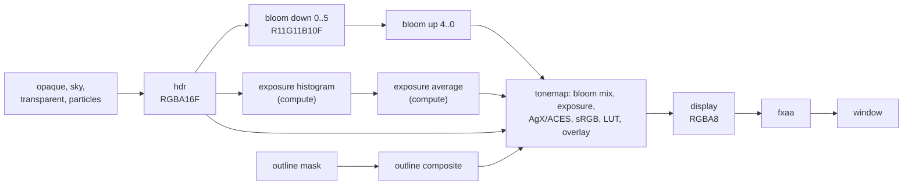
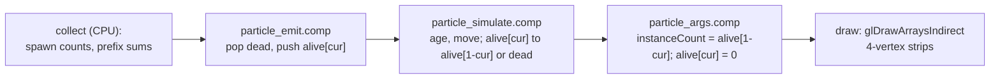

# 08. Effects and post-processing

Chapter [07](07-lighting-and-shadows.md) ended with a lit image in a floating-point render
target, where a pixel can hold 0.002 or 3000. This chapter follows that image to the screen
and covers the effects drawn around it. You will learn why the scene is rendered in HDR, how
bloom is built from a mip pyramid, how auto exposure computes a luminance histogram on the GPU
without reading anything back, what a tone curve does (AgX and ACES), how a 3D LUT grades
color, how FXAA finds and softens edges, and then the scene effects: outlines with x-ray
silhouettes, projected decals (selection circles and spell templates), camera fade for
occluding walls, fog of war, GPU particles, the sky, and debug lines.

Where it lives:

| Topic | Code |
|---|---|
| Post chain | [`post/PostProcess.java`](../../modules/render/src/main/java/dev/jeddy/render/post/PostProcess.java), shaders `post/bloom_down.frag`, `bloom_up.frag`, `exposure_histogram.comp`, `exposure_average.comp`, `exposure.glsl`, `tonemap.frag`, `fxaa.frag`, `engine/color.glsl` |
| Grading LUT cooking | [`CubeLut.java`](../../tools/cooker/src/main/java/dev/jeddy/cooker/lut/CubeLut.java), [`CubeLutImporter.java`](../../tools/cooker/src/main/java/dev/jeddy/cooker/lut/CubeLutImporter.java) |
| Outlines | [`outline/Outlines.java`](../../modules/render/src/main/java/dev/jeddy/render/outline/Outlines.java), `pbr/outline_mask.vert`, `pbr/outline_mask.frag`, `post/outline.frag` |
| Decals | [`RenderPacket.addDecal`](../../modules/render/src/main/java/dev/jeddy/render/RenderPacket.java), [`decal/DecalTextures.java`](../../modules/render/src/main/java/dev/jeddy/render/decal/DecalTextures.java), `engine/decals.glsl` |
| Camera fade, fog of war | `engine/camera_fade.glsl`, [`fog/FogOfWar.java`](../../modules/render/src/main/java/dev/jeddy/render/fog/FogOfWar.java), `engine/fog_of_war.glsl` |
| Particles | [`particle/GpuParticles.java`](../../modules/render/src/main/java/dev/jeddy/render/particle/GpuParticles.java), `particle/*` |
| Sky, debug lines | `pbr/sky.frag`, [`debug/DebugDraw.java`](../../modules/render/src/main/java/dev/jeddy/render/debug/DebugDraw.java), [`debug/DebugRenderer.java`](../../modules/render/src/main/java/dev/jeddy/render/debug/DebugRenderer.java) |

Shader paths are relative to `modules/render/src/main/resources/dev/jeddy/render/shaders/`.
The decisions behind this chapter are D45 (decals in the light clusters), D46 (post), D47
(particles) and D48 (fog of war and camera fade) in DESIGN §17 ([../DESIGN.md](../DESIGN.md)).

## The display chain at a glance



`PostProcess.declare` adds these passes to the frame graph after everything that draws into the
`hdr` target. The overlay input is the outline image (or `-1` when outlines are off). With FXAA
the composite writes an intermediate `display` texture; without it, it writes the window
directly.

## HDR: why a floating-point target

Real scenes span an enormous range of radiance. A sunlit wall can be a thousand times brighter
than the same wall in shade, and a torch flame brighter still. If the lit pass wrote into an
8-bit target, it would have to clamp at 1 and quantize to 256 levels, losing both highlights
and shadow detail before exposure and tone mapping had a chance to decide what to show.

So the opaque pass renders into `graph.texture("hdr", GL_RGBA16F, 1f)`: half floats, 16 bits per
channel, about three significant decimal digits over a range up to 65504. The image is
**scene-referred** (proportional to physical radiance); the post chain turns it into a
**display-referred** image (values a monitor can show). Bloom uses `GL_R11F_G11F_B10F`, a packed
unsigned float format of 32 bits per pixel with no alpha: half the bandwidth of RGBA16F, and
bloom needs neither alpha nor negative values.

The window's framebuffer is not sRGB-capable (D23), so the composite pass encodes sRGB in the
shader, and the intermediate `display` texture is plain `GL_RGBA8` holding encoded values.

## Bloom

### What it imitates

Bright lights seem to glow: the lens and the eye scatter a small fraction of strong light into
neighboring directions (veiling glare). Bloom imitates that by adding a heavily blurred copy of
the image. A wide blur is expensive if done directly, so it is done on a **mip pyramid**:
downsample the image several times (each level half the size), then walk back up, adding each
level's blur to the next larger one. Each step is cheap, and the sum of all levels is a smooth
glow with a long tail.

`PostProcess.Config.DEFAULT` uses 6 levels and a mix of 4%: levels `bloom down 0` to `5` are 1/2
to 1/64 of the screen, and `bloom up 0` to `4` are 1/2 to 1/32.

### Downsampling with a 13-tap filter

A naive 2×2 average aliases: small bright features flicker as they cross pixel boundaries.
[`post/bloom_down.frag`](../../modules/render/src/main/resources/dev/jeddy/render/shaders/post/bloom_down.frag)
uses Jimenez's 13-tap filter (Call of Duty: Advanced Warfare). Thirteen bilinear taps around the
output pixel form five overlapping 2×2 boxes: one in the center (taps `j k l m`) and four at the
corners. The center box gets weight 0.5, each corner box 0.125:

```
  a . b . c        weights per tap (box weights spread over their 4 taps):
  . j . k .          e (shared by 4 corner boxes)       4 x 0.125/4 = 0.125
  d . e . f          b, d, f, h (shared by 2 boxes)     2 x 0.125/4 = 0.0625
  . l . m .          a, c, g, i (1 corner box)          1 x 0.125/4 = 0.03125
  g . h . i          j, k, l, m (center box)            0.5/4       = 0.125
```

The weights sum to $0.125 + 4(0.03125) + 4(0.0625) + 4(0.125) = 1$, so brightness is preserved:

```glsl
        outColor = e * 0.125 + (a + c + g + i) * 0.03125 + (b + d + f + h) * 0.0625
                + (j + k + l + m) * 0.125;
```

**Karis average on the first level.** A single pixel of extreme brightness (a specular glint on
a sword, 1000 times brighter than its neighbors) dominates any average, and as it moves by a
pixel the bloom around it pulses. The first downsample weights each box by
$w = 1/(1 + \text{luma})$, which behaves like averaging in a compressed (tone-mapped) space:

```math
\text{out} = \frac{\sum_b k_b\, w_b\, \bar c_b}{\sum_b k_b\, w_b}, \qquad w_b = \frac{1}{1 + Y(\bar c_b)}
```

where $\bar c_b$ is box $b$'s average color, $k_b$ its weight (0.5 or 0.125), and $Y$ the
luminance (`jeddyLuminance`, Rec. 709 weights $0.2126, 0.7152, 0.0722$).

```glsl
vec3 karis(vec3 a, vec3 b, vec3 c, vec3 d, out float weight) {
    vec3 box = (a + b + c + d) * 0.25;
    weight = 1.0 / (1.0 + jeddyLuminance(box));
    return box * weight;
}
```

Each tap also clamps to `[0, 60000]`, which keeps NaNs, negative values and half-float
overflow from spreading through the whole pyramid.

### Upsampling with a tent filter

[`post/bloom_up.frag`](../../modules/render/src/main/resources/dev/jeddy/render/shaders/post/bloom_up.frag)
reads the next smaller level with a 3×3 tent filter (weights $`\frac{1}{16}\begin{bmatrix}1&2&1\\2&4&2\\1&2&1\end{bmatrix}`$)
and adds this level's downsample:

```glsl
    outColor = textureLod(uHigh, vUv, 0.0).rgb + s * (1.0 / 16.0);
```

The passes run from the smallest level up (`for (int i = bloomLevels - 2; i >= 0; i--)` in
`declare`), so `bloom up 0` ends up as the sum of every level's blur.

### Mixing it in

```glsl
    if ((uFlags & 8u) != 0u) {
        vec3 bloom = textureLod(uBloom, vUv, 0.0).rgb * uParams.z;
        hdr = mix(hdr, bloom, uParams.y);
    }
```

`uParams.z` is `1 / bloomLevels`: each level is an average of the image, so their sum is about
`bloomLevels` times as bright, and dividing normalizes it. The result is then blended with
`mix` rather than added: $`c' = (1-k)\,c + k\,\text{bloom}`$ with $k = 0.04$. Total energy stays
about the same; bloom only redistributes light from bright areas into their surroundings. There
is no brightness threshold: everything blooms a little, and only very bright things bloom
visibly, which is what physical glare does.

**Try it.** `PostProcessTest.bloomSpreadsBrightLightIntoTheSurroundings` renders an emissive
sphere of strength 40 and checks that a pixel 30 px from the center (beyond the silhouette) goes
from below 2/255 without bloom to above 8/255 with `setBloomIntensity(0.05f)`.

```bash
./gradlew :render:test -Pjeddy.gpuTests=true --tests 'dev.jeddy.render.post.PostProcessTest'
```

## Auto exposure

### The idea

A camera (or an eye) adapts: it lets in less light in sunshine and more in a cellar. Exposure is
a multiplier applied before tone mapping. Auto exposure picks it so that the scene's average
luminance maps to **middle grey**, the key value 0.18 (a surface reflecting 18% looks halfway
between black and white to us). If the average luminance is $\bar Y$:

```math
\text{exposure} = \frac{\text{key}}{\bar Y}
```

Which average? The arithmetic mean is dominated by a few very bright pixels (the sun, a fire),
so Jeddy averages **log** luminance (a geometric mean, like how we perceive brightness in stops)
and ignores the darkest and brightest fractions of pixels.

### A histogram on the GPU

[`post/exposure_histogram.comp`](../../modules/render/src/main/resources/dev/jeddy/render/shaders/post/exposure_histogram.comp)
builds a 256-bin histogram of log2 luminance:

```glsl
    ivec2 p = ivec2(gl_GlobalInvocationID.xy) * 2;
    ivec2 size = textureSize(uHdr, 0);
    if (p.x < size.x && p.y < size.y) {
        float l = jeddyLuminance(texelFetch(uHdr, p, 0).rgb);
        uint bin = 0u;
        if (l > 1e-6) {
            bin = uint(clamp((log2(l) - uRange.x) * uRange.y, 0.0, 1.0) * 254.0 + 1.0);
        }
        atomicAdd(bins[bin], 1u);
    }
    barrier();
    if (bins[i] != 0u) {
        atomicAdd(jHistogram[i], bins[i]);
    }
```

- **Quarter density**: each invocation reads one pixel at even coordinates, so a 2×2 block
  contributes one sample. The histogram shape barely changes and the pass is four times cheaper.
- **Binning**: with $t = (\log_2 Y - \text{min})/(\text{max} - \text{min})$ clamped to $[0,1]$,
  the bin is $`\lfloor 254\,t \rfloor + 1`$, so bins 1 to 255 cover the range and bin 0 holds
  black pixels ($Y \le 10^{-6}$), which have no logarithm. The default range is $2^{-8}$ to
  $2^{10}$ (`AutoExposure.DEFAULT`: `minLog2 = -8`, `maxLog2 = 10`), 18 stops, about 0.07 stop
  per bin.
- **Two-level atomics**: each 16×16 workgroup (256 invocations, one per bin for the final step)
  first counts into `shared` memory, then adds only its non-zero bins to the global histogram.
  Neighboring pixels tend to fall into the same few bins, so instead of 256 global atomics
  contending for the same addresses, a workgroup issues a handful.

Example: $Y = 0.05$ gives $\log_2 Y = -4.32$, $t = 0.204$, bin 52, whose center is
$2^{-4.35} = 0.049$.

### The trimmed average and adaptation

[`post/exposure_average.comp`](../../modules/render/src/main/resources/dev/jeddy/render/shaders/post/exposure_average.comp)
runs one workgroup of 256 invocations: each loads one bin into shared memory and clears it in
the global buffer for the next frame; then invocation 0 walks the bins.

```glsl
    float low = total * uParams.x;
    float high = total * uParams.y;
    float below = 0.0;
    float sum = 0.0;
    float weight = 0.0;
    float range = 1.0 / uRange.y;
    for (int b = 1; b < 256; b++) {
        float n = counts[b];
        float w = max(min(below + n, high) - max(below, low), 0.0);
        sum += w * (uRange.x + (float(b) - 0.5) / 254.0 * range);
        weight += w;
        below += n;
    }
```

Think of the sorted pixels laid out on a line from 0 to `total`. Bin $b$ occupies the interval
$[\text{below}, \text{below} + n]$, and only its overlap with $[\text{low}, \text{high}]$ counts:
`min(below + n, high) - max(below, low)`, clamped at 0. With the defaults `lowFraction = 0.5`
and `highFraction = 0.95`, the average uses the pixels between the median and the 95th
percentile (the brighter half, minus the brightest 5%). Each counted pixel contributes its bin's
center log luminance, $\text{min} + (b - 0.5)/254 \cdot (\text{max} - \text{min})$. Black pixels
(bin 0) never count.

Then exposure adapts towards the target smoothly, in log space (in stops), so a change from 1 to
2 takes as long as from 4 to 8:

```math
\text{target} = \frac{\text{key}}{2^{\overline{\log_2 Y}}}, \qquad
k = 1 - e^{-\Delta t\cdot \text{rate}}, \qquad
\log_2 e_{\text{next}} = \operatorname{mix}(\log_2 e,\ \log_2 \text{target},\ k)
```

$1 - e^{-\Delta t\cdot\text{rate}}$ makes the adaptation frame-rate independent: two frames of
$\Delta t$ move as far as one of $2\Delta t$.

```glsl
    float key = uParams.w;
    float averageLog = weight > 0.0 ? sum / weight : log2(key);
    float target = key / exp2(averageLog);
    float current = jExposure;
    float next = target;
    if (current > 0.0) {
        float rate = target > current ? uSpeed.y : uSpeed.x;
        float k = 1.0 - exp(-uParams.z * rate);
        next = exp2(mix(log2(current), log2(target), k));
    }
```

When the target exposure is higher than the current one, the scene got darker, so the darkening
rate applies (`darkenRate`, 1/s by default); otherwise the brightening rate (3/s). Eyes adapt to
bright light faster than to darkness, and so does this. An exposure of 0 means "no history":
`setAutoExposure` writes 0 so the next frame snaps to the target (camera cuts use
`resetExposure`).

**Numeric example** (the scenario of `autoExposureMapsTheAverageToTheKeyAndAdapts`): a uniform
scene of radiance 0.05 snaps to exposure $0.18/0.05 = 3.6$. The scene becomes ten times brighter
(0.5), so the target is 0.36. After one frame of 0.1 s at the brightening rate 3/s,
$k = 1 - e^{-0.3} = 0.259$ and the exposure is
$`2^{\,1.848 + 0.259\cdot(-1.474 - 1.848)} = 2^{0.987} = 1.98`$, a quarter of the way in stops.
After 40 more frames it has converged to 0.36. (These are the ideal values. The GPU averages bin
centers, here $2^{-4.35} = 0.049$ and $0.493$, so it measures 3.67 and 0.365; the test allows 8%.)

### No read-back (D46)

The histogram, the average and the exposure stay on the GPU in one storage buffer at
`PostProcess.EXPOSURE_BINDING` (5), declared in `post/exposure.glsl`:

```glsl
layout(std430, binding = 5) buffer JeddyExposure {
    uint jHistogram[256]; // bin 0: black; bins 1..255: log2 luminance over the configured range
    float jExposure;      // current exposure multiplier (0 before the first frame: snap)
    float jAverageLuminance;
    float jTargetExposure;
    float jExposurePad;
};
```

| Byte offset | Field |
|---|---|
| 0–1023 | `jHistogram[256]` |
| 1024 | `jExposure` (`EXPOSURE_OFFSET`) |
| 1028 | `jAverageLuminance` (`AVERAGE_OFFSET`) |
| 1032 | `jTargetExposure` |
| 1036 | pad (1040 bytes in total) |

The composite pass reads `jExposure` directly. Reading it back to the CPU would stall the CPU
until the GPU finished the frame, or need a delayed ring of buffers; keeping the loop on the GPU
avoids both. The frame graph inserts the storage barrier between the passes because they declare
`writes(exposure)` and `readsStorage(exposure)`. On the CPU, `RenderPacket.exposure` became a
**compensation** factor: `prepare(p.exposure, elapsed)` passes it to the composite, which
multiplies it on top of the automatic value.

## Tone mapping

### Why a curve

After exposure, middle grey is 0.18, but highlights can still be 10 or 100. A display shows
$[0, 1]$. Clamping turns every bright area into a flat white blob with clipped, oddly colored
edges. A **tone curve** compresses the range smoothly: almost linear in the shadows and
midtones, rolling off highlights gradually towards 1.

From `post/tonemap.frag`:

```glsl
    hdr *= jExposure * uParams.x;
    vec3 display = (uFlags & 1u) != 0u ? jeddyTonemapAgx(hdr) : jeddyTonemapAces(hdr);
    vec3 encoded = jeddyLinearToSrgb(display);
```

`uParams.x` is the compensation. `PostProcess.Tonemapper` offers `AGX` (default) and `ACES`.

### ACES (Narkowicz fit)

Krzysztof Narkowicz's rational fit of the ACES reference rendering transform:

```math
f(x) = \operatorname{saturate}\left(\frac{x\,(2.51x + 0.03)}{x\,(2.43x + 0.59) + 0.14}\right)
```

```glsl
// ACES filmic fit (Narkowicz 2015).
vec3 jeddyTonemapAces(vec3 x) {
    return clamp((x * (2.51 * x + 0.03)) / (x * (2.43 * x + 0.59) + 0.14), 0.0, 1.0);
}
```

It is applied per channel. That gives contrast and punch, but in a saturated bright color (a blue
magic flame) one channel reaches the shoulder of the curve before the others, so the ratios
between channels change and the hue shifts as the color gets brighter (blue towards purple,
orange towards yellow).

### AgX

Troy Sobotka's AgX avoids those artifacts. `jeddyTonemapAgx` (in `engine/color.glsl`) uses a
polynomial fit of its default curve by Benjamin Wrensch:

1. **Inset**: a 3×3 matrix mixes a little of the other channels into each one. This pulls very
   saturated colors slightly inward, so as they brighten they move towards white instead of
   clipping in one channel.
2. **Log encoding**: $\log_2$ of each channel, clamped to $[-12.47, 4.03]$ and normalized to
   $[0, 1]$. Since $\log_2 0.18 = -2.47$, that range is 10 stops below middle grey to 6.5 above.
3. **Sigmoid**: a degree-6 polynomial approximating AgX's contrast curve.
4. **Outset**: a second matrix that roughly reverses the inset, restoring saturation.
5. **Power 2.2**: the curve's output is display-encoded; `pow(c, 2.2)` makes it linear again so
   the shader can apply the exact sRGB encoding afterwards.

```glsl
    c = inset * max(c, vec3(0.0));
    c = clamp(log2(max(c, vec3(1e-10))), minEv, maxEv);
    c = (c - minEv) / (maxEv - minEv);
    vec3 x2 = c * c;
    vec3 x4 = x2 * x2;
    c = 15.5 * x4 * x2 - 40.14 * x4 * c + 31.96 * x4 - 6.868 * x2 * c + 0.4298 * x2
            + 0.1191 * c - 0.00232;
    c = outset * c;
    return pow(clamp(c, 0.0, 1.0), vec3(2.2));
```

Values for grey inputs (linear display output; ACES from the formula, AgX from a port of the
shader code):

| Input | 0.18 | 1 | 4 | 30 |
|---|---|---|---|---|
| ACES | 0.267 | 0.804 | 0.973 | 1.0 |
| AgX | 0.214 | 0.590 | 0.861 | 0.997 |

AgX is flatter and keeps detail in highlights longer; ACES is more contrasty and saturates
earlier.

### sRGB encoding

Monitors expect **sRGB-encoded** values, not linear light: the encoding spends more of the 256
levels on dark tones, where our eyes are more sensitive. The transfer function:

```math
\text{enc}(c) =
\begin{cases}
12.92\,c & c \le 0.0031308\\
1.055\,c^{1/2.4} - 0.055 & \text{otherwise}
\end{cases}
```

```glsl
vec3 jeddyLinearToSrgb(vec3 c) {
    c = clamp(c, 0.0, 1.0);
    return mix(c * 12.92, 1.055 * pow(c, vec3(1.0 / 2.4)) - 0.055, step(vec3(0.0031308), c));
}
```

`step(edge, c)` is 0 below the edge and 1 above, so `mix` selects a branch without an `if`.
Linear 0.18 encodes to 0.461: middle grey sits in the middle of the encoded range.

**Try it.** `PostProcessTest.toneCurvesMatchTheReference` renders a uniform environment at
radiances 0 to 30 with exposure compensation 1.5 and compares the window pixel with a Java port
of each curve (`agx`, `aces` and `srgb` helpers in the test), and checks the curves are
monotonic.

## Color grading with a 3D LUT

Grading changes the look: warmer, cooler, more contrast, a desaturated flashback. Colorists
author it in tools that export a **3D lookup table**: an $n\times n\times n$ grid where entry
$(r, g, b)$ holds the graded color. Any color is graded by trilinear interpolation between the
eight nearest entries, which a 3D texture does in hardware.

Jeddy grades in **display space**, after tone mapping and sRGB encoding (D46): LUTs from
grading tools expect display-encoded inputs in $[0,1]$, and that is the space in which a
colorist made them.

The lookup needs one correction. With $n$ entries per axis, entry $i$ sits at texture
coordinate $(i + 0.5)/n$ (texel centers). Input 0 must hit the center of entry 0 and input 1
the center of entry $n-1$:

```math
u = x\,\frac{n-1}{n} + \frac{0.5}{n}
```

For $n = 16$: input 0 maps to 0.03125, input 1 to 0.96875. Without it the LUT's outer half texels
would be wasted and the result slightly off.

```glsl
    if ((uFlags & 2u) != 0u) {
        float n = uParams.w;
        encoded = textureLod(uLut, encoded * ((n - 1.0) / n) + 0.5 / n, 0.0).rgb;
    }
```

LUTs reach the renderer two ways:

- `PostProcess.createLut(device, size, rgb)` builds an RGBA16F 3D texture from `size³` RGB
  triples, red varying fastest; `setGradingLut(glTexture, size)` turns grading on (0 turns it
  off).
- The cooker's `CubeLutImporter` cooks an Adobe/Resolve `.cube` file (parsed by `CubeLut`:
  `LUT_3D_SIZE`, optional `DOMAIN_MIN`/`DOMAIN_MAX`, data with red fastest) into an RGBA16F 3D
  KTX2, resampling it onto $[0,1]$ when the source domain differs, and warning when values leave
  $[0, 1]$ ("display-space grading expects encoded colors").

**Try it.** `gradingLutRemapsDisplayColors` builds a 16³ LUT that swaps red and blue and checks
that the window shows red's value in blue and vice versa; `cookedLutsLoadAsVolumeTextures` loads
a cooked 8³ LUT that halves every value through the asset manager.

## Overlay, dither and luma

After grading, the composite does three more things:

```glsl
    if ((uFlags & 16u) != 0u) {
        vec4 o = textureLod(uOverlay, vUv, 0.0);
        encoded = encoded * (1.0 - o.a) + o.rgb;
    }
    if ((uFlags & 4u) != 0u) {
        encoded += (jeddyGradientNoise(gl_FragCoord.xy) - 0.5) / 255.0;
    }
    outColor = vec4(encoded, dot(encoded, vec3(0.299, 0.587, 0.114)));
```

1. **Overlay**: the outline image (below), premultiplied and already sRGB-encoded, composited
   with the "over" operator. It comes after the LUT, so outline colors are exact whatever the
   grading and exposure.
2. **Dither**: an 8-bit target quantizes to steps of 1/255, which shows as **banding** in smooth
   gradients (a dark sky). Adding noise of $\pm\frac12$ step before quantization trades the bands
   for fine, invisible grain. The noise is interleaved gradient noise (Jimenez 2014), a cheap
   per-pixel hash. The composite dithers only when there is no FXAA pass; otherwise FXAA dithers
   its own output (`uParams.w` is 1 in `fxaaPass`).
3. **Luma in alpha**: FXAA works on perceptual brightness. Storing Rec. 601 luma of the encoded
   color in alpha saves FXAA from recomputing it at each of its many taps.

## FXAA

Aliasing is the staircase along geometric edges: each pixel is either inside or outside a
triangle. MSAA would fix it at the rasterizer but costs memory and does not combine well with
deferred-style screen passes. **FXAA** (Timothy Lottes) is a single screen-space pass that finds
edges in the final image and blends across them. D46 chose it over SMAA for v1: one pass, no
lookup textures.

[`post/fxaa.frag`](../../modules/render/src/main/resources/dev/jeddy/render/shaders/post/fxaa.frag),
after FXAA 3.11's quality algorithm:

1. **Early out.** Read the luma of the pixel and its four neighbors. If their range is below
   `max(0.0833, 0.166 * hi)` (absolute and relative thresholds, `uParams.z` and `.y`), there is no
   edge worth smoothing.
2. **Sub-pixel amount.** Compare the pixel with the weighted average of its 8 neighbors. A thin
   feature (a one-pixel line) differs a lot from its surroundings; it gets a blend amount of
   `smoothstep(...)²` scaled by `uParams.x` (0.75).
3. **Edge orientation.** Second differences along rows and columns decide whether the edge is
   horizontal or vertical.
4. **Which side.** Of the two neighbors across the edge, the one with the larger luma gradient is
   the other side of the edge; the search line is placed half a pixel towards it.
5. **Walk along the edge** in both directions with growing steps (`SEARCH = 1, 1, 1, 1, 1.5, 2,
   2, 2, 4, 8`) until the luma departs from the edge's average by a quarter of the gradient: the
   edge ends there.
6. **Blend.** If the pixel is at distance $d_1$ from one end and $d_2$ from the other, the edge
   crosses the pixel row at a position that gives a blend of $`0.5 - \min(d_1,d_2)/(d_1+d_2)`$:
   pixels near the end of a staircase step get almost half a pixel of blend, pixels in the middle
   almost none. The final read is offset across the edge by the blend amount, and bilinear
   filtering does the mixing.

```glsl
    float offset = 0.5 - distance / (distance1 + distance2);
    // Blend only on the side where the edge ends in the direction of this pixel's luma.
    bool centerBelow = m < edgeLuma;
    bool consistent = ((nearer1 ? end1 : end2) < 0.0) != centerBelow;
    float blend = max(consistent ? offset : 0.0, sub);
```

**Try it.** `fxaaSoftensTheSilhouette` counts pixels with intermediate values along an emissive
sphere's edge; with FXAA on there must be at least 1.5 times as many.

## Outlines and x-ray silhouettes

CRPGs highlight the hovered creature, mark the selected party members and hostile targets, and
show interactable objects while a key is held. They also need to show characters hidden behind
walls. [`Outlines`](../../modules/render/src/main/java/dev/jeddy/render/outline/Outlines.java)
does all of it with two passes and an overlay.

**Styles.** An instance gets a style with `RenderPacket.setHighlight(i, style)`, which stores the
style (1 to 15) in flag bits 8–11 (`HIGHLIGHT_SHIFT = 8`) and sets `FLAG_HIGHLIGHT`. Each style
has an sRGB color and opacity, an outline width in pixels (up to 8), a fill opacity where the
shape is visible, a fill opacity where it is hidden, and an outline opacity where hidden. The
defaults:

| Style | Color (sRGB) | Width | Visible fill | Hidden fill | Hidden outline |
|---|---|---|---|---|---|
| `HIGHLIGHT_HOVER` (1) | white, a 0.9 | 2 | 0 | 0.25 | 0.6 |
| `HIGHLIGHT_SELECTED` (2) | (0.35, 1, 0.45) | 2 | 0 | 0.3 | 0.7 |
| `HIGHLIGHT_HOSTILE` (3) | (1, 0.25, 0.2) | 2 | 0 | 0.3 | 0.7 |
| `HIGHLIGHT_INTERACTABLE` (4) | (1, 0.8, 0.3) | 1.5 | 0.12 | 0 | 0 |

**Collect.** `collect` loops over the packet, keeps highlighted instances inside the view frustum
(static ones too, whoever culls them for the main view, D49) and builds their draws with its own
`DrawBuilder`.

**Mask pass.** `pbr/outline_mask.vert` and `.frag` draw only the highlighted instances into an
`RG8` mask with their own depth buffer (`outline depth`, cleared to 0), using
`PipelineState.OPAQUE`, so where two highlighted objects overlap the nearer one wins. The
fragment shader compares its depth with the scene's prepass depth:

```glsl
    float scene = texelFetch(uSceneDepth, ivec2(gl_FragCoord.xy), 0).r;
    float z = gl_FragCoord.z;
    // Reversed-Z: larger is nearer. The tolerance absorbs differences between this program's
    // and the prepass's transforms.
    bool occluded = scene > z + max(z * 2e-4, 1e-7);
    outMask = vec2(float(vStyle) / 255.0, occluded ? 1.0 : 0.0);
```

The mask stores the style in R and "hidden behind the scene" in G. The tolerance plays the same
role as GEQUAL in the lit pass (chapter 07, D42): two programs, not bit-identical depths.

**Composite pass.** [`post/outline.frag`](../../modules/render/src/main/resources/dev/jeddy/render/shaders/post/outline.frag)
turns the mask into a premultiplied RGBA8 overlay:

- Inside a shape (the pixel's own style is non-zero): the fill, $\alpha = a\cdot\text{fill}$ with
  the hidden or visible fill depending on G. A hostile creature behind a wall shows as a 30% red
  silhouette over the wall: the x-ray.
- Outside: search the $(2r+1)^2$ neighborhood (limited to a disc of radius $r+1$) for the nearest
  shape pixel, where $r$ is the widest style's width rounded up. If its center is $d$ pixels
  away, this pixel spans distances $[d-1, d]$ from the shape's edge, so the fraction of it inside
  an outline of width $w$ is about

```math
\alpha = \operatorname{saturate}(w + 1 - d)\cdot a
```

  which gives an anti-aliased outline without any extra pass. Hidden parts multiply it by the
  hidden-outline opacity.

```glsl
    // A pixel d away from the nearest shape pixel spans [d - 1, d] from the shape edge.
    float a = clamp(params.x + 1.0 - sqrt(best), 0.0, 1.0) * c.a;
    if (hidden > 0.5) {
        a *= params.w;
    }
    outOverlay = vec4(c.rgb * a, a);
```

**Why display space.** The overlay is composited by the tone-map pass after encoding and grading
(above), so a "selected" green is exactly `(0.35, 1, 0.45)` on screen in a dark cave and in
daylight. Exposure and tone curves would otherwise change it. It is composited before FXAA, so
outline edges get anti-aliased with the scene.

**Try it.** `OutlinesTest.selectedInstancesGetAnOutlineOfTheStyleColor` measures the outline color
and width (about 2 px), and `hiddenPartsShowAsAnXraySilhouette` checks that the hidden half of a
sphere behind a wall shows as wall × 0.7 + hostile red × 0.3 while the visible half has no fill.

## Decals

Selection circles under characters, spell templates (a fireball circle, a cone of cold, a
lightning bolt line), scorch marks and blood: all are **decals**, images projected onto whatever
surfaces lie under them. Jeddy's decals are boxes that project downward, evaluated inside the
lit shader (no extra geometry and no extra pass).

### The box and its world-to-box matrix

`RenderPacket.addDecal(shape, x, y, z, halfWidth, halfDepth, halfLength, yaw, r, g, b, a)`
describes a box centered at $\mathbf c = (x, y, z)$, rotated by `yaw` $\psi$ about +Y, with half
extents $w$ (local X), $h$ (vertical) and $l$ (local Z). The shader needs the inverse: given a
world point $\mathbf p$, where is it inside the box, in coordinates where the box is $[-1,1]^3$?

The box's local axes in world space are the columns of the rotation about Y:

```math
\mathbf X = (\cos\psi,\ 0,\ -\sin\psi), \qquad \mathbf Y = (0,\ 1,\ 0), \qquad \mathbf Z = (\sin\psi,\ 0,\ \cos\psi)
```

A rotation's inverse is its transpose, so the local coordinates are dot products with the axes,
then divided by the half extents:

```math
p_x' = \frac{\mathbf X\cdot(\mathbf p - \mathbf c)}{w}, \quad
p_y' = \frac{\mathbf Y\cdot(\mathbf p - \mathbf c)}{h}, \quad
p_z' = \frac{\mathbf Z\cdot(\mathbf p - \mathbf c)}{l}
```

Expanding $\mathbf X\cdot(\mathbf p - \mathbf c) = \mathbf X\cdot\mathbf p - \mathbf X\cdot\mathbf c$
gives an affine map, stored as three rows of a row-major 3×4 matrix (the same layout as instance
transforms, D21; see [02 Math foundations](02-math-foundations.md)):

```math
\begin{bmatrix} p_x' \\ p_y' \\ p_z' \end{bmatrix} =
\begin{bmatrix}
\cos\psi/w & 0 & -\sin\psi/w & -(x\cos\psi - z\sin\psi)/w \\
0 & 1/h & 0 & -y/h \\
\sin\psi/l & 0 & \cos\psi/l & -(x\sin\psi + z\cos\psi)/l
\end{bmatrix}
\begin{bmatrix} p_x \\ p_y \\ p_z \\ 1 \end{bmatrix}
```

That is exactly what `addDecal` writes:

```java
        float c = (float) Math.cos(yaw);
        float sn = (float) Math.sin(yaw);
        float iw = 1f / halfWidth;
        float ih = 1f / halfDepth;
        float il = 1f / halfLength;
        // Local X = (cos, 0, -sin), Y = up, Z = (sin, 0, cos); rows map world to [-1, 1].
        d[o] = c * iw;
        d[o + 1] = 0;
        d[o + 2] = -sn * iw;
        d[o + 3] = -(c * x - sn * z) * iw;
        d[o + 4] = 0;
        d[o + 5] = ih;
        d[o + 6] = 0;
        d[o + 7] = -y * ih;
        d[o + 8] = sn * il;
        d[o + 9] = 0;
        d[o + 10] = c * il;
        d[o + 11] = -(sn * x + c * z) * il;
```

**Numeric example.** A decal at $(2, 0, 3)$ with $\psi = 90°$ ($\cos = 0$, $\sin = 1$) and half
extents $w = 1$, $h = 0.5$, $l = 2$. The rows are $(0, 0, -1, 3)$, $(0, 2, 0, 0)$ and
$(0.5, 0, 0, -1)$.

- The center $(2, 0, 3)$ maps to $`(-3 + 3,\ 0,\ 1 - 1) = (0, 0, 0)`$.
- $(4, 0, 3)$ maps to $(0, 0, 1)$: local Z points along world +X at this yaw, and 2 m is the
  half length.
- $(2, 0, 2)$ maps to $(1, 0, 0)$: local X points along world −Z.

The rest of the 28-float record (`DECAL_FLOATS`) is the bounding sphere (center and
$\sqrt{w^2+h^2+l^2}$, for cluster culling), the color and opacity, then shape parameters:

| Floats | GLSL (`engine/decals.glsl`) | Content |
|---|---|---|
| 0–11 | `rows[3]` | world to box, row-major 3×4 |
| 12–15 | `bounds` | sphere center, radius |
| 16–19 | `color` | linear RGB, opacity |
| 20–23 | `params` | shape (int bits), p0, p1, emission |
| 24–27 | `extra` | fill opacity, texture layer, 0, 0 |

### Shapes as signed distances

Each procedural shape is a **signed distance** $d$ to its edge in meters, negative inside, so a
single function draws a crisp, anti-aliased fill and outline for all of them. The box coordinates
are scaled back to meters with the half extents, recovered from the matrix rows:
`scale = vec2(1.0 / length(d.rows[0].xyz), 1.0 / length(d.rows[2].xyz))` is $(w, l)$ because
row 0's XYZ part has length $1/w$.

| Shape | Signed distance ($\mathbf q$ = local XZ in meters) |
|---|---|
| `DECAL_DISC` | $\lVert\mathbf q\rVert - w$ |
| `DECAL_CONE` (apex at the center, axis +Z, half-angle $\theta$) | $`\max(\lVert\mathbf q\rVert - l,\ \lvert q_x\rvert\cos\theta - q_z\sin\theta)`$ |
| `DECAL_LINE` | $`\max(\lvert q_x\rvert - w,\ \lvert q_z\rvert - l)`$ |
| `DECAL_RING` | not a distance: a smooth band between an inner radius (fraction p0 of $w$) and $w$, with edge softness p1 |

The cone's side term is the distance to the line through the apex at angle $\theta$ from the
axis: its outward normal is $(\cos\theta, -\sin\theta)$, and taking $\lvert q_x\rvert$ mirrors
both sides into one. The maximum of two signed distances is their intersection (the shape must
be inside both the radius and the wedge). Points behind the apex have $`q_z < 0`$, so the side term
is positive: outside.

The distance becomes an opacity:

```glsl
float jeddyDecalOutline(float distance, float outline, float fill, float aa) {
    float inside = 1.0 - smoothstep(-aa, aa, distance);
    float rim = 1.0 - smoothstep(outline - aa, outline + aa, -distance);
    return inside * max(fill, rim);
}
```

- `inside` is 1 inside the edge and 0 outside, with a soft transition two "aa" wide.
- `rim` is 1 within `outline` meters inside the edge.
- The interior shows at `fill` opacity (30% by default for templates), the rim at full opacity.

`aa` is the **pixel footprint**: `max(length(dpdx), length(dpdy))`, the world size of one pixel
on this surface, from the derivatives `pbr.frag` takes at its top. The transition is always about
one pixel wide, at any zoom. That is why the lit shader computes `dFdx(vWorld)` first: GLSL
derivatives are undefined in non-uniform control flow (after a `discard` that only some pixels
take, or inside a loop whose iterations differ per pixel, like the decal loop), so they are taken
while every pixel of the 2×2 quad is still running the same code.

### Applying decals in the lit shader

```glsl
    // Surfaces turned away from the projection axis (walls, sides) fade out.
    float facing = smoothstep(0.35, 0.65, normal.y);
    // ...
    for (uint k = 0u; k < decals; k++) {
        JeddyDecal d = jDecals[jClusterLights[range.x + lights + k]];
        vec4 w = vec4(world, 1.0);
        vec3 p = vec3(dot(d.rows[0], w), dot(d.rows[1], w), dot(d.rows[2], w));
        if (any(greaterThan(abs(p), vec3(1.0)))) {
            continue;
        }
        vec2 scale = vec2(1.0 / length(d.rows[0].xyz), 1.0 / length(d.rows[2].xyz));
        float a = d.color.a * facing * (1.0 - smoothstep(0.75, 1.0, abs(p.y)));
```

- **Clustered** (D45): the decal list is the same cluster list as the lights, after them.
  `range.y >> 16` is the decal count, and `range.x + lights + k` indexes past the lights.
  `light_cull.comp` tests decals' bounding spheres exactly like lights' (chapter 07). One cull
  pass and one lookup serve both.
- **Facing**: decals project downward, so only upward-facing surfaces (normal Y above about 0.5)
  take them. A selection ring does not smear down the side of a crate.
- **Vertical fade**: the top and bottom 25% of the box fade out, so a decal does not end in a hard
  line on a slope.

**Compositing.** Decals can tint (a painted mark, lit like the surface) or glow (a selection
circle, visible in darkness), set with `setDecalEmission` (0 tints, 1 glows):

```glsl
        float glow = d.params.w;
        // Tints composite over each other in list order (premultiplied); glow adds.
        float tint = a * (1.0 - glow);
        result.tint = result.tint * (1.0 - tint) + vec4(color, 1.0) * tint;
        result.emitted += color * a * glow;
```

and `pbr.frag` uses the result:

```glsl
        base.rgb = base.rgb * (1.0 - decal.tint.a) + decal.tint.rgb;
        // Painted-on marks are matte and not metallic.
        metallic *= 1.0 - decal.tint.a;
        roughness = mix(roughness, 0.9, decal.tint.a);
        decalGlow = decal.emitted;
```

Because tinting changes the base color **before** lighting, a tint decal (emission 0, such as a
painted mark) is shadowed and lit like the floor, while glowing decals add `decalGlow` to the final
color.

**Textured decals.** `DECAL_TEXTURE` decals sample a layer of
[`DecalTextures`](../../modules/render/src/main/java/dev/jeddy/render/decal/DecalTextures.java),
an sRGB 2D array texture with full mip chains bound at unit 10 (`DecalTextures.UNIT`). Any texture
can be copied in on the GPU (`copy`), or RGBA8 pixels uploaded (`add`). The UV is the box's XZ
remapped to $[0,1]$, and the mip level comes from explicit gradients by the chain rule:
$`\partial u/\partial x = \tfrac12\,(\text{row}_0\cdot\partial\mathbf p/\partial x)`$, since
$u = \tfrac12 p_x' + \tfrac12$ and $`p_x' = \text{row}_0\cdot\mathbf p + t_0`$:

```glsl
            vec2 uv = p.xz * 0.5 + 0.5;
            vec2 gx = vec2(dot(d.rows[0].xyz, dpdx), dot(d.rows[2].xyz, dpdx)) * 0.5;
            vec2 gy = vec2(dot(d.rows[0].xyz, dpdy), dot(d.rows[2].xyz, dpdy)) * 0.5;
            vec4 t = textureGrad(jDecalTextures, vec3(uv, d.extra.y), gx, gy);
```

`textureGrad` is needed for the same reason as the footprint: implicit derivatives inside the
loop would be undefined.

**Opting out.** `FLAG_NO_DECALS` (16) on an instance (a character's feet) skips decals entirely;
`pbr.frag` tests `(vFlags & 16u) == 0u`. Blended materials never get decals (the include is
compiled out with `ALPHA_BLEND`).

**Helpers.** `addSelectionCircle` (ring, emissive), `addAoeCircle` (disc, 6 cm outline, 30%
fill), `addAoeCone` (half-angle in radians, 4 cm outline) and `addAoeLine` (from two points: the
yaw is `atan2(dx, dz)` and the half length half their distance). All four helpers set emission 1,
so their shapes glow; call `setDecalEmission(d, 0)` to make an AoE template a lit tint instead.

**Try it.** `DecalTest.areaTemplatesTintTheirShapes` (which sets emission 0 on its three
templates) checks the fill ratio (0.7 green/red inside,
30% red over white), the solid rim, and that points beside the cone, behind its apex and past the
line's end are untouched. `hundredsOfDecalsAreClusteredWithoutAllocating` renders 300 selection
circles at 0 bytes per frame.

## Camera fade for occluders

In an isometric game, roofs, walls and trees between the camera and the party hide what the
player wants to see. Sorting and alpha-blending them would break the depth prepass and needs
back-to-front order. Jeddy instead dissolves them with a **screen-door dither**: a faded surface
discards a fraction of its pixels in a fixed pattern, so it stays opaque, needs no sorting, and
the eye blends the pattern into a see-through look (D48).

**The pattern.** A 4×4 Bayer matrix gives every pixel of a 4×4 block a different threshold:

```glsl
bool jeddyFadeDiscard(vec2 fragCoord, float fade) {
    if (fade <= 0.0) {
        return false;
    }
    const float bayer[16] = float[](0.0, 8.0, 2.0, 10.0, 12.0, 4.0, 14.0, 6.0, 3.0, 11.0, 1.0,
            9.0, 15.0, 7.0, 13.0, 5.0);
    ivec2 p = ivec2(fragCoord) & 3;
    return fade > (bayer[p.y * 4 + p.x] + 0.5) / 16.0;
}
```

A pixel is dropped when the fade exceeds its threshold $(b + 0.5)/16$. With fade 0.5, the 8
pixels with $b \le 7$ go, half of every block; the Bayer ordering spreads them evenly instead of
clumping them. `FogAndFadeTest.instanceFadeDithersOutAShareOfPixels` counts $128 \pm 8$ remaining
pixels of 256 at `setFade(i, 0.5f)`.

**Two fade sources.**

1. A **per-instance fade** (`RenderPacket.setFade`), stored as float bits in the last word of the
   instance record: the game fades a roof while the party is inside.
2. **Reveal points** for instances flagged `FLAG_FADE_OCCLUDER` (32): up to four points
   (`addReveal(x, y, z, radius)`, the party members) around which occluders dissolve.

```glsl
    vec3 f = (jView * vec4(world, 1.0)).xyz;
    for (uint i = 0u; i < n; i++) {
        vec4 reveal = jReveal[i];
        vec3 r = (jView * vec4(reveal.xyz, 1.0)).xyz;
        if (f.z <= r.z + 0.25) {
            continue; // not in front of the point
        }
        // Lateral distance at the point's depth (perspective) or in the view plane (ortho).
        vec2 lateral = jeddyOrthographic() ? f.xy - r.xy : f.xy / -f.z * -r.z - r.xy;
        float d = length(lateral) / reveal.w;
        fade = max(fade, 1.0 - smoothstep(0.75, 1.0, d));
    }
```

The geometry, in view space (camera at the origin looking down −Z, so larger $z$ is closer):

```
   camera                 surface f            reveal point r
     O --------------------- * ----------------------- @
      \                      |  f.z > r.z + 0.25:       \
       \  ray through f      |  f is in front of r       \  f projected to r's depth:
        \                    |                            \   f.xy * (r.z / f.z)
```

- Only surfaces at least 25 cm in front of the point fade (the floor under the character and
  walls behind it stay).
- With perspective, the surface point is projected along its view ray onto the plane at the
  reveal point's depth, $`\mathbf f_{xy}\cdot(r_z/f_z)`$, and compared with $\mathbf r_{xy}$ there:
  that measures whether the wall covers the character on screen, in meters at the character's
  distance. With an orthographic camera rays are parallel, so the view-plane offset is enough.
- Fully faded within 75% of the radius, solid beyond it.

**Same pixels in both passes.** The depth prepass runs the same functions (`pbr/depth.frag`, with
`uCameraFade` set to 1 for the main view and 0 for shadow maps), so faded pixels are missing from
the depth buffer as well and the lit pass, testing GEQUAL, never shades them. Shadows still come
from the whole roof.

**Try it.** `wallsInFrontOfThePartyDissolveAroundIt` puts a wall between the camera and a red
sphere, adds a reveal point at the sphere, and checks that the sphere shows through, the wall
outside the circle stays solid, and an unflagged wall ignores reveal points.

## Fog of war

The physics visibility system (chapter [11](11-physics-navigation-crowds.md)) knows which grid
cells the party sees now and which it has explored. `app.physics.FogOfWarFeed` packs that into a
byte per cell (0 unexplored, 128 explored, 255 visible) and copies it into the render packet with
`setFogOfWar(cells, width, height, minX, minZ, sizeX, sizeZ, version)`.

[`FogOfWar`](../../modules/render/src/main/java/dev/jeddy/render/fog/FogOfWar.java) uploads the
grid as an `R8` texture only when `fogVersion` changes (D48), reallocating only when the grid size
changes. The rows are not a multiple of 4 bytes in general, so the upload sets
`GL_UNPACK_ALIGNMENT` to 1 around it. The lit pass samples it at unit 12 with a **linear**
sampler: bilinear filtering between cells turns the blocky grid into soft edges for free.

The world-to-grid mapping is an offset and a scale in XZ, with the reciprocals precomputed into
`jFogBounds` by `writeFrameConstants`:

```math
(u, v) = \left(\frac{x - x_{\min}}{s_x},\ \frac{z - z_{\min}}{s_z}\right)
```

```glsl
vec3 jeddyFogOfWar(vec3 color, vec3 world) {
    if (jFogParams.z == 0.0) {
        return color;
    }
    vec2 uv = (world.xz - jFogBounds.xy) * jFogBounds.zw;
    float v = texture(jFogOfWar, uv).r;
    float explored = smoothstep(0.05, 0.45, v);
    float visible = smoothstep(0.55, 0.95, v);
    float luma = dot(color, vec3(0.2126, 0.7152, 0.0722));
    vec3 dimmed = mix(vec3(luma), color, jFogParams.y) * jFogParams.x;
    return mix(dimmed, color, visible) * explored;
}
```

The R8 value $v$ is 0, about 0.5 or 1. Two smoothsteps split it into an "explored" factor
(0 → 1 around 0.25) and a "visible" factor (0 → 1 around 0.75). Explored-but-not-visible areas get
`dimmed`: desaturated towards their luminance (`fogExploredSaturation`, 0.3 by default) and
darkened (`fogExploredBrightness`, 0.4). Unexplored areas are multiplied by 0: black. The function
runs last in `pbr.frag` (`jeddyApplyEffects`), after emission, so glowing things in unexplored
areas are hidden too.

**Try it.** `fogDimsExploredAndHidesUnexploredGround` uses a 2×2 grid over $[-2, 2]^2$: the
visible cell is lit normally (about 1), the explored one is $0.4\times$ that, the unexplored one
below 0.02. `fogAndFadeFramesAllocateNothing` uploads a new 64×64 grid every frame at 0 bytes.

## GPU particles

Fireballs, sparks, smoke and magic need thousands of short-lived sprites. Simulating them on the
CPU would cost game-thread time and an upload per frame. [`GpuParticles`](../../modules/render/src/main/java/dev/jeddy/render/particle/GpuParticles.java)
keeps the whole life cycle on the GPU; the CPU only turns emitter rates into spawn counts (D47).

### Memory layout

| Buffer | Binding | Content |
|---|---|---|
| particle pool | 12 (`PARTICLES_BINDING`) | `capacity` × 80 B: position + age, velocity + lifetime, start color, end color, sizes + gravity + drag |
| lists | 13 (`LISTS_BINDING`) | 64 B header, then three index arrays of `capacity` each: dead stack, alive list 0, alive list 1 |
| emitters | 14 (`EMITTERS_BINDING`) | this frame's emitters, 112 B each, in the frame ring |

The header (`engine/particles.glsl`) holds the dead count, the two alive counts, a pad, and at
byte 16 a `DrawArraysIndirectCommand` (`count`, `instanceCount`, `first`, `baseInstance`) that the
GPU fills for the draw. At creation every particle is dead: the dead count is `capacity` and the
dead stack holds indices `0 .. capacity-1`. The default pool is 64k particles
(`SceneRenderer.Config.DEFAULT`, `1 << 16`).

### One frame



**CPU: spawn counts.** `collect` converts each emitter's rate (particles per second) into an
integer count for this frame with **random rounding**: $\lfloor \text{rate}\cdot\Delta t\rfloor$,
plus one with probability equal to the fractional part. At 60 fps a rate of 30/s is 0.5 per frame:
deterministic rounding would give 0 every frame (or 1 every frame), random rounding gives 30 per
second on average. Bursts are added once per **game** frame (`p.frame != lastPacketFrame`),
because the render thread may render the same packet twice. Each emitter's record gets its first
spawn index (a running prefix sum) and count.

**Emit.** One invocation per new particle. It finds its emitter by binary search over the prefix
sums (the last emitter whose first index is at most the invocation id), then pops a dead index:

```glsl
    uint before = atomicAdd(jDeadCount, 0xFFFFFFFFu);
    if (before == 0u || before > capacity) {
        atomicAdd(jDeadCount, 1u); // pool exhausted
        return;
    }
    uint index = jIndices[jeddyDead(before - 1u, capacity)];
```

Adding `0xFFFFFFFF` is subtracting 1 in unsigned arithmetic. If the stack was empty, the count
wraps and the invocation puts it back. The `before > capacity` test catches the moment when
several invocations race past zero.

The new particle's position is uniform in the emitter's sphere: a uniform direction, from
$z = 2\xi_1 - 1$ and $\phi = 2\pi\xi_2$ (Archimedes: the area of a sphere's slice depends only on
its height, so a uniform $z$ gives a uniform direction), and a radius $`R\,\xi_3^{1/3}`$. The cube
root is needed because the volume within radius $r$ grows as $r^3$:
$`P(\text{radius} < r) = (r/R)^3 = \xi`$ gives $`r = R\,\xi^{1/3}`$. The random numbers come from a
PCG hash (Jarzynski and Olano) seeded by the invocation id and a per-frame seed.

**Simulate.** One invocation per particle of the current alive list:

```glsl
    float age = p.positionAge.w + uSeconds;
    if (age >= p.velocityLife.w) {
        uint slot = atomicAdd(jDeadCount, 1u);
        jIndices[jeddyDead(slot, capacity)] = index;
        return;
    }
    vec3 v = p.velocityLife.xyz;
    v.y -= 9.81 * p.sizeForces.z * uSeconds;
    v *= exp(-p.sizeForces.w * uSeconds);
    jParticles[index].positionAge = vec4(p.positionAge.xyz + v * uSeconds, age);
    jParticles[index].velocityLife.xyz = v;
    uint next = 1u - current;
    uint slot = atomicAdd(jAliveCount[next], 1u);
    jIndices[jeddyAlive(next, slot, capacity)] = index;
```

- Gravity: $`v_y \mathrel{-}= 9.81\,g\,\Delta t`$, with $g$ the emitter's gravity scale.
- Drag: $\frac{dv}{dt} = -k v$ has the exact solution $`v(t+\Delta t) = v(t)\,e^{-k\Delta t}`$, so
  multiplying by `exp(-drag * dt)` is stable at any time step (a plain $v \mathrel{-}= kv\Delta t$
  overshoots when $`k\Delta t > 1`$).
- Position uses the updated velocity (semi-implicit Euler).
- Survivors are appended to the **other** alive list, the dead go back on the dead stack. Two
  lists that swap roles each frame (ping-pong) mean no particle is read and written in the same
  list during a pass, and the surviving list is compact without any sorting or compaction step.

**Args.** A single invocation writes the indirect draw: `jDrawCount = 4u` (a quad as a triangle
strip), `jDrawInstances` = the survivors' count, and zeroes the current list's count. The CPU
then flips `current`. The draw is `glDrawArraysIndirect(GL_TRIANGLE_STRIP, DRAW_OFFSET)` with the
list buffer bound as the indirect buffer: the GPU decides how many sprites to draw, and the CPU
never learns the number. The frame graph knows the draw pass `readsIndirect(lists)` (the list
buffer, which holds the counters and the indirect command), so it inserts the command barrier after
the compute passes.

**Try it.** `ParticlesTest.burstsSpawnOncePerGameFrameAndRatesPerSecond` checks bursts against
re-rendered packets and that 200/s for 0.25 s adds 50; `gravityAndDragMoveParticles` checks the
average position against $y = 1 - \tfrac12 g t^2$ and $x = 2t$; `particlesDieAtTheEndOfTheirLifetime`
checks the pool cap.

### Drawing soft, camera-facing sprites

`particle/particle.vert` turns each instance into a square facing the camera (a **billboard**). The
camera's right and up axes in world space are the first two **rows** of the view matrix (its
rotation part is orthonormal, so its inverse is its transpose, and the rows of the view matrix are
the camera axes):

```glsl
    vec2 corner = vec2(float(gl_VertexID & 1), float(gl_VertexID >> 1)) * 2.0 - 1.0;
    vec3 right = vec3(jView[0][0], jView[1][0], jView[2][0]);
    vec3 up = vec3(jView[0][1], jView[1][1], jView[2][1]);
    vec3 world = p.positionAge.xyz + (right * corner.x + up * corner.y) * size;
```

`jView[c][r]` is column `c`, row `r` in GLSL, so `(jView[0][0], jView[1][0], jView[2][0])` is
row 0. Vertex ids 0 to 3 give corners $(-1,-1), (1,-1), (-1,1), (1,1)$, the strip order. Color
and size interpolate from birth to death by $t = \text{age}/\text{lifetime}$. A particle of size 0
is moved outside the clip volume (`vec4(0.0, 0.0, -2.0, 1.0)`).

`particle/particle.frag` makes the sprite a soft disc and fades it near opaque surfaces
(**soft particles**):

```glsl
    float d = max(texelFetch(uSceneDepth, ivec2(gl_FragCoord.xy), 0).r, 1e-7);
    vec2 ndc = gl_FragCoord.xy * jViewport.zw * 2.0 - 1.0;
    vec4 v = jInverseProjection * vec4(ndc, d, 1.0);
    float scene = -v.z / v.w;
    float fade = clamp((scene - vViewDepth) / max(vSize, 0.05), 0.0, 1.0);
    float shape = 1.0 - smoothstep(0.3, 1.0, length(vCorner));
    float k = fade * shape;
    if (k <= 0.0) {
        discard;
    }
    outColor = vColor * k;
```

The pass has no depth attachment (D47). Instead it reads the scene depth as a texture,
reconstructs the opaque surface's view depth behind the pixel, and scales the sprite by how far in
front of it the particle is, relative to its size. Behind a surface the difference is negative and
the pixel is discarded; close to a surface the sprite fades in smoothly instead of being cut by a
hard line where it intersects the floor.

### Premultiplied alpha, one blend mode

The pass blends with `BLEND_PREMULTIPLIED`: $`\text{dst}' = \text{src}_{rgb} + (1 - \text{src}_a)\,\text{dst}`$.
Colors are **premultiplied** (RGB already multiplied by coverage). That one equation covers two
kinds of particles:

- alpha $a \gt 0$ (`colorStart = (r·a, g·a, b·a, a)`): normal "over" blending (smoke);
- alpha 0 (`(r, g, b, 0)`): $\text{dst}' = \text{src} + \text{dst}$, pure additive light (sparks,
  fire, magic).

Additive blending is commutative, so glowing particles need no sorting. Particles are not sorted
at all in v1 (D47), so overlapping smoke may blend in the wrong order; for the effects of an
isometric CRPG (mostly glowing) that is an accepted trade-off.

**Try it.** `additiveSpritesGlowAndHideBehindOpaqueSurfaces` puts glowing particles in front of and
behind a black sphere: the front ones exceed 1 (additive), the hidden ones contribute below 0.01.
`particleFramesAllocateNothing` measures 0 bytes per frame with an emitter at 500/s.

## The sky

Where no geometry was drawn, the background shows the environment cube.
[`pbr/sky.frag`](../../modules/render/src/main/resources/dev/jeddy/render/shaders/pbr/sky.frag)
draws one full-screen triangle after the opaque pass:

```glsl
void main() {
    vec3 far = jeddyWorldFromDepth(vUv, 0.0001);
    vec3 dir = jeddyOrthographic()
            ? -vec3(jView[0][2], jView[1][2], jView[2][2])
            : normalize(far - jEye.xyz);
    outColor = vec4(textureLod(jEnvironmentMap, dir, 0.0).rgb * jEnvironment.x, 1.0);
}
```

- `jeddyWorldFromDepth` unprojects the pixel at a tiny reversed-Z depth (very far away) with the
  inverse view-projection; the direction from the eye to that point is the pixel's view ray.
  With an orthographic camera every ray is the camera's forward axis, minus row 2 of the view
  matrix.
- Mip 0 of the prefiltered cube is the unblurred environment.
- `jEnvironment.x` is the packet's `environmentSpecular` scale, so sky and reflections match.

**The full-screen triangle.** `engine/fullscreen.vert` has no vertex buffer: vertex ids 0, 1, 2
become $(0,0), (2,0), (0,2)$ in UV and $(-1,-1), (3,-1), (-1,3)$ in clip space, one triangle
that covers the screen (clipping removes the rest). A two-triangle quad would shade the pixels
along its diagonal twice, because GPUs shade 2×2 pixel quads. Its `gl_Position.z` is 0, the far
plane in reversed-Z.

```glsl
void main() {
    vec2 p = vec2((gl_VertexID << 1) & 2, gl_VertexID & 2);
    vUv = p;
    gl_Position = vec4(p * 2.0 - 1.0, 0.0, 1.0);
}
```

**Only where empty.** `SceneRenderer.sky` uses `PipelineState.withDepth(FULLSCREEN, true, false,
DEPTH_GEQUAL)` against the prepass depth: the triangle is at depth 0, the buffer was cleared to 0,
so $0 \ge 0$ passes where nothing was drawn and $0 \ge d$ fails wherever geometry wrote $`d > 0`$.

## Debug drawing

Physics, navigation and gameplay code often need to show what they think: a raycast, a navmesh
polygon, an agent's avoidance radius. [`DebugDraw`](../../modules/render/src/main/java/dev/jeddy/render/debug/DebugDraw.java)
is an immediate-mode line API usable from any thread without locks: each job-system thread writes
into its own slot (`line(thread, x0, y0, z0, x1, y1, z1, argb)`, plus `box`, `circle`,
`sphere`, `capsule` and `cross` built from lines with precomputed sine and cosine tables). At
extract time the game thread calls `collect(packet)`, which concatenates every slot into
`packet.debugLines` (6 floats per line) and `packet.debugColors`. A full slot drops lines and
counts them (`dropped()`) instead of growing, so drawing a line never allocates.

[`DebugRenderer`](../../modules/render/src/main/java/dev/jeddy/render/debug/DebugRenderer.java)
draws them with **vertex pulling**: instead of a vertex buffer with attributes, the vertex shader
reads its vertex from a storage buffer by `gl_VertexID`:

```glsl
            layout(std430, binding = 2) readonly buffer Lines { vec4 vertices[]; };
            layout(location = 0) uniform mat4 viewProjection;
            layout(location = 0) out vec4 color;
            void main() {
                vec4 v = vertices[gl_VertexID];
                vec4 argb = unpackUnorm4x8(floatBitsToUint(v.w));
                color = vec4(argb.z, argb.y, argb.x, argb.w);
                gl_Position = viewProjection * vec4(v.xyz, 1.0);
            }
```

Each vertex is `(x, y, z, color bits)`: the Java side writes the `0xAARRGGBB` int into the fourth
float slot (its raw bits; `floatBitsToUint` recovers the same integer). `unpackUnorm4x8` splits a
`uint` into four bytes from the least significant: for the value `0xAARRGGBB` that is B, G, R, A,
hence the swizzle. One `glDrawArrays(GL_LINES, 0,
lines * 2)` draws everything. In `WorldRenderer` the lines are drawn after `SceneRenderer.render`,
into the window framebuffer, followed by the screen-space `Overlay` (text from a 5×7 font in a
storage buffer, D31).

## Exercises

1. **Switch the tone curve.** Call `renderer.post().setTonemapper(PostProcess.Tonemapper.ACES)`
   (or build the renderer with `PostProcess.Config.DEFAULT.withTonemapper(...)`) and compare a
   bright, saturated scene with AgX. Then add a third curve, Reinhard $x/(1+x)$, as a new enum
   constant.
   <details><summary>Hint</summary>

   The shader selects the curve with bit 0 of `uFlags`; bits 0 to 4 are taken, so use bit 5
   (value 32), set it in `PostProcess.tonemap`, and add
   `vec3 jeddyTonemapReinhard(vec3 x) { return x / (1.0 + x); }` to `engine/color.glsl`. Extend
   `toneCurvesMatchTheReference` with a Java reference; its loop over `Tonemapper.values()` picks
   the new constant up automatically.
   </details>

2. **Change the exposure key.** Set the key to 0.12 instead of 0.18 and predict what
   `autoExposureMapsTheAverageToTheKeyAndAdapts` will measure before running it.
   <details><summary>Hint</summary>

   The snapped exposure becomes $0.12/0.05 = 2.4$ and the adapted one $0.12/0.5 = 0.24$, so the
   test's hard-coded 0.18 and 0.36 fail. Make the test derive its expectations from `ae.key()`.
   </details>

3. **Add a vignette.** Darken the corners in `tonemap.frag` by $`1 - k\,\lVert \text{uv} - 0.5\rVert^2`$.
   Where in the chain should it go: before tone mapping, after encoding, before or after the LUT
   and the overlay?
   <details><summary>Hint</summary>

   Multiply `hdr` before the tone curve to darken in light units (it then behaves like a lens
   effect and the curve compresses it). Keep it before the overlay so outlines stay exact. Check
   that `toneCurvesMatchTheReference` still passes: it samples the center pixel, where the
   vignette is 1.
   </details>

4. **Add a decal shape.** Add `DECAL_SQUARE_RING = 5`: a square outline with no fill, sized by
   `halfWidth` and `halfLength`.
   <details><summary>Hint</summary>

   Add the constant to `RenderPacket` and `J_DECAL_SQUARE_RING = 5u` to `engine/decals.glsl`. Its
   signed distance is the line's, `max(q.x, q.y)` with `q = abs(p.xz) * scale - scale`, passed to
   `jeddyDecalOutline` with `fill = 0`. Add a test to `DecalTest` modeled on
   `areaTemplatesTintTheirShapes`: rim solid, center untouched.
   </details>

5. **Pulse the selection rings.** Make emissive ring decals pulse slowly with time.
   <details><summary>Hint</summary>

   The frame constants already carry the time: `jEye.w` (written from `p.time` by
   `writeFrameConstants`). In `jeddyDecals`, multiply `glow` for `J_DECAL_RING` by
   `0.75 + 0.25 * sin(jEye.w * 4.0)`. No CPU change is needed, and the allocation tests still pass.
   </details>

6. **Soft-particle distance as a parameter.** The soft fade distance is the particle's size. Make
   it an emitter setting (`setEmitterSoftness`) and test that a large value fades sprites that sit
   near the floor.
   <details><summary>Hint</summary>

   All 24 packet floats of an emitter are used, but in the GPU record the ints at bytes 104 and 108
   (`spawn.z`, `spawn.w`) are written as 0 by `collect` and never read; `collect` could put the
   value there as float bits. The draw needs it per particle, so add a sixth `vec4` to
   `JeddyParticle` (and `PARTICLE_BYTES` becomes 96), copy it in `particle_emit.comp`, and pass it
   from `particle.vert` to `particle.frag`. Check `additiveSpritesGlowAndHideBehindOpaqueSurfaces`
   still passes.
   </details>

7. **A bloom threshold (hard).** Add an optional soft-knee threshold to the first downsample, so
   only light above a level blooms, and keep the energy-preserving `mix`.
   <details><summary>Hint</summary>

   A common soft knee: with brightness $b = \max(r,g,b)$, threshold $T$ and knee $K$,
   $s = \operatorname{clamp}(b - T + K, 0, 2K)^2 / (4K)$ and the weight is $\max(s, b - T)/\max(b, 10^{-4})$.
   Apply it per tap (or per box, before the Karis weight) only when `uFirst != 0`, pass $T$ and $K$
   as a uniform from `PostProcess.bloomDown`, and add a test where a dim emissive sphere (strength
   0.5) shows no bloom while `bloomSpreadsBrightLightIntoTheSurroundings` keeps passing.
   </details>

## Further reading

- Jorge Jimenez, "Next Generation Post Processing in Call of Duty: Advanced Warfare", SIGGRAPH
  2014 course *Advances in Real-Time Rendering*: the 13-tap downsample, the Karis average,
  interleaved gradient noise.
- Brian Karis, "Real Shading in Unreal Engine 4", SIGGRAPH 2013, and his "Graphic Rants" blog post
  on tone mapping, the source of the $1/(1+\text{luma})$ weighting used against bloom fireflies.
- Sébastien Lagarde and Charles de Rousiers, "Moving Frostbite to Physically Based Rendering",
  SIGGRAPH 2014: physical units, exposure and the camera model.
- Tomas Akenine-Möller et al., *Real-Time Rendering*, 4th edition: chapter 8 (light and color: tone
  mapping, color grading), 12 (image-space effects: bloom, image filtering), 13 (beyond polygons:
  billboards, particles), 15 (non-photorealistic rendering: outlines and edge detection) and 20
  (efficient shading: decals, clustered methods).
- Timothy Lottes, "FXAA" (NVIDIA white paper) and the FXAA 3.11 source.
- Krzysztof Narkowicz, "ACES Filmic Tone Mapping Curve" (blog post).
- Troy Sobotka's AgX, and Benjamin Wrensch's "Minimal AgX Implementation" (2023) for the polynomial
  fit used here.
- Tristan Lorach, "Soft Particles" (NVIDIA white paper).
- Mark Jarzynski and Marc Olano, "Hash Functions for GPU Rendering", Journal of Computer Graphics
  Techniques, 2020 (the PCG hash).
- Inigo Quilez's articles on 2D signed distance functions, for more decal shapes.
- Ola Olsson, Markus Billeter and Ulf Assarsson, "Clustered Deferred and Forward Shading", HPG 2012
  (the grid that decals share with lights).
- LearnOpenGL: [HDR](https://learnopengl.com/Advanced-Lighting/HDR) and
  [Bloom](https://learnopengl.com/Advanced-Lighting/Bloom).
- The [OpenGL 4.6 core specification](https://registry.khronos.org/OpenGL/specs/gl/glspec46.core.pdf)
  (indirect draws, memory barriers, blending, sRGB) and the
  [GLSL 4.60 specification](https://registry.khronos.org/OpenGL/specs/gl/GLSLangSpec.4.60.pdf)
  (`textureGrad`, derivatives, shared memory and atomics).

---

[← 07 Lighting and shadows](07-lighting-and-shadows.md) · [Index](README.md) · [09 Animation and skinning →](09-animation-and-skinning.md)
