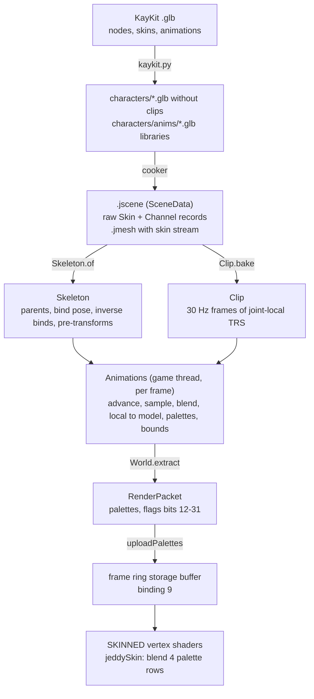

# 09 — Skeletal animation and GPU skinning

*A KayKit knight is one mesh of a few thousand vertices, yet it idles, walks, swings a sword and
falls over. Nobody stores a new mesh for every frame of that. The artist binds the mesh to a
**skeleton**, a tree of a few dozen joints, and animates only the joints; every frame, the engine
works out where each joint is, turns that into one matrix per joint, and the GPU moves every vertex
by a weighted mix of a few of those matrices. This chapter builds that path from empty files: the
skeleton read from a cooked glTF scene, clips baked at load time into fixed-rate frames, instances
that blend and crossfade clips in parallel without allocating, the math of linear blend skinning
and the artefacts it is known for, the vertex stream, storage buffer, flag bits and shader variant
that let the GPU skin every pass, and the game-side pieces: animated scenes in the `World`, the iso
demo's `Animator` that picks what 300 characters play, and how their state is saved. It ends with
the tests that pin all of it down and the numbers measured so far.*

**Before you start.** You need [Lesson 0](lessons/00-foundations.md): the notation of §2 (sums,
rounding, intervals, big-O), bit masks, shifts and packing (§6, for the flag bits that carry a
palette), how a `float` rounds (§7), arrays, native memory and alignment (§8), caches, the
prefetcher and threads (§9), and what a GPU, a driver and a frame are (§10–11). From the chapters:
[02](02-math-foundations.md), on vectors, matrices, homogeneous coordinates, the row-major 3×4
layout, TRS (translation × rotation × scale), parent × local, inverses and transforming normals;
[03](03-rotations-and-transforms.md), on quaternions, the quaternion-to-matrix formula, slerp,
nlerp and "the short way round", transform hierarchies and the fixed tick with interpolation;
[01](01-architecture.md), on the game and main threads, the job system and the render packet's
triple buffer; [05](05-opengl-from-java.md), on the GPU pipeline, vertex attribute formats, storage
buffers and the std430 layout, and program variants; and [06](06-renderer-architecture.md), on the
render packet, the mesh registry, program slots, sort keys and the scene renderer. Lesson
[1](lessons/01-buffers-in-flight.md) builds the frame ring the palettes are written into, and
lesson [3](lessons/03-data-layout.md) explains why the engine keeps data in one array per field
(struct of arrays). None of these is re-taught here; the chapter cites them where it leans on them.

**What you will build**

| Piece | File | What it does |
|---|---|---|
| The skeleton | [`Skeleton`](../../modules/animation/src/main/java/dev/jeddy/animation/Skeleton.java) | the joints of one glTF skin in skin order: parents, bind pose, inverse binds, pre-transforms, names, a layout hash, the evaluation order and attachments |
| Baked clips | [`Clip`](../../modules/animation/src/main/java/dev/jeddy/animation/Clip.java) | a glTF animation resampled at load time into fixed-rate frames of joint-local TRS; two frames and a lerp per sample |
| Animated instances | [`Animations`](../../modules/animation/src/main/java/dev/jeddy/animation/Animations.java) | per-instance states, synchronized two-clip blends, crossfades, and a parallel update that writes joint matrices, skinning palettes and bounds |
| The skin stream | [`MeshWriter`](../../modules/asset/src/main/java/dev/jeddy/asset/format/MeshWriter.java), [`MeshRegistry`](../../modules/render/src/main/java/dev/jeddy/render/mesh/MeshRegistry.java) | four joint indices and four weights per vertex, in a fourth mega buffer read as vertex attributes 4 and 5 |
| Palettes in the frame | [`RenderPacket`](../../modules/render/src/main/java/dev/jeddy/render/RenderPacket.java), [`SceneRenderer`](../../modules/render/src/main/java/dev/jeddy/render/SceneRenderer.java) | skinning matrices appended per visible character, addressed through instance flag bits 12–31, uploaded into the frame ring and bound at storage binding 9 |
| Skinned programs | [`MaterialTable`](../../modules/render/src/main/java/dev/jeddy/render/draw/MaterialTable.java), [`MaterialSystem`](../../modules/render/src/main/java/dev/jeddy/render/material/MaterialSystem.java), [`DrawBuilder`](../../modules/render/src/main/java/dev/jeddy/render/draw/DrawBuilder.java) | a `SKINNED` variant of each program slot, created on the render thread and picked by the draw build |
| The shaders | [`engine/skinning.glsl`](../../modules/render/src/main/resources/dev/jeddy/render/shaders/engine/skinning.glsl), [`pbr/pbr.vert`](../../modules/render/src/main/resources/dev/jeddy/render/shaders/pbr/pbr.vert), [`pbr/depth.vert`](../../modules/render/src/main/resources/dev/jeddy/render/shaders/pbr/depth.vert), [`pbr/outline_mask.vert`](../../modules/render/src/main/resources/dev/jeddy/render/shaders/pbr/outline_mask.vert) | linear blend skinning of positions, normals and tangents in every pass |
| Animated scenes | [`World`](../../modules/app/src/main/java/dev/jeddy/app/world/World.java) | `instantiateAnimated`, skinned renderables, attachments, one palette per visible instance, joint bounds |
| The demo's animator | [`Animator`](../../samples/iso-demo/src/main/java/dev/jeddy/samples/iso/Animator.java), [`AgentSync`](../../modules/app/src/main/java/dev/jeddy/app/world/AgentSync.java) | idle, walk/run blended by crowd speed, one-shot actions, death and revival, facing the target, saving |
| Content | [`kaykit.py`](../../samples/iso-demo/tools/kaykit.py), [`GltfSceneImporter`](../../tools/cooker/src/main/java/dev/jeddy/cooker/gltf/GltfSceneImporter.java) | animation libraries (a rig and its clips, no meshes) and their raw channels in `.jscene` |

The design is in [DESIGN](../DESIGN.md) §13.4, with decisions D79 (baked clips), D80 (GPU skinning)
and D81 (flat animated scenes); the work was milestone M12 in [TASKS](../TASKS.md). The cooked scene
format is described in [jscene.md](../formats/jscene.md).

**Contents**

- Part A — The ideas
  1. [The problem: one mesh, many poses](#1-the-problem-one-mesh-many-poses)
  2. [Skeletons in glTF](#2-skeletons-in-gltf)
  3. [Poses: from local transforms to model matrices](#3-poses-from-local-transforms-to-model-matrices)
  4. [The bind pose and the inverse bind matrix](#4-the-bind-pose-and-the-inverse-bind-matrix)
  5. [Clips: keys, interpolation and baking](#5-clips-keys-interpolation-and-baking)
  6. [Playing, blending and crossfading](#6-playing-blending-and-crossfading)
  7. [Linear blend skinning](#7-linear-blend-skinning)
  8. [Skinning on the GPU](#8-skinning-on-the-gpu)
- Part B — Building it
  9. [Step 1: the module](#9-step-1-the-module)
  10. [Step 2: the skeleton](#10-step-2-the-skeleton)
  11. [Step 3: baked clips](#11-step-3-baked-clips)
  12. [Step 4: animated instances](#12-step-4-animated-instances)
  13. [Step 5: the skin stream](#13-step-5-the-skin-stream)
  14. [Step 6: palettes in the render packet](#14-step-6-palettes-in-the-render-packet)
  15. [Step 7: uploading the palettes](#15-step-7-uploading-the-palettes)
  16. [Step 8: skinned program slots](#16-step-8-skinned-program-slots)
  17. [Step 9: the shaders](#17-step-9-the-shaders)
  18. [Step 10: animated scenes in the World](#18-step-10-animated-scenes-in-the-world)
  19. [Step 11: the demo's Animator](#19-step-11-the-demos-animator)
  20. [Step 12: facing the target](#20-step-12-facing-the-target)
  21. [Step 13: saving animation state](#21-step-13-saving-animation-state)
- Part C — Using it and proving it
  22. [One frame, end to end](#22-one-frame-end-to-end)
  23. [The tests, walked through](#23-the-tests-walked-through)
  24. [Content: animation libraries](#24-content-animation-libraries)
  25. [Measured numbers](#25-measured-numbers)
  26. [Things to run](#26-things-to-run)
  27. [Exercises](#27-exercises)
  28. [Glossary](#28-glossary)
  29. [Further reading](#29-further-reading)

---

# Part A — The ideas

## 1. The problem: one mesh, many poses

### 1.1 Why not store every pose

A mesh is a list of vertices (chapter [05](05-opengl-from-java.md), on the pipeline). To make a
character walk, every vertex must be somewhere else in every frame. The most direct answer is to
store the moved vertices for every frame of every clip. Count what that costs for the demo's knight.
The source glTF file (`samples/iso-demo/assets/characters/knight.glb`) has six skinned meshes with
3,716 vertices between them. Jeddy stores 28 bytes per vertex for drawing (a 12-byte position and a
16-byte attribute record, chapter 05 on vertex formats). The walk clip lasts 1.0667 s, which is 33
frames at 30 frames a second, so one clip for one character model would be

$$33 \times 3716 \times 28 = 3{,}433{,}584 \text{ bytes} \approx 3.4\ \text{MB}.$$

The demo plays ten clips on five hero models and eleven on four skeleton models, so this approach
needs well over a hundred megabytes before it has done anything clever, and it still could not
blend a walk into a run, because blending would mean mixing thousands of vertices per character per
frame on the CPU. A sword held in the hand would also need to know where the hand is, which a
list of vertices does not say.

### 1.2 Skeleton, weights, palette

Skeletal animation splits the problem in three:

- **A skeleton.** The artist builds a tree of a few dozen **joints** (also called **bones**): hips,
  spine, chest, upper arm, lower arm, hand, and so on. Each joint has a transform relative to its
  parent joint. The KayKit rigs have 41.
- **Skin weights.** Each vertex of the mesh is attached to up to four joints, with a **weight** per
  joint saying how much it follows that joint. A vertex in the middle of the forearm follows the
  lower-arm joint with weight 1; a vertex at the elbow might follow the upper arm with 0.5 and the
  lower arm with 0.5. The weights of a vertex add up to 1. They are part of the mesh and never
  change.
- **Animation clips** store, over time, only the joints' transforms: 41 joints instead of 3,716
  vertices.

Every frame the engine samples the clips for each character, works out where each joint is, and
turns that into one matrix per joint, the **skinning matrix**. The array of a character's skinning
matrices for one frame is its **palette** (like a painter's palette: the shader picks a few entries
and mixes them). The vertex shader then moves each vertex by the weighted mix of the four palette
matrices it names. That last step, mixing matrices by weights, is **linear blend skinning** (§7),
and doing it in the vertex shader is **GPU skinning** (§8). The CPU's work per character becomes
41 matrices instead of thousands of vertices, and the clip data, about 54 KB for the walk (§5.11),
is shared by every character of the rig.

### 1.3 The whole path at a glance



Offline, a Python script prepares the KayKit files and the cooker turns glTF into the engine's
formats (§24; chapter [10](10-assets.md) covers the cooker). At load time the game builds a
`Skeleton` per rig and bakes each clip it will play into a `Clip`. Per frame, on the game thread,
the demo's `Animator.update` decides what each character plays, `World.updateAnimations` evaluates
every pose on the job workers, and `World.extract` copies the palettes of the visible characters
into the render packet. The main thread copies those palettes into GPU memory once, and every pass
that draws a skinned mesh reads them. §22 follows one frame through all of it.

## 2. Skeletons in glTF

### 2.1 Joints are nodes, and a skin lists them

glTF, the file format the assets arrive in, has no special "bone" object. A joint is an ordinary
**node** of the scene tree, with a local translation, rotation and scale (TRS, chapter
[02](02-math-foundations.md), on TRS) relative to its parent node. What makes a set of nodes a
skeleton is a **skin**:

```
"skins": [{ "joints": [49, 30, 21, ...], "inverseBindMatrices": <accessor> }]
```

A skin lists the joint nodes and gives one **inverse bind matrix** per joint (§4). A skinned mesh's
vertices carry two extra attributes: `JOINTS_0`, four joint indices, and `WEIGHTS_0`, four weights.
(glTF allows a second set, `JOINTS_1`/`WEIGHTS_1`, for more than four influences; the engine's
importer reads only the first set.) The mesh node names its skin, and the cooker keeps all of it
raw in the `.jscene` (D39): `SceneData.Skin(int skeleton, int[] joints, float[] inverseBind)`, the
inverse binds still as glTF wrote them.

### 2.2 Two numbering schemes: node order and skin order

The joint indices in `JOINTS_0` are positions **in the skin's `joints` list**, not node numbers.
This is the single most important detail of the format, because it means there are two ways to
number the same joints:

- **Node order** is the order of the scene's nodes. The cooker writes them **parents first**:
  `SceneData.parent(i)` is "always a smaller index" (its Javadoc). Evaluating nodes in this order
  always meets a parent before its children.
- **Skin order** is the order of the skin's `joints` list. The vertex stream refers to joints this
  way, so the palette the GPU reads must be in skin order too: palette entry $j$ is the skinning
  matrix of `joints[j]`.

Skin order need not be parents first. The test rig in
[`TestRig.java`](../../modules/animation/src/test/java/dev/jeddy/animation/TestRig.java) lists its
joints out of node order on purpose, so the tests catch any code that confuses the two:

| Node | Name | Parent node | Joint (skin order) |
|---|---|---|---|
| 0 | `Armature` (90° about +Y, scale 2) | −1 | not a joint |
| 1 | `hips` | 0 | 1 (`J_HIPS`) |
| 2 | `spine` | 1 | 0 (`J_SPINE`) |
| 3 | `hand` | 2 | 2 (`J_HAND`) |
| 4 | `socket` | 3 | not a joint |
| 5 | `sword` (mesh) | 4 | not a joint |
| 6 | `body` (skinned mesh) | 0 | not a joint |

The skin is `{SPINE, HIPS, HAND}` (node numbers), so a vertex weighted to "joint 0" follows the
spine, even though the hips are its parent and come first in the file.

### 2.3 The KayKit knight

The real files are bigger and follow the same rules. In the source `knight.glb` there are 57 nodes
and one skin of 41 joints:

- a joint called `root`, whose parent is a **non-joint** node called `Rig`; then `hips`, `spine`,
  `chest`, the arms down to `handslot.l` and `handslot.r`, `head`, the legs down to the toes, and a
  set of helper joints the artist used for inverse kinematics in the modelling tool (`kneeIK.l`,
  `heelIK.l`, `IK-foot.l`, `control-toe-roll.l`, `elbowIK.l`, `handIK.l` and their right-hand twins);
- six skinned mesh nodes (`Knight_ArmLeft`, `Knight_ArmRight`, `Knight_Body`, `Knight_Head`,
  `Knight_LegLeft`, `Knight_LegRight`), all children of `Rig`, all using skin 0;
- nine rigid meshes hung under joints: swords and shields under `handslot.l` and `handslot.r`, the
  helmet under `head`, the cape under `chest`.

In the source file the skin's joint list is not in node order, exactly the situation the test rig
reproduces. The skeleton model `skeleton_warrior.glb` has 52 nodes and a skin of 41 joints with the
same names in the same order, which is why one set of clips serves both rigs (§2.6).

### 2.4 Nodes between joints: the pre-transform

The joint hierarchy is not the node hierarchy. Between a joint and its nearest joint ancestor there
may be plain nodes, and above the root joint there usually is one: an **armature** node. Rigs that
went through other tools on their way to glTF often carry a real transform there. A tool that works
with Z up and in centimetres, for example, exports an armature that rotates by −90° about $x$ and
scales by 0.01, so that the rig ends up Y-up and in metres. If the evaluator walked only from joint
to parent joint, it would lose those transforms and the character would lie on its back, a hundred
times too big.

So `Skeleton` composes them once, at load time, into a static **pre-transform** per joint. Let $j$
be a joint and $n_1, n_2, \dots, n_k$ the non-joint nodes met when walking up from $j$'s node: $n_1$
its parent, $n_2$ the parent of $n_1$, and so on, until the next node is a joint (or there is no
next node). Write $N_x$ for node $x$'s local matrix. In the node tree, a point given in $n_1$'s
space reaches the joint ancestor's space by going through $N_{n_1}$, then $N_{n_2}$, …, then
$N_{n_k}$. With column vectors the first transform applied is the rightmost (chapter 02, on the
order of a matrix product), so

$$P_j = N_{n_k} \cdots N_{n_2}\, N_{n_1}.$$

For a root joint the walk runs to the top of the scene, so $P_j$ holds every ancestor. For a joint
whose parent node is a joint, the walk stops at once and $P_j$ is the identity $I$.

*Worked example (a Z-up centimetre rig).* The armature is $R_x(-90°)$ with scale 0.01. Chapter
[03](03-rotations-and-transforms.md), on the rotations about the three axes, gives

$$R_x(\theta) = \begin{bmatrix} 1 & 0 & 0 \\ 0 & \cos\theta & -\sin\theta \\ 0 & \sin\theta & \cos\theta \end{bmatrix}, \qquad R_x(-90°) = \begin{bmatrix} 1 & 0 & 0 \\ 0 & 0 & 1 \\ 0 & -1 & 0 \end{bmatrix},$$

which sends $(x, y, z)$ to $(x, z, -y)$. A hips joint 100 units "up" in the source, at $(0, 0, 100)$,
lands at $0.01 \cdot (0, 100, 0) = (0, 1, 0)$: one metre up the engine's $y$ axis.

*In the test rig* the hips' pre-transform is the `Armature` node, a 90° turn about +Y with a uniform
scale of 2 (§3.4 multiplies it out). The spine's is the identity: its parent node, the hips, is a
joint. *In the KayKit files* the `Rig` node above `root` has no translation, rotation or scale at
all, so every joint's pre-transform is the identity. The mechanism costs nothing then: §12.10 shows
the evaluator's fast path for joints with no pre-transform.

### 2.5 Attachments: meshes that hang off a joint

A sword is not skinned. It is a rigid mesh node somewhere below a hand joint, sometimes with plain
nodes in between (KayKit's `handslot.r` is itself a joint, but a rig may hang a weapon off a
"socket" node under the hand). To follow the hand, the engine needs two things: which joint the
mesh hangs off, and the fixed offset from that joint to the mesh. The offset is the same walk as the
pre-transform, but it starts with the mesh node's own matrix:

$$O = N_{n_k} \cdots N_{n_1}\, N_{\text{mesh}},$$

where $n_1, \dots, n_k$ are the non-joint nodes between the mesh and its nearest joint ancestor.
Every frame the mesh is then placed at "that joint's model matrix times $O$" (§18.6).

*Test rig.* `sword` sits at $(0, 0, 0.2)$ under `socket`, which sits at $(0, 0.1, 0)$ under the hand
joint. The offset is $T(0, 0.1, 0)\,T(0, 0, 0.2) = T(0, 0.1, 0.2)$: two translations add. The
skinned `body` has no joint ancestor (only `Armature`, which is not a joint), so it is not an
attachment.

### 2.6 Names, hashes and the layout

Joints are found by name in two places: clips bind their channels to joints by name (§5.7), and
gameplay asks for joints like `"root"`. Comparing strings is slow and string handling allocates, so
names become 64-bit numbers once, with [`StrId.of`](../../modules/core/src/main/java/dev/jeddy/core/id/StrId.java):
**FNV-1a** over the name's UTF-8 bytes. FNV-1a starts from a fixed value (the *offset basis*,
`0xcbf29ce484222325`) and, for each byte $b$, replaces the hash $h$ by $(h \oplus b) \times p$,
where $\oplus$ is XOR (L00 §6.1) and $p$ is the FNV prime `0x100000001b3`; the multiplication wraps
around modulo $2^{64}$ like every Java `long` multiplication (L00 §4.3). XOR mixes the byte in,
the multiplication by a large odd number spreads every bit over the higher bits. An empty name maps
to `StrId.NONE`, which is 0. A lookup is then a loop of `long` comparisons.

A clip is baked for one particular arrangement of joints: its frames store joint $j$'s local
transform at position $j$, in skin order, relative to joint $j$'s parent. Another skeleton can play
the same frames only if its joint $j$ has the same name **and** the same parent, for every $j$. The
two KayKit rigs satisfy that. Comparing 41 names and 41 parents on every `play` would be wasteful, so
`Skeleton` folds all of them into one number, the **layout**:

$$h_0 = \texttt{0x9E3779B97F4A7C15} \oplus n, \qquad h \leftarrow (h \oplus \text{name}_j) \cdot p, \qquad h \leftarrow (h \oplus \text{parent}_j) \cdot p \quad (j = 0, 1, \dots, n-1)$$

with $n$ the joint count and $p$ the same FNV prime, here mixing whole 64-bit values instead of
bytes. The start value is the usual "golden ratio" constant, $2^{64}/\varphi$ rounded
($\varphi \approx 1.618$), a common seed that has no structure of its own. A `Clip` remembers the
layout it was baked for, and `Animations.play` throws "clip baked for another skeleton layout" when
they differ: one `long` comparison. Two different layouts could in principle hash to the same
number, but with $2^{64}$ possible values that is not a practical concern for a handful of rigs.

<details><summary>Check: the test rig's skin order is spine, hips, hand. What is joint 2's parent joint, and what is joint 0's?</summary>

Joint 2 is the hand, whose parent node is the spine, which is joint 0: parent joint 0. Joint 0 is the
spine, whose parent node is the hips, joint 1: parent joint 1. `SkeletonTest` asserts both
(`s.parent(J_HAND) == J_SPINE`, `s.parent(J_SPINE) == J_HIPS`).
</details>

## 3. Poses: from local transforms to model matrices

### 3.1 A pose is ten floats per joint

A **local pose** gives every joint a translation, a rotation quaternion and a scale, relative to its
parent node. The engine stores it as ten `float`s per joint, `Skeleton.TRS = 10`:

| Offset | 0 | 1 | 2 | 3 | 4 | 5 | 6 | 7 | 8 | 9 |
|---|---|---|---|---|---|---|---|---|---|---|
| Value | $t_x$ | $t_y$ | $t_z$ | $q_x$ | $q_y$ | $q_z$ | $q_w$ | $s_x$ | $s_y$ | $s_z$ |

This is also the layout of `SceneData.trs(i, k)` and of glTF itself (quaternions as `xyzw`, chapter
[03](03-rotations-and-transforms.md), on the quaternion record). Animation works in TRS rather than
matrices because TRS interpolates well: halfway between two translations is their average, halfway
between two rotations is a normalized average of their quaternions (nlerp, chapter 03 on
interpolating rotations), halfway between two scales is their average. Averaging two rotation
*matrices* gives a matrix that is no longer a rotation (§7.3 shows how far off it is), and it would
take 12 or 16 floats per joint instead of 10.

### 3.2 The local matrix

From a joint's TRS, its **local matrix** is

$$L_j = T(\mathbf{t}_j)\, R(\mathbf{q}_j)\, S(\mathbf{s}_j):$$

scale first, then rotate, then translate (chapter [02](02-math-foundations.md), on TRS). In the
engine's row-major 3×4 form, rows `[r00 r01 r02 tx | r10 r11 r12 ty | r20 r21 r22 tz]`, the linear
part is the rotation matrix of $\mathbf{q}$ with column $c$ multiplied by $s_c$, and the last column
is $\mathbf{t}$. Chapter 03 derives the rotation matrix of a quaternion $(x, y, z, w)$:

$$R(\mathbf{q}) = \begin{bmatrix} 1 - 2(y^2 + z^2) & 2(xy - wz) & 2(xz + wy) \\ 2(xy + wz) & 1 - 2(x^2 + z^2) & 2(yz - wx) \\ 2(xz - wy) & 2(yz + wx) & 1 - 2(x^2 + y^2) \end{bmatrix}$$

and [`AffineOps.composeTRS`](../../modules/math/src/main/java/dev/jeddy/math/AffineOps.java) writes
$L_j$ from the ten floats. §12.10 writes the same nine products by hand inside the evaluator.

### 3.3 The model matrix, derived

The **model matrix** $M_j$ of a joint places it relative to the skeleton's scene root (the top of the
cooked scene, which the character's root entity will place in the world). Think of a point given in
joint $j$'s own space. To get to the scene root, it goes through $j$'s local matrix (into the space
of $j$'s parent node), then through the non-joint nodes between $j$ and its parent joint $p(j)$
(that is $P_j$, §2.4), and is then a point in $p(j)$'s space, which $M_{p(j)}$ takes the rest of the
way. Applying the first transform rightmost:

$$M_j = M_{p(j)}\; P_j\; L_j, \qquad M_{p(j)} = I \text{ when } p(j) = -1.$$

This is "parent × local" (chapter 02) with the pre-transform slotted in between. It needs the
parent's model matrix to exist already, which is why the order of evaluation matters (§3.5).

### 3.4 A worked example: the test rig

The armature's rotation is $\mathbf{q} = (0, \sqrt{0.5}, 0, \sqrt{0.5})$: an angle of 90° about +Y,
since a unit quaternion is $(\hat{\mathbf{n}} \sin\frac{\theta}{2}, \cos\frac{\theta}{2})$ and
$\sin 45° = \cos 45° = \sqrt{0.5}$. Plugging $x = z = 0$, $y = w = \sqrt{0.5}$ into §3.2's matrix
gives $R_y(90°)$, which maps $(x, y, z) \mapsto (z, y, -x)$. With the scale of 2 on every column:

```
P_hips = [ 0  0  2 | 0 ]
         [ 0  2  0 | 0 ]
         [-2  0  0 | 0 ]
```

(Printed from the engine, `Skeleton`'s copy of this matrix is `[1.1920929E-7, 0.0, 1.9999999,
0.0, 0.0, 2.0, 0.0, 0.0, -1.9999999, 0.0, 1.1920929E-7, 0.0]`: the $10^{-7}$ entries are `float`
rounding of $1 - 2 \cdot 0.5 = 0$, because $\sqrt{0.5}$ is stored inexactly, L00 §7.3.)

- **Hips** (no parent joint): $L = T(0, 1, 0)$, so $M_{\text{hips}} = P_{\text{hips}}\, T(0, 1, 0)$.
  Its origin is $P_{\text{hips}}(0, 1, 0) = (2 \cdot 0,\ 2 \cdot 1,\ -2 \cdot 0) = (0, 2, 0)$.
- **Spine**: $L = T(0, 0.5, 0)$, parent the hips, no pre-transform. Its origin is
  $M_{\text{hips}}(0, 0.5, 0) = P_{\text{hips}}(0, 1.5, 0) = (0, 3, 0)$.
- **Hand**: $L = T(0.3, 0, 0)$, parent the spine. Its origin is
  $P_{\text{hips}}(0.3, 1.5, 0) = (2 \cdot 0,\ 2 \cdot 1.5,\ -2 \cdot 0.3) = (0, 3, -0.6)$.

Run in the engine, `Animations` produces origins $(0, 2, 0)$, $(0, 3, 0)$ and
$(3.6 \times 10^{-8}, 3, -0.6)$: the same, up to rounding.
`bindPosePalettesAreIdentityAndModelsMatchTheScene` (§23.1) checks every model matrix against the
node's transform computed independently by `TestRig.worldTransforms`.

### 3.5 Parents first: the evaluation order

$M_j$ needs $M_{p(j)}$, so joints must be evaluated parents first. Skin order does not guarantee
that (the test rig's skin starts with the spine, whose parent is the hips). Node order does,
because the cooker writes nodes parents first. So `Skeleton` sorts the joint indices by their node
numbers, once, and keeps the result as the **evaluation order**. For the test rig the skin is spine
(node 2), hips (node 1), hand (node 3); sorted by node number: hips, spine, hand, that is joints 1,
0, 2. The evaluator walks joints in that order but writes each result at its skin-order position,
which is what the GPU needs.

### 3.6 A bounding sphere from the joints

The renderer culls every object by a bounding sphere (chapter [06](06-renderer-architecture.md), on
culling on the CPU). A mesh's own sphere describes its bind pose and is wrong for an animated
character: one lying on the floor after its death clip is nowhere near its standing bind pose. So
the evaluator builds a sphere from the joints' current positions. Each joint's origin is the
translation column of $M_j$ (indices 3, 7 and 11 of its 12 floats). Take the smallest box around
all of them, $[\mathbf{min}, \mathbf{max}]$. A box's farthest points from its centre are its corners,
at half the diagonal, so the sphere

$$\mathbf{c} = \tfrac12(\mathbf{min} + \mathbf{max}), \qquad r = \bigl\lVert \tfrac12(\mathbf{max} - \mathbf{min}) \bigr\rVert$$

contains the box and therefore every joint. *Test rig:* $x \in [0, 0]$, $y \in [2, 3]$,
$z \in [-0.6, 0]$, so $\mathbf{c} = (0, 2.5, -0.3)$ and $r = \sqrt{0 + 0.5^2 + 0.3^2} = \sqrt{0.34}
\approx 0.5831$; the engine computes 0.5830952. The sphere encloses the joints, not the skin around
them (a hand's fingers reach past the hand joint), so the world adds a margin (§18.5).

## 4. The bind pose and the inverse bind matrix

### 4.1 What the bind pose is

The artist modelled the knight in one particular pose, the **bind pose** (usually standing with the
arms out, a "T" or "A" pose), and stored the mesh vertices in that pose, in model space. Let $B_j$
be joint $j$'s model matrix in that pose. glTF's **inverse bind matrix** (IBM) of joint $j$ is
$B_j^{-1}$, the matrix that undoes it.

### 4.2 The skinning matrix, derived

Take a vertex $\mathbf{v}$, given in model space in the bind pose, that should follow joint $j$
rigidly, as if glued to the bone.

1. Express it relative to the joint as the joint was at bind time: $\mathbf{v}_j = B_j^{-1}\mathbf{v}$.
   This is the vertex's position "in the joint's own coordinates", and it never changes: a point
   glued to a bone keeps its coordinates in that bone's space however the bone moves.
2. Carry it with the joint as it is now: $\mathbf{v}' = M_j\,\mathbf{v}_j$.

So the matrix that moves a bind-pose vertex to where joint $j$ has taken it is

$$K_j = M_j\, B_j^{-1}.$$

This $K_j$ is the **skinning matrix**, and the array of all $K_j$ of one skeleton instance is its
**palette**. `Animations.palettes()` stores exactly this product (its Javadoc: `model × inverseBind`).
The IBMs are stored in the file, rather than computed from the nodes, so the mesh can be bound in a
pose other than the nodes' rest pose, and so a loader needs no matrix inversion.

### 4.3 Why the bind pose gives identity matrices

If the current pose is the bind pose, then $M_j = B_j$ for every joint and

$$K_j = B_j\, B_j^{-1} = I:$$

every vertex stays exactly where the artist put it. This makes a strong test: after
`Animations.add`, which evaluates the bind pose, every palette entry of the test rig must be the
identity within $10^{-5}$ (§23.1).

One caveat: this holds only when the IBMs are the exact inverses of the joints' model matrices as
the node transforms give them. glTF does not require that. If an exporter wrote the nodes in one
pose and the IBMs for another, the "bind pose" palettes are not identities, and the un-animated
mesh shows the node pose. That is correct behaviour, not a bug. The test rig builds its IBMs with
`AffineOps.invert` from the node transforms, so the identity test is exact there.

### 4.4 Inverting an affine transform, worked

An affine transform $M = [A \mid \mathbf{t}]$ (a 3×3 linear part $A$ and a translation $\mathbf{t}$,
chapter 02 on the affine inverse) maps $\mathbf{x}$ to $\mathbf{y} = A\mathbf{x} + \mathbf{t}$.
Solving for $\mathbf{x}$: $\mathbf{x} = A^{-1}(\mathbf{y} - \mathbf{t}) = A^{-1}\mathbf{y} -
A^{-1}\mathbf{t}$, so

$$M^{-1} = [\,A^{-1} \mid -A^{-1}\mathbf{t}\,].$$

When $A = sR$ is a rotation times a uniform scale, $A^{-1} = \frac{1}{s}R^{\mathsf T}$, because the
inverse of a rotation is its transpose (chapter 02, on rotations).

*The test rig's hips.* From §3.4, $B_{\text{hips}} = P_{\text{hips}}\,T(0, 1, 0)$ has
$A = 2R_y(90°)$ and $\mathbf{t} = (0, 2, 0)$. Then

$$A^{-1} = \tfrac12 R_y(90°)^{\mathsf T} = \begin{bmatrix} 0 & 0 & -0.5 \\ 0 & 0.5 & 0 \\ 0.5 & 0 & 0 \end{bmatrix}, \qquad -A^{-1}\mathbf{t} = -(0,\ 0.5 \cdot 2,\ 0) = (0, -1, 0),$$

so the hips' IBM, as a row-major 3×4, is `[0 0 -0.5 0 | 0 0.5 0 -1 | 0.5 0 0 0]`, which is what the
engine reads back from `Skeleton` (up to $3 \times 10^{-8}$ of rounding). Check: it sends the hips'
origin $(0, 2, 0)$ to $(0, 0.5 \cdot 2 - 1, 0) = (0, 0, 0)$, the joint's own origin.

### 4.5 A bent strip, by hand

The GPU test [`SkinningTest`](../../modules/render/src/test/java/dev/jeddy/render/pbr/SkinningTest.java)
skins a vertical strip from $y = 0$ to $1$, 0.2 m wide, with two joints: joint 0 at the origin and
joint 1 at $(0, 0.5, 0)$. Bend joint 1 by $-90°$ about $z$, so the top half points to $+x$.

- Bind: $B_1 = T(0, 0.5, 0)$, so $B_1^{-1} = T(0, -0.5, 0)$ (§4.4 with $A = I$).
- Pose: $M_1 = T(0, 0.5, 0)\,R_z(-90°)$: the joint stays where it was and turns.
- Palette: $K_1 = T(0, 0.5, 0)\,R_z(-90°)\,T(0, -0.5, 0)$.

With $\cos(-90°) = 0$ and $\sin(-90°) = -1$,
$R_z(-90°) = \begin{bmatrix} 0 & 1 & 0 \\ -1 & 0 & 0 \\ 0 & 0 & 1 \end{bmatrix}$, which maps
$(x, y) \mapsto (y, -x)$. Composing right to left:

$$(x, y) \xrightarrow{T(0,-0.5)} (x,\; y - 0.5) \xrightarrow{R_z(-90°)} (y - 0.5,\; -x) \xrightarrow{T(0,0.5)} (y - 0.5,\; 0.5 - x).$$

As a row-major 3×4 that is `[0 1 0 -0.5 | -1 0 0 0.5 | 0 0 1 0]`, exactly the `BENT` constant of the
test:

```java
// modules/render/src/test/java/dev/jeddy/render/pbr/SkinningTest.java
        // T(0, 0.5, 0) Rz(-90°) T(0, -0.5, 0): (x, y) -> (y - 0.5, 0.5 - x).
        float[] m = {0, 1, 0, -0.5f, -1, 0, 0, 0.5f, 0, 0, 1, 0};
```

The strip's top vertices $(0.1, 1)$ and $(-0.1, 1)$ go to $(0.5, 0.4)$ and $(0.5, 0.6)$: the top
edge now stands at $x = 0.5$, the tip of the arm centred at $(0.5, 0.5)$. The joint itself,
$(0, 0.5)$, maps to $(0.5 - 0.5, 0.5 - 0) = (0, 0.5)$: a pivot stays put, as it should. The form
$T\,R\,T^{-1}$, "move the pivot to the origin, rotate, move it back", is the shape of the skinning
matrix of any joint that turns about its own origin while everything above it stays in the bind
pose.

### 4.6 From glTF's column-major 4×4 to the engine's 3×4

glTF stores a 4×4 matrix in **column-major** order: element (row $r$, column $c$) is at index
$4c + r$. The engine's affine transforms are **row-major 3×4**: element $(r, c)$ at $4r + c$, and the
constant bottom row $[0\ 0\ 0\ 1]$ is not stored (chapter 02, on matrices in memory, explains both
layouts and why the engine has two, D21). Converting is a transposed copy of the top three rows;
chapter 02 quotes the very loop `Skeleton` uses (§10.3 here).

*Example.* The translation $T(1, 2, 3)$ is `[1,0,0,0, 0,1,0,0, 0,0,1,0, 1,2,3,1]` in glTF and
`[1,0,0,1, 0,1,0,2, 0,0,1,3]` in the engine. Element $(0, 3)$, the $x$ translation, is glTF index
$4 \cdot 3 + 0 = 12$ (value 1) and engine index $4 \cdot 0 + 3 = 3$. A skin without
`inverseBindMatrices` gets identities from the cooker's `GltfImporter`, as glTF specifies.

Why row-major 3×4 for joints? Twelve floats instead of sixteen, and three rows are exactly three
`vec4`s in a std430 storage buffer, so the palette goes to the GPU by a plain copy with no
conversion (§8.3; DESIGN §8.2 and §9.2).

## 5. Clips: keys, interpolation and baking

### 5.1 What a glTF animation holds

A glTF animation is a list of **channels**. Each channel targets one node and one **path**
(`translation`, `rotation`, `scale`, or morph-target `weights`) and points at a **sampler**: an
input list of key times in seconds, an output list of values (three floats per key for a
translation or scale, four for a rotation), and an **interpolation** mode that says what happens
between keys. The cooker keeps them raw in the `.jscene` (D39) as

```java
// modules/asset/src/main/java/dev/jeddy/asset/format/SceneData.java
    /** One animated property of one node. */
    public record Channel(
            int node, int path, int interpolation, int components, float[] times, float[] values) {}

    /** A named animation clip. */
    public record Animation(String name, float duration, List<Channel> channels) {}
```

and an animation's `duration` is the largest key time of its channels
([`GltfSceneImporter`](../../tools/cooker/src/main/java/dev/jeddy/cooker/gltf/GltfSceneImporter.java)
takes the maximum over every channel's times).

Channels are independent of each other. KayKit's `Walking_A` has 123 channels over 41 joints (a
translation, a rotation and a scale each) with 1,051 keys between them, each channel with its own
key times. To know joint $j$'s pose at time $t$ from this data, you must, for each of its channels,
find the two keys around $t$ and interpolate between them.

### 5.2 Finding the two keys around a time

The key times of a channel are sorted. Let them be $t_0 < t_1 < \dots < t_{m-1}$. Outside the range,
glTF says the value is clamped: the first key's value before $t_0$, the last key's after $t_{m-1}$.
Inside, we want the index $k$ with $t_k \le t < t_{k+1}$. **Binary search** finds it by keeping two
indices, `lo` and `hi`, with $t_{lo} \le t < t_{hi}$, and halving the gap between them: look at
`mid` halfway between; if $t_{mid} \le t$ the answer is at or after `mid`, so `lo = mid`, otherwise
`hi = mid`. When `hi - lo` is 1, `lo` is $k$. Each step halves the gap, so $m$ keys need about
$\log_2 m$ steps (L00 §2.8).

*Worked.* Times $[0, 0.5, 1]$ and $t = 0.75$: start with `lo = 0`, `hi = 2`; `mid = 1`, $t_1 = 0.5
\le 0.75$, so `lo = 1`; now `hi - lo = 1`, done: the keys are 1 and 2.

Between the two keys, the position as a fraction is

$$s = \frac{t - t_k}{\Delta}, \qquad \Delta = t_{k+1} - t_k, \qquad s \in [0, 1).$$

In the example, $s = (0.75 - 0.5)/0.5 = 0.5$. What happens with $s$ depends on the mode.

### 5.3 LINEAR: lerp and slerp

Translations and scales **lerp** (chapter [02](02-math-foundations.md), on linear interpolation):

$$\mathbf{p}(s) = \mathbf{p}_k + s\,(\mathbf{p}_{k+1} - \mathbf{p}_k).$$

Rotations use **slerp**, spherical linear interpolation, which turns at a constant angular speed
along the shorter arc between the two quaternions. Chapter [03](03-rotations-and-transforms.md), on
interpolating rotations, derives it: with $\cos\Omega = \mathbf{q}_k \cdot \mathbf{q}_{k+1}$,

$$\operatorname{slerp}(\mathbf{q}_k, \mathbf{q}_{k+1}, s) = \frac{\sin((1-s)\Omega)}{\sin\Omega}\,\mathbf{q}_k + \frac{\sin(s\Omega)}{\sin\Omega}\,\mathbf{q}_{k+1}.$$

Two details follow from chapter 03. If the dot product is negative, one quaternion is negated first,
so the turn takes the short way. And when the two are nearly equal ($\cos\Omega > 0.9995$, that is
$\Omega < 1.81°$), $\sin\Omega$ is nearly zero and dividing by it magnifies rounding, so the weights
fall back to the plain $1 - s$ and $s$, which is what the sines tend to for small angles.

*Worked (the turn of `ClipTest`).* A hand channel turns from the identity $(0, 0, 0, 1)$ to 90° about
+Y, $(0, \sin 45°, 0, \cos 45°) = (0, 0.7071, 0, 0.7071)$, over one second. At $t = 0.5$, $s = 0.5$
and $\cos\Omega = 0.7071$, so $\Omega = 45°$. Both weights are $\sin 22.5° / \sin 45° = 0.3827 /
0.7071 = 0.5412$, and the result is $(0,\ 0.5412 \cdot 0.7071,\ 0,\ 0.5412 + 0.5412 \cdot 0.7071) =
(0, 0.3827, 0, 0.9239) = (0, \sin 22.5°, 0, \cos 22.5°)$: a 45° turn, half of 90°.

### 5.4 STEP

The value of key $k$ holds until key $k+1$, then jumps. Doors, switches and blinking eyes use it.

### 5.5 CUBICSPLINE: the Hermite curve, derived

Here each key stores three values: an **in-tangent** $\mathbf{a}_k$, the value $\mathbf{p}_k$, and an
**out-tangent** $\mathbf{b}_k$. A tangent is a slope, a rate of change: how fast the value is moving
as it leaves (out) or arrives at (in) the key. The curve between two keys is the cubic polynomial
that has the right values and the right slopes at both ends, a **cubic Hermite spline**. Derive it.

Look for $\mathbf{p}(s) = \mathbf{a}s^3 + \mathbf{b}s^2 + \mathbf{c}s + \mathbf{d}$ on $s \in [0, 1]$
(the letters here are unknown coefficient vectors, not the tangents). Its slope is
$\mathbf{p}'(s) = 3\mathbf{a}s^2 + 2\mathbf{b}s + \mathbf{c}$. Ask for end values $\mathbf{p}_0,
\mathbf{p}_1$ and end slopes $\mathbf{m}_0, \mathbf{m}_1$ (slopes per unit of $s$):

$$\mathbf{p}(0) = \mathbf{d} = \mathbf{p}_0, \quad \mathbf{p}'(0) = \mathbf{c} = \mathbf{m}_0, \quad
\mathbf{p}(1) = \mathbf{a} + \mathbf{b} + \mathbf{c} + \mathbf{d} = \mathbf{p}_1, \quad
\mathbf{p}'(1) = 3\mathbf{a} + 2\mathbf{b} + \mathbf{c} = \mathbf{m}_1.$$

The first two give $\mathbf{c}$ and $\mathbf{d}$. The third says $\mathbf{a} + \mathbf{b} =
\mathbf{p}_1 - \mathbf{p}_0 - \mathbf{m}_0$; the fourth says $3\mathbf{a} + 2\mathbf{b} =
\mathbf{m}_1 - \mathbf{m}_0$. Subtract twice the third from the fourth:

$$\mathbf{a} = 2\mathbf{p}_0 - 2\mathbf{p}_1 + \mathbf{m}_0 + \mathbf{m}_1, \qquad
\mathbf{b} = (\mathbf{p}_1 - \mathbf{p}_0 - \mathbf{m}_0) - \mathbf{a} = -3\mathbf{p}_0 + 3\mathbf{p}_1 - 2\mathbf{m}_0 - \mathbf{m}_1.$$

Substitute all four and collect the terms of each of $\mathbf{p}_0, \mathbf{m}_0, \mathbf{p}_1,
\mathbf{m}_1$:

$$\mathbf{p}(s) = \underbrace{(2s^3 - 3s^2 + 1)}_{h_{00}}\mathbf{p}_0
+ \underbrace{(s^3 - 2s^2 + s)}_{h_{10}}\mathbf{m}_0
+ \underbrace{(-2s^3 + 3s^2)}_{h_{01}}\mathbf{p}_1
+ \underbrace{(s^3 - s^2)}_{h_{11}}\mathbf{m}_1.$$

(Check the $\mathbf{p}_0$ term: $2s^3$ from $\mathbf{a}$, $-3s^2$ from $\mathbf{b}$, $1$ from
$\mathbf{d}$.) The four $h$ functions are the **Hermite basis**.

glTF tangents are slopes per **second**, $d\mathbf{p}/dt$, while the formula wants slopes per unit
of $s$. Since $t = t_k + s\Delta$, a step of 1 in $s$ is $\Delta$ seconds, and the chain rule gives
$d\mathbf{p}/ds = \Delta \cdot d\mathbf{p}/dt$. So

$$\mathbf{m}_0 = \Delta\,\mathbf{b}_k \ (\text{key } k\text{'s out-tangent}), \qquad \mathbf{m}_1 = \Delta\,\mathbf{a}_{k+1} \ (\text{key } k{+}1\text{'s in-tangent}).$$

*Numeric check.* With zero tangents, from $\mathbf{p}_0 = 0$ to $\mathbf{p}_1 = 1$, the curve is
$h_{01}(s) = 3s^2 - 2s^3$, the classic **smoothstep**: it starts and ends with zero slope. At
$s = 0.25$: $3 \cdot 0.0625 - 2 \cdot 0.015625 = 0.1875 - 0.03125 = 0.15625$, which
`ClipTest.evaluatesStepAndCubicSplineChannels` asserts. A cubic curve between two unit quaternions
does not stay on the unit sphere, so after evaluating a rotation the baker normalizes it (§11.3).

### 5.6 Baking: resampling at a fixed rate (D79)

At load time, `Clip.bake` evaluates every channel at evenly spaced times and stores the results as
whole poses, one block of $n \times 10$ floats per frame for a skeleton of $n$ joints. The number of
frames and the time between them are

$$F = \max\!\bigl(2,\ \operatorname{round}(d \cdot \text{rate}) + 1\bigr), \qquad \text{step} = \frac{d}{F - 1},$$

with $d$ the clip's duration and the rate 30 frames per second by default (`DEFAULT_RATE`). The
"+ 1" is there because frames sit at both ends of the clip: $d \cdot \text{rate}$ gaps between
frames need one more frame than there are gaps, like fence posts. Dividing the duration by $F - 1$
instead of using $1/\text{rate}$ bends the rate slightly so that frame 0 is at time 0 and the last
frame exactly at $d$.

*Worked.* `Walking_A` lasts $1.0667$ s ($32/30$): $F = \operatorname{round}(32.0) + 1 = 33$ and
step $= 1.0667/32 = 1/30$ s, exactly the rate. A clip of $1.05$ s would get
$F = \operatorname{round}(31.5) + 1 = 33$ and step $= 1.05/32 = 0.0328125$ s, a rate of 30.48 frames
per second. A single pose (duration 0) still gets two identical frames, so sampling never needs a
special case (`ClipTest.handlesSinglePoses`).

Every frame starts as a copy of the bind pose, so joints the clip does not animate keep their bind
values. The frames are one flat `float[]`:

```
Clip.frames  (frameCount × jointCount × 10 floats)

frame 0 : [ j0: tx ty tz qx qy qz qw sx sy sz | j1: ... | ... | j40: ... ]
frame 1 : [ j0: ...                                                       ]
  ...
frame 32: [ ...                                                           ]

index(frame f, joint j, component k) = (f * jointCount + j) * 10 + k
```

D79 records the choice: clips are "resampled at load time into fixed-rate frames of joint-local TRS
rather than sampled from glTF keys at run time: sampling becomes two frames and a lerp per joint,
with no per-channel key search or cursor state, and the memory (about 1.2 KB per joint-second at
30 Hz) is small next to textures". §5.11 puts numbers on both sides.

### 5.7 Binding channels to joints by name

A channel names a node of the scene it came from. The clip is baked for a skeleton, and the two need
not be the same scene. An **animation library** is a `.jscene` holding a rig's nodes and its clips
and no meshes (§24). A channel on a library node called `spine` drives whatever joint of the
skeleton is called `spine`, wherever that joint sits in the skeleton's skin order. Channels on nodes
the skeleton does not have are skipped, and so are morph-weight channels (the engine has no morph
targets). A node with no name falls back to its node index, which only makes sense when the clip is
baked from the skeleton's own scene. D79: "Clips bind to skeletons by joint name, so a rig's clips
live once in an animation library."

### 5.8 One hemisphere from frame to frame

A unit quaternion $\mathbf{q}$ and its negation $-\mathbf{q}$ describe the same rotation (chapter 03,
on two quaternions for every rotation: negating both $\cos\frac{\theta}{2}$ and
$\hat{\mathbf{n}}\sin\frac{\theta}{2}$ is the same as adding $360°$ to $\theta$). Keys, and the values
sampled between them, can land in either **hemisphere** of the four-dimensional unit sphere: an
exporter may store a key as $-\mathbf{q}$, and the slerp of one pair of keys and the cubic curve of
another need not agree on a sign.

That matters at run time, where sampling lerps two neighbouring frames component by component and
then normalizes (§5.10). Suppose frame $i$ holds $\mathbf{q}$ and frame $i+1$ holds $-\mathbf{q}'$,
with $\mathbf{q}'$ almost equal to $\mathbf{q}$. Halfway between them the lerp is
$\frac12(\mathbf{q} - \mathbf{q}')$, almost the zero vector; normalizing a tiny vector of rounding
noise gives an arbitrary rotation, and the joint spins wildly for a moment.

The baker fixes this once per clip: for every joint, it walks the frames in order and negates frame
$i$'s quaternion when its dot product with frame $i-1$'s (already fixed) quaternion is negative.
Afterwards every pair of consecutive frames has a non-negative dot product, so every frame lerp takes
the short way, and no sampling code needs a sign test.

### 5.9 Playing in place: the root lock

Locomotion clips usually move the character: across the cycle, the hips or the root joint travel
forward a stride. In a crowd-driven game the crowd simulation moves the character (chapter
[11](11-physics-navigation-crowds.md), on crowds), so the clip must play **in place**, or the body
would run ahead of its own position and snap back at every loop. `bake` therefore takes a
`lockJoint`: that joint's local $x$ and $z$ translation stay at frame 0's values for the whole clip,
while $y$ still bobs (the engine is Y-up). `ClipTest.locksARootJointsHorizontalTranslation` moves the
hips from $(0, 1, 0)$ to $(3, 2, 5)$ and, locked, expects $(0, 2, 0)$ at the end. The demo locks the
`root` joint of its walk and run clips (§19.2).

The alternative is **root motion**: extract the root's travel from the clip and feed it to the
character's movement, so the feet never slide. DESIGN §13.4 lists root-motion extraction under
"Not yet"; the demo instead matches the playback rate to the crowd's speed (§19.4).

### 5.10 Sampling a baked clip: two frames and an nlerp

To sample joint $j$ at time $t$, divide by the step:

$$x = \frac{t}{\text{step}}, \qquad f_0 = \lfloor x \rfloor, \qquad a = x - f_0,$$

and lerp frame $f_0$ and frame $f_0 + 1$ by $a$. The frame index is a division, not a search. Past
the end, $f_0$ is clamped to the second-to-last frame with $a = 1$, which lands exactly on the last
frame; before the start (or for a time that is not a number), $x$ is set to 0. All ten floats are
lerped, then the four rotation floats are divided by their length: that is **nlerp**, normalized
lerp, not slerp.

How much does that cost in accuracy? Chapter 03, on nlerp, shows that for two unit quaternions an
angle $\Omega$ apart on the 4D sphere, nlerp at parameter $a$ lands at the angle

$$\varphi(a) = \operatorname{atan2}\bigl(a \sin\Omega,\; 1 - a + a\cos\Omega\bigr)$$

from the first, where slerp would be at $a\,\Omega$. A rotation turns by twice the 4D angle (chapter
03: "the 4D angle between two quaternions is half the angle of the rotation between them"). Between
two frames $1/30$ s apart the rotation is small: a joint turning 720° per second turns 24° per frame,
so $\Omega = 12°$, and the largest difference between nlerp and slerp over $a \in [0, 1]$, doubled
to a rotation angle, is $0.017°$. Even 60° per frame stays under $0.27°$. (Both numbers come from
evaluating the formula on a fine grid of $a$.) Nlerp costs one square root; slerp costs an
`acos` and three sines.

*A consequence worth knowing.* A `STEP` channel is sampled exactly at the frame times, but the run
time lerps between frames, so a step becomes a ramp one frame long. Baked at 10 Hz, a value that
jumps from 0 to 2 at $t = 0.5$ s reads 0 at 0.4 s, 1.0 at 0.45 s and 2 at 0.5 s; at the default
30 Hz the ramp lasts 33 ms (exercise 6 measures it).

### 5.11 Why bake: the costs compared

Sampling raw glTF channels at run time costs, per channel and per sample, a key search (a binary
search, or a remembered position per channel per instance, which is state every instance must carry
and update), then an interpolation whose code depends on the mode, with channels scattered in memory,
each with its own arrays. A 41-joint pose touches 123 channels.

Baked, one pose sample is:

1. one division to find the two frame indices, **once per clip**, shared by every joint (the frame
   positions do not depend on the joint);
2. a straight walk over two contiguous blocks of $41 \times 10$ floats, lerping.

No search, no per-channel state, no branch on the interpolation mode, and sequential memory, the
pattern the CPU's prefetcher streams best (L00 §9.3).

The price is memory. At 30 Hz a joint costs $30 \times 10 \times 4 = 1200$ bytes per second of
clip, D79's "about 1.2 KB per joint-second". Concretely, for the files in the repository (computed
from the library glTFs: frames per clip by §5.6's formula, times 41 joints, times 40 bytes):

| What | Frames | Baked bytes |
|---|---|---|
| `Walking_A` (1.0667 s) | 33 | $33 \times 41 \times 40 = 54{,}120$ |
| the ten hero clips the demo plays (11.3 s) | 349 | 572,360 |
| the eleven skeleton clips (14.87 s) | 457 | 749,480 |
| both rigs | 806 | 1,321,840 (about 1.3 MB) |

The raw channels of `Walking_A` in the library file take 19,540 bytes (key times and values, after
the library script dropped redundant keys, §24), so baking that clip costs about 2.8 times the raw
size. For scale, one 1024×1024 BC7 texture (one byte per texel) with its mip chain is about
$1{,}048{,}576 \times \frac43 \approx 1.4$ MB: every baked clip of both rigs together weighs about
as much as one material texture. D79 records the next step for when that stops being true:
"Quantization waits for a measured need".

Baking runs once per clip at load time and allocates; TASKS M12-02 notes that "clips of the two
KayKit libraries bake in about 3 ms per rig". Clips are immutable afterwards and shared by every
instance on any thread.

<details><summary>Check: a 0.8 s run clip baked at 30 Hz. How many frames, what step, and which frames does sampling at t = 0.5 s lerp, with what factor?</summary>

$F = \operatorname{round}(24) + 1 = 25$ frames, step $= 0.8/24 = 1/30$ s. On paper
$x = 0.5 \cdot 30 = 15$, so $f_0 = 15$ and $a = 0$: frame 15 exactly. In `float` arithmetic the step
is stored as 0.033333335 and $x$ comes out as 14.999999, so the code takes $f_0 = 14$ and
$a \approx 0.999999$: frame 14 lerped almost entirely into frame 15, the same pose to within
rounding (L00 §7.3).
</details>

## 6. Playing, blending and crossfading

### 6.1 States

An animated character plays a **state**: either one clip, or a **blend** of two clips $a$ and $b$
with a weight $w \in [0, 1]$ that is $b$'s share (a walk and a run, with the weight chosen from the
character's speed). A state has a playback **speed** (1 is as authored) and either **loops** or
**holds** its last frame (attacks, hit reactions and deaths hold). Changing the weight, the speed or
the position in the cycle of the current state does not restart it; starting a new state does, at
the beginning of the cycle, and may crossfade from the old one (§6.4).

### 6.2 Normalized time and synchronized blends

Each state keeps one **normalized time**, its **phase** $p \in [0, 1]$: 0 at the start of a cycle,
1 at the end. Clip $a$ is sampled at $p\,d_a$ seconds and clip $b$ at $p\,d_b$ seconds, where $d$ is
a clip's duration. Both clips are always at the same *fraction* of their cycles.

Why not let each clip run on its own clock? Take KayKit's walk (1.0667 s) and run (0.8 s), both
starting with the left foot down. Run independently, after 0.4 s the run is halfway through its cycle
($0.4/0.8 = 0.5$: right foot down) while the walk is only $0.4/1.0667 = 37.5\,\%$ through. Averaging
those two poses gives legs that are neither here nor there: feet slide, cross or float. With a shared
phase, both clips are at the same point of the gait, and an average of "left foot down" with "left
foot down" is still "left foot down". This assumes the clips are authored with matching phases (the
same foot plant at the same fraction of the cycle), the usual convention for a locomotion set.

### 6.3 How fast the phase moves

Playing $a$ alone, one cycle takes $d_a$ seconds, so the phase grows at $dp/dt = 1/d_a$; playing $b$
alone, at $1/d_b$. For a blend the engine interpolates the **cycle length** linearly with the
weight, then advances by the frame time $\Delta t$ times the speed:

$$\ell(w) = d_a + (d_b - d_a)\,w = (1 - w)\,d_a + w\,d_b, \qquad p \leftarrow p + \frac{\Delta t \cdot \text{speed}}{\ell(w)},$$

then wraps to $p - \lfloor p \rfloor$ when the state loops, or clamps to $[0, 1]$ when it holds. At
$w = 0$ this is $a$'s own rate, at $w = 1$ $b$'s; in between the cycle length morphs smoothly.
Why interpolate *lengths* rather than *rates*? Interpolating the rates, $(1-w)/d_a + w/d_b$, would
also agree at the ends but give a cycle time of $1/\bigl((1-w)/d_a + w/d_b\bigr)$ in between, which
is shorter: for the KayKit walk (1.0667 s) and run (0.8 s) at $w = \tfrac12$, lengths give 0.9333 s and
rates give 0.9143 s. The code's Javadoc records no reason, so this is the chapter's reading: the pose
at weight $w$ is "$w$ of the way" from the walk to the run, and with lengths interpolated its cycle
time is also $w$ of the way, so one parameter means the same thing for the pose and for its timing.
Either rule is legitimate; what matters is that both clips share a phase. A clip of length zero (a single pose) is always at phase 1.
The floor, rather than a cast to `int`, keeps the wrap right for negative speeds: $\lfloor -0.25
\rfloor = -1$, so $-0.25$ wraps to $0.75$, where `(int) -0.25f` would be 0.

*Worked (`AnimationsTest.blendsTwoClipsWithSynchronizedTimes`).* `slide` moves the spine's $x$ from 0
to 1 over 1 s, `slide2` from 0 to 4 over 2 s. With $w = 0.5$: $\ell = 1 + (2 - 1) \cdot 0.5 = 1.5$ s.
After 0.75 s, $p = 0.75/1.5 = 0.5$. `slide` is sampled at $0.5 \cdot 1 = 0.5$ s ($x = 0.5$) and
`slide2` at $0.5 \cdot 2 = 1$ s ($x = 2$). The blend is $0.5 \cdot 0.5 + 0.5 \cdot 2 = 1.25$, which
the test asserts. Then `setBlendWeight(i, 1)` gives $x = 2$ at the same phase, and `setSpeed(i, 2)`
with $\Delta t = 0.25$ s on the now 2-second cycle moves the phase by $0.25 \cdot 2 / 2 = 0.25$, to
0.75.

Crowds playing the same loop from phase 0 would march in lockstep, so the demo starts every
character's idle at a random phase (`setPhase`, §19.3).

### 6.4 Crossfades

Switching from one state to another in a single frame makes the pose jump. A **crossfade** blends
from the old state to the new one over a short time $D$ (the demo uses 0.2 s). The old state becomes
the **previous** state and keeps playing; the **fade factor** is a linear ramp,

$$f = \min\!\left(1, \frac{e}{D}\right),$$

with $e$ the time elapsed since the switch. The new state gets total weight $f$, the old one $1 - f$,
and each splits its share between its two clips. That gives up to four weighted contributions:

| Contribution | Clip | Sampled at | Weight |
|---|---|---|---|
| current $a$ | `curA` | $p_{\text{cur}}\,d$ | $(1 - w_{\text{cur}})\,f$ |
| current $b$ | `curB` | $p_{\text{cur}}\,d$ | $w_{\text{cur}}\,f$ |
| previous $a$ | `prevA` | $p_{\text{prev}}\,d$ | $(1 - w_{\text{prev}})(1 - f)$ |
| previous $b$ | `prevB` | $p_{\text{prev}}\,d$ | $w_{\text{prev}}\,(1 - f)$ |

($d$ is each row's own clip duration.) The weights add up to
$(1 - w_{\text{cur}})f + w_{\text{cur}}f + (1 - w_{\text{prev}})(1 - f) + w_{\text{prev}}(1 - f) =
f + (1 - f) = 1$, so a weighted sum of translations is a proper average. Both states keep advancing
during the fade, and once $e \ge D$ the previous state is dropped.

*Worked (`AnimationsTest.crossfadesBetweenStates`).* The instance holds `hold` (spine $x = 10$), then
`play(i, slide, 0.2f)`. After 0.1 s, $f = 0.1/0.2 = 0.5$ and `slide` is at 0.1 s ($x = 0.1$). The
blend is $0.5 \cdot 10 + 0.5 \cdot 0.1 = 5.05$. After another 0.15 s the fade is over and $x$ is
`slide` at 0.25 s, 0.25.

*A simplification you can see.* If `play` is called while a fade is still running, "the state it
fades out is dropped" (the Javadoc): the new fade starts from the *current* state alone. Measured
with three constant clips A ($x = 0$), B ($x = 4$) and C ($x = 8$): play A, fade to B over 0.2 s,
wait 0.1 s (the pose is $0.5 \cdot 0 + 0.5 \cdot 4 = 2$), then fade to C; at the moment of the
switch the pose jumps from 2 to 4, because A's half was thrown away and the fade now starts from B
alone. Exercise 8 fixes it.

### 6.5 Blending quaternions

Translations and scales of the contributions are added with their weights, which is right because
the weights sum to 1. For rotations, a weighted sum of quaternions followed by a normalization is a
good blend too (with two inputs it is exactly nlerp), as long as every input is in the same
hemisphere as the others. Each contribution's rotation (itself the lerp of two frames of one clip)
is compared with the sum so far and flipped if they point apart. With $\mathbf{q}_m$ the rotation
of contribution $m$, $w_m$ its weight and $\mathbf{s}_m$ the running sum after it:

$$\mathbf{s}_0 = w_0\,\mathbf{q}_0, \qquad
\mathbf{s}_m = \mathbf{s}_{m-1} + \sigma_m\,w_m\,\mathbf{q}_m, \quad
\sigma_m = \begin{cases} -1 & \text{if } \mathbf{s}_{m-1}\cdot\mathbf{q}_m < 0 \\ +1 & \text{otherwise} \end{cases}, \qquad
\hat{\mathbf{q}} = \frac{\mathbf{s}_{\text{last}}}{\lVert\mathbf{s}_{\text{last}}\rVert}.$$

*Why the sign matters, with numbers* (chapter 03, on the short way round, has the same example).
Blend 50/50 the identity $(0, 0, 0, 1)$ and a 90° turn about +Y, $(0, 0.7071, 0, 0.7071)$:

- same hemisphere: the sum is $(0, 0.3536, 0, 0.8536)$, of length $0.9239$, normalized
  $(0, 0.3827, 0, 0.9239)$: since $\sin 22.5° = 0.3827$, a 45° turn, the expected halfway;
- with the second stored as its negation $(0, -0.7071, 0, -0.7071)$, the same rotation: the sum is
  $(0, -0.3536, 0, 0.1464)$, normalized $(0, -0.9239, 0, 0.3827)$, a 135° turn about −Y: exactly
  180° away from the right answer. The blend went the long way round.

The sign test flips the second input back before adding it. The first contribution starts the sum,
so there is nothing to test it against, and the lerp *inside* each contribution is safe because the
baker put consecutive frames of a clip in one hemisphere (§5.8).

Can the sum be (nearly) zero, leaving nothing to normalize? Chapter 03 (on animation: hemispheres
and blends) shows it cannot with real weights: the first contribution, a lerp of two same-hemisphere
unit quaternions, has length at least $1/\sqrt2$ times its weight, and each later term is flipped so
that its dot product with the sum is not negative, so adding it never makes the sum shorter. The code
still falls back to the bind rotation when the squared length is below $10^{-24}$; that guard is
defensive, not a case that occurs.

### 6.6 Per frame, not per tick

The simulation runs at a fixed 30 ticks per second and the renderer draws faster, interpolating every
object's transform between the last two ticks (chapter [01](01-architecture.md), on fixed ticks and
interpolation). If poses advanced per tick, each character would need two palettes per frame (the
previous tick's and the current one) and the shader would have to blend them, doubling the palette
bytes and the vertex shader's palette reads. Instead the animation update runs once per **frame**,
with the frame's real duration as $\Delta t$: the pose is exact for the frame being drawn and needs
no interpolation, while the character's root (its position in the world) still interpolates between
ticks like everything else. DESIGN §13.4: "`update(dt, jobs)` runs per frame (not per tick, so no
pose interpolation is needed)". What hangs off a joint is composed with both of the root's
transforms so it follows both rules at once (§18.6, D81).

A character nobody can see (hidden in the fog of war) does not need a new pose at all. Instances can
be made **inactive**: the update skips them, their phase does not advance, and their last pose stays
in place, ready for when they are shown again.

## 7. Linear blend skinning

### 7.1 The formula

Each vertex names up to four joints $j_0, \dots, j_3$ with weights $w_0, \dots, w_3$, and
$\sum w_i = 1$. **Linear blend skinning** (LBS) moves the bind-pose vertex $\mathbf{v}$ by the
weighted average of the four skinning matrices:

$$\mathbf{v}' = \Bigl(\sum_{i=0}^{3} w_i\,K_{j_i}\Bigr)\,\mathbf{v}.$$

A vertex with weight 1 on one joint moves rigidly with it ($\mathbf{v}' = K_j\mathbf{v}$, §4.2); a
vertex shared between two joints lands in between.

Because a matrix product distributes over a sum, $\bigl(\sum w_i K_i\bigr)\mathbf{v} = \sum w_i
\,(K_i\mathbf{v})$: averaging the matrices first and transforming once gives the same point as
transforming by each matrix and averaging the four results. The GPU does the former, and it is the
cheaper order once the normal and the tangent are skinned too. Count multiply-adds: blending four
3×4 matrices costs $4 \times 12 = 48$; then the point costs 12 and each direction 9, so 78 in all.
Transforming the point and two directions by each of the four matrices costs $4 \times 30 = 120$,
plus 36 to weight and sum the results: 156. Same answer, half the arithmetic.

Why must the weights sum to 1? If every $K$ is the identity (the bind pose) the formula gives
$\bigl(\sum w_i\bigr)\mathbf{v}$: weights summing to 1.1 would push the vertex 10 % away from the
model's origin. Quantization in the file makes the sum slightly off (§8.2), so the shader divides by
the sum before using the weights.

### 7.2 Normals and tangents

Normals and tangents are directions, so they are transformed by the linear (3×3) part of the blended
matrix and ignore its translation (a direction has $w = 0$ in homogeneous coordinates, chapter 02).
Strictly, normals need the **inverse transpose** of that linear part (chapter 02, on transforming
normals). If every joint's linear part is a rotation times a uniform scale, $sR$, its inverse
transpose is $\bigl((sR)^{-1}\bigr)^{\mathsf T} = \bigl(\tfrac1s R^{\mathsf T}\bigr)^{\mathsf T} =
\tfrac1s R$: the same direction as $sR$ gives, only a different length. The engine relies on that
("joints scale uniformly", says the shader's comment) and normalizes later. For a *blend* of
different rotations the blended linear part is not a rotation, so the result is an approximation, the
standard one in games: the error is largest exactly where §7.3's shrinking happens.

### 7.3 Where it goes wrong: the shrinking elbow, derived

A weighted average of rotation matrices is not a rotation matrix. Work in the plane in which the
joint bends (as in chapter 03's rotations in the plane) and blend the identity with a rotation by
$\theta$, weights $1 - w$ and $w$:

$$(1 - w)\,I + w\,R(\theta) = \begin{bmatrix} 1 - w + w\cos\theta & -w\sin\theta \\ w\sin\theta & 1 - w + w\cos\theta \end{bmatrix}.$$

Any matrix of the form $\begin{bmatrix} a & -b \\ b & a \end{bmatrix}$ is a rotation scaled by
$\sqrt{a^2 + b^2}$ (it is $\sqrt{a^2+b^2}$ times the rotation by $\operatorname{atan2}(b, a)$). Here

$$a^2 + b^2 = (1-w)^2 + 2w(1-w)\cos\theta + w^2\cos^2\theta + w^2\sin^2\theta = 1 - 2w(1-w)(1 - \cos\theta),$$

using $\cos^2 + \sin^2 = 1$ and $(1-w)^2 + w^2 = 1 - 2w(1-w)$. So the blend is a rotation scaled by

$$\text{scale}(w, \theta) = \sqrt{1 - 2w(1-w)(1-\cos\theta)}.$$

It is 1 at $w = 0$ or $w = 1$ (pure joints) and at $\theta = 0$ (no bend), and smallest at
$w = \frac12$, where it is $\sqrt{\frac{1 + \cos\theta}{2}} = \lvert\cos\frac{\theta}{2}\rvert$ (the
half-angle identity, chapter 03). The rotation part is also the expected one there: at $w = \frac12$,
$\operatorname{atan2}(b, a) = \frac{\theta}{2}$. So at the middle of a joint, LBS turns the surface by
half the bend, as you would hope, but **shrinks it by** $\cos\frac{\theta}{2}$.

*Numbers.* An elbow bent 90°: vertices with $w = \frac12$ shrink to $\cos 45° = 0.707$ of their
distance from the joint; vertices with $w = 0.25$ to $\sqrt{1 - 2 \cdot 0.25 \cdot 0.75 \cdot 1} =
\sqrt{0.625} = 0.79$.

*In the test strip* (§4.5): the middle row sits at the joint, $y = 0.5$, with weights 0.5 on joint 0
(the identity) and 0.5 on joint 1 (`BENT`). A vertex $(x, 0.5)$ goes to

$$0.5\,(x,\; 0.5) + 0.5\,(0.5 - 0.5,\; 0.5 - x) = (0.5x,\; 0.5 - 0.5x).$$

The vertices at $x = \pm 0.1$ land at $(0.05, 0.45)$ and $(-0.05, 0.55)$, which are
$\sqrt{0.1^2 + 0.1^2} \approx 0.141$ apart. The strip was 0.2 wide: it lost exactly the factor
$\cos 45° \approx 0.707$. On a character this is the elbow or knee that collapses when it bends far.

### 7.4 The candy wrapper

The same formula applies to a **twist** about the bone's own axis, in the plane across the bone. A
forearm twisted by 180° between elbow and wrist has its middle vertices at $w = \frac12$, and
$\cos 90° = 0$: the blended matrix squashes the whole cross-section of the arm onto the bone's axis,
like the twisted ends of a sweet's wrapper. That is the famous **candy-wrapper** artefact. At a 120°
twist the middle of the forearm is at half its width ($\cos 60° = 0.5$).

### 7.5 Alternatives

- **Dual quaternion skinning** (Kavan, Collins, Žára and O'Sullivan, 2007) represents each joint's
  rigid transform as a unit **dual quaternion** $\hat{q} = q_r + \varepsilon\,q_d$. Here $\varepsilon$
  is the **dual unit**, a symbol defined by $\varepsilon^2 = 0$ (not a real number: it is to "small"
  what $i$ is to "square root of −1"); because any product of two $\varepsilon$ terms vanishes, the
  dual parts of a product only ever add, which is how a translation rides along with a rotation.
  $q_r$ is the rotation and $q_d = \frac12\,(\mathbf{t}, 0)\,q_r$ encodes the translation
  $\mathbf{t}$ (a "pure" quaternion times the rotation). It blends $\sum w_i \hat{q}_i$, with the same hemisphere sign trick
  as §6.5, and divides by the length of the real part. The result is always a rigid transform, so
  there is no shrinking and no candy wrapper: the bent strip's middle row stays 0.2 wide
  (exercise 14 computes it). It cannot represent scale or shear directly, and it tends to bulge
  slightly at bent joints.
- **Rigs that work around LBS**: extra twist joints along the forearm that each take part of the
  twist (so no single blend sees 180°), and corrective shapes that push the collapsed vertices back
  out. These are authoring solutions; the engine still does LBS.

The engine uses LBS: it is the cheapest, the glTF specification describes skinning with exactly this
weighted sum of joint matrices (so assets are authored and previewed for it), and the KayKit
characters are low-poly and stylized, with short limbs that never twist far.

## 8. Skinning on the GPU

### 8.1 Where the work runs, and the alternatives

Skinning on the CPU would mean touching every vertex every frame and sending the results to the GPU:
for the knight, $3716 \times 28 \approx 104$ KB per character per frame; for a crowd of 300 characters
of about 5,000 vertices (`skeleton_warrior.glb` has 5,048 skinned vertices in its source file) it would
be around 42 MB per frame, more than the frame ring holds and far more than a frame's budget of
memory bandwidth should go to. On the GPU, the CPU computes 41 matrices per character, 1,968 bytes,
and the vertex shader does the per-vertex work, which is the kind of work GPUs are built for (L00
§10.1): thousands of independent vertices, the same small program.

The vertex shader skins in **every pass that draws the mesh**: the depth prepass, each sun shadow
cascade the character falls in (the sun uses 2 to 4 cascades, chapter
[07](07-lighting-and-shadows.md)), local light shadows, the lit pass and the outline mask. A
character is skinned several times per frame. D80 records the shape that was chosen: "GPU skinning
with a skin stream parallel to the vertex space (one vertex array for every mesh; the 16 B per vertex
slot is only allocated once a skinned mesh exists) and per-frame palettes in a storage buffer,
addressed through flag bits 12–31 of the instance record, so the 64-byte record and the static scene
path stay unchanged. Skinned draws are their own program slots (`SKINNED` variant)". The other
designs a reader would consider are below; the log does not discuss them, so the reasons given are
this chapter's reading of the trade-offs, not quotations:

| Design | What it would cost here |
|---|---|
| CPU skinning | the bandwidth above, every frame, and CPU time per vertex |
| **Pre-skinning in a compute shader**: skin each visible character once per frame into its own vertex buffer, then let every pass draw that buffer | skins once instead of once per pass, but needs per-character vertex memory (300 × 5,000 × 28 B is again about 42 MB), an extra compute pass and a memory barrier before the draws, and gives every character its own vertex range, so meshes would no longer be "one base vertex shared by every instance" (chapter [06](06-renderer-architecture.md), on mega buffers) |
| Palettes in plain uniforms | GL guarantees only 1,024 vertex uniform components (`GL_MAX_VERTEX_UNIFORM_COMPONENTS`), 85 matrices of 12 floats; and uniforms belong to a program, so every character would need its own uniform update and its own draw, which breaks multi-draw batching |
| **Palettes in a storage buffer, skinned in each pass's vertex shader** | chosen: one upload per frame, any number of characters in one multi-draw, the cost being repeated vertex work per pass |

### 8.2 The skin stream and the vertex fetch

Every mesh lives in shared mega buffers (chapter 06, on the mesh registry; D27): positions (12 bytes
per vertex) and attributes (16 bytes) in two streams described by one vertex array, so any mesh is a
base vertex plus an index range. Skinning adds a third vertex stream, a fourth buffer, of 16 bytes
per vertex (`MeshData.SKIN_STRIDE = 16`):

| Bytes | Type | Content | Shader input |
|---|---|---|---|
| 0–7 | `u16` × 4 | joint indices, in skin order | location 4, `uvec4 jeddyJoints` |
| 8–15 | `unorm16` × 4 | weights | location 5, `vec4 jeddyWeights` |

The skin buffer covers the same vertex slots as the other two streams, so the base vertex that finds
a mesh's positions also finds its joints and weights, and skinned meshes stay in the same vertex
array and the same multi-draw batches as everything else.

**What the vertex fetch does with it** (chapter [05](05-opengl-from-java.md), on vertex fetch and on
normalized, integer and half-float attributes). For vertex number $i$ the fetch hardware reads 8
bytes at $16i$ and 8 bytes at $16i + 8$ of the skin buffer, through the GPU's caches. It hands the
joints to the shader **as integers**, unchanged, because they are described with the integer format
call (`glVertexArrayAttribIFormat`): joint 3 must stay 3 to index an array, not become `3.0` or
$3/65535$. It converts each weight $c$ to the float $c/65535$, because the weights are described as
normalized unsigned shorts. Where that conversion happens depends on the vendor. NVIDIA GPUs have a
fixed-function vertex fetch unit in front of the shader cores that reads and converts attributes
before the shader starts. AMD GPUs have no such unit: the driver's compiler emits the fetch as code at
the start of the vertex shader (a *prologue* it generates from the vertex array's formats), using
typed buffer loads whose format conversion is done by the memory load path. Either way the
conversion is not an instruction the shader's author wrote, and its cost is in the load path rather
than in arithmetic; but it is not literally free everywhere.

**Quantization.** The cooker stores each weight as $\operatorname{round}(\operatorname{clamp}(w, 0, 1)
\cdot 65535)$. Each rounding is off by at most half a step, $0.5/65535$, so the four weights can sum
to anything within $2/65535 \approx 3 \times 10^{-5}$ of 1. Chapter 05's example: $(0.5, 0.25, 0.25,
0)$ is stored as $(32768, 16384, 16384, 0)$ and fetched with a sum of 1.0000153. The shader divides by
the sum (§17.1). Sixteen bits for joint indices allow 65,536 joints per skin; eight bits would allow
256.

**The price** (D80): once any skinned mesh exists, the skin buffer spans the whole vertex space, 16
more bytes per vertex slot, even for level geometry that never reads them. Scenes without skinned
meshes never create it. What it costs per vertex fetched: a skinned depth pass reads positions and
skin, $12 + 16 = 28$ bytes; a skinned lit pass reads all three streams, $12 + 16 + 16 = 44$ bytes.

### 8.3 Palettes in a storage buffer

Each frame, the palettes of the visible characters are copied into the **frame ring** (lesson
[1](lessons/01-buffers-in-flight.md) builds it: one persistently mapped buffer cut into three
regions, one per frame in flight, each protected by a fence) and that range is bound to **storage
binding 9**. Sizes: a joint is a 3×4 matrix, 12 floats, 48 bytes; a 41-joint character is 1,968
bytes; 300 characters, all visible, are 12,300 matrices and $12{,}300 \times 48 = 590{,}400$ bytes
per frame, in a region of 32 MiB (the scene ring's default, L01 §8.4).

The shader declares the buffer as an array of `vec4`:

```glsl
layout(std430, binding = 9) readonly buffer JeddyPalettes {
    vec4 jeddyPaletteRows[];
};
```

In std430 an array of `vec4` has a stride of 16 bytes (chapter 05, on the layout rules), so the
buffer is exactly the Java `float[]`: matrix $m$'s row $r$ is `jeddyPaletteRows[3 * m + r]`, at byte
$48m + 16r$. No conversion on either side. The array has no size in the shader (a **runtime-sized
array**); its length follows from the size of the bound range.

**What the driver and the GPU do.** `glBindBufferRange(GL_SHADER_STORAGE_BUFFER, 9, ring, offset,
size)` records the range; when a draw runs, the GPU's binding table for storage slot 9 holds its
address and size. The offset must be a multiple of `GL_SHADER_STORAGE_BUFFER_OFFSET_ALIGNMENT`, a
value the driver reports (often smaller than the 256 bytes uniform buffers usually need). The usual
explanation is that a bound range becomes a small hardware descriptor (a start address and a size)
whose address field has fewer low bits than a byte address, so starts must fall on that granularity
(chapter 05, on binding points); the specification only states the rule, not the reason, and the
value differs by driver. Storage-buffer reads from a
vertex shader go through the GPU's general memory path, its L1 and L2 caches (chapter 05, on what
the hardware does with each kind of buffer). Every vertex of a character reads the same 1,968 bytes
of palette, 192 bytes per vertex (four joints × three rows × 16 bytes), so after the first few
vertices those rows come from cache. `readonly` makes the compiler reject any write through this
declaration. A compiler *may* also take it as licence to assume the buffer does not change during the draw and keep loaded rows in
registers instead of re-reading them; GLSL does not require that optimization, and a compiler that
does not make it still produces a correct shader.

**Synchronization.** The CPU writes the palettes through the coherent mapping *before* the frame's
draw commands are issued, so the draws see them (L01 §6.2). The region is written again only three
frames later, after the fence placed behind this frame's commands has signalled (L01 §6.1, §10). No
`glMemoryBarrier` is needed: barriers order *shader* writes before later reads (L01 §6.3), and these
bytes were written by the CPU.

### 8.4 Telling a vertex which palette: flag bits

A vertex knows its joints only as 0 to 40, relative to its own skeleton. The shader must also know
where that skeleton's palette starts in the shared buffer. The instance record (64 bytes: three rows
of the transform and four 32-bit values, chapter 06 and L01 §14.1) has no spare field, but its 32-bit
**flags** word has spare bits. The palette base goes there:

| Bits | Meaning |
|---|---|
| 0 | `FLAG_STATIC` |
| 1 | `FLAG_CASTS_SHADOW` |
| 2 | `FLAG_TRANSLUCENT` |
| 3 | `FLAG_HIGHLIGHT` |
| 4 | `FLAG_NO_DECALS` |
| 5 | `FLAG_FADE_OCCLUDER` |
| 6–7 | unused |
| 8–11 | highlight style (`HIGHLIGHT_SHIFT = 8`) |
| 12–31 | palette base + 1; 0 = not skinned (`PALETTE_SHIFT = 12`) |

Storing **base + 1** lets 0 mean "no palette" without spending a separate bit. Twenty bits hold up to
$2^{20} - 1 = 1{,}048{,}575$ (`MAX_PALETTE_MATRICES`), far more than 12,300. (In practice the ring is
the tighter limit: a 32 MiB region holds at most $33{,}554{,}432 / 48 \approx 699{,}050$ matrices,
and it holds the instance records too.)

*Worked (L00 §6.4's packing).* An instance casts shadows and takes no decals:
`FLAG_CASTS_SHADOW | FLAG_NO_DECALS` $= 2 + 16 = 18 = $ `0x12`. Its palette starts at matrix 4,100.
The packed word is `(4100 + 1) << 12 | 0x12`: $4101 = $ `0x1005`, shifted left by 12 bits (three hex
digits) is `0x1005000`, and OR-ing the flags gives `0x01005012`. The shader shifts it back:
`0x01005012 >> 12` is `0x1005` = 4101, minus 1 is 4,100. A vertex whose third joint is 7 then reads
matrix $4100 + 7 = 4107$, rows `jeddyPaletteRows[12321]`, `[12322]` and `[12323]`
($3 \times 4107 = 12{,}321$).

D80 explains the choice: the palette rides in bits the record already carries, "so the 64-byte record
and the static scene path stay unchanged". A skinned instance also loses `FLAG_STATIC`: the GPU-driven
static path keeps static instances' records on the GPU across frames (D49, chapter 06), and a skinned
instance's pose changes every frame.

### 8.5 A program variant for skinned draws

Skinned and unskinned meshes need different vertex shaders. The engine compiles shader
**permutations** from a feature mask: bit $i$ of the mask becomes a `#define` of that feature's name
before compilation (chapter 05, on variants and feature masks). Bit 15 is `SKINNED`, and the vertex
shaders wrap all skinning code in `#ifdef SKINNED`. An unskinned program therefore does not declare
attributes 4 and 5, does not read binding 9, and spends no registers on the blended rows.

Draws are sorted and batched by **program slot**, a small number for a (program definition, feature
mask, texture set) triple that fits 12 bits of the sort key (chapter 06, on program slots). A skinned
draw of the knight's material needs its own slot: the same definition and textures, with `SKINNED`
added to the mask. Because the slot is part of the sort key, all skinned draws of one material sort
together into one batch, one program switch per frame. Creating a slot can grow tables, so it
happens on the render thread before the parallel draw build reads them (§16.3).

A draw uses the skinned slot only when **both** are true: the instance carries a palette, and the
mesh has a skin stream. A skinned mesh drawn without a palette uses the normal program and shows its
bind pose (useful in a level editor). An instance with a palette but a mesh without a skin stream
must not use the skinned program: attributes 4 and 5 would read whatever the skin buffer holds at
that mesh's slots.

### 8.6 Every pass must skin

All passes that draw a skinned mesh must skin it, and skin it the same way. After the depth prepass,
the lit opaque pass draws with depth writes off and the reversed-Z depth test `GL_GEQUAL` against the
prepass's depth (chapter [04](04-cameras-and-projection.md) on reversed-Z, chapter 06 on the passes).
Suppose the prepass drew the strip of §4.5 unbent and the lit pass drew it bent. The bent arm would
still pass the test (it is nearer than the wall behind it). But where the prepass wrote the upright
top half, the depth buffer now holds the strip's depth, so the wall behind fails the test there, and
nothing lit covers those pixels either: a hole in the shape of the unbent strip. Shadows would be cast
by the wrong shape the same way, and the outline would trace the wrong silhouette. `SkinningTest`
checks all three (§23.4).

Why `GL_GEQUAL` and not `GL_EQUAL`, which would also be "the same surface"? `MaterialSystem`'s Javadoc
for the lit binder: "the prepass and lit programs compute the same positions, but nothing guarantees
bit-identical depth across two different programs." Two compilations of the same arithmetic may round
differently, and skinning adds dozens of operations before the position is known.

### 8.7 What can go wrong

| Mistake | Symptom |
|---|---|
| joints described with `glVertexArrayAttribFormat` (the float call) | the `uvec4` input reads undefined values (the specification's word): exploding meshes |
| palette written in node order instead of skin order | limbs follow the wrong bones |
| inverse binds copied without the transpose (§4.6) | every skinned vertex lands far away |
| a vertex's joint index ≥ the skeleton's joint count | it reads the next character's palette, or past the bound range, which is undefined (the engine does not ask for robust buffer access, chapter 05). Nothing checks it: `MeshWriter` only rejects indices outside 0–65,535, and a `.jmesh` does not know which skin it will be used with |
| weights that do not sum to 1 | the mesh swells or shrinks about the model origin (§7.1); the shader renormalizes |
| one pass not skinned | holes, wrong shadows or outlines (§8.6) |
| more palettes than the ring region holds | `SceneRenderer` throws "scene ring is full; raise Config.ringBytesPerFrame" (§15) |

---

# Part B — Building it

Part A derived every formula. Part B writes the code in the order you would: the module, the
skeleton, the baked clip, the animated instances, then the renderer's side (the skin stream, the
palettes in the packet, their upload, the skinned program slots, the shaders), then the game's side
(the `World`, the demo's `Animator`, facing, saving). Every block is copied from the repository and
names its file; where a block leaves lines out or is condensed, the text says so.

## 9. Step 1: the module

The animation code is a module of its own, `modules/animation`. Its build script only applies the
library convention plugin and declares what it uses:

```kotlin
// modules/animation/build.gradle.kts
plugins {
    id("jeddy.java-library")
}

dependencies {
    api(project(":core"))
    api(project(":math"))
    api(project(":asset"))
}
```

```java
// modules/animation/src/main/java/module-info.java
module dev.jeddy.animation {
    requires transitive dev.jeddy.core;
    requires transitive dev.jeddy.math;
    requires transitive dev.jeddy.asset;

    exports dev.jeddy.animation;
}
```

- **`core`** for `StrId` (name hashes) and the job system; **`math`** for `AffineOps`, the 3×4
  kernels; **`asset`** for `SceneData`, the cooked scene the skeletons and clips are read from.
- **Not `render`, not `scene`.** DESIGN §3's module graph keeps `animation` independent of the
  renderer and the transform hierarchy: it produces plain `float[]` arrays (joint matrices, palettes,
  bounds), and `app` (the `World`, §18) copies them where they are needed. The same rule keeps
  `physics`, `scene` and `render` apart (CLAUDE.md, "Module boundaries").
- **`api` and `requires transitive`**: the module's public methods take and return types of those
  modules (`Skeleton.of(SceneData, int)`, `Animations.update(float, JobSystem)`), so a user of
  `animation` needs them too.

## 10. Step 2: the skeleton

### 10.1 The fields

Create `Skeleton.java` in `dev.jeddy.animation`. The class Javadoc states what it is and who may use
it (every public type in the engine states its thread ownership):

```java
// modules/animation/src/main/java/dev/jeddy/animation/Skeleton.java
/**
 * The joints of one skin of a cooked scene (TASKS M12-02, DESIGN §13.4), in skin order: joint
 * {@code j} is what the mesh skin stream's joint index {@code j} refers to.
 *
 * <p>Each joint has a parent joint (or -1), its bind-pose local transform (translation, rotation
 * quaternion {@code xyzw}, scale), its inverse bind matrix as a row-major 3×4 affine transform, and
 * a static <em>pre-transform</em> that folds in the scene nodes between the joint and its nearest
 * joint ancestor, or the scene root for root joints (an armature node's rotation or 0.01 scale). A
 * joint's model transform, relative to the scene root, is {@code model(parent) × pre × local}; its
 * skinning matrix is {@code model × inverseBind}. Joints are evaluated in scene-node order ({@link
 * #evaluationOrder}), which puts parents first.
 *
 * <p>Joint names hash to {@link StrId}s: clips bind to joints by name, so one animation library
 * serves every skeleton of a rig. Skeletons with the same joint names and parents in the same order
 * share a {@link #layout} and can play the same clips.
 *
 * <p>Thread ownership: immutable after {@link #of}; any thread.
 */
public final class Skeleton {
    /** Floats per joint of a local pose: translation (3), rotation (4), scale (3). */
    public static final int TRS = 10;

    private final int jointCount;
    private final int[] parent;
    private final int[] node;
    private final int[] order;
    private final long[] names;
    private final String[] nameStrings;
    private final float[] bind;
    private final float[] inverseBind;
    private final float[] pre;
    private final boolean[] hasPre;
    private final int[] jointOfNode;
    private final float[] nodeLocal;
    private final int[] nodeParent;
    private final long layout;
```

Every per-joint field is an array indexed by the joint's **skin-order** index $j$ (struct of arrays,
L03 §4), and every one is `final`: once built, a skeleton never changes, so any number of threads may
read it at once with no synchronization (the job workers do, §12.5).

| Field | Per | Holds |
|---|---|---|
| `parent` | joint | the parent joint (skin order), or −1 (§2.4) |
| `node` | joint | the scene node the joint is |
| `order` | joint | `order[k]` is the $k$-th joint to evaluate, parents first (§3.5) |
| `names`, `nameStrings` | joint | the name as a `StrId`, and the string itself for tools |
| `bind` | joint | the bind-pose local TRS, 10 floats at `j * 10` |
| `inverseBind` | joint | the IBM as a row-major 3×4, 12 floats at `j * 12` |
| `pre`, `hasPre` | joint | the pre-transform $P_j$ (12 floats) and whether it is not the identity |
| `jointOfNode` | node | the joint a scene node is, or −1 |
| `nodeLocal`, `nodeParent` | node | every node's local matrix and parent, kept for `attachment` (§10.6) |
| `layout` | skeleton | the hash of names and parents (§2.6) |

### 10.2 The constructor, part 1: node transforms and the joint map

The constructor is long; it is shown in three parts. The first sizes the arrays and builds two
tables over **all** the scene's nodes:

```java
// modules/animation/src/main/java/dev/jeddy/animation/Skeleton.java
    private Skeleton(SceneData scene, SceneData.Skin skin) {
        int[] joints = skin.joints();
        int n = joints.length;
        int nodes = scene.nodeCount();
        jointCount = n;
        parent = new int[n];
        node = Arrays.copyOf(joints, n);
        names = new long[n];
        nameStrings = new String[n];
        bind = new float[n * TRS];
        inverseBind = new float[n * AffineOps.STRIDE];
        pre = new float[n * AffineOps.STRIDE];
        hasPre = new boolean[n];
        jointOfNode = new int[nodes];
        Arrays.fill(jointOfNode, -1);
        nodeParent = new int[nodes];
        nodeLocal = new float[nodes * AffineOps.STRIDE];
        for (int i = 0; i < nodes; i++) {
            nodeParent[i] = scene.parent(i);
            AffineOps.composeTRS(
                    scene.trs(i, 0),
                    scene.trs(i, 1),
                    scene.trs(i, 2),
                    scene.trs(i, 3),
                    scene.trs(i, 4),
                    scene.trs(i, 5),
                    scene.trs(i, 6),
                    scene.trs(i, 7),
                    scene.trs(i, 8),
                    scene.trs(i, 9),
                    nodeLocal,
                    i * AffineOps.STRIDE);
        }
        for (int j = 0; j < n; j++) {
            if (joints[j] < 0 || joints[j] >= nodes) {
                throw new IllegalArgumentException("joint " + j + " names node " + joints[j]);
            }
            if (jointOfNode[joints[j]] >= 0) {
                throw new IllegalArgumentException("node " + joints[j] + " is joint twice");
            }
            jointOfNode[joints[j]] = j;
        }
```

- **`node = Arrays.copyOf(joints, n)`**: a private copy. The skin's array belongs to `SceneData`;
  copying it means nothing outside can change the skeleton later.
- **`nodeLocal`**: every node's local matrix $N_i = T\,R\,S$, composed once from its ten TRS floats
  with `AffineOps.composeTRS` (chapter 02 builds it). The pre-transform walk and `attachment` need
  these matrices, and computing them once is cheaper than recomputing them inside every walk.
- **`jointOfNode`** is the inverse of the skin's list: node → joint. It starts all −1, "not a joint",
  so the walks below can ask "is this node a joint?" with one array read.
- **The two checks** turn a malformed file into an `IllegalArgumentException` with a useful message
  instead of an `ArrayIndexOutOfBoundsException` later, or a skeleton in which one node is two joints.

### 10.3 The constructor, part 2: per joint

```java
// modules/animation/src/main/java/dev/jeddy/animation/Skeleton.java
        float[] ibm = skin.inverseBind();
        float[] tmp = new float[AffineOps.STRIDE];
        long hash = 0x9E3779B97F4A7C15L ^ n;
        for (int j = 0; j < n; j++) {
            int nd = joints[j];
            for (int k = 0; k < TRS; k++) {
                bind[j * TRS + k] = scene.trs(nd, k);
            }
            nameStrings[j] = scene.nodeName(nd);
            names[j] = nameStrings[j].isEmpty() ? StrId.NONE : StrId.of(nameStrings[j]);
            // glTF matrices are column-major 4×4: element (row r, column c) is m[c * 4 + r].
            for (int r = 0; r < 3; r++) {
                for (int c = 0; c < 4; c++) {
                    inverseBind[j * AffineOps.STRIDE + r * 4 + c] = ibm[j * 16 + c * 4 + r];
                }
            }
            // Walk up to the nearest joint ancestor, composing the nodes in between.
            AffineOps.identity(pre, j * AffineOps.STRIDE);
            int p = scene.parent(nd);
            while (p >= 0 && jointOfNode[p] < 0) {
                AffineOps.mul(nodeLocal, p * AffineOps.STRIDE, pre, j * AffineOps.STRIDE, tmp, 0);
                System.arraycopy(tmp, 0, pre, j * AffineOps.STRIDE, AffineOps.STRIDE);
                p = scene.parent(p);
            }
            parent[j] = p < 0 ? -1 : jointOfNode[p];
            hasPre[j] = !isIdentity(pre, j * AffineOps.STRIDE);
            hash = (hash ^ names[j]) * 0x100000001B3L;
            hash = (hash ^ parent[j]) * 0x100000001B3L;
        }
        layout = hash;
```

Line by line:

- **The bind pose** is the joint node's own TRS, ten floats copied as they are. A clip starts every
  frame from it (§11.2), and an instance with nothing playing shows it.
- **The name** becomes a `StrId` (§2.6). An empty name maps to `StrId.NONE` (0) rather than to the
  hash of the empty string, so "unnamed" is a value `find` can refuse.
- **The IBM** is converted with §4.6's index arithmetic: row-major index `r * 4 + c` on the left,
  column-major `c * 4 + r` on the right. The loop stops at row 2, so glTF's bottom row
  $(0, 0, 0, 1)$ is never copied. `ibm[j * 16 + ...]` because glTF stores 16 floats per joint.
- **The pre-transform walk** is §2.4's product $P_j = N_{n_k} \cdots N_{n_1}$. It starts with the
  identity and, for each non-joint ancestor `p` met on the way up, multiplies `p`'s matrix in on the
  **left** (`AffineOps.mul(a, b, out)` computes $a \times b$, "apply `b` first"). After the first
  step $P = N_{n_1}$, after the second $N_{n_2} N_{n_1}$, and so on, which is the order in which the
  node hierarchy itself would apply them.
- **Why `tmp` and a copy?** `AffineOps.mul`'s Javadoc says "`out` may overlap neither input". Its
  loop writes the result row by row, and every row reads all three rows of `b`; writing straight into
  `pre` (which is `b`) would overwrite `b`'s first row before the second and third rows of the result
  are computed. So the product goes into `tmp` and is copied back.
- **The loop stops** at the first ancestor that *is* a joint (`jointOfNode[p] >= 0`) or at the top
  (`p < 0`). That node, through `jointOfNode`, is the parent joint; no joint ancestor means −1.
- **`hasPre`** records whether $P_j$ differs from the identity by more than $10^{-6}$ in any entry, so
  the evaluator can skip the multiplication for nearly every joint (§12.10).
- **The layout hash** mixes the name and the parent joint of every joint, in skin order, with §2.6's
  formula. `parent[j]` is an `int` and is widened to `long` before the XOR, with sign extension, so
  −1 mixes in as 64 one-bits (L00 §5.4): a root and a joint whose parent is joint 0 hash differently.

`isIdentity`, used above, compares against the identity's 12 floats:

```java
// modules/animation/src/main/java/dev/jeddy/animation/Skeleton.java
    private static boolean isIdentity(float[] m, int o) {
        for (int k = 0; k < AffineOps.STRIDE; k++) {
            float expected = k == 0 || k == 5 || k == 10 ? 1 : 0;
            if (Math.abs(m[o + k] - expected) > 1e-6f) {
                return false;
            }
        }
        return true;
    }
```

Indices 0, 5 and 10 are the diagonal of a row-major 3×4 (row $r$, column $r$ is at $4r + r = 5r$).

### 10.4 The constructor, part 3: the evaluation order

```java
// modules/animation/src/main/java/dev/jeddy/animation/Skeleton.java
        // Scene nodes come parents first, so sorting joints by node index orders parents first.
        Integer[] sorted = new Integer[n];
        for (int j = 0; j < n; j++) {
            sorted[j] = j;
        }
        Arrays.sort(sorted, (a, b) -> Integer.compare(joints[a], joints[b]));
        order = new int[n];
        for (int k = 0; k < n; k++) {
            order[k] = sorted[k];
        }
    }
```

This is §3.5: sort the joint indices $0..n-1$ by their node numbers. `Arrays.sort` with a comparator
needs objects, hence the boxed `Integer[]` and a lambda that captures `joints`. Both allocate, which
the engine forbids on hot paths (DESIGN §4.2), but this runs once per scene at load time, where
clarity wins. (An allocation-free version would sort `long` keys `(long) joints[j] << 32 | j` with
`Arrays.sort(long[])` and take the low 32 bits; for 41 joints once per scene it is not worth it.)
For the test rig the result is hips, spine, hand: joints 1, 0, 2.

### 10.5 The factory, the queries and `find`

```java
// modules/animation/src/main/java/dev/jeddy/animation/Skeleton.java
    /**
     * Builds the skeleton of skin {@code skin} of {@code scene}.
     *
     * @throws IllegalArgumentException if the skin is malformed
     */
    public static Skeleton of(SceneData scene, int skin) {
        if (skin < 0 || skin >= scene.skins().size()) {
            throw new IllegalArgumentException("no skin " + skin);
        }
        return new Skeleton(scene, scene.skins().get(skin));
    }
```

A static factory with a private constructor: the public way in names what it builds from (`of(scene,
skin)`), validates the skin index first, and leaves room to return a cached skeleton later without
changing callers.

The queries are one-line array reads (condensed here; the file gives each its Javadoc):

```java
// modules/animation/src/main/java/dev/jeddy/animation/Skeleton.java (condensed)
    public int jointCount() { return jointCount; }
    public int parent(int j) { return parent[j]; }
    public int node(int j) { return node[j]; }
    public int evaluationOrder(int k) { return order[k]; }
    public long name(int j) { return names[j]; }
    public String nameString(int j) { return nameStrings[j]; }   // cold path
    public float bind(int j, int k) { return bind[j * TRS + k]; }
    public long layout() { return layout; }
```

Finding a joint by name:

```java
// modules/animation/src/main/java/dev/jeddy/animation/Skeleton.java
    /** Returns the joint called {@code name} ({@link StrId}), or -1. */
    public int find(long name) {
        if (name == StrId.NONE) {
            return -1;
        }
        for (int j = 0; j < jointCount; j++) {
            if (names[j] == name) {
                return j;
            }
        }
        return -1;
    }

    /** Returns the joint called {@code name}, or -1. */
    public int find(String name) {
        return find(name.isEmpty() ? StrId.NONE : StrId.of(name));
    }

    /** Returns the joint that scene node {@code node} is, or -1. */
    public int jointOfNode(int node) {
        return node >= 0 && node < jointOfNode.length ? jointOfNode[node] : -1;
    }
```

- **A linear scan**, not a hash map: 41 `long` comparisons over one contiguous array (328 bytes,
  a little over five 64-byte cache lines) take nanoseconds, and a `HashMap<Long, Integer>` would box every key and
  chase pointers (L03 §3). The scan runs at load time (binding clips) and in game setup (`"root"`).
- **`NONE` never matches**, even though unnamed joints store `NONE`: two unnamed joints are not the
  same joint.
- **`jointOfNode` checks its argument's range**, so callers can ask about any node number,
  including −1, without a guard of their own.

### 10.6 `attachment`

```java
// modules/animation/src/main/java/dev/jeddy/animation/Skeleton.java
    /**
     * Finds where a scene node hangs off this skeleton (an attachment: a weapon under a hand
     * joint): returns its nearest joint ancestor and writes the node's transform relative to that
     * joint (the scene nodes in between, composed with the node's own) into {@code offset[o..o +
     * 12)}. Returns -1 if no ancestor is a joint.
     */
    public int attachment(int sceneNode, float[] offset, int o) {
        float[] tmp = new float[AffineOps.STRIDE];
        System.arraycopy(nodeLocal, sceneNode * AffineOps.STRIDE, offset, o, AffineOps.STRIDE);
        int p = nodeParent[sceneNode];
        while (p >= 0 && jointOfNode[p] < 0) {
            AffineOps.mul(nodeLocal, p * AffineOps.STRIDE, offset, o, tmp, 0);
            System.arraycopy(tmp, 0, offset, o, AffineOps.STRIDE);
            p = nodeParent[p];
        }
        return p < 0 ? -1 : jointOfNode[p];
    }
```

The same walk as the pre-transform, starting from the node's own matrix instead of the identity:
$O = N_{n_k}\cdots N_{n_1} N_{\text{mesh}}$ (§2.5). It allocates `tmp` because it runs once per mesh
node when a character is spawned (§18.2), a cold path. It writes into the caller's array at an
offset, the engine's usual way of returning a matrix without creating one. For the test rig's sword
it returns `J_HAND` and the offset $T(0, 0.1, 0.2)$: `offset[7]` is 0.1 and `offset[11]` is 0.2, the
$t_y$ and $t_z$ slots of a row-major 3×4.

Finally, the evaluator in the same package reads the arrays directly:

```java
// modules/animation/src/main/java/dev/jeddy/animation/Skeleton.java (condensed)
    // Package-private views for the evaluator (read-only by convention).
    float[] bindPose() { return bind; }
    float[] inverseBinds() { return inverseBind; }
    float[] preTransforms() { return pre; }
    boolean hasPre(int j) { return hasPre[j]; }
    int[] parents() { return parent; }
    int[] order() { return order; }
```

Returning the arrays themselves, not copies, lets the hot loop of §12 read them with no call per
element. Package-private keeps that power inside `dev.jeddy.animation`; "read-only by convention"
is a promise the package keeps, since Java has no read-only arrays.

## 11. Step 3: baked clips

### 11.1 Fields and constructor

```java
// modules/animation/src/main/java/dev/jeddy/animation/Clip.java
/**
 * An animation clip baked for a skeleton layout (TASKS M12-02, DESIGN §13.4, D79): the clip's glTF
 * channels resampled at evenly spaced frames from 0 to its duration, each frame a block of
 * joint-local transforms (10 floats per joint: translation, rotation quaternion {@code xyzw},
 * scale) in skin order. Joints the clip does not animate keep the bind pose. Sampling at any time
 * is two frames and a lerp per joint.
 *
 * <p>Channels bind to joints by node name, so the library may be another scene than the skeleton's:
 * an animation library holding a rig and its clips serves every character with that rig. Unnamed
 * nodes bind by node index (a clip baked from the skeleton's own scene).
 *
 * <p>Thread ownership: immutable after {@link #bake}; any thread.
 */
public final class Clip {
    /** The default sampling rate in frames per second. */
    public static final float DEFAULT_RATE = 30;

    private final String name;
    private final float duration;
    private final float step;
    private final int frameCount;
    private final int jointCount;
    private final long layout;
    final float[] frames;

    private Clip(String name, float duration, int frameCount, int jointCount, long layout) {
        this.name = name;
        this.duration = duration;
        this.frameCount = frameCount;
        this.jointCount = jointCount;
        this.layout = layout;
        this.step = duration > 0 ? duration / (frameCount - 1) : 1;
        this.frames = new float[frameCount * jointCount * Skeleton.TRS];
    }
```

- **`step`** is §5.6's $d/(F - 1)$. A zero-length clip gets a step of 1 instead of a division by
  zero; its two frames are identical, so any step works.
- **`frames`** is allocated here, all at once, in the layout of §5.6's diagram. It is
  **package-private** and not `private`: `Animations` reads it directly in its inner loop (§12.7),
  and a getter returning a copy would allocate. It is `final`, and nothing writes it after `bake`
  returns.
- **`layout`** is the skeleton's layout hash at bake time, checked by `Animations.play` (§12.4).

### 11.2 `bake`, part 1: frames filled with the bind pose

Two entry points: by name at the default rate, and the full version.

```java
// modules/animation/src/main/java/dev/jeddy/animation/Clip.java
    /** Bakes the animation called {@code name} of {@code library} at {@link #DEFAULT_RATE}. */
    public static Clip bake(SceneData library, String name, Skeleton skeleton) {
        List<SceneData.Animation> all = library.animations();
        for (int a = 0; a < all.size(); a++) {
            if (all.get(a).name().equals(name)) {
                return bake(library, a, skeleton, DEFAULT_RATE, -1);
            }
        }
        throw new IllegalArgumentException("no animation called " + name);
    }

    /**
     * Bakes animation {@code animation} of {@code library} for {@code skeleton}.
     *
     * @param rate frames per second (the frames are spread evenly over the duration)
     * @param lockJoint a joint whose local X and Z translation stay at the first frame's (in-place
     *     playback of a clip that walks its root; Y-up rigs), or -1
     */
    public static Clip bake(
            SceneData library, int animation, Skeleton skeleton, float rate, int lockJoint) {
        if (!(rate > 0)) {
            throw new IllegalArgumentException("rate must be positive: " + rate);
        }
        SceneData.Animation anim = library.animations().get(animation);
        int joints = skeleton.jointCount();
        float duration = Math.max(0, anim.duration());
        int frameCount = Math.max(2, Math.round(duration * rate) + 1);
        Clip clip = new Clip(anim.name(), duration, frameCount, joints, skeleton.layout());
        float[] f = clip.frames;
        float[] bind = skeleton.bindPose();
        int frameFloats = joints * Skeleton.TRS;
        for (int i = 0; i < frameCount; i++) {
            System.arraycopy(bind, 0, f, i * frameFloats, frameFloats);
        }
```

- **`!(rate > 0)`** rejects zero, negative rates *and* NaN in one test: every comparison with NaN is
  false (L00 §7.3), so `rate > 0` is false for NaN and the negation is true. `rate <= 0` would let
  NaN through.
- **`Math.max(0, anim.duration())`** guards against a negative duration in a damaged file.
- **`frameCount`** is §5.6's $F$; `Math.round` rounds to the nearest whole number.
- **The bind-pose fill**: every frame starts as a copy of the skeleton's bind pose (one
  `System.arraycopy` of $n \times 10$ floats per frame), so joints no channel touches keep it, and so
  does any path a channel does not animate (a joint whose clip only rotates it keeps its bind
  translation and scale).

### 11.3 `bake`, part 2: the channels

```java
// modules/animation/src/main/java/dev/jeddy/animation/Clip.java
        float[] value = new float[4];
        for (SceneData.Channel c : anim.channels()) {
            int joint = bindJoint(library, c.node(), skeleton);
            if (joint < 0 || c.path() == SceneData.PATH_WEIGHTS || c.times().length == 0) {
                continue;
            }
            int offset =
                    switch (c.path()) {
                        case SceneData.PATH_TRANSLATION -> 0;
                        case SceneData.PATH_ROTATION -> 3;
                        default -> 7;
                    };
            int components = c.path() == SceneData.PATH_ROTATION ? 4 : 3;
            if (c.components() != components) {
                throw new IllegalArgumentException(
                        anim.name() + ": channel with " + c.components() + " components");
            }
            for (int i = 0; i < frameCount; i++) {
                float t = i == frameCount - 1 ? duration : i * clip.step;
                evaluate(c, t, value);
                if (components == 4) {
                    normalize(value);
                }
                System.arraycopy(
                        value, 0, f, i * frameFloats + joint * Skeleton.TRS + offset, components);
            }
        }
```

- **Skipped channels**: a node the skeleton has no joint for (`joint < 0`, §5.7), morph weights, and
  a channel with no keys.
- **`offset`** is where the path lives inside a joint's ten floats (§3.1): 0 for translation, 3 for
  rotation, 7 for scale. A `switch` expression with arrows returns a value per case and needs no
  `break`.
- **The component check** catches a channel that does not match its path (a rotation with three
  numbers), which would otherwise copy garbage into the neighbouring fields.
- **The frame time**: frame $i$ is at $i \cdot \text{step}$, except the last, which is set to the
  duration exactly. `i * clip.step` in `float` could land a hair before the last key and miss its
  value by rounding (L00 §7.3); this way the last frame always reads the last key.
- **`normalize` for rotations**: slerp keeps unit length, but a cubic curve between quaternions does
  not (§5.5), and a stored key might not be perfectly unit either.
- **`value`** is one four-float scratch array for the whole bake: `evaluate` writes into it, and the
  copy moves it into the frame.

### 11.4 `bake`, part 3: hemispheres and the root lock

```java
// modules/animation/src/main/java/dev/jeddy/animation/Clip.java
        for (int j = 0; j < joints; j++) {
            for (int i = 1; i < frameCount; i++) {
                int q = i * frameFloats + j * Skeleton.TRS + 3;
                int prev = q - frameFloats;
                // Keep consecutive frames in one hemisphere, so frame lerps take the short way.
                if (f[q] * f[prev]
                                + f[q + 1] * f[prev + 1]
                                + f[q + 2] * f[prev + 2]
                                + f[q + 3] * f[prev + 3]
                        < 0) {
                    for (int k = 0; k < 4; k++) {
                        f[q + k] = -f[q + k];
                    }
                }
            }
        }
        if (lockJoint >= 0) {
            for (int i = 1; i < frameCount; i++) {
                int o = i * frameFloats + lockJoint * Skeleton.TRS;
                f[o] = f[lockJoint * Skeleton.TRS];
                f[o + 2] = f[lockJoint * Skeleton.TRS + 2];
            }
        }
        return clip;
    }
```

- **The hemisphere pass** (§5.8). `q` is the index of joint `j`'s rotation (offset 3) in frame `i`,
  and `prev` the same joint one frame earlier: exactly `frameFloats` floats back. The inner loop goes
  forward in time, so frame `i - 1` has already been fixed when frame `i` is compared with it, and a
  sign chosen early carries through the whole clip.
- **The root lock** (§5.9) copies frame 0's $x$ (offset 0) and $z$ (offset 2) of `lockJoint` into
  every later frame and leaves $y$ (offset 1) alone. It runs after everything else, so it overrides
  whatever the channels wrote.

### 11.5 `bindJoint`

```java
// modules/animation/src/main/java/dev/jeddy/animation/Clip.java
    private static int bindJoint(SceneData library, int node, Skeleton skeleton) {
        String name = library.nodeName(node);
        if (!name.isEmpty()) {
            return skeleton.find(StrId.of(name));
        }
        int j = skeleton.jointOfNode(node);
        return j >= 0 && skeleton.name(j) == StrId.NONE ? j : -1;
    }
```

A named library node binds to the skeleton's joint of the same name, wherever it is (§5.7). An
unnamed node binds by node index, and only to a joint that is unnamed too: if the skeleton's joint
at that node index has a name, the two scenes are clearly different, and binding by index would
animate the wrong bone. `ClipTest.bindsChannelsByNameAcrossScenes` builds a library whose nodes are
`hand`, `unrelated`, `spine`, in that order, with a channel on `unrelated` that must bind nowhere
(§23.2).

### 11.6 `evaluate`

```java
// modules/animation/src/main/java/dev/jeddy/animation/Clip.java
    /** The channel's value at time {@code t} (glTF semantics: clamped at both ends). */
    private static void evaluate(SceneData.Channel c, float t, float[] out) {
        float[] times = c.times();
        float[] v = c.values();
        int n = c.components();
        boolean cubic = c.interpolation() == SceneData.INTERPOLATION_CUBIC;
        int stride = cubic ? n * 3 : n;
        int valueAt = cubic ? n : 0; // cubic keys are in-tangent, value, out-tangent
        int last = times.length - 1;
        if (t <= times[0] || last == 0) {
            System.arraycopy(v, valueAt, out, 0, n);
            return;
        }
        if (t >= times[last]) {
            System.arraycopy(v, last * stride + valueAt, out, 0, n);
            return;
        }
        int lo = 0;
        int hi = last;
        while (hi - lo > 1) {
            int mid = (lo + hi) >>> 1;
            if (times[mid] <= t) {
                lo = mid;
            } else {
                hi = mid;
            }
        }
        float span = times[hi] - times[lo];
        float s = span > 0 ? (t - times[lo]) / span : 0;
```

- **`stride` and `valueAt`**: a linear or step key is `n` floats; a cubic key is `3n` floats, in-tangent
  first, then the value at `n`, then the out-tangent at `2n`.
- **The clamps** (§5.2): before the first key or with a single key, the first value; at or after the
  last key, the last value. A one-key channel (the library script makes constant channels one key
  long, §24) takes the first branch for every frame.
- **The binary search** is §5.2's, with the invariant `times[lo] <= t < times[hi]`, true at the
  start because of the two clamps. **`(lo + hi) >>> 1`** halves with an unsigned shift (L00 §6.3):
  if `lo + hi` ever overflowed into a negative `int`, `>>> 1` would still give the right midpoint,
  where `/ 2` would not. (With key counts in the thousands it cannot overflow here; it is the
  standard safe idiom.)
- **`s`** is §5.2's fraction. The `span > 0` guard handles two keys at the same time (a jump), for
  which the division would be 0/0.

Then the three modes:

```java
// modules/animation/src/main/java/dev/jeddy/animation/Clip.java
        switch (c.interpolation()) {
            case SceneData.INTERPOLATION_STEP -> System.arraycopy(v, lo * stride, out, 0, n);
            case SceneData.INTERPOLATION_CUBIC -> {
                float s2 = s * s;
                float s3 = s2 * s;
                float h00 = 2 * s3 - 3 * s2 + 1;
                float h10 = s3 - 2 * s2 + s;
                float h01 = -2 * s3 + 3 * s2;
                float h11 = s3 - s2;
                int a = lo * stride;
                int b = hi * stride;
                for (int k = 0; k < n; k++) {
                    out[k] =
                            h00 * v[a + n + k]
                                    + h10 * span * v[a + 2 * n + k]
                                    + h01 * v[b + n + k]
                                    + h11 * span * v[b + k];
                }
            }
            default -> {
                int a = lo * stride;
                int b = hi * stride;
                if (n == 4 && c.path() == SceneData.PATH_ROTATION) {
                    slerp(v, a, v, b, s, out);
                } else {
                    for (int k = 0; k < n; k++) {
                        out[k] = v[a + k] + (v[b + k] - v[a + k]) * s;
                    }
                }
            }
        }
    }
```

- **STEP** copies key `lo`'s value. (`lo * stride` is right because a step key has no tangents, so
  its value is at offset 0.)
- **CUBIC** is §5.5's formula term by term: `h00` times key `lo`'s value (`a + n`), `h10 * span`
  times its out-tangent (`a + 2n`), `h01` times key `hi`'s value (`b + n`), `h11 * span` times its
  in-tangent (`b + 0`). The `span` factors are the chain rule's $\Delta$.
- **LINEAR**, the `default`, slerps rotations and lerps everything else (§5.3).

### 11.7 `slerp` and `normalize`

```java
// modules/animation/src/main/java/dev/jeddy/animation/Clip.java
    private static void slerp(float[] p, int po, float[] q, int qo, float s, float[] out) {
        float x0 = p[po], y0 = p[po + 1], z0 = p[po + 2], w0 = p[po + 3];
        float x1 = q[qo], y1 = q[qo + 1], z1 = q[qo + 2], w1 = q[qo + 3];
        float d = x0 * x1 + y0 * y1 + z0 * z1 + w0 * w1;
        if (d < 0) {
            d = -d;
            x1 = -x1;
            y1 = -y1;
            z1 = -z1;
            w1 = -w1;
        }
        float a;
        float b;
        if (d > 0.9995f) {
            a = 1 - s;
            b = s;
        } else {
            double theta = Math.acos(Math.min(1, d));
            double sin = Math.sin(theta);
            a = (float) (Math.sin((1 - s) * theta) / sin);
            b = (float) (Math.sin(s * theta) / sin);
        }
        out[0] = a * x0 + b * x1;
        out[1] = a * y0 + b * y1;
        out[2] = a * z0 + b * z1;
        out[3] = a * w0 + b * w1;
        normalize(out);
    }

    private static void normalize(float[] q) {
        float len = (float) Math.sqrt(q[0] * q[0] + q[1] * q[1] + q[2] * q[2] + q[3] * q[3]);
        if (len > 0) {
            for (int k = 0; k < 4; k++) {
                q[k] /= len;
            }
        } else {
            q[0] = 0;
            q[1] = 0;
            q[2] = 0;
            q[3] = 1;
        }
    }
```

- **The sign flip** takes the short way (§5.3). It negates the local copies, not the stored key.
- **`d > 0.9995f`**: the near-equal case, with the plain weights.
- **`Math.min(1, d)`** keeps `acos` defined: rounding could make the dot product of two unit
  quaternions come out as 1.0000001, and $\arccos$ of anything above 1 is NaN. (Here `d` is at most
  0.9995 in that branch, so it is belt and braces.)
- **`double` for the trigonometry**, as in chapter 03's `Quatf.slerp`: Java's `Math.sin` and
  `Math.acos` work in `double` anyway, and the casts to `float` come at the end.
- **`normalize`** after slerp removes the small length drift of `float` arithmetic. A zero-length
  input (impossible for real keys) becomes the identity rather than four NaNs.

The baker is the only user of these, so they are `private static`, allocate nothing and are
deliberately simple: speed does not matter at load time; correctness does.

### 11.8 `sample` and the accessors

```java
// modules/animation/src/main/java/dev/jeddy/animation/Clip.java
    /**
     * Writes joint {@code joint}'s local transform at time {@code time} (clamped to the clip) into
     * {@code out[o..o + 10)}: frames lerped, the rotation normalized. Allocates nothing.
     */
    public void sample(int joint, float time, float[] out, int o) {
        float x = time / step;
        if (!(x > 0)) {
            x = 0;
        }
        int f0 = (int) x;
        float a = x - f0;
        if (f0 >= frameCount - 1) {
            f0 = frameCount - 2;
            a = 1;
        }
        int p = (f0 * jointCount + joint) * Skeleton.TRS;
        int q = p + jointCount * Skeleton.TRS;
        float[] f = frames;
        for (int k = 0; k < Skeleton.TRS; k++) {
            out[o + k] = f[p + k] + (f[q + k] - f[p + k]) * a;
        }
        float len =
                (float)
                        Math.sqrt(
                                out[o + 3] * out[o + 3]
                                        + out[o + 4] * out[o + 4]
                                        + out[o + 5] * out[o + 5]
                                        + out[o + 6] * out[o + 6]);
        for (int k = 3; k < 7; k++) {
            out[o + k] /= len;
        }
    }
```

§5.10, line by line: `x` is the time in frames; **`!(x > 0)`** catches negative times and NaN at once
(as for the rate in §11.2); **`(int) x`** truncates toward zero, which for $x \ge 0$ is the floor;
**past the end** the frame is clamped to the last pair with `a = 1`; `p` is the index of joint
`joint` in frame `f0`, and `q` the same joint one frame later, `jointCount * 10` floats on. All ten
floats are lerped, then the rotation is normalized: nlerp. There is no zero-length guard: the two
frames are unit quaternions in one hemisphere (§5.8), so their lerp has length at least
$1/\sqrt 2$.

`Animations` does not call `sample`; it repeats the frame arithmetic once per clip and the lerp once
per joint inside its own loop (§12.7). `sample` is the public, one-joint form for tests and tools.
The remaining accessors are plain getters: `name()`, `duration()`, `frameCount()`, `frameStep()`,
`jointCount()` and `layout()`.

## 12. Step 4: animated instances

### 12.1 The fields

`Animations` holds every animated skeleton instance of a game: what each plays, and the poses it
evaluates for them every frame.

```java
// modules/animation/src/main/java/dev/jeddy/animation/Animations.java
/**
 * Animated skeleton instances (TASKS M12-03, DESIGN §13.4): what each plays, and the poses that
 * {@link #update} evaluates for them every frame.
 *
 * <p>An instance plays a <b>state</b>: one clip, or a blend of two clips whose normalized times
 * stay in sync (a walk and a run, weighted by speed), at a playback speed, looping or holding its
 * last frame. Switching state crossfades from the previous one over a given time. Per frame and in
 * parallel over instances, {@link #update} advances the states, samples and blends up to four clip
 * samples per joint, and writes each joint's model transform (relative to the skeleton's scene
 * root), its skinning matrix ({@code model × inverseBind}, the GPU palette) and a model-space
 * bounding sphere of the joints. Inactive instances keep their last pose and cost nothing.
 *
 * <p>Instances are slot indices. Their joints occupy a range of the flat {@link #models()} and
 * {@link #palettes()} arrays (12 floats per joint, row-major 3×4) starting at joint {@link
 * #jointBase}. Everything is allocated up front: adding and removing instances of skeletons no
 * larger than the first ones, playing and updating allocate nothing.
 *
 * <p>Thread ownership: the game thread; {@link #update} borrows job workers.
 */
public final class Animations {
    private static final int GRAIN = 8;

    private final int capacity;
    private final int jointCapacity;
    private final Skeleton[] skeleton;
    private final int[] jointBase;
    private final int[] jointRange;
    private final boolean[] alive;
    private final boolean[] active;
    private int highWater;
    private int jointsUsed;
    private int liveCount;

    // The playing state (cur) and the one fading out (prev).
    private final Clip[] curA;
    private final Clip[] curB;
    private final float[] curPhase;
    private final float[] curWeight;
    private final float[] curSpeed;
    private final boolean[] curLoop;
    private final Clip[] prevA;
    private final Clip[] prevB;
    private final float[] prevPhase;
    private final float[] prevWeight;
    private final float[] prevSpeed;
    private final boolean[] prevLoop;
    private final float[] fadeElapsed;
    private final float[] fadeDuration;

    private final float[] models;
    private final float[] palettes;
    private final float[] bounds;
    private final int[] version;

    private float[][] pose;
    private final Contributions[] contributions;
    private final float[][] local;
    private float dt;
    private final JobKernel kernel = this::updateRange;
```

An instance is an `int` **slot**, and everything about it lives at that index of parallel arrays
(struct of arrays, L03 §4), in five groups:

- **Slots.** `skeleton[i]` is the instance's skeleton (shared, immutable). `jointBase[i]` is where its
  joints start in the flat output arrays, and `jointRange[i]` how many joints that range has room for
  (a reused slot may be larger than its current skeleton). `alive` and `active` are §6.6's flags.
  `highWater` is one past the highest slot ever used, so loops run over `[0, highWater)`;
  `jointsUsed` is the high-water mark of the joint ranges; `liveCount` the number of live instances.
- **The current state** (`cur*`) and **the previous state** being faded out (`prev*`): clips $a$ and
  $b$ (`curB` is `null` for a single clip), the phase, the blend weight, the speed, loop or hold.
  `fadeElapsed` and `fadeDuration` are §6.4's $e$ and $D$.
- **Outputs.** `models` and `palettes`: 12 floats per joint, joint $j$ of instance $i$ at
  `(jointBase[i] + j) * 12`. `bounds`: 4 floats per instance (centre, radius). `version[i]` counts
  adds and removes of slot $i$, so a caller holding a slot number can tell it was recycled.
- **Per-thread scratch.** `pose[t]`, `contributions[t]` and `local[t]` belong to job-system thread
  slot `t` (§12.6).
- **The kernel.** `kernel` is the method `updateRange` as a `JobKernel` object, created once (§12.6).

The outputs are laid out like this:

```
models[] and palettes[]  (12 floats per joint, row-major 3x4)

| inst 0: joint 0 | joint 1 | ... | joint n0-1 | inst 1: joint 0 | ... | ...
  ^ jointBase(0) = 0                            ^ jointBase(1) = n0

bounds[]  (4 floats per instance: centre x, y, z, radius)
```

Why one big array for every instance's joints, rather than a `float[]` per instance? One array is one
object (L03 §3: one header, no pointer to follow per instance), a renderer can copy a whole palette
with one `System.arraycopy` from a known offset (§18.4), and nothing is allocated when instances
come and go.

### 12.2 The constructor

```java
// modules/animation/src/main/java/dev/jeddy/animation/Animations.java
    /**
     * Creates room for {@code maxInstances} instances with {@code maxJoints} joints in all.
     *
     * @param threadSlots per-thread scratch slots: {@code JobSystem.threadSlots()} of the job
     *     system passed to {@link #update}, or 1 to update on the calling thread only
     */
    public Animations(int maxInstances, int maxJoints, int threadSlots) {
        capacity = maxInstances;
        jointCapacity = maxJoints;
        skeleton = new Skeleton[maxInstances];
        jointBase = new int[maxInstances];
        jointRange = new int[maxInstances];
        alive = new boolean[maxInstances];
        active = new boolean[maxInstances];
        curA = new Clip[maxInstances];
        curB = new Clip[maxInstances];
        curPhase = new float[maxInstances];
        curWeight = new float[maxInstances];
        curSpeed = new float[maxInstances];
        curLoop = new boolean[maxInstances];
        prevA = new Clip[maxInstances];
        prevB = new Clip[maxInstances];
        prevPhase = new float[maxInstances];
        prevWeight = new float[maxInstances];
        prevSpeed = new float[maxInstances];
        prevLoop = new boolean[maxInstances];
        fadeElapsed = new float[maxInstances];
        fadeDuration = new float[maxInstances];
        models = new float[maxJoints * AffineOps.STRIDE];
        palettes = new float[maxJoints * AffineOps.STRIDE];
        bounds = new float[maxInstances * 4];
        version = new int[maxInstances];
        int slots = Math.max(1, threadSlots);
        pose = new float[slots][0];
        contributions = new Contributions[slots];
        for (int t = 0; t < slots; t++) {
            contributions[t] = new Contributions();
        }
        local = new float[slots][AffineOps.STRIDE * 2];
    }
```

Two capacities, both fixed for the object's life: `maxInstances` sizes the per-instance arrays,
`maxJoints` the per-joint outputs. The demo passes `characters × 48` joints, headroom over the
41-joint KayKit rigs (§19.2). Fixing them up front is how the class keeps its promise of no
allocation after creation (DESIGN §4.2). Sizing for the demo's 300 characters: 14,400 joints, so
`models` and `palettes` are $14{,}400 \times 12 \times 4 = 691{,}200$ bytes each.

The per-thread scratch: `pose[t]` (one local pose, ten floats per joint) starts **empty** and grows in
`add` to the largest skeleton seen, because the constructor does not know joint counts yet;
`contributions[t]` holds the clip samples of one instance (§12.8); `local[t]` holds 24 floats, two
3×4 matrices, for the general path of §12.10.

### 12.3 `add` and `remove`

```java
// modules/animation/src/main/java/dev/jeddy/animation/Animations.java
    /**
     * Adds an instance of {@code s} in its bind pose (no state plays until {@link #play}). A slot
     * freed by {@link #remove} is reused when its joint range fits.
     *
     * @return the instance
     * @throws IllegalStateException when instances or joints run out
     */
    public int add(Skeleton s) {
        int n = s.jointCount();
        int slot = -1;
        for (int i = 0; i < highWater; i++) {
            if (!alive[i] && jointRange[i] >= n) {
                slot = i; // reuse the freed joint range
                break;
            }
        }
        if (slot < 0) {
            if (highWater == capacity) {
                throw new IllegalStateException("more than " + capacity + " animated instances");
            }
            if (jointsUsed + n > jointCapacity) {
                throw new IllegalStateException("more than " + jointCapacity + " animated joints");
            }
            slot = highWater++;
            jointBase[slot] = jointsUsed;
            jointRange[slot] = n;
            jointsUsed += n;
        }
        for (int t = 0; t < pose.length; t++) {
            if (pose[t].length < n * Skeleton.TRS) {
                pose[t] = new float[n * Skeleton.TRS];
            }
        }
        skeleton[slot] = s;
        alive[slot] = true;
        active[slot] = true;
        curA[slot] = null;
        curB[slot] = null;
        prevA[slot] = null;
        prevB[slot] = null;
        fadeDuration[slot] = 0;
        liveCount++;
        version[slot]++;
        evaluate(slot, 0);
        return slot;
    }
```

- **First, reuse.** A dead slot whose joint range is big enough is taken as it is, range and all. The
  search is linear over `[0, highWater)`, which is fine: spawning is rare compared with frames.
- **Otherwise, a new slot** at `highWater`, with a new joint range carved from the end of the used
  joints (a bump allocator, L01 §8.2). Two separate limits give two clear messages.
- **Grow the scratch poses** only if this skeleton is larger than any before: the one case in which
  `add` allocates, as the class Javadoc says.
- **Reset the state**: no clip plays (`curA` is `null`), no fade.
- **`evaluate(slot, 0)`** computes the bind pose at once (§12.8: with no clip, the pose is the bind
  pose), so a new instance has valid models, palettes and bounds before its first `update`. It uses
  thread slot 0's scratch, which is safe because `add` runs on the game thread while no update runs.

```java
// modules/animation/src/main/java/dev/jeddy/animation/Animations.java
    /** Removes an instance; its slot and joint range are reused by a later {@link #add}. */
    public void remove(int instance) {
        check(instance);
        alive[instance] = false;
        curA[instance] = null;
        curB[instance] = null;
        prevA[instance] = null;
        prevB[instance] = null;
        liveCount--;
        version[instance]++;
    }
```

Clearing the clip references is not needed for correctness (a dead slot is skipped); it lets the
garbage collector free a clip nobody else uses. The other queries are one line each (condensed; the
file gives each its Javadoc):

```java
// modules/animation/src/main/java/dev/jeddy/animation/Animations.java (condensed)
    public int capacity() { return capacity; }
    public int count() { return liveCount; }
    public boolean isAlive(int instance) {
        return instance >= 0 && instance < highWater && alive[instance];
    }
    public Skeleton skeleton(int instance) { return skeleton[instance]; }
    public void setActive(int instance, boolean on) { check(instance); active[instance] = on; }
    public boolean isActive(int instance) { return active[instance]; }
```

`check` (at the end of the file) throws "no animated instance" for a slot out of range or dead:

```java
// modules/animation/src/main/java/dev/jeddy/animation/Animations.java
    private void check(int instance) {
        if (instance < 0 || instance >= highWater || !alive[instance]) {
            throw new IllegalArgumentException("no animated instance " + instance);
        }
    }
```

### 12.4 Playing states

The general method, then the helpers:

```java
// modules/animation/src/main/java/dev/jeddy/animation/Animations.java
    /**
     * Starts a new state, crossfading from the current one over {@code fadeSeconds} (0 cuts). If a
     * crossfade is still running, the state it fades out is dropped.
     *
     * @param a the clip, or the first clip of a blend
     * @param b the second clip of a blend (its normalized time follows {@code a}'s), or {@code
     *     null}
     * @param weight the blend weight of {@code b} in [0, 1]
     * @param speed playback speed (1 = authored)
     * @param loop whether the state loops; otherwise it holds its last frame
     */
    public void play(
            int instance,
            Clip a,
            Clip b,
            float weight,
            float speed,
            boolean loop,
            float fadeSeconds) {
        check(instance);
        long layout = skeleton[instance].layout();
        if (a.layout() != layout || (b != null && b.layout() != layout)) {
            throw new IllegalArgumentException("clip baked for another skeleton layout");
        }
        if (fadeSeconds > 0 && curA[instance] != null) {
            prevA[instance] = curA[instance];
            prevB[instance] = curB[instance];
            prevPhase[instance] = curPhase[instance];
            prevWeight[instance] = curWeight[instance];
            prevSpeed[instance] = curSpeed[instance];
            prevLoop[instance] = curLoop[instance];
            fadeElapsed[instance] = 0;
            fadeDuration[instance] = fadeSeconds;
        } else {
            prevA[instance] = null;
            prevB[instance] = null;
            fadeDuration[instance] = 0;
        }
        curA[instance] = a;
        curB[instance] = b;
        curPhase[instance] = 0;
        curWeight[instance] = clamp01(weight);
        curSpeed[instance] = speed;
        curLoop[instance] = loop;
    }
```

- **The layout check** (§2.6): one `long` comparison per clip. A clip baked for another rig would
  index frames with the wrong joints, so it is refused loudly.
- **Fading** copies the whole current state into the `prev*` arrays and starts the clock. There must
  be a current state to fade from: the first `play` after `add` always cuts.
- **A cut** (`fadeSeconds` 0, or nothing playing) clears the previous state. So does starting a fade
  while another runs: the old `prev*` values are overwritten by the current state, and whatever was
  still fading out disappears at once. That is the jump of §6.4; exercise 8 removes it.
- **The new state** starts at phase 0 with its weight clamped to $[0, 1]$.

```java
// modules/animation/src/main/java/dev/jeddy/animation/Animations.java
    /** Plays {@code clip} looping at normal speed, crossfading over {@code fadeSeconds}. */
    public void play(int instance, Clip clip, float fadeSeconds) {
        play(instance, clip, null, 0, 1, true, fadeSeconds);
    }

    /**
     * Plays {@code clip} once and holds its last frame (attacks, hit reactions, death), crossfading
     * over {@code fadeSeconds}; {@link #isFinished} turns true at the end.
     */
    public void playOnce(int instance, Clip clip, float fadeSeconds) {
        play(instance, clip, null, 0, 1, false, fadeSeconds);
    }

    // ... (here the file has the general play, quoted above)

    /** Plays a looping blend of {@code a} and {@code b} (weight of {@code b}), times in sync. */
    public void playBlend(int instance, Clip a, Clip b, float weight, float fadeSeconds) {
        play(instance, a, b, weight, 1, true, fadeSeconds);
    }

    /**
     * Moves the current state to normalized time {@code phase} (wrapped into [0, 1) when it loops,
     * clamped otherwise): desynchronizes crowds playing the same loop.
     */
    public void setPhase(int instance, float phase) {
        check(instance);
        curPhase[instance] = curLoop[instance] ? phase - (float) Math.floor(phase) : clamp01(phase);
    }

    /** Changes the blend weight of the current state's second clip, in [0, 1]. */
    public void setBlendWeight(int instance, float weight) {
        check(instance);
        curWeight[instance] = clamp01(weight);
    }

    /** Changes the playback speed of the current state. */
    public void setSpeed(int instance, float speed) {
        check(instance);
        curSpeed[instance] = speed;
    }
```

The three setters change the current state in place, without restarting it (§6.1); the demo calls
`setBlendWeight` and `setSpeed` every frame while a character moves (§19.4). `setPhase` wraps a
looping state's phase with the floor (§6.3: 1.75 becomes 0.75) and clamps a held one. The read-back
queries (condensed):

```java
// modules/animation/src/main/java/dev/jeddy/animation/Animations.java (condensed)
    public Clip current(int instance) { return curA[instance]; }
    public Clip currentBlend(int instance) { return curB[instance]; }
    public float phase(int instance) { return curPhase[instance]; }
    public boolean isFinished(int instance) {
        return !curLoop[instance] && curA[instance] != null && curPhase[instance] >= 1;
    }
    public boolean isFading(int instance) { return prevA[instance] != null; }
```

A looping state is never finished; a held one is once its phase reaches 1. A fade is running exactly
while a previous state exists.

And the outputs (condensed):

```java
// modules/animation/src/main/java/dev/jeddy/animation/Animations.java (condensed)
    public int jointBase(int instance) { return jointBase[instance]; }
    public int jointCount(int instance) { return skeleton[instance].jointCount(); }
    public float[] models() { return models; }
    public float[] palettes() { return palettes; }
    public float[] bounds() { return bounds; }
    public int version(int instance) { return version[instance]; }
```

The arrays are returned as they are, like `Skeleton`'s views, so the `World` can copy a palette
straight out of them (§18.4). Their Javadoc gives the layout: "joint `j` of instance `i` at
`(jointBase(i) + j) * 12`", and for `bounds()`: "Skin reaches beyond its joints, so callers add a
margin".

### 12.5 `update` and the parallel kernel

```java
// modules/animation/src/main/java/dev/jeddy/animation/Animations.java
    /**
     * Advances every active instance by {@code dt} seconds and evaluates its pose, in parallel on
     * {@code jobs} (or the calling thread if {@code null}). Allocates nothing.
     */
    public void update(float dt, JobSystem jobs) {
        this.dt = dt;
        if (jobs != null && highWater > GRAIN) {
            jobs.parallelFor(kernel, highWater, GRAIN);
        } else {
            updateRange(0, highWater, 0);
        }
    }
```

The job system (chapter [01](01-architecture.md), on the job system) splits `[0, highWater)` into
chunks of `GRAIN` instances and runs `kernel` on them from its worker threads, the calling thread
helping; `parallelFor` returns when every chunk is done. The design follows DESIGN §4:

- **`kernel` is a `final` field** initialized to `this::updateRange` once. A method reference that
  uses `this` is an object; created inside `update`, it would allocate every frame (capturing lambdas
  are banned on hot paths, DESIGN §4.2). The changing input, `dt`, travels through a field written
  *before* the dispatch; the job system's publication of the job makes that write visible to the
  workers (chapter 01, on how a job is published: happens-before through a volatile write).
- **`GRAIN = 8`**: workers take eight instances at a time. One instance is about 41 joints of work,
  enough per chunk to make the per-chunk scheduling cost small, while 300 instances still give 38
  chunks to share out. With eight or fewer instances, the job system is not worth waking at all and
  the calling thread does everything.
- **No locks.** Each instance's outputs are its own ranges of `models`, `palettes` and `bounds`, and
  its own slots of the state arrays, so no two workers ever write the same float.
- **Per-thread scratch.** The third argument of a `JobKernel` is the running thread's slot, unique
  among threads running at once and less than `JobSystem.threadSlots()`. It picks `pose[thread]`,
  `contributions[thread]` and `local[thread]`. That is why the constructor asks for `threadSlots`.

```java
// modules/animation/src/main/java/dev/jeddy/animation/Animations.java
    private void updateRange(int start, int end, int thread) {
        float step = dt;
        for (int i = start; i < end; i++) {
            if (!alive[i] || !active[i]) {
                continue;
            }
            if (curA[i] != null) {
                curPhase[i] =
                        advance(
                                curA[i],
                                curB[i],
                                curWeight[i],
                                curSpeed[i],
                                curLoop[i],
                                curPhase[i],
                                step);
            }
            if (prevA[i] != null) {
                prevPhase[i] =
                        advance(
                                prevA[i],
                                prevB[i],
                                prevWeight[i],
                                prevSpeed[i],
                                prevLoop[i],
                                prevPhase[i],
                                step);
                fadeElapsed[i] += step;
                if (fadeElapsed[i] >= fadeDuration[i]) {
                    prevA[i] = null;
                    prevB[i] = null;
                }
            }
            evaluate(i, thread);
        }
    }
```

Per instance: skip the dead and the inactive (an inactive instance's phase does not move and its
outputs keep the last pose, §6.6); advance the current state; advance the previous state and the fade
clock, and drop the previous state once the fade is complete; then evaluate. `float step = dt` reads
the field once into a local, so the loop works on a register.

Why per frame and not per tick: §6.6.

### 12.6 `advance`

```java
// modules/animation/src/main/java/dev/jeddy/animation/Animations.java
    /** The next normalized time of a state after {@code dt} seconds. */
    private static float advance(
            Clip a, Clip b, float weight, float speed, boolean loop, float phase, float dt) {
        float length = a.duration();
        if (b != null) {
            length += (b.duration() - length) * weight;
        }
        if (length <= 0) {
            return 1;
        }
        float p = phase + dt * speed / length;
        if (loop) {
            p -= (float) Math.floor(p);
        } else if (p > 1) {
            p = 1;
        } else if (p < 0) {
            p = 0;
        }
        return p;
    }
```

This is §6.3's formula: the cycle length $\ell(w) = d_a + (d_b - d_a)\,w$, then
$p + \Delta t \cdot \text{speed}/\ell$, then the wrap or the clamp. `static` and with every input as
a parameter, it touches no field, which makes it easy to read and safe to call from any worker.

### 12.7 `evaluate` and the contributions

```java
// modules/animation/src/main/java/dev/jeddy/animation/Animations.java
    /** Samples and blends the instance's states, then writes models, palettes and bounds. */
    private void evaluate(int i, int thread) {
        Skeleton s = skeleton[i];
        int n = s.jointCount();
        float[] p = pose[thread];
        Clip ca = curA[i];
        if (ca == null) {
            System.arraycopy(s.bindPose(), 0, p, 0, n * Skeleton.TRS);
        } else {
            Clip cb = curB[i];
            Clip pa = prevA[i];
            Clip pb = prevB[i];
            float fade = pa == null ? 1 : Math.min(1, fadeElapsed[i] / fadeDuration[i]);
            float cw = cb == null ? 0 : curWeight[i];
            float pw = pb == null ? 0 : prevWeight[i];
            // Up to four weighted clip samples; frame positions are the same for every joint.
            Contributions c = contributions[thread];
            c.count = 0;
            c.add(ca, curPhase[i] * ca.duration(), (1 - cw) * fade);
            if (cb != null) {
                c.add(cb, curPhase[i] * cb.duration(), cw * fade);
            }
            if (pa != null) {
                c.add(pa, prevPhase[i] * pa.duration(), (1 - pw) * (1 - fade));
                if (pb != null) {
                    c.add(pb, prevPhase[i] * pb.duration(), pw * (1 - fade));
                }
            }
            blend(c, n, p, s.bindPose());
        }
        writeModels(i, s, p, thread);
    }
```

- **Nothing playing**: the local pose is the bind pose.
- **Otherwise**, §6.4's table row by row: the fade factor $f$ (1 when nothing fades), the blend
  weights (0 when a state has no second clip, so its single clip gets the state's whole share), and
  up to four contributions, each sampled at its state's phase times its own clip's duration (§6.2).
- **Contributions are registered first, joints second.** Which two frames a clip needs, and how far
  between them, depends only on the clip and the time, never on the joint. So the frame arithmetic
  runs once per clip per instance here, and the joint loop in `blend` does only arithmetic.

```java
// modules/animation/src/main/java/dev/jeddy/animation/Animations.java
    /** Clip samples of one instance: frames, the two frame offsets, the lerp factor, a weight. */
    private static final class Contributions {
        final float[][] frames = new float[4][];
        final int[] first = new int[4];
        final int[] second = new int[4];
        final float[] alpha = new float[4];
        final float[] weight = new float[4];
        int count;

        void add(Clip clip, float time, float w) {
            if (w <= 0) {
                return;
            }
            int frameCount = clip.frameCount();
            float x = time / clip.frameStep();
            if (!(x > 0)) {
                x = 0;
            }
            int f0 = (int) x;
            float a = x - f0;
            if (f0 >= frameCount - 1) {
                f0 = frameCount - 2;
                a = 1;
            }
            int k = count++;
            int frameFloats = clip.jointCount() * Skeleton.TRS;
            frames[k] = clip.frames;
            first[k] = f0 * frameFloats;
            second[k] = first[k] + frameFloats;
            alpha[k] = a;
            weight[k] = w;
        }
    }
```

A small struct of arrays, at most four entries (two states of two clips), one object per thread
created in the constructor and reused. `add` is `Clip.sample`'s frame arithmetic (§11.8), storing the
clip's frame array, the offsets of the two frames' first floats, the lerp factor and the weight.
Contributions with weight 0 are dropped: a single clip has `cw = 0`, so a blend partner of weight 0
costs nothing, and at $f = 1$ the previous state costs nothing either. At least one contribution is
always registered (the weights sum to 1, §6.4).

### 12.8 `blend`

```java
// modules/animation/src/main/java/dev/jeddy/animation/Animations.java
    /** The weighted sum of the contributions per joint (nlerp for rotations) into {@code p}. */
    private static void blend(Contributions c, int n, float[] p, float[] bind) {
        float[] f0 = c.frames[0];
        int a0 = c.first[0];
        int b0 = c.second[0];
        float t0 = c.alpha[0];
        float w0 = c.weight[0];
        int count = c.count;
        for (int j = 0; j < n; j++) {
            int o = j * Skeleton.TRS;
            int x = a0 + o;
            int y = b0 + o;
            for (int k = 0; k < Skeleton.TRS; k++) {
                float v = f0[x + k];
                p[o + k] = (v + (f0[y + k] - v) * t0) * w0;
            }
            for (int m = 1; m < count; m++) {
                float[] f = c.frames[m];
                int xm = c.first[m] + o;
                int ym = c.second[m] + o;
                float t = c.alpha[m];
                float w = c.weight[m];
                float qx = f[xm + 3] + (f[ym + 3] - f[xm + 3]) * t;
                float qy = f[xm + 4] + (f[ym + 4] - f[xm + 4]) * t;
                float qz = f[xm + 5] + (f[ym + 5] - f[xm + 5]) * t;
                float qw = f[xm + 6] + (f[ym + 6] - f[xm + 6]) * t;
                float d = p[o + 3] * qx + p[o + 4] * qy + p[o + 5] * qz + p[o + 6] * qw;
                float wq = d < 0 ? -w : w;
                p[o + 3] += qx * wq;
                p[o + 4] += qy * wq;
                p[o + 5] += qz * wq;
                p[o + 6] += qw * wq;
                for (int k = 0; k < 3; k++) {
                    float v = f[xm + k];
                    p[o + k] += (v + (f[ym + k] - v) * t) * w;
                    float u = f[xm + 7 + k];
                    p[o + 7 + k] += (u + (f[ym + 7 + k] - u) * t) * w;
                }
            }
            float len2 =
                    p[o + 3] * p[o + 3]
                            + p[o + 4] * p[o + 4]
                            + p[o + 5] * p[o + 5]
                            + p[o + 6] * p[o + 6];
            if (len2 > 1e-24f) {
                float inv = (float) (1 / Math.sqrt(len2));
                p[o + 3] *= inv;
                p[o + 4] *= inv;
                p[o + 5] *= inv;
                p[o + 6] *= inv;
            } else {
                System.arraycopy(bind, o + 3, p, o + 3, 4);
            }
        }
    }
```

This is §6.5's running sum, written so the common case is fast:

- **Contribution 0 is hoisted**: its array, offsets, lerp factor and weight are read into locals
  before the joint loop, and its ten floats are lerped and weighted in one tight loop that
  *initializes* the joint (no separate clearing pass). It needs no sign test: it starts the sum.
- **Later contributions** add their lerped rotation with the sign of the dot product against the sum
  so far (`wq` is $\sigma_m w_m$), then their translation (`k` = 0–2) and scale (`7 + k`), lerped and
  weighted, in one small loop.
- **The normalization** divides the rotation by its length: one square root and four
  multiplications (`inv` is computed once). The bind-rotation fallback for a near-zero sum is the
  defensive guard of §6.5.
- **Memory order.** For one joint, each contribution's reads are ten consecutive floats of two
  frames; across joints, `o` grows by 10, so every frame block is read front to back, the order the
  prefetcher handles best (L00 §9.3).

With one clip playing (the common case), `count` is 1, the inner `m` loop does not run, and each
joint costs a 10-float lerp and a normalization.

### 12.9 `writeModels`: the general path

`writeModels` turns the local pose into model matrices, palettes and bounds, walking joints in the
evaluation order. Its start, and the general path for root joints and joints with a pre-transform:

```java
// modules/animation/src/main/java/dev/jeddy/animation/Animations.java
    private void writeModels(int i, Skeleton s, float[] p, int thread) {
        int n = s.jointCount();
        int[] order = s.order();
        int[] parents = s.parents();
        float[] pre = s.preTransforms();
        float[] ibm = s.inverseBinds();
        float[] m = models;
        float[] pal = palettes;
        float[] tmp = local[thread];
        int base = jointBase[i];
        float minX = Float.POSITIVE_INFINITY;
        float minY = Float.POSITIVE_INFINITY;
        float minZ = Float.POSITIVE_INFINITY;
        float maxX = Float.NEGATIVE_INFINITY;
        float maxY = Float.NEGATIVE_INFINITY;
        float maxZ = Float.NEGATIVE_INFINITY;
        for (int k = 0; k < n; k++) {
            int j = order[k];
            int o = j * Skeleton.TRS;
            int mo = (base + j) * AffineOps.STRIDE;
            int parent = parents[j];
            if (parent < 0 || s.hasPre(j)) {
                // Rare: root joints and joints below non-joint nodes take the general path.
                AffineOps.composeTRS(
                        p[o], p[o + 1], p[o + 2], p[o + 3], p[o + 4], p[o + 5], p[o + 6], p[o + 7],
                        p[o + 8], p[o + 9], tmp, 0);
                if (s.hasPre(j)) {
                    AffineOps.mul(pre, j * AffineOps.STRIDE, tmp, 0, tmp, AffineOps.STRIDE);
                    System.arraycopy(tmp, AffineOps.STRIDE, tmp, 0, AffineOps.STRIDE);
                }
                if (parent < 0) {
                    System.arraycopy(tmp, 0, m, mo, AffineOps.STRIDE);
                } else {
                    AffineOps.mul(m, (base + parent) * AffineOps.STRIDE, tmp, 0, m, mo);
                }
            } else {
```

- **Locals for everything the loop reads.** The arrays, `base`, and the six running box bounds
  (starting at $\pm\infty$ so that the first joint sets them) live in locals, so the JIT can keep them
  in registers instead of reloading fields.
- **`j = order[k]`**: walk in evaluation order (parents first, §3.5), and **write at `mo`, joint `j`'s
  skin-order slot**. The parent's model matrix, at `(base + parent) * 12`, has always been written
  earlier in this same loop.
- **The general path** computes $M_j = M_{p(j)}\,P_j\,L_j$ (§3.3) with the library kernels: $L_j$ into
  `tmp[0..12)`; if there is a pre-transform, $P_j L_j$ into `tmp[12..24)` and copied back to the
  start; then either "no parent: $M_j$ is that" or the parent's matrix times it, written straight
  into `models`. The two halves of `tmp` (24 floats, two matrices) exist because `mul`'s output must
  not overlap its inputs (§10.3). In the KayKit rigs only `root` takes this path; in the test rig the
  hips do (no parent, and a pre-transform).

### 12.10 `writeModels`: the fast path

Every other joint (all but one of KayKit's 41) has a parent joint and no pre-transform, so
$M_j = M_{p(j)}\,L_j$, and the code builds $L_j$ in local variables and multiplies it into the parent
directly:

```java
// modules/animation/src/main/java/dev/jeddy/animation/Animations.java
                // model = parent × translation × rotation × scale, with the local matrix in
                // registers.
                float qx = p[o + 3], qy = p[o + 4], qz = p[o + 5], qw = p[o + 6];
                float sx = p[o + 7], sy = p[o + 8], sz = p[o + 9];
                float xx = qx * qx, yy = qy * qy, zz = qz * qz;
                float xy = qx * qy, xz = qx * qz, yz = qy * qz;
                float wx = qw * qx, wy = qw * qy, wz = qw * qz;
                float l00 = (1 - 2 * (yy + zz)) * sx;
                float l01 = 2 * (xy - wz) * sy;
                float l02 = 2 * (xz + wy) * sz;
                float l10 = 2 * (xy + wz) * sx;
                float l11 = (1 - 2 * (xx + zz)) * sy;
                float l12 = 2 * (yz - wx) * sz;
                float l20 = 2 * (xz - wy) * sx;
                float l21 = 2 * (yz + wx) * sy;
                float l22 = (1 - 2 * (xx + yy)) * sz;
                float tx = p[o], ty = p[o + 1], tz = p[o + 2];
                int po = (base + parent) * AffineOps.STRIDE;
                for (int r = 0; r < 3; r++) {
                    float a0 = m[po + r * 4];
                    float a1 = m[po + r * 4 + 1];
                    float a2 = m[po + r * 4 + 2];
                    float a3 = m[po + r * 4 + 3];
                    m[mo + r * 4] = a0 * l00 + a1 * l10 + a2 * l20;
                    m[mo + r * 4 + 1] = a0 * l01 + a1 * l11 + a2 * l21;
                    m[mo + r * 4 + 2] = a0 * l02 + a1 * l12 + a2 * l22;
                    m[mo + r * 4 + 3] = a0 * tx + a1 * ty + a2 * tz + a3;
                }
            }
```

- **The nine `l` values** are §3.2's rotation matrix with column $c$ scaled by $s_c$, the same nine
  products and expressions as `AffineOps.composeTRS` (chapter 02 builds it); `tx, ty, tz` are its
  translation column.
- **The product.** Write the parent as rows $(a_0, a_1, a_2, a_3)$, $a_3$ being its translation, and
  remember that a 3×4 affine matrix is a 4×4 with the bottom row $(0, 0, 0, 1)$. Row $r$ of
  $M_{p}\,L$ times column $c$ of $L$ is $a_0 L_{0c} + a_1 L_{1c} + a_2 L_{2c} + a_3 L_{3c}$. For the
  three linear columns $L_{3c} = 0$, which gives the first three lines. For the translation column,
  $L_{03}, L_{13}, L_{23}$ are $t_x, t_y, t_z$ and $L_{33} = 1$, which is why `a3` is added on the
  fourth line: the parent's own translation carries over.
- **Why inline it?** Writing $L_j$ to memory and calling `AffineOps.mul` would compute the same
  numbers, plus 12 stores and 12 loads of `tmp` per joint, and a call. Kept in locals, the local
  matrix *can* live in registers. Whether all of it does is up to the JIT: nine linear entries, three
  translations, the four loaded parent values and the products in flight are more than the 16 vector
  registers x86-64 guarantees (32 with AVX-512), so C2 may spill some of them to the stack. What is
  certain is that the call, the 12 stores into `tmp` and the 12 loads back out are gone; how many
  spills replace them is a prediction to check with the benchmark (§25), not a fact. The parent's row
  is loaded once per row into `a0..a3`.

### 12.11 `writeModels`: palettes and bounds

Then, for every joint, whichever path it took:

```java
// modules/animation/src/main/java/dev/jeddy/animation/Animations.java
            int io = j * AffineOps.STRIDE;
            float i00 = ibm[io], i01 = ibm[io + 1], i02 = ibm[io + 2], i03 = ibm[io + 3];
            float i10 = ibm[io + 4], i11 = ibm[io + 5], i12 = ibm[io + 6], i13 = ibm[io + 7];
            float i20 = ibm[io + 8], i21 = ibm[io + 9], i22 = ibm[io + 10], i23 = ibm[io + 11];
            for (int r = 0; r < 3; r++) {
                float a0 = m[mo + r * 4];
                float a1 = m[mo + r * 4 + 1];
                float a2 = m[mo + r * 4 + 2];
                float a3 = m[mo + r * 4 + 3];
                pal[mo + r * 4] = a0 * i00 + a1 * i10 + a2 * i20;
                pal[mo + r * 4 + 1] = a0 * i01 + a1 * i11 + a2 * i21;
                pal[mo + r * 4 + 2] = a0 * i02 + a1 * i12 + a2 * i22;
                pal[mo + r * 4 + 3] = a0 * i03 + a1 * i13 + a2 * i23 + a3;
            }
            float x = m[mo + 3];
            float y = m[mo + 7];
            float z = m[mo + 11];
            minX = Math.min(minX, x);
            minY = Math.min(minY, y);
            minZ = Math.min(minZ, z);
            maxX = Math.max(maxX, x);
            maxY = Math.max(maxY, y);
            maxZ = Math.max(maxZ, z);
        }
        float hx = (maxX - minX) * 0.5f;
        float hy = (maxY - minY) * 0.5f;
        float hz = (maxZ - minZ) * 0.5f;
        int b = i * 4;
        bounds[b] = minX + hx;
        bounds[b + 1] = minY + hy;
        bounds[b + 2] = minZ + hz;
        bounds[b + 3] = (float) Math.sqrt(hx * hx + hy * hy + hz * hz);
    }
```

- **The palette** $K_j = M_j B_j^{-1}$ (§4.2), with the same row-times-columns pattern: the IBM's
  twelve floats are loaded into locals once, and each of the model's three rows is multiplied by
  them. The model matrix was just written, so its rows are in the L1 cache.
- **The bounds** grow a box around the joint origins (indices 3, 7, 11, §3.6); after the loop, the
  centre is `min + half` and the radius the half-diagonal. The centre is written as $\min + h$ rather
  than $\frac12(\min + \max)$: the same number, reusing `h`.

That completes the evaluator. What is left in the file: `clamp01` (`v < 0 ? 0 : v > 1 ? 1 : v`,
weights and phases into $[0, 1]$) and `jointsUsed()`, the joint high-water mark.

**Allocation.** After construction, `update`, `play` and the setters allocate nothing:
`AnimationsTest.updatesAndStateChangesAllocateNothing` runs updates with a `play` every 50 frames
inside `Allocations.assertNoAllocation` (§23.3). `add` allocates only to grow the scratch poses for a
larger skeleton than any before.

## 13. Step 5: the skin stream

### 13.1 Writing it: `MeshWriter`

The cooker builds each `.jmesh` file through
[`MeshWriter`](../../modules/asset/src/main/java/dev/jeddy/asset/format/MeshWriter.java) (chapter
[10](10-assets.md) covers the format and the cooker). A skinned mesh adds one call:

```java
// modules/asset/src/main/java/dev/jeddy/asset/format/MeshWriter.java
    /**
     * Adds the skin stream.
     *
     * @param joints four joint indices (0 to 65535) per vertex
     * @param weights four weights per vertex, summing to 1
     */
    public MeshWriter skin(int[] joints, float[] weights) {
        this.joints = joints.clone();
        this.weights = weights.clone();
        return this;
    }
```

The arrays are cloned so the caller may reuse its own; `return this` lets the calls chain
(`.positions(...).attributes(...).skin(...).indices(...)`, §23.4). At `toBytes` time the writer
checks the lengths ("joints need 4 ints per vertex") and writes 16 bytes per vertex into the skin
section, which starts at a 64-byte boundary of the file:

```java
// modules/asset/src/main/java/dev/jeddy/asset/format/MeshWriter.java
        if (hasSkin) {
            for (int v = 0; v < vertexCount; v++) {
                int at = (int) skinOffset + v * MeshData.SKIN_STRIDE;
                for (int k = 0; k < 4; k++) {
                    int j = joints[4 * v + k];
                    if (j < 0 || j > 0xFFFF) {
                        throw new IllegalStateException("joint index out of range: " + j);
                    }
                    b.putShort(at + 2 * k, (short) j);
                    b.putShort(at + 8 + 2 * k, MeshEncoding.unorm16(weights[4 * v + k]));
                }
            }
        }
```

- Joint $k$ of vertex $v$ goes to bytes `at + 2k` (0, 2, 4, 6), weight $k$ to `at + 8 + 2k` (8, 10,
  12, 14): §8.2's table. `b` is a little-endian `ByteBuffer`, so each 16-bit value is written low
  byte first (L04 builds the engine's binary formats on the same rule).
- **`(short) j`** keeps the low 16 bits. A joint index of 40,000 does not fit in a signed `short`
  (largest 32,767) and is stored as $40000 - 65536 = -25536$; but the GPU reads the field as an
  *unsigned* 16-bit integer (`GL_UNSIGNED_SHORT`), and the same 16 bits read unsigned are 40,000
  again (L00 §5.3's general reading of a bit pattern, and §5.4's signed trap in reverse). The range check before it rejects anything 16 bits cannot hold.
- **The weight** is quantized by
  [`MeshEncoding.unorm16`](../../modules/asset/src/main/java/dev/jeddy/asset/format/MeshEncoding.java):

  ```java
  // modules/asset/src/main/java/dev/jeddy/asset/format/MeshEncoding.java
      public static short unorm16(float v) {
          return (short) Math.round(Math.max(0f, Math.min(1f, v)) * 65535f);
      }
  ```

  clamp to $[0, 1]$, scale to $[0, 65535]$, round to the nearest whole number, keep 16 bits. A weight
  of 1 becomes 65,535, stored as the `short` −1 and read back by the GPU as 65,535, then as
  $65535/65535 = 1.0$.

The format's constants live in
[`MeshData`](../../modules/asset/src/main/java/dev/jeddy/asset/format/MeshData.java): `FLAG_SKIN = 1`
in the header says the stream is present, and `SKIN_STRIDE = 16`. `MeshData.hasSkin()` and `skin()`
(a `MemorySegment` view of the section, or `MemorySegment.NULL`) read it back.

### 13.2 Describing it: `MeshRegistry`

[`MeshRegistry`](../../modules/render/src/main/java/dev/jeddy/render/mesh/MeshRegistry.java) owns the
mega buffers and the one vertex array (chapter [06](06-renderer-architecture.md) builds it, on the
mesh registry). Its constructor describes all six attributes once, the skin stream's two included:

```java
// modules/render/src/main/java/dev/jeddy/render/mesh/MeshRegistry.java
        // Skin stream: integer joints and normalized weights. Enabled only once the buffer exists.
        glVertexArrayAttribIFormat(vao, 4, 4, GL_UNSIGNED_SHORT, 0);
        glVertexArrayAttribBinding(vao, 4, BINDING_SKIN);
        glVertexArrayAttribFormat(vao, 5, 4, GL_UNSIGNED_SHORT, true, 8);
        glVertexArrayAttribBinding(vao, 5, BINDING_SKIN);
```

- **Attribute 4**, the joints: four unsigned shorts at relative offset 0, with the **I** call, so
  they reach the shader as integers (§8.2). Its signature has no `normalized` argument: integers are
  never normalized.
- **Attribute 5**, the weights: four unsigned shorts at offset 8, `normalized = true`, so they reach
  the shader as floats $c/65535$.
- Both read from vertex buffer **binding 2** (`BINDING_SKIN = 2`), next to binding 0 (positions) and
  1 (attributes). The binding's stride, 16, is set when a buffer is attached.

The skin buffer itself is created only when the first skinned mesh arrives:

```java
// modules/render/src/main/java/dev/jeddy/render/mesh/MeshRegistry.java
    private void createSkins() {
        skins =
                device.buffers()
                        .create(
                                vertexSpace.capacity() * MeshData.SKIN_STRIDE,
                                GpuBuffers.DYNAMIC,
                                "mesh skins");
        glEnableVertexArrayAttrib(vao, 4);
        glEnableVertexArrayAttrib(vao, 5);
        bindBuffers();
    }
```

It is sized to the **whole** vertex space, 16 bytes per slot, so a skinned mesh's skin data sits at
the same slot as its positions and attributes and one base vertex addresses all three streams (§8.2;
the price recorded in D80). Like the other streams it is created with `GpuBuffers.DYNAMIC`
(`GL_DYNAMIC_STORAGE_BIT`, L01 §4), and `upload` fills it through the asset upload ring's GPU copy,
or directly when that ring is full (chapter 06, on the registry's upload). Only now are attributes 4 and 5 **enabled**; before that, no buffer
backs them, and only `SKINNED` programs declare them anyway. `bindBuffers` attaches the new buffer to
binding 2 with stride 16:

```java
// modules/render/src/main/java/dev/jeddy/render/mesh/MeshRegistry.java
        if (skins != 0) {
            glVertexArrayVertexBuffer(vao, BINDING_SKIN, b.glName(skins), 0, MeshData.SKIN_STRIDE);
        }
```

In `add`, the skin stream is uploaded at the mesh's vertex offset, creating the buffer on first use,
and the mesh is marked:

```java
// modules/render/src/main/java/dev/jeddy/render/mesh/MeshRegistry.java
        if (data.hasSkin()) {
            if (skins == 0) {
                createSkins();
            }
            upload(b.glName(skins), vOff * MeshData.SKIN_STRIDE, data.skin());
        }
        // ...
        skinned[m] = data.hasSkin();
```

When the vertex space grows (doubling, chapter 06), the skin buffer grows with the position and
attribute buffers (`regrow(skins, old * SKIN_STRIDE, cap * SKIN_STRIDE, "mesh skins")`), so the three
streams always cover the same slots. Two queries complete it:

```java
// modules/render/src/main/java/dev/jeddy/render/mesh/MeshRegistry.java
    /**
     * Returns {@code true} if a mesh has the skin stream (it draws with {@code SKINNED} programs
     * when its instance carries a palette).
     */
    public boolean isSkinned(int mesh) {
        return skinned[Handles.index(mesh)];
    }

    /** Returns {@code true} once a skinned mesh was added (the skin buffer exists). */
    public boolean hasSkins() {
        return skins != 0;
    }
```

`Handles.index(mesh)` takes the slot index out of the mesh handle (L03 §6).

## 14. Step 6: palettes in the render packet

The game thread describes a frame in a [`RenderPacket`](../../modules/render/src/main/java/dev/jeddy/render/RenderPacket.java)
(chapter 06 builds it, with its flags in the high bits). The palette part is three constants, an
array, a counter and three methods:

```java
// modules/render/src/main/java/dev/jeddy/render/RenderPacket.java
    /**
     * First bit of the instance's skinning palette in {@link #flags} (20 bits): the palette's first
     * matrix in {@link #palettes} plus one, 0 for none ({@link #setPalette}).
     */
    public static final int PALETTE_SHIFT = 12;

    /** Most matrices the packet's palettes can address ({@code 2^20 - 1}). */
    public static final int MAX_PALETTE_MATRICES = (1 << 20) - 1;

    /** Floats per palette matrix: a row-major 3×4 affine transform. */
    public static final int PALETTE_FLOATS = 12;
```

```java
// modules/render/src/main/java/dev/jeddy/render/RenderPacket.java
    /**
     * Skinning palettes (TASKS M12-04, D80): {@link #PALETTE_FLOATS} floats per joint matrix (joint
     * model transform × inverse bind, relative to the instance's transform), uploaded once per
     * frame and read by {@code SKINNED} programs. Fill with {@link #addPalette}.
     */
    public float[] palettes = new float[PALETTE_FLOATS * 256];

    /** Number of palette matrices. */
    public int paletteCount;

    /**
     * Appends the {@code joints} skinning matrices at {@code src[offset..offset + joints × 12)}
     * (one animated skeleton's palette) and returns the first one's index, for {@link #setPalette}
     * on each instance that skins with it. Allocates nothing unless the array grows.
     *
     * @throws IllegalStateException past {@link #MAX_PALETTE_MATRICES}
     */
    public int addPalette(float[] src, int offset, int joints) {
        int base = paletteCount;
        if (base + joints > MAX_PALETTE_MATRICES) {
            throw new IllegalStateException("more than " + MAX_PALETTE_MATRICES + " matrices");
        }
        int need = (base + joints) * PALETTE_FLOATS;
        if (need > palettes.length) {
            palettes = Arrays.copyOf(palettes, Math.max(need, palettes.length * 2));
        }
        System.arraycopy(src, offset, palettes, base * PALETTE_FLOATS, joints * PALETTE_FLOATS);
        paletteCount = base + joints;
        return base;
    }
```

- **The packet's palettes are one `float[]`**, like `Animations.palettes()`, so adding a character is
  one `System.arraycopy` of $41 \times 12 = 492$ floats, and uploading all of them is one bulk copy
  (§15). The array starts with room for 256 matrices.
- **The base it returns** is a matrix index, not a float index: what the shader multiplies by 3 to
  find rows.
- **Growth** doubles the array (or more, if one palette is bigger than the doubling), which
  allocates. A game that knows its peak avoids it with `reserve` (below); `reset` sets `paletteCount`
  back to 0 every frame and keeps the array.
- **`MAX_PALETTE_MATRICES`** is what 20 flag bits can address once 0 is reserved (§8.4).

```java
// modules/render/src/main/java/dev/jeddy/render/RenderPacket.java
    /**
     * Makes instance {@code i} skin with the palette starting at matrix {@code base} (from {@link
     * #addPalette}), or stops skinning it with {@code -1}. Skinned instances are never static
     * (clears {@link #FLAG_STATIC}); their mesh must have the skin stream, whose joint indices
     * address the palette.
     */
    public void setPalette(int i, int base) {
        int f = flags[i] & ((1 << PALETTE_SHIFT) - 1);
        if (base >= 0) {
            f = (f & ~FLAG_STATIC) | (base + 1) << PALETTE_SHIFT;
        }
        flags[i] = f;
    }

    /** Returns the palette base of instance {@code i}, or -1 if it does not skin. */
    public int palette(int i) {
        return (flags[i] >>> PALETTE_SHIFT) - 1;
    }
```

§8.4's packing (chapter 06 walks through the same lines): `(1 << 12) - 1` is `0xFFF`, a mask of the
low twelve bits (the six flags and the highlight style), so the old palette field is cleared;
`(base + 1) << 12` puts the new one in bits 12–31, after `& ~FLAG_STATIC` has cleared bit 0. `-1`
stops skinning by leaving the field 0. `palette` shifts back with `>>>`, the unsigned shift, because
bit 31 may be set and a signed `>>` would then copy it into the high bits and return a negative
number (L00 §6.3).

The pre-sizing call: `reserve(instances, lights, decals, emitters, lines, paletteMatrices)` grows
`palettes` to `paletteMatrices × 12` floats if it is smaller. The demo reserves `characters × JOINTS`
matrices in each of its packets at start-up (`DemoGame`), so nothing grows mid-game (DESIGN §4.2).

## 15. Step 7: uploading the palettes

[`SceneRenderer`](../../modules/render/src/main/java/dev/jeddy/render/SceneRenderer.java) draws a
packet on the main thread (chapter 06, on the scene renderer). The palettes go to the GPU first thing
in the frame, right after the frame ring has moved to this frame's region:

```java
// modules/render/src/main/java/dev/jeddy/render/SceneRenderer.java
    /**
     * Storage binding of the frame's skinning palettes ({@code engine/skinning.glsl}, TASKS
     * M12-04).
     */
    public static final int PALETTE_BINDING = 9;
```

```java
// modules/render/src/main/java/dev/jeddy/render/SceneRenderer.java (from render)
        ring.beginFrame();
        uploadPalettes(p);
```

```java
// modules/render/src/main/java/dev/jeddy/render/SceneRenderer.java
    /** Copies the packet's skinning palettes into the ring and binds them for every pass. */
    private void uploadPalettes(RenderPacket p) {
        int n = p.paletteCount;
        if (n == 0) {
            return;
        }
        long bytes = (long) n * RenderPacket.PALETTE_FLOATS * 4;
        long o = ring.allocate(bytes, device.caps().shaderStorageBufferOffsetAlignment());
        if (o < 0) {
            throw new IllegalStateException("scene ring is full; raise Config.ringBytesPerFrame");
        }
        MemorySegment.copy(
                p.palettes,
                0,
                ring.memory(),
                ValueLayout.JAVA_FLOAT,
                o,
                n * RenderPacket.PALETTE_FLOATS);
        device.state().bindStorage(PALETTE_BINDING, ring.glName(), o, bytes);
    }
```

- **No palettes, no work**: a scene without animation pays one comparison.
- **`(long) n * ...`**: the byte count is computed in `long` (L00 §4.3), as every buffer size in the
  engine is.
- **`ring.allocate(bytes, alignment)`** is L01 §11's lock-free bump allocator. The alignment is the
  driver's storage-buffer offset alignment, read once into the capabilities, because the range is
  about to be bound (§8.3). It returns the offset of the range in the ring buffer, or −1 when the
  region is full.
- **A full ring throws**, with the fix in the message. The draw builder, by contrast, degrades by
  drawing nothing for a frame (L01 §8.4); here a missing palette would draw characters exploded, so
  a loud configuration error is better.
- **`MemorySegment.copy(float[], ..., MemorySegment, JAVA_FLOAT, ...)`** writes the Java array into
  the mapped memory in one sequential run: the shape write-combined memory handles best, and no reads
  of the mapping (L01 §3.3). `JAVA_FLOAT` is little-endian on the engine's platforms, the GPU's byte
  order.
- **`bindStorage`** is the state cache's `glBindBufferRange(GL_SHADER_STORAGE_BUFFER, 9, ...)` (chapter
  05, on the state cache): skipped if the same range is already bound. Nothing else uses storage
  binding 9, so it stays bound for every pass of the frame. (Texture unit 9, which the ambient
  occlusion texture uses in `engine/effects.glsl`, is a different numbering space, chapter 05.)

## 16. Step 8: skinned program slots

### 16.1 The feature bit

```java
// modules/render/src/main/java/dev/jeddy/render/draw/MaterialTable.java
    /**
     * Variant bit of skinned draws (engine feature bit 15, {@code SKINNED} in the shaders): every
     * program definition that draws skinned meshes honors it.
     */
    public static final long SKINNED = 1L << 15;
```

The material system names the feature bits for the shader compiler; bits 0–9 are the material
features of `MaterialData.FEATURE_NAMES`, 10–14 are reserved, 15 is skinning:

```java
// modules/render/src/main/java/dev/jeddy/render/material/MaterialSystem.java
    /** The feature table shared by the PBR and depth programs. */
    public static ShaderFeatures features() {
        String[] names = new String[37];
        for (int i = 0; i < 16; i++) {
            names[i] =
                    i < MaterialData.FEATURE_NAMES.size()
                            ? MaterialData.FEATURE_NAMES.get(i)
                            : "J_RESERVED_" + i;
        }
        names[15] = "SKINNED"; // MaterialTable.SKINNED
```

(The rest of the method names bits 16–31 `MATERIAL_CUSTOM_*` and the global features 32–36.) The
depth-only programs compile only the features that change their output, and skinning certainly does.
Three passes use them: the depth prepass, the shadow casters, and the outline mask, whose binder
`Outlines` builds with `materials.depthBinder(...)`, so its program is looked up with the same
`DEPTH_FEATURES` mask:

```java
// modules/render/src/main/java/dev/jeddy/render/material/MaterialSystem.java
    /** Feature bits the depth-only variants care about. */
    private static final long DEPTH_FEATURES =
            MaterialData.FEATURE_ALPHA_MASK
                    | MaterialData.FEATURE_BASE_COLOR_MAP
                    | MaterialData.FEATURE_UV_TRANSFORM
                    | MaterialData.FEATURE_UV1
                    | MaterialTable.SKINNED;
```

### 16.2 `prepareSkinned` and `skinnedSlot`

A program slot is a (definition, mask, texture set) triple in the material table (chapter 06, on
program slots); slots are found or created by `slot(definition, mask, textureSet)`, which returns an
existing slot with the same triple. The skinned variant of a slot is the slot with `SKINNED` added to
its mask, remembered in a per-slot array that starts filled with −1:

```java
// modules/render/src/main/java/dev/jeddy/render/draw/MaterialTable.java
    private int[] skinnedVariant = filled(16); // -1 until prepared
```

```java
// modules/render/src/main/java/dev/jeddy/render/draw/MaterialTable.java
    /**
     * Makes sure program slot {@code slot} has a {@link #SKINNED} variant and returns it (the slot
     * itself if it already is one). Allocates only the first time.
     *
     * <p>Thread ownership: the render thread, while no draw build runs.
     */
    public int prepareSkinned(int slot) {
        int v = skinnedVariant[slot];
        if (v >= 0) {
            return v;
        }
        long mask = slotMask[slot];
        v =
                (mask & SKINNED) != 0
                        ? slot
                        : slot(slotDefinition[slot], mask | SKINNED, slotTextureSet[slot]);
        skinnedVariant[slot] = v;
        skinnedVariant[v] = v;
        return v;
    }

    /**
     * Returns the {@link #SKINNED} variant of program slot {@code slot} prepared by {@link
     * #prepareSkinned}, or {@code slot} itself if none was.
     */
    public int skinnedSlot(int slot) {
        int v = skinnedVariant[slot];
        return v < 0 ? slot : v;
    }
```

- **Already prepared**: one array read.
- **A slot that is already skinned** is its own variant. Otherwise `slot(...)` finds or creates the
  slot with the same definition and textures and the mask plus `SKINNED`.
- **`skinnedVariant[v] = v`** records that the variant is its own variant, so asking about it later
  answers at once instead of creating a "skinned skinned" slot.
- **`slot(...)` may grow the slot arrays** (`Arrays.copyOf`, and `skinnedVariant` is grown and refilled
  with −1 beyond the old end). Growing arrays while another thread reads them is a data race (L00
  §9.5), hence the thread rule in the Javadoc. **`skinnedSlot`** only reads, and returns the slot
  unchanged when no variant was prepared, so a worker can never create one by accident.

For loading screens and tests, `MaterialSystem.compileBlockingSkinned(material)` prepares the skinned
slot and compiles its lit and depth programs before the first frame needs them:

```java
// modules/render/src/main/java/dev/jeddy/render/material/MaterialSystem.java
    public void compileBlockingSkinned(int material) {
        int slot = table.prepareSkinned(table.programSlot(material));
        programs.getBlocking(pbrProgram, table.slotMask(slot));
        programs.getBlocking(depthProgram, table.slotMask(slot) & DEPTH_FEATURES);
    }
```

### 16.3 Two phases in the draw builder

[`DrawBuilder.build`](../../modules/render/src/main/java/dev/jeddy/render/draw/DrawBuilder.java)
(chapter 06 builds it) first counts the items of the visible instances on the render thread, and
prepares the skinned slots in the same loop:

```java
// modules/render/src/main/java/dev/jeddy/render/draw/DrawBuilder.java
        for (int v = 0; v < visibleCount; v++) {
            itemFirst[v] = n;
            int i = visibleIndices[v];
            int mesh = p.mesh[i];
            if (meshes.isValid(mesh)) {
                int submeshes = meshes.submeshCount(mesh);
                if ((p.flags[i] >>> RenderPacket.PALETTE_SHIFT) != 0 && meshes.isSkinned(mesh)) {
                    prepareSkinned(p.material[i], mesh, submeshes);
                }
                n += submeshes;
            }
        }
```

```java
// modules/render/src/main/java/dev/jeddy/render/draw/DrawBuilder.java
    private void prepareSkinned(int instanceMaterial, int mesh, int submeshes) {
        for (int s = 0; s < submeshes; s++) {
            int material =
                    instanceMaterial >= 0 ? instanceMaterial : meshes.submeshMaterialIndex(mesh, s);
            materials.prepareSkinned(materials.programSlot(material));
        }
    }
```

Every submesh of a skinned instance may use a different material (the mesh's own materials, unless
the instance overrides them with one), so each one's slot gets a variant. Then the parallel item
kernel, on the job workers, only reads:

```java
// modules/render/src/main/java/dev/jeddy/render/draw/DrawBuilder.java
            boolean skinned =
                    (p.flags[i] >>> RenderPacket.PALETTE_SHIFT) != 0 && meshes.isSkinned(mesh);
            for (int s = 0; s < submeshes; s++) {
                int item = first + s;
                int material =
                        instanceMaterial >= 0
                                ? instanceMaterial
                                : meshes.submeshMaterialIndex(mesh, s);
                int slot = materials.programSlot(material);
                if (skinned) {
                    slot = materials.skinnedSlot(slot);
                }
```

`(flags >>> 12) != 0` is "the instance carries a palette"; together with `isSkinned` it is §8.5's
two conditions. The slot then goes into the item's 64-bit sort key (chapter 06), which is what puts
every skinned draw of one material in a batch of its own: `SkinningTest` expects exactly two batches
for a wall and a skinned strip (§23.4).

## 17. Step 9: the shaders

### 17.1 `skinning.glsl`

[`engine/skinning.glsl`](../../modules/render/src/main/resources/dev/jeddy/render/shaders/engine/skinning.glsl)
is an include file: before a program is compiled, the asset module's `ShaderPreprocessor` expands
every `#include` and honours `#pragma once` (it is shared by the runtime and the cooker; chapter
05, on shaders and variants, and `ShaderPreprocessorTest`), so the file's text ends up inside every
vertex shader that includes it. Its header comment states the contract:

```glsl
// modules/render/src/main/resources/dev/jeddy/render/shaders/engine/skinning.glsl
// GPU skinning (TASKS M12-04, DESIGN §13.4, D80). The frame's palettes sit in a storage buffer at
// binding 9, three vec4 rows per joint matrix (row-major 3x4: joint model transform x inverse
// bind, relative to the instance transform); a skinned instance keeps its first palette matrix
// plus one in instance flag bits 12..31. The skin stream gives four joints (u16) and four weights
// (unorm16) per vertex. Vertex shaders of SKINNED variants only.
#pragma once
#include "/engine/vertex.glsl"

layout(location = 4) in uvec4 jeddyJoints;
layout(location = 5) in vec4 jeddyWeights;

layout(std430, binding = 9) readonly buffer JeddyPalettes {
    vec4 jeddyPaletteRows[];
};

// A blended skinning transform: three rows of a 3x4 matrix.
struct JeddySkin {
    vec4 row0;
    vec4 row1;
    vec4 row2;
};
```

- **`#pragma once`**: included twice, it is pasted once (the engine's include handling honours it).
- **The inputs** match §13.2's formats: an integer `uvec4` at location 4, a float `vec4` at 5.
- **The storage block** is §8.3's: std430, binding 9, read-only, a runtime-sized array of rows.
- **`JeddySkin`** is the blended matrix as three rows, the same shape as an instance record's
  transform (`engine/instance.glsl`), so applying it is three dot products.

```glsl
// modules/render/src/main/resources/dev/jeddy/render/shaders/engine/skinning.glsl
// Blends the vertex's four palette matrices (linear blend skinning). Instances without a palette
// get the identity, so a skinned mesh drawn without one keeps its bind pose.
JeddySkin jeddySkin(uint instanceFlags) {
    uint palette = instanceFlags >> 12u;
    JeddySkin s;
    if (palette == 0u) {
        s.row0 = vec4(1.0, 0.0, 0.0, 0.0);
        s.row1 = vec4(0.0, 1.0, 0.0, 0.0);
        s.row2 = vec4(0.0, 0.0, 1.0, 0.0);
        return s;
    }
    uint base = palette - 1u;
    // Quantized weights may not sum to exactly 1.
    vec4 w = jeddyWeights / max(dot(jeddyWeights, vec4(1.0)), 1e-6);
    s.row0 = vec4(0.0);
    s.row1 = vec4(0.0);
    s.row2 = vec4(0.0);
    for (int k = 0; k < 4; k++) {
        uint r = (base + jeddyJoints[k]) * 3u;
        s.row0 += w[k] * jeddyPaletteRows[r];
        s.row1 += w[k] * jeddyPaletteRows[r + 1u];
        s.row2 += w[k] * jeddyPaletteRows[r + 2u];
    }
    return s;
}
```

- **`instanceFlags >> 12u`**: the flags are a `uint`, so `>>` is a logical shift that fills with
  zeros, like Java's `>>>`. What remains is base + 1 (§8.4).
- **No palette** gives the identity: a `SKINNED` program drawing an instance without a palette shows
  the bind pose instead of reading row $3 \cdot (0 - 1)$, which as a `uint` would be about four
  billion. Every vertex of an instance takes the same branch, so the GPU's groups of 32 or 64
  invocations (L00 §10.1) rarely split on it.
- **`dot(jeddyWeights, vec4(1.0))`** is $w_0 + w_1 + w_2 + w_3$ in one instruction. Dividing by it
  restores $\sum w = 1$ after quantization (§8.2); `max(..., 1e-6)` guards a vertex whose weights are
  all zero (it then keeps zero weights instead of dividing by zero).
- **The loop**, with a constant trip count of four (which shader compilers typically unroll into
  straight-line code, though nothing in GLSL guarantees it), adds
  $w_k \times$ row for the three rows of matrix `base + jeddyJoints[k]`, whose rows start at index
  3 × that (§8.3). This is §7.1's $\sum w_i K_{j_i}$, row by row: 12 `vec4` loads and 12 `vec4`
  multiply-adds.
- **Unused influences** have weight 0 and usually joint index 0; reading joint 0's rows for them is
  harmless (they are multiplied by 0) and cheap (they are in cache).
- **The joint index is relative** to the instance's palette, `base + joint`. Because the skin stream
  stores skin-order indices, the palette must be in skin order, which is why `Animations` writes joint
  $j$ at `jointBase + j` while evaluating in another order (§12.9).

```glsl
// modules/render/src/main/resources/dev/jeddy/render/shaders/engine/skinning.glsl
vec3 jeddySkinPoint(JeddySkin s, vec3 p) {
    vec4 v = vec4(p, 1.0);
    return vec3(dot(s.row0, v), dot(s.row1, v), dot(s.row2, v));
}

// Directions (normals and tangents) by the linear part; joints scale uniformly, so normals stay
// perpendicular. Not normalized: the instance transform's normalization follows.
vec3 jeddySkinDirection(JeddySkin s, vec3 d) {
    return vec3(dot(s.row0.xyz, d), dot(s.row1.xyz, d), dot(s.row2.xyz, d));
}
```

A point is $(\mathbf{p}, 1)$, so each row's dot product includes its translation; a direction uses
only the `xyz` of each row (§7.2).

### 17.2 `pbr.vert`

The lit pass's vertex shader includes the file only in the `SKINNED` variant:

```glsl
// modules/render/src/main/resources/dev/jeddy/render/shaders/pbr/pbr.vert
#include "/engine/vertex.glsl"
#include "/engine/instance.glsl"
#ifdef SKINNED
#include "/engine/skinning.glsl"
#endif
#include "/engine/frame.glsl"
```

```glsl
// modules/render/src/main/resources/dev/jeddy/render/shaders/pbr/pbr.vert
void main() {
    JeddyInstance inst = jeddyInstance();
    vec3 n;
    vec3 t;
    float handedness;
    jeddyTangentFrame(n, t, handedness);
    vec3 position = jeddyPosition;
#ifdef SKINNED
    JeddySkin skin = jeddySkin(inst.data.y);
    position = jeddySkinPoint(skin, position);
    n = jeddySkinDirection(skin, n);
    t = jeddySkinDirection(skin, t);
#endif
    vWorld = jeddyTransformPoint(inst, position);
    float mirror = jeddyMirrored(inst) ? -1.0 : 1.0;
    vNormal = jeddyTransformNormal(inst, n);
    vTangent = vec4(normalize(jeddyTransformDirection(inst, t)), handedness * mirror);
```

(The rest of `main` writes the UVs, the material, the flags, the fade and `gl_Position`.)

- **`jeddyInstance()`** finds the instance's 64-byte record (L01 §14.1); `inst.data.y` is its flags
  word, which carries the palette base.
- **`jeddyTangentFrame`** decodes the vertex's normal and tangent from its QTangent (chapter 03).
- **Skin, then place.** The skinned position is still relative to the scene root; the instance
  transform $W$ (the character's root entity, interpolated between ticks, L01 §14.1) then places it in
  the world. So a skinned vertex goes through

  $$\mathbf{x}_{\text{world}} = W\,\Bigl(\sum_i w_i\,K_{j_i}\Bigr)\,\mathbf{v}.$$

- **The normal** is skinned by the linear part, then `jeddyTransformNormal` applies the instance's
  inverse transpose (as a cofactor matrix) and normalizes, which also cleans up the length changes of
  §7.2 (chapter 06, on normals and mirrored instances). The tangent is skinned the same way and
  normalized after the instance's linear part.

### 17.3 `depth.vert` and `outline_mask.vert`

The depth prepass and shadow casters, and the outline mask, need only the position:

```glsl
// modules/render/src/main/resources/dev/jeddy/render/shaders/pbr/depth.vert
#ifdef SKINNED
    vec3 world = jeddyTransformPoint(inst, jeddySkinPoint(jeddySkin(inst.data.y), jeddyPosition));
#else
    vec3 world = jeddyTransformPoint(inst, jeddyPosition);
#endif
```

`outline_mask.vert` has the same four lines. The skinned positions here are computed by the same
functions in the same order as in `pbr.vert`, which is what §8.6 needs: every pass sees the same bent
shape. They are not guaranteed to be bit-identical across programs, which is why the lit pass tests
with `GL_GEQUAL`.

## 18. Step 10: animated scenes in the World

The [`World`](../../modules/app/src/main/java/dev/jeddy/app/world/World.java) is the game-side scene
of `app`: entities with transforms, and renderables that `extract` turns into render-packet instances
(chapter [01](01-architecture.md) on the world and extraction; chapter
[03](03-rotations-and-transforms.md) on the transform store and on flattening a scene at spawn
time). This step adds what an animated character needs.

### 18.1 Fields

```java
// modules/app/src/main/java/dev/jeddy/app/world/World.java
    // Animation.
    private final Animations animations; // null: no animated scenes
    private int[] animInstance = new int[256]; // per renderable: the instance it follows, or -1
    private int[] attachJoint = new int[256]; // per renderable: the joint it hangs off; -1 skins
    private float[] attachOffset = new float[256 * 12]; // relative to that joint
    private final SparseSet animated = new SparseSet(1024, 64); // animated roots by entity index
    private int[] animatedRoot = new int[64];
    private int[][] animatedInstances = new int[64][];
    private final Map<SceneData, Skeleton[]> skeletons = new IdentityHashMap<>();
    private final int[] paletteStamp;
    private final int[] paletteBase;
    private int extractStamp;
    private float skinMargin = 0.5f;
    private final float[] attachLocal = new float[12];
    private final float[] attachPrev = new float[12];
    private final float[] attachCurr = new float[12];
```

- **Per renderable** (the world's renderables are SoA rows, L03): `animInstance` is the `Animations`
  instance the renderable follows (−1 for an ordinary renderable), `attachJoint` the joint it hangs
  off (−1 for a skinned mesh), `attachOffset` §2.5's offset $O$, 12 floats.
- **Per animated root**: a sparse set keyed by the root entity's index (L03 §8) and, at the same dense
  position, the root handle and the `int[]` of its animation instances, one per skin.
- **`skeletons`**: one `Skeleton[]` per cooked scene, so every knight shares the knight's skeletons.
  An `IdentityHashMap` compares keys with `==`, which is right here: two `SceneData` objects are the
  same scene only if they are the same object, and `SceneData` defines no `equals` anyway.
- **Per animation instance**: `paletteStamp` and `paletteBase`, for adding each palette to the packet
  once per frame (§18.4).
- **`attachLocal`, `attachPrev`, `attachCurr`**: three scratch matrices for composing attachments
  without allocating (§18.6).

The constructor takes the pool, or `null` for a world without animation, and sizes the stamp arrays
by its capacity:

```java
// modules/app/src/main/java/dev/jeddy/app/world/World.java
    public World(int maxEntities, AssetType<GpuMesh> meshes, Animations animations) {
        this.pool = new EntityPool(maxEntities);
        this.transforms = new TransformStore(pool, 1024);
        this.meshes = meshes;
        this.animations = animations;
        int slots = animations == null ? 0 : animations.capacity();
        this.paletteStamp = new int[slots];
        this.paletteBase = new int[slots];
    }
```

### 18.2 `instantiateAnimated`

Spawning a character is a cold path, done once per character; it may allocate. Its Javadoc lists the
three kinds of mesh nodes:

```java
// modules/app/src/main/java/dev/jeddy/app/world/World.java
    /**
     * Instantiates a skinned scene under a new root entity at {@code (x, y, z)} turned by {@code
     * yaw}, with an {@link Animations} instance per skin in its bind pose (play clips on {@link
     * #animation}). Only mesh nodes become entities, all direct children of the root:
     *
     * <ul>
     *   <li>skinned meshes, with identity transforms: their palette places their vertices;
     *   <li>meshes under a joint (weapons, shields, helmets): <em>attachments</em> that follow
     *       their joint at a fixed offset;
     *   <li>other meshes: their transform composed down the node hierarchy, as with {@code
     *       flatten}.
     * </ul>
     *
     * {@code nodeFlags} chooses flags per mesh node ({@code null}: {@code renderFlags} for all);
     * animated renderables are never static. Skeletons are built once per scene object and shared.
     * Cold path.
     *
     * @return the root entity
     * @throws IllegalStateException if this world has no {@link Animations} or they are full
     */
    public int instantiateAnimated(
            SceneData scene,
            float x,
            float y,
            float z,
            float yaw,
            int renderFlags,
            NodeFlags nodeFlags) {
        if (animations == null) {
            throw new IllegalStateException("this world was created without Animations");
        }
        Skeleton[] rigs = skeletons(scene);
        int flags = renderFlags & ~RenderPacket.FLAG_STATIC;
        int[] instances = new int[rigs.length];
        int added = 0;
        try {
            for (; added < rigs.length; added++) {
                instances[added] = animations.add(rigs[added]);
            }
        } catch (RuntimeException e) {
            for (int k = 0; k < added; k++) {
                animations.remove(instances[k]);
            }
            throw e;
        }
        int root = create(Handles.NULL, x, y, z, yaw);
```

- **One `Animations` instance per skin**, each in its bind pose (`add` evaluates it, §12.3). If the
  pool is full halfway through a multi-skin scene, the instances already added are removed before
  the exception goes on: the world is left as it was, not with half a character.
- **`FLAG_STATIC` is cleared** from the flags: an animated renderable moves every frame, and static
  instances are drawn by the GPU-driven path that assumes they do not (D49).
- **The root entity** carries the character's position and yaw; the crowd sync moves it (§20).

Then the mesh nodes, in node order:

```java
// modules/app/src/main/java/dev/jeddy/app/world/World.java
        int n = scene.nodeCount();
        float[] composed = new float[n * 10];
        for (int i = 0; i < n; i++) {
            compose(scene, i, scene.parent(i), composed);
            int m = scene.mesh(i);
            if (m < 0) {
                continue;
            }
            int f = nodeFlags == null ? flags : nodeFlags.flags(scene.nodeName(i), flags);
            if (f < 0) {
                continue;
            }
            f &= ~RenderPacket.FLAG_STATIC;
            int skin = scene.skin(i);
            int instance = -1;
            int joint = -1;
            if (skin >= 0) {
                instance = instances[skin];
            } else {
                for (int k = 0; k < rigs.length && instance < 0; k++) {
                    joint = rigs[k].attachment(i, attachLocal, 0);
                    if (joint >= 0) {
                        instance = instances[k];
                    }
                }
            }
            int e = pool.create();
            transforms.add(e, root);
            if (instance < 0) {
                int o = i * 10;
                transforms.setPosition(e, composed[o], composed[o + 1], composed[o + 2]);
                transforms.setRotation(
                        e, composed[o + 3], composed[o + 4], composed[o + 5], composed[o + 6]);
                transforms.setScale(e, composed[o + 7], composed[o + 8], composed[o + 9]);
            }
            addRenderable(e, scene.meshId(m), RenderPacket.MESH_MATERIALS, f);
            int r = renderables.indexOf(Handles.index(e));
            group[r] = root;
            animInstance[r] = instance;
            attachJoint[r] = joint;
            if (joint >= 0) {
                System.arraycopy(attachLocal, 0, attachOffset, r * 12, 12);
            }
        }
```

- **`compose`** accumulates every node's TRS relative to the scene root, parents first (chapter 03
  builds it, on flattening at spawn time). Only the third kind of mesh uses the result.
- **Only mesh nodes become entities.** Joints and plain nodes stay data. `nodeFlags` may pick flags
  per node name or leave a node out (a negative result), which is how the demo hides the alternative
  weapons, shields and props a KayKit adventurer carries (`Characters.equipment`).
- **Skinned meshes** (`scene.skin(i) >= 0`) follow their skin's instance and get an **identity** local
  transform (nothing is set, and a new transform starts at the identity). glTF says a skinned mesh
  node's own transform must be ignored: the palette already places the vertices relative to the scene
  root (§4.2), and the root entity places the scene in the world.
- **Attachments** are meshes with a joint ancestor in one of the skeletons; `attachment` returns the
  joint and writes the offset into `attachLocal`, which is copied to the renderable's row. Their
  entity also keeps the identity: the joint pose is composed at extract time (§18.6).
- **Other meshes** (a barrel the character scene happens to contain) get their composed transform,
  as a static flattened scene would.
- **Every entity is a direct child of the root** (`transforms.add(e, root)`), so the transform store
  holds the root plus one entity per mesh node.

Last, the root is registered as animated:

```java
// modules/app/src/main/java/dev/jeddy/app/world/World.java
        int a = animated.add(Handles.index(root));
        if (a >= animatedRoot.length) {
            animatedRoot = Arrays.copyOf(animatedRoot, a * 2);
            animatedInstances = Arrays.copyOf(animatedInstances, a * 2);
        }
        animatedRoot[a] = root;
        animatedInstances[a] = instances;
        return root;
    }
```

**Why flat (D81).** The obvious alternative is to make every node an entity in the transform
hierarchy, joints included, and have the animation write joint transforms into it. D81 records why
not: "Animated scenes are instantiated flat: only mesh nodes become entities (children of the root),
joints live in `Animations` rather than in the transform hierarchy, and attachments are composed at
extract time from the joint's model matrix. This keeps the transform store at a few entries per
character instead of 50, avoids a per-frame joint → transform write-back, and lets attachments
interpolate with the root between ticks while the pose itself advances per frame." For the knight:
the root and one entity per mesh node the demo keeps, instead of 57 nodes; and no 41 matrices written
back into the store every frame.

### 18.3 Skeletons per scene, and finding an instance

```java
// modules/app/src/main/java/dev/jeddy/app/world/World.java
    private Skeleton[] skeletons(SceneData scene) {
        Skeleton[] rigs = skeletons.get(scene);
        if (rigs == null) {
            rigs = new Skeleton[scene.skins().size()];
            for (int s = 0; s < rigs.length; s++) {
                rigs[s] = Skeleton.of(scene, s);
            }
            skeletons.put(scene, rigs);
        }
        return rigs;
    }

    /**
     * Returns the {@link Animations} instance of the first skin of an animated root, or -1 if
     * {@code root} is not one.
     */
    public int animation(int root) {
        return animation(root, 0);
    }

    /** Returns the {@link Animations} instance of skin {@code skin} of an animated root, or -1. */
    public int animation(int root, int skin) {
        int a = animated.indexOf(Handles.index(root));
        if (a < 0 || animatedRoot[a] != root || skin >= animatedInstances[a].length) {
            return -1;
        }
        return animatedInstances[a][skin];
    }
```

A skeleton is immutable and reads nothing of the instance, so one per skin per scene object serves
every character spawned from that scene. `animation(root)` is how a game reaches a character's
instance to play clips on it. The sparse set is keyed by the entity's *index*, so
`animatedRoot[a] != root` compares the full handle, generation included (L03 §6): a recycled index
does not find the dead character's instances.

### 18.4 Per frame: `updateAnimations` and the palette stamp

```java
// modules/app/src/main/java/dev/jeddy/app/world/World.java
    /**
     * Advances every animated instance by {@code dt} seconds (a frame, not a tick: poses need no
     * interpolation) on {@code jobs}. Call before {@link #extract}. Allocates nothing.
     */
    public void updateAnimations(float dt, JobSystem jobs) {
        if (animations != null) {
            animations.update(dt, jobs);
        }
    }

    /** Adds instance {@code a}'s palette to the packet once per extract; returns its base. */
    private int palette(RenderPacket packet, int a) {
        if (paletteStamp[a] != extractStamp) {
            paletteStamp[a] = extractStamp;
            paletteBase[a] =
                    packet.addPalette(
                            animations.palettes(),
                            animations.jointBase(a) * AffineOps.STRIDE,
                            animations.jointCount(a));
        }
        return paletteBase[a];
    }
```

A knight has six skinned meshes on one skeleton, and all six must read the same palette, so it must be
added once, not six times. `extract` increments `extractStamp` once per call:

```java
// modules/app/src/main/java/dev/jeddy/app/world/World.java (from extract)
        if (++extractStamp == 0) {
            Arrays.fill(paletteStamp, 0); // after 2^32 extracts
            extractStamp = 1;
        }
```

The first renderable of instance `a` met in a frame finds a stale stamp, adds the palette (one
`System.arraycopy` out of `Animations.palettes()`, §14) and remembers its base; the other five find
the current stamp and reuse the base. The stamp avoids clearing a "done" array every frame. Stamp 0
is never current (it is what a new array holds), so when the counter wraps around after $2^{32}$
extracts the array is cleared once and the count restarts at 1. Hidden renderables are skipped
before this point (`extract` drops non-static renderables of hidden groups), so a character hidden in
the fog adds no palette at all.

### 18.5 `extractAnimated`: skinned meshes

`extract` hands every renderable with `animInstance[i] >= 0` to `extractAnimated`. For a skinned mesh:

```java
// modules/app/src/main/java/dev/jeddy/app/world/World.java
        int k =
                packet.add(
                        prev,
                        i * 12,
                        world,
                        s * 12,
                        mesh.handle(),
                        material[i],
                        flags[i],
                        entityOf[i]);
        packet.setPalette(k, palette(packet, a));
        float[] b = animations.bounds();
        AffineOps.transformPoint(world, s * 12, b[a * 4], b[a * 4 + 1], b[a * 4 + 2], point, 0);
        packet.setBounds(
                k,
                point[0],
                point[1],
                point[2],
                (b[a * 4 + 3] + skinMargin) * maxScale(world, s * 12));
        return k;
```

- **Two transforms**, the previous tick's (`prev`, kept per renderable by `beginTick`) and the
  current one (`world`, the transform store's world matrices, slot `s`). The renderer interpolates
  between them (L01 §14.1). Since the skinned mesh's entity has an identity local transform, both are
  the root's.
- **The palette base** goes into the instance's flags (§14), which also clears `FLAG_STATIC`.
- **The bounds** are the joint sphere of §3.6, moved into the world: its centre transformed by the
  root's matrix, its radius enlarged by `skinMargin` (0.5 m in model space by default, settable with
  `setSkinMargin`) and scaled by the root's largest axis scale:

```java
// modules/app/src/main/java/dev/jeddy/app/world/World.java
    private static float maxScale(float[] m, int o) {
        float sx = m[o] * m[o] + m[o + 4] * m[o + 4] + m[o + 8] * m[o + 8];
        float sy = m[o + 1] * m[o + 1] + m[o + 5] * m[o + 5] + m[o + 9] * m[o + 9];
        float sz = m[o + 2] * m[o + 2] + m[o + 6] * m[o + 6] + m[o + 10] * m[o + 10];
        return (float) Math.sqrt(Math.max(sx, Math.max(sy, sz)));
    }
```

Column $c$ of the linear part (indices $c$, $4 + c$, $8 + c$) is the image of axis $c$, and its length
is that axis's scale (chapter 06, on how big an instance is: the length of a column). A sphere
transformed by a matrix that scales its axes differently fits inside a sphere scaled by the largest of
them. Comparing squared lengths and taking one square root at the end saves two (chapter 02, on
comparing squared lengths).

*Why not the mesh's own bounding sphere?* It describes the bind pose. A character lying on the floor
after its death clip is nowhere near its standing bind pose, and would be culled while visible.

### 18.6 `extractAnimated`: attachments over two ticks

An attachment's world transform is root × joint model × offset. The renderer interpolates between the
previous and the current tick's transforms, so both are composed:

```java
// modules/app/src/main/java/dev/jeddy/app/world/World.java
    private int extractAnimated(
            RenderPacket packet, int i, int s, int a, GpuMesh mesh, float[] world) {
        if (!hasPrev[i]) {
            System.arraycopy(world, s * 12, prev, i * 12, 12);
            hasPrev[i] = true;
        }
        int joint = attachJoint[i];
        if (joint >= 0) {
            AffineOps.mul(
                    animations.models(),
                    (animations.jointBase(a) + joint) * AffineOps.STRIDE,
                    attachOffset,
                    i * 12,
                    attachLocal,
                    0);
            AffineOps.mul(prev, i * 12, attachLocal, 0, attachPrev, 0);
            AffineOps.mul(world, s * 12, attachLocal, 0, attachCurr, 0);
            int k =
                    packet.add(
                            attachPrev,
                            0,
                            attachCurr,
                            0,
                            mesh.handle(),
                            material[i],
                            flags[i],
                            entityOf[i]);
            AffineOps.transformPoint(
                    attachCurr, 0, mesh.sphere(0), mesh.sphere(1), mesh.sphere(2), point, 0);
            packet.setBounds(
                    k, point[0], point[1], point[2], mesh.sphere(3) * maxScale(attachCurr, 0));
            return k;
        }
```

- **`hasPrev`**: a renderable extracted for the first time has no previous transform yet; it uses
  the current one, so it does not fly in from the origin.
- **The joint part** `attachLocal` $= M_{\text{joint}}\,O$ is this frame's pose, the same for both
  ticks: the pose advances per frame, not per tick (§6.6).
- **Only the root differs** between `attachPrev` (previous root × joint part) and `attachCurr`
  (current root × joint part). So a sword moves with the root's interpolated motion between ticks and
  with the pose every frame, exactly like the skinned hand holding it, whose vertices get the same
  two roots through the instance record and the same pose through the palette.
- **The bounds** are the sword mesh's own sphere moved by its current transform: a rigid mesh's
  sphere is right in any pose.

### 18.7 Hiding and destroying

```java
// modules/app/src/main/java/dev/jeddy/app/world/World.java
    public void setGroupHidden(int groupEntity, boolean hidden) {
        int index = Handles.index(groupEntity);
        if (index >= hiddenGroup.length) {
            hiddenGroup = Arrays.copyOf(hiddenGroup, Math.max(index + 1, hiddenGroup.length * 2));
        }
        hiddenGroup[index] = hidden;
        int a = animated.indexOf(index);
        if (a >= 0 && animatedRoot[a] == groupEntity) {
            for (int instance : animatedInstances[a]) {
                animations.setActive(instance, !hidden);
            }
        }
    }
```

Hiding a group (the fog of war hides skeletons the party cannot see) also deactivates its animation
instances: a skeleton nobody can see costs nothing in `Animations.update` and keeps its pose for when
it reappears (§6.6). `destroy(root)` destroys the group's mesh entities and renderables, removes its
animation instances (`animations.remove`, whose slots and joint ranges a later spawn reuses, §12.3),
and removes the root from the animated set by swapping the last entry into its place:

```java
// modules/app/src/main/java/dev/jeddy/app/world/World.java (from destroy)
            for (int instance : animatedInstances[a]) {
                animations.remove(instance);
            }
            int last = animated.size() - 1;
            animated.remove(Handles.index(entity));
            animatedRoot[a] = animatedRoot[last];
            animatedInstances[a] = animatedInstances[last];
            animatedInstances[last] = null;
```

The sparse set's `remove` moves its last dense entry into the freed position (L03 §8.3), so the two
parallel arrays do the same.

## 19. Step 11: the demo's Animator

[`Animator`](../../samples/iso-demo/src/main/java/dev/jeddy/samples/iso/Animator.java) decides what
each of the iso demo's characters plays. It is game code on top of `Animations`: the engine provides
states and blends, the game decides when to idle, walk, strike or fall.

### 19.1 Rigs, slots and clip names

```java
// samples/iso-demo/src/main/java/dev/jeddy/samples/iso/Animator.java
    /** Rig: the adventurers. */
    static final int HEROES = 0;

    /** Rig: the skeletons. */
    static final int SKELETONS = 1;

    /** Animation library per rig. */
    static final String[] LIBRARIES = {
        "characters/anims/heroes.jscene", "characters/anims/skeletons.jscene"
    };

    // Clip slots.
    static final int IDLE = 0;
    static final int WALK = 1;
    static final int RUN = 2;
    static final int ATTACK_1H = 3;
    static final int ATTACK_2H = 4;
    static final int ATTACK_DUAL = 5;
    static final int CAST = 6;
    static final int HIT = 7;
    static final int DEATH = 8;
    static final int COMBAT_IDLE = 9;
    static final int AWAKEN = 10;
    static final int CHEER = 11;
    private static final int SLOTS = 12;

    /** Clip names per rig and slot ({@code null}: use another slot, see {@link #clip}). */
    private static final String[][] NAMES = {
        {
            "Idle",
            "Walking_A",
            "Running_A",
            "1H_Melee_Attack_Chop",
            "2H_Melee_Attack_Chop",
            "Dualwield_Melee_Attack_Stab",
            "Spellcast_Shoot",
            "Hit_A",
            "Death_A",
            null,
            null,
            "Cheer"
        },
        {
            "Idle",
            "Walking_D_Skeletons",
            "Running_A",
            "1H_Melee_Attack_Chop",
            "2H_Melee_Attack_Chop",
            null,
            "Spellcast_Shoot",
            "Hit_A",
            "Death_A",
            "Idle_Combat",
            "Skeletons_Awaken_Standing",
            "Taunt"
        }
    };
```

Gameplay code asks for a **slot** ("attack one-handed"), never for a clip name; the table maps slots
to each rig's clip names, with `null` where a rig has no such clip. Ten hero slots and eleven skeleton
slots are filled, the clips §5.11 counted.

```java
// samples/iso-demo/src/main/java/dev/jeddy/samples/iso/Animator.java
    /**
     * Ground speed of the walk and run clips in model meters per second, measured on the feet in
     * contact with the ground (Gait analysis of the libraries); the world scale multiplies them.
     */
    private static final float[][] GAIT = {{1.12f, 3.57f}, {1.0f, 3.57f}};

    private static final float STAND = 0.15f;
    private static final float FADE = 0.2f;

    // Modes.
    private static final byte LOCOMOTION = 0;
    private static final byte ACTION = 1;
    private static final byte DEAD = 2;

    // Locomotion states.
    private static final byte NONE = 0;
    private static final byte STANDING = 1;
    private static final byte MOVING = 2;
```

- **`GAIT`**: how fast each rig's walk and run clips move their feet over the ground, in model metres
  per second (the comment says they were measured on the feet in contact with the ground): heroes walk
  at 1.12 and run at 3.57, skeletons walk at 1.0 and run at 3.57. §19.4 uses them.
- **`STAND`**: below 0.15 m/s a character counts as standing. **`FADE`**: the 0.2 s crossfade used for
  every locomotion change.
- **Modes**: what a character is doing at the top level. **Locomotion states**: within `LOCOMOTION`,
  whether the idle or the walk/run blend was last started (`NONE` forces a restart).

### 19.2 The fields and the constructor

```java
// samples/iso-demo/src/main/java/dev/jeddy/samples/iso/Animator.java
    private final World world;
    private final Animations animations;
    private final Crowd crowd;
    private final Clip[][] clips = new Clip[2][SLOTS];
    private final float[] walkSpeed = new float[2];
    private final float[] runSpeed = new float[2];

    private int count;
    private final int[] instance;
    private final int[] rig;
    private final int[] agent;
    private final byte[] mode;
    private final byte[] moving;
    private final boolean[] combat;
    private final float[] actionLeft;
    private final int[] actionSlot; // the one-shot playing while mode == ACTION (for saves)

    /**
     * Bakes the rigs' clips (cold: allocates) for up to {@code capacity} characters scaled by
     * {@code scale}.
     *
     * @param libraries the animation library scene per rig ({@link #LIBRARIES})
     * @param skeletons a skeleton of each rig to bake against
     */
    Animator(
            World world,
            Crowd crowd,
            SceneData[] libraries,
            Skeleton[] skeletons,
            float scale,
            int capacity) {
        this.world = world;
        this.animations = world.animations();
        this.crowd = crowd;
        for (int r = 0; r < 2; r++) {
            for (int s = 0; s < SLOTS; s++) {
                String name = NAMES[r][s];
                if (name != null) {
                    // Locomotion plays in place: the crowd moves the character.
                    int lock = s == WALK || s == RUN ? skeletons[r].find("root") : -1;
                    clips[r][s] =
                            Clip.bake(
                                    libraries[r],
                                    animationIndex(libraries[r], name),
                                    skeletons[r],
                                    Clip.DEFAULT_RATE,
                                    lock);
                }
            }
            walkSpeed[r] = GAIT[r][0] * scale;
            runSpeed[r] = GAIT[r][1] * scale;
        }
        instance = new int[capacity];
        rig = new int[capacity];
        agent = new int[capacity];
        mode = new byte[capacity];
        moving = new byte[capacity];
        combat = new boolean[capacity];
        actionLeft = new float[capacity];
        actionSlot = new int[capacity];
    }
```

- **Per character**, SoA again: its `Animations` instance, its rig, its crowd agent, its mode, its
  locomotion state, whether it is in combat, the time left of its one-shot action, and which one.
- **Baking once per rig.** Every clip of each rig is baked once, against one skeleton of that rig
  (the demo passes a hero's and a skeleton's, `Skeleton.of(partyScenes[0], 0)` and
  `Skeleton.of(enemyScenes[0], 0)`); every character of the rig shares those `Clip` objects, which is
  allowed because every model of a rig has the same layout (§2.6). The walk and run are baked with
  the `root` joint locked (§5.9).
- **The speeds** are scaled to the world: the demo shows characters at `Characters.SCALE = 0.8`, so a
  hero's walk clip moves its feet at $1.12 \times 0.8 = 0.896$ m/s in the world.
- `animationIndex` finds an animation by name in the library (a linear search at load time, throwing
  "no clip …" for a typo), and `clip` applies the fallbacks:

```java
// samples/iso-demo/src/main/java/dev/jeddy/samples/iso/Animator.java
    /** The clip of {@code slot} for rig {@code r}, falling back where a rig lacks one. */
    private Clip clip(int r, int slot) {
        Clip c = clips[r][slot];
        if (c != null) {
            return c;
        }
        return slot == ATTACK_DUAL ? clips[r][ATTACK_1H] : clips[r][IDLE];
    }
```

A skeleton asked for a dual-wield attack swings one-handed; any other missing slot idles.

The pool itself is created by `DemoGame` with room for `characters × JOINTS` joints, `JOINTS = 48`
("Joints per character rig (KayKit: 41), for sizing the animation pools"), and its thread slots:
`new Animations(characters, characters * JOINTS, ctx.jobs().threadSlots())`.

### 19.3 Registering characters

```java
// samples/iso-demo/src/main/java/dev/jeddy/samples/iso/Animator.java
    /**
     * Registers the character spawned at {@code root} (an animated scene) driven by crowd agent
     * {@code a}; returns its index. It starts idle at a random point of the loop.
     */
    int add(int root, int r, int a, Rng rng) {
        int c = count++;
        instance[c] = world.animation(root);
        rig[c] = r;
        agent[c] = a;
        mode[c] = LOCOMOTION;
        moving[c] = NONE;
        locomotion(c);
        animations.setPhase(instance[c], rng.nextFloat());
        return c;
    }

    /** Points character {@code c} at another crowd agent (respawns), or -1 for none. */
    void setAgent(int c, int a) {
        agent[c] = a;
    }

    /** Makes character {@code c} stand in its combat stance (where the rig has one). */
    void setCombat(int c, boolean on) {
        if (combat[c] != on) {
            combat[c] = on;
            if (mode[c] == LOCOMOTION && moving[c] == STANDING) {
                moving[c] = NONE; // restart the idle with the other clip
            }
        }
    }

    /** Returns whether character {@code c} is free for an action (not acting and not dead). */
    boolean isFree(int c) {
        return mode[c] == LOCOMOTION;
    }
```

`add` starts the character in locomotion (`locomotion` picks idle for a standing agent) and then moves
its loop to a random phase from the game's seeded generator (L02 builds `Rng`), so 64 skeletons
idling side by side do not breathe in unison (§6.3). `setCombat` swaps the idle for the combat stance
by resetting the locomotion state, so the next `locomotion` call restarts the idle with the other
clip.

### 19.4 Locomotion: walk and run by speed

```java
// samples/iso-demo/src/main/java/dev/jeddy/samples/iso/Animator.java
    private void locomotion(int c) {
        int a = agent[c];
        float speed = 0;
        if (a >= 0 && crowd.isActive(a)) {
            float vx = crowd.velocityX(a);
            float vz = crowd.velocityZ(a);
            speed = (float) Math.sqrt(vx * vx + vz * vz);
        }
        int r = rig[c];
        int i = instance[c];
        if (speed < STAND) {
            if (moving[c] != STANDING) {
                animations.play(i, clip(r, combat[c] ? COMBAT_IDLE : IDLE), FADE);
                moving[c] = STANDING;
            }
            return;
        }
        float walk = walkSpeed[r];
        float run = runSpeed[r];
        float w = Math.clamp((speed - walk) / (run - walk), 0f, 1f);
        float rate = Math.clamp(speed / (walk + (run - walk) * w), 0.5f, 2f);
        if (moving[c] != MOVING) {
            animations.play(i, clips[r][WALK], clips[r][RUN], w, rate, true, FADE);
            moving[c] = MOVING;
        } else {
            animations.setBlendWeight(i, w);
            animations.setSpeed(i, rate);
        }
    }
```

- **The speed** is the length of the crowd agent's horizontal velocity (chapter
  [11](11-physics-navigation-crowds.md), on crowds), 0 for a character without an active agent.
- **Standing**: play the idle (or the combat stance) once, with a crossfade; the `moving` byte makes
  sure `play` runs only on the transition, not every frame.
- **Moving**: a looping blend of walk and run. On the transition, `play` starts it; afterwards only
  the weight and the rate change, every frame, which never restarts the cycle (§12.4).

In formulas, with $v$ the agent's speed and $v_w$, $v_r$ the walk and run clips' ground speeds:

$$w = \operatorname{clamp}\!\left(\frac{v - v_w}{v_r - v_w},\ 0,\ 1\right), \qquad
\text{rate} = \operatorname{clamp}\!\left(\frac{v}{v_w + (v_r - v_w)\,w},\ 0.5,\ 2\right).$$

The weight picks the gait: 0 at the walk's own speed, 1 at the run's, linear in between. The rate
stretches time so that the feet keep up with the ground: if the blend's feet move at
$v_w + (v_r - v_w)w$ metres per second at rate 1, playing it at rate $v / (v_w + (v_r - v_w)w)$ makes
them move at $v$. Notice that for $v$ between $v_w$ and $v_r$ the denominator is exactly $v$, so the
rate is 1: the blend weight alone matches the speed. The rate departs from 1 only below the walk speed
(a slow shuffle, down to half speed) or above the run speed (up to double).

*Numbers for the heroes*: $v_w = 1.12 \times 0.8 = 0.896$ m/s and $v_r = 3.57 \times 0.8 = 2.856$ m/s.

| Agent speed $v$ (m/s) | $w$ | rate | What you see |
|---|---|---|---|
| 0.1 | (below `STAND` = 0.15) | | idle |
| 0.3 | 0 | $0.3/0.896 = 0.335 \to 0.5$ (clamped) | slow walk, feet slide a little |
| 0.5 | 0 | 0.558 | slow walk |
| 2.0 | 0.563 | 1.0 | walk/run blend at authored speed |
| 3.6 (the party's `maxSpeed`) | 1 | 1.26 | run, sped up |

*How good is "linear in $w$"?* The formula assumes the blend's ground speed is
$v_w + (v_r - v_w)\,w$. Model it more carefully: per cycle, the blend's feet cover about
$(1 - w)D_w + w\,D_r$ metres, where $D = v \cdot d$ is a clip's stride (its speed times its duration),
in $\ell(w) = (1 - w)\,d_w + w\,d_r$ seconds (§6.3). That ratio is not linear in $w$. For the heroes
($d_w = 1.0667$ s, $d_r = 0.8$ s), at $v = 1.5$ m/s the linear weight 0.308 gives, under this model,
a blend whose feet move at 1.387 m/s while the body moves at 1.5: about 8 % of slide, a prediction of
the model rather than a measurement. Exercise 10 solves for the exact weight.

### 19.5 Actions, death and revival

```java
// samples/iso-demo/src/main/java/dev/jeddy/samples/iso/Animator.java
    /** Plays a one-shot action (attack, cast, hit), then returns to locomotion. */
    void action(int c, int slot) {
        if (mode[c] == DEAD) {
            return;
        }
        Clip clip = clip(rig[c], slot);
        animations.playOnce(instance[c], clip, 0.1f);
        mode[c] = ACTION;
        actionSlot[c] = slot;
        actionLeft[c] = clip.duration() - FADE;
        moving[c] = NONE;
    }

    /** Plays the death clip and holds its last frame until {@link #revive}. */
    void die(int c) {
        animations.playOnce(instance[c], clip(rig[c], DEATH), 0.1f);
        mode[c] = DEAD;
    }

    /** Brings a dead character back with its rig's awakening clip. */
    void revive(int c) {
        mode[c] = LOCOMOTION;
        action(c, AWAKEN);
    }
```

- **An action** (attack, cast, hit reaction) plays once with a quick 0.1 s fade in. The dead do not
  act.
- **`actionLeft = duration - FADE`**: the action ends 0.2 s before the clip does, and the next
  `locomotion` call starts the usual 0.2 s crossfade back, so the fade completes just as the one-shot
  reaches its last frame: no frozen frame at the end of a swing.
- **`moving[c] = NONE`** forces `locomotion` to call `play` when the action ends, rather than merely
  adjusting the weight of a state that is no longer the locomotion blend.
- **Death** plays `DEATH` once and holds its last frame: the body stays on the floor. (The skeletons'
  AI, `SkeletonAi.think`, hides a corpse after `Enemies.CORPSE_SECONDS = 2.5` s, which also freezes
  its animation instance, §18.7.)
- **Revival** goes back to locomotion and plays `AWAKEN`, the skeletons' "rise from the ground"
  clip; a hero rig has none, so `clip` falls back to the idle, played once.

### 19.6 The per-frame update

```java
// samples/iso-demo/src/main/java/dev/jeddy/samples/iso/Animator.java
    /** Per frame: actions run out, locomotion follows the agents' speeds. Allocates nothing. */
    void update(float dt) {
        for (int c = 0; c < count; c++) {
            if (mode[c] == DEAD || !animations.isActive(instance[c])) {
                continue; // hidden characters keep their pose and their timers
            }
            if (mode[c] == ACTION) {
                actionLeft[c] -= dt;
                if (actionLeft[c] > 0) {
                    continue;
                }
                mode[c] = LOCOMOTION;
            }
            locomotion(c);
        }
    }
```

The dead are left alone (their death clip holds). A character hidden in the fog is skipped entirely,
so its action timer does not run either: when it is seen again it finishes its swing where it left
off. Everyone else counts down an action, or follows its agent's speed. The demo calls it every frame,
just before `World.updateAnimations` (§22).

## 20. Step 12: facing the target

Characters face +Z in model space, and the crowd moves them.
[`AgentSync.apply`](../../modules/app/src/main/java/dev/jeddy/app/world/AgentSync.java) copies each
agent's position onto its entity every tick, and turns the entity toward its velocity, or, while it
stands, toward a facing a game asked for:

```java
// modules/app/src/main/java/dev/jeddy/app/world/AgentSync.java
    /**
     * Turns {@code agent}'s entity toward {@code targetYaw} (radians about +Y, 0 = +Z) at the turn
     * rate while it stands still; moving again cancels it.
     */
    public void face(int agent, float targetYaw) {
        wantYaw[agent] = targetYaw;
        wants[agent] = true;
    }

    /** Like {@link #face}, toward the point {@code (x, z)}. */
    public void faceToward(int agent, float x, float z) {
        float dx = x - crowd.x(agent);
        float dz = z - crowd.z(agent);
        if (dx * dx + dz * dz > 1e-6f) {
            face(agent, (float) Math.atan2(dx, dz));
        }
    }
```

**The yaw toward a point.** A rotation by $\psi$ about +Y maps +Z to $(\sin\psi, 0, \cos\psi)$ (chapter
03, on yaw: turning on the ground). We want that to point along $(d_x, d_z)$, so
$\sin\psi \propto d_x$ and $\cos\psi \propto d_z$, which is exactly what $\psi =
\operatorname{atan2}(d_x, d_z)$ gives (chapter 03, on `atan2`). Note the argument order: `atan2(y, x)`
usually takes the "sine side" first, and here the sine side is $x$. A target at distance zero has no
direction, so the call is ignored. The demo calls `faceToward` before an attack's `action`, so
skeletons swing at what they are hitting.

The turn itself is rate-limited and takes the short way:

```java
// modules/app/src/main/java/dev/jeddy/app/world/AgentSync.java
            float vx = crowd.velocityX(a);
            float vz = crowd.velocityZ(a);
            float target;
            if (vx * vx + vz * vz > 0.04f) {
                target = (float) Math.atan2(vx, vz);
                wants[a] = false;
            } else if (wants[a]) {
                target = wantYaw[a];
            } else {
                continue;
            }
            float d = target - yaw[a];
            d -= (float) (Math.PI * 2) * (float) Math.floor((d + Math.PI) / (Math.PI * 2));
            if (Math.abs(d) <= maxTurn) {
                wants[a] = false; // facing reached: stop touching the transform
            }
            yaw[a] += Math.clamp(d, -maxTurn, maxTurn);
            world.setYaw(e, yaw[a]);
```

- **Moving faster than 0.2 m/s** ($0.2^2 = 0.04$): face the velocity, and forget any requested
  facing. **Standing with a request**: turn toward it. Otherwise leave the transform alone.
- **The wrap** brings the difference into $[-\pi, \pi)$, the short way round (chapter 03, on angles
  wrapping around): subtract the whole number of turns $2\pi \lfloor (d + \pi)/2\pi \rfloor$. From a
  yaw of 170° to a target of −170°, $d = -340°$, $\lfloor(-340° + 180°)/360°\rfloor = \lfloor
  -0.444\rfloor = -1$, so $d$ becomes $-340° + 360° = 20°$: a 20° turn across the 180° line instead of
  340° the other way.
- **The rate limit**: `maxTurn = turnRate * dt`. With the default 10 rad/s and a 30 Hz tick it is
  $10/30 = 0.333$ rad, 19.1° per tick; a half turn takes about 0.31 s.

## 21. Step 13: saving animation state

A save holds the dynamic state only (D112: "component stores, the rules' live values, agents,
animation state, party, fog, generators"); the clips themselves are rebuilt from the libraries when
the level loads. Each system writes its own state into a chunk with `core.io.ByteWriter` (D113; lesson
[4](lessons/04-binary-formats.md) builds the writer and the save file). The demo's `CryptSave` gives
the `Animator` the chunk `ANIM`, version 1 (D117: every chunk carries its own version).

```java
// samples/iso-demo/src/main/java/dev/jeddy/samples/iso/Animator.java
    /**
     * Writes every character's state: what it is doing (locomotion, a one-shot and which, dead),
     * its stance, what is left of the action and the phase of the clip playing. The crowd agent is
     * not written: the game rebinds it from its own tables. Allocates nothing.
     */
    void write(ByteWriter w) {
        w.int32(count);
        for (int c = 0; c < count; c++) {
            w.int8(mode[c]);
            w.bool(combat[c]);
            w.int32(actionSlot[c]);
            w.float32(actionLeft[c]);
            w.float32(animations.phase(instance[c]));
        }
    }
```

Per character, 14 bytes: the mode (1), the stance (1), the action slot (4), the time left (4) and the
phase of the current state (4). What is *not* written is as instructive: the blend weight and speed
(recomputed from the agent's speed by `locomotion`), any crossfade in progress (a load cuts to the
saved state), the joint matrices (recomputed by the next update), and the slot numbers of
`Animations` (recreated at spawn). Saving the slot of the clip, not the clip, keeps saves valid when
a clip is re-exported.

```java
// samples/iso-demo/src/main/java/dev/jeddy/samples/iso/Animator.java
    /**
     * Reads what {@link #write} wrote and replays each character's clip at its saved phase, so a
     * loaded character stands, swings or lies exactly as it was. Characters past the saved count
     * are left as they are.
     */
    void read(ByteReader r) {
        int n = Math.min(count, r.int32());
        for (int c = 0; c < n; c++) {
            byte m = (byte) r.int8();
            combat[c] = r.bool();
            actionSlot[c] = r.int32();
            actionLeft[c] = r.float32();
            float phase = r.float32();
            int i = instance[c];
            int rig = this.rig[c];
            switch (m) {
                case DEAD -> {
                    mode[c] = DEAD;
                    animations.playOnce(i, clip(rig, DEATH), 0);
                }
                case ACTION -> {
                    mode[c] = ACTION;
                    animations.playOnce(i, clip(rig, Math.clamp(actionSlot[c], 0, SLOTS - 1)), 0);
                }
                default -> {
                    mode[c] = LOCOMOTION;
                    moving[c] = NONE; // locomotion() picks the clip from the agent's speed
                    locomotion(c);
                }
            }
            animations.setPhase(i, phase);
        }
    }
```

- **`Math.min(count, r.int32())`**: a save with more characters than the running game has (a newer
  level) reads only as many as exist; the extra records are left unread, which is fine because each
  chunk is read from its own buffer.
- **Replaying**: the dead play their death clip, cut (fade 0) and moved by `setPhase` to the saved
  phase (normally 1, the body on the floor); an action replays its one-shot at the saved phase with
  the saved time left; locomotion lets `locomotion` pick the clip from the agent's restored speed. The
  action slot is clamped into range, so a damaged file cannot index outside the table.
- **Two things a careful reader notices.** The locomotion branch starts its clip with `locomotion`'s
  usual 0.2 s crossfade, from whatever pose the character showed before the load, so for a fifth of a
  second it is not "exactly as it was". And the action branch does not reset `moving[c]`, which
  `action()` always does; exercise 12 asks what that leads to.

The order of loading matters: `CryptSave.apply` reads the crowd (`CROW`) and the enemies (`ENEM`,
which rebind agents and hide or show groups) before `ANIM`, so `locomotion` sees the restored
speeds.

---

# Part C — Using it and proving it

## 22. One frame, end to end

Follow one character of the iso demo through one frame. Two threads are involved (chapter
[01](01-architecture.md), on the game and main threads): the game thread simulates and fills a render
packet, the main thread draws it.

```
GAME THREAD                                              MAIN THREAD (GL)
 fixed tick (30 Hz, when one is due):
   crowd moves agent                                      ...drawing the previous packet...
   AgentSync.apply: root position, turn (§20)
   World.updateTransforms
 every frame (DemoGame.update):
   Animator.update: idle / walk-run / action (§19)  ┐
   World.updateAnimations -> Animations.update       ├ timed together: the "animation" row (§25)
     on the job workers: advance, sample, blend,     │
     models, palettes, bounds (§12)                  ┘
 Game.extract -> World.extract (§18.4-18.6):
   skinned meshes: palette added once, flags, joint bounds
   attachments: prev and curr transforms composed
   packet handed over (triple buffer) ----------------> SceneRenderer.render(packet):
                                                           ring.beginFrame()
                                                           uploadPalettes: copy, bind 9 (§15)
                                                           cull by the joint spheres (§18.5)
                                                           DrawBuilder.build:
                                                             prepare skinned slots (§16.3)
                                                             item kernel picks skinnedSlot
                                                             sort, records into the ring
                                                           passes, each skinning in its vertex
                                                           shader (§17): depth prepass, sun
                                                           shadow cascades, lit, outline mask
                                                           ring.endFrame(): fence
```

The demo's game loop shows the per-frame part (from `DemoGame.update`):

```java
// samples/iso-demo/src/main/java/dev/jeddy/samples/iso/DemoGame.java
        if (levelBuilt) {
            // Poses advance per frame, not per tick: they need no interpolation.
            long t0 = System.nanoTime();
            animator.update(dt);
            world.updateAnimations(dt, ctx.jobs());
            animationNanos = System.nanoTime() - t0;
        }
```

The order matters twice. `Animator.update` must run before `World.updateAnimations`, so the clips it
starts this frame are evaluated this frame. And `updateAnimations` must run before `extract`, so the
palettes copied into the packet are this frame's.

## 23. The tests, walked through

### 23.1 `SkeletonTest`

[`SkeletonTest`](../../modules/animation/src/test/java/dev/jeddy/animation/SkeletonTest.java) works on
§2.2's test rig, whose skin lists spine, hips, hand.

- **`readsJointsInSkinOrderWithParentsAndEvaluationOrder`**: three joints; joint 0 is node `SPINE`; the
  spine's parent is the hips, the hips have none, the hand's parent is the spine; the evaluation order
  is hips, spine, hand (§3.5); `find("hand")` and `find(StrId.of("hand"))` agree, and `find("sword")`
  is −1 (not a joint); `jointOfNode` maps both ways; the spine's bind $y$ is 0.5; the hips have a
  pre-transform (the armature's turn and scale) and the spine does not.
- **`bindPosePalettesAreIdentityAndModelsMatchTheScene`**: after `Animations.add`, every palette entry
  is the identity within $10^{-5}$ (§4.3) and every model matrix equals the node's scene-root transform
  computed independently by `TestRig.worldTransforms` (a plain parent × local loop over the nodes). The
  bounds' $y$ is 2.5, halfway between the hips (2) and the spine and hand (3). Exercise 1 completes the
  check.
- **`findsAttachmentsAndTheirOffsets`**: the sword hangs off the hand at $T(0, 0.1, 0.2)$ (§2.5); the
  skinned body is not an attachment.
- **`layoutsMatchForTheSameRigOnly`**: two skeletons of the same rig have equal layouts, a two-joint
  rig has another, and `Skeleton.of(scene, 1)` on a one-skin scene throws.

How the rig's IBMs are made matters for the identity test: `TestRig.scene` builds the scene once
without its skin, computes every node's world transform, inverts the joints' with `AffineOps.invert`,
and stores them column-major with `AffineOps.toMat4`, exactly as glTF would. So $K = B\,B^{-1}$ is the
identity up to `float` rounding, and the test can demand $10^{-5}$.

### 23.2 `ClipTest`

[`ClipTest`](../../modules/animation/src/test/java/dev/jeddy/animation/ClipTest.java):

- **`resamplesLinearChannelsAndKeepsUntouchedJointsInBindPose`**: a one-second clip moving the spine
  from $x = 0$ to 1 and turning the hand 90°, baked at 10 Hz: 11 frames, step 0.1 s. At 0.25 s the
  spine is at $x = 0.25$; at 0.5 s the hand has turned 45° ($q_y = \sin 22.5°$, $q_w = \cos 22.5°$,
  §5.3's worked slerp) and kept its bind translation 0.3; the hips, which no channel touches, keep their
  bind $y$ of 1; sampling at 5 s clamps to the last frame.
- **`evaluatesStepAndCubicSplineChannels`**: baked at 100 Hz, a step channel reads 0 at 0.49 s and 2
  at 0.75 s, and a cubic channel with zero tangents reads $3 \cdot 0.0625 - 2 \cdot 0.015625 = 0.15625$
  at a quarter of its span (§5.5).
- **`bindsChannelsByNameAcrossScenes`**: a library whose nodes are `hand`, `unrelated` and `spine`, in
  that order, and whose clip lasts 2 s: baked by name at the default rate it has $30 \cdot 2 + 1 = 61$
  frames; the spine channel drives the skeleton's spine ($y = 2$ at 1 s, halfway from 0 to 4); the
  channel on `unrelated` binds nowhere, so the hand keeps $x = 0.3$; an unknown clip name throws.
- **`locksARootJointsHorizontalTranslation`**: §5.9's numbers, $(3, 2, 5)$ locked to $(0, 2, 0)$.
- **`handlesSinglePoses`**: a duration-0 animation with one scale key bakes to two frames; any sample
  gives the scale 2 and the bind rotation.

### 23.3 `AnimationsTest`

[`AnimationsTest`](../../modules/animation/src/test/java/dev/jeddy/animation/AnimationsTest.java) uses
three clips on the spine: `slide` (0 → 1 over 1 s), `slide2` (0 → 4 over 2 s) and `hold` (stays at
10). It reads the spine's local $x$ back from the *model* matrices, by multiplying the inverse of the
hips' model by the spine's: $M_{\text{hips}}^{-1} M_{\text{spine}} = L_{\text{spine}}$, so the test
checks the whole chain, blend through model matrices.

- **`loopsAClipAndWrapsItsTime`**: 0.25 s in, $x = 0.25$ and the phase is 0.25; a further second
  wraps back to 0.25; `setPhase(1.75)` wraps to 0.75 and is seen after a zero-length update.
- **`holdsTheLastFrameOfAOneShot`**: `playOnce`; not finished at 0.6 s, finished at 1.2 s with
  $x = 1$, still 1 after five more seconds.
- **`blendsTwoClipsWithSynchronizedTimes`**: §6.3's worked example (1.25, then 2, then phase 0.75).
- **`crossfadesBetweenStates`**: §6.4's worked example (10, then 5.05 while fading, then 0.25).
- **`inactiveInstancesKeepTheirPose`**: deactivated after 0.3 s, a further 0.3 s changes neither the
  pose nor the phase; reactivated, it continues to 0.6.
- **`reusesSlotsAndRejectsForeignClips`**: a pool of two instances and six joints is full after two
  three-joint skeletons; after a `remove` the next `add` returns the same slot, with nothing playing;
  a clip baked for a one-joint skeleton is refused with `IllegalArgumentException` (§2.6).
- **`parallelUpdatesMatchTheCallingThread`**: 64 instances with different blend weights and speeds,
  updated ten times on the calling thread and ten times on a two-worker job system, give the same
  palettes and bounds within $10^{-6}$: the parallel kernel computes exactly what the serial loop does
  (§12.5).
- **`updatesAndStateChangesAllocateNothing`**: eight blending instances, a crossfading `play` every
  50 frames, inside `Allocations.assertNoAllocation`, which runs the body thousands of times until the
  JIT has compiled it and then demands zero bytes allocated (L00 §8.2).

### 23.4 `SkinningTest` (GPU)

[`SkinningTest`](../../modules/render/src/test/java/dev/jeddy/render/pbr/SkinningTest.java) runs
against a real GL context, so it is tagged `gpu` and runs only with `-Pjeddy.gpuTests=true` (§26). It
draws §4.5's strip: 0.2 m wide from $y = 0$ to 1, three rows of two vertices, the bottom row on joint
0, the top row on joint 1, the middle row half on each:

```java
// modules/render/src/test/java/dev/jeddy/render/pbr/SkinningTest.java
                joints[v * 4] = 0;
                joints[v * 4 + 1] = 1;
                weights[v * 4] = 1 - r / 2f;
                weights[v * 4 + 1] = r / 2f;
```

(row `r` = 0, 1, 2 gives weights (1, 0), (0.5, 0.5), (0, 1)), written with
`new MeshWriter().positions(pos).attributes(nrm, tan, uv, null).skin(joints, weights)...`. The camera
looks at it from 4 m away, a lit wall stands 1 m behind it, and the sun shines toward +X and into the
screen so that shadows land to the right of their casters. The palette is `BENT`: the identity for
joint 0, §4.5's matrix for joint 1.

- **`skinnedInstancesDrawWithTheSkinnedVariantOfTheirSlot`**: the strip is skinned and the wall is
  not; the registry had no skin buffer before the strip was added; the material's skinned slot differs
  from its normal slot by exactly `SKINNED` in the mask, is prepared once, and is its own variant; the
  skinned instance has lost `FLAG_STATIC` and has palette base 0; and the frame draws in exactly two
  batches, the wall and the strip (§16.3).
- **`aBentStripFollowsItsPaletteInEveryPass`** reads back the HDR image and checks:
  - the lower half is orange at $(0, 0.25)$, and the bent arm is orange at $(0.35, 0.5)$;
  - nothing orange at $(0, 0.9)$, where the unbent top would be, and the lit wall shows there: the
    depth prepass was skinned too (§8.6);
  - on the wall, a shadow where the arm's shadow falls, $(0.95, 0.5, -1)$, darker than half of the lit
    wall at $(0.6, 0.9, -1)$, where the upright top's shadow would be: the shadow pass was skinned;
  - no GL errors;
  - without a palette the same mesh draws upright, with the top's shadow and no arm's.
- **`outlinesFollowTheSkinnedShape`**: selected, the strip's outline (green) appears just right of the
  arm's tip at $(0.5, 0.5)$ and not above the upright top: the outline mask was skinned.
- **`skinnedFramesAllocateNothing`**: a whole frame, palette upload included, allocates nothing.

### 23.5 `AnimatedWorldTest`

[`AnimatedWorldTest`](../../modules/app/src/test/java/dev/jeddy/app/world/AnimatedWorldTest.java)
builds a KayKit-like character: a `Rig` node; joints `hips` at $(0, 1, 0)$ and `hand.r` at
$(1, 0.5, 0)$ relative to the hips, turned 90° about +Y and scaled 2; a `handslot.r` node under the
hand holding a `1H_Sword` mesh at $(0, 0, 0.5)$; two skinned meshes, `Body` and `Head`; a plain
`Barrel` at $x = 2$; and a "wave" clip that raises the hand by 1 m over a second.

- **`animatedScenesMatchTheirBindPoseAndFollowTheirClips`**:
  - the root plus the four mesh nodes make five transforms and four renderables; `animation(root)` is
    instance 0, there is no second skin, and an ordinary entity is not animated;
  - in the bind pose, every transform equals what the static `instantiate(..., flatten = true)`
    produces for the same scene, and the palette is the identity;
  - the sword is an attachment (no palette), the body and the head share the first palette, the
    barrel is plain, and the palette was added once: `paletteCount == 2`;
  - the body's bounds: joints at $(0, 1, 0)$ and $(1, 1.5, 0)$ give the centre $(0.5, 1.25, 0)$, moved
    by the root at $x = 5$ to $(5.5, 1.25, 0)$, and the radius
    $\sqrt{0.5^2 + 0.25^2} + 0.5 = 1.059$ (the root has scale 1);
  - after half a second of the wave, the sword is 0.5 m higher and the hand's palette has $t_y = 0.5$:
    the hand's model matrix is the bind one moved up by 0.5, $M = T(0, 0.5, 0)\,B$, so
    $K = M B^{-1} = T(0, 0.5, 0)$; the barrel has not moved;
  - after the root moves 2 m between ticks, the sword's current transform is 2 m from its previous
    one, at the same height, and the skinned body follows the root (§18.6).
- **`palettesAreSharedHiddenScenesFreezeAndDestroyCleansUp`**: two characters from one scene share one
  `Skeleton` object; eight renderables, four palette matrices (two per character); nothing animated is
  static, even when spawned with `FLAG_STATIC`; hiding one character deactivates its instance and
  leaves four renderables and two matrices, the visible one's palette first; a full world frame
  (`beginTick`, `updateTransforms`, `updateAnimations`, `extract`) allocates nothing; `destroy` removes
  the instance and the renderables; a world without `Animations` refuses `instantiateAnimated`.

### 23.6 The cooker's library test

`GltfSceneImporterTest.cooksAnimationLibrariesWithoutMeshes` (in `tools/cooker`) writes a glTF with
two nodes (`root`, `hips`) and one animation, `Walking_A`, with a three-key translation channel and a
one-key rotation channel, as `kaykit.py` writes them (§24). The cooker turns it into a `.jscene` with
two nodes, no meshes, a duration of 1 s, two channels, and a single key on the second.

## 24. Content: animation libraries

KayKit ships each character as a glTF with its mesh, its rig and dozens of clips.
[`kaykit.py`](../../samples/iso-demo/tools/kaykit.py) splits that: the character files
(`characters/*.glb`) keep meshes and rigs without clips, and one **animation library** per rig
(`characters/anims/heroes.glb`, built from the knight, and `skeletons.glb`, built from the skeleton
warrior) keeps the rig's nodes (no meshes, skins or textures) and only the clips the script lists, eleven per
rig (`HERO_CLIPS` and `SKELETON_CLIPS` in the script). The demo's `Animator` plays all eleven of the
skeletons' and ten of the heroes': `Spellcast_Long` is in the heroes' library but in no slot of
`Animator.NAMES` (§19.1), so it is cooked and never baked. The files in the repository are 404,140 and
438,608 bytes. The writer also drops redundant keys:

```python
# samples/iso-demo/tools/kaykit.py (from write_animation_library)
            if interpolation != "CUBICSPLINE" and all(v == values[0] for v in values):
                times, values = times[:1], values[:1]  # constant: one key holds it
```

A channel whose values never change becomes a single key. That is lossless: glTF clamps a channel
outside its key range (§5.2), so a single key holds for the whole clip. Cubic channels are excluded
because their stored triples include tangents, which a "constant" test on the triples would mishandle.
(Each value is a tuple, the whole vector of one key, so the test compares whole keys.)

The cooker turns the libraries into `.jscene` files like any scene (D39), and the demo loads them as
assets and bakes their clips at start-up (§19.2). Because channels bind by name (§5.7), one library
serves every character of its rig: the knight, the barbarian, the mage and the two rogues share the
heroes' library, the four skeleton models the skeletons'.

## 25. Measured numbers

These are the numbers recorded in the repository's documents; where this chapter computes from them,
it says so.

| What | Number | Source |
|---|---|---|
| `AnimationBench.update300`, one thread | 0.9 ms | TASKS M12-03 |
| the same, with the job system on 2 vCPUs | 0.55–0.6 ms | TASKS M12-03 (acceptance: ≤ 1 ms) |
| the demo's animation row in the perf scene, 2 vCPUs | 0.16 ms | TASKS M12-07 (budget ≤ 1 ms p99, enforced by the nightly run) |
| baking the clips of one KayKit library | about 3 ms per rig | TASKS M12-02 |

[`AnimationBench`](../../bench/src/main/java/dev/jeddy/bench/AnimationBench.java) builds a 41-joint tree:
a five-joint spine (joints 0–4, each the child of the one before) and nine four-joint chains hung off
joint 3 ($5 + 9 \times 4 = 41$; the parent rule is `j < 5 ? j - 1 : (j - 5) % 4 == 0 ? 3 : j - 1`),
and three clips that animate every joint's translation, rotation and scale at
30 keys a second (a 1.0 s walk, a 0.7 s run, a 1.2 s attack). 300 characters start with a walk/run
blend of random weight. Every frame, one character starts a 0.25 s crossfade into the attack, held once
it ends; once all 300 have switched, the next 300 frames switch them back to the blend, one per frame,
and so on. So, averaged over time, about half the characters play the attack alone (one sample per
joint), half play the blend (two), and about fifteen at a time crossfade (0.25 s is 15 frames at 60 Hz:
three samples). One benchmark call is one 60 Hz frame (`update(1/60f, jobs)`), with `parallel` false
and true. (The class Javadoc's "a third of them crossfade … at any time, so most joints take two to four
samples" overstates it: about 5 % fade at a time, and no state of this benchmark has four samples.)

Computed from the measurement: 0.9 ms for $300 \times 41 = 12{,}300$ joints is about 73 ns per joint on
one thread, for one to three samples (about 1.5 on average), a blend, a normalization, a model matrix,
a palette matrix and a bounds update. The perf scene's 0.16 ms is far lower; TASKS M12-07 records it
with "fog of war freezing hidden skeletons": every skeleton the party cannot see is inactive and costs
nothing (§18.7).

Memory, computed in §5.11 and §8.3: 54,120 bytes for the walk clip, 1,321,840 bytes for every baked
clip of both rigs, 1,968 bytes of palette per character per frame, 590,400 bytes for 300 visible
characters.

## 26. Things to run

```
./gradlew :animation:test
./gradlew :animation:test --tests 'dev.jeddy.animation.SkeletonTest'
./gradlew :animation:test --tests 'dev.jeddy.animation.ClipTest'
./gradlew :animation:test --tests 'dev.jeddy.animation.AnimationsTest'
./gradlew :render:test -Pjeddy.gpuTests=true --tests 'dev.jeddy.render.pbr.SkinningTest'
./gradlew :app:test --tests 'dev.jeddy.app.world.AnimatedWorldTest'
./gradlew :bench:jmh -Pjmh.includes=AnimationBench
./gradlew :iso-demo:run
./gradlew :iso-demo:run --args="--perf 60 --fail-on animation"
```

- The GPU test needs a GL 4.6 driver; without the flag it is skipped.
- In the demo, move the party and watch its members blend between walk and run as their crowd agents
  speed up and slow down: the blend weight follows the crowd speed (§19.4). Watch a skeleton turn to
  face the party member it is about to strike (§20).
- `--perf 60` runs the scripted perf scene for 60 seconds and writes `perf.md`, whose `animation` row
  is the time of `Animator.update` plus `World.updateAnimations` per frame; `--fail-on animation` makes
  the process exit with code 4 if its p99 exceeds 1 ms (`PerfCapture.ANIMATION_BUDGET_MS`; running.md
  lists the budget keys).

## 27. Exercises

Each has a hint and a full solution; try before you open them. The test code in the solutions was
compiled and run against the repository's classes while this chapter was written (the solutions of
exercises 8 and 9 against the modified `Animations` they describe). Put the tests in
`modules/animation/src/test/java/dev/jeddy/animation/`, next to `TestRig`, whose helpers (`trs`,
`move`, `animation`, the node and joint constants) they use through
`import static dev.jeddy.animation.TestRig.*`.

**1. The test rig by hand.** Compute the test rig's joint bounding sphere in the bind pose (centre and
radius) and the hand's model translation, then write a test that checks all of it.
`SkeletonTest.bindPosePalettesAreIdentityAndModelsMatchTheScene` checks only the centre's $y$ today.

<details><summary>Hint</summary>

The armature maps $(x, y, z) \mapsto 2\,(z, y, -x)$ (§3.4). Joint origins are $(0, 2, 0)$, $(0, 3, 0)$
and $(0, 3, -0.6)$. Read the bounds at `a.bounds()[i * 4 .. i * 4 + 3]` and the hand's translation at
indices 3, 7 and 11 of its 12 floats in `a.models()`.
</details>

<details><summary>Solution</summary>

The box is $x \in [0, 0]$, $y \in [2, 3]$, $z \in [-0.6, 0]$; the centre is $(0, 2.5, -0.3)$ and the
radius the half-diagonal $\sqrt{0^2 + 0.5^2 + 0.3^2} = \sqrt{0.34} \approx 0.5831$ (§3.6).

```java
    @Test
    void theTestRigByHand() {
        Skeleton s = Skeleton.of(TestRig.scene(), 0);
        Animations a = new Animations(4, 64, 1);
        int i = a.add(s);
        float[] b = a.bounds();
        assertEquals(0, b[i * 4], 1e-5f);
        assertEquals(2.5f, b[i * 4 + 1], 1e-5f);
        assertEquals(-0.3f, b[i * 4 + 2], 1e-5f);
        assertEquals((float) Math.sqrt(0.34), b[i * 4 + 3], 1e-5f);
        float[] m = a.models();
        int h = (a.jointBase(i) + J_HAND) * AffineOps.STRIDE;
        assertEquals(0, m[h + 3], 1e-5f);
        assertEquals(3, m[h + 7], 1e-5f);
        assertEquals(-0.6f, m[h + 11], 1e-5f);
    }
```

The engine computes $(1.8 \times 10^{-8}, 2.5, -0.3)$ and 0.5830952; the tolerance absorbs the
$10^{-8}$.
</details>

**2. A centimetre rig.** Build a scene whose `Armature` node is $R_x(-90°)$ with scale 0.01, a `hips`
joint under it at $(0, 0, 100)$ and a `spine` joint under the hips at $(0, 0, 50)$ (a Z-up rig in
centimetres, §2.4). Predict the joints' model origins and which joints have a pre-transform, then test
it.

<details><summary>Hint</summary>

A rotation by $\theta$ about $x$ is the quaternion $(\sin\frac{\theta}{2}, 0, 0, \cos\frac{\theta}{2})$;
for $-90°$ that is $(-\sqrt{0.5}, 0, 0, \sqrt{0.5})$. §2.4's worked example maps $(x, y, z)$ to
$0.01\,(x, z, -y)$. Identity IBMs are fine for this test, since it checks models, not palettes.
</details>

<details><summary>Solution</summary>

The hips' pre-transform is the armature, $P = 0.01\,R_x(-90°)$; the spine's parent node is a joint, so
it has none. Hips: $P(0, 0, 100) = 0.01\,(0, 100, 0) = (0, 1, 0)$. Spine: $P(0, 0, 150) = (0, 1.5, 0)$.

```java
    @Test
    void aCentimetreRigStandsUpInMetres() {
        float h = (float) Math.sqrt(0.5);
        SceneData.Builder b = new SceneData.Builder();
        b.node("Armature", -1, -1, -1, -1, trs(0, 0, 0, -h, 0, 0, h, 0.01f));
        b.node("hips", 0, -1, -1, -1, trs(0, 0, 100, 0, 0, 0, 1, 1));
        b.node("spine", 1, -1, -1, -1, trs(0, 0, 50, 0, 0, 0, 1, 1));
        float[] ibm = new float[32];
        ibm[0] = ibm[5] = ibm[10] = ibm[15] = ibm[16] = ibm[21] = ibm[26] = ibm[31] = 1;
        b.skin(new SceneData.Skin(-1, new int[] {1, 2}, ibm));
        Skeleton s = Skeleton.of(b.build(), 0);
        assertTrue(s.hasPre(0));
        assertTrue(!s.hasPre(1));
        Animations a = new Animations(1, 2, 1);
        int i = a.add(s);
        float[] m = a.models();
        int hips = a.jointBase(i) * 12;
        int spine = (a.jointBase(i) + 1) * 12;
        assertEquals(0, m[hips + 3], 1e-5f);
        assertEquals(1, m[hips + 7], 1e-5f);
        assertEquals(0, m[hips + 11], 1e-5f);
        assertEquals(1.5f, m[spine + 7], 1e-5f);
        assertEquals(0, m[spine + 11], 1e-5f);
    }
```

`hasPre` is package-private, so the test must live in `dev.jeddy.animation`.
</details>

**3. A moved parent.** Take the test rig, but parent the hand to the hips instead of the spine, with the
same names and the same skin order. Predict whether its layout equals the original's and what
`Animations.play` does with a clip baked for the original. Then test it, and explain why the layout
hash must include the parents, not only the names.

<details><summary>Hint</summary>

§2.6. A clip stores the hand's local transform *relative to its parent*. What would the hand's local
translation $(0.3, 0, 0)$ mean under a different parent?
</details>

<details><summary>Solution</summary>

The layouts differ: the hand's parent joint changes from 0 (the spine) to 1 (the hips), and the hash
mixes in every joint's parent. `play` throws `IllegalArgumentException("clip baked for another
skeleton layout")`. Without the parents in the hash the clip would be accepted, and every frame would
place the hand 0.3 to the side of the *hips* instead of the spine, half a metre (one metre in the
armature's scale) too low: the names match, but the meaning of every local transform below a moved
parent does not.

```java
    @Test
    void aMovedParentChangesTheLayout() {
        Skeleton original = Skeleton.of(TestRig.scene(), 0);
        SceneData.Builder b = new SceneData.Builder();
        b.node("Armature", -1, -1, -1, -1, trs(0, 0, 0, 0, H, 0, H, 2));
        b.node("hips", 0, -1, -1, -1, trs(0, 1, 0, 0, 0, 0, 1, 1));
        b.node("spine", 1, -1, -1, -1, trs(0, 0.5f, 0, 0, 0, 0, 1, 1));
        b.node("hand", 1, -1, -1, -1, trs(0.3f, 0, 0, 0, 0, 0, 1, 1)); // parent: hips
        float[] ibm = new float[48];
        for (int j = 0; j < 3; j++) {
            ibm[j * 16] = ibm[j * 16 + 5] = ibm[j * 16 + 10] = ibm[j * 16 + 15] = 1;
        }
        b.skin(new SceneData.Skin(-1, new int[] {2, 1, 3}, ibm));
        Skeleton moved = Skeleton.of(b.build(), 0);
        assertNotEquals(original.layout(), moved.layout());
        SceneData scene =
                TestRig.scene(
                        animation(
                                "wave",
                                1,
                                move(HAND, 1, new float[] {0.3f, 0, 0}, new float[] {0.3f, 1, 0})));
        Clip wave = Clip.bake(scene, "wave", Skeleton.of(scene, 0));
        Animations a = new Animations(1, 3, 1);
        int i = a.add(moved);
        assertThrows(IllegalArgumentException.class, () -> a.play(i, wave, 0));
    }
```
</details>

**4. The hips' inverse bind in glTF order.** §4.4 computed the hips' IBM as the row-major 3×4
`[0 0 -0.5 0 | 0 0.5 0 -1 | 0.5 0 0 0]`. Write down the 16 floats glTF stores for it, then check your
answer with `AffineOps.toMat4`.

<details><summary>Hint</summary>

glTF stores column by column (§4.6): first the four entries of column 0 (top to bottom, the bottom row
being $(0, 0, 0, 1)$), then column 1, and so on.
</details>

<details><summary>Solution</summary>

The 4×4 is

$$\begin{bmatrix} 0 & 0 & -0.5 & 0 \\ 0 & 0.5 & 0 & -1 \\ 0.5 & 0 & 0 & 0 \\ 0 & 0 & 0 & 1 \end{bmatrix},$$

so the columns are $(0, 0, 0.5, 0)$, $(0, 0.5, 0, 0)$, $(-0.5, 0, 0, 0)$ and $(0, -1, 0, 1)$, and glTF
stores `[0, 0, 0.5, 0,  0, 0.5, 0, 0,  -0.5, 0, 0, 0,  0, -1, 0, 1]`. The translation is at indices 12
to 14, as in §4.6's example.

```java
    @Test
    void theHipsInverseBindInGltfOrder() {
        Skeleton s = Skeleton.of(TestRig.scene(), 0);
        float[] gltf = new float[16];
        AffineOps.toMat4(s.inverseBinds(), J_HIPS * 12, gltf, 0);
        float[] expected = {0, 0, 0.5f, 0, 0, 0.5f, 0, 0, -0.5f, 0, 0, 0, 0, -1, 0, 1};
        for (int k = 0; k < 16; k++) {
            assertEquals(expected[k], gltf[k], 1e-6f, "index " + k);
        }
    }
```

`toMat4` (chapter 02) is exactly the inverse of `Skeleton`'s conversion loop, which is why the test rig
can use it to write its IBMs.
</details>

**5. A cubic key with an out-tangent.** A cubic translation channel on the hips goes from $y = 0$ at
$t = 0$ to $y = 1$ at $t = 0.5$ s, with an out-tangent of 2 per second at the first key and zero
tangents otherwise. Compute $y$ at $t = 0.25$ s by hand, then bake the clip at 4 frames per second and
check that a sample at 0.25 s gives your number.

<details><summary>Hint</summary>

$s = 0.5$ and $\Delta = 0.5$. Evaluate the four Hermite functions at $s = 0.5$, and remember that the
tangent enters multiplied by $\Delta$ (§5.5). A key's nine floats are in-tangent, value, out-tangent. At
4 frames per second, frame 1 is exactly at 0.25 s.
</details>

<details><summary>Solution</summary>

At $s = 0.5$: $h_{00} = 2(0.125) - 3(0.25) + 1 = 0.5$, $h_{10} = 0.125 - 0.5 + 0.5 = 0.125$,
$h_{01} = -0.25 + 0.75 = 0.5$, $h_{11} = 0.125 - 0.25 = -0.125$. With $\mathbf{m}_0 = \Delta \cdot 2 =
1$ and $\mathbf{m}_1 = 0$: $y = 0.5 \cdot 0 + 0.125 \cdot 1 + 0.5 \cdot 1 + (-0.125) \cdot 0 = 0.625$.
Without the tangent it would be 0.5; the out-tangent makes the value leave the first key faster.

```java
    @Test
    void aCubicKeyWithAnOutTangent() {
        SceneData.Channel cubic =
                new SceneData.Channel(
                        HIPS,
                        SceneData.PATH_TRANSLATION,
                        SceneData.INTERPOLATION_CUBIC,
                        3,
                        new float[] {0, 0.5f},
                        new float[] {
                            0, 0, 0, 0, 0, 0, 0, 2, 0, // key 0: in, value, out
                            0, 0, 0, 0, 1, 0, 0, 0, 0 // key 1: in, value, out
                        });
        SceneData scene = TestRig.scene(animation("ease", 0.5f, cubic));
        Clip c = Clip.bake(scene, 0, Skeleton.of(scene, 0), 4, -1);
        assertEquals(3, c.frameCount());
        float[] out = new float[10];
        c.sample(J_HIPS, 0.25f, out, 0);
        assertEquals(0.625f, out[1], 1e-5f);
    }
```

$F = \operatorname{round}(0.5 \cdot 4) + 1 = 3$ frames at 0, 0.25 and 0.5 s, so the sample lands
exactly on frame 1 and no frame lerp blurs the value.
</details>

**6. Steps become ramps.** Bake a `STEP` channel that jumps the spine's $x$ from 0 to 2 at $t = 0.5$ s
(keys at 0 and 0.5, a 1-second clip) at 10 frames per second, and predict the samples at 0.4, 0.45 and
0.5 s. Then bake it at 100 frames per second and predict 0.45 and 0.495 s. How long is the ramp in each
case, and at the default 30 Hz?

<details><summary>Hint</summary>

The baker evaluates the channel exactly at frame times (§11.3): at 0.5 s it hits the last key, which
clamps to 2. Sampling lerps neighbouring frames (§5.10).
</details>

<details><summary>Solution</summary>

At 10 Hz the frames are 0.1 s apart: frame 4 (0.4 s) holds 0 and frame 5 (0.5 s) holds 2. Samples: 0 at
0.4 s, $0 + (2 - 0) \cdot 0.5 = 1$ at 0.45 s, 2 at 0.5 s: a ramp 0.1 s long. At 100 Hz, frame 49 (0.49 s)
holds 0 and frame 50 holds 2, so 0.45 s reads 0 and 0.495 s reads 1: a ramp of 0.01 s. At 30 Hz it is
one frame, $1/30 \approx 33$ ms.

```java
    @Test
    void stepsBecomeRamps() {
        SceneData.Channel step =
                new SceneData.Channel(
                        SPINE,
                        SceneData.PATH_TRANSLATION,
                        SceneData.INTERPOLATION_STEP,
                        3,
                        new float[] {0, 0.5f},
                        new float[] {0, 0, 0, 2, 0, 0});
        SceneData scene = TestRig.scene(animation("step", 1, step));
        Skeleton s = Skeleton.of(scene, 0);
        float[] out = new float[10];
        Clip slow = Clip.bake(scene, 0, s, 10, -1);
        slow.sample(J_SPINE, 0.4f, out, 0);
        assertEquals(0, out[0], 1e-5f);
        slow.sample(J_SPINE, 0.45f, out, 0);
        assertEquals(1, out[0], 1e-4f);
        slow.sample(J_SPINE, 0.5f, out, 0);
        assertEquals(2, out[0], 1e-5f);
        Clip fast = Clip.bake(scene, 0, s, 100, -1);
        fast.sample(J_SPINE, 0.45f, out, 0);
        assertEquals(0, out[0], 1e-5f);
        fast.sample(J_SPINE, 0.495f, out, 0);
        assertEquals(1, out[0], 1e-3f);
    }
```

Compare `ClipTest.evaluatesStepAndCubicSplineChannels`, which bakes at 100 Hz and samples away from the
jump, so the ramp never shows. If a game needs a sharp step (a weapon appearing in a hand), the fix is
to sample step channels without the frame lerp, or to put such events in a separate track rather than
in the joint pose.
</details>

**7. A blend cycle of one second.** A walk of $32/30$ s and a run of 0.8 s are blended with
$w = 0.25$ at speed 1.2. How long is the blended cycle, how much does the phase advance in one 60 Hz
frame, how many seconds does a cycle take at this speed, and at what times are the two clips sampled
when $p = 0.5$? Check the phase step with a test.

<details><summary>Hint</summary>

§6.3: $\ell(w) = d_a + (d_b - d_a)\,w$ and $\Delta p = \Delta t \cdot \text{speed} / \ell$.
</details>

<details><summary>Solution</summary>

$\ell = \frac{32}{30} + (0.8 - \frac{32}{30}) \cdot 0.25 = \frac{32}{30} - \frac{2}{30} = 1$ s.
$\Delta p = \frac{1}{60} \cdot 1.2 / 1 = 0.02$, so a cycle takes 50 frames, $50/60 = 0.833$ s (the
1-second cycle played 1.2 times faster). At $p = 0.5$ the walk is sampled at $0.5 \cdot 32/30 = 0.533$
s and the run at $0.5 \cdot 0.8 = 0.4$ s: both halfway through their own cycles.

```java
    @Test
    void aBlendCycleOfOneSecond() {
        SceneData scene =
                TestRig.scene(
                        animation(
                                "walk",
                                32 / 30f,
                                move(SPINE, 32 / 30f, new float[] {0, 0.5f, 0}, new float[] {1, 0.5f, 0})),
                        animation(
                                "run",
                                0.8f,
                                move(SPINE, 0.8f, new float[] {0, 0.5f, 0}, new float[] {1, 0.5f, 0})));
        Skeleton s = Skeleton.of(scene, 0);
        Clip walk = Clip.bake(scene, "walk", s);
        Clip run = Clip.bake(scene, "run", s);
        Animations a = new Animations(1, 3, 1);
        int i = a.add(s);
        a.play(i, walk, run, 0.25f, 1.2f, true, 0);
        a.update(1 / 60f, null);
        assertEquals(0.02f, a.phase(i), 1e-6f);
    }
```
</details>

**8. Fix the crossfade pop.** §6.4 measured a jump from 2 to 4 when a fade to C interrupts a fade from A
to B. Write a test that plays A, fades to B over 0.2 s, waits 0.1 s, fades to C, and asserts that the
spine's $x$ right after the second `play` (call `update(0, null)`) equals the one right before it. It
fails today. Make it pass without allocating per frame.

<details><summary>Hint</summary>

When `play` interrupts a fade, freeze the pose the fade shows *now* into a per-instance snapshot (a
joint-indexed `float[]` allocated in the constructor, laid out like the local poses) and fade from the
snapshot. In `blend`, a snapshot can be one more contribution: a "clip" whose two frames are the same
block of the snapshot array, with lerp factor 0. (A more advanced technique, *inertialization*, stores
the pose difference at the switch and decays it to zero; look it up once the simple version works.)
</details>

<details><summary>Solution</summary>

Changes to `Animations`, shown as the lines added or changed:

```java
    // Fields, and their allocation in the constructor:
    private final boolean[] prevIsSnapshot; // the fade starts from a frozen pose, not a state
    private final float[] snapshot; // TRS per joint, same joint ranges as models
        prevIsSnapshot = new boolean[maxInstances];
        snapshot = new float[maxJoints * Skeleton.TRS];

    // In add() and remove():
        prevIsSnapshot[slot] = false;        // (prevIsSnapshot[instance] in remove)

    // In play(), the fade branch becomes two branches:
        if (fadeSeconds > 0 && curA[instance] != null && isFading(instance)) {
            // A fade is running: freeze the pose it shows now and fade from that.
            int n = skeleton[instance].jointCount();
            blendLocal(instance, 0);
            System.arraycopy(
                    pose[0], 0, snapshot, jointBase[instance] * Skeleton.TRS, n * Skeleton.TRS);
            prevIsSnapshot[instance] = true;
            prevA[instance] = null;
            prevB[instance] = null;
            fadeElapsed[instance] = 0;
            fadeDuration[instance] = fadeSeconds;
        } else if (fadeSeconds > 0 && curA[instance] != null) {
            prevIsSnapshot[instance] = false;
            prevA[instance] = curA[instance];
            // ... the rest of the original fade branch, unchanged
        } else {
            prevA[instance] = null;
            prevB[instance] = null;
            prevIsSnapshot[instance] = false;
            fadeDuration[instance] = 0;
        }

    public boolean isFading(int instance) {
        return prevA[instance] != null || prevIsSnapshot[instance];
    }

    // In updateRange(), the fade block runs for snapshots too:
            if (isFading(i)) {
                if (prevA[i] != null) {
                    prevPhase[i] = advance(prevA[i], prevB[i], prevWeight[i], prevSpeed[i],
                            prevLoop[i], prevPhase[i], step);
                }
                fadeElapsed[i] += step;
                if (fadeElapsed[i] >= fadeDuration[i]) {
                    prevA[i] = null;
                    prevB[i] = null;
                    prevIsSnapshot[i] = false;
                }
            }

    // evaluate() is split, so play() can compute the blended local pose alone:
    private void evaluate(int i, int thread) {
        blendLocal(i, thread);
        writeModels(i, skeleton[i], pose[thread], thread);
    }

    /** The instance's blended local pose into {@code pose[thread]}. */
    private void blendLocal(int i, int thread) {
        // ... the body of the old evaluate up to blend(...), with two changes:
            boolean snap = prevIsSnapshot[i];
            float fade =
                    pa == null && !snap ? 1 : Math.min(1, fadeElapsed[i] / fadeDuration[i]);
        // ... and, after the four c.add calls, before blend(...):
            if (snap) {
                c.addPose(snapshot, jointBase[i] * Skeleton.TRS, 1 - fade);
            }
    }

    // In Contributions:
        /** A frozen pose as a contribution: one "frame" at {@code offset}, no lerp. */
        void addPose(float[] pose, int offset, float w) {
            if (w <= 0) {
                return;
            }
            int k = count++;
            frames[k] = pose;
            first[k] = offset;
            second[k] = offset;
            alpha[k] = 0;
            weight[k] = w;
        }
```

(The `updateRange` block is condensed to fewer lines than the file's formatting would give.) Why it
works: at the switch the snapshot holds exactly the pose the old fade showed, and the new fade starts
with $f = 0$, so the snapshot has weight 1 and nothing moves. `blend` reads the snapshot as it reads
any frame (`c.first[m] + o`), so the joint loop is unchanged; at most three contributions exist (the
new state's two and the snapshot), within the four `Contributions` holds. `play` uses thread slot 0's
scratch, safe because `play` runs on the game thread while no update runs, as `add` does. The snapshot
array costs 10 floats per joint of capacity, allocated once.

The test (it fails on the original code, where the second value is 4):

```java
    @Test
    void anInterruptedFadeDoesNotPop() {
        SceneData scene =
                TestRig.scene(
                        animation("A", 1, move(SPINE, 1, new float[] {0, 0.5f, 0}, new float[] {0, 0.5f, 0})),
                        animation("B", 1, move(SPINE, 1, new float[] {4, 0.5f, 0}, new float[] {4, 0.5f, 0})),
                        animation("C", 1, move(SPINE, 1, new float[] {8, 0.5f, 0}, new float[] {8, 0.5f, 0})));
        Skeleton s = Skeleton.of(scene, 0);
        Clip a = Clip.bake(scene, "A", s);
        Clip b = Clip.bake(scene, "B", s);
        Clip c = Clip.bake(scene, "C", s);
        Animations an = new Animations(4, 64, 1);
        int i = an.add(s);
        an.play(i, a, 0);
        an.play(i, b, 0.2f);
        an.update(0.1f, null);
        float before = spineX(an, i); // half A, half B: 2
        an.play(i, c, 0.2f);
        an.update(0, null);
        assertEquals(before, spineX(an, i), 1e-4f);
        an.update(0.1f, null);
        assertEquals(5, spineX(an, i), 1e-3f); // half the snapshot (2), half C (8)
        an.update(0.1f, null);
        assertFalse(an.isFading(i));
        assertEquals(8, spineX(an, i), 1e-3f);
        Clip[] clips = {a, b, c};
        int[] f = {0};
        Allocations.assertNoAllocation(
                "interrupted fades",
                () -> {
                    int k = f[0]++;
                    an.play(i, clips[k % 3], 0.2f);
                    an.update(1 / 60f, null);
                });
    }
```

`spineX` is `AnimationsTest`'s helper (§23.3), copied into the test class.
</details>

**9. A third clip in a blend.** Extend `Animations` so a state can blend three clips along one parameter
$u$: walk at $u = 0$, jog at 0.5, run at 1, with at most two clips non-zero at any $u$. Derive the cycle
length, update `play`, `advance` and `evaluate`, and test it with a third "slide" clip, as
`blendsTwoClipsWithSynchronizedTimes` does. Keep `updatesAndStateChangesAllocateNothing` green.

<details><summary>Hint</summary>

Map $u$ to a segment and a weight inside it: for $u < 0.5$, clips 0 and 1 with $w = 2u$; otherwise
clips 1 and 2 with $w = 2u - 1$. Everything downstream is the two-clip code: $\ell = (1 - w)\,d_{lo} +
w\,d_{hi}$, and each clip samples at $p\,d$. Each state still registers only two contributions, so a
crossfade still needs four. Store the third clip in new SoA arrays (`curC`, `prevC`).
</details>

<details><summary>Solution</summary>

Three small helpers pick the segment:

```java
    /** The clip at the low end of the segment {@code u} falls in. */
    private static Clip lower(Clip a, Clip b, Clip c, float u) {
        return c == null || u < 0.5f ? a : b;
    }

    /** The clip at the high end of that segment, or null for a single clip. */
    private static Clip upper(Clip a, Clip b, Clip c, float u) {
        return c == null ? b : u < 0.5f ? b : c;
    }

    /** The weight of the upper clip inside the segment: u itself for two clips. */
    private static float segment(Clip c, float u) {
        return c == null ? u : u < 0.5f ? 2 * u : 2 * u - 1;
    }
```

The rest, as additions and changes:

```java
    // Fields (allocated with the others in the constructor; set to null in add() and remove()):
    private final Clip[] curC; // third clip of a three-point blend, or null
    private final Clip[] prevC;

    // The old play(...) delegates; the new one stores c (the body is the old one plus
    // prevC[instance] = curC[instance] in the fade branch, prevC[instance] = null in the cut
    // branch, and curC[instance] = c with the other cur* assignments):
    public void play(int instance, Clip a, Clip b, float weight, float speed, boolean loop,
            float fadeSeconds) {
        play(instance, a, b, null, weight, speed, loop, fadeSeconds);
    }

    public void play(int instance, Clip a, Clip b, Clip c, float weight, float speed,
            boolean loop, float fadeSeconds) {
        check(instance);
        long layout = skeleton[instance].layout();
        if (a.layout() != layout
                || (b != null && b.layout() != layout)
                || (c != null && c.layout() != layout)) {
            throw new IllegalArgumentException("clip baked for another skeleton layout");
        }
        if (c != null && b == null) {
            throw new IllegalArgumentException("a three-point blend needs b");
        }
        // ... as before, with the prevC/curC lines above
    }

    // updateRange passes curC[i] / prevC[i] to advance, and clears prevC[i] when a fade ends.

    private static float advance(Clip a, Clip b, Clip c, float u, float speed, boolean loop,
            float phase, float dt) {
        Clip lo = lower(a, b, c, u);
        Clip hi = upper(a, b, c, u);
        float length = lo.duration();
        if (hi != null) {
            length += (hi.duration() - length) * segment(c, u);
        }
        // ... the rest of advance, unchanged
    }

    // evaluate: pick the two clips of each state, then register contributions as before.
        if (curA[i] == null) {
            System.arraycopy(s.bindPose(), 0, p, 0, n * Skeleton.TRS);
        } else {
            Clip ca = lower(curA[i], curB[i], curC[i], curWeight[i]);
            Clip cb = upper(curA[i], curB[i], curC[i], curWeight[i]);
            Clip pa = prevA[i] == null ? null : lower(prevA[i], prevB[i], prevC[i], prevWeight[i]);
            Clip pb = prevA[i] == null ? null : upper(prevA[i], prevB[i], prevC[i], prevWeight[i]);
            float fade = pa == null ? 1 : Math.min(1, fadeElapsed[i] / fadeDuration[i]);
            float cw = cb == null ? 0 : segment(curC[i], curWeight[i]);
            float pw = pb == null ? 0 : segment(prevC[i], prevWeight[i]);
            // ... the four c.add calls and blend, unchanged
        }
```

(Signatures are condensed onto fewer lines.) The cycle length is the two-clip formula on the active
segment, so it is continuous in $u$: at $u = 0.5$ from below, $w \to 1$ on (walk, jog), giving the jog's
duration; from above, $w = 0$ on (jog, run), the jog's duration again. `setBlendWeight` keeps working:
it now sets $u$.

```java
    @Test
    void blendsTheTwoClipsAroundTheParameter() {
        SceneData scene =
                TestRig.scene(
                        animation("slide", 1, move(SPINE, 1, new float[] {0, 0.5f, 0}, new float[] {1, 0.5f, 0})),
                        animation("slide2", 2, move(SPINE, 2, new float[] {0, 0.5f, 0}, new float[] {4, 0.5f, 0})),
                        animation("slide3", 3, move(SPINE, 3, new float[] {0, 0.5f, 0}, new float[] {9, 0.5f, 0})));
        Skeleton s = Skeleton.of(scene, 0);
        Clip c1 = Clip.bake(scene, "slide", s);
        Clip c2 = Clip.bake(scene, "slide2", s);
        Clip c3 = Clip.bake(scene, "slide3", s);
        Animations a = new Animations(4, 64, 1);
        int i = a.add(s);
        // u = 0.75: slide2 and slide3 half and half; cycle 2.5 s; after 1.25 s, p = 0.5.
        a.play(i, c1, c2, c3, 0.75f, 1, true, 0);
        a.update(1.25f, null);
        assertEquals(0.5f, a.phase(i), 1e-5f);
        assertEquals(0.5f * 2 + 0.5f * 4.5f, spineX(a, i), 1e-3f);
        // u = 0.25: slide and slide2, exactly the two-clip test.
        a.play(i, c1, c2, c3, 0.25f, 1, true, 0);
        a.update(0.75f, null);
        assertEquals(1.25f, spineX(a, i), 1e-3f);
        // u = 0.5: slide2 alone.
        a.play(i, c1, c2, c3, 0.5f, 1, true, 0);
        a.update(1, null);
        assertEquals(2, spineX(a, i), 1e-3f);
    }
```

At $u = 0.75$: $\ell = 2 + (3 - 2) \cdot 0.5 = 2.5$ s; after 1.25 s, $p = 0.5$; `slide2` at 1 s gives
2 and `slide3` at 1.5 s gives 4.5, blended 3.25. The allocation test still passes, and an extra
allocation check with three-clip states and fades, written like the one in exercise 8, passes too.
</details>

**10. Exact gait matching.** §19.4's rate formula assumes the blend's ground speed is linear in $w$.
Write the blend's speed as stride over cycle length, $v(w) = \frac{(1-w)D_w + w D_r}{(1-w)d_w + w\,d_r}$
with $D = v\,d$ per clip, and solve $v(w) = v_{\text{agent}}$ for $w$. Put the solver in a small static
method and test that it agrees with the current formula at both ends and, in between, really produces
the agent's speed.

<details><summary>Hint</summary>

Multiply both sides by the denominator: $(1-w)D_w + w D_r = v\,[(1-w)d_w + w\,d_r]$ is linear in $w$.
For the heroes, $d_w = 32/30$ s and $d_r = 0.8$ s.
</details>

<details><summary>Solution</summary>

Expanding: $D_w + w(D_r - D_w) = v\,d_w + v\,w\,(d_r - d_w)$, so

$$w = \frac{v\,d_w - D_w}{(D_r - D_w) - v\,(d_r - d_w)}.$$

At $v = v_w$ the numerator is $v_w d_w - v_w d_w = 0$; at $v = v_r$ numerator and denominator are
both $d_w(v_r - v_w)$, so $w = 1$: the same ends as the linear formula. In between, for the heroes
($v_w = 0.896$, $v_r = 2.856$ m/s):

| $v$ | linear $w$ | exact $w$ |
|---|---|---|
| 1.2 | 0.155 | 0.197 |
| 1.5 | 0.308 | 0.373 |
| 2.0 | 0.563 | 0.632 |
| 2.5 | 0.818 | 0.857 |

With the exact weight, the blend's feet move at the agent's speed at rate 1 everywhere in the range.

```java
    static float exactWeight(float v, float vw, float dw, float vr, float dr) {
        float strideW = vw * dw;
        float strideR = vr * dr;
        float w = (v * dw - strideW) / ((strideR - strideW) - v * (dr - dw));
        return Math.clamp(w, 0f, 1f);
    }

    @Test
    void exactGaitWeights() {
        float vw = 1.12f * 0.8f, vr = 3.57f * 0.8f, dw = 32 / 30f, dr = 0.8f;
        assertEquals(0, exactWeight(vw, vw, dw, vr, dr), 1e-5f);
        assertEquals(1, exactWeight(vr, vw, dw, vr, dr), 1e-5f);
        assertEquals(0.6323f, exactWeight(2.0f, vw, dw, vr, dr), 1e-4f);
        float w = exactWeight(1.5f, vw, dw, vr, dr);
        float speed = ((1 - w) * vw * dw + w * vr * dr) / ((1 - w) * dw + w * dr);
        assertEquals(1.5f, speed, 1e-4f);
    }
```

The denominator stays positive for these clips ($1.329 + 0.267\,v$), so no division by zero. Keep in
mind that "stride is linear in $w$" is itself a model; only watching the feet in the demo tells which
weight looks right.
</details>

**11. How much does LBS shrink?** Using §7.3's formula, compute the scale of the cross-section for a
vertex with $w = 0.3$ at a joint bent 120°, and for $w = 0.5$ at the same joint. Which weight shrinks
the most, and how thin is the middle of a forearm twisted by 150°?

<details><summary>Hint</summary>

$\text{scale}(w, \theta) = \sqrt{1 - 2w(1-w)(1-\cos\theta)}$. The product $w(1-w)$ is a downward
parabola in $w$.
</details>

<details><summary>Solution</summary>

$\cos 120° = -0.5$, so $1 - \cos\theta = 1.5$. For $w = 0.3$: $1 - 2 \cdot 0.21 \cdot 1.5 = 0.37$,
scale $\sqrt{0.37} = 0.608$. For $w = 0.5$: $1 - 2 \cdot 0.25 \cdot 1.5 = 0.25$, scale 0.5, which is
$\cos 60°$ as §7.3 predicts. $w(1-w)$ is largest at $w = \frac12$ (its derivative $1 - 2w$ is zero
there), so the middle vertices shrink the most. A 150° twist at $w = \frac12$ leaves
$\cos 75° \approx 0.259$ of the forearm's width: a quarter, well on the way to the candy wrapper.
</details>

**12. A loaded one-shot that never ends.** Read `Animator.read` (§21) next to `Animator.action` (§19.5)
and `locomotion` (§19.4). A character is standing idle when the player loads a save in which that
character was halfway through an attack. What does it look like a second later, once the attack's time
is up and the agent still stands? Fix it.

<details><summary>Hint</summary>

`action()` sets `moving[c] = NONE`. Does the `ACTION` branch of `read`? What does `locomotion` do when
`moving[c]` is already `STANDING` and the agent stands?
</details>

<details><summary>Solution</summary>

Before the load, `moving[c]` is `STANDING`. `read` sets the mode to `ACTION` and replays the attack, but
leaves `moving[c]` as it was. When `actionLeft` runs out, `update` switches to `LOCOMOTION` and calls
`locomotion`, which sees a standing agent and `moving[c] == STANDING`, so it does nothing: the attack,
played with `playOnce`, holds its last frame, and the character stays frozen at the end of its swing
until its agent starts moving. (A character that was `MOVING` before the load is no better: once the
loaded action ends, `locomotion` only calls `setBlendWeight` and `setSpeed` on the held one-shot, and the
character slides along in that frozen frame until it stops.) The fix is the line `action()` already has:

```java
                case ACTION -> {
                    mode[c] = ACTION;
                    moving[c] = NONE; // like action(): locomotion restarts when it ends
                    animations.playOnce(i, clip(rig, Math.clamp(actionSlot[c], 0, SLOTS - 1)), 0);
                }
```

A regression test would load a save mid-action into a demo whose characters stand, advance past the
action and check that `animations.current(instance)` is the idle clip. The iso demo has no test
sources today, which is one reason this slipped through.
</details>

**13. Flag bits by hand.** An instance's flags word is `0x00000109`. Which flags and which highlight style
does it hold? What does `setPalette(i, 30)` turn it into, what does the shader compute from the new word,
and what is the largest base `setPalette` can store?

<details><summary>Hint</summary>

§8.4's table and §14's code: keep the low 12 bits, clear bit 0, put `base + 1` in bits 12–31. Write
the hex digits as bits (L00 §3.3).
</details>

<details><summary>Solution</summary>

`0x109` is `0001 0000 1001`: bit 0 (`FLAG_STATIC`), bit 3 (`FLAG_HIGHLIGHT`), and bits 8–11 hold 1, the
`HIGHLIGHT_HOVER` style. `setPalette(i, 30)`: `0x109 & 0xFFF` keeps it, `& ~FLAG_STATIC` gives `0x108`,
`(30 + 1) << 12` is `31 × 4096 = 126,976 = 0x1F000`, and the OR is `0x0001F108`. The shader computes
`0x1F108 >> 12 = 0x1F = 31`, minus 1: base 30. In `jshell`:
`Integer.toHexString((0x109 & 0xFFF & ~1) | 31 << 12)` prints `1f108`. The field is 20 bits, so it
holds at most $2^{20} - 1$, and the largest base is $2^{20} - 2 = 1{,}048{,}574$, the last of the
`MAX_PALETTE_MATRICES` $= 1{,}048{,}575$ matrices an `addPalette` may create.
</details>

**14. Dual quaternion skinning.** On the CPU first: write a test-only `DualQuat` helper that turns a rigid
row-major 3×4 palette matrix into a unit dual quaternion (8 floats), blends several with weights
(hemisphere sign on the real part, then division by the real part's length), and transforms a point.
Apply it to the bent strip's middle row and assert that its two vertices stay 0.2 apart (LBS gives
0.141, §7.3).

<details><summary>Hint</summary>

With rotation quaternion $q_r$ (from the 3×3 part: `Quatf.fromMatrix`, given row by row) and
translation $\mathbf{t}$, $q_d = \frac12(\mathbf{t}, 0)\,q_r$ (a quaternion product). To transform
$\mathbf{p}$ after normalizing: rotate by $q_r$, then add $\mathbf{t} = 2\,(q_d\,q_r^{*})_{xyz}$. For
the 50/50 middle row, the blend of the identity and `BENT` is a 45° turn about the joint at
$(0, 0.5)$.
</details>

<details><summary>Solution</summary>

```java
// a new test file: modules/animation/src/test/java/dev/jeddy/animation/DualQuat.java
package dev.jeddy.animation;

import dev.jeddy.math.Quatf;
import dev.jeddy.math.Vec3f;

/** Dual quaternion skinning on the CPU, for tests: 8 floats, real (x, y, z, w) then dual. */
final class DualQuat {
    private DualQuat() {}

    /** The unit dual quaternion of the rigid row-major 3×4 transform {@code m[o..o + 12)}. */
    static void fromAffine(float[] m, int o, float[] dq, int d) {
        Quatf r =
                Quatf.fromMatrix(
                        m[o], m[o + 1], m[o + 2], m[o + 4], m[o + 5], m[o + 6], m[o + 8],
                        m[o + 9], m[o + 10]);
        // dual = ½ (t, 0) r: the translation as a pure quaternion, times the rotation.
        Quatf t = new Quatf(m[o + 3], m[o + 7], m[o + 11], 0).mul(r);
        dq[d] = r.x();
        dq[d + 1] = r.y();
        dq[d + 2] = r.z();
        dq[d + 3] = r.w();
        dq[d + 4] = 0.5f * t.x();
        dq[d + 5] = 0.5f * t.y();
        dq[d + 6] = 0.5f * t.z();
        dq[d + 7] = 0.5f * t.w();
    }

    /** {@code out = normalize(Σ ±w[i] dq[i])}, each term's sign chosen against the first's real part. */
    static void blend(float[] dqs, float[] w, int n, float[] out) {
        java.util.Arrays.fill(out, 0, 8, 0);
        for (int i = 0; i < n; i++) {
            int d = i * 8;
            float dot =
                    dqs[d] * dqs[0] + dqs[d + 1] * dqs[1] + dqs[d + 2] * dqs[2] + dqs[d + 3] * dqs[3];
            float s = dot < 0 ? -w[i] : w[i];
            for (int k = 0; k < 8; k++) {
                out[k] += s * dqs[d + k];
            }
        }
        float len = (float) Math.sqrt(out[0] * out[0] + out[1] * out[1] + out[2] * out[2] + out[3] * out[3]);
        for (int k = 0; k < 8; k++) {
            out[k] /= len;
        }
    }

    /** Transforms point {@code (x, y, z)} by unit dual quaternion {@code dq} into {@code out}. */
    static void transformPoint(float[] dq, float x, float y, float z, float[] out) {
        Quatf r = new Quatf(dq[0], dq[1], dq[2], dq[3]);
        Quatf d = new Quatf(dq[4], dq[5], dq[6], dq[7]);
        Vec3f p = r.rotate(new Vec3f(x, y, z));
        Quatf t = d.mul(r.conjugate()); // t = 2 d r*, as a pure quaternion
        out[0] = p.x() + 2 * t.x();
        out[1] = p.y() + 2 * t.y();
        out[2] = p.z() + 2 * t.z();
    }
}
```

```java
    @Test
    void dualQuaternionsKeepTheStripsWidth() {
        float[] bent = {1, 0, 0, 0, 0, 1, 0, 0, 0, 0, 1, 0, 0, 1, 0, -0.5f, -1, 0, 0, 0.5f, 0, 0, 1, 0};
        float[] dqs = new float[16];
        DualQuat.fromAffine(bent, 0, dqs, 0);
        DualQuat.fromAffine(bent, 12, dqs, 8);
        float[] blended = new float[8];
        DualQuat.blend(dqs, new float[] {0.5f, 0.5f}, 2, blended);
        float[] l = new float[3];
        float[] r = new float[3];
        DualQuat.transformPoint(blended, -0.1f, 0.5f, 0, l);
        DualQuat.transformPoint(blended, 0.1f, 0.5f, 0, r);
        assertEquals(0.2f, (float) Math.hypot(l[0] - r[0], l[1] - r[1]), 1e-5f);
        assertEquals(0.0707f, r[0], 1e-4f);
        assertEquals(0.5f - 0.0707f, r[1], 1e-4f);
        float[] top = new float[8];
        DualQuat.blend(dqs, new float[] {0, 1}, 2, top);
        float[] t = new float[3];
        DualQuat.transformPoint(top, 0.1f, 1, 0, t);
        assertEquals(0.5f, t[0], 1e-5f);
        assertEquals(0.4f, t[1], 1e-5f);
    }
```

`BENT`'s dual quaternion is real $(0, 0, -0.7071, 0.7071)$ (−90° about $z$) and dual
$(-0.3536, 0, 0, 0)$; $2\,q_d\,q_r^{*}$ gives back its translation $(-0.5, 0.5, 0)$. The 50/50 blend is a
45° turn about $(0, 0.5)$: the vertices land at $(\pm 0.0707, 0.5 \mp 0.0707)$, 0.2 apart, and the top
row with weight $(0, 1)$ lands where `BENT` puts it, $(0.5, 0.4)$. The helper allocates (every `Quatf`
operation returns a new immutable record, chapter 03), which is fine for a test.

*Where you would go next, on the GPU.* A `SKINNED_DQ` variant on one of the reserved feature bits
(10–14 are `J_RESERVED_*` today, §16.1) would read two `vec4` per joint (real, dual) instead of three
rows, which means `Animations` writing dual quaternions and the packet carrying 8 floats per joint. The
blend in GLSL is the CPU code above; the translation of a normalized dual quaternion $(r, d)$ written
without a quaternion product is $\mathbf{t} = 2\,(r_w \mathbf{d}_v - d_w \mathbf{r}_v +
\mathbf{r}_v \times \mathbf{d}_v)$ (the vector part of $2\,d\,r^{*}$), which for `BENT` gives
$2\,((-0.25, 0, 0) - 0 + (0, 0.25, 0)) = (-0.5, 0.5, 0)$, as it should.
</details>

**15. Two-bone IK, tests first.** [next-milestones.md](../next-milestones.md) plans foot IK with an
analytic two-bone solver. Write the tests before the solver: a chain hip → knee → ankle with bone lengths
$a$ and $b$, a target at distance $d$ from the hip, and a pole point the knee should bend toward. Assert
that the ankle reaches a reachable target within $10^{-4}$, that both bone lengths are preserved, that
the knee lies on the pole's side, and that an unreachable target ($d > a + b$) gives a straight leg
pointing at it. Then implement the solver in `dev.jeddy.animation`, allocation-free.

<details><summary>Hint</summary>

The law of cosines gives the angle at the hip between the thigh and the hip–target line,
$\alpha = \arccos\frac{a^2 + d^2 - b^2}{2ad}$ (and the knee's interior angle
$\gamma = \arccos\frac{a^2 + b^2 - d^2}{2ab}$, which you need when you turn positions into joint
rotations). Clamp $d$ to $[|a - b|, a + b]$ and the cosine to $[-1, 1]$. The leg's plane is spanned by the
hip–target direction $\mathbf{u}$ and the pole direction with its component along $\mathbf{u}$ removed
(Gram–Schmidt, chapter 02).
</details>

<details><summary>Solution</summary>

With $\mathbf{u}$ the unit direction to the target and $\mathbf{v}$ the unit pole direction
perpendicular to it, the knee is at $\mathbf{h} + a(\cos\alpha\,\mathbf{u} + \sin\alpha\,\mathbf{v})$
and the ankle at $\mathbf{h} + d\,\mathbf{u}$. The thigh then has length $a$ (unit vectors
$\mathbf{u} \perp \mathbf{v}$), and the shin has length $b$ by the law of cosines.

```java
// a new file: modules/animation/src/main/java/dev/jeddy/animation/TwoBoneIk.java
package dev.jeddy.animation;

/** Analytic two-bone IK (hip, knee, ankle), positions only. Allocates nothing. */
final class TwoBoneIk {
    private TwoBoneIk() {}

    /**
     * Places the knee and the ankle of a chain rooted at the hip {@code h} with thigh length
     * {@code a} and shin length {@code b}, reaching for target {@code t} and bending toward the
     * pole point {@code p}. Writes knee (x, y, z) then ankle (x, y, z) into {@code out[0..6)}.
     */
    static void solve(
            float hx, float hy, float hz,
            float a, float b,
            float tx, float ty, float tz,
            float px, float py, float pz,
            float[] out) {
        float dx = tx - hx, dy = ty - hy, dz = tz - hz;
        float len = (float) Math.sqrt(dx * dx + dy * dy + dz * dz);
        // Unit direction u from the hip to the target (any direction if they coincide).
        float ux = 1, uy = 0, uz = 0;
        if (len > 1e-6f) {
            ux = dx / len;
            uy = dy / len;
            uz = dz / len;
        }
        // Reachable distance: no closer than |a - b|, no farther than a + b.
        float d = Math.clamp(len, Math.abs(a - b), a + b);
        // Pole direction v: the pole minus its part along u (Gram–Schmidt), normalized.
        float qx = px - hx, qy = py - hy, qz = pz - hz;
        float along = qx * ux + qy * uy + qz * uz;
        float vx = qx - along * ux, vy = qy - along * uy, vz = qz - along * uz;
        float vl = (float) Math.sqrt(vx * vx + vy * vy + vz * vz);
        if (vl < 1e-6f) {
            // Pole on the line: pick any perpendicular (u × Y, or u × X when u is vertical).
            if (Math.abs(uy) < 0.99f) {
                vx = -uz; vy = 0; vz = ux;
            } else {
                vx = 0; vy = uz; vz = -uy;
            }
            vl = (float) Math.sqrt(vx * vx + vy * vy + vz * vz);
        }
        vx /= vl;
        vy /= vl;
        vz /= vl;
        // Law of cosines: the hip angle between the thigh and the hip–target line.
        float cos = d > 0 ? Math.clamp((a * a + d * d - b * b) / (2 * a * d), -1f, 1f) : 1;
        float sin = (float) Math.sqrt(1 - cos * cos);
        out[0] = hx + a * (cos * ux + sin * vx);
        out[1] = hy + a * (cos * uy + sin * vy);
        out[2] = hz + a * (cos * uz + sin * vz);
        out[3] = hx + d * ux;
        out[4] = hy + d * uy;
        out[5] = hz + d * uz;
    }
}
```

(The parameter list is condensed onto fewer lines than the formatter would produce.)

```java
    @Test
    void twoBoneIkReachesBendsTowardThePoleAndKeepsLengths() {
        float[] out = new float[6];
        TwoBoneIk.solve(0, 1, 0, 0.5f, 0.5f, 0.3f, 0.2f, 0, 0, 1, 1, out);
        assertEquals(0.3f, out[3], 1e-4f);
        assertEquals(0.2f, out[4], 1e-4f);
        assertEquals(0, out[5], 1e-4f);
        assertEquals(0.5f, (float) Math.sqrt(out[0] * out[0] + (out[1] - 1) * (out[1] - 1) + out[2] * out[2]), 1e-4f);
        float sx = out[3] - out[0], sy = out[4] - out[1], sz = out[5] - out[2];
        assertEquals(0.5f, (float) Math.sqrt(sx * sx + sy * sy + sz * sz), 1e-4f);
        assertTrue(out[2] > 0, "the knee bends toward the pole (+Z)");
        TwoBoneIk.solve(0, 1, 0, 0.5f, 0.5f, 0, -1, 0, 0, 1, 1, out);
        assertEquals(0.5f, out[1], 1e-5f);
        assertEquals(0, out[4], 1e-5f);
        assertEquals(0, out[2], 1e-5f);
    }
```

Worked: hip $(0, 1, 0)$, both bones 0.5, target $(0.3, 0.2, 0)$: $d = \sqrt{0.09 + 0.64} = 0.854$,
$\cos\alpha = d/(2a) = 0.854$ (with $a = b$ the formula simplifies to $d/2a$), and the knee lands at
$(0.15, 0.6, 0.260)$, toward the pole at $+z$. The target $(0, -1, 0)$ is 2 m away, beyond the leg's
1 m, so $d$ is clamped to 1, $\alpha = 0$, and the leg points straight at it: knee $(0, 0.5, 0)$, ankle
$(0, 0, 0)$. Turning these positions into joint rotations (the hip's and the knee's local quaternions)
is the next step of the milestone.
</details>

**16. Palette bandwidth.** The crypt shows 6 heroes and, in a fight, up to 64 skeletons, all with 41
joints. How many palette matrices and bytes does a frame upload when all are visible, how much is that
per second at 60 frames per second, and what share of the scene ring's 32 MiB region is it? How many
such characters would fill the region on their own?

<details><summary>Hint</summary>

48 bytes per matrix (§8.3); the region is $32 \times 2^{20}$ bytes (L00 §4.1).
</details>

<details><summary>Solution</summary>

$70 \times 41 = 2{,}870$ matrices, $2{,}870 \times 48 = 137{,}760$ bytes per frame, $8{,}265{,}600$
bytes (about 8.3 MB) per second at 60 fps: the CPU writes it into the mapped ring with one sequential
`MemorySegment.copy` (§15). It is $137{,}760 / 33{,}554{,}432 \approx 0.41\,\%$ of the region. One
character's palette is $41 \times 48 = 1{,}968$ bytes, so the region alone would hold
$33{,}554{,}432 / 1{,}968 = 17{,}050$ characters; in practice the instance records and everything else
the frame writes share it (L01 §8.4).
</details>

## 28. Glossary

- **Animation library:** a cooked scene holding a rig's nodes and its clips, no meshes; one serves
  every character of the rig (§5.7, §24).
- **Attachment:** a rigid mesh hung below a joint (a sword under a hand), placed at joint model ×
  fixed offset (§2.5, §18.6).
- **Bake (a clip):** resample its channels at load time into fixed-rate frames of whole poses (§5.6,
  D79).
- **Bind pose:** the pose the mesh was modelled in; its vertices are stored in it (§4.1).
- **Blend (state):** two clips played together with a weight, their phases in sync (§6.1–6.3).
- **Candy wrapper:** LBS collapsing a twisted limb's cross-section onto its axis (§7.4).
- **Channel, sampler (glTF):** one animated property of one node; its key times, values and
  interpolation mode (§5.1).
- **Crossfade, fade factor:** a blend from the previous state to the current one over a short time;
  the ramp $f = \min(1, e/D)$ that weights them (§6.4).
- **Cubic Hermite spline:** the cubic between two keys with given values and slopes; glTF's
  `CUBICSPLINE` (§5.5).
- **Dual quaternion skinning:** blending rigid transforms as dual quaternions; no shrinking, no candy
  wrapper (§7.5, exercise 14).
- **Evaluation order:** joints sorted so parents come before children (§3.5).
- **FNV-1a:** the 64-bit hash behind `StrId`: XOR in a byte, multiply by a prime (§2.6).
- **Hemisphere (quaternion):** $\mathbf{q}$ and $-\mathbf{q}$ are the same rotation; keeping neighbours on
  the same side makes lerps take the short way (§5.8).
- **Inverse bind matrix (IBM):** the inverse of a joint's model matrix in the bind pose (§4.1).
- **Joint (bone):** a node of the skeleton that vertices follow (§1.2, §2.1).
- **Key, keyframe:** one time and value of a channel (§5.1).
- **Layout (skeleton):** a hash of the joint names and parents in skin order; equal layouts play the
  same clips (§2.6).
- **Linear blend skinning (LBS):** moving a vertex by the weighted average of its joints' skinning
  matrices (§7.1).
- **Local pose:** ten floats per joint, translation, rotation, scale, relative to the parent node
  (§3.1).
- **Model matrix (joint):** a joint's transform relative to the skeleton's scene root,
  $M_{p(j)}\,P_j\,L_j$ (§3.3).
- **Nlerp:** lerp then normalize; how frames and blends combine rotations (§5.10, §6.5).
- **Node order, skin order:** the scene's (parents first) and the skin's numbering of the same joints
  (§2.2).
- **Palette:** a character's skinning matrices for one frame (§1.2, §4.2).
- **Phase (normalized time):** a state's position in its cycle, from 0 to 1 (§6.2).
- **Pre-transform:** the composed non-joint nodes between a joint and its parent joint (§2.4).
- **Program variant, skinned slot:** a shader compiled with `#define SKINNED`; the program slot that
  uses it (§8.5, §16).
- **Root lock:** keeping a joint's horizontal translation fixed so a clip plays in place (§5.9).
- **Root motion:** moving the character by the clip's own root travel; not implemented (§5.9).
- **Runtime-sized array:** a GLSL storage-block array whose length comes from the bound range (§8.3).
- **Skin:** glTF's list of joint nodes and their inverse bind matrices (§2.1).
- **Skin stream:** four joint indices and four weights per vertex, attributes 4 and 5 (§8.2, §13).
- **Skinning matrix:** $K_j = M_j B_j^{-1}$: moves a bind-pose vertex with joint $j$ (§4.2).
- **Slerp:** spherical linear interpolation of quaternions, at constant angular speed (§5.3).
- **State:** what an instance plays: a clip or a blend, a speed, loop or hold (§6.1).
- **Step (interpolation):** a value that holds until the next key (§5.4).
- **unorm16:** a 16-bit unsigned integer read as $c/65535$, how weights are stored (§8.2).
- **Weight (skin):** how much a vertex follows a joint; a vertex's weights sum to 1 (§1.2).

## 29. Further reading

- Jason Gregory, *Game Engine Architecture*, the chapter on animation systems: poses, clips, blending,
  skinning and the animation pipeline in a production engine.
- The glTF 2.0 specification,
  [registry.khronos.org/glTF/specs/2.0/glTF-2.0.html](https://registry.khronos.org/glTF/specs/2.0/glTF-2.0.html):
  the sections on skins and animations, including the appendix on interpolation (where the cubic
  spline formula of §5.5 comes from).
- Ladislav Kavan, Steven Collins, Jiří Žára and Carol O'Sullivan, "Skinning with Dual Quaternions"
  (I3D 2007), and the longer journal version, "Geometric Skinning with Approximate Dual Quaternion
  Blending", by the same authors.
- Nicholas Frechette, the "Animation Compression" blog series behind the Animation Compression Library
  (ACL): the place to start when D79's "quantization waits for a measured need" stops waiting.
- Fletcher Dunn and Ian Parberry, *3D Math Primer for Graphics and Game Development*: quaternions, slerp
  and matrix composition, if chapter [03](03-rotations-and-transforms.md) left questions.
- The OpenGL 4.6 core specification at [khronos.org](https://www.khronos.org/opengl/): vertex attribute
  formats (`glVertexAttribIFormat` against `glVertexAttribFormat`) and the std430 layout rules for
  shader storage blocks.

---

*Code this chapter builds or quotes: `animation.Skeleton`, `Clip`, `Animations`; `asset.format.SceneData`
(`Channel`, `Animation`), `MeshWriter.skin`, `MeshEncoding.unorm16`, `MeshData`; `render.mesh.MeshRegistry`
(the skin stream), `RenderPacket` (`addPalette`, `setPalette`, `palette`, `reserve`), `SceneRenderer`
(`uploadPalettes`, `PALETTE_BINDING`), `draw.MaterialTable` (`SKINNED`, `prepareSkinned`,
`skinnedSlot`), `material.MaterialSystem` (`features`, `DEPTH_FEATURES`, `compileBlockingSkinned`),
`draw.DrawBuilder` (the skinned slot in `build` and the item kernel); the shaders
`engine/skinning.glsl`, `pbr/pbr.vert`, `pbr/depth.vert`, `pbr/outline_mask.vert`; `app.world.World`
(`instantiateAnimated`, `animation`, `updateAnimations`, `extractAnimated`, `setGroupHidden`,
`destroy`), `app.world.AgentSync` (`face`, `faceToward`, `apply`); the iso demo's `Animator`,
`DemoGame` (the per-frame calls) and `CryptSave` (the `ANIM` chunk); `cooker.gltf.GltfSceneImporter`
and `GltfImporter` (raw channels, default inverse binds); `samples/iso-demo/tools/kaykit.py`. Tests:
`SkeletonTest`, `ClipTest`, `AnimationsTest`, `SkinningTest`, `AnimatedWorldTest`,
`GltfSceneImporterTest.cooksAnimationLibrariesWithoutMeshes`. Benchmark: `AnimationBench`. Decisions:
D21, D27, D39, D49, D79, D80, D81, D112, D113, D117 in [DESIGN §17](../DESIGN.md), and DESIGN §4,
§13.4. Chapters: [01](01-architecture.md) (threads, the job system, ticks and interpolation),
[02](02-math-foundations.md) (matrices, TRS, inverses, normals, the 3×4 layout),
[03](03-rotations-and-transforms.md) (quaternions, slerp and nlerp, hierarchies),
[05](05-opengl-from-java.md) (vertex formats, storage buffers, variants),
[06](06-renderer-architecture.md) (the packet, the mesh registry, program slots, the scene renderer),
[07](07-lighting-and-shadows.md) (the shadow passes), [10](10-assets.md) (the cooker),
[11](11-physics-navigation-crowds.md) (the crowd that moves the characters),
[16](16-saves.md) (saves). Lessons: [L00](lessons/00-foundations.md),
[L01](lessons/01-buffers-in-flight.md) (the frame ring the palettes are written into),
[L03](lessons/03-data-layout.md) (struct of arrays, handles, sparse sets),
[L04](lessons/04-binary-formats.md) (`ByteWriter` and save files).*

[← 08 Effects and post-processing](08-effects-and-post.md) · [Index](README.md) · [10 Assets →](10-assets.md)
