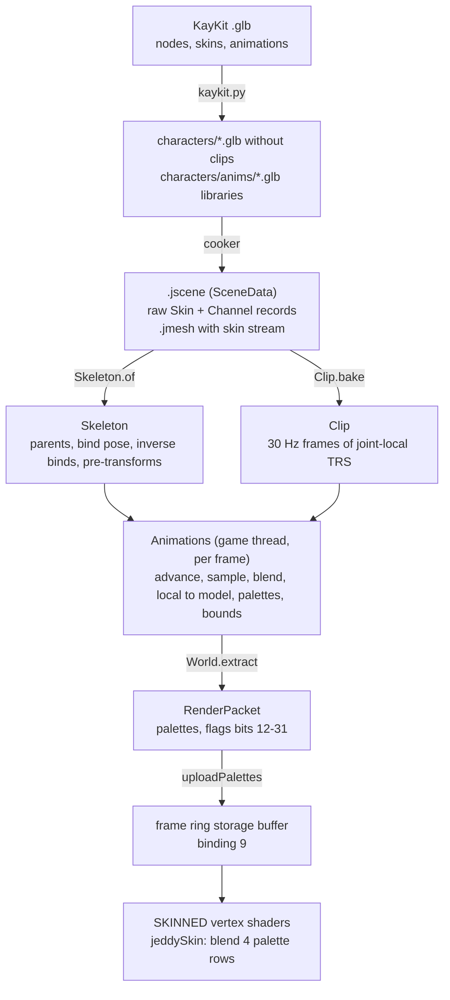

# 09. Skeletal animation and GPU skinning

A KayKit knight is one mesh, but it walks, swings a sword and falls over. Nobody stores a new mesh
for every frame. The artist binds the mesh to a *skeleton*, a tree of joints, and animates the
joints. Every frame, the engine works out where each joint is, turns that into one matrix per joint
(the *palette*), and the vertex shader moves every vertex by a weighted mix of a few of those
matrices. This chapter follows that path from the glTF file to the pixel, with the math derived
and checked against the code and its tests.

You will learn:

- what a skeleton is in glTF (joints, skins, inverse bind matrices) and how Jeddy reads one;
- how a pose made of translation, rotation and scale per joint becomes model-space matrices;
- why the skinning matrix is `model × inverseBind`, and why the bind pose gives identity matrices;
- how glTF keyframes (linear, step, cubic spline) are resampled into fixed-rate frames, and why;
- how instances blend two clips in sync, crossfade between states, and blend quaternions safely;
- the math of linear blend skinning and its known artifacts;
- how the renderer feeds palettes to the GPU: a skin vertex stream, a storage buffer, flag bits
  and a `SKINNED` shader variant;
- how the app's `World` and the iso demo's `Animator` drive 300 characters.

Where it lives:

| Area | Code |
|---|---|
| Skeletons, clips, instances | `modules/animation`: [`Skeleton`](../../modules/animation/src/main/java/dev/jeddy/animation/Skeleton.java), [`Clip`](../../modules/animation/src/main/java/dev/jeddy/animation/Clip.java), [`Animations`](../../modules/animation/src/main/java/dev/jeddy/animation/Animations.java) |
| Raw skins and channels | [`SceneData`](../../modules/asset/src/main/java/dev/jeddy/asset/format/SceneData.java) (`.jscene`, see [jscene.md](../formats/jscene.md)) |
| Skin vertex stream | [`MeshWriter`](../../modules/asset/src/main/java/dev/jeddy/asset/format/MeshWriter.java), [`MeshRegistry`](../../modules/render/src/main/java/dev/jeddy/render/mesh/MeshRegistry.java) |
| Palettes and draws | [`RenderPacket`](../../modules/render/src/main/java/dev/jeddy/render/RenderPacket.java), [`SceneRenderer`](../../modules/render/src/main/java/dev/jeddy/render/SceneRenderer.java), [`MaterialTable`](../../modules/render/src/main/java/dev/jeddy/render/draw/MaterialTable.java), [`DrawBuilder`](../../modules/render/src/main/java/dev/jeddy/render/draw/DrawBuilder.java) |
| Shaders | [`engine/skinning.glsl`](../../modules/render/src/main/resources/dev/jeddy/render/shaders/engine/skinning.glsl), [`pbr/pbr.vert`](../../modules/render/src/main/resources/dev/jeddy/render/shaders/pbr/pbr.vert), [`pbr/depth.vert`](../../modules/render/src/main/resources/dev/jeddy/render/shaders/pbr/depth.vert), [`pbr/outline_mask.vert`](../../modules/render/src/main/resources/dev/jeddy/render/shaders/pbr/outline_mask.vert) |
| Game integration | [`World`](../../modules/app/src/main/java/dev/jeddy/app/world/World.java), [`AgentSync`](../../modules/app/src/main/java/dev/jeddy/app/world/AgentSync.java), the demo's [`Animator`](../../samples/iso-demo/src/main/java/dev/jeddy/samples/iso/Animator.java) |
| Content | [`kaykit.py`](../../samples/iso-demo/tools/kaykit.py), [`GltfSceneImporter`](../../tools/cooker/src/main/java/dev/jeddy/cooker/gltf/GltfSceneImporter.java) |

The design is in [DESIGN.md](../DESIGN.md) §13.4 and decisions D79 (baked clips), D80 (GPU
skinning) and D81 (flat animated scenes). The work was milestone M12 in [TASKS.md](../TASKS.md).
This chapter uses quaternions and the TRS → matrix formula without re-deriving them; see
[03 Rotations and transforms](03-rotations-and-transforms.md). For the renderer's packets, sort keys,
program slots and frame ring, see [06 Renderer architecture](06-renderer-architecture.md).

## The whole path at a glance



Per frame, the game thread runs `Animator.update` (which clips to play), then
`World.updateAnimations` (which evaluates all poses on the job workers), then `World.extract`
(which copies palettes into the packet). The main thread uploads the palettes once and every
pass that draws a skinned mesh reads them.

## Skeletons in glTF

### Joints are just nodes

glTF has no special "bone" object. A joint is an ordinary node with a local translation, rotation
and scale (TRS). What makes a set of nodes a skeleton is a **skin**:

```
"skins": [{ "joints": [49, 30, 21, ...], "inverseBindMatrices": <accessor> }]
```

A skin lists the joint nodes and one *inverse bind matrix* (IBM) per joint. A skinned mesh's
vertices carry `JOINTS_0` (four joint indices) and `WEIGHTS_0` (four weights). The joint indices
are positions **in the skin's `joints` list**, not node indices. This is the single most
important detail of the format: there are two numbering schemes.

- **Node order**: the order of `nodes` in the file. After cooking, Jeddy's `.jscene` stores nodes
  parents first (`SceneData.parent(i)` "always a smaller index").
- **Skin order**: the order of `skin.joints`. The vertex stream refers to joints this way, and so
  must the palette the GPU reads.

Skin order need not be parents first. The test rig in
[`TestRig.java`](../../modules/animation/src/test/java/dev/jeddy/animation/TestRig.java) lists its
joints out of node order on purpose:

| Node | Name | Parent node | Joint (skin order) |
|---|---|---|---|
| 0 | `Armature` (90° about Y, scale 2) | -1 | not a joint |
| 1 | `hips` | 0 | 1 (`J_HIPS`) |
| 2 | `spine` | 1 | 0 (`J_SPINE`) |
| 3 | `hand` | 2 | 2 (`J_HAND`) |
| 4 | `socket` | 3 | not a joint |
| 5 | `sword` (mesh) | 4 | not a joint |
| 6 | `body` (skinned mesh) | 0 | not a joint |

The skin is `{SPINE, HIPS, HAND}`, so a vertex weighted to "joint 0" follows the spine.

The real KayKit knight
(`samples/iso-demo/assets/characters/knight.glb`) has 57 nodes and one skin of 41 joints: a
`root` joint whose parent is a non-joint node called `Rig`, then `hips`, `spine`, `chest`, the
arms, `head`, the legs and a set of IK helper joints (`kneeIK.l`, `handIK.r`, ...). Six skinned
mesh nodes (`Knight_Body`, `Knight_Head`, the arms and legs) are children of `Rig` and all use skin
0. Weapons such as `1H_Sword` hang under `handslot.r`, which is itself a joint.

### Reading a skin: `Skeleton.of`

[`Skeleton.of(scene, skin)`](../../modules/animation/src/main/java/dev/jeddy/animation/Skeleton.java)
builds, per joint `j` in skin order:

| Field | Meaning |
|---|---|
| `parent[j]` | the nearest ancestor that is a joint, as a joint index, or -1 |
| `bind[j * 10 .. +10)` | the bind-pose local TRS, copied from the node |
| `inverseBind[j * 12 .. +12)` | the IBM as a row-major 3×4 |
| `pre[j * 12 .. +12)` | the composed transform of the non-joint nodes between the joint and its parent joint |
| `names[j]` | the node name hashed to a `StrId` |
| `order[k]` | the k-th joint to evaluate; parents come first |
| `layout` | a hash of names and parents |

It is immutable after construction and may be shared by any thread. One skeleton per scene object
is enough for every character instance of that scene.

### Pre-transforms: folding in non-joint ancestors

The joint hierarchy is not the node hierarchy. Between a joint and its nearest joint ancestor there
may be plain nodes. The most common one is an *armature* node above the root joint. Rigs that
went through other tools on their way to glTF (FBX imports into Blender are a typical case) often
carry an armature node with a 90° rotation, or with a 0.01 scale when the source was in
centimeters. If the evaluator walked only joint parents, it would lose those transforms.

`Skeleton` composes them once, at load time, into a static *pre-transform* per joint:

```java
// modules/animation/src/main/java/dev/jeddy/animation/Skeleton.java
            // Walk up to the nearest joint ancestor, composing the nodes in between.
            AffineOps.identity(pre, j * AffineOps.STRIDE);
            int p = scene.parent(nd);
            while (p >= 0 && jointOfNode[p] < 0) {
                AffineOps.mul(nodeLocal, p * AffineOps.STRIDE, pre, j * AffineOps.STRIDE, tmp, 0);
                System.arraycopy(tmp, 0, pre, j * AffineOps.STRIDE, AffineOps.STRIDE);
                p = scene.parent(p);
            }
            parent[j] = p < 0 ? -1 : jointOfNode[p];
            hasPre[j] = !isIdentity(pre, j * AffineOps.STRIDE);
```

`AffineOps.mul(a, b, out)` computes $a \times b$ ("apply `b` first"). Walking up from the joint,
each new ancestor $N$ is multiplied on the **left**: after visiting the joint's parent $n_1$, then
$n_2$, up to $n_k$ (the last non-joint node), the pre-transform is

```math
P_j = N_{n_k} \cdots N_{n_2} \, N_{n_1}
```

where $N_x$ is node $x$'s local matrix. That is exactly the order in which the node hierarchy
would have applied them. For a root joint the walk runs to the scene root, so $P_j$ holds every
ancestor.

In the test rig the hips' pre-transform is the `Armature` node: a 90° turn about Y and a uniform
scale of 2. `SkeletonTest` checks `s.hasPre(J_HIPS)` is true and `s.hasPre(J_SPINE)` is false
(the spine's parent node, the hips, is a joint, so nothing lies between them).

In the KayKit files committed to this repository, the `Rig` node above `root` carries no
translation, rotation or scale, so its pre-transform is the identity and `hasPre` is false for
every joint. The mechanism costs nothing in that case: with `hasPre` false, every joint except
`root` (which has no parent joint and always takes the general path) goes down the evaluator's fast
path (see [Writing models, palettes and bounds](#writing-models-palettes-and-bounds)).

### Joint names, `StrId` and the layout hash

Joint names are hashed with [`StrId.of`](../../modules/core/src/main/java/dev/jeddy/core/id/StrId.java),
a 64-bit FNV-1a over the UTF-8 bytes; `Skeleton` maps an empty name to `StrId.NONE`, which is 0,
instead of hashing it. Lookups compare
`long`s, so `Skeleton.find(long)` is a short linear scan with no string work. Names matter because
clips bind to joints by name (next section) and attachments are found by name.

Two skeletons can play the same baked clip only if their joints have the same names and parents in
the same skin order. `Skeleton` folds that into one number:

```java
// modules/animation/src/main/java/dev/jeddy/animation/Skeleton.java
        long hash = 0x9E3779B97F4A7C15L ^ n;
        // ... per joint j, in skin order:
            hash = (hash ^ names[j]) * 0x100000001B3L;
            hash = (hash ^ parent[j]) * 0x100000001B3L;
        // ...
        layout = hash;
```

The multiplier `0x100000001B3` is the 64-bit FNV prime, here mixing whole 64-bit values instead of
bytes. A `Clip` remembers the layout it was baked for, and `Animations.play` throws
`IllegalArgumentException("clip baked for another skeleton layout")` on a mismatch. A hash
comparison is one `long` compare per `play`, instead of comparing 41 names.

### Evaluation order

A child's model matrix needs its parent's, so joints must be evaluated parents first. Skin order
does not guarantee that, but node order does (the cooker writes parents first). So `Skeleton`
sorts joint indices by node index:

```java
// modules/animation/src/main/java/dev/jeddy/animation/Skeleton.java
        // Scene nodes come parents first, so sorting joints by node index orders parents first.
        Integer[] sorted = new Integer[n];
        for (int j = 0; j < n; j++) {
            sorted[j] = j;
        }
        Arrays.sort(sorted, (a, b) -> Integer.compare(joints[a], joints[b]));
```

The boxed `Integer[]` and the lambda are fine here: this is a cold path that runs once per scene.
For the test rig, skin order is spine, hips, hand, and `evaluationOrder` returns hips (1), spine
(0), hand (2). Outputs are still written at skin-order positions, which is what the GPU needs.

### Attachments

A sword is not skinned. It is a rigid mesh node somewhere below a hand joint. `Skeleton.attachment`
finds that joint and the sword's fixed offset from it:

```java
// modules/animation/src/main/java/dev/jeddy/animation/Skeleton.java
    public int attachment(int sceneNode, float[] offset, int o) {
        float[] tmp = new float[AffineOps.STRIDE];
        System.arraycopy(nodeLocal, sceneNode * AffineOps.STRIDE, offset, o, AffineOps.STRIDE);
        int p = nodeParent[sceneNode];
        while (p >= 0 && jointOfNode[p] < 0) {
            AffineOps.mul(nodeLocal, p * AffineOps.STRIDE, offset, o, tmp, 0);
            System.arraycopy(tmp, 0, offset, o, AffineOps.STRIDE);
            p = nodeParent[p];
        }
        return p < 0 ? -1 : jointOfNode[p];
    }
```

It is the same walk as the pre-transform, but it starts with the node's own local matrix. In the
test rig, `sword` sits at $(0, 0, 0.2)$ under `socket`, which sits at $(0, 0.1, 0)$ under `hand`.
The offset is $`T(0, 0.1, 0)\,T(0, 0, 0.2) = T(0, 0.1, 0.2)`$, and `findsAttachmentsAndTheirOffsets`
asserts `offset[7] == 0.1` and `offset[11] == 0.2` (the `ty` and `tz` slots of a row-major 3×4).
The skinned `body` returns -1: its ancestors are `Armature` only, which is not a joint.

**Try it:** `./gradlew :animation:test --tests 'dev.jeddy.animation.SkeletonTest'`.

## From a local pose to model matrices

### A pose is ten floats per joint

A *local pose* gives each joint a translation, a rotation quaternion and a scale, relative to its
parent node. `Skeleton.TRS = 10` is the stride:

| Offset | 0 | 1 | 2 | 3 | 4 | 5 | 6 | 7 | 8 | 9 |
|---|---|---|---|---|---|---|---|---|---|---|
| Value | $t_x$ | $t_y$ | $t_z$ | $q_x$ | $q_y$ | $q_z$ | $q_w$ | $s_x$ | $s_y$ | $s_z$ |

This is also the layout of `SceneData.trs(i, k)` and of glTF itself (quaternions as `xyzw`).
Animation works in TRS rather than matrices because TRS interpolates well: you can lerp a
translation, nlerp a quaternion and lerp a scale, but lerping two rotation matrices gives a matrix
that is no longer a rotation.

### Local to model

The local matrix is $`L_j = T(\mathbf{t}_j)\,R(\mathbf{q}_j)\,S(\mathbf{s}_j)`$: scale first, then
rotate, then translate. In Jeddy's row-major 3×4 form (rows `[r00 r01 r02 tx | r10 r11 r12 ty |
r20 r21 r22 tz]`, see [`AffineOps`](../../modules/math/src/main/java/dev/jeddy/math/AffineOps.java))
the linear part is the rotation matrix of $\mathbf{q}$ with column $c$ multiplied by $s_c$, and the
last column is $\mathbf{t}$. Chapter [03](03-rotations-and-transforms.md) derives the
quaternion-to-matrix formula used by `AffineOps.composeTRS`.

The **model** matrix of a joint places it relative to the skeleton's scene root:

```math
M_j = M_{p(j)} \; P_j \; L_j , \qquad M_{p(j)} = I \text{ when } p(j) = -1
```

where $p(j)$ is the parent joint and $P_j$ the pre-transform. Vectors are columns and multiply on
the right, so a point in joint $j$'s space goes through $L_j$, then $P_j$, then the parent's model
matrix.

**Worked example (the test rig in its bind pose).** The armature's rotation is
$\mathbf{q} = (0, \sqrt{0.5}, 0, \sqrt{0.5})$, a 90° turn about +Y, which maps
$(x, y, z) \mapsto (z, y, -x)$, and its scale is 2. So $P_{hips}$ has the linear part
$R_y(90^\circ)\cdot 2$:

```
P_hips = [ 0  0  2 | 0 ]
         [ 0  2  0 | 0 ]
         [-2  0  0 | 0 ]
```

- Hips: $L = T(0, 1, 0)$, no parent, so $M_{hips} = P_{hips} L$. Its origin goes to
  $P_{hips}(0, 1, 0) = (0, 2, 0)$.
- Spine: $L = T(0, 0.5, 0)$, parent hips. Origin: $(0, 2, 0) + 2\cdot R_y(90^\circ)(0, 0.5, 0) = (0, 3, 0)$.
- Hand: $L = T(0.3, 0, 0)$, parent spine. Origin:
  $(0, 3, 0) + 2\cdot R_y(90^\circ)(0.3, 0, 0) = (0, 3, 0) + (0, 0, -0.6) = (0, 3, -0.6)$.

`bindPosePalettesAreIdentityAndModelsMatchTheScene` checks that every `models()` entry equals the
node's scene-root transform computed independently by `TestRig.worldTransforms`, and that the
joints' bounding sphere is centered at $y = 2.5$ (halfway between 2 and 3).

## Inverse bind matrices and the skinning matrix

### What the bind pose is

The artist modeled the knight in one pose, the **bind pose** (usually arms out, a "T" or "A"
pose), and stored the mesh vertices in that pose, in model space. Let $B_j$ be joint $j$'s model
matrix in that pose. The glTF *inverse bind matrix* of joint $j$ is $B_j^{-1}$.

### Deriving the skinning matrix

Take a vertex $\mathbf{v}$ (model space, bind pose) that should follow joint $j$ rigidly.

1. Express it relative to the joint as it was at bind time: $`\mathbf{v}_j = B_j^{-1}\mathbf{v}`$.
   This is the vertex's position "in the joint's own coordinates", and it never changes.
2. Carry it with the joint as it is now: $`\mathbf{v}' = M_j\,\mathbf{v}_j`$.

So the matrix that moves a bind-pose vertex to its animated position is

```math
K_j = M_j \, B_j^{-1}
```

This $K_j$ is the **skinning matrix**, and the array of all $K_j$ of one skeleton is the
**palette**. `Animations.palettes()` stores exactly this (`model × inverseBind`).

### Why the bind pose gives identity palettes

If the current pose is the bind pose, then $M_j = B_j$ and

```math
K_j = B_j B_j^{-1} = I
```

for every joint, and every vertex stays where the artist put it. This is a strong test, and
`SkeletonTest` uses it: after `Animations.add` (which evaluates the bind pose), every palette
must equal `IDENTITY` within `1e-5`.

One caveat: this holds only when the IBMs are the exact inverses of the joints' rest transforms as
stored in the nodes. glTF does not require that. If an exporter wrote nodes in one pose and IBMs
for another, the "bind pose" palettes are not identities and the un-animated mesh shows the node
pose. That is correct behavior, not a bug. The TestRig builds its IBMs with `AffineOps.invert` on
the node transforms, so the identity test is exact there.

### A numeric example

The GPU test [`SkinningTest`](../../modules/render/src/test/java/dev/jeddy/render/pbr/SkinningTest.java)
uses a vertical strip from $y = 0$ to $1$ with two joints: joint 0 at the origin and joint 1 at
$(0, 0.5, 0)$. Let joint 1 bend by $-90^\circ$ about Z (the top half then points to +X).

- Bind: $B_1 = T(0, 0.5, 0)$, so $B_1^{-1} = T(0, -0.5, 0)$.
- Pose: $`M_1 = T(0, 0.5, 0)\,R_z(-90^\circ)`$.
- Palette: $`K_1 = T(0, 0.5, 0)\,R_z(-90^\circ)\,T(0, -0.5, 0)`$.

With $\cos(-90^\circ) = 0$ and $\sin(-90^\circ) = -1$,
$`R_z(-90^\circ) = \begin{bmatrix} 0 & 1 & 0 \\ -1 & 0 & 0 \\ 0 & 0 & 1 \end{bmatrix}`$, which maps
$(x, y) \mapsto (y, -x)$. Composing right to left:

```math
(x, y) \xrightarrow{T(0,-0.5)} (x,\; y - 0.5) \xrightarrow{R_z(-90^\circ)} (y - 0.5,\; -x) \xrightarrow{T(0,0.5)} (y - 0.5,\; 0.5 - x)
```

As a row-major 3×4 that is `[0 1 0 -0.5 | -1 0 0 0.5 | 0 0 1 0]`, which is exactly the `BENT`
constant in the test:

```java
// modules/render/src/test/java/dev/jeddy/render/pbr/SkinningTest.java
        // T(0, 0.5, 0) Rz(-90°) T(0, -0.5, 0): (x, y) -> (y - 0.5, 0.5 - x).
        float[] m = {0, 1, 0, -0.5f, -1, 0, 0, 0.5f, 0, 0, 1, 0};
```

The strip's top vertex $(0.1, 1, 0)$ goes to $(0.5, 0.4, 0)$ and $(-0.1, 1, 0)$ to $(0.5, 0.6, 0)$:
the top edge now stands at $x = 0.5$, with the arm's tip centered at $(0.5, 0.5)$. The joint
itself, $(0, 0.5)$, maps to itself, as a pivot should.

### From glTF column-major 4×4 to Jeddy's row-major 3×4

glTF stores a 4×4 matrix in column-major order: element (row $r$, column $c$) is at index
$4c + r$. Jeddy's affine transforms are row-major 3×4: element $(r, c)$ at $4r + c$, and the
constant bottom row $`[0\;0\;0\;1]`$ is dropped. The conversion is a transposed copy of the top
three rows:

```java
// modules/animation/src/main/java/dev/jeddy/animation/Skeleton.java
            // glTF matrices are column-major 4×4: element (row r, column c) is m[c * 4 + r].
            for (int r = 0; r < 3; r++) {
                for (int c = 0; c < 4; c++) {
                    inverseBind[j * AffineOps.STRIDE + r * 4 + c] = ibm[j * 16 + c * 4 + r];
                }
            }
```

Example: the translation $T(1, 2, 3)$ is `[1,0,0,0, 0,1,0,0, 0,0,1,0, 1,2,3,1]` in glTF and
`[1,0,0,1, 0,1,0,2, 0,0,1,3]` in Jeddy. Element $(0, 3)$ is glTF index 12 (value 1) and Jeddy
index 3. The test rig goes the other way with `AffineOps.toMat4`. If a skin has no
`inverseBindMatrices`, the cooker's `GltfImporter` fills identities, as glTF specifies.

Why row-major 3×4? It is 12 floats instead of 16, and three rows are exactly three `vec4`s in a
std430 storage buffer. The palette goes to the GPU by a plain copy, with no conversion
(DESIGN §8.2, §9.2).

## Clips: from glTF channels to baked frames

### glTF animations

A glTF animation is a list of **channels**. Each channel targets one node and one *path*
(`translation`, `rotation`, `scale` or morph `weights`) and points at a **sampler**: an input
accessor of key times in seconds, an output accessor of values, and an interpolation mode. The
cooker keeps them raw in the `.jscene` (D39) as
`SceneData.Channel(int node, int path, int interpolation, int components, float[] times, float[] values)`,
and an animation's `duration` is the largest key time of its channels
([`GltfSceneImporter`](../../tools/cooker/src/main/java/dev/jeddy/cooker/gltf/GltfSceneImporter.java)).
The binary layout is in [jscene.md](../formats/jscene.md).

Channels are independent. A walk might have 123 channels over 41 joints, each with its own key
times. Sampling such data directly means, per channel, finding the two keys around time $t$.

### The three interpolation modes

Let keys $k$ and $k+1$ surround $t$, with times $`t_k \le t < t_{k+1}`$, span
$\Delta = t_{k+1} - t_k$ and local parameter $s = (t - t_k)/\Delta \in [0, 1)$.

**`LINEAR`.** Translations and scales lerp:
$`\mathbf{p}(s) = \mathbf{p}_k + s(\mathbf{p}_{k+1} - \mathbf{p}_k)`$.
Rotations use spherical linear interpolation (slerp), which turns at a constant
angular speed along the shorter arc. `Clip.slerp` flips the second quaternion when the dot product
is negative (the short way, see below) and falls back to a plain lerp when the two are nearly equal
($`d > 0.9995`$), where $\sin\theta$ would be tiny and the division unstable:

```java
// modules/animation/src/main/java/dev/jeddy/animation/Clip.java
        if (d > 0.9995f) {
            a = 1 - s;
            b = s;
        } else {
            double theta = Math.acos(Math.min(1, d));
            double sin = Math.sin(theta);
            a = (float) (Math.sin((1 - s) * theta) / sin);
            b = (float) (Math.sin(s * theta) / sin);
        }
```

**`STEP`.** The value of key $k$ holds until key $k+1$: `System.arraycopy(v, lo * stride, out, 0, n)`.

**`CUBICSPLINE`.** Each key stores three values: an in-tangent $`\mathbf{a}_k`$, the value
$`\mathbf{p}_k`$ and an out-tangent $`\mathbf{b}_k`$. The curve between keys is a cubic Hermite
spline. Let us derive it.

We want a cubic $\mathbf{p}(s) = \mathbf{a}s^3 + \mathbf{b}s^2 + \mathbf{c}s + \mathbf{d}$ on
$[0, 1]$ with given end values $`\mathbf{p}(0) = \mathbf{p}_0`$, $`\mathbf{p}(1) = \mathbf{p}_1`$ and
end slopes $`\mathbf{p}'(0) = \mathbf{m}_0`$, $`\mathbf{p}'(1) = \mathbf{m}_1`$ (derivatives with
respect to $s$). The four conditions give

```math
\mathbf{d} = \mathbf{p}_0, \quad \mathbf{c} = \mathbf{m}_0, \quad
\mathbf{a} + \mathbf{b} + \mathbf{c} + \mathbf{d} = \mathbf{p}_1, \quad
3\mathbf{a} + 2\mathbf{b} + \mathbf{c} = \mathbf{m}_1
```

Solving the last two for $\mathbf{a}$ and $\mathbf{b}$:
$`\mathbf{a} = 2\mathbf{p}_0 - 2\mathbf{p}_1 + \mathbf{m}_0 + \mathbf{m}_1`$ and
$`\mathbf{b} = -3\mathbf{p}_0 + 3\mathbf{p}_1 - 2\mathbf{m}_0 - \mathbf{m}_1`$. Substituting and
grouping by $`\mathbf{p}_0, \mathbf{m}_0, \mathbf{p}_1, \mathbf{m}_1`$:

```math
\mathbf{p}(s) = \underbrace{(2s^3 - 3s^2 + 1)}_{h_{00}}\mathbf{p}_0
+ \underbrace{(s^3 - 2s^2 + s)}_{h_{10}}\mathbf{m}_0
+ \underbrace{(-2s^3 + 3s^2)}_{h_{01}}\mathbf{p}_1
+ \underbrace{(s^3 - s^2)}_{h_{11}}\mathbf{m}_1
```

glTF tangents are slopes per **second** ($d\mathbf{p}/dt$). Since $`t = t_k + s\Delta`$, the chain
rule gives $d\mathbf{p}/ds = \Delta \cdot d\mathbf{p}/dt$. So $`\mathbf{m}_0 = \Delta\,\mathbf{b}_k`$
(key $k$'s out-tangent) and $`\mathbf{m}_1 = \Delta\,\mathbf{a}_{k+1}`$ (key $k+1$'s in-tangent).
The code is this formula term by term (values sit at offset `n` inside a key, out-tangents at
`2 * n`, in-tangents at 0):

```java
// modules/animation/src/main/java/dev/jeddy/animation/Clip.java
            case SceneData.INTERPOLATION_CUBIC -> {
                float s2 = s * s;
                float s3 = s2 * s;
                float h00 = 2 * s3 - 3 * s2 + 1;
                float h10 = s3 - 2 * s2 + s;
                float h01 = -2 * s3 + 3 * s2;
                float h11 = s3 - s2;
                int a = lo * stride;
                int b = hi * stride;
                for (int k = 0; k < n; k++) {
                    out[k] =
                            h00 * v[a + n + k]
                                    + h10 * span * v[a + 2 * n + k]
                                    + h01 * v[b + n + k]
                                    + h11 * span * v[b + k];
                }
            }
```

**Numeric check.** With zero tangents the curve is
$`\mathbf{p}_0 + h_{01}(s)\,(\mathbf{p}_1 - \mathbf{p}_0)`$, the classic smoothstep $3s^2 - 2s^3$. `ClipTest.evaluatesStepAndCubicSplineChannels`
moves the hips from $y = 0$ to $y = 1$ over one second with zero tangents and expects, at
$s = 0.25$, $3 \cdot 0.0625 - 2 \cdot 0.015625 = 0.15625$. A cubic quaternion is not unit length
in general, so `bake` normalizes every rotation after `evaluate`.

Before choosing between modes, `evaluate` finds the key pair with a binary search over `times`,
and clamps to the first or last key outside the range (glTF semantics). That search exists only
at bake time.

### Resampling at a fixed rate

`Clip.bake` evaluates every channel at evenly spaced times and stores the results as complete
poses:

```java
// modules/animation/src/main/java/dev/jeddy/animation/Clip.java
        float duration = Math.max(0, anim.duration());
        int frameCount = Math.max(2, Math.round(duration * rate) + 1);
        Clip clip = new Clip(anim.name(), duration, frameCount, joints, skeleton.layout());
        float[] f = clip.frames;
        float[] bind = skeleton.bindPose();
        int frameFloats = joints * Skeleton.TRS;
        for (int i = 0; i < frameCount; i++) {
            System.arraycopy(bind, 0, f, i * frameFloats, frameFloats);
        }
        // ...
            for (int i = 0; i < frameCount; i++) {
                float t = i == frameCount - 1 ? duration : i * clip.step;
                evaluate(c, t, value);
                if (components == 4) {
                    normalize(value);
                }
                System.arraycopy(
                        value, 0, f, i * frameFloats + joint * Skeleton.TRS + offset, components);
            }
```

with `step = duration / (frameCount - 1)` from the constructor. The rate is adjusted slightly so
that the first frame is at 0 and the last exactly at `duration`. Every frame starts as a copy of
the bind pose, so joints the clip does not animate keep their bind values.

**Example.** KayKit's `Walking_A` lasts $1.0667$ s ($32/30$). At `DEFAULT_RATE = 30`:
`frameCount` $= \operatorname{round}(32.0) + 1 = 33$ and `step` $= 1.0667/32 = 1/30$ s. The
frames are one flat `float[]`:

```
Clip.frames  (frameCount × jointCount × 10 floats)

frame 0 : [ j0: tx ty tz qx qy qz qw sx sy sz | j1: ... | ... | j40: ... ]
frame 1 : [ j0: ...                                                       ]
  ...
frame 32: [ ...                                                           ]

index(frame f, joint j, component k) = (f * jointCount + j) * 10 + k
```

### Binding channels to joints by name

```java
// modules/animation/src/main/java/dev/jeddy/animation/Clip.java
    private static int bindJoint(SceneData library, int node, Skeleton skeleton) {
        String name = library.nodeName(node);
        if (!name.isEmpty()) {
            return skeleton.find(StrId.of(name));
        }
        int j = skeleton.jointOfNode(node);
        return j >= 0 && skeleton.name(j) == StrId.NONE ? j : -1;
    }
```

The library can be a different scene from the character. An **animation library** is a `.jscene`
holding a rig's nodes and clips, with no meshes. A channel on a node called `spine` drives whatever
joint of the skeleton is called `spine`, wherever it sits in that skeleton's skin order. Channels on
nodes the skeleton does not have are skipped, as are morph-weight channels. Unnamed nodes fall back
to the node index, which only makes sense for a clip baked from the skeleton's own scene.
`ClipTest.bindsChannelsByNameAcrossScenes` builds a library whose nodes are in another order, plus
an `unrelated` node with a channel that must bind nowhere.

### Hemisphere continuity for quaternions

A unit quaternion $\mathbf{q}$ and its negation $-\mathbf{q}$ describe the same rotation (negating
both $\cos\frac{\theta}{2}$ and $\mathbf{n}\sin\frac{\theta}{2}$ is the same as adding $2\pi$ to
$\theta$). Keys, and the values sampled between them, can land in either "hemisphere" of the 4D
sphere. That matters later:
at run time, `Clip.sample` lerps two neighboring frames component-wise. If frame $i$ holds
$\mathbf{q}$ and frame $i+1$ holds $-\mathbf{q}'$ with $\mathbf{q}' \approx \mathbf{q}$, the lerp
passes near the zero vector halfway, and the normalized result swings through a large rotation.
`bake` fixes this once:

```java
// modules/animation/src/main/java/dev/jeddy/animation/Clip.java
                // Keep consecutive frames in one hemisphere, so frame lerps take the short way.
                if (f[q] * f[prev]
                                + f[q + 1] * f[prev + 1]
                                + f[q + 2] * f[prev + 2]
                                + f[q + 3] * f[prev + 3]
                        < 0) {
                    for (int k = 0; k < 4; k++) {
                        f[q + k] = -f[q + k];
                    }
                }
```

After this pass, the dot product of every pair of consecutive frames is non-negative, so a frame
lerp always takes the short way.

### Root lock

Locomotion clips usually move the character: the hips or the root joint travel forward. In a CRPG
the crowd simulation moves the character, so the clip must play in place. `bake`'s `lockJoint`
argument keeps that joint's local $x$ and $z$ translation at frame 0's values (Y-up), while $y$
still bobs:

```java
// modules/animation/src/main/java/dev/jeddy/animation/Clip.java
        if (lockJoint >= 0) {
            for (int i = 1; i < frameCount; i++) {
                int o = i * frameFloats + lockJoint * Skeleton.TRS;
                f[o] = f[lockJoint * Skeleton.TRS];
                f[o + 2] = f[lockJoint * Skeleton.TRS + 2];
            }
        }
```

`ClipTest.locksARootJointsHorizontalTranslation` moves the hips from $(0, 1, 0)$ to $(3, 2, 5)$
and expects $(0, 2, 0)$ at the end. The demo locks the `root` joint of its walk and run clips.

### Sampling: two frames and a lerp

```java
// modules/animation/src/main/java/dev/jeddy/animation/Clip.java
    public void sample(int joint, float time, float[] out, int o) {
        float x = time / step;
        if (!(x > 0)) {
            x = 0;
        }
        int f0 = (int) x;
        float a = x - f0;
        if (f0 >= frameCount - 1) {
            f0 = frameCount - 2;
            a = 1;
        }
        int p = (f0 * jointCount + joint) * Skeleton.TRS;
        int q = p + jointCount * Skeleton.TRS;
        // ... out = lerp(frames[p..], frames[q..], a); then the rotation is normalized
```

The frame index is a division, not a search. `!(x > 0)` also catches NaN. Past the end it clamps
to the last frame. The rotation is lerped and renormalized: that is **nlerp**, not slerp. Between
two frames 1/30 s apart, the difference is tiny. Taking two unit quaternions an angle $\Omega$
apart on the 4D sphere, nlerp at parameter $s$ gives the angle
$`\operatorname{atan2}(s\sin\Omega,\; 1 - s + s\cos\Omega)`$ from the first, where slerp gives
$`s\,\Omega`$. For a joint turning 24° per frame (720° per second at 30 Hz, so $\Omega = 12^\circ$), the
largest difference over $s$ is about 0.017° of rotation. Even 60° per frame stays under 0.3°.

`ClipTest.resamplesLinearChannelsAndKeepsUntouchedJointsInBindPose` bakes a 90° turn at 10 Hz and
samples it at 0.5 s: the expected rotation is 45°, with $q_y = \sin(\pi/8)$ and
$q_w = \cos(\pi/8)$.

A consequence worth knowing: a `STEP` channel is sampled exactly at frame times, but the run time
lerps between frames, so a step change becomes a ramp one frame long (33 ms at 30 Hz).

### Why bake (D79)

Sampling raw glTF at run time costs, per channel and per sample, a key search (binary search, or a
cached cursor per channel per instance, which is mutable state that every instance must carry),
then an interpolation that depends on the mode. Channels are scattered in memory, each with its
own arrays.

Baked, a pose sample is:

1. one division to find two frame indices, **once per clip**, shared by all joints;
2. a straight walk over two contiguous blocks of `jointCount × 10` floats, lerping.

No search, no per-channel state, no branches on the interpolation mode, and sequential memory that
the hardware prefetcher handles well. That is what makes 300 characters × 41 joints fit in well
under a millisecond.

The cost is memory: $30 \text{ frames} \times 10 \text{ floats} \times 4 \text{ bytes} = 1200$ bytes
per joint-second, the "about 1.2 KB per joint-second" of D79. `Walking_A` at 41 joints is
$33 \times 41 \times 40 = 54{,}120$ bytes. All ten hero clips the demo bakes (about 11.3 s in total,
349 frames) come to roughly 0.57 MB. That is small next to the textures. D79 also records the
alternative: quantize the frames (see [Further reading](#further-reading) on ACL) only when a
measurement says memory matters.

Baking runs at load time and allocates (TASKS M12-02 notes about 3 ms per KayKit rig). Clips are
immutable afterwards and shared by every instance.

### Content: animation libraries

[`kaykit.py`](../../samples/iso-demo/tools/kaykit.py) writes `characters/anims/heroes.glb` and
`skeletons.glb`: the rig's nodes (no meshes, skins or textures) and only the clips the demo plays,
11 per rig, about 400 KB each. Its `write_animation_library` drops redundant keys:

```python
# samples/iso-demo/tools/kaykit.py
            if interpolation != "CUBICSPLINE" and all(v == values[0] for v in values):
                times, values = times[:1], values[:1]  # constant: one key holds it
```

A channel whose values never change becomes one key, which is lossless: glTF clamps a channel
outside its key range, so a single key holds for the whole clip. Cubic channels are excluded
because their stored triples include tangents. The cooker turns these files into `.jscene`s like
any scene; `GltfSceneImporterTest.cooksAnimationLibrariesWithoutMeshes` checks a mesh-less library
with a single-key channel.

**Try it:** `./gradlew :animation:test --tests 'dev.jeddy.animation.ClipTest'`.

## Playing, blending and crossfading: `Animations`

### Instances as SoA slots

[`Animations`](../../modules/animation/src/main/java/dev/jeddy/animation/Animations.java) holds up to
`maxInstances` skeleton instances. An instance is an `int` slot; its state lives in parallel arrays
(`curA`, `curB`, `curPhase`, `curWeight`, `curSpeed`, `curLoop`, and the same set prefixed `prev`
for the state that is fading out, plus `fadeElapsed` and `fadeDuration`). Joint outputs live in
flat arrays shared by all instances:

```
models[] and palettes[]  (12 floats per joint, row-major 3x4)

| inst 0: joint 0 | joint 1 | ... | joint n0-1 | inst 1: joint 0 | ... | ...
  ^ jointBase(0) = 0                            ^ jointBase(1) = n0

bounds[]  (4 floats per instance: center x, y, z, radius)
```

Joint ranges are reserved by `add` and reused by a later `add` of a skeleton that fits. The
constructor sizes everything (`maxJoints` in total), so after creation, adding instances of
skeletons no larger than the first ones, playing and updating allocate nothing. `add` evaluates
the bind pose at once, so a new instance has valid palettes before its first `update`.

### States

```java
// modules/animation/src/main/java/dev/jeddy/animation/Animations.java
    public void play(
            int instance,
            Clip a,
            Clip b,
            float weight,
            float speed,
            boolean loop,
            float fadeSeconds) {
```

A state is one clip (`b == null`), or a 1D blend of two clips `a` and `b` with `weight` the share of
`b`. It has a playback `speed` and either loops or holds its last frame. The helpers are
`play(instance, clip, fade)` (loop), `playOnce(instance, clip, fade)` (hold; `isFinished` turns
true at the end) and `playBlend(instance, a, b, weight, fade)` (looping blend). `setBlendWeight`,
`setSpeed` and `setPhase` change the current state without restarting it. Each new state starts at
phase 0.

### Phase and synchronized blends

Each state keeps a **normalized time**, the phase $p \in [0, 1]$: 0 at the start of a cycle and 1
at its end. Clip $a$ is sampled at $`p\,d_a`$ seconds and clip $b$ at $`p\,d_b`$ seconds, where $d$ is a
clip's duration.

Why not let each clip run on its own clock? Suppose a walk lasts 1.0667 s and a run 0.8 s, and both
start with the left foot down. Run independently, after 0.4 s the run is at mid-cycle (right foot
down) and the walk is only 37.5% through. Averaging those two poses gives legs that are neither
here nor there: feet slide, cross or float. With a shared phase, both clips are at the same point
of the gait, so a blend of "left foot down" with "left foot down" is still "left foot down". This
assumes that both clips are authored with matching phases (the same foot plant at the same
normalized time), which is the usual convention for locomotion sets.

How fast should the phase move? Playing $a$ alone, one cycle takes $d_a$ seconds, so
$dp/dt = 1/d_a$. Playing $b$ alone, $1/d_b$. For a blend, Jeddy blends the **cycle length**
linearly with the weight:

```math
\ell(w) = d_a + (d_b - d_a)\,w = (1 - w)\,d_a + w\,d_b, \qquad
p \leftarrow p + \frac{\Delta t \cdot \text{speed}}{\ell(w)}
```

then wraps $p - \lfloor p \rfloor$ when looping, or clamps to $[0, 1]$ when holding:

```java
// modules/animation/src/main/java/dev/jeddy/animation/Animations.java
    private static float advance(
            Clip a, Clip b, float weight, float speed, boolean loop, float phase, float dt) {
        float length = a.duration();
        if (b != null) {
            length += (b.duration() - length) * weight;
        }
        if (length <= 0) {
            return 1;
        }
        float p = phase + dt * speed / length;
        if (loop) {
            p -= (float) Math.floor(p);
        } else if (p > 1) {
            p = 1;
        } else if (p < 0) {
            p = 0;
        }
        return p;
    }
```

At $w = 0$ this is clip $a$'s own rate; at $w = 1$ clip $b$'s. In between, the cycle length
morphs smoothly. A zero-length clip (a single pose) is always at phase 1. `Math.floor` (rather than
a cast) keeps the wrap right for negative speeds.

**Worked example (from `AnimationsTest.blendsTwoClipsWithSynchronizedTimes`).** `slide` moves the
spine's $x$ from 0 to 1 over 1 s, and `slide2` from 0 to 4 over 2 s. With $w = 0.5$:
$\ell = 1 + (2 - 1)\cdot 0.5 = 1.5$ s. After 0.75 s, $p = 0.75/1.5 = 0.5$. `slide` is sampled at
$0.5 \cdot 1 = 0.5$ s ($x = 0.5$) and `slide2` at $0.5 \cdot 2 = 1$ s ($x = 2$). The blend is
$0.5 \cdot 0.5 + 0.5 \cdot 2 = 1.25$, which the test asserts. Then `setBlendWeight(i, 1)` gives
$x = 2$ at the same phase, and `setSpeed(i, 2)` with $\Delta t = 0.25$ s on a 2 s cycle moves the
phase by $0.25 \cdot 2 / 2 = 0.25$, to 0.75.

`setPhase` is how crowds avoid marching in lockstep: the demo starts every character's idle at a
random phase.

### Crossfades

`play` with `fadeSeconds > 0` moves the current state into the `prev` arrays and starts a fade. The
fade factor is a linear ramp, $f = \min(1, e / D)$ with $e$ = `fadeElapsed` and $D$ =
`fadeDuration`. The new state gets total weight $f$, the old one $1 - f$, and each splits its share
between its two clips. That gives up to four weighted contributions:

| Contribution | Clip | Sample time | Weight |
|---|---|---|---|
| current $a$ | `curA` | $`p_{cur}\,d`$ | $`(1 - w_{cur})\,f`$ |
| current $b$ | `curB` | $`p_{cur}\,d`$ | $`w_{cur}\,f`$ |
| previous $a$ | `prevA` | $`p_{prev}\,d`$ | $(1 - w_{prev})(1 - f)$ |
| previous $b$ | `prevB` | $`p_{prev}\,d`$ | $`w_{prev}\,(1 - f)`$ |

The weights add up to $f + (1 - f) = 1$. Both states keep advancing during the fade, and when
$e \ge D$ the previous state is dropped.

**Worked example (`crossfadesBetweenStates`).** The instance holds `hold` ($x = 10$), then
`play(i, slide, 0.2f)`. After 0.1 s, $f = 0.1/0.2 = 0.5$; `slide` is at 0.1 s ($x = 0.1$). The
blend is $0.5 \cdot 10 + 0.5 \cdot 0.1 = 5.05$. After another 0.15 s the fade has ended and $x$ is
`slide` at 0.25 s, so 0.25.

One simplification is visible in the code: if `play` is called while a fade is running, "the state
it fades out is dropped". The new fade starts from the *current* state alone, so a pose that was
50% A and 50% B jumps to 100% B before fading toward C. Exercise 5 asks you to measure and fix that.

### Sampling once per clip, not per joint

`evaluate` registers the contributions first. Frame indices depend only on the clip and the time,
so they are computed once per clip per instance:

```java
// modules/animation/src/main/java/dev/jeddy/animation/Animations.java
            // Up to four weighted clip samples; frame positions are the same for every joint.
            Contributions c = contributions[thread];
            c.count = 0;
            c.add(ca, curPhase[i] * ca.duration(), (1 - cw) * fade);
            if (cb != null) {
                c.add(cb, curPhase[i] * cb.duration(), cw * fade);
            }
            if (pa != null) {
                c.add(pa, prevPhase[i] * pa.duration(), (1 - pw) * (1 - fade));
                if (pb != null) {
                    c.add(pb, prevPhase[i] * pb.duration(), pw * (1 - fade));
                }
            }
            blend(c, n, p, s.bindPose());
```

`Contributions.add` repeats `Clip.sample`'s frame arithmetic and stores the clip's `frames` array,
the offsets of the two frames, the lerp factor and the weight. It skips zero weights. The joint loop
in `blend` then does only arithmetic.

### Blending quaternions

Translations and scales blend as weighted sums, which is fine because the weights sum to 1. A
weighted sum of quaternions followed by a normalization is also a good rotation blend, as long as
the inputs are in the same hemisphere. `blend` checks the sign of each new sample against the sum
so far:

```java
// modules/animation/src/main/java/dev/jeddy/animation/Animations.java
                float qx = f[xm + 3] + (f[ym + 3] - f[xm + 3]) * t;
                float qy = f[xm + 4] + (f[ym + 4] - f[xm + 4]) * t;
                float qz = f[xm + 5] + (f[ym + 5] - f[xm + 5]) * t;
                float qw = f[xm + 6] + (f[ym + 6] - f[xm + 6]) * t;
                float d = p[o + 3] * qx + p[o + 4] * qy + p[o + 5] * qz + p[o + 6] * qw;
                float wq = d < 0 ? -w : w;
                p[o + 3] += qx * wq;
                p[o + 4] += qy * wq;
                p[o + 5] += qz * wq;
                p[o + 6] += qw * wq;
```

In formula form, with $`\mathbf{q}_m`$ the lerped frame rotation of contribution $m$ and
$`\mathbf{a}_m`$ the running sum after it:

```math
\mathbf{a}_0 = w_0\,\mathbf{q}_0, \qquad
\mathbf{a}_m = \mathbf{a}_{m-1} + \sigma_m\,w_m\,\mathbf{q}_m, \quad
\sigma_m = \begin{cases} -1 & \mathbf{a}_{m-1}\cdot\mathbf{q}_m < 0 \\ +1 & \text{otherwise} \end{cases}, \qquad
\hat{\mathbf{q}} = \frac{\mathbf{a}_{last}}{\lVert\mathbf{a}_{last}\rVert}
```

**Why the sign matters, with numbers.** Blend 50/50 the identity $`\mathbf{q}_a = (0, 0, 0, 1)`$ and a
90° turn about +Y, $`\mathbf{q}_b = (0, 0.7071, 0, 0.7071)`$.

- Same hemisphere: the sum is $(0, 0.3536, 0, 0.8536)$, length $0.9239$, normalized
  $(0, 0.3827, 0, 0.9239)$. Since $\sin 22.5^\circ = 0.3827$, that is a 45° turn about +Y, the expected
  halfway rotation. (For two inputs with equal weights, nlerp is exact by symmetry.)
- If $`\mathbf{q}_b`$ were stored as $`-\mathbf{q}_b`$ (the same rotation): the sum is
  $(0, -0.3536, 0, 0.1464)$, normalized $(0, -0.9239, 0, 0.3827)$. That is a 135° turn about -Y,
  i.e. -135°: exactly 180° away from the right answer. The blend went the long way around.

The sign test flips $`-\mathbf{q}_b`$ back before adding it. The first contribution starts the sum, so
there is nothing to test it against, and the lerp between the two frames *inside* any contribution
is safe because the bake pass put consecutive frames of a clip in one hemisphere. If the sum is nearly zero
(`len2 <= 1e-24f`, only possible with opposing inputs), the joint falls back to its bind rotation
instead of dividing by zero.

### Writing models, palettes and bounds

`writeModels` walks joints in evaluation order and computes $`M_j = M_{p(j)}\,P_j\,L_j`$. Root joints
and joints with a non-identity pre-transform take the general path: `AffineOps.composeTRS` into
scratch, `AffineOps.mul` with the pre-transform, then with the parent. Every other joint, which is
nearly all of them, takes a fast path with $L_j$ built in local variables and multiplied straight
into the parent:

```java
// modules/animation/src/main/java/dev/jeddy/animation/Animations.java
                // model = parent × translation × rotation × scale, with the local matrix in
                // registers.
                float qx = p[o + 3], qy = p[o + 4], qz = p[o + 5], qw = p[o + 6];
                float sx = p[o + 7], sy = p[o + 8], sz = p[o + 9];
                float xx = qx * qx, yy = qy * qy, zz = qz * qz;
                float xy = qx * qy, xz = qx * qz, yz = qy * qz;
                float wx = qw * qx, wy = qw * qy, wz = qw * qz;
                float l00 = (1 - 2 * (yy + zz)) * sx;
                float l01 = 2 * (xy - wz) * sy;
                // ... l02 through l22, then tx, ty, tz
                int po = (base + parent) * AffineOps.STRIDE;
                for (int r = 0; r < 3; r++) {
                    float a0 = m[po + r * 4];
                    float a1 = m[po + r * 4 + 1];
                    float a2 = m[po + r * 4 + 2];
                    float a3 = m[po + r * 4 + 3];
                    m[mo + r * 4] = a0 * l00 + a1 * l10 + a2 * l20;
                    m[mo + r * 4 + 1] = a0 * l01 + a1 * l11 + a2 * l21;
                    m[mo + r * 4 + 2] = a0 * l02 + a1 * l12 + a2 * l22;
                    m[mo + r * 4 + 3] = a0 * tx + a1 * ty + a2 * tz + a3;
                }
```

Each row of the product is a row of the parent times the columns of $L_j$; the translation column
gets the parent's translation `a3` added, because the implicit bottom row of $L_j$ is
$`[0\;0\;0\;1]`$. Writing the local matrix to memory and calling `AffineOps.mul` would compute the
same numbers. Inlining avoids 12 stores and 12 loads per joint, and keeps the JIT's job simple.

The palette $K_j = M_j B_j^{-1}$ follows in the same loop, with the inverse bind's 12 floats loaded
into locals. Finally the joint origins (the translation column of each $M_j$: indices 3, 7 and 11)
feed an axis-aligned box, and the instance's bounding sphere is that box's center and
half-diagonal:

```math
\mathbf{c} = \tfrac12(\mathbf{min} + \mathbf{max}), \qquad r = \lVert \tfrac12(\mathbf{max} - \mathbf{min}) \rVert
```

For the test rig: $x \in [0, 0]$, $y \in [2, 3]$, $z \in [-0.6, 0]$, so the center is
$(0, 2.5, -0.3)$ and $r = \sqrt{0 + 0.25 + 0.09} \approx 0.583$. The sphere encloses the joints,
not the skin; callers add a margin.

### Active, inactive, and the parallel update

`setActive(instance, false)` freezes an instance: `update` skips it, its phase does not advance and
its last models and palettes stay in place. The world uses this for characters hidden in the fog of
war.

`update(dt, jobs)` runs once per **frame**:

```java
// modules/animation/src/main/java/dev/jeddy/animation/Animations.java
    public void update(float dt, JobSystem jobs) {
        this.dt = dt;
        if (jobs != null && highWater > GRAIN) {
            jobs.parallelFor(kernel, highWater, GRAIN);
        } else {
            updateRange(0, highWater, 0);
        }
    }
```

The design choices here follow DESIGN §4:

- `kernel` is a `final` field initialized to `this::updateRange` once, so no lambda is created per
  frame. `dt` travels through a field instead of a capture.
- `GRAIN = 8`: workers take eight instances at a time. One instance is around 41 joints of work,
  so eight is enough to amortize the scheduling cost without starving workers of chunks.
- Each worker writes only its own instances' ranges of `models`, `palettes` and `bounds`. No two
  workers touch the same floats, so there are no locks.
- Scratch is per thread: `pose[thread]` (one local pose), `contributions[thread]` and
  `local[thread]` (24 floats for the general path). The `threadIndex` passed to `JobKernel.run`
  selects them. That is why the constructor needs `threadSlots` (`JobSystem.threadSlots()`, or 1
  for a single-threaded user).

`parallelUpdatesMatchTheCallingThread` runs 64 instances with different weights and speeds on one
thread and on a two-worker job system and expects the same palettes and bounds (to within 1e-6).

Why per frame instead of per 30 Hz tick? The renderer interpolates transforms between the last two
ticks (DESIGN §5). If poses advanced per tick, the packet would need two palettes per instance and
a blend in the shader. Advancing per frame gives an exact pose for the frame being drawn, while
the character's root still interpolates.

**Numbers.** `AnimationBench.update300` (300 instances, 41 joints, walk/run blends plus constant
crossfades into a one-shot) measured 0.9 ms on one thread and 0.55 to 0.6 ms with jobs on 2 vCPUs
(TASKS M12-03; the acceptance criterion was 1 ms).

**Try it:**

```
./gradlew :animation:test --tests 'dev.jeddy.animation.AnimationsTest'
./gradlew :bench:jmh -Pjmh.includes=AnimationBench
```

`updatesAndStateChangesAllocateNothing` wraps updates and periodic `play` calls in
`Allocations.assertNoAllocation`.

## Linear blend skinning

### The formula

Each vertex has up to four joints $j_0..j_3$ and weights $w_0..w_3$ with $\sum w_i = 1$. Linear
blend skinning (LBS) moves the vertex by the weighted average of the palette matrices:

```math
\mathbf{v}' = \left(\sum_{i=0}^{3} w_i\,K_{j_i}\right)\mathbf{v}
```

Because matrix multiplication distributes over the sum, averaging the matrices first and then
transforming once is the same as transforming by each and averaging the results. The GPU does the
former: it blends three `vec4` rows and then does one 3×4 transform.

Normals and tangents are directions, so they use only the linear (3×3) part of the blended matrix
and no translation. Strictly, normals need the inverse transpose of that part. If every joint has
a rotation and a uniform scale $s$, its linear part is $sR$, whose inverse transpose is
$\frac{1}{s}R$: the same direction. Jeddy relies on that ("joints scale uniformly") and
renormalizes afterwards. For blended matrices this is an approximation, the standard one in games.

### Where LBS goes wrong

A weighted average of rotation matrices is not a rotation matrix. In 2D, blend the identity and a
rotation by $\theta$ with equal weights. Using $1 + \cos\theta = 2\cos^2\frac{\theta}{2}$ and
$\sin\theta = 2\sin\frac{\theta}{2}\cos\frac{\theta}{2}$:

```math
\frac{1}{2}\left(I + R(\theta)\right) =
\frac{1}{2}\begin{bmatrix} 1 + \cos\theta & -\sin\theta \\ \sin\theta & 1 + \cos\theta \end{bmatrix}
= \cos\frac{\theta}{2}\; R\!\left(\frac{\theta}{2}\right)
```

The result is the halfway rotation, as you would hope, but **scaled by** $\cos\frac{\theta}{2}$. The
mesh shrinks where the weights mix.

**In the test strip.** The middle row of `SkinningTest`'s strip sits at the joint, $y = 0.5$, with
weights $(0.5, 0.5)$ on joint 0 (identity) and joint 1 (`BENT`). For a vertex $(x, 0.5)$:

```math
0.5\,(x,\;0.5) + 0.5\,(0.5 - 0.5,\;0.5 - x) = (0.5x,\;0.5 - 0.5x)
```

The vertices at $x = \pm 0.1$ land at $(0.05, 0.45)$ and $(-0.05, 0.55)$, which are
$\sqrt{0.1^2 + 0.1^2} \approx 0.141$ apart. The strip was 0.2 wide: it lost the factor
$\cos 45^\circ \approx 0.707$ that the formula predicts for $\theta = 90^\circ$. On a character this is the
elbow or knee that collapses when bent.

For a **twist** of 180° about the bone's own axis, the same formula applies in the plane across the
bone, and $\cos 90^\circ = 0$: the blended matrix squashes the whole cross-section onto the bone's
axis. That is the famous **candy-wrapper** artifact on forearms.

### Alternatives (for context)

- **Dual quaternion skinning** (Kavan, Collins, Žára and O'Sullivan) represents each joint's rigid
  transform as a unit dual quaternion $`\hat{q} = q_r + \varepsilon\,q_d`$, with $q_r$ the rotation
  and $`q_d = \frac{1}{2}\,t\,q_r`$ encoding the translation $t$ (as a pure quaternion). It blends
  $`\sum w_i \hat{q}_i`$ (with the same hemisphere sign trick as above) and normalizes by
  $\lVert q_r \rVert$. The result is always a rigid transform, so there is no volume loss and no
  candy wrapper. It cannot represent scale or shear directly, and it tends to bulge slightly at
  bent joints. Exercise 6 asks you to implement it.
- **Rigs that work around LBS**: extra twist joints along the forearm that each take part of the
  twist, and corrective shapes. These are authoring solutions; the engine still does LBS.

Jeddy uses LBS: it is the cheapest, it is what glTF assets are authored and previewed for, and the
KayKit characters are low-poly and stylized.

## GPU skinning in Jeddy (D80)

Skinning on the GPU means the CPU never touches vertices. It computes 41 matrices per character
and the vertex shader does the per-vertex work for every pass that draws the mesh: the depth
prepass, the shadow maps, the lit pass and the outline mask. D80 sets the shape of the solution.

### The skin stream

Every mesh in Jeddy lives in shared mega buffers (DESIGN §9.2, D27): positions (12 B per vertex) and
attributes (16 B per vertex) in two streams, described by one vertex array, so any mesh is a base
vertex plus an index range. Skinning adds a third vertex stream, 16 bytes per vertex
(`MeshData.SKIN_STRIDE = 16`):

| Bytes | Type | Content | Attribute |
|---|---|---|---|
| 0..7 | `u16` × 4 | joint indices (skin order) | location 4, `uvec4 jeddyJoints` |
| 8..15 | `unorm16` × 4 | weights | location 5, `vec4 jeddyWeights` |

The cooker writes them through `MeshWriter.skin(joints, weights)`, which quantizes each weight to
16 bits with `MeshEncoding.unorm16`, that is
$\operatorname{round}(\operatorname{clamp}(w, 0, 1) \cdot 65535)$:

```java
// modules/asset/src/main/java/dev/jeddy/asset/format/MeshWriter.java
                for (int k = 0; k < 4; k++) {
                    int j = joints[4 * v + k];
                    if (j < 0 || j > 0xFFFF) {
                        throw new IllegalStateException("joint index out of range: " + j);
                    }
                    b.putShort(at + 2 * k, (short) j);
                    b.putShort(at + 8 + 2 * k, MeshEncoding.unorm16(weights[4 * v + k]));
                }
```

[`MeshRegistry`](../../modules/render/src/main/java/dev/jeddy/render/mesh/MeshRegistry.java)
describes the two attributes in its one vertex array at construction, on vertex buffer binding 2
(`BINDING_SKIN`):

```java
// modules/render/src/main/java/dev/jeddy/render/mesh/MeshRegistry.java
        // Skin stream: integer joints and normalized weights. Enabled only once the buffer exists.
        glVertexArrayAttribIFormat(vao, 4, 4, GL_UNSIGNED_SHORT, 0);
        glVertexArrayAttribBinding(vao, 4, BINDING_SKIN);
        glVertexArrayAttribFormat(vao, 5, 4, GL_UNSIGNED_SHORT, true, 8);
        glVertexArrayAttribBinding(vao, 5, BINDING_SKIN);
```

Note the two different calls. `glVertexArrayAttribIFormat` (with an **I**) declares an *integer*
attribute: the shader receives the 16-bit values as a `uvec4`, unchanged, suitable for indexing an
array. `glVertexArrayAttribFormat` with `normalized = true` converts each `u16` to a float
$x/65535$ in $[0, 1]$, so the weights arrive as a `vec4` with no shader-side decoding. Using the
non-I call for joints would hand the shader floats like `3.0`, and the declared `uvec4` input would
then read undefined values.

The skin buffer is created only when the first skinned mesh is added:

```java
// modules/render/src/main/java/dev/jeddy/render/mesh/MeshRegistry.java
    private void createSkins() {
        skins =
                device.buffers()
                        .create(
                                vertexSpace.capacity() * MeshData.SKIN_STRIDE,
                                GpuBuffers.DYNAMIC,
                                "mesh skins");
        glEnableVertexArrayAttrib(vao, 4);
        glEnableVertexArrayAttrib(vao, 5);
        bindBuffers();
    }
```

It is sized to the whole vertex space and grows with it (the `regrow` in `allocate`), so a skinned
mesh's skin data sits at the same vertex offset as its positions and attributes. One base vertex
addresses all three streams, and skinned meshes stay in the same vertex array and multi-draw
batches as everything else. The price (D80): once any skinned mesh exists, every vertex slot costs
16 more bytes, even for level geometry that never reads them. Scenes without skinned meshes never
pay. `SkinningTest` asserts `!meshes.hasSkins()` before the strip is added.

### Palettes in the render packet

The game thread copies palettes into the [`RenderPacket`](../../modules/render/src/main/java/dev/jeddy/render/RenderPacket.java):
`addPalette(src, offset, joints)` appends `joints × 12` floats to `packet.palettes` and returns the
index of the first matrix. Each skinned instance then stores that base in its flags:

```java
// modules/render/src/main/java/dev/jeddy/render/RenderPacket.java
    public void setPalette(int i, int base) {
        int f = flags[i] & ((1 << PALETTE_SHIFT) - 1);
        if (base >= 0) {
            f = (f & ~FLAG_STATIC) | (base + 1) << PALETTE_SHIFT;
        }
        flags[i] = f;
    }
```

The instance flags word is a 32-bit `int` that travels unchanged into the 64-byte GPU instance
record (as `data.y`):

| Bits | Meaning |
|---|---|
| 0 | `FLAG_STATIC` |
| 1 | `FLAG_CASTS_SHADOW` |
| 2 | `FLAG_TRANSLUCENT` |
| 3 | `FLAG_HIGHLIGHT` |
| 4 | `FLAG_NO_DECALS` |
| 5 | `FLAG_FADE_OCCLUDER` |
| 6..7 | unused |
| 8..11 | highlight style (`HIGHLIGHT_SHIFT = 8`) |
| 12..31 | palette base + 1, 0 = not skinned (`PALETTE_SHIFT = 12`) |

Storing *base + 1* lets 0 mean "no palette" without a separate bit. Twenty bits address up to
`MAX_PALETTE_MATRICES` $= 2^{20} - 1 = 1{,}048{,}575$ matrices per frame, far more than 300
characters × 41 joints = 12,300. `palette(i)` reads it back with `(flags[i] >>> PALETTE_SHIFT) - 1`
(unsigned shift, since bit 31 may be set). `setPalette` also clears `FLAG_STATIC`: the GPU-driven
static path (D49) keeps static instances on the GPU across frames, and a skinned instance changes
every frame. Packing the palette into existing flag bits kept the 64-byte instance record and the
static-scene path unchanged (D80).

### Uploading to a storage buffer

[`SceneRenderer.render`](../../modules/render/src/main/java/dev/jeddy/render/SceneRenderer.java)
uploads palettes first thing in the frame:

```java
// modules/render/src/main/java/dev/jeddy/render/SceneRenderer.java
    private void uploadPalettes(RenderPacket p) {
        int n = p.paletteCount;
        if (n == 0) {
            return;
        }
        long bytes = (long) n * RenderPacket.PALETTE_FLOATS * 4;
        long o = ring.allocate(bytes, device.caps().shaderStorageBufferOffsetAlignment());
        if (o < 0) {
            throw new IllegalStateException("scene ring is full; raise Config.ringBytesPerFrame");
        }
        MemorySegment.copy(
                p.palettes,
                0,
                ring.memory(),
                ValueLayout.JAVA_FLOAT,
                o,
                n * RenderPacket.PALETTE_FLOATS);
        device.state().bindStorage(PALETTE_BINDING, ring.glName(), o, bytes);
    }
```

The frame ring is a persistently mapped buffer split into three per-frame regions (chapter
[06](06-renderer-architecture.md)). `MemorySegment.copy` writes the Java `float[]` straight into
the mapped memory; `bindStorage` (a cached `glBindBufferRange`) attaches that range to storage
binding 9, `PALETTE_BINDING`. The offset must respect `GL_SHADER_STORAGE_BUFFER_OFFSET_ALIGNMENT`,
hence the `caps()` value. With every one of 300 characters visible, that is
$12{,}300 \times 48 = 590{,}400$ bytes per frame.

### The `SKINNED` program variant

Skinned and unskinned draws need different vertex shaders, so they need different programs. Jeddy
compiles shader permutations from a 64-bit feature mask, where bit $i$ becomes `#define NAME_i`
(chapter [06](06-renderer-architecture.md)). Bit 15 is `SKINNED`:

```java
// modules/render/src/main/java/dev/jeddy/render/draw/MaterialTable.java
    public static final long SKINNED = 1L << 15;
```

```java
// modules/render/src/main/java/dev/jeddy/render/material/MaterialSystem.java
        names[15] = "SKINNED"; // MaterialTable.SKINNED
```

The depth programs (depth prepass, shadows and the outline mask) only compile the features that
change depth output, and skinning certainly does, so `SKINNED` is part of `DEPTH_FEATURES`:

```java
// modules/render/src/main/java/dev/jeddy/render/material/MaterialSystem.java
    private static final long DEPTH_FEATURES =
            MaterialData.FEATURE_ALPHA_MASK
                    | MaterialData.FEATURE_BASE_COLOR_MAP
                    | MaterialData.FEATURE_UV_TRANSFORM
                    | MaterialData.FEATURE_UV1
                    | MaterialTable.SKINNED;
```

Draws are sorted and batched by **program slot**, a small index for a (program definition, feature
mask, texture set) triple that fits 12 bits of the sort key. A skinned draw of the knight's
material therefore needs its own slot: the same definition and textures, with `SKINNED` added to
the mask. `MaterialTable` creates it on demand and remembers it in `skinnedVariant`:

```java
// modules/render/src/main/java/dev/jeddy/render/draw/MaterialTable.java
    public int prepareSkinned(int slot) {
        int v = skinnedVariant[slot];
        if (v >= 0) {
            return v;
        }
        long mask = slotMask[slot];
        v =
                (mask & SKINNED) != 0
                        ? slot
                        : slot(slotDefinition[slot], mask | SKINNED, slotTextureSet[slot]);
        skinnedVariant[slot] = v;
        skinnedVariant[v] = v;
        return v;
    }

    public int skinnedSlot(int slot) {
        int v = skinnedVariant[slot];
        return v < 0 ? slot : v;
    }
```

Creating a slot can grow tables, so it must not happen on a worker in the middle of a parallel
build. [`DrawBuilder.build`](../../modules/render/src/main/java/dev/jeddy/render/draw/DrawBuilder.java)
splits the job. First, on the render thread, it walks the visible instances and prepares slots:

```java
// modules/render/src/main/java/dev/jeddy/render/draw/DrawBuilder.java
                if ((p.flags[i] >>> RenderPacket.PALETTE_SHIFT) != 0 && meshes.isSkinned(mesh)) {
                    prepareSkinned(p.material[i], mesh, submeshes);
                }
```

Then the parallel `buildItems` kernel only *reads* the table:

```java
// modules/render/src/main/java/dev/jeddy/render/draw/DrawBuilder.java
            boolean skinned =
                    (p.flags[i] >>> RenderPacket.PALETTE_SHIFT) != 0 && meshes.isSkinned(mesh);
            for (int s = 0; s < submeshes; s++) {
                // ...
                int slot = materials.programSlot(material);
                if (skinned) {
                    slot = materials.skinnedSlot(slot);
                }
```

Both conditions are required: the instance carries a palette **and** the mesh has a skin stream.
A skinned mesh drawn without a palette uses the normal program and shows its bind pose. Because the
slot is part of the sort key, all skinned draws of one material form their own batch;
`SkinningTest.skinnedInstancesDrawWithTheSkinnedVariantOfTheirSlot` expects exactly two batches
for a wall and a skinned strip. For a loading screen, `MaterialSystem.compileBlockingSkinned`
compiles the skinned lit and depth variants ahead of time.

### The shaders

[`engine/skinning.glsl`](../../modules/render/src/main/resources/dev/jeddy/render/shaders/engine/skinning.glsl)
declares the inputs and the palette buffer:

```glsl
// modules/render/src/main/resources/dev/jeddy/render/shaders/engine/skinning.glsl
layout(location = 4) in uvec4 jeddyJoints;
layout(location = 5) in vec4 jeddyWeights;

layout(std430, binding = 9) readonly buffer JeddyPalettes {
    vec4 jeddyPaletteRows[];
};
```

In std430 a `vec4` array has a 16-byte stride, so the buffer is just the Java `float[]`: matrix $m$'s
row $r$ is `jeddyPaletteRows[3 * m + r]`. The blend:

```glsl
// modules/render/src/main/resources/dev/jeddy/render/shaders/engine/skinning.glsl
JeddySkin jeddySkin(uint instanceFlags) {
    uint palette = instanceFlags >> 12u;
    JeddySkin s;
    if (palette == 0u) {
        s.row0 = vec4(1.0, 0.0, 0.0, 0.0);
        s.row1 = vec4(0.0, 1.0, 0.0, 0.0);
        s.row2 = vec4(0.0, 0.0, 1.0, 0.0);
        return s;
    }
    uint base = palette - 1u;
    // Quantized weights may not sum to exactly 1.
    vec4 w = jeddyWeights / max(dot(jeddyWeights, vec4(1.0)), 1e-6);
    s.row0 = vec4(0.0);
    s.row1 = vec4(0.0);
    s.row2 = vec4(0.0);
    for (int k = 0; k < 4; k++) {
        uint r = (base + jeddyJoints[k]) * 3u;
        s.row0 += w[k] * jeddyPaletteRows[r];
        s.row1 += w[k] * jeddyPaletteRows[r + 1u];
        s.row2 += w[k] * jeddyPaletteRows[r + 2u];
    }
    return s;
}
```

Points to notice:

- The joint index is relative to the instance's palette: `base + joint`. Because the skin stream
  stores skin-order indices, the palette must be in skin order. That is why `Animations` writes
  joint $j$ at `jointBase + j` and evaluates in a separate order.
- `dot(jeddyWeights, vec4(1.0))` is $w_0 + w_1 + w_2 + w_3$. Each weight was rounded to the
  nearest $1/65535$, so the sum can be off by up to $2/65535$; dividing restores $\sum w = 1$.
  `max(..., 1e-6)` guards a vertex with all-zero weights.
- Unused influences have weight 0, so reading joint 0's matrix for them does no harm.
- `palette == 0u` returns the identity: safe if a `SKINNED` program ever draws an instance without
  a palette.

`jeddySkinPoint` applies the three rows to $(\mathbf{p}, 1)$, and `jeddySkinDirection` applies the
3×3 part to a direction. In [`pbr/pbr.vert`](../../modules/render/src/main/resources/dev/jeddy/render/shaders/pbr/pbr.vert):

```glsl
// modules/render/src/main/resources/dev/jeddy/render/shaders/pbr/pbr.vert
    vec3 position = jeddyPosition;
#ifdef SKINNED
    JeddySkin skin = jeddySkin(inst.data.y);
    position = jeddySkinPoint(skin, position);
    n = jeddySkinDirection(skin, n);
    t = jeddySkinDirection(skin, t);
#endif
    vWorld = jeddyTransformPoint(inst, position);
    float mirror = jeddyMirrored(inst) ? -1.0 : 1.0;
    vNormal = jeddyTransformNormal(inst, n);
    vTangent = vec4(normalize(jeddyTransformDirection(inst, t)), handedness * mirror);
```

The order of transforms for a skinned vertex is therefore

```math
\mathbf{x}_{world} = W_{inst}\;\Big(\sum_i w_i\,K_{j_i}\Big)\;\mathbf{v}
```

where $W_{inst}$ is the interpolated instance transform (the character's root entity) and the
palette works in the scene root's space. The normal is skinned by the linear part, then
`jeddyTransformNormal` applies the instance's inverse transpose (cofactor matrix) and normalizes.
[`depth.vert`](../../modules/render/src/main/resources/dev/jeddy/render/shaders/pbr/depth.vert) and
[`outline_mask.vert`](../../modules/render/src/main/resources/dev/jeddy/render/shaders/pbr/outline_mask.vert)
skin only the position:

```glsl
// modules/render/src/main/resources/dev/jeddy/render/shaders/pbr/depth.vert
#ifdef SKINNED
    vec3 world = jeddyTransformPoint(inst, jeddySkinPoint(jeddySkin(inst.data.y), jeddyPosition));
#else
    vec3 world = jeddyTransformPoint(inst, jeddyPosition);
#endif
```

All passes must agree. After a depth prepass, the lit opaque pass draws with depth writes off and
the reversed-Z test `GL_GEQUAL` against the prepass's depth. Suppose the prepass drew the unbent
strip and the lit pass the bent one. The bent arm would still pass (it is nearer than the wall),
but where the prepass wrote the upright top, the depth buffer holds the strip's depth: nothing lit
covers those pixels, and the wall behind them fails the test. The result is a hole in the shape of
the unbent strip. Shadows would be cast by the wrong shape in the same way.

### Try it: the bent strip

```
./gradlew :render:test -Pjeddy.gpuTests=true --tests 'dev.jeddy.render.pbr.SkinningTest'
```

GPU tests need a GL 4.6 driver, hence the flag. `aBentStripFollowsItsPaletteInEveryPass` draws the
strip from the earlier numeric example (bottom row on joint 0, top row on joint 1, middle row half
and half) in front of a lit wall, with the sun shining toward +X. It reads back the HDR image and
checks:

- the lower half is orange at $(0, 0.25)$, and the bent arm is orange at $(0.35, 0.5)$;
- nothing orange where the unbent top would be, at $(0, 0.9)$; the lit wall shows there instead,
  which proves the depth prepass was skinned too;
- on the wall, there is a shadow where the arm's shadow falls and none where the upright top's
  would, which proves the shadow pass was skinned;
- without a palette the same mesh draws upright.

`outlinesFollowTheSkinnedShape` checks the outline mask around the arm's tip at $(0.5, 0.5)$, and
`skinnedFramesAllocateNothing` wraps the whole frame in an allocation check.

## World integration (D81)

### Flat animated scenes

[`World.instantiateAnimated(scene, x, y, z, yaw, renderFlags, nodeFlags)`](../../modules/app/src/main/java/dev/jeddy/app/world/World.java)
spawns a character:

1. It builds the scene's skeletons once and caches them per `SceneData` object
   (`IdentityHashMap<SceneData, Skeleton[]>`), then adds one `Animations` instance per skin, in its
   bind pose. If the pool is full, it removes the instances it added and rethrows.
2. It creates a root entity at the given place.
3. Only **mesh nodes** become entities, and all of them are direct children of the root. There are
   three kinds:
   - **skinned meshes** (`scene.skin(i) >= 0`): identity local transforms. glTF ignores a skinned
     mesh node's own transform; the palette already places the vertices relative to the scene root,
     and the root entity places the scene in the world.
   - **attachments**: meshes with a joint ancestor, found with `Skeleton.attachment`. The world
     keeps the joint index and the offset per renderable.
   - **other meshes**: their transform composed down the node hierarchy, as with the static
     `instantiate(..., flatten = true)`.
4. It clears `FLAG_STATIC` on all of them: animated renderables are never static.

Why not make every joint an entity in the scene's transform hierarchy? D81 gives the reasons. The
KayKit knight has 57 nodes; as entities it would be about 50 transforms in the transform store,
and every frame the animation would have to write 41 joint matrices back into it. Flat, it is the
root plus a handful of mesh entities, the joints stay in `Animations`, and nothing is written back.

### Per frame: update, then extract

`World.updateAnimations(dt, jobs)` calls `Animations.update`. Then `extract` writes renderables into
the packet. For a skinned renderable:

```java
// modules/app/src/main/java/dev/jeddy/app/world/World.java
        int k =
                packet.add(
                        prev,
                        i * 12,
                        world,
                        s * 12,
                        mesh.handle(),
                        material[i],
                        flags[i],
                        entityOf[i]);
        packet.setPalette(k, palette(packet, a));
        float[] b = animations.bounds();
        AffineOps.transformPoint(world, s * 12, b[a * 4], b[a * 4 + 1], b[a * 4 + 2], point, 0);
        packet.setBounds(
                k,
                point[0],
                point[1],
                point[2],
                (b[a * 4 + 3] + skinMargin) * maxScale(world, s * 12));
```

A knight has six skinned meshes on one skeleton, so the palette must be added once, not six times.
`palette(packet, a)` uses a stamp that changes every extract:

```java
// modules/app/src/main/java/dev/jeddy/app/world/World.java
    private int palette(RenderPacket packet, int a) {
        if (paletteStamp[a] != extractStamp) {
            paletteStamp[a] = extractStamp;
            paletteBase[a] =
                    packet.addPalette(
                            animations.palettes(),
                            animations.jointBase(a) * AffineOps.STRIDE,
                            animations.jointCount(a));
        }
        return paletteBase[a];
    }
```

The stamp avoids clearing an array every frame. Because hidden renderables are skipped before this
point, hidden characters add no palette at all.

The **bounds** are the joint sphere from `Animations.bounds()`, moved to the world by the root's
transform, with the radius enlarged by `skinMargin` (0.5 m in model space by default,
`setSkinMargin`) and scaled by the root's largest axis scale. The mesh's own bounding sphere would
be wrong here: it describes the bind pose, and a character lying on the floor after its death clip
is nowhere near it.

### Attachments for two ticks

An attachment's world transform is root × joint model × offset. The renderer interpolates between
the previous and the current tick's transforms (`prevWorld`, `currWorld`, `alpha`), so
`extractAnimated` composes both:

```java
// modules/app/src/main/java/dev/jeddy/app/world/World.java
            AffineOps.mul(
                    animations.models(),
                    (animations.jointBase(a) + joint) * AffineOps.STRIDE,
                    attachOffset,
                    i * 12,
                    attachLocal,
                    0);
            AffineOps.mul(prev, i * 12, attachLocal, 0, attachPrev, 0);
            AffineOps.mul(world, s * 12, attachLocal, 0, attachCurr, 0);
```

The joint part (`attachLocal`) is this frame's pose, the same for both; only the root differs. So a
sword moves with the root's interpolated motion between ticks and with the pose every frame, exactly
like the skinned hand holding it.

### Hiding and destroying

`setGroupHidden(root, true)` hides every renderable of the group (the fog of war uses it) and also
calls `animations.setActive(instance, false)`: a skeleton nobody can see costs nothing. `destroy(root)`
destroys the group's entities and renderables and removes its animation instances, whose slots and
joint ranges become reusable.

### Try it

```
./gradlew :app:test --tests 'dev.jeddy.app.world.AnimatedWorldTest'
```

`animatedScenesMatchTheirBindPoseAndFollowTheirClips` builds a KayKit-like character: a `Rig`
node, joints `hips` at $(0, 1, 0)$ and `hand.r` at $(1, 0.5, 0)$ relative to the hips, turned 90°
and scaled 2, a sword under a socket under the hand, a skinned body and head, and a plain barrel.
It checks, among other things:

- in the bind pose, every transform equals the flattened static hierarchy, and the palette is the
  identity;
- one palette of two matrices serves both the body and the head (`paletteCount == 2`);
- the body's bounds: joints at $(0, 1, 0)$ and $(1, 1.5, 0)$ give the center $(0.5, 1.25, 0)$,
  moved by the root at $x = 5$ to $(5.5, 1.25, 0)$, and the radius
  $\sqrt{0.5^2 + 0.25^2} + 0.5$;
- after half a second of a "wave" clip that raises the hand 1 m per second, the sword is 0.5 m
  higher and the hand's palette has $t_y = 0.5$ (since $`K = T(0, 0.5, 0)\,B\,B^{-1}`$);
- after moving the root by 2 m between ticks, the sword's `currWorld` is 2 m from its `prevWorld`.

`palettesAreSharedHiddenScenesFreezeAndDestroyCleansUp` covers shared skeletons, hidden groups,
`destroy` and an allocation check of a full world frame.

## The iso demo: `Animator` and `AgentSync.face`

[`Animator`](../../samples/iso-demo/src/main/java/dev/jeddy/samples/iso/Animator.java) decides
what each of the demo's characters plays. It is the game-specific layer on top of `Animations`.

### Clips per rig

There are two rigs, `HEROES` and `SKELETONS`, each with an animation library
(`characters/anims/heroes.jscene`, `skeletons.jscene`). `NAMES` maps 12 slots (`IDLE`, `WALK`,
`RUN`, `ATTACK_1H`, ..., `DEATH`, `COMBAT_IDLE`, `AWAKEN`, `CHEER`) to clip names per rig, with
`null` where a rig has no such clip; `clip(r, slot)` falls back to `ATTACK_1H` for a missing
dual-wield attack and to `IDLE` otherwise. The constructor bakes every named clip once per rig
against a skeleton of that rig, locking the `root` joint for the walk and run:

```java
// samples/iso-demo/src/main/java/dev/jeddy/samples/iso/Animator.java
                    // Locomotion plays in place: the crowd moves the character.
                    int lock = s == WALK || s == RUN ? skeletons[r].find("root") : -1;
```

`DemoGame` sizes the pool at `characters × JOINTS` with `JOINTS = 48`, leaving headroom over the
41-joint KayKit rigs.

### Locomotion: blending walk and run by speed

`GAIT` holds the ground speed of each rig's walk and run clips in model meters per second
(`{1.12, 3.57}` for the heroes, `{1.0, 3.57}` for the skeletons), multiplied by the characters'
world scale (`Characters.SCALE = 0.8`). Each frame, `locomotion` reads the crowd agent's speed $v$:

```java
// samples/iso-demo/src/main/java/dev/jeddy/samples/iso/Animator.java
        float walk = walkSpeed[r];
        float run = runSpeed[r];
        float w = Math.clamp((speed - walk) / (run - walk), 0f, 1f);
        float rate = Math.clamp(speed / (walk + (run - walk) * w), 0.5f, 2f);
        if (moving[c] != MOVING) {
            animations.play(i, clips[r][WALK], clips[r][RUN], w, rate, true, FADE);
            moving[c] = MOVING;
        } else {
            animations.setBlendWeight(i, w);
            animations.setSpeed(i, rate);
        }
```

In formulas, with $v_w$ and $v_r$ the walk and run speeds:

```math
w = \operatorname{clamp}\!\left(\frac{v - v_w}{v_r - v_w},\,0,\,1\right), \qquad
\text{rate} = \operatorname{clamp}\!\left(\frac{v}{v_w + (v_r - v_w)\,w},\,0.5,\,2\right)
```

The weight picks the gait; the rate stretches it so the feet move as fast as the ground. Notice
that inside $[v_w, v_r]$ the denominator is exactly $v$, so the rate is 1: the blend alone matches
the speed. The rate only departs from 1 below the walk speed or above the run speed.

**Numbers for the heroes:** $v_w = 1.12 \times 0.8 = 0.896$ m/s and $v_r = 3.57 \times 0.8 = 2.856$
m/s.

| Agent speed $v$ | $w$ | rate | What you see |
|---|---|---|---|
| 0.1 | (standing: below `STAND = 0.15`) | | idle |
| 0.3 | 0 | $0.335 \to 0.5$ (clamped) | slow walk, slight foot slide |
| 0.5 | 0 | 0.558 | slow walk |
| 2.0 | 0.563 | 1.0 | walk/run blend at authored speed |
| 3.6 (the party's `maxSpeed`) | 1 | 1.26 | run, sped up |

The model assumes that the blend's ground speed is linear in $w$. It is an approximation: per cycle
the blend covers roughly $(1 - w)D_w + w D_r$ meters (where $D$ is a clip's stride length) in
$`\ell(w) = (1 - w)d_w + w\,d_r`$ seconds, which is not linear in $w$. Exercise 4 explores it.

Below `STAND` (0.15 m/s) the character idles, or plays its combat stance (`COMBAT_IDLE`, skeletons
only) when `setCombat` says it is engaged. State changes crossfade over `FADE = 0.2` s. The
`moving` byte makes sure `play` is called only on transitions; while moving, only the weight and
rate change.

### Actions, death and revival

```java
// samples/iso-demo/src/main/java/dev/jeddy/samples/iso/Animator.java
    void action(int c, int slot) {
        if (mode[c] == DEAD) {
            return;
        }
        Clip clip = clip(rig[c], slot);
        animations.playOnce(instance[c], clip, 0.1f);
        mode[c] = ACTION;
        actionLeft[c] = clip.duration() - FADE;
        moving[c] = NONE;
    }
```

An attack, cast or hit reaction plays once. `actionLeft` ends the action `FADE` seconds before the
clip does, and the next `locomotion` call starts a 0.2 s crossfade back, so the fade completes just
as the one-shot reaches its last frame. `die` plays `DEATH` once and holds the last frame (the body
stays on the floor; `Enemies` hides it after `CORPSE_SECONDS = 2.5`). `revive` sets the mode back and plays
`AWAKEN`, the skeletons' "rise from the ground" clip; a hero rig has none, so it falls back to idle.
`update` skips dead and inactive characters, so a skeleton hidden in the fog keeps its pose and its
action timer.

### Facing the target: `AgentSync.face`

Characters face +Z in model space, and the crowd moves them. [`AgentSync.apply`](../../modules/app/src/main/java/dev/jeddy/app/world/AgentSync.java)
turns each entity toward its velocity, or, while it stands, toward a yaw requested with
`face(agent, yaw)`. `faceToward(agent, x, z)` computes that yaw as `atan2(dx, dz)`: a rotation by
$\psi$ about +Y maps +Z to $(\sin\psi, 0, \cos\psi)$, so the direction $(d_x, d_z)$ has
$\psi = \operatorname{atan2}(d_x, d_z)$. The demo calls it before an attack's `action`, so
skeletons swing at what they are hitting.

The turn is rate-limited and takes the short way:

```java
// modules/app/src/main/java/dev/jeddy/app/world/AgentSync.java
            float d = target - yaw[a];
            d -= (float) (Math.PI * 2) * (float) Math.floor((d + Math.PI) / (Math.PI * 2));
            if (Math.abs(d) <= maxTurn) {
                wants[a] = false; // facing reached: stop touching the transform
            }
            yaw[a] += Math.clamp(d, -maxTurn, maxTurn);
```

The second line wraps the difference into $[-\pi, \pi)$. From a yaw of 170° to a target of -170°,
$d = -340^\circ$ and $\lfloor(-340^\circ + 180^\circ)/360^\circ\rfloor = -1$, so $d$ becomes
$-340^\circ + 360^\circ = 20^\circ$: a 20° turn (across 180°) instead of a 340° turn the other way.
With the default turn rate of 10 rad/s and 30 Hz ticks, `maxTurn` is about 0.33 rad (19°) per
tick.

### Measuring it

`DemoGame` times `animator.update(dt)` plus `world.updateAnimations(dt, ctx.jobs())` every frame,
and `PerfCapture` reports it as the `animation` row against `ANIMATION_BUDGET_MS = 1` (p99). TASKS
M12-07 records 0.16 ms on 2 vCPUs in the perf scene, with the fog of war freezing hidden skeletons.

```
./gradlew :iso-demo:run
./gradlew :iso-demo:run --args="--perf 60 --fail-on animation"
```

## Exercises

1. **The test rig by hand.** Compute the test rig's joint bounding sphere in the bind pose
   (center and radius) and add the radius assertion to
   `SkeletonTest.bindPosePalettesAreIdentityAndModelsMatchTheScene`, which only checks the center's
   $y$ today. Then add a joint-level check: the hand's model translation is $(0, 3, -0.6)$.
   <details><summary>Hint</summary>

   The armature maps $`(x, y, z) \mapsto 2\,(z, y, -x)`$. Joint origins are $(0,2,0)$, $(0,3,0)$ and
   $(0,3,-0.6)$, so the box is $[0,0] \times [2,3] \times [-0.6, 0]$. Read the bounds at
   `a.bounds()[i * 4 .. i * 4 + 3]` and the hand's translation at indices 3, 7 and 11 of its
   12-float block in `a.models()`.
   </details>

2. **Steps become ramps.** Write a `ClipTest` that bakes a `STEP` channel jumping from 0 to 2 at
   $t = 0.5$ s with a 10 Hz rate, then samples between the frames around the jump. Predict the values
   first. Then change the rate to 100 Hz and see the ramp shrink.
   <details><summary>Hint</summary>

   At 10 Hz the frames are at 0.4 s (value 0) and 0.5 s (value 2, because `evaluate` at exactly
   0.5 finds the key at 0.5). `sample` at 0.45 s lerps them: 1.0. Compare with
   `evaluatesStepAndCubicSplineChannels`, which bakes at 100 Hz and samples on frame times.
   </details>

3. **A third clip in a blend.** Extend `Animations` so a state can blend three clips along one
   parameter (walk, jog, run at parameter values 0, 0.5 and 1): at most two clips are non-zero at
   any parameter value. Derive the cycle length, update `advance` and `evaluate`, and test it with
   three "slide" clips of different lengths, as `blendsTwoClipsWithSynchronizedTimes` does. Keep
   `updatesAndStateChangesAllocateNothing` green.
   <details><summary>Hint</summary>

   Map the parameter $u$ to a segment and a local weight: for $`u < 0.5`$ blend clips 0 and 1 with
   $w = 2u$, else clips 1 and 2 with $w = 2u - 1$. Then everything downstream is the existing
   two-clip code: $`\ell = (1-w)\,d_{lo} + w\,d_{hi}`$, and each clip samples at $`p\,d`$. If each state
   registers only its two active clips, `Contributions` still needs just four entries during a
   crossfade. Store the third clip in a new SoA array (`curC`, `prevC`) allocated in the
   constructor.
   </details>

4. **Exact gait matching.** The demo's rate formula assumes the blended ground speed is linear in
   $w$. Write down the blend's speed as stride length over cycle length,
   $`v(w) = \frac{(1-w)D_w + w D_r}{(1-w)d_w + w\,d_r}`$ with $`D = v\,d`$ per clip, and solve
   $v(w) = v_{agent}$ for $w$. Put the solver in a small static method and unit-test it against the
   current formula at both ends (they must agree at $w = 0$ and $w = 1$).
   <details><summary>Hint</summary>

   Cross-multiplying gives a linear equation in $w$:
   $`(1-w)D_w + w D_r = v\,[(1-w)d_w + w\,d_r]`$, so
   $`w = \frac{v\,d_w - D_w}{(D_r - D_w) - v\,(d_r - d_w)}`$. For the heroes, $d_w = 1.0667$ s and
   $d_r = 0.8$ s (from the clips). With this $w$ the rate is exactly 1 inside the range. Remember the
   linear-stride assumption is itself an approximation.
   </details>

5. **Fix the crossfade pop.** Write a test that plays A, starts a 0.2 s fade to B, advances 0.1 s,
   then starts a fade to C, and asserts that the spine's position right after the second `play`
   (call `update(0, null)`) equals the one right before it. It fails today. Make it pass without
   allocating.
   <details><summary>Hint</summary>

   One approach: when `play` interrupts a fade, evaluate the current blended local pose into a
   per-instance snapshot (preallocated in a joint-indexed `float[]` like `models`) and fade from the
   snapshot, treating it as a fifth "contribution" with frames from the snapshot. Another approach,
   *inertialization*, stores the pose offset at the switch and decays it to zero; look it up after
   you have the simple version working.
   </details>

6. **Dual quaternion skinning.** First, on the CPU: write a test-only `DualQuat` helper that turns a
   rigid row-major 3×4 palette matrix into a unit dual quaternion (8 floats), blends four of them
   with weights (hemisphere sign on the real part, then normalize by the real part's length) and
   transforms a point. Apply it to the bent strip's middle row and assert that the two vertices
   stay 0.2 apart (LBS gives 0.141). Then, optionally, add a `SKINNED_DQ` variant on a reserved
   feature bit (bits 10 to 14 are `J_RESERVED_*` today) and a `jeddySkinDQ` function.
   <details><summary>Hint</summary>

   With rotation quaternion $q_r$ (from the 3×3 part) and translation $\mathbf{t}$,
   $`q_d = \frac{1}{2}(\mathbf{t}, 0)\,q_r`$ (quaternion product). To transform $\mathbf{p}$ after
   normalizing: rotate by $q_r$, then add the translation $`\mathbf{t} = 2\,(q_d\,q_r^{\ast})_{xyz}`$.
   For the 50/50 middle row, the blend of the identity and `BENT` is a 45° rotation about the joint
   at $(0, 0.5)$, so the vertices land at $(\pm 0.0707, 0.5 \mp 0.0707)$.
   </details>

7. **Preview of the next milestone: a two-bone IK test first.** [next-milestones.md](../next-milestones.md)
   plans foot IK with an analytic two-bone solver. Write the tests before the solver: a chain
   hip → knee → ankle with bone lengths $a$ and $b$, a target at distance $d$ from the hip, and a
   pole vector. Assert that the ankle reaches a reachable target within $10^{-4}$, that the knee
   lies on the pole's side of the hip-target line, that bone lengths are preserved, and that an
   unreachable target ($`d > a + b`$) gives a straight leg pointing at it. Then implement the solver
   in `dev.jeddy.animation`, allocation-free.
   <details><summary>Hint</summary>

   The law of cosines gives the knee's interior angle
   $\gamma = \arccos\frac{a^2 + b^2 - d^2}{2ab}$ and the angle at the hip between the thigh and the
   hip-target line, $\alpha = \arccos\frac{a^2 + d^2 - b^2}{2ad}$. Clamp the cosines to $[-1, 1]$
   and $d$ to $[|a - b|, a + b]$. The plane of the leg is spanned by the hip-target direction and the
   pole vector (after removing its component along that direction).
   </details>

## Further reading

- Jason Gregory, *Game Engine Architecture*, chapter 12 (animation systems): poses, clips,
  blending, skinning and the animation pipeline in a production engine.
- The glTF 2.0 specification at
  [registry.khronos.org/glTF/specs/2.0/glTF-2.0.html](https://registry.khronos.org/glTF/specs/2.0/glTF-2.0.html),
  sections on skins and animations, including the appendix on interpolation (where the cubic spline
  formula above comes from).
- Ladislav Kavan, Steven Collins, Jiří Žára and Carol O'Sullivan, "Skinning with Dual Quaternions"
  (I3D 2007), and the longer journal version "Geometric Skinning with Approximate Dual Quaternion
  Blending" by the same authors.
- Nicholas Frechette, the "Animation Compression" blog series behind the Animation Compression
  Library (ACL): the place to start when D79's "quantization waits for a measured need" stops
  waiting.
- Fletcher Dunn and Ian Parberry, *3D Math Primer for Graphics and Game Development*: quaternions,
  slerp and matrix composition, if chapter [03](03-rotations-and-transforms.md) left questions.
- The OpenGL 4.6 core specification at [khronos.org](https://www.khronos.org/opengl/): vertex
  attribute formats (`glVertexAttribIFormat` versus `glVertexAttribFormat`) and the std430 layout
  rules for shader storage blocks.

---

[← 08 Effects and post-processing](08-effects-and-post.md) · [Index](README.md) · [10 Assets →](10-assets.md)
