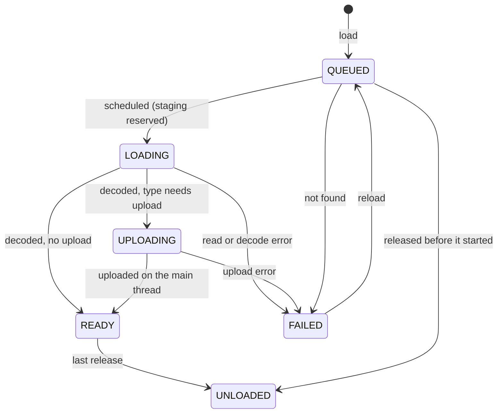
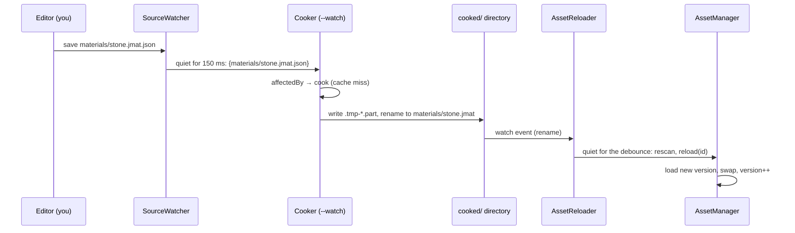

# 10 — Assets: from glTF to the GPU

*A game ships thousands of files: meshes exported from Blender, textures from painting tools, HDR
skies, shaders, level descriptions. None of them is in the shape a GPU wants. This chapter builds the
two programs that close that gap. The first is the **cooker**, an offline tool that reads source files
once, slowly and carefully, and writes GPU-ready files: meshes reordered for the GPU's caches and
packed into 28 bytes per vertex, textures filtered into mip chains in linear light and
block-compressed into the BC formats the texture hardware decodes, materials, environment maps, and
finally `.jpak` archives compressed with zstd. The second is the **runtime** side: a virtual file
system over those archives and an asynchronous asset manager that moves bytes from a memory-mapped
file through IO threads, decode workers and a budgeted upload on the main thread into GPU buffers,
without a frame ever waiting for a disk. Along the way it derives the math the code uses (normalized
integers, cache miss ratios, the Kaiser filter, the bit layouts of BC1, BC4, BC5 and BC7, solid
angles, spherical harmonics, hash ids) and says what the GPU does with each byte. It ends with one
character, `knight.glb`, followed from its source file to pixels, the tests that prove each piece,
and exercises.*

**Before you start.** You need [Lesson 0](lessons/00-foundations.md): binary and hexadecimal (§3),
bytes and Java's number types (§4), two's complement and the signed-byte trap (§5), bit operations,
masks, packing and rounding up to a power of two (§6), how a `float` is stored (§7), memory, native
memory and alignment (§8), caches, threads and `volatile` (§9), the GPU, the driver and OpenGL (§10),
frame budgets (§11) and the FFM API (§12). [Lesson 4](lessons/04-binary-formats.md) builds the
engine's binary streams and explains byte order, alignment, CRC-32C checksums and format versions;
every cooked format here follows its rules and this chapter links there instead of repeating them.
[Lesson 3](lessons/03-data-layout.md) builds the generational handles the asset manager hands out,
and [lesson 1](lessons/01-buffers-in-flight.md) explains fences and why a buffer the GPU has read is
changed with a GPU copy. From the chapters you need: chapter [03](03-rotations-and-transforms.md), on
quaternions and the tangent frame stored as one quaternion (the QTangent, built there); chapter
[05](05-opengl-from-java.md), on textures, mip levels, sampling, texture formats, vertex arrays and
the upload ring; and chapter [06](06-renderer-architecture.md), on the mesh registry's mega buffers,
level-of-detail selection from projected error, and the texture arrays materials sample from. This
chapter uses those without rebuilding them.

**What you will build**

| Piece | File | What it does |
|---|---|---|
| The importer contract | [`Importer`](../../tools/cooker/src/main/java/dev/jeddy/cooker/Importer.java), [`CookContext`](../../tools/cooker/src/main/java/dev/jeddy/cooker/CookContext.java), [`CopyImporter`](../../tools/cooker/src/main/java/dev/jeddy/cooker/CopyImporter.java) | what one importer sees and produces; the simplest importer |
| Import settings | [`ImportSettings`](../../tools/cooker/src/main/java/dev/jeddy/cooker/ImportSettings.java) | per-file JSON sidecars merged over directory defaults |
| The cook cache | [`CookCache`](../../tools/cooker/src/main/java/dev/jeddy/cooker/CookCache.java) | content-addressed results, atomic writes, per-source state |
| The cooker | [`Cooker`](../../tools/cooker/src/main/java/dev/jeddy/cooker/Cooker.java), [`CookerMain`](../../tools/cooker/src/main/java/dev/jeddy/cooker/CookerMain.java), [`CookReport`](../../tools/cooker/src/main/java/dev/jeddy/cooker/CookReport.java) | plans the sources, cooks only what changed, in parallel, removes stale outputs, reports |
| glTF reading | [`GltfDocument`](../../tools/cooker/src/main/java/dev/jeddy/cooker/gltf/GltfDocument.java), [`GltfImporter`](../../tools/cooker/src/main/java/dev/jeddy/cooker/gltf/GltfImporter.java) | GLB chunks, buffers, accessors, normalized integers; meshes, materials, nodes, skins, animations |
| Mesh processing | [`MeshProcessor`](../../tools/cooker/src/main/java/dev/jeddy/cooker/mesh/MeshProcessor.java) | flat normals, MikkTSpace tangents, welding, meshoptimizer passes, LODs with their error |
| The mesh format | [`MeshEncoding`](../../modules/asset/src/main/java/dev/jeddy/asset/format/MeshEncoding.java), [`MeshWriter`](../../modules/asset/src/main/java/dev/jeddy/asset/format/MeshWriter.java), [`MeshData`](../../modules/asset/src/main/java/dev/jeddy/asset/format/MeshData.java) | `.jmesh`: quantized streams in 64-byte-aligned sections, read in place and validated |
| Images and mips | [`ImageRgba`](../../tools/cooker/src/main/java/dev/jeddy/cooker/texture/ImageRgba.java), [`ImageDecoder`](../../tools/cooker/src/main/java/dev/jeddy/cooker/texture/ImageDecoder.java), [`MipGenerator`](../../tools/cooker/src/main/java/dev/jeddy/cooker/texture/MipGenerator.java) | linear float images, sRGB, TGA and Radiance HDR; Kaiser-filtered mips |
| Texture encoding | [`TextureCooker`](../../tools/cooker/src/main/java/dev/jeddy/cooker/texture/TextureCooker.java), [`KtxEncoder`](../../tools/cooker/src/main/java/dev/jeddy/cooker/texture/KtxEncoder.java), [`ImageMetrics`](../../tools/cooker/src/main/java/dev/jeddy/cooker/texture/ImageMetrics.java), [`TextureImporter`](../../tools/cooker/src/main/java/dev/jeddy/cooker/texture/TextureImporter.java) | usage → format, UASTC → BC7/BC5/BC4 through libktx, zstd per level, PSNR and SSIM |
| The texture reader | [`Ktx2`](../../modules/asset/src/main/java/dev/jeddy/asset/format/Ktx2.java) | KTX2 header, level index and key/value data; a level decoded straight into the caller's memory |
| Materials | [`MaterialData`](../../modules/asset/src/main/java/dev/jeddy/asset/format/MaterialData.java), [`MaterialImporter`](../../tools/cooker/src/main/java/dev/jeddy/cooker/material/MaterialImporter.java) | `.jmat`: factors, texture ids, a feature mask that is the shader variant |
| The scene importer | [`GltfSceneImporter`](../../tools/cooker/src/main/java/dev/jeddy/cooker/gltf/GltfSceneImporter.java) | one glTF → `.jscene`, `.jmesh`, `.jmat` and `.ktx2` files, ORM packing, parents-first nodes |
| Environment maps | [`EnvironmentImporter`](../../tools/cooker/src/main/java/dev/jeddy/cooker/env/EnvironmentImporter.java), [`EnvironmentBaker`](../../tools/cooker/src/main/java/dev/jeddy/cooker/env/EnvironmentBaker.java), [`BrdfLutImporter`](../../tools/cooker/src/main/java/dev/jeddy/cooker/env/BrdfLutImporter.java) | HDR sky → prefiltered cube, irradiance as nine spherical-harmonic coefficients, the BRDF table |
| Other importers | [`ShaderImporter`](../../tools/cooker/src/main/java/dev/jeddy/cooker/shader/ShaderImporter.java), [`PhysicsImporter`](../../tools/cooker/src/main/java/dev/jeddy/cooker/physics/PhysicsImporter.java) and more | shaders checked per variant, collision and navigation bakes |
| zstd from Java | [`Zstd`](../../modules/compress/src/main/java/dev/jeddy/compress/Zstd.java), [`ZstdCompressor`](../../modules/compress/src/main/java/dev/jeddy/compress/ZstdCompressor.java), [`ZstdDecompressor`](../../modules/compress/src/main/java/dev/jeddy/compress/ZstdDecompressor.java), [`ZstdDictionary`](../../modules/compress/src/main/java/dev/jeddy/compress/ZstdDictionary.java), [`Checksums`](../../modules/compress/src/main/java/dev/jeddy/compress/Checksums.java) | reusable contexts, offset-based calls that allocate nothing, trained dictionaries, CRC-32C |
| Paks | [`PakFormat`](../../modules/asset/src/main/java/dev/jeddy/asset/pak/PakFormat.java), [`PakWriter`](../../modules/asset/src/main/java/dev/jeddy/asset/pak/PakWriter.java), [`Pak`](../../modules/asset/src/main/java/dev/jeddy/asset/pak/Pak.java), [`PakBuilder`](../../tools/cooker/src/main/java/dev/jeddy/cooker/pak/PakBuilder.java) | `.jpak`: a table of contents as columns, aligned entries, memory-mapped reads |
| Ids and the file system | [`AssetPaths`](../../modules/asset/src/main/java/dev/jeddy/asset/AssetPaths.java), [`StrId`](../../modules/core/src/main/java/dev/jeddy/core/id/StrId.java), [`Vfs`](../../modules/asset/src/main/java/dev/jeddy/asset/Vfs.java) | 64-bit path hashes; paks and loose directories mounted in order behind one hash index |
| The asset manager | [`StagingRing`](../../modules/asset/src/main/java/dev/jeddy/asset/StagingRing.java), [`AssetLoader`](../../modules/asset/src/main/java/dev/jeddy/asset/AssetLoader.java), [`AssetType`](../../modules/asset/src/main/java/dev/jeddy/asset/AssetType.java), [`AssetState`](../../modules/asset/src/main/java/dev/jeddy/asset/AssetState.java), [`DecodeContext`](../../modules/asset/src/main/java/dev/jeddy/asset/DecodeContext.java), [`AssetManager`](../../modules/asset/src/main/java/dev/jeddy/asset/AssetManager.java) | handles, priorities, IO on virtual threads, decode on workers, budgeted uploads, dependencies |
| Hot reload | [`SourceWatcher`](../../tools/cooker/src/main/java/dev/jeddy/cooker/watch/SourceWatcher.java), [`AssetReloader`](../../modules/asset/src/main/java/dev/jeddy/asset/AssetReloader.java) | a source edit recooked and swapped in behind the same handle |
| The build | [`dev.jeddy.assets.gradle.kts`](../../build-logic/src/main/kotlin/dev.jeddy.assets.gradle.kts), [`Assets.kt`](../../build-logic/src/main/kotlin/dev/jeddy/gradle/Assets.kt) | `cookAssets` and `packAssets` for game projects |

The byte-level specifications are in [`docs/formats/`](../formats/): [`jmesh.md`](../formats/jmesh.md),
[`jmat.md`](../formats/jmat.md), [`jscene.md`](../formats/jscene.md), [`ktx2.md`](../formats/ktx2.md)
and [`jpak.md`](../formats/jpak.md). The design is [DESIGN §10](../DESIGN.md); the decisions this
chapter explains are D8, D11, D25–D27, D33–D41, D43, D58, D63, D65, D68, D79, D80, D90, D101 and D104
in DESIGN §17.

**Contents**

- Part A — The ideas
  1. [Why cook offline](#1-why-cook-offline)
  2. [Cooking only what changed](#2-cooking-only-what-changed)
  3. [glTF 2.0: how a 3D scene is stored](#3-gltf-20-how-a-3d-scene-is-stored)
  4. [Meshes the way a GPU likes them](#4-meshes-the-way-a-gpu-likes-them)
  5. [Textures in GPU memory](#5-textures-in-gpu-memory)
  6. [Compressing files: zstd](#6-compressing-files-zstd)
  7. [The runtime's ideas: ids, mapped files, four threads](#7-the-runtimes-ideas-ids-mapped-files-four-threads)
- Part B — Building the cooker
  8. [Step 1: the importer contract](#8-step-1-the-importer-contract)
  9. [Step 2: import settings](#9-step-2-import-settings)
  10. [Step 3: the content-addressed cache](#10-step-3-the-content-addressed-cache)
  11. [Step 4: the cooker](#11-step-4-the-cooker)
  12. [Step 5: reading glTF](#12-step-5-reading-gltf)
  13. [Step 6: the import model](#13-step-6-the-import-model)
  14. [Step 7: the mesh processor](#14-step-7-the-mesh-processor)
  15. [Step 8: the mesh file](#15-step-8-the-mesh-file)
  16. [Step 9: images into linear floats](#16-step-9-images-into-linear-floats)
  17. [Step 10: the mip generator](#17-step-10-the-mip-generator)
  18. [Step 11: encoding with libktx](#18-step-11-encoding-with-libktx)
  19. [Step 12: reading KTX2](#19-step-12-reading-ktx2)
  20. [Step 13: materials](#20-step-13-materials)
  21. [Step 14: the glTF scene importer](#21-step-14-the-gltf-scene-importer)
  22. [Step 15: environment maps](#22-step-15-environment-maps)
  23. [Step 16: shaders, physics and the other importers](#23-step-16-shaders-physics-and-the-other-importers)
  24. [Step 17: zstd from Java](#24-step-17-zstd-from-java)
  25. [Step 18: the pak format and its writer](#25-step-18-the-pak-format-and-its-writer)
  26. [Step 19: the pak reader](#26-step-19-the-pak-reader)
  27. [Step 20: the pak builder](#27-step-20-the-pak-builder)
- Part C — Building the runtime
  28. [Step 21: asset paths and ids](#28-step-21-asset-paths-and-ids)
  29. [Step 22: the virtual file system](#29-step-22-the-virtual-file-system)
  30. [Step 23: the staging ring](#30-step-23-the-staging-ring)
  31. [Step 24: loaders, types and states](#31-step-24-loaders-types-and-states)
  32. [Step 25: the asset manager](#32-step-25-the-asset-manager)
  33. [Step 26: hot reload](#33-step-26-hot-reload)
  34. [Step 27: the Gradle side](#34-step-27-the-gradle-side)
- Part D — Using it and proving it
  35. [The GPU side: meshes, textures, materials](#35-the-gpu-side-meshes-textures-materials)
  36. [Worked example: knight.glb from source to pixels](#36-worked-example-knightglb-from-source-to-pixels)
  37. [The tests, walked through](#37-the-tests-walked-through)
  38. [Things to run](#38-things-to-run)
  39. [Measured numbers](#39-measured-numbers)
  40. [Why it is built this way](#40-why-it-is-built-this-way)
  41. [Exercises](#41-exercises)
  42. [Glossary](#42-glossary)
  43. [Further reading](#43-further-reading)
  44. [Appendix: the scripts behind the numbers](#44-appendix-the-scripts-behind-the-numbers)

---

# Part A — The ideas

## 1. Why cook offline

### 1.1 What a source file holds, and what the GPU wants

Open `samples/iso-demo/assets/characters/knight.glb`, the knight of the demo's party. It is a
**glTF** file (§3), the format Blender and most tools export. Inside are positions, normals and
texture coordinates as 32-bit floats, triangle indices, a node hierarchy, a material, and one PNG
image. Every one of those is in a shape that is convenient for an exporter and wrong for a GPU:

| The source has | The GPU wants | Why |
|---|---|---|
| a PNG image (zlib-compressed rows of 8-bit RGBA) | a block-compressed texture with a full mip chain (§5) | the texture unit cannot decode PNG; it decodes BC blocks in hardware, at a quarter of RGBA8's memory and bandwidth |
| normal (12 bytes) and tangent (16 bytes) as floats | one quaternion in 8 bytes (§4.7) | fewer bytes fetched per vertex, every pass, every frame |
| texture coordinates as two floats (8 bytes) | two half floats (4 bytes) | the same |
| triangles in whatever order the modeller made them | an order that reuses the GPU's vertex cache (§4.2) | each reused vertex is a vertex shader run saved |
| one full-detail mesh | the mesh plus simplified **levels of detail** (§4.5) | far objects need far fewer triangles |
| a material described in JSON | 128 bytes plus 16 per texture, which the renderer copies into a table row (§20) | no parsing at run time |

Doing this work at load time is not an option. A PNG would have to be inflated on the CPU, its mips
computed, and its texels uploaded at 4 bytes each, four times the memory of a compressed texture.
And block compression is slow: cooking one 2048 × 2048 color texture to BC7 takes 1.8 seconds on two
cores (D36, measured in `bench/README.md`), far more than a whole level is allowed to take to load.

### 1.2 Two programs

So the engine splits the pipeline in two (DESIGN §1, goal 5):

- **The cooker** (`tools/cooker`, the command `jeddy-cook`) runs offline, on the developer's machine
  or the build server. It may be slow, it uses every core, and it may call native tools that never
  ship with the game: **libktx** (texture compression), **meshoptimizer** (mesh optimization) and
  a small shim around **MikkTSpace** (tangent generation). The DESIGN §6.1 table marks those three as
  "tools only". It writes GPU-ready files into a **cooked tree** and packs that tree into `.jpak`
  archives.
- **The runtime** (`modules/asset` and the renderer) maps those files into memory and copies their
  bytes into GPU buffers with almost no processing. The motto is **"the file is the upload"**: the
  vertex stream inside a `.jmesh` is a slice of the file that goes straight into a GL buffer, and a
  KTX2 level is a run of BC blocks that goes straight into a texture. The only native library the
  runtime adds for assets is **zstd**, to decompress.

The word **cook** comes from the game industry: raw ingredients in, a dish the runtime can eat out.
An **asset** is anything the game loads by name: a mesh, a texture, a material, a sound, a level.

### 1.3 Three decisions that follow

- **D8: textures are cooked to BCn, and there is no transcoding at run time.** Desktop GPUs, the
  only target (D1), decode the BC formats in hardware, so the cooker writes BC7, BC5 or BC4 blocks
  and the runtime uploads them unchanged. The route to those blocks goes through an intermediate
  format called UASTC (§5.10), but that detour happens in the cooker.
- **D27: vertex attributes are 16 bytes.** A tangent frame packed into one quaternion (8 bytes) and
  two half-float UV sets (4 bytes each) fill 16 bytes. Positions stay full 32-bit floats in a stream
  of their own, so the depth prepass and the shadow passes fetch 12 bytes per vertex and nothing
  else (chapter [06](06-renderer-architecture.md), on the mesh registry).
- **D35: the cooker's incrementality is a content-addressed cache.** Since one texture can take
  seconds, the cooker must know exactly which sources changed. It hashes their contents rather than
  trusting file times (§2).

### 1.4 The whole journey

Keep this picture in mind; every section below zooms into one box.

```
 OFFLINE (tools/cooker)                                         RUNTIME (asset + render)

 assets/                    Cooker                 cooked tree                Vfs
  knight.glb  ─┐      ┌───────────────────┐       knight.jscene       ┌──────────────────────┐
  stone.png   ─┼────▶ │ plan: settings,   │ ────▶ knight/*.jmesh ─────▶│ mounts, one hash     │
  sky.hdr     ─┤      │ importer per file │       knight/*.jmat   dev │ index id → location  │
  *.frag      ─┤      │ jobs in parallel  │       knight/*.ktx2  ─────▶│ (loose tree in dev,  │
  *.meta      ─┘      └────────┬──────────┘            │      reload  │  paks when shipped)  │
                               │ key = sha256(...)     │              └─────────┬────────────┘
                               ▼                       ▼                        │ read / prefetch
                       ┌───────────────┐        ┌────────────┐                  ▼
                       │  cook cache   │        │ PakBuilder │──▶ *.jpak   ┌──────────────────────┐
                       │ entries/      │        └────────────┘  (zstd,     │ AssetManager         │
                       │ objects/<sha> │                         dicts)    │ IO thread → worker   │
                       └───────────────┘                                   │ decode → main thread │
                                                                           │ upload (4 ms budget) │
                                                                           └─────────┬────────────┘
                                                                                     ▼
                                                              MeshRegistry mega buffers, texture
                                                              array layers, material table rows
```

<details><summary>Check: why can the runtime not simply load the PNG and compress it to BC7 itself, once, at first start?</summary>

It could, but a good BC7 encode costs seconds per large texture (D36: 1.8 s for one 2048² texture on
two cores), so a first start would take minutes for a full game, and the encoder (libktx) would have
to ship with the game. The cooker pays that cost once per change, on the developer's machine, and the
game ships only results.
</details>

## 2. Cooking only what changed

A cold cook of the M6 sample assets (a glTF scene, six textures, an HDR sky, a material and shaders)
took 1.2 s (`bench/README.md`), and a real game's textures alone would take many minutes. A developer who edits one texture must not wait for all of
them. The cooker therefore keeps a **cache** of earlier results and cooks only the sources whose
result could have changed. The whole problem is deciding "could have changed" correctly.

### 2.1 Why timestamps are not enough

The classic answer, used by `make`, compares file modification times: if the source is newer than
its output, build it again. That fails in ways that waste hours:

- **Settings change without the source changing.** Raising a texture's maximum size in its sidecar
  file (§9) changes the result, but `rock.png` is untouched.
- **The tool changes.** A new cooker version that encodes better must re-cook everything; the
  sources are all older than their outputs.
- **Time goes backwards.** Restoring an older version of a file from version control, or copying a
  folder with "preserve timestamps", produces sources older than their outputs that are nevertheless
  different. Switching between two branches touches files the cooker must re-cook, and switching
  back should not cost a second full cook.
- **Inputs nobody listed.** A glTF file that references an external PNG has to be re-cooked when the
  PNG changes, though the `.gltf` text did not.

### 2.2 Fingerprints: hash functions

The fix is to look at the **content**. A **hash function** turns any sequence of bytes into a
fixed-size number, its **hash** or **digest**, such that equal inputs give equal hashes and a
change anywhere in the input changes the hash completely. If the cooker remembers "the input with
hash $H$ produced these outputs", then any later input with hash $H$ is the same input, and the
outputs can be reused without running the importer.

That reasoning needs the hash to make two different inputs collide only with a negligible
probability. The cooker uses **SHA-256**, a *cryptographic* hash with 256-bit digests, from the
JDK's `MessageDigest`. How unlikely is a collision? Among $n$ random 256-bit values, the chance that
any two are equal is about

$$p \approx \frac{n^2}{2 \cdot 2^{256}} = \frac{n^2}{2^{257}}$$

(the **birthday bound**: there are about $n^2/2$ pairs, and each pair is equal with probability
$2^{-256}$). For a million cooked inputs, $p \approx 10^{12} / 2^{257} \approx 4 \times 10^{-66}$.
"Cryptographic" adds that nobody knows how to *construct* two inputs with the same SHA-256, which
does not matter for a cooker but costs nothing extra. A digest is written as 64 hexadecimal digits
(L00 §3.3): `HexFormat.of().formatHex(...)`.

### 2.3 The cache key

The cooker does not hash only the source bytes. It hashes **everything that can change the
output**, one part after the other:

$$\text{key} = \mathrm{SHA256}\big(\text{cooker version} \,\|\, \text{importer name and version} \,\|\, \text{source path} \,\|\, \text{canonical settings} \,\|\, \text{source bytes}\big)$$

where $\|$ means "followed by". Each part answers one of §2.1's failures:

| Part | Why it is in the key |
|---|---|
| `Cooker.VERSION` | bump it and every result is cooked again |
| importer name and `version()` | bump one importer's version and only its sources are cooked again |
| source path | the outputs are named after it (`characters/knight.glb` → `characters/knight.jscene`) |
| canonical settings | a changed sidecar changes the result |
| source bytes | the content itself |

**Canonical** settings means one fixed text for one meaning: the settings are written as JSON with
their keys sorted, so `{"a": 1, "b": 2}` and `{"b": 2, "a": 1}` give the same key.

A cache where results are found by the hash of what produced them is **content-addressed**. Its most
pleasant property: undo an edit, and the old key comes back, and so does the old result, instantly.

### 2.4 Dependencies, present and absent

Some inputs are not the source file: the external PNG of a `.gltf`, a shader's `#include`d file, a
level's prefab kit. An importer **records each dependency it reads with its hash**. A cached result
is reused only if the key matches *and* every recorded dependency still has its recorded hash.

There is a subtle gap. Suppose a level reads the settings of its kit, and the kit has no settings
file yet. Later someone adds `dungeon.glb.meta` next to the kit. Nothing the level recorded has
changed, so a cache that only records files it *read* would happily reuse the old level. `make` has
the same blind spot with header files that did not exist at the last build. Jeddy closes it by
recording a dependency as **absent** (an empty hash): the result stays valid only while that file
keeps not existing (D104). The one case this cannot cover is a cache entry written *before* the
importer started recording the probe at all (an older cooker version that never looked): such an
entry has no absent dependency to invalidate, and `--force` recooks it once (§11.6).

### 2.5 Writing files so that nobody sees half of one

The running game watches the cooked tree and reloads what changes (§33). If the cooker wrote a file
in place, a reader could see half of it. So every output is written **atomically**: to a temporary
file in the same directory, then renamed over the target. A rename inside one file system replaces
the directory entry in one step, so a reader sees either the old file or the new one, never a mix.
(Java asks for this with `StandardCopyOption.ATOMIC_MOVE`; where a file system cannot, the code falls
back to a plain replace.)

And outputs are written **only when their bytes differ** from what is on disk. Otherwise every
re-cook would touch every file, and the game would reload every asset.

<details><summary>Check: you change a texture's sidecar from <code>{"maxSize": 512}</code> to <code>{"maxSize": 1024}</code>, cook, then change it back and cook again. What happens the second time?</summary>

The settings are part of the key, so the first change is a miss and the texture is cooked. Changing
it back restores the first key, whose entry and output objects are still in the cache: a hit, and
the old `.ktx2` is restored without encoding anything.
</details>

## 3. glTF 2.0: how a 3D scene is stored

**glTF** ("GL Transmission Format") is the Khronos Group's format for 3D scenes, designed to be
loaded quickly by programs that draw with GPUs. Version 2.0 is the one every modern tool exports.

### 3.1 JSON plus binary buffers

A glTF scene has two halves:

- **A JSON document** that describes everything: meshes, materials, nodes, and where the numbers are.
- **Binary buffers** holding the numbers themselves, as raw little-endian arrays (lesson
  [4](lessons/04-binary-formats.md#2-byte-order-little-endian-derived) derives byte order).

It comes in two packagings:

- **`.gltf`**: the JSON as a text file, with buffers and images in separate files (`yard.bin`,
  `textures/crate_basecolor.png`) referenced by relative URIs, or embedded as `data:` URIs in base64
  (text that spends 4 characters on every 3 bytes, a third more).
- **`.glb`**: one binary file holding the JSON and one buffer as two **chunks** (§3.6). Most exports,
  and all of the demo's characters, are `.glb`.

### 3.2 Buffers, buffer views and accessors

The JSON describes the numbers in three layers:

```
buffers[0]        one big array of bytes: the GLB's binary chunk, a .bin file, or a data: URI
   │
bufferViews[3]    a byte range of a buffer: buffer, byteOffset, byteLength, optional byteStride
   │
accessors[7]      how to read elements from a view: count, type (SCALAR, VEC2, VEC3, VEC4, MAT4),
                  componentType (5126 FLOAT, 5123 UNSIGNED_SHORT, ...), normalized, sparse
```

An **accessor** is a typed array view over bytes. Its **type** says how many components an element
has (SCALAR 1, VEC2 2, VEC3 3, VEC4 4, MAT4 16) and its **componentType** what each component is,
with numbers borrowed from OpenGL's enumerations:

| componentType | Meaning | Bytes |
|---|---|---|
| 5120 | `BYTE` (signed 8-bit) | 1 |
| 5121 | `UNSIGNED_BYTE` | 1 |
| 5122 | `SHORT` | 2 |
| 5123 | `UNSIGNED_SHORT` | 2 |
| 5125 | `UNSIGNED_INT` | 4 |
| 5126 | `FLOAT` | 4 |

Where is component $k$ of element $i$? Elements are **stride** bytes apart: the view's `byteStride`
if it has one (the data is **interleaved** with other attributes), otherwise packed tightly, one
element after the other. So its byte position in the buffer is

$$\text{at}(i, k) = \text{view.byteOffset} + \text{accessor.byteOffset} + i \cdot \text{stride} + k \cdot \text{size}$$

with $\text{stride} = \text{byteStride}$ if given, else $\text{components} \times \text{size}$.

*Worked example.* Positions and normals interleaved: each vertex is 3 position floats then 3 normal
floats, 24 bytes. The view has `byteStride` 24; the position accessor has `byteOffset` 0, the normal
accessor `byteOffset` 12. Normal component $k = 2$ (its $z$) of vertex $i = 1$, with the view at
byte 0: $0 + 12 + 1 \cdot 24 + 2 \cdot 4 = 44$. Byte 44 is indeed the last float of the second
vertex's normal (the second vertex occupies bytes 24–47).

A **sparse** accessor stores a base array and then a short list of substitutions: "element 2 is
really $(0, 2, 0)$". Morph targets use it, since a blend shape changes a few vertices of many.

### 3.3 Normalized integers, derived

To save space, an exporter may store values that live in $[0, 1]$ or $[-1, 1]$ (colors, texture
coordinates, skin weights) as small integers with `normalized: true`. The rule maps the integer range
onto the real interval so that both ends are hit exactly.

**Unsigned.** A $b$-bit unsigned integer $c$ runs from 0 to $2^b - 1$. Dividing by the largest value
maps 0 to 0 and the largest to 1:

$$x = \frac{c}{2^b - 1}: \qquad \text{8 bits: } \frac{c}{255}, \qquad \text{16 bits: } \frac{c}{65535}$$

**Signed.** A $b$-bit two's complement integer runs from $-2^{b-1}$ to $2^{b-1} - 1$ (L00 §5.2): for
8 bits, $-128$ to $127$. There is one more negative value than positive, so no single divisor maps
both ends to $\pm 1$. The rule divides by the largest *positive* value, which makes $+1$ and $0$
exact, and clamps the one extra negative value:

$$x = \max\!\left(\frac{c}{2^{b-1} - 1},\; -1\right): \qquad \text{8 bits: } \max\!\left(\frac{c}{127}, -1\right), \qquad \text{16 bits: } \max\!\left(\frac{c}{32767}, -1\right)$$

*Worked:* the signed byte $-128$ gives $-128/127 = -1.0079$, clamped to $-1$; so $-128$ and $-127$
both mean $-1$. The unsigned byte 51 gives $51/255 = 0.2$. These are the same rules GL's vertex fetch
applies to normalized attributes (chapter [05](05-opengl-from-java.md), on normalized, integer and
half-float attributes), so you will meet them again in the QTangent (§4.7).

### 3.4 Meshes, primitives, materials and textures

- A **mesh** is a list of **primitives**. Each primitive is one draw: a `mode` (4 means triangle
  lists; the others are points, lines and strips), an optional `indices` accessor, a dictionary of
  `attributes` (`POSITION`, `NORMAL`, `TANGENT`, `TEXCOORD_0`, `TEXCOORD_1`, `JOINTS_0`, `WEIGHTS_0`,
  each an accessor index) and a `material` index. A primitive without `indices` draws its vertices
  in order: $0, 1, 2, \dots$
- A **material** follows the **PBR metallic-roughness** model (chapter
  [07](07-lighting-and-shadows.md) explains the lighting): a base color factor and texture, metallic
  and roughness factors and one texture holding roughness in its green channel and metalness in its
  blue channel, a normal map with a scale, an occlusion map with a strength, an emissive color and
  texture, an `alphaMode` (`OPAQUE`, `MASK` with an `alphaCutoff`, or `BLEND`) and `doubleSided`.
  Every texture reference names a **texture** and the UV set it reads (`texCoord`). Extensions add to
  this: `KHR_texture_transform` (scale, offset and rotation of the texture coordinates) and
  `KHR_materials_emissive_strength` (emissive brighter than 1).
- A **texture** pairs an **image** (PNG or JPEG bytes) with a **sampler** whose `wrapS` and `wrapT`
  say what happens outside $[0, 1]$: 10497 `REPEAT` (the default), 33648 `MIRRORED_REPEAT`, 33071
  `CLAMP_TO_EDGE`.
- **Lights** come from the extension `KHR_lights_punctual`: directional, point or spot, with a color,
  an intensity and a range.

### 3.5 Nodes, skins and animations

- A **node** places something in the scene: an optional `mesh`, `skin` or light, a list of
  `children`, and a local transform, either as translation, rotation (a quaternion $x, y, z, w$) and
  scale (**TRS**), or as a column-major $4 \times 4$ `matrix`. A **scene** lists its root nodes, and
  the top-level `scene` says which scene is the default. Splitting a matrix back into TRS, including
  the mirrored case where one scale is negative, is derived in chapter
  [03](03-rotations-and-transforms.md), on splitting node matrices in the cooker.
- A **skin** names its **joints** (nodes) and an accessor of **inverse bind matrices**, one $4 \times
  4$ per joint. A skinned primitive's `JOINTS_0` say which four joints move each vertex and
  `WEIGHTS_0` how much (chapter [09](09-animation-and-skinning.md)).
- An **animation** has **samplers** (an `input` accessor of key times, an `output` accessor of values,
  an `interpolation`: `LINEAR`, `STEP` or `CUBICSPLINE`, which stores three values per key: an
  in-tangent, the value and an out-tangent) and **channels** that connect a sampler to a node's
  `translation`, `rotation`, `scale` or morph `weights`.

### 3.6 The GLB container

A `.glb` starts with a 12-byte header and continues with chunks, all little-endian:

```
offset 0   u32 magic    "glTF" (the bytes 67 6C 54 46)
       4   u32 version  2
       8   u32 length   total file size in bytes
      12   chunk 0:  u32 chunkLength, u32 chunkType, chunkLength bytes of data   (JSON)
           chunk 1:  u32 chunkLength, u32 chunkType, chunkLength bytes of data   (BIN, optional)
```

The chunk types are four ASCII letters read as a little-endian `u32`. The letters `J S O N` are the
bytes `4A 53 4F 4E`; read little-endian, the first byte is the lowest, so the number is
`0x4E4F534A`. Likewise `B I N \0` (bytes `42 49 4E 00`) is `0x004E4942`. Each chunk's data is padded
to a multiple of 4 bytes (spaces for JSON, zeros for BIN), so the next chunk starts at

$$\text{next} = \text{start} + \text{roundUp}(\text{chunkLength}, 4) = \text{start} + \big((\text{chunkLength} + 3) \mathbin{\&} \lnot 3\big)$$

which is L00 §6.6's round-up with $a = 4$ ($\lnot 3$ is $-4$).

*The knight, measured.* `knight.glb` is 380,236 bytes. Its JSON chunk is 24,412 bytes (a multiple of
4, no padding) and its binary chunk 355,796 bytes: $12 + (8 + 24{,}412) + (8 + 355{,}796) = 380{,}236$.
Its JSON lists 57 nodes, 15 meshes, 72 accessors, 73 buffer views, 1 buffer, 1 skin, 1 material, 1
texture and 1 image (`knight_texture`, a PNG inside the binary chunk), and no animations: the
demo's clips live in the shared library `characters/anims/heroes.glb` (D79).

<details><summary>Check: a WEIGHTS_0 accessor of type VEC4, componentType 5123 (UNSIGNED_SHORT), normalized, holds two elements, (65535, 0, 0, 0) and (32768, 32767, 0, 0). Which floats does it hold?</summary>

Unsigned 16-bit normalized divides by 65535: $(1, 0, 0, 0)$ and $(32768/65535,\ 32767/65535,\ 0,\ 0)
= (0.500008,\ 0.499992,\ 0,\ 0)$. Each element's integers add up to 65535, so its weights add up to
exactly 1. `GltfImporterTest.readsStridedNormalizedAndSparseAccessors` reads these values (and a third
element).
</details>

## 4. Meshes the way a GPU likes them

A mesh reaches the GPU as vertex streams and an index list (chapter
[05](05-opengl-from-java.md), on the pipeline's vertex fetch and on vertex arrays). The GPU's cost
for drawing it has three parts the cooker can change: how often the vertex shader runs, how many
pixels are shaded more than once, and how scattered the vertex reads are. This section explains each
and the number meshoptimizer uses to measure it, then simplification, tangent frames and the
quantized vertex.

### 4.1 Indexed triangles and welding

A **vertex**, to a GPU, is not a point in space. It is the whole tuple the vertex shader reads:
position, normal, tangent, texture coordinates, skin joints and weights. Two corners at the same
position with different normals are two vertices. A cube has 8 corner points but 24 vertices: each
corner touches three faces, each face has its own normal.

An **index list** names, for each triangle, three vertices by number, so a vertex shared by several
triangles is stored once. **Welding** is the step that finds vertices whose every attribute is
identical and keeps one of each, renumbering the indices. Exporters often write duplicates (a vertex
per triangle corner, for instance), and the cooker itself creates them on purpose in §4.6, so it
always welds.

### 4.2 The post-transform cache: ACMR and ATVR

When the GPU draws indexed triangles, it runs the vertex shader for each index it meets, unless it
has just shaded that same vertex index. Recently shaded vertices are kept for a while in a small
on-chip store, the **post-transform cache** (also called the vertex reuse cache). A triangle whose
three vertices are all still there costs no vertex shading at all.

How well an index order uses that cache is measured with two ratios:

$$\text{ACMR} = \frac{\text{vertex shader runs}}{\text{triangles}}, \qquad \text{ATVR} = \frac{\text{vertex shader runs}}{\text{unique vertices}}$$

**ACMR** (average cache miss ratio) counts shader runs per triangle, **ATVR** (average transformed
vertex ratio) per vertex. ATVR is 1.0 when every vertex is shaded exactly once, the ideal. ACMR has
a best value that depends on the mesh. A triangle has 3 corners, so with no reuse at all ACMR is 3.
With perfect reuse every vertex runs once, and ACMR is vertices divided by triangles. For a closed
triangle mesh **Euler's formula** relates the counts: with $V$ vertices, $E$ edges and $F$ triangles,
$V - E + F = 2$. Every triangle has 3 edges and every edge borders 2 triangles, so $E = 3F/2$, and
substituting gives $V - F/2 = 2$, or

$$F = 2V - 4 \approx 2V$$

A big mesh has about twice as many triangles as vertices, so the ideal ACMR is about $V/F = 0.5$.
The same holds for a large regular grid: $(n + 1)^2$ vertices and $2n^2$ triangles.

**A cache by hand.** Model the cache as a **FIFO** (first in, first out) of 4 vertex numbers: a miss
shades the vertex and pushes it in, pushing the oldest out; a hit changes nothing. Draw two quads of
a grid whose top row is vertices 0, 1, 2 and bottom row 3, 4, 5, in the order the cooker's test grid
uses ($A, C, A{+}1$ then $A{+}1, C, C{+}1$ per quad):

```
triangle   indices    misses            cache afterwards (oldest first)
1          0 3 1      0, 3, 1   (3)     0 3 1
2          1 3 4      4         (1)     0 3 1 4
3          1 4 2      2         (1)     3 1 4 2        (0 pushed out)
4          2 4 5      5         (1)     1 4 2 5        (3 pushed out)
                      total 6           ACMR = 6 / 4 = 1.5     ATVR = 6 / 6 = 1.0
```

Here every vertex ran once, so ATVR is perfect, but a strip this thin cannot reuse more. On a real
grid, row order fails differently: by the time a row is finished, the vertices of its lower edge, which
the next row needs again, have long left a 16-entry cache.

**Measured.** meshoptimizer's analyzer (`meshopt_analyzeVertexCache`, a 16-entry FIFO, the model the
cooker's report uses) on the 64 × 64 grid of the cooker's tests (4,225 vertices, 8,192 triangles), run
by `AcmrScratchTest` (§44, where you can run it yourself):

| Triangle order | ACMR | ATVR | Vertex shader runs |
|---|---|---|---|
| row by row | 1.016 | 1.969 | 8,320 |
| shuffled at random | 2.993 | 5.803 | 24,517 |
| after `meshopt_optimizeVertexCache` (from row order) | 0.629 | 1.220 | 5,156 |
| after `meshopt_optimizeVertexCache` (from the shuffle) | 0.643 | 1.246 | 5,264 |

The optimizer reorders triangles greedily, in the family of Tom Forsyth's "linear-speed vertex cache
optimization": it keeps choosing a next triangle whose vertices are in the cache, preferring vertices
with few triangles left to draw, so they can leave the cache for good. It does not care where it
started: both inputs end about 2 % apart, and about 1.6 times fewer shader runs than row
order. Real GPUs do not use a plain FIFO (they reuse vertices within the batch of vertices one shader
wave processes), but an order that is good for this model is good for them too, which is why the model
is the standard yardstick.

### 4.3 Overdraw and the early depth test

**Overdraw** is shading a pixel more than once in one pass. Within one opaque mesh it happens when a
triangle farther from the camera is drawn before a nearer one covering the same pixels: the far one
is shaded, then overwritten.

GPUs fight it with the **early depth test**: when the fragment shader does not change depth, the
depth test runs *before* the fragment shader (chapter [05](05-opengl-from-java.md), on the stencil
and depth tests), and a fragment behind what is already in the depth buffer is discarded without
being shaded. That only helps if the near surfaces were drawn first. So the cooker reorders a mesh's
triangles so that, seen from most directions, outer surfaces come first.
`meshopt_optimizeOverdraw` does it after the cache pass: it cuts the cache-friendly order into
clusters and sorts the clusters so that those facing outward from the mesh's center draw first (the
method of Sander, Nehab and Barczak, 2007). Moving clusters around costs some cache reuse, so a
**threshold** bounds the damage: with the default 1.05, the result's ACMR may be at most 5 % worse
than before the pass.

`meshopt_analyzeOverdraw` measures the result by rasterizing the mesh in software from several
directions and dividing pixels shaded by pixels covered: 1.0 means no pixel was shaded twice. The
knight's meshes report between 1.00 and 1.06 (§36): small convex-ish pieces have little to gain.

### 4.4 Vertex fetch locality

The vertex shader's inputs are read from the vertex streams through the GPU's caches, in cache lines
(L00 §9.3 for the CPU's version of the same idea). If the indices visit vertices 0, 1000, 3, 998, …,
every fetch touches a different line. After the two passes above have fixed the triangle order,
`meshopt_optimizeVertexFetch` **renumbers the vertices in the order the indices first use them**, so
fetches walk memory forward and each line is used fully: a 64-byte line holds $64/12 = 5.3$ positions
or $64/16 = 4$ attribute records. It also drops vertices no index uses, and returns how many remain.

### 4.5 Simplification and geometric error

A character seen from far away covers a few hundred pixels; drawing all its triangles wastes vertex
work and produces triangles smaller than a pixel, which GPUs shade inefficiently. A **level of
detail** (LOD) is a simplified copy. LOD 0 is the full mesh; LOD 1, 2, … have fewer triangles.

`meshopt_simplify` builds them by **edge collapse**: it repeatedly merges the two vertices of an edge
into one, which removes the (usually two) triangles that shared the edge, choosing each time the
collapse that moves the surface least. "Least" is measured with **quadric error metrics**: each
vertex carries the planes of the original triangles around it, and the error of moving the vertex is
the sum of its squared distances to those planes. It stops when it reaches a requested index count,
or when the next collapse would exceed a requested error.

Errors come out **relative to the mesh's size**: 0.05 means "5 % of the mesh's extent". The function
`meshopt_simplifyScale` returns that extent, the size of the mesh's bounding box along its longest
axis (for a box from $(0, 0, 0)$ to $(2, 0.5, 1)$ it returns 2.0; `AcmrScratchTest` in §44
checks it). Multiplying gives the error in **mesh units**, meters here:

$$e_{\text{mesh}} = e_{\text{relative}} \times \text{extent}$$

That number is what the renderer needs. A LOD whose error $e$ covers less than about one pixel on
screen is invisible. Chapters [04](04-cameras-and-projection.md) and
[06](06-renderer-architecture.md) derive how many pixels a length covers (on level of detail from
projected error): $e \cdot s \cdot K / d$ in perspective and $e \cdot s \cdot K$ in orthographic
view, with $s$ the instance's scale, $d$ its distance and $K$ the pixels per world unit, and
`DrawBuilder.selectLod` takes the coarsest LOD whose projected error is at most one pixel:

```java
// modules/render/src/main/java/dev/jeddy/render/draw/DrawBuilder.java
private int selectLod(int mesh, float scale, float distance) {
    int lods = meshes.lodCount(mesh);
    float k =
            orthographic
                    ? pixelsPerUnit * scale
                    : pixelsPerUnit * scale / Math.max(distance, 1e-3f);
    int lod = 0;
    for (int l = 1; l < lods; l++) {
        if (meshes.lodError(mesh, l) * k <= thresholdPixels) {
            lod = l;
        } else {
            break;
        }
    }
    return lod;
}
```

*Worked, with the knight.* The knight's head mesh has LOD errors 0.0182, 0.0433 and 0.0537 m (from
the cook report of §36), and the party is drawn at scale 0.8. In the demo's default orthographic view
chapter 04 computes 54 pixels per meter, so $K = 54$: LOD 1 projects to $0.0182 \times 0.8 \times 54
= 0.79$ pixels, accepted; LOD 2 to $1.87$ pixels, rejected. The head draws LOD 1, 477 triangles
instead of 956, and nobody can tell.

### 4.6 Normals and tangent frames

**Flat normals.** Some sources have no normals at all. A triangle with corners $p_0, p_1, p_2$ has two
edge vectors $p_1 - p_0$ and $p_2 - p_0$, and their **cross product** (chapter
[02](02-math-foundations.md)) is perpendicular to both, so perpendicular to the triangle:

$$n = \frac{(p_1 - p_0) \times (p_2 - p_0)}{\lVert (p_1 - p_0) \times (p_2 - p_0) \rVert}$$

In right-handed coordinates it points out of the side from which $p_0, p_1, p_2$ appear
counterclockwise, which glTF requires for front faces. A degenerate triangle (zero area, so a zero
cross product that cannot be divided by its length) gets $n = (0, 0, 1)$. *Worked:* $p_0 = (0, 0, 0)$,
$p_1 = (1, 0, 0)$, $p_2 = (0, 1, 0)$: edges $(1, 0, 0)$ and $(0, 1, 0)$, cross product $(0 \cdot 0 -
0 \cdot 1,\ 0 \cdot 0 - 1 \cdot 0,\ 1 \cdot 1 - 0 \cdot 0) = (0, 0, 1)$, length 1: $n = (0, 0, 1)$, and
seen from $+z$ the three points do turn counterclockwise.

**Tangent frames.** A **normal map** stores small tilts of the normal per texel, in the **tangent
space** of the surface: $x$ along the direction in which the texture coordinate $u$ grows, $y$ along
the direction of $v$, $z$ out of the surface. To use it the shader needs, per vertex, the normal $n$,
the **tangent** $t$ (the $u$ direction) and the **bitangent** $b$ (the $v$ direction). Chapter
[03](03-rotations-and-transforms.md) (on the tangent frame in one quaternion) explains the frame;
here the question is where $t$ comes from. It is not in the geometry alone: it depends on how the
texture was laid onto the surface, so it is computed from positions *and* UVs, triangle by triangle.

There are many ways to average those per-triangle directions into per-vertex tangents, and a normal
map only looks right if the shader uses the same tangents the program that **baked** the map used.
**MikkTSpace** (Morten Mikkelsen's 2008 thesis) is the de facto standard: Blender, Substance and most
bakers use it. The cooker calls the reference implementation through a small native shim
(`jeddy_tools_native`). MikkTSpace works per **triangle corner**, not per vertex, so the cooker first
**unwelds** the mesh (every corner becomes its own vertex), runs it, and welds again afterwards (§4.1):
corners whose position, normal, tangent and UVs all came out equal merge back.

**Handedness.** glTF stores the tangent as four numbers $(t_x, t_y, t_z, w)$, and the bitangent is not
stored: it is

$$b = w\,(n \times t), \qquad w = \pm 1$$

$w$ is the **handedness**. It flips where the texture is **mirrored**: one half of a symmetric
character reusing the other half's texels runs $u$ backwards relative to the geometry.

**The sign convention trap (D33).** MikkTSpace's bitangent follows $+v$, the direction in which $v$
grows. glTF puts the UV origin at the image's top-left corner, so $v$ grows *down* the image, while a
normal map's $+Y$ (its green channel) points *up* the image, towards $-v$. glTF's tangent $w$ is
defined for that $+Y$. So the cooker negates the $w$ MikkTSpace returns.
`MeshProcessorTest.generatesTangentsFollowingGltfConventions` checks it on a cube whose faces have
known UVs: every bitangent must point towards decreasing $v$. Note that the cooker generates tangents
for every primitive that has UVs and no tangents (the `tangents` setting, on by default), whether or
not its material has a normal map.

### 4.7 Fewer bytes per vertex: QTangents, half floats, unorm weights

The cooked vertex is 12 bytes of position in one stream and 16 bytes of attributes in another (D27),
plus 16 bytes of skin for skinned meshes. The attributes are where bytes are saved.

**The QTangent.** With $b = n \times t$ the matrix $[\,t\;b\;n\,]$ (columns $t$, $b$, $n$) is a
rotation, and a rotation fits in a unit quaternion: four numbers instead of nine. Stored as four
`snorm16` (signed 16-bit normalized, §3.3) they take 8 bytes. The handedness goes into the sign of
the quaternion, which is free because $q$ and $-q$ are the same rotation: the encoder keeps $w \ge 0$
and negates the whole quaternion when $w_{\text{tangent}} = -1$; the decoder reads the handedness from
the sign of $w$. A frame turned by exactly 180° has $w = 0$, and integer zero has no sign, so the
encoder first raises $w$ to at least `W_BIAS` $= 1/32767$, one quantization step. Chapter
[03](03-rotations-and-transforms.md) derives all of this (on the tangent frame in one quaternion, and
on encoding and decoding a QTangent) and builds `MeshEncoding.encodeQTangent` line by line; this
chapter only uses it. Its outputs, checked by running the real encoder:

| Normal | Tangent | $w$ | Stored `snorm16` $(x, y, z, w)$ |
|---|---|---|---|
| (0, 0, 1) | (1, 0, 0) | +1 | (0, 0, 0, 32767) |
| (0, 0, 1) | (1, 0, 0) | −1 | (0, 0, 0, −32767) |
| (0, 1, 0) | (1, 0, 0) | +1 | (−23170, 0, 0, 23170) |
| (0, 1, 0) | (1, 0, 0) | −1 | (23170, 0, 0, −23170) |
| (0, 0, −1) | (1, 0, 0) | −1 | (−32767, 0, 0, −1) |

The third row is a floor facing up: $b = n \times t = (0, 0, -1)$, the frame is a rotation of −90°
about $x$, $q = (-0.7071, 0, 0, 0.7071)$, and $-0.7071 \times 32767 = -23169.8$ rounds to −23170. The
last row is the 180° case: the bias makes $w$ one step instead of zero, so its sign survives.

The vertex shader decodes it with the rotation formula $v' = v + 2\,q_{xyz} \times (q_{xyz} \times v
+ w\,v)$ (chapter 03, on rotating a vector with fewer multiplications): the normal is the rotated $+z$
axis, the tangent the rotated $+x$ axis.

```glsl
// modules/render/src/main/resources/dev/jeddy/render/shaders/engine/vertex.glsl
layout(location = 1) in vec4 jeddyQTangent; // snorm16 x4, normalized by the vertex fetch

vec3 jeddyQuatRotate(vec4 q, vec3 v) {
    return v + 2.0 * cross(q.xyz, cross(q.xyz, v) + q.w * v);
}

// Normal, tangent and bitangent sign of the vertex (MeshEncoding is the reference).
void jeddyTangentFrame(out vec3 normal, out vec3 tangent, out float handedness) {
    vec4 q = normalize(jeddyQTangent);
    normal = jeddyQuatRotate(q, vec3(0.0, 0.0, 1.0));
    tangent = jeddyQuatRotate(q, vec3(1.0, 0.0, 0.0));
    handedness = jeddyQTangent.w < 0.0 ? -1.0 : 1.0;
}
```

(condensed: the file's other declarations are left out.) The vertex fetch has already turned the four
`snorm16` into floats in $[-1, 1]$, because the attribute is declared as `GL_SHORT`, normalized.

**Half-float UVs.** Each UV set is two IEEE 754 **half floats**: 16 bits with 1 sign bit, 5 exponent
bits and 10 fraction bits, the layout of L00 §7.2 at a smaller size, written with Java's
`Float.floatToFloat16`. Ten fraction bits mean that between two powers of two there are $2^{10} =
1024$ evenly spaced values, so in $[2^e, 2^{e+1})$ the step is

$$\Delta = \frac{2^e}{2^{10}} = 2^{e - 10}$$

which doubles at every power of two:

| UV range | Step | In texels of a 1024-texel texture |
|---|---|---|
| $[0.25, 0.5)$ | $2^{-12} \approx 0.00024$ | 0.25 |
| $[0.5, 1)$ | $2^{-11} \approx 0.00049$ | 0.5 |
| $[1, 2)$ | $2^{-10} \approx 0.00098$ | 1 |
| $[8, 16)$ | $2^{-7} \approx 0.0078$ | 8 |

(The steps were checked with `Float.floatToFloat16` and the next representable value.) For UVs inside
$[0, 1]$, as on the demo's texture atlases, the rounding error is at most half a step, under half a
texel even at the top of the range. A tiling floor with UVs up to 16 would visibly snap; that is the
price of 4 bytes per UV set instead of 8.

**Skin weights.** The optional skin stream stores four `u16` joint numbers and four `unorm16` weights,
$\mathrm{round}(w \cdot 65535)$, per vertex: 16 bytes. Rounding each weight separately can make the
four not add up to exactly 65535, which is why the skinning shader divides by their sum (chapter
[09](09-animation-and-skinning.md)).

**The total.** Position 12 + attributes 16 = 28 bytes per vertex, against 12 + 12 (normal) + 16
(tangent) + 8 + 8 (two float UV sets) = 56 bytes for the same data as floats: half.

<details><summary>Check: a grid of 100 × 100 quads drawn in an order with ACMR 0.6. About how many vertex shader runs is that, and how many would the ideal order need?</summary>

$2 \times 100 \times 100 = 20{,}000$ triangles, so $0.6 \times 20{,}000 = 12{,}000$ runs. The grid has
$101^2 = 10{,}201$ vertices, and the ideal is to run each once: ACMR $10{,}201 / 20{,}000 \approx 0.51$.
</details>

## 5. Textures in GPU memory

Chapter [05](05-opengl-from-java.md) (on textures and sampling) explains texels, normalized
coordinates, mip levels and how the texture unit picks one, filtering, wrap modes and texture
formats, and lists the BC formats. This section is about what the cooker must produce and why: how
much memory a texture takes, how its mip levels are computed correctly, how the four BC formats Jeddy
uses lay out their bits, what they save in bandwidth, how quality is measured, and the KTX2
container that carries the result.

### 5.1 How big a texture is

A level of $w \times h$ texels in an uncompressed format of $B$ bytes per texel takes $w h B$ bytes.
A full **mip chain** halves both sides per level (rounding down, never below 1) until $1 \times 1$,
which adds a third: the sum $1 + \frac14 + \frac1{16} + \dots$ is $\frac43$ (chapter 05 derives it).

A **block-compressed** format stores $4 \times 4$ texels in a fixed number of bytes, 8 or 16. A level
needs whole blocks, $\lceil w/4 \rceil \cdot \lceil h/4 \rceil$ of them, so the levels smaller than a
block, $2 \times 2$ and $1 \times 1$, still take one whole block each. For a $1024 \times 1024$
texture the chain is 11 levels with

$$65{,}536 + 16{,}384 + 4{,}096 + 1{,}024 + 256 + 64 + 16 + 4 + 1 + 1 + 1 = 87{,}383 \text{ blocks}$$

Full chains, computed with exactly that rule (`mip_sizes.py` in §44):

| Size | Levels | RGBA8 (4 B/texel) | BC7 or BC5 (16 B/block) | BC4 or BC1 (8 B/block) |
|---|---|---|---|---|
| 2048² | 12 | 22,369,620 B (21.3 MiB) | 5,592,432 B (5.33 MiB) | 2,796,216 B (2.67 MiB) |
| 1024² | 11 | 5,592,404 B (5.33 MiB) | 1,398,128 B (1.33 MiB) | 699,064 B (0.67 MiB) |
| 512² | 10 | 1,398,100 B | 349,552 B | 174,776 B |
| 256² | 9 | 349,524 B | 87,408 B | 43,704 B |

BC7 is a quarter of RGBA8 (plus 27 bytes for the padded tail levels at 1024²), BC4 an eighth. A level
of 300 materials with three 1024² textures each would need 4.7 GiB as RGBA8 and 1.2 GiB as BC7: the
difference between not fitting and fitting in a mid-range GPU's memory.

### 5.2 Averaging light: why mips are made in linear space

A mip level is an average of the level above. *What* is averaged matters.

Color textures are stored in **sRGB**, a nonlinear encoding. The eye distinguishes dark shades much
better than bright ones, so a format with only 256 levels per channel should spend more of them on
dark values. sRGB does that: the stored value $c_s$ relates to the linear light value
$c_{\text{lin}}$ (both in $[0, 1]$) by a curve that is a straight line near black and close to a power
of $1/2.4$ above it:

$$c_s = \begin{cases} 12.92\, c_{\text{lin}} & c_{\text{lin}} \le 0.0031308 \\ 1.055\, c_{\text{lin}}^{1/2.4} - 0.055 & \text{otherwise} \end{cases}
\qquad
c_{\text{lin}} = \begin{cases} c_s / 12.92 & c_s \le 0.04045 \\ \left(\dfrac{c_s + 0.055}{1.055}\right)^{2.4} & \text{otherwise} \end{cases}$$

(The right-hand formula decodes, the left encodes; the two pieces meet where $0.0031308 \times 12.92 =
0.04045$.) Light adds linearly: two lamps give twice the light of one. So an average of colors must be
taken in **linear** values.

*Worked: a checkerboard.* Black (sRGB byte 0) and white (byte 255) texels in a fine checkerboard,
seen from far away, emit on average half the light of white: linear 0.5. Encoded back,
$1.055 \times 0.5^{1/2.4} - 0.055 = 0.7354$, which is byte $0.7354 \times 255 = 187.5$, rounded to
**188**. Averaging the stored bytes instead gives $(0 + 255)/2 = 127.5$, about **128**, which decodes to
linear $\left(\frac{128/255 + 0.055}{1.055}\right)^{2.4} = 0.216$: less than half the light it should
be. Every distant texture would darken, and the darkening would pop as the GPU switches levels.

So the cooker **decodes sRGB to linear floats first, filters the floats, and encodes back to sRGB at
the end**. Data textures (normal maps, roughness and metalness, masks) hold numbers, not light, and
are filtered as they are. Alpha is always linear. When the renderer samples an sRGB texture, the
texture unit decodes each texel to linear as it reads it, so shaders always compute in linear light
(chapter 05, on formats).

### 5.3 Which filter: box against windowed sinc

Filtering a level down to half its size computes each output texel as a **weighted average** of
nearby input texels. The weights, as a function of distance from the output texel's center, are the
filter's **kernel**.

- The **box filter** averages the $2 \times 2$ texels under each output texel with weights
  $(\frac12, \frac12)$ per axis. It is cheap but poor: detail finer than the new texel size is not
  removed cleanly. It leaks into the result as **aliasing** (stripes and moiré that crawl as the
  camera moves), while detail that should survive is blurred.
- The ideal kernel for halving is the **sinc** function, $\mathrm{sinc}(x) = \dfrac{\sin(\pi x)}{\pi
  x}$ (with $\mathrm{sinc}(0) = 1$), $x$ measured in output texels. Why this shape: a row of texels can
  be written as a sum of sine waves of different **frequencies** (cycles per texel), and a grid with
  spacing 1 can hold waves up to $\frac12$ cycle per texel, the alternating pattern; anything faster
  cannot be told apart from a slower wave once sampled, which is aliasing. Halving the resolution
  halves that limit, so the ideal filter keeps every wave below $\frac12$ cycle per *output* texel
  exactly and removes every wave above: a flat box in frequency. The kernel that has that box as its
  frequency content is the box's inverse Fourier transform, $\int_{-1/2}^{1/2} e^{2\pi i f x}\,df =
  \frac{\sin(\pi x)}{\pi x}$, the sinc. Its zeros at every non-zero integer say the same thing in
  the spatial domain: a signal that already fits the coarser grid passes through unchanged. But its
  wiggles never end (every tap would need every texel), so it cannot be used as it is.
- A **windowed sinc** multiplies the sinc by a **window** that falls smoothly to zero at a radius $R$,
  keeping the shape near the center and dropping the far wiggles. Jeddy uses the **Kaiser window**:

$$w(t) = \mathrm{sinc}(t) \cdot \frac{I_0\!\left(\alpha \sqrt{1 - (t/R)^2}\right)}{I_0(\alpha)}, \qquad |t| < R$$

and $w(t) = 0$ beyond, where $t$ is the distance from the output texel's center in **output** texels,
$R = 1.5$ (so the kernel spans three output texels, six input texels at a 2:1 reduction), $\alpha = 4$
sets how fast the window falls, and $I_0$ is the **modified Bessel function of order 0**, defined by
the series

$$I_0(x) = \sum_{k \ge 0} \frac{(x^2/4)^k}{(k!)^2} = 1 + \frac{x^2}{4} + \frac{(x^2/4)^2}{4} + \frac{(x^2/4)^3}{36} + \dots$$

You need nothing about Bessel functions except that this series converges quickly and that $I_0$ is
1 at 0 and grows smoothly, so the fraction is 1 at the center ($t = 0$) and falls to $1/I_0(4) =
1/11.30$ at the edge.

*Worked weights for a 2:1 reduction.* Output texel 0 sits over input texels 0 and 1; its center in
input coordinates is $(0 + 0.5) \times 2 - 0.5 = 0.5$. Input texel $j$ is at distance $t = (j - 0.5)/2$
output texels. For $j = 1$: $t = 0.25$, $\mathrm{sinc}(0.25) = \sin(\pi/4)/(\pi/4) = 0.9003$, the
window's argument is $4\sqrt{1 - (0.25/1.5)^2} = 3.944$, $I_0(3.944) = 10.770$, $I_0(4) = 11.302$, so
the window is $0.9529$ and the weight $0.9003 \times 0.9529 = 0.8579$. All eight taps:

| Input texel $j$ | −3 | −2 | −1 | 0 | 1 | 2 | 3 | 4 |
|---|---|---|---|---|---|---|---|---|
| $t$ (output texels) | −1.75 | −1.25 | −0.75 | −0.25 | 0.25 | 0.75 | 1.25 | 1.75 |
| weight | 0 | −0.0422 | 0.1901 | 0.8579 | 0.8579 | 0.1901 | −0.0422 | 0 |
| normalized | 0 | −0.021 | 0.0945 | 0.4265 | 0.4265 | 0.0945 | −0.021 | 0 |

The raw weights add up to 2.0116, and the code divides each by that sum so the normalized weights
add up to exactly 1: a flat image stays flat (`TextureTest.mipFilterPreservesAverageAndCoverage`
checks it). The small **negative lobes** at $\pm 1.25$ sharpen; a box filter would be $(0.5, 0.5)$
on texels 0 and 1 only. Negative weights can push a value slightly outside $[0, 1]$, which is clamped
when the level is quantized to bytes.

The filter is **separable**: filtering every row with the 8 horizontal weights, then every column of
the result with the 8 vertical ones, gives the same result as a 2D kernel of $8 \times 8 = 64$ weights,
for 16 multiplications per output texel instead of 64. Samples beyond the edge **wrap** around for a
tiling texture and **clamp** to the edge texel otherwise, matching how the texture will be sampled
(chapter 05, on wrap modes).

### 5.4 Normal maps and cut-out alpha in mips

Two kinds of texture need more than an average.

- **Normal maps.** A texel stores a unit vector $(x, y, z)$ mapped from $[-1, 1]$ to $[0, 1]$ per
  channel. The average of unit vectors is shorter than 1 (the average of $(1, 0, 0)$ and $(0, 1, 0)$
  is $(0.5, 0.5, 0)$, length 0.707), and a short normal darkens lighting. So after each level the
  cooker maps every texel back to $[-1, 1]$, divides by its length, and maps it back.
- **Alpha-tested textures** (foliage, fences, hair cards) are drawn where alpha is at least a
  **cutoff**, say 0.5, and discarded elsewhere. Averaging alpha blurs the cut-out shapes: a leaf
  texel of alpha 1 next to three empty ones becomes 0.25 in the next level, below the cutoff. Distant
  trees go bald. The fix keeps **coverage**, the fraction of texels that pass the cutoff, the same in
  every level: measure it in level 0, then for each smaller level search for an alpha scale $s$ such
  that the fraction of texels with $s \cdot \alpha \ge \text{cutoff}$ equals it. Coverage only grows
  with $s$, so **binary search** works: try the middle of $[0, 4]$, keep the half that contains the
  target, 20 times; the remaining interval is $4/2^{20} \approx 0.000004$ wide.

### 5.5 Block compression: fixed-size blocks the texture unit decodes

General compressors like zstd or PNG's zlib produce variable-length output: to find texel $(x, y)$
you must decompress everything before it. A GPU samples texels in any order, millions per frame, so
it needs **random access**. **Block compression** (BC, also called BCn) gives it by compressing every
$4 \times 4$ block of texels into the same number of bytes. Then the block holding texel $(x, y)$ of a
level $w$ texels wide is found with arithmetic alone:

$$\text{block} = \left(\left\lfloor \frac{y}{4} \right\rfloor \cdot \left\lceil \frac{w}{4} \right\rceil + \left\lfloor \frac{x}{4} \right\rfloor\right) \cdot \text{blockBytes}$$

(in the simple row-major layout files use; GPUs rearrange blocks in memory into tiles so 2D
neighbours are close, but the size per block is the same). The **texture unit** fetches the block and
decodes it in fixed hardware, on the way to filtering. The data stays compressed in GPU memory and,
on current GPUs generally, in the texture cache too, so compression saves bandwidth as well as space
(§5.9).

All BC formats share one idea. The colors inside a $4 \times 4$ block are usually similar, and lie
near a straight line through color space (a gradient, a brick with highlights and shadows). So a block
stores the line's two ends, the **endpoints**, and for each texel a short **index** saying where on
the line between them it lies. Encoding (choosing endpoints and indices that minimize the error) is
slow and done by the cooker; decoding is a few multiplications.

### 5.6 BC1, bit by bit

BC1 (also known as DXT1) is the oldest: 8 bytes per block, 4 bits per texel. Jeddy does not cook it
(it needs the `EXT_texture_compression_s3tc` extension, and BC7 is better), but every later format
builds on it, so it is the right place to start.

```
byte  0   1   2   3   4         5         6         7
     [color0 ][color1 ][ indices: 16 × 2 bits, texel 0 in bits 0-1 of byte 4  ]
      u16 LE   u16 LE   row 0 in byte 4, row 1 in byte 5, ... (texel i = row*4 + column)

a color is RGB565:  bit 15 ........ 11 | 10 ............ 5 | 4 ........ 0
                         red (5 bits)  |   green (6 bits)  | blue (5 bits)
```

**RGB565** packs a color into 16 bits (L00 §6.4): 5 bits of red, 6 of green (the eye is most
sensitive to green) and 5 of blue. A 5-bit value $v$ is expanded to 8 bits by **bit replication**,
$(v \ll 3) \mid (v \gg 2)$, which maps 0 to 0 and 31 to 255 exactly; 6 bits use $(v \ll 2) \mid (v
\gg 4)$.

The decoder builds a **palette** of four colors from the endpoints $c_0$ and $c_1$:

- if $c_0 > c_1$ (comparing the two 16-bit numbers): $c_2 = \frac{2c_0 + c_1}{3}$, $c_3 = \frac{c_0 +
  2c_1}{3}$, two points evenly spaced on the line;
- otherwise: $c_2 = \frac{c_0 + c_1}{2}$ and $c_3$ is transparent black, which gives BC1 its
  one-bit alpha.

The order of the endpoints is itself information: the encoder chooses which mode a block uses by
which endpoint it writes first.

*Worked block.* Red $(255, 0, 0)$ is $31 \ll 11 = $ `0xF800` in RGB565; blue $(0, 0, 255)$ is `0x001F`.
`0xF800` > `0x001F`, so the block is in four-color mode with the palette red, blue, $(170, 0, 85)$
(two thirds red, one third blue) and $(85, 0, 170)$ (one third red, two thirds blue), each channel
rounded down. Give rows 0 to 3 the indices
`0 0 1 1`, `0 2 3 1`, `1 1 1 1`, `1 1 1 1`. Row 1's byte, texel 4 in the low bits: $0 \mid 2 \ll 2
\mid 3 \ll 4 \mid 1 \ll 6 = $ `0x78`. The whole block is

```
00 F8 1F 00 50 78 55 55
```

16 texels in 8 bytes, where RGBA8 would need 64.

### 5.7 BC4 and BC5, bit by bit

**BC4** stores one channel: 8 bytes per block, 4 bits per texel.

```
byte  0       1       2 ... 7
     [red0 ] [red1 ] [ indices: 16 × 3 bits as one 48-bit little-endian number, texel 0 lowest ]
```

With 3-bit indices the palette has 8 entries:

- if $r_0 > r_1$: $r_0$, $r_1$ and six values evenly between them, $r_i = \frac{(8 - i)\,r_0 + (i -
  1)\,r_1}{7}$ for $i = 2, \dots, 7$;
- otherwise: $r_0$, $r_1$, four values between them, $r_i = \frac{(6 - i)\,r_0 + (i - 1)\,r_1}{5}$
  for $i = 2, \dots, 5$, then exactly 0 and exactly 255. This mode serves blocks that are mostly
  a narrow range plus a few pure black or white texels.

*Worked block.* $r_0 = 200$, $r_1 = 10$: the palette is $200, 10, 172.86, 145.71, 118.57, 91.43,
64.29, 37.14$ (chapter 05 decodes the same endpoints). Indices `0 2 3 4` for rows 0 and 1 and `5 6 7
1` for rows 2 and 3 give a ramp from 200 down to 10 across each row. Packing the sixteen 3-bit indices
into 48 bits, texel 0 lowest, gives the block

```
C8 0A D0 08 8D F5 53 3F
```

(`C8` is 200, `0A` is 10; decoding the six index bytes back gives `0 2 3 4 0 2 3 4 5 6 7 1 5 6 7 1`.)
Eight values between the endpoints, each texel within half a step of its source value, in 3 bits.

**BC5** is two BC4 blocks back to back, 16 bytes: the first for red, the second for green. Each
channel has its **own** endpoints and its **own** indices. That is why Jeddy uses it for **normal
maps**. A tangent-space normal $(x, y, z)$ has unit length and points out of the surface, so $z > 0$
and

$$x^2 + y^2 + z^2 = 1 \quad\Longrightarrow\quad z = \sqrt{1 - x^2 - y^2}$$

$z$ is redundant. BC5 spends all 16 bytes on $x$ and $y$, with eight levels per block in each,
independently, and the shader rebuilds $z$:

```glsl
// modules/render/src/main/resources/dev/jeddy/render/shaders/pbr/pbr.frag
vec2 xy = texture(jNormalMap, vec3(jeddySlotUv(m, 1u, vUv), float(m.layers.y))).rg * 2.0 - 1.0;
xy *= m.pbr.z;
vec3 tn = vec3(xy, sqrt(clamp(1.0 - dot(xy, xy), 0.0, 1.0)));
vec3 t = normalize(vTangent.xyz - n * dot(n, vTangent.xyz));
vec3 b = cross(n, t) * vTangent.w;
n = normalize(t * tn.x + b * tn.y + n * tn.z);
```

Line by line: read red and green and map $[0, 1]$ back to $[-1, 1]$; scale $x$ and $y$ by the
material's normal scale (`m.pbr.z`; the third texture coordinate is the array layer, chapter
[06](06-renderer-architecture.md) on texture arrays); rebuild $z$, with a `clamp` so that rounding
can never take the square root of a negative number; make the interpolated tangent perpendicular to
the normal again; build the bitangent from the handedness (§4.6); and turn the tangent-space normal
into the surface's frame (a change of basis, chapter 03).

### 5.8 BC7: eight modes in 128 bits

BC1's weakness is that one line through color space must fit all 16 texels, with only 4 points on it
and 16-bit endpoints. **BC7** (part of the BPTC family in GL) keeps the endpoint-and-index idea with
16 bytes per block, 8 bits per texel, and lets the encoder choose, per block, among **eight modes**
that spend the 128 bits differently:

- **Subsets.** A block can be split into 2 or 3 **subsets**, each with its own pair of endpoints, so
  a block containing an edge between two different colors (a brick and its mortar) gets one line per
  side. Which texel belongs to which subset is a **partition**: one of 64 fixed shapes listed in the
  specification, chosen by 6 bits (or one of 16 by 4 bits in mode 0).
- **Endpoint precision.** More subsets leave fewer bits per endpoint: 4 to 7 bits per channel.
- **P-bits.** A **p-bit** is one extra low bit shared by all channels of an endpoint (or, in mode 1, by
  both endpoints of a subset). A 7-bit channel plus a p-bit gives 8 bits for the price of 7 + 1/4.
- **Alpha.** Modes 4 to 7 store alpha. Modes 4 and 5 give alpha its **own index set**, and a 2-bit
  **rotation** field can swap alpha with red, green or blue after decoding, so any one channel can
  get the separate indices.
- **Anchor indices.** The encoder may swap a subset's two endpoints, which reverses its indices. It
  always does so that a fixed **anchor** texel's index has its top bit 0, so that bit is not stored:
  one bit saved per subset (texel 0 is subset 0's anchor).

The mode is written first, in **unary**: mode $m$ is $m$ zero bits then a one, starting at bit 0 of
byte 0. Every row of this table adds up to exactly 128 bits (`bc_bits.py` in §44 adds them up):

| Mode | Mode bits | Subsets | Partition | Rotation + index select | Color endpoints | Alpha endpoints | P-bits | Indices | Second indices |
|---|---|---|---|---|---|---|---|---|---|
| 0 | 1 | 3 | 4 | 0 | 3 × 2 × 3 × 4 = 72 | 0 | 6 | 16 × 3 − 3 = 45 | 0 |
| 1 | 2 | 2 | 6 | 0 | 2 × 2 × 3 × 6 = 72 | 0 | 2 | 16 × 3 − 2 = 46 | 0 |
| 2 | 3 | 3 | 6 | 0 | 3 × 2 × 3 × 5 = 90 | 0 | 0 | 16 × 2 − 3 = 29 | 0 |
| 3 | 4 | 2 | 6 | 0 | 2 × 2 × 3 × 7 = 84 | 0 | 4 | 16 × 2 − 2 = 30 | 0 |
| 4 | 5 | 1 | 0 | 2 + 1 | 2 × 3 × 5 = 30 | 2 × 6 = 12 | 0 | 16 × 2 − 1 = 31 | 16 × 3 − 1 = 47 |
| 5 | 6 | 1 | 0 | 2 + 0 | 2 × 3 × 7 = 42 | 2 × 8 = 16 | 0 | 16 × 2 − 1 = 31 | 16 × 2 − 1 = 31 |
| 6 | 7 | 1 | 0 | 0 | 2 × 3 × 7 = 42 | 2 × 7 = 14 | 2 | 16 × 4 − 1 = 63 | 0 |
| 7 | 8 | 2 | 6 | 0 | 2 × 2 × 3 × 5 = 60 | 2 × 2 × 5 = 20 | 4 | 16 × 2 − 2 = 30 | 0 |

(Color endpoints are subsets × 2 endpoints × 3 channels × bits; indices are 16 texels × bits minus one
saved bit per subset. Mode 0, for instance: $1 + 4 + 72 + 6 + 45 = 128$.)

**Interpolation.** A palette entry is a fixed blend of the two endpoints, with weights out of 64 from
a table per index size:

| Index bits | Weights $w$ |
|---|---|
| 2 | 0, 21, 43, 64 |
| 3 | 0, 9, 18, 27, 37, 46, 55, 64 |
| 4 | 0, 4, 9, 13, 17, 21, 26, 30, 34, 38, 43, 47, 51, 55, 60, 64 |

$$\text{value} = \big((64 - w)\,e_0 + w\,e_1 + 32\big) \gg 6$$

per channel: a weighted average in integer arithmetic, where $+32$ rounds to nearest before the
division by 64 (a shift by 6, L00 §6.3).

**Mode 6, bit by bit.** One subset, RGBA, 4-bit indices: the mode encoders pick for smooth blocks,
because it has the finest gradations (16 palette entries). Bits are numbered from bit 0 of byte 0:

```
bits   0-6    mode: 0000001 (bit 6 set)
       7-13   R0      14-20  R1          (7 bits each)
      21-27   G0      28-34  G1
      35-41   B0      42-48  B1
      49-55   A0      56-62  A1
      63      P0 (p-bit of endpoint 0)     64  P1 (p-bit of endpoint 1)
      65-67   index of texel 0 (the anchor: 3 bits, top bit implied 0)
      68-127  indices of texels 1-15 (4 bits each)
```

An endpoint channel is its 7 bits shifted up with the p-bit below: $e = (v \ll 1) \mid p$, 8 bits.
*Worked:* $R_0 = 100$ with $P_0 = 1$ gives $e_0 = 201$; $R_1 = 20$ with $P_1 = 0$ gives $e_1 = 40$.
The red palette for the 16 indices is then $201, 191, 178, 168, 158, 148, 136, 126, 115, 105, 93, 83,
73, 63, 50, 40$; for index 1, $w = 4$: $(60 \times 201 + 4 \times 40 + 32) \gg 6 = 12{,}252 \gg 6 =
191$.

A BC7 encoder must, for every block, try modes, partitions, endpoint pairs and p-bits, and pick the
combination with the smallest error: that search is why encoding is slow (§1.1) and decoding fast.

### 5.9 Memory and bandwidth

| Format | Bytes per block | Bits per texel | Channels | Jeddy cooks it for |
|---|---|---|---|---|
| RGBA8 (uncompressed) | 64 per 16 texels | 32 | 4 | nothing shipped as material textures |
| BC1 | 8 | 4 | RGB, 1-bit alpha | nothing (needs an extension) |
| BC4 | 8 | 4 | 1 | masks, a separate occlusion map |
| BC5 | 16 | 8 | 2, independent | tangent-space normal maps |
| BC7 | 16 | 8 | RGBA | base color and emissive (sRGB), ORM (linear) |

**What the texture unit does.** For each sample a shader asks for, the texture unit computes the level
(chapter 05, on choosing the level), the texel positions the filter needs (4 for bilinear, 8 for
trilinear), the blocks containing them, and the addresses of those blocks. It looks the blocks up in
its **texture cache**; a miss fetches a cache line from GPU memory. A 64-byte line holds 4 BC7 blocks,
64 texels, where it would hold 16 RGBA8 texels. So the same line traffic brings four times as many
texels (eight times for BC4), and neighbouring pixels, which read neighbouring texels, hit the cache
more often. The decode itself is fixed-function hardware next to the filter and costs no shader time.

**An estimate of the traffic.** This is a prediction from a simple model, not a measurement. When the
level is chosen well, one screen pixel covers about one texel. That is what the **level of detail**
$\lambda$ is: the texture unit measures how many texels of level 0 one pixel step crosses, $\rho$, and
picks $\lambda = \log_2 \rho$, the level at which that step is one texel, because each level halves
the texel density (chapter [05](05-opengl-from-java.md), on choosing the level, derives it from the
screen-space derivatives).
A 1920 × 1080 frame is 2,073,600 pixels. If every pixel shows a surface that samples three material
textures (base color, normal, ORM), each sample touches about one new texel of its level, and
trilinear filtering adds the next smaller level (a quarter more), the unique texel data a frame needs
is about

$$2{,}073{,}600 \times 3 \times 1.25 \times \text{bytes per texel}$$

which is 7.8 MB for one-byte-per-texel BC7 and BC5, against 31.1 MB for RGBA8. At 60 frames per second
that is 0.47 GB/s against 1.87 GB/s, before overdraw, shadow maps or effects. On an integrated GPU,
which shares the CPU's memory bus (L00 §10.1), that factor of four is bandwidth the rest of the frame
keeps.

**What can go wrong.**

- **The wrong color space.** A base color cooked as linear (`BC7_UNORM`) but holding sRGB bytes is
  sampled without decoding: everything looks washed out and too bright. An ORM texture cooked as sRGB
  would have its roughness and metalness bent by the curve. The cooker picks sRGB only for the
  `color` kind (§18).
- **A normal map read as color.** BC5 has no blue channel; a shader that reads `.xyz` gets $z = 0$
  and flat, dark lighting. The shader must rebuild $z$ (§5.7).
- **Tiny levels.** The $2 \times 2$ and $1 \times 1$ levels are smaller than a block. One Intel
  driver refuses to copy or read back such regions, which once left every texture black after a
  texture array grew (D101; lesson [1](lessons/01-buffers-in-flight.md#17-the-day-on-real-hardware)
  tells the story).
- **Sizes that are not multiples of 4** are legal: the last block in a row or column is padded, and
  only its first texels are used.

### 5.10 UASTC first, then BC, and how quality is measured

The cooker does not encode BC7 with its own code. It drives **libktx** (KTX-Software v4.4.2, pinned in
`natives/versions.json`), whose high-quality path goes through **UASTC**: a 4 × 4, 8-bits-per-texel
block format from Binomial's **Basis Universal** project, designed to be **transcoded** quickly into
BC7, ASTC and other GPU formats. The cooker compresses to UASTC, then asks libktx to transcode to BC7,
BC5 or BC4, and writes only the BC result (D8): the runtime never sees UASTC. The same pipeline gives
all three targets, the UASTC → BC7 transcode is close to lossless, and libktx has no direct BC7
encoder: its route to BC7 is UASTC plus a transcode.

UASTC has **levels** 0 (fastest) to 4 (very slow) that trade encode time for quality, and an optional
**RDO** (rate-distortion optimization) pass that makes blocks more alike so zstd compresses them
better. The cooker starts at level 0 and only spends more time where needed. To know where, it
measures.

**PSNR.** Compare the decoded image with the input texel by texel. The **mean squared error** over
$N$ channel values is $\mathrm{MSE} = \frac1N \sum (a_i - b_i)^2$, in units of byte levels squared.
The **peak signal-to-noise ratio** relates it to the largest possible value, 255, on a logarithmic
scale:

$$\mathrm{PSNR} = 10 \log_{10} \frac{255^2}{\mathrm{MSE}} \ \text{dB}$$

The logarithm turns ratios into differences: every 10 dB is ten times less squared error. Solving for
the error: at 40 dB, $\mathrm{MSE} = 255^2 / 10^4 = 6.50$, a root-mean-square error of $\sqrt{6.50} =
2.55$ levels out of 255; at 30 dB, 8.06 levels; at 50 dB, 0.81. Identical images have MSE 0 and
infinite PSNR; the code reports 99 dB for them.

**SSIM.** PSNR treats every error alike, but the eye notices changed structure (a blurred edge, a
blocky gradient) more than a uniform shift. The **structural similarity index** compares small windows
of the two images by their means $\mu$, their variances $\sigma^2$ (how much the values vary) and their
covariance $\sigma_{ab}$ (how much they vary *together*):

$$\mathrm{SSIM} = \frac{(2\mu_a\mu_b + C_1)(2\sigma_{ab} + C_2)}{(\mu_a^2 + \mu_b^2 + C_1)(\sigma_a^2 + \sigma_b^2 + C_2)}, \qquad C_1 = (0.01 \cdot 255)^2,\ C_2 = (0.03 \cdot 255)^2$$

It is 1 for identical windows and falls towards 0 as structure is lost; $C_1 = 6.5025$ and $C_2 =
58.5225$ keep the fraction stable in flat, dark windows. The first factor compares brightness, the
second compares the *pattern*. The cooker computes it on **luma** (brightness, $0.299R + 0.587G +
0.114B$) over $8 \times 8$ windows four texels apart and averages.

*Worked.* Window $a$ is a checkerboard of 90 and 110: $\mu_a = 100$, $\sigma_a^2 = 100$. Two damaged
copies have the **same PSNR**: $b_1 = a + 10$ (every value shifted) and $b_2 = 100$ everywhere (the
pattern blurred away), both with $\mathrm{MSE} = 100$ and $\mathrm{PSNR} = 10\log_{10}(65025/100) =
28.1$ dB. For $b_1$: $\mu_b = 110$, $\sigma_b^2 = 100$, $\sigma_{ab} = 100$, so $\mathrm{SSIM} =
\frac{(2 \cdot 100 \cdot 110 + 6.5)(200 + 58.5)}{(100^2 + 110^2 + 6.5)(200 + 58.5)} = \frac{22006.5}
{22106.5} = 0.995$: the pattern is intact, only the brightness moved. For $b_2$: $\mu_b = 100$,
$\sigma_b^2 = 0$, $\sigma_{ab} = 0$, so $\mathrm{SSIM} = \frac{(20000 + 6.5)(0 + 58.5)}{(20000 +
6.5)(100 + 58.5)} = \frac{58.5}{158.5} = 0.369$. PSNR cannot tell the two apart; SSIM says the blur
destroyed the texture and the shift did not, which is what a player would say.

**The retry rule (D36).** For color and ORM textures, if UASTC level 0 gives less than 40 dB, encode
again one level higher, up to level 2. The measurements behind it (2048² color texture, two cores):
level 0 gave 52.4 dB, level 1 53.0 dB at four times the encode time; but a saturated synthetic
gradient at 256² gave 32 dB at level 0 and 40.6 dB at level 1. Level 0 is right almost always, and the
retry catches the rest. Normal maps and masks are compared on their own channels and are not retried.

### 5.11 The KTX2 container

**KTX2** is the Khronos container for GPU textures: a header, an index of levels, a **data format
descriptor** (DFD, a standard description of the pixel format), key/value metadata, and the level
data. The fields Jeddy's reader uses, all little-endian:

| Offset | Size | Field |
|---|---|---|
| 0 | 12 | identifier `«KTX 20»\r\n\x1A\n` (bytes `AB 4B 54 58 20 32 30 BB 0D 0A 1A 0A`) |
| 12 | 4 | `vkFormat`: the pixel format, as Vulkan's enumeration numbers it (146 = `BC7_SRGB_BLOCK`) |
| 16 | 4 | `typeSize`: 1 for block formats |
| 20, 24, 28 | 4 each | pixel width, height, depth (0 means "not used") |
| 32 | 4 | layer count (0 for a texture that is not an array) |
| 36 | 4 | face count (6 for a cube map) |
| 40 | 4 | level count |
| 44 | 4 | supercompression scheme: 0 none, 1 BasisLZ, 2 Zstandard, 3 zlib |
| 48, 52 | 4 each | DFD offset and length (not read) |
| 56, 60 | 4 each | key/value data offset and length |
| 64, 72 | 8 each | supercompression global data offset and length (not read) |
| 80 + 24·i | 8 + 8 + 8 | level $i$: byte offset, stored length, uncompressed length |

The identifier's first and eighth bytes are outside 7-bit ASCII and its last four are a line ending
and an end-of-file mark, so a file mangled by a text-mode transfer is detected at once, a trick it
shares with PNG. **Supercompression** is a general compressor applied *on top of* the block data:
Jeddy uses zstd, one frame per level (§6), so a loader can decompress levels independently. Inside,
the bytes are still BC blocks, GPU-ready.

*The knight's texture, read from the cooked file* (from a local cook of the demo on 2026-10-10, not committed; your numbers will differ slightly)*.* `vkFormat` 146, 1024 × 1024, depth 0, layers 0,
faces 1, 11 levels, supercompression 2. The level index says level 0 holds 1,048,576 bytes of BC7
blocks stored in **13,087** zstd bytes, level 1 262,144 in 22,685, and each of the three tail levels
16 bytes in 25: a frame's fixed cost is larger than 16 bytes of data (a 6-byte frame header, a 3-byte
block header and the 16 bytes stored raw, with no checksum, §6.1). The levels are stored
smallest first in the file, level 10 at byte 436 and level 0 last at byte 46,395, so a streaming loader
could show a blurry texture before the big level arrives. The whole file is 59,482 bytes, 4.3 % of
the 1,398,128 bytes of blocks: this flat-shaded atlas has large areas of identical blocks, which zstd
finds and stores once.

<details><summary>Check: a 512 × 256 mask texture (BC4) with a full chain. How many levels, how many blocks in level 0, and how many bytes in all?</summary>

Levels: the larger side 512 halves to 1 in 9 steps, so 10 levels ($512 \times 256$, $256 \times 128$, …,
$2 \times 1$, $1 \times 1$). Level 0: $128 \times 64 = 8{,}192$ blocks. All levels:
$8192 + 2048 + 512 + 128 + 32 + 8 + 2 + 1 + 1 + 1 = 10{,}925$ blocks of 8 bytes, 87,400 bytes. (Level 6 is
$8 \times 4$: $2 \times 1 = 2$ blocks; levels 7, 8, 9 are $4 \times 2$, $2 \times 1$, $1 \times 1$, one
block each.)
</details>

## 6. Compressing files: zstd

Block compression makes textures small *for the GPU*. Files on disk can be made smaller still with a
general-purpose compressor, decompressed once at load time. Jeddy uses **zstd** (Zstandard, by Yann
Collet at Facebook), the only native library the runtime adds for assets. Lesson
[4](lessons/04-binary-formats.md#7-compression-briefly) introduced its frames; this section explains
what happens inside and the choices the engine makes.

### 6.1 Matches and entropy coding

zstd combines two classic ideas.

**Matches (LZ77).** As the compressor walks through the input it remembers what it has seen. When the
next bytes repeat something earlier, it writes a **match**, "copy $L$ bytes from $D$ bytes back",
instead of the bytes themselves; bytes that do not repeat are written as **literals**. The input
`abcabcabcd` becomes the literals `abc`, a match of length 6 at distance 3, and the literal `d`. (A
match may overlap the bytes it is producing: copying 6 bytes from 3 back repeats `abc` twice.)

**Entropy coding.** The literals, lengths and distances that remain are not equally common. Giving
frequent symbols short bit codes and rare symbols long ones (**Huffman coding** for literals and a
faster relative called **finite state entropy** for the rest) shrinks them further. Decoding is a
table lookup per symbol.

The output is a **frame**: the magic bytes `28 B5 2F FD`, a one-byte **frame header descriptor**
whose bits say which optional fields follow (bit 2: a content checksum is present), usually the
original size, then compressed blocks, and optionally a 32-bit checksum of the original content,
which the decompressor verifies. Whether the checksum is written is a parameter of the compressor:
Jeddy's `ZstdCompressor` turns it on in its constructor (so pak entries have one, §25), but
`checksum(false)` can switch it off, and the frames libktx writes into KTX2 levels (§18.2) carry none.
Every KTX2 level in §5.11 starts with exactly those four magic bytes.

### 6.2 Levels: slow to compress, fast to decompress

A **level** says how hard the compressor searches for matches: 1 is fast, 19 searches long and wide.
Decompression does not search, it follows instructions, so its speed hardly depends on the level.
Measured on an 8 MiB corpus (local run at M4, `bench/README.md`):

| Level | Compress | Decompress |
|---|---|---|
| 1 | 290 MB/s | 735 MB/s |
| 3 | 256 MB/s | 828 MB/s |
| 19 | 2 MB/s | 924 MB/s |

Level 19 compresses over a hundred times slower and decompresses at least as fast. For a pak that is
built once and read millions of times that is free size, so release paks use level 19
(`Zstd.RELEASE_LEVEL`). Development tools use zstd's default, level 3 (`Zstd.DEFAULT_LEVEL`), and the
cooker supercompresses KTX2 levels at level 10.

### 6.3 Small files and trained dictionaries

A compressor finds repetitions *within* what it has seen. A 144-byte `.jmat` has almost nothing to
repeat inside itself: the 17 materials of the demo's local cooked tree (2,432 bytes) compress one by
one at level 19 to 975 bytes in all, 57 bytes each. Yet a hundred materials share most of their
structure: the same magic number, the same header layout, similar factors, similar texture ids.

A **dictionary** captures that shared content. It is a block of typical bytes that both the
compressor and the decompressor pretend came *before* each file, so a match can point back into it.
zstd can **train** one from samples (`ZDICT_trainFromBuffer`): it picks the substrings that occur most
often across them, and builds entropy tables tuned to them. A file compressed with a dictionary can
only be decompressed with the same dictionary, which is why a pak stores its dictionary as an entry.

*Measured* (`DictionaryScratchTest` in §44, on the local cooked tree's character files): the 47 files
of at most 16 KiB that are not already compressed, 307,641 bytes, compress one by one at level 19 to
116,749 bytes without a dictionary and to **43,367** bytes with a 64 KiB dictionary trained on them,
2.7 times smaller. The dictionary itself is stored once, so here the saving is $116{,}749 - (43{,}367 +
65{,}536) = 7{,}846$ bytes; it grows with every further file that shares the structure.
`ZstdTest.dictionariesShrinkSmallSimilarAssets` asserts that a dictionary at least halves 600 small
synthetic materials.

### 6.4 Compressing what is already compressed

Compressed data looks random: its repetitions have been removed. zstd on top of it saves nothing and
costs decompression time at load. KTX2 files whose levels are already zstd-supercompressed, Ogg and
MP3 audio are such data. So the pak writer tries zstd and **stores** an entry uncompressed when
compression saves less than a sixteenth of its size (§25), and the dictionary trainer does not use
those files as samples (§27): they would teach it nothing.

## 7. The runtime's ideas: ids, mapped files, four threads

### 7.1 Naming assets with 64-bit hashes

The runtime never looks up an asset by its path string. Strings cost: comparing them is a loop,
hashing them allocates nothing only if done carefully, and storing them inside a binary file (a
mesh's material, a material's textures) takes variable space. Instead every asset is named by a
**`StrId`**: a 64-bit hash of its **normalized** path, computed by the cooker when it writes a
reference and by the runtime when code asks for a path. A reference inside a cooked file is then just
a `long`.

The hash is **FNV-1a** (Fowler, Noll and Vo), chosen because it is tiny, fast and identical on every
platform. Start from a fixed **offset basis**, then for each byte of the UTF-8 encoding of the path
(lesson [4](lessons/04-binary-formats.md#42-utf-8)), XOR the byte in and multiply by a fixed prime,
keeping the low 64 bits:

$$h_0 = \texttt{0xcbf29ce484222325}, \qquad h_{k+1} = (h_k \oplus \text{byte}_k) \times \texttt{0x100000001b3} \bmod 2^{64}$$

The XOR mixes the byte into the low bits (L00 §6.1); the multiplication by an odd prime spreads every
bit upwards across the whole word; "mod $2^{64}$" is simply Java's `long` overflow (L00 §4.3).
*Worked, for the one-byte path `a`* (byte `0x61`): $h_0 \oplus \texttt{0x61} =
\texttt{0xcbf29ce484222344}$ (only the low byte changes: `0x25` XOR `0x61` is `0x44`), and multiplying
by the prime modulo $2^{64}$ gives `0xaf63dc4c8601ec8c`, the published FNV-1a test value for `a`. The
id of `characters/knight.jscene` is `0xed8c76edec8e70f5`.

**Normalized** means one spelling per asset: forward slashes, lower case, no `.` or `..` segments.
`Characters\Knight.JSCENE` and `characters/knight.jscene` therefore have the same id (both
`0xed8c76edec8e70f5`, checked with `AssetPaths.id`), on Windows and Linux alike.

**Collisions.** Two different paths can hash to the same 64-bit id. By the birthday bound of §2.2,
among $n$ paths the chance is about $n^2 / 2^{65}$: for 100,000 assets, $2.7 \times 10^{-10}$. With
32-bit ids the chance would reach one half at about 77,000 assets, which is why the ids are 64-bit.
And the build does not rely on luck: the pak writer and the loose-directory scanner both reject two
paths with one id (§25, §29).

### 7.2 Memory-mapped files and page faults

To read a pak, the runtime does not copy the file into a buffer. It **maps** it: it asks the operating
system to reserve a range of addresses that *is* the file (`FileChannel.map`). Nothing is read yet.
The first time any thread touches an address in that range, the CPU raises a **page fault**: the
operating system reads the 4 KiB **page** containing it from disk (or finds it already in its **page
cache**, the RAM it keeps file contents in), installs it, and lets the instruction continue. Later
touches of that page run at memory speed.

That has three benefits: no copy from the operating system into a Java buffer; parts of the file
nobody needs are never read; and the page cache is shared, so a second run of the game, or a pak
that was just written, often reads no disk at all. It has two costs the asset manager must handle:

- **A fault blocks the thread that touches the page** until the disk answers. A decode worker that
  faults stalls every job queued behind it. So an IO thread touches the pages first
  (`MemorySegment.load()`, §32.4) and the worker finds them present.
- **Unmapping while someone reads crashes.** A zstd decompression is a native call that reads
  through raw addresses; if the mapping disappears underneath it, the process dies with a memory
  fault, not an exception. So readers announce themselves and `unmount` waits for them (D25, §29).

This is also why the pak aligns large entries to 4,096 bytes (§25): an entry that starts on a page
boundary shares no page with its neighbours, so loading it faults in only its own pages.

### 7.3 A load crosses four threads

Loading one asset needs four kinds of work, and each belongs on a different thread (DESIGN §5, D26):

```
 owner (game thread)          IO (virtual threads)       workers (job system)      main (GL thread)
 ────────────────────         ────────────────────       ────────────────────      ────────────────
 load(id): handle,
   priority queue
 update(): pick the most
   urgent, reserve staging ──▶ loose: read the file
                               pak: touch the pages ──▶  decompress, parse
                                                         (AssetLoader.decode) ──▶ upload to the GPU,
                                                                                  within a budget
 update(): free staging,  ◀─────────────────────────────────────────────────────  READY
   load dependencies
```

- The **owner** (the game thread) does all bookkeeping: handles, reference counts, the priority
  queue. One thread owns it, so it needs no locks.
- **IO** blocks on the disk. Blocking a platform thread for milliseconds is wasteful; a **virtual
  thread** (Java 21+) is cheap to block, because the JVM parks it and runs others on the same carrier.
- **Decoding** is CPU work: decompressing, parsing, validating every index of a mesh. It runs as jobs
  on the job system's workers (chapter [01](01-architecture.md)).
- **Uploading** creates GL objects and copies into them, which only the main thread may do (L00
  §10.5, CLAUDE.md rule 4).

A slot moves between stages as an `int` index through lock-free queues (`MpmcIntQueue`), so handing it
over allocates nothing. Other threads may ask "is it ready?" at any time, so the state of each slot is
a byte written with **release** and read with **acquire** semantics. A **release store** guarantees
that every write the thread made before it (the decoded value, say) is visible to a thread that later
reads the stored value with an **acquire load** and sees the new state. It is the one-variable
version of L00 §9.5's "publish through a synchronizing operation", reached in Java through a
`VarHandle`.

### 7.4 Budgets: time per frame and bytes in flight

Two resources must never run away:

- **Main-thread time.** A frame at 60 fps has 16.7 ms (L00 §11). Uploads run on the main thread, so
  they get a **budget**, 4 ms by default: upload until the budget is spent, then leave the rest for
  the next frame. At least one asset is uploaded per call, so a single asset bigger than the budget
  still makes progress.
- **Memory in flight.** Every load needs memory to decompress into. Allocating native memory per
  asset is slow and unbounded, so the manager owns one **staging ring** of 64 MiB (§30) and lets at
  most 32 loads be in flight. When the ring is full, scheduling waits for loads to complete. An asset
  larger than half the ring gets dedicated memory for its load instead, so it can never wedge the
  ring.

<details><summary>Check: why is the IO stage on virtual threads but decoding on the job system's platform-thread workers?</summary>

IO spends its time waiting for the disk; a virtual thread that blocks costs almost nothing, because
the JVM unmounts it from its carrier thread. Decoding spends its time computing; it should run on as
many cores as there are, on threads that are always running, which is what the job system's workers
are. Mixing them would either block workers on disk or run CPU work on threads meant for waiting.
</details>

---

# Part B — Building the cooker

The cooker is an ordinary Java program in the module `dev.jeddy.cooker` (`tools/cooker`). It depends on
`core`, `math`, `compress`, `asset` (for the formats it writes), `physics` and `script`, and on
`java.desktop` for ImageIO. We build it from the outside in: first the contract every importer
follows, then the settings, the cache and the driver; then, one by one, the importers that do the
real work.

## 8. Step 1: the importer contract

### 8.1 The problem

The cooker must handle many kinds of source: glTF scenes, images, HDR skies, shaders, materials
written by hand, physics descriptions, levels, rules, dialogue, fonts, sounds. Each kind needs
different code, but the driver (caching, parallelism, writing outputs, reporting) is the same for all.
So the kind-specific code goes behind one small interface, an **importer**, and everything an
importer may touch goes through one object, its **cook context**.

### 8.2 `Importer`

```java
// tools/cooker/src/main/java/dev/jeddy/cooker/Importer.java
public interface Importer {
    /** Returns the name used in reports and by the {@code importer} setting. */
    String name();

    /**
     * Returns the importer's version. Bump it whenever the output for the same input changes, so
     * cached results are cooked again.
     */
    int version();

    /**
     * Returns {@code true} if this importer cooks {@code path} (relative, {@code /}-separated,
     * original case) by default.
     */
    boolean accepts(String path, ImportSettings settings);

    /**
     * Returns other source files (relative to the source root) this source consumes, such as a
     * glTF's external buffers and images. The cooker does not cook claimed files on their own
     * unless their settings say {@code "standalone": true}.
     */
    default List<String> claims(Path root, String path, ImportSettings settings)
            throws IOException {
        return List.of();
    }

    /** Cooks the source; outputs, dependencies, warnings and statistics go to {@code ctx}. */
    void cook(CookContext ctx) throws Exception;
}
```

Five methods:

- **`name`** and **`version`** go into the cache key (§2.3). The version is the importer author's
  promise: "if I change what you get for the same input, I bump this".
- **`accepts`** decides, from the path and the file's settings, whether this importer handles the
  file. The driver asks importers in priority order and takes the first that says yes (§11.1).
- **`claims`** lets a source say "these other files are mine": a `.gltf` claims its `.bin` and its
  images, so the PNG next to it is not also cooked as a standalone texture. It is a `default` method
  returning nothing, because most importers claim nothing.
- **`cook`** does the work. It may throw anything; the driver turns the exception into a failed item
  in the report.

The interface's Javadoc states its thread ownership: implementations must be thread-safe, because
`cook` runs on job threads, possibly for several sources at once. In practice every importer is
**stateless** (no fields that change), which makes that automatic.

### 8.3 The simplest importer: `CopyImporter`

```java
// tools/cooker/src/main/java/dev/jeddy/cooker/CopyImporter.java
public final class CopyImporter implements Importer {
    private static final Set<String> EXTENSIONS =
            Set.of("ogg", "wav", "flac", "mp3", "json", "txt", "csv", "toml", "ttf", "otf", "bin");

    @Override
    public String name() {
        return "copy";
    }

    @Override
    public int version() {
        return 1;
    }

    @Override
    public boolean accepts(String path, ImportSettings settings) {
        return EXTENSIONS.contains(extension(path));
    }

    @Override
    public void cook(CookContext ctx) {
        ctx.output(CookContext.sanitize(ctx.path()), ctx.bytes());
    }

    /** Returns the lower-case extension after the last dot, or {@code ""}. */
    public static String extension(String path) {
        int slash = path.lastIndexOf('/');
        int dot = path.lastIndexOf('.');
        return dot > slash + 1 ? path.substring(dot + 1).toLowerCase(Locale.ROOT) : "";
    }
}
```

Audio, configuration and data files are used by the runtime as they are, so "cooking" them means
copying them to their normalized path. Audio is already compressed; the pak will store it without
compressing it again (§6.4).

`extension` is shared by every importer. The condition `dot > slash + 1` handles two cases at once:
a dot in a *directory* name (`v1.2/readme` has its last dot before its last slash, so no extension)
and a file whose name *starts* with a dot (`.hidden`, where the dot is right after the slash), which
has no extension either. `Locale.ROOT` makes the lower-casing independent of the computer's language:
in a Turkish locale `"I".toLowerCase()` is a dotless `ı`, which would make `.PNG` fail to match.

### 8.4 `CookContext`: what an importer sees

```java
// tools/cooker/src/main/java/dev/jeddy/cooker/CookContext.java
public final class CookContext {
    private final CookerConfig config;
    private final String path;
    private final Path file;
    private final byte[] bytes;
    private final ImportSettings settings;
    private final JobSystem jobs;
    private final int threads;
    private final Map<String, byte[]> outputs = new LinkedHashMap<>();

    /** The recorded hash of a dependency that must stay absent. */
    public static final String ABSENT = "";

    private final Map<String, String> dependencies = new LinkedHashMap<>();
    private final List<String> warnings = new ArrayList<>();
    private final Map<String, Object> stats = new LinkedHashMap<>();
```

Two groups of fields:

- **Inputs**, final and read-only: the configuration, the source's relative path (`/`-separated,
  original case) and its file, its bytes (already read by the driver, because it hashed them), its
  merged settings, the job system for fanning out, and `threads`, the number of threads one native
  encoder call in this job may use (§11.5). Each has a plain getter.
- **Outputs**, collected rather than written: produced files by path, dependencies by path with their
  hash, warnings and report statistics. They are `LinkedHashMap`s so they keep insertion order; the
  report then lists things in the order the importer produced them, the same on every run.

The constructor is package-private: only the `Cooker` creates contexts.

**Where outputs go.** Most importers name their outputs after their source:

```java
    public String outputBase() {
        String p = path;
        int slash = p.lastIndexOf('/');
        int dot = p.indexOf('.', slash + 1);
        if (dot > slash + 1) {
            p = p.substring(0, dot);
        }
        return AssetPaths.normalize(sanitize(p));
    }

    /** Replaces characters that do not belong in asset paths with {@code _}. */
    public static String sanitize(String name) {
        StringBuilder sb = new StringBuilder(name.length());
        for (int i = 0; i < name.length(); i++) {
            char c = name.charAt(i);
            boolean ok =
                    (c >= 'a' && c <= 'z')
                            || (c >= 'A' && c <= 'Z')
                            || (c >= '0' && c <= '9')
                            || c == '_'
                            || c == '-'
                            || c == '.'
                            || c == '/';
            sb.append(ok ? c : '_');
        }
        return sb.toString();
    }
```

`outputBase` cuts the path at the **first** dot of the file name, so `Models/Crate.glb` gives
`models/crate` and `levels/loot.table.csv` gives `levels/loot`: an importer then appends its own
extension. `sanitize` keeps only characters that are safe in a file name on every platform and turns
everything else into `_` (`My Tex (2).png` becomes `My_Tex__2_.png`); `AssetPaths.normalize` (§28)
then lower-cases it.

**Dependencies.**

```java
    public byte[] readDependency(Path dependency) throws IOException {
        byte[] data = Files.readAllBytes(dependency);
        recordDependency(dependency, data);
        return data;
    }

    /** Records a dependency whose bytes were read elsewhere. */
    public void recordDependency(Path dependency, byte[] data) {
        put(dependency, CookCache.sha256(data));
    }

    public void recordAbsentDependency(Path dependency) {
        put(dependency, ABSENT);
    }

    public void dependOnSettings(ImportSettings settings) throws IOException {
        for (Path p : settings.probed()) {
            if (Files.isRegularFile(p)) {
                readDependency(p);
            } else {
                recordAbsentDependency(p);
            }
        }
    }

    private void put(Path dependency, String hash) {
        Path abs = dependency.toAbsolutePath().normalize();
        String key =
                abs.startsWith(config.sourceRoot())
                        ? config.sourceRoot().relativize(abs).toString().replace('\\', '/')
                        : abs.toString();
        synchronized (dependencies) {
            dependencies.put(key, hash);
        }
    }
```

(Javadoc trimmed.) The pattern is "read through me and I will remember": an importer that reads a file
with `readDependency` cannot forget to record it. `recordAbsentDependency` stores the empty hash
`ABSENT` (§2.4), and `dependOnSettings` applies both to every settings file another source's settings
*looked for* (§9). `put` stores dependencies under the source root as relative `/`-separated paths, so
the cache stays valid when the project folder moves or is checked out on another machine, and files
outside the root (engine shader includes) under their absolute path. It is `synchronized` because an
importer may record dependencies from several of its helper jobs at once.

**Outputs, warnings and statistics.**

```java
    public void output(String outputPath, byte[] data) {
        String p = AssetPaths.normalize(outputPath);
        synchronized (outputs) {
            if (outputs.putIfAbsent(p, data) != null) {
                throw new IllegalStateException(path + " writes " + p + " twice");
            }
        }
    }

    /** Adds a report warning. */
    public void warn(String message) {
        synchronized (warnings) {
            warnings.add(message);
        }
    }

    /** Adds a report statistic ({@code String}, {@code Number}, {@code Boolean}, lists, maps). */
    public void stat(String key, Object value) {
        synchronized (stats) {
            stats.put(key, value);
        }
    }
```

`output` normalizes the path and refuses a second output with the same path from one source, which
would otherwise silently overwrite the first. Nothing is written to disk here: the driver decides
later whether the bytes even differ from what is there (§11.3).

## 9. Step 2: import settings

### 9.1 What settings are for

The same importer needs different choices for different files: this texture is a mask, that one may
be at most 512 texels, this glTF should drop a node, that shader has two variants. Those choices live
in small JSON files next to the sources:

- **`<file>.meta`**, a **sidecar**: settings for one file. The demo's `env/sky.hdr.meta` is
  `{"size": 64, "samples": 64}`; `shaders/ground.frag.meta` is `{"permutations": [[], ["FOG"]]}`.
- **`_defaults.meta`**: settings for every file in its directory and below. `CookerTest` puts
  `{"maxSize": 16}` into `textures/_defaults.meta`, which shrinks every texture under `textures/`.

The settings of a file are those defaults, from the source root down to the file's directory, with the
sidecar last; **nearer wins**. Keys are the importers' business (`kind`, `maxSize`, `lods`,
`excludeNodes`, …) with one exception the driver itself reads: `importer`, which forces an importer by
name, and `"importer": "none"`, which skips the file.

### 9.2 The class

```java
// tools/cooker/src/main/java/dev/jeddy/cooker/ImportSettings.java
public final class ImportSettings {
    /** Sidecar suffix. */
    public static final String SIDECAR = ".meta";

    /** Per-directory defaults file. */
    public static final String DIRECTORY_DEFAULTS = "_defaults.meta";

    /** No settings. */
    public static final ImportSettings EMPTY = new ImportSettings(Map.of(), List.of(), List.of());

    private final Map<String, Object> values;
    private final List<Path> files;
    private final List<Path> probed;
```

`values` is the merged JSON object; `files` the settings files that contributed; `probed` every file
that was **looked for**, present or not, which is what the absent-dependency trick of §2.4 needs. The
class is immutable, so any thread may read it.

### 9.3 Loading and merging

```java
    public static ImportSettings load(Path root, Path source) throws IOException {
        Map<String, Object> merged = new LinkedHashMap<>();
        List<Path> used = new ArrayList<>();
        List<Path> probed = new ArrayList<>();
        Path dir = source.getParent();
        List<Path> chain = new ArrayList<>();
        for (Path d = dir; d != null && d.startsWith(root); d = d.getParent()) {
            chain.add(0, d);
        }
        for (Path d : chain) {
            merge(d.resolve(DIRECTORY_DEFAULTS), merged, used, probed);
        }
        merge(source.resolveSibling(source.getFileName() + SIDECAR), merged, used, probed);
        return new ImportSettings(merged, List.copyOf(used), List.copyOf(probed));
    }

    private static void merge(
            Path file, Map<String, Object> into, List<Path> used, List<Path> probed)
            throws IOException {
        probed.add(file);
        if (!Files.isRegularFile(file)) {
            return;
        }
        Object parsed;
        try {
            parsed = Json.parse(Files.readAllBytes(file));
        } catch (RuntimeException e) {
            throw new IOException(file + ": " + e.getMessage(), e);
        }
        if (!(parsed instanceof Map<?, ?>)) {
            throw new IOException(file + ": settings must be a JSON object");
        }
        into.putAll(Json.asObject(parsed, file.toString()));
        used.add(file);
    }
```

- **The chain.** Walking up from the file's directory with `getParent()` and inserting each directory
  at the front (`chain.add(0, d)`) gives the list from the root down. The loop stops when it leaves the
  root (`startsWith(root)`), so a `_defaults.meta` above the source tree never leaks in.
- **Merging** is `putAll` in that order: a key set by a nearer file replaces the farther one's value.
  (It replaces whole values; a nested object is not merged key by key.)
- **`probed.add(file)` comes first**, before checking that the file exists: an absent file is still
  recorded as looked-for.
- **Errors become `IOException`s naming the file**, so a typo in a sidecar fails that source with
  "assets/env/sky.hdr.meta: ..." in the report instead of a bare parser message.

For `assets/levels/dungeon.glb` in the demo, the probed list is `assets/_defaults.meta`,
`assets/levels/_defaults.meta` and `assets/levels/dungeon.glb.meta`; only the last exists, and holds
`{"excludeNodes": ["wall_doorway_1"], "_comment": "..."}` (§13.4).

### 9.4 Reading values, and the canonical form

The accessors (`has`, `string`, `bool`, `integer`, `number`, `raw`) look a key up and fall back to a
default; `strings` also accepts a single string where a list is expected:

```java
    public List<String> strings(String key, List<String> fallback) {
        Object v = values.get(key);
        if (v == null) {
            return fallback;
        }
        if (v instanceof String one) {
            return List.of(one);
        }
        List<String> out = new ArrayList<>();
        for (Object o : Json.asArray(v, key)) {
            if (!(o instanceof String str)) {
                throw new IllegalArgumentException(key + ": expected strings");
            }
            out.add(str);
        }
        return List.copyOf(out);
    }
```

And the form that goes into the cache key:

```java
    public String canonical() {
        return Json.write(sorted(values));
    }

    private static Object sorted(Object v) {
        if (v instanceof Map<?, ?> m) {
            Map<String, Object> out = new TreeMap<>();
            for (Map.Entry<?, ?> e : m.entrySet()) {
                out.put(String.valueOf(e.getKey()), sorted(e.getValue()));
            }
            return out;
        }
        if (v instanceof List<?> l) {
            List<Object> out = new ArrayList<>(l.size());
            for (Object o : l) {
                out.add(sorted(o));
            }
            return out;
        }
        return v;
    }
```

`sorted` copies every object, at every depth, into a `TreeMap`, which iterates its keys in sorted
order, and leaves lists in their order (order inside a list means something; order of keys in an
object does not). Two settings files that say the same thing in a different key order therefore give
the same text, and the same cache key.

## 10. Step 3: the content-addressed cache

### 10.1 What is on disk

```
<cache>/
  entries/<key>.json        one cook: outputs (path, sha256, size), dependencies (path → sha256),
                            warnings, statistics
  objects/<aa>/<sha256>     every output's bytes, stored once under its own content hash
  state.json                per source: the key, importer, outputs and dependencies of its last cook
  report/report.json        the last run's report (and report.html), unless --report moves it
```

By default the cache is a sibling of the output directory (`build/cooked.cache` for `build/cooked`);
the Gradle plugin uses `build/cook-cache` (§34).

- An **entry** is keyed by the cook key of §2.3 and says what that cook produced. It does not contain
  the bytes.
- An **object** is one output's bytes, named by *its own* SHA-256. Two sources (or two versions of
  one source) that produce identical bytes share one object. Objects are spread over 256
  subdirectories by the first two hex digits of their hash (`objects/3f/3f9a…`), because many file
  systems slow down on directories with tens of thousands of files.
- **`state.json`** is not part of the cache proper: it remembers what the *current* source tree
  produced last time, to delete outputs that a source stops producing (§11.4) and to map changed files
  to sources in watch mode (§33).

### 10.2 The class

```java
// tools/cooker/src/main/java/dev/jeddy/cooker/CookCache.java
final class CookCache {
    /** One output of a cached cook. */
    record Output(String path, String sha256, long size) {}

    /** A cached cook. */
    record Entry(
            String importer,
            List<Output> outputs,
            Map<String, String> dependencies,
            List<String> warnings,
            Map<String, Object> stats) {}

    /** What the latest cook of one source produced. */
    record SourceState(
            String key, String importer, List<String> outputs, List<String> dependencies) {}

    private final Path dir;

    CookCache(Path dir) throws IOException {
        this.dir = dir;
        Files.createDirectories(dir.resolve("entries"));
        Files.createDirectories(dir.resolve("objects"));
    }

    /** Returns the hex SHA-256 of {@code data}. */
    static String sha256(byte[] data) {
        return HexFormat.of().formatHex(digest().digest(data));
    }

    /** Returns a new SHA-256 digest. */
    static MessageDigest digest() {
        try {
            return MessageDigest.getInstance("SHA-256");
        } catch (NoSuchAlgorithmException e) {
            throw new IllegalStateException(e);
        }
    }
```

Three records describe the three things on disk. The class is package-private: only the cooker uses
it. `digest()` creates a fresh `MessageDigest` per call because a digest object accumulates state and
is not thread-safe, while cook jobs hash in parallel. Every JDK is required to provide SHA-256, so the
checked `NoSuchAlgorithmException` cannot happen and is rethrown unchecked.

### 10.3 Looking up and storing

```java
    Entry lookup(String key) throws IOException {
        Path file = entryFile(key);
        if (!Files.isRegularFile(file)) {
            return null;
        }
        Map<String, Object> json;
        try {
            json = Json.asObject(Json.parse(Files.readAllBytes(file)), "cache entry");
        } catch (RuntimeException e) {
            return null; // a damaged entry is a miss
        }
        List<Output> outputs = new ArrayList<>();
        for (Object o : Json.asArray(json.get("outputs"), "outputs")) {
            Map<String, Object> m = Json.asObject(o, "output");
            Output out =
                    new Output(
                            Json.string(m, "path", ""),
                            Json.string(m, "sha256", ""),
                            (long) Json.number(m, "size", -1));
            if (!Files.isRegularFile(objectFile(out.sha256()))) {
                return null;
            }
            outputs.add(out);
        }
        // ... dependencies, warnings and stats read back the same way
        return new Entry(/* ... */);
    }
```

(Shown in part.) The cache's rule is **when in doubt, miss**. A damaged entry, or one whose object has
been deleted, returns `null`, and the source is simply cooked again. The cache can never make a cook
*wrong*, only skip one.

```java
    void store(String key, Entry entry, Map<String, byte[]> data) throws IOException {
        for (Output o : entry.outputs()) {
            Path obj = objectFile(o.sha256());
            if (!Files.isRegularFile(obj)) {
                writeAtomically(obj, data.get(o.path()));
            }
        }
        Map<String, Object> json = new LinkedHashMap<>();
        json.put("importer", entry.importer());
        // ... outputs as {path, sha256, size}, dependencies (sorted), warnings, stats
        writeAtomically(entryFile(key), Json.write(json).getBytes(StandardCharsets.UTF_8));
    }

    /** Returns the bytes of a stored output. */
    byte[] object(String sha256) throws IOException {
        return Files.readAllBytes(objectFile(sha256));
    }

    Path objectFile(String sha256) {
        return dir.resolve("objects").resolve(sha256.substring(0, 2)).resolve(sha256);
    }

    private Path entryFile(String key) {
        return dir.resolve("entries").resolve(key + ".json");
    }
```

**Objects first, then the entry.** If the cooker is killed between the two, there are objects no
entry points to (harmless, `--prune` removes them), but never an entry pointing to missing objects. An
object that already exists is not written again: same name, same content, by construction.

### 10.4 State, pruning and atomic writes

`loadState` reads `state.json` into a `TreeMap<String, SourceState>` (an empty one if the file is
missing; also an empty one if it is damaged, with the comment "a damaged state only costs stale-output
tracking"), and `saveState` writes it back with the cooker version. `prune(keep)` deletes every entry
whose key is not in `keep` and every object no kept entry references, and returns how many files it
deleted.

Every file the cooker writes, outputs included, goes through one method:

```java
    static void writeAtomically(Path target, byte[] data) throws IOException {
        Files.createDirectories(target.getParent());
        Path tmp = Files.createTempFile(target.getParent(), ".tmp-", ".part");
        try {
            Files.write(tmp, data);
            try {
                Files.move(
                        tmp,
                        target,
                        StandardCopyOption.ATOMIC_MOVE,
                        StandardCopyOption.REPLACE_EXISTING);
            } catch (AtomicMoveNotSupportedException e) {
                Files.move(tmp, target, StandardCopyOption.REPLACE_EXISTING);
            }
        } finally {
            try {
                Files.deleteIfExists(tmp);
            } catch (NoSuchFileException ignored) {
                // moved
            } catch (IOException e) {
                throw new UncheckedIOException(e);
            }
        }
    }
```

- The temporary file is created **in the target's directory**, because a rename is only atomic within
  one file system (§2.5); the system temp directory may be on another disk.
- Its name **starts with a dot** (`.tmp-1234.part`). The runtime's file watcher and the VFS ignore
  names starting with a dot (§29, §33), so a half-written temporary never looks like an asset.
- `finally` deletes the temporary if anything failed before or during the move; after a successful
  move it no longer exists, which is fine.

## 11. Step 4: the cooker

### 11.1 Fields, importers and planning

```java
// tools/cooker/src/main/java/dev/jeddy/cooker/Cooker.java
public final class Cooker implements AutoCloseable {
    /** Cooker version; bump it to invalidate every cached result. */
    public static final int VERSION = 1;

    /** Source path of the built-in outputs (BRDF LUT). */
    static final String BUILTIN_PREFIX = "<builtin>/";

    private static final Logger LOG = Log.logger("cooker");

    private final CookerConfig config;
    private final List<Importer> importers;
    private final List<Importer> builtins;
    private final JobSystem jobs;
    private final CookCache cache;

    private record Job(
            String source, Path file, Importer importer, ImportSettings settings, String error) {}

    private record Result(Item item, SourceState state, List<String> intended) {}

    public Cooker(CookerConfig config) throws IOException {
        this(config, defaultImporters(), List.of(new BrdfLutImporter(), new DefaultFontImporter()));
    }

    public Cooker(CookerConfig config, List<Importer> importers, List<Importer> builtins)
            throws IOException {
        this.config = config;
        this.importers = List.copyOf(importers);
        this.builtins = List.copyOf(builtins);
        this.jobs = new JobSystem(config.threads() - 1);
        this.cache = new CookCache(config.cacheDir());
        Files.createDirectories(config.outputRoot());
    }
```

(Javadoc trimmed.) `CookerConfig` is a record of where to read and write (source root, output root,
cache and report directories), how many threads, `force`, shader include roots and validation, and the
game's component schema; its compact constructor normalizes every path and refuses a source tree and
an output tree that contain each other (the cooker would cook its own outputs).

- A **`Job`** is one source to cook: its relative path, file, chosen importer and settings, or an
  `error` when its settings could not even be loaded.
- A **`Result`** is one job's outcome: its report item, its new state, and the outputs it
  **intended** to write, even if writing failed. Two sources writing the same output must both be
  caught; on Windows the second writer fails with an I/O error because the first still has the file
  open, and without `intended` the first would pass as cooked.
- **Builtins** are importers without a source file that run once per cook: `BrdfLutImporter` writes
  `engine/brdf_lut.ktx2` (§22.4) and `DefaultFontImporter` writes the engine's default UI font
  (`engine/fonts/inter.jfont` and `.ktx2`, chapter [13](13-ui.md)).
- **`new JobSystem(config.threads() - 1)`**: the thread that calls `parallelFor` runs chunks too,
  so $n - 1$ workers plus the caller use $n$ threads.

The importers, in priority order:

```java
    public static List<Importer> defaultImporters() {
        return List.of(
                new GltfSceneImporter(),
                new PhysicsImporter(),
                new LevelImporter(),
                new RulesImporter(),
                new DialogueImporter(),
                new QuestImporter(),
                new MaterialImporter(),
                new EnvironmentImporter(),
                new CubeLutImporter(),
                new FontImporter(),
                new TextureImporter(),
                new ShaderImporter(),
                new CopyImporter());
    }
```

**Order matters.** `level.physics.json` ends in `.json`, which `CopyImporter` accepts, but
`PhysicsImporter` comes first and accepts `*.physics.json`. A `.hdr` goes to `EnvironmentImporter`
unless its settings give it another `kind` (then `TextureImporter`, later in the list, takes it), and
`CopyImporter` is last because it accepts the most. §23 lists what each importer accepts.

**Planning** lists the sources and builds their jobs:

```java
    private List<Job> plan() throws IOException {
        List<String> sources = scan();
        Map<String, ImportSettings> settings = new HashMap<>();
        Map<String, Importer> chosen = new LinkedHashMap<>();
        Map<String, String> errors = new LinkedHashMap<>();
        for (String s : sources) {
            try {
                ImportSettings st = ImportSettings.load(config.sourceRoot(), file(s));
                settings.put(s, st);
                Importer imp = select(s, st);
                if (imp != null) {
                    chosen.put(s, imp);
                }
            } catch (IOException | RuntimeException e) {
                errors.put(s, describe(e));
            }
        }
        Set<String> claimed = new HashSet<>();
        for (Map.Entry<String, Importer> e : chosen.entrySet()) {
            try {
                for (String c :
                        e.getValue()
                                .claims(
                                        config.sourceRoot(),
                                        e.getKey(),
                                        settings.get(e.getKey()))) {
                    if (!c.equals(e.getKey())) {
                        claimed.add(c);
                    }
                }
            } catch (IOException | RuntimeException ex) {
                // The source's own cook reports the problem.
                LOG.debug("{}: cannot list claimed files: {}", e.getKey(), ex.getMessage());
            }
        }
        List<Job> out = new ArrayList<>();
        for (String s : sources) {
            if (errors.containsKey(s)) {
                out.add(new Job(s, file(s), null, ImportSettings.EMPTY, errors.get(s)));
                continue;
            }
            Importer imp = chosen.get(s);
            ImportSettings st = settings.get(s);
            if (imp == null || (claimed.contains(s) && !st.bool("standalone", false))) {
                continue;
            }
            out.add(new Job(s, file(s), imp, st, null));
        }
        for (Importer b : builtins) {
            out.add(new Job(BUILTIN_PREFIX + b.name(), null, b, ImportSettings.EMPTY, null));
        }
        return out;
    }
```

Three passes:

1. **Settings and importer** for every source. A broken sidecar does not stop the plan: the source
   becomes a job carrying its `error`, so it shows up as failed in the report.
2. **Claims.** Every chosen importer may claim other files. A claim of the source itself is ignored.
   If listing claims fails (a `.gltf` that is not valid JSON), the source's own cook will report it.
3. **Jobs** for every source that has an importer and is not claimed, unless its settings say
   `"standalone": true`; then one job per builtin, with a made-up source path `<builtin>/brdf-lut`
   and no file.

`select` honours the `importer` setting first (`"none"` returns `null`, an unknown name throws), then
asks each importer's `accepts` in order. `scan` walks the source root recursively and returns the
relative paths sorted, skipping every name that starts with a dot (hidden files and directories,
`.git`, editor backups) and every `.meta` file:

```java
    private static void walk(Path dir, String prefix, List<String> out) throws IOException {
        try (DirectoryStream<Path> ds = Files.newDirectoryStream(dir)) {
            for (Path p : ds) {
                String name = p.getFileName().toString();
                if (name.startsWith(".") || name.endsWith(ImportSettings.SIDECAR)) {
                    continue;
                }
                if (Files.isDirectory(p)) {
                    walk(p, prefix + name + "/", out);
                } else if (Files.isRegularFile(p)) {
                    out.add(prefix + name);
                }
            }
        }
    }
```

### 11.2 One cook job: the key, the hit, the miss

`cookOne` runs on a job thread for one `Job`. First the key:

```java
    private String key(Job job, byte[] bytes) {
        MessageDigest d = CookCache.digest();
        String header =
                "jeddy-cook "
                        + VERSION
                        + "\n"
                        + job.importer().name()
                        + " "
                        + job.importer().version()
                        + "\n"
                        + job.source()
                        + "\n"
                        + job.settings().canonical()
                        + "\n";
        d.update(header.getBytes(StandardCharsets.UTF_8));
        d.update(bytes);
        return HexFormat.of().formatHex(d.digest());
    }
```

This is §2.3's formula as code. The parts are separated by newlines (and the importer's name from its
version by a space), so the boundaries between them are hashed too: a path cannot run into the
settings that follow it. Calling `update` twice feeds the header and then the bytes into one digest
without concatenating them in memory.

Then the lookup and the **hit**:

```java
            byte[] bytes = job.file() == null ? new byte[0] : Files.readAllBytes(job.file());
            String key = key(job, bytes);
            Entry hit = config.force() ? null : cache.lookup(key);
            if (hit != null && dependenciesUnchanged(hit)) {
                long size = 0;
                List<String> outs = new ArrayList<>();
                boolean sameKey = before != null && before.key().equals(key);
                for (Output o : hit.outputs()) {
                    restore(o, sameKey);
                    outs.add(o.path());
                    size += o.size();
                }
                SourceState st =
                        new SourceState(
                                key,
                                importerName,
                                outs,
                                new ArrayList<>(hit.dependencies().keySet()));
                return new Result(
                        new Item(
                                job.source(),
                                importerName,
                                Status.CACHED,
                                System.nanoTime() - t0,
                                outs,
                                size,
                                hit.warnings(),
                                hit.stats(),
                                null),
                        st,
                        outs);
            }
```

- A builtin has no file, so its "bytes" are empty and only its name and version make its key.
- `--force` (`config.force()`) skips the lookup entirely.
- A hit also needs every recorded dependency unchanged:

```java
    private boolean dependenciesUnchanged(Entry e) throws IOException {
        for (Map.Entry<String, String> d : e.dependencies().entrySet()) {
            Path p = Path.of(d.getKey());
            Path file = p.isAbsolute() ? p : config.sourceRoot().resolve(d.getKey());
            if (CookContext.ABSENT.equals(d.getValue())) {
                if (Files.exists(file)) {
                    return false; // a sidecar appeared
                }
                continue;
            }
            if (!Files.isRegularFile(file)
                    || !CookCache.sha256(Files.readAllBytes(file)).equals(d.getValue())) {
                return false;
            }
        }
        return true;
    }
```

  Each dependency is hashed again; an `ABSENT` one must still be absent.
- On a hit the outputs are **restored** from the objects (§11.3), and the item reports the cached
  warnings and statistics, so a cached source looks in the report exactly like a cooked one.

Otherwise, the **miss**: run the importer and store what it produced.

```java
            CookContext ctx =
                    new CookContext(
                            config, job.source(), job.file(), bytes, job.settings(), jobs, threads);
            job.importer().cook(ctx);
            intended = new ArrayList<>(ctx.outputs().keySet());
            List<Output> outputs = new ArrayList<>();
            long size = 0;
            for (Map.Entry<String, byte[]> e : ctx.outputs().entrySet()) {
                byte[] data = e.getValue();
                Output o = new Output(e.getKey(), CookCache.sha256(data), data.length);
                outputs.add(o);
                writeOutput(o, data);
                size += data.length;
            }
            Map<String, String> deps = new TreeMap<>(ctx.dependencies());
            // Statistics go through JSON so a cooked item reports exactly what a cached one will.
            Map<String, Object> stats = Json.asObject(Json.parse(Json.write(ctx.stats())), "stats");
            Entry entry =
                    new Entry(importerName, outputs, deps, List.copyOf(ctx.warnings()), stats);
            cache.store(key, entry, ctx.outputs());
```

The line worth a second look is the statistics round trip through JSON. An importer may put a `float`
or an `int` into its statistics; read back from the cache, the same value is a `double`. Converting
the fresh statistics through JSON once makes a cooked item and a later cached item report *equal*
statistics (`CookerTest` compares them with `assertEquals`).

The whole method is wrapped in `try { … } catch (Exception | LinkageError | AssertionError e)`. A
failed source becomes a `FAILED` item with `describe(e)`, the exception chain on one line plus the
first stack frame. `LinkageError` matters: a missing native library (`UnsatisfiedLinkError`) must fail
one texture, not kill the cooker. **Failures are not cached** (no entry is stored), so the next run
tries again, and **a failed source keeps its previous outputs** on disk.

### 11.3 Writing outputs only when they changed

```java
    private void restore(Output o, boolean trustSize) throws IOException {
        Path target = outputFile(o.path());
        if (Files.isRegularFile(target) && Files.size(target) == o.size()) {
            if (trustSize || CookCache.sha256(Files.readAllBytes(target)).equals(o.sha256())) {
                return;
            }
        }
        CookCache.writeAtomically(target, cache.object(o.sha256()));
    }

    private void writeOutput(Output o, byte[] data) throws IOException {
        Path target = outputFile(o.path());
        if (Files.isRegularFile(target)
                && Files.size(target) == data.length
                && CookCache.sha256(Files.readAllBytes(target)).equals(o.sha256())) {
            return; // unchanged: don't wake the runtime's reloader
        }
        CookCache.writeAtomically(target, data);
    }

    private Path outputFile(String path) {
        if (!AssetPaths.isNormalized(path)) {
            throw new IllegalArgumentException("output path is not normalized: " + path);
        }
        Path p = config.outputRoot().resolve(path).normalize();
        if (!p.startsWith(config.outputRoot())) {
            throw new IllegalArgumentException("output escapes the output root: " + path);
        }
        return p;
    }
```

- Both methods compare **size first** (a single file-system query) and hash the existing file only if
  the size matches.
- `restore` goes further when the source's **previous key was the same key** (`trustSize`): the file
  on disk was written by this very result last time, so a matching size is trusted without hashing.
  That makes a fully cached run cheap: each cached source costs reading and hashing the source, and
  almost no reads of outputs.
- `outputFile` is a guard: an importer can never write outside the output root (a path like
  `../../etc/x` is refused), and only normalized paths reach the disk.

### 11.4 After the jobs: clashes and stale outputs

`run(subset)` cooks either everything (`subset == null`, from `cookAll`) or a set of sources (from
`cook(...)`, which watch mode uses). Its first half plans and runs the jobs:

```java
    private CookReport run(Set<String> subset) throws IOException {
        long t0 = System.nanoTime();
        Map<String, SourceState> previous = cache.loadState();
        List<Job> all = plan();
        List<Job> todo = new ArrayList<>();
        Set<String> planned = new HashSet<>();
        for (Job j : all) {
            planned.add(j.source());
            if (subset == null || subset.contains(j.source()) || j.file() == null) {
                todo.add(j);
            }
        }
        int perJob =
                Math.max(
                        1, config.threads() / Math.max(1, Math.min(config.threads(), todo.size())));
        Result[] results = new Result[todo.size()];
        jobs.parallelFor(
                (start, end, thread) -> {
                    for (int i = start; i < end; i++) {
                        results[i] =
                                cookOne(todo.get(i), previous.get(todo.get(i).source()), perJob);
                    }
                },
                todo.size(),
                1);
```

Builtins (`j.file() == null`) always run; they are cached like everything else, so that costs a
lookup. The second half is bookkeeping, done on the driving thread after every job has finished:

1. **Clashes.** Count, for every intended output, the sources that wanted it. Every source with an
   output another source also wanted fails, with a message naming both ("outputs written by more than
   one source: dup/a.ktx2 (also from dup/a.jpg, dup/a.png)").
2. **The new state** is the previous state with each successful source's entry replaced.
3. **Gone sources**: those in the previous state that the plan no longer has (deleted, renamed,
   newly claimed, or now skipped with `"importer": "none"`). Their outputs are deleted, unless some
   other source still produces them, and they appear in the report as `REMOVED`.
4. **Outputs a re-cooked source stopped producing** (a glTF whose mesh was deleted) are deleted too.
5. The state is saved, the items sorted by source path, the report written.

Deleting an output also deletes the directories it leaves empty, walking up to the output root:

```java
    private boolean deleteOutput(String path) {
        try {
            Path p = outputFile(path);
            boolean deleted = Files.deleteIfExists(p);
            for (Path d = p.getParent();
                    d != null
                            && !d.equals(config.outputRoot())
                            && d.startsWith(config.outputRoot());
                    d = d.getParent()) {
                try (Stream<Path> s = Files.list(d)) {
                    if (s.findAny().isPresent()) {
                        break;
                    }
                }
                Files.deleteIfExists(d);
            }
            return deleted;
        } catch (IOException e) {
            throw new UncheckedIOException(e);
        }
    }
```

| Situation | What happens |
|---|---|
| First cook | miss: the importer runs; entry and objects stored |
| Nothing changed | hit: outputs already identical, nothing written (`CACHED`) |
| `rock.png.meta` changed `maxSize` | the settings change the key: miss, cooked again |
| A glTF's external `wood.png` changed | the key hits, a dependency hash differs: cooked again |
| `dungeon.glb.meta` appears next to a kit a level uses | the level recorded it as absent: cooked again |
| You undo that change | the old key and objects are still cached: instant hit |
| A source is deleted | its outputs and empty directories are deleted (`REMOVED`) |
| `--force` | the cache is ignored; everything is cooked |
| `--prune` | entries and objects no current source uses are deleted |

### 11.5 Threads

`run` cooks **one source per job** with `parallelFor(..., todo.size(), 1)`: a grain of 1, so each
worker takes one source at a time and a slow texture does not hold a batch of others hostage. The
threads are then split: `perJob = threads / min(threads, jobs)` is passed into each `CookContext` as
the number of threads one native encoder call may use. With 8 threads and 2 sources each encoder may
use 4; with 8 threads and 100 sources, each uses 1 (the jobs themselves fill the cores). libktx's
UASTC encoder is the main user. Importers fan out further: the glTF importer cooks a file's meshes in
one `parallelFor` and its textures in another (§21.3).

The class comment admits a rule broken on purpose: cook jobs read files on job threads, which the job
system forbids in the engine (no blocking I/O on workers, DESIGN §4.5). The cooker is an offline tool,
its jobs are long and mostly CPU-bound, and nothing latency-sensitive shares its workers.

### 11.6 The report and the command line

```java
// tools/cooker/src/main/java/dev/jeddy/cooker/CookReport.java
    public enum Status {
        /** Cooked by its importer. */
        COOKED,
        /** Outputs restored from the cache. */
        CACHED,
        /** The importer failed; the previous outputs were left in place. */
        FAILED,
        /** The source disappeared and its outputs were deleted. */
        REMOVED
    }

    /** One source. */
    public record Item(
            String source,
            String importer,
            Status status,
            long nanos,
            List<String> outputs,
            long outputBytes,
            List<String> warnings,
            Map<String, Object> stats,
            String error) {}
```

Every run writes `report.json` and a self-contained `report.html` (one file, no external styles or
scripts) into the report directory. The statistics are the importers': texture format, size, levels,
PSNR, SSIM, UASTC level and timings (§18); mesh vertices, triangles, LOD triangles and errors, ACMR,
ATVR and overdraw (§14); shader permutations compiled (§23). `summary()` prints one line such as
`3 cooked, 23 cached, 0 failed, 0 removed in 0.64 s`.

[`CookerMain`](../../tools/cooker/src/main/java/dev/jeddy/cooker/CookerMain.java) is the command line:

```
jeddy-cook [cook] --source DIR --out DIR [--cache DIR] [--report DIR] [--threads N]
                  [--force] [--prune] [--watch] [--shader-include DIR]... [--no-validate]
                  [--components FILE]
jeddy-cook pak    --cooked DIR --out DIR [--layout FILE] [--level N] [--threads N] [--no-names]
jeddy-cook bindings --source DIR --out DIR --package NAME
```

`cook` (the default command) turns a source tree into a cooked tree, `pak` packs a cooked tree into
`.jpak` archives (§27), and `bindings` writes the Java constants of the levels' named objects (D110,
chapter [14](14-editor.md)). The **exit status** is 0 on success, 1 if a source failed, 2 on bad
arguments: a build script can stop on 1 and print the usage on 2. `run(args, out)` returns the status
instead of calling `System.exit`, so tests can call it (`CookerTest.commandLine`). The printout lists
every source that was not `CACHED`, with its status, importer, time, error and warnings.

## 12. Step 5: reading glTF

[`GltfDocument`](../../tools/cooker/src/main/java/dev/jeddy/cooker/gltf/GltfDocument.java) turns the
bytes of a `.gltf` or `.glb` into the JSON tree (parsed with the engine's own `core.json.Json`; like
the image decoders of D38, the cooker avoids third-party libraries) plus the binary buffers, and answers one question well: "give me
accessor $a$ as numbers".

### 12.1 Fields and entry points

```java
// tools/cooker/src/main/java/dev/jeddy/cooker/gltf/GltfDocument.java
public final class GltfDocument {
    /** {@code componentType} values. */
    static final int BYTE = 5120;

    static final int UNSIGNED_BYTE = 5121;
    static final int SHORT = 5122;
    static final int UNSIGNED_SHORT = 5123;
    static final int UNSIGNED_INT = 5125;
    static final int FLOAT = 5126;

    /** Reads the files that URIs refer to (lets the cooker record them as dependencies). */
    @FunctionalInterface
    public interface UriReader {
        /** Returns the bytes of {@code file}. */
        byte[] read(Path file) throws IOException;
    }

    private final Path file;
    private final Map<String, Object> json;
    private final UriReader reader;
    private final List<ByteBuffer> buffers = new ArrayList<>();

    // ... the constructor, quoted in §12.3 ...

    /** Reads a {@code .gltf} or {@code .glb} file. */
    public static GltfDocument read(Path file) throws IOException {
        return read(file, Files.readAllBytes(file), Files::readAllBytes);
    }

    /**
     * Parses {@code bytes}, the content of {@code file}; external buffers and images are read
     * through {@code reader}.
     */
    public static GltfDocument read(Path file, byte[] bytes, UriReader reader) throws IOException {
        if (isGlb(bytes)) {
            return readGlb(file, bytes, reader);
        }
        return new GltfDocument(file, parseJson(file, bytes, 0, bytes.length), null, reader);
    }
```

The `UriReader` is the hook that makes dependencies automatic. Tests call the one-argument `read`,
which reads external files plainly. The glTF importer passes `ctx::readDependency` (§8.4), so every
external buffer and image it opens is hashed and recorded, and an edit to `wood.png` cooks the glTF
again even though the `.gltf` text did not change.

`isGlb` checks for the four bytes `g l T F` at the start of a file at least 12 bytes long; anything
else is treated as JSON text.

### 12.2 The GLB chunks

```java
    private static GltfDocument readGlb(Path file, byte[] bytes, UriReader reader)
            throws IOException {
        ByteBuffer b = ByteBuffer.wrap(bytes).order(ByteOrder.LITTLE_ENDIAN);
        int version = b.getInt(4);
        int length = b.getInt(8);
        if (version != 2 || length > bytes.length) {
            throw new IOException(file + ": bad GLB header");
        }
        Map<String, Object> json = null;
        ByteBuffer bin = null;
        int p = 12;
        while (p + 8 <= length) {
            int chunkLength = b.getInt(p);
            int type = b.getInt(p + 4);
            int start = p + 8;
            if (chunkLength < 0 || start + chunkLength > length) {
                throw new IOException(file + ": truncated GLB chunk");
            }
            if (type == 0x4E4F534A) { // JSON
                json = parseJson(file, bytes, start, chunkLength);
            } else if (type == 0x004E4942) { // BIN
                bin = ByteBuffer.wrap(bytes, start, chunkLength).slice();
            }
            p = start + ((chunkLength + 3) & ~3);
        }
        if (json == null) {
            throw new IOException(file + ": GLB has no JSON chunk");
        }
        return new GltfDocument(file, json, bin, reader);
    }
```

- `ByteBuffer.wrap(...).order(LITTLE_ENDIAN)` reads the file's little-endian integers correctly on any
  machine (Java's default `ByteBuffer` order is big-endian; lesson
  [4](lessons/04-binary-formats.md#2-byte-order-little-endian-derived)). Absolute `getInt(index)`
  reads leave the buffer's position alone.
- **Trust nothing** (lesson 4's rule for readers): the header's length may not exceed the file, and
  every chunk must fit inside it. A negative `chunkLength` (a huge `u32` read as a signed `int`) is
  caught by `chunkLength < 0`.
- The chunk types are the two little-endian ASCII tags of §3.6. Unknown chunk types are skipped, as
  the specification asks, so a future extension chunk does not break the reader.
- The BIN chunk is not copied: `wrap(bytes, start, chunkLength).slice()` is a view of exactly the
  chunk whose index 0 is the chunk's first byte, so offsets from the JSON can be used directly.
- `p = start + ((chunkLength + 3) & ~3)` skips the chunk and its padding (§3.6).

### 12.3 The constructor: buffers

```java
    private GltfDocument(
            Path file, Map<String, Object> json, ByteBuffer glbBinary, UriReader reader)
            throws IOException {
        this.file = file;
        this.json = json;
        this.reader = reader;
        Map<String, Object> asset = object(json.get("asset"), "asset");
        String version = Json.string(asset, "version", "");
        if (!version.startsWith("2.")) {
            throw new IOException(file + ": glTF version " + version + " is not supported");
        }
        for (Object b : list("buffers")) {
            Map<String, Object> buffer = object(b, "buffer");
            String uri = Json.string(buffer, "uri", null);
            ByteBuffer data;
            if (uri == null) {
                if (glbBinary == null) {
                    throw new IOException(file + ": a buffer has no uri and there is no GLB chunk");
                }
                data = glbBinary;
            } else {
                data = ByteBuffer.wrap(readUri(uri));
            }
            buffers.add(data.order(ByteOrder.LITTLE_ENDIAN));
        }
    }
```

A buffer without a `uri` is the GLB's binary chunk; one with a URI is read through `readUri`, which
decodes a `data:...;base64,` URI with `Base64.getDecoder()` or reads the file through the
`UriReader`. Every buffer ends up as a little-endian `ByteBuffer`.

`externalFiles(file, bytes)` serves the importer's `claims` (§21): it parses only the JSON (from the GLB
chunk, checking that it is the first chunk, or the whole text) and returns the paths of every buffer
and image URI that is not a `data:` URI. Both it and `readUri` resolve URIs the same way:

```java
    private static Path resolveUri(Path file, String uri) {
        String path = URLDecoder.decode(uri.replace("+", "%2B"), StandardCharsets.UTF_8);
        return file.resolveSibling(path).normalize();
    }
```

glTF URIs are percent-encoded (`my%20texture.png` for `my texture.png`). Java's `URLDecoder` decodes
`%20`, but it was written for web forms, where `+` means a space; in a URI a `+` is just a plus.
Replacing `+` by its own percent code first makes the decoder give it back unchanged.

### 12.4 Accessors

```java
    public float[] floats(int a) throws IOException {
        Map<String, Object> acc = get("accessors", a);
        int n = count(a);
        int c = components(a);
        int type = Json.integer(acc, "componentType", FLOAT);
        boolean normalized = Json.bool(acc, "normalized", false);
        float[] out = new float[n * c];
        if (acc.containsKey("bufferView")) {
            View v = view(Json.integer(acc, "bufferView", 0), Json.integer(acc, "byteOffset", 0));
            int size = size(type);
            int stride = v.stride > 0 ? v.stride : size * c;
            for (int i = 0; i < n; i++) {
                for (int k = 0; k < c; k++) {
                    out[i * c + k] =
                            component(v.data, v.offset + i * stride + k * size, type, normalized);
                }
            }
        }
        Object sparse = acc.get("sparse");
        if (sparse != null) {
            Map<String, Object> s = object(sparse, "sparse");
            int count = Json.integer(s, "count", 0);
            Map<String, Object> idx = object(s.get("indices"), "sparse.indices");
            Map<String, Object> val = object(s.get("values"), "sparse.values");
            View iv = view(Json.integer(idx, "bufferView", 0), Json.integer(idx, "byteOffset", 0));
            View vv = view(Json.integer(val, "bufferView", 0), Json.integer(val, "byteOffset", 0));
            int itype = Json.integer(idx, "componentType", UNSIGNED_INT);
            for (int i = 0; i < count; i++) {
                int target = (int) integer(iv.data, iv.offset + i * size(itype), itype);
                for (int k = 0; k < c; k++) {
                    out[target * c + k] =
                            component(
                                    vv.data,
                                    vv.offset + (i * c + k) * size(type),
                                    type,
                                    normalized);
                }
            }
        }
        return out;
    }
```

This is §3.2's position formula: `v.offset` already includes the view's and the accessor's byte
offsets, so `v.offset + i * stride + k * size` is $\text{at}(i, k)$. An accessor without a buffer view
is all zeros, which the specification allows exactly so that a sparse accessor can describe "zeros,
except these few". The sparse part then overwrites the listed elements: `indices` says which element,
and `values` holds the replacements packed tightly.

The view itself:

```java
    private record View(ByteBuffer data, int offset, int length, int stride) {}

    private View view(int index, int extraOffset) throws IOException {
        Map<String, Object> v = get("bufferViews", index);
        int buffer = Json.integer(v, "buffer", 0);
        int offset = Json.integer(v, "byteOffset", 0) + extraOffset;
        int length = Json.integer(v, "byteLength", 0);
        if (buffer >= buffers.size()) {
            throw new IOException(file + ": bufferView " + index + " refers to a missing buffer");
        }
        ByteBuffer data = buffers.get(buffer);
        if (offset < 0 || offset > data.capacity()) {
            throw new IOException(file + ": bufferView " + index + " lies outside its buffer");
        }
        return new View(data, offset, length, Json.integer(v, "byteStride", 0));
    }
```

It checks that the view starts inside its buffer. A read past the buffer's end is still caught, by the
`ByteBuffer` itself, which throws `IndexOutOfBoundsException`; the cooker turns that into a failed
source like any other exception.

One component, with §3.3's rules:

```java
    private static float component(ByteBuffer b, int at, int type, boolean normalized) {
        return switch (type) {
            case FLOAT -> b.getFloat(at);
            case UNSIGNED_BYTE -> normalized ? (b.get(at) & 0xFF) / 255f : b.get(at) & 0xFF;
            case BYTE -> normalized ? Math.max(b.get(at) / 127f, -1f) : b.get(at);
            case UNSIGNED_SHORT ->
                    normalized ? (b.getShort(at) & 0xFFFF) / 65535f : b.getShort(at) & 0xFFFF;
            case SHORT -> normalized ? Math.max(b.getShort(at) / 32767f, -1f) : b.getShort(at);
            case UNSIGNED_INT -> Integer.toUnsignedLong(b.getInt(at));
            default -> throw new IllegalArgumentException("componentType " + type);
        };
    }
```

- **Unsigned bytes and shorts**: Java's `byte` and `short` are signed, so `b.get(at)` of the byte
  `0xFF` is −1. `& 0xFF` keeps the low 8 bits as an `int`, 255 (the signed-byte trap of L00 §5.4); `&
  0xFFFF` does the same for 16 bits.
- **Signed normalized**: divide by the largest positive value and clamp the one extra negative value
  (§3.3). `b.get(at) / 127f` is a float division because `127f` is a float.
- **`UNSIGNED_INT`**: `Integer.toUnsignedLong` reads the 32 bits as a value from 0 to $2^{32} - 1$.
  (A `float` holds integers exactly only up to $2^{24}$, L00 §7.3, so vertex data stored as huge
  unsigned ints would round; glTF never uses `UNSIGNED_INT` for vertex attributes, only for indices,
  which go through `ints`.)

`ints(a)` reads index and joint accessors the same way into an `int[]`, without normalization, through
`integer(...)`, which accepts unsigned and signed bytes and shorts and unsigned ints. `count(a)`
returns the accessor's `count`, and `components(a)` maps its `type` to 1, 2, 3, 4 (`VEC4` and
`MAT2`), 9 or 16.

### 12.5 Images

`imageName(i)` returns an image's `name`, or else the file name of its URI, or else `image<i>`,
without extension; `image(i)` returns a record of that name, a MIME type and the bytes, from a URI or
from a buffer view inside the GLB:

```java
    public Image image(int i) throws IOException {
        Map<String, Object> img = get("images", i);
        String uri = Json.string(img, "uri", null);
        if (uri != null) {
            String mime =
                    uri.startsWith("data:") ? uri.substring(5, uri.indexOf(';')) : guessMime(uri);
            return new Image(imageName(i), mime, readUri(uri));
        }
        View v = view(Json.integer(img, "bufferView", 0), 0);
        byte[] bytes = new byte[v.length];
        v.data.get(v.offset, bytes);
        return new Image(imageName(i), Json.string(img, "mimeType", ""), bytes);
    }
```

A `data:image/png;base64,...` URI carries its MIME type between `data:` (5 characters) and the first
`;`. The knight's only image is a buffer view with `mimeType` `image/png` and the name
`knight_texture`.

## 13. Step 6: the import model

[`GltfImporter`](../../tools/cooker/src/main/java/dev/jeddy/cooker/gltf/GltfImporter.java) turns a
`GltfDocument` into plain Java data that the rest of the cooker uses without knowing about JSON:
the **import model**.

### 13.1 The records

```java
// tools/cooker/src/main/java/dev/jeddy/cooker/gltf/GltfImporter.java
    public static final class Primitive {
        public float[] positions;   // x, y, z per vertex
        public float[] normals;     // x, y, z per vertex
        public float[] tangents;    // x, y, z, w per vertex (w = bitangent sign)
        public float[] uv0;         // u, v per vertex
        public float[] uv1;
        public int[] joints;        // four joint indices per vertex
        public float[] weights;     // four weights per vertex
        public int[] indices;       // three indices per triangle
        public int material = -1;   // glTF material index, or -1 for the default material

        public int vertexCount() {
            return positions.length / 3;
        }
    }

    public record Mesh(String name, List<Primitive> primitives) {}
    public record TextureRef(int texture, int texCoord, float scale) {}
    public record Texture(int image, boolean wrapS, boolean wrapT) {}
    public record Node(String name, int parent, float[] translation, float[] rotation,
            float[] scale, int mesh, int light, int skin) {}
    public record Skin(int skeleton, int[] joints, float[] inverseBind) {}
    public record Channel(int node, String path, String interpolation, int components,
            float[] times, float[] values) {}
    public record Animation(String name, List<Channel> channels) {}
    public record Scene(List<Mesh> meshes, List<Material> materials, List<Texture> textures,
            List<Node> nodes, List<Light> lights, List<Skin> skins, List<Animation> animations,
            List<String> warnings) {}
```

(Condensed: the Javadoc comments are shortened to trailing comments, the records are written on fewer
lines, and `Material` and `Light`, records of the fields listed in §3.4, are left out.) `Primitive` is
a mutable class rather than a record because it is filled in several steps and its optional streams
stay `null` when the source lacks them; the mesh processor later replaces some of them. Every stream
is a flat array, $n$ components per vertex, the layout the mesh processor and meshoptimizer want.

### 13.2 `importScene`

`importScene(doc, excludeNodes)` builds the model in a fixed order: meshes, materials, textures
(each with its sampler's wrap modes: `true`, meaning "repeat", unless `wrapS` or `wrapT` is 33071,
`CLAMP_TO_EDGE`; a missing sampler means repeat), the lights of `KHR_lights_punctual`, the nodes (with
the excluded subtrees detached, §13.5), skins and animations. Warnings collect in a list and end up in
the cook report.

A skin's inverse bind matrices must be 16 floats per joint, or the file is rejected; a skin without
them gets identity matrices, which is what the specification says a missing accessor means:

```java
                ibm = new float[joints.length * 16];
                for (int j = 0; j < joints.length; j++) {
                    ibm[j * 16] = ibm[j * 16 + 5] = ibm[j * 16 + 10] = ibm[j * 16 + 15] = 1;
                }
```

(the diagonal of a column-major $4 \times 4$ is at indices 0, 5, 10 and 15). Skins and animations are
kept **raw**, as keys and values, and stored that way in the `.jscene` (D39). The animation module
resamples them at load time (D79, chapter [09](09-animation-and-skinning.md)); the class Javadoc,
written before that module existed, still calls it "the future animation module".

An animation channel's value count must match its key count: one value per key, or three for
`CUBICSPLINE` (in-tangent, value, out-tangent, §3.5). The code derives the number of components from
the two counts and rejects a mismatch:

```java
            int perKey = interpolation.equals("CUBICSPLINE") ? 3 : 1;
            int components =
                    times.length == 0
                            ? doc.components(output)
                            : values.length / (times.length * perKey);
            if (components <= 0 || values.length != times.length * perKey * components) {
                throw new IOException(doc.file() + ": " + name + " has mismatched sampler sizes");
            }
```

### 13.3 Meshes

```java
    private static Mesh mesh(GltfDocument doc, int m, List<String> warnings) throws IOException {
        Map<String, Object> mesh = doc.get("meshes", m);
        String name = Json.string(mesh, "name", "mesh" + m);
        List<Primitive> out = new ArrayList<>();
        List<Object> prims = Json.asArray(mesh.get("primitives"), "primitives");
        for (int p = 0; p < prims.size(); p++) {
            Map<String, Object> prim = GltfDocument.object(prims.get(p), "primitive");
            int mode = Json.integer(prim, "mode", 4);
            if (mode != 4) {
                warnings.add(
                        name + " primitive " + p + ": mode " + mode + " is not triangles, skipped");
                continue;
            }
            Map<String, Object> attributes =
                    GltfDocument.object(prim.get("attributes"), "attributes");
            if (!attributes.containsKey("POSITION")) {
                warnings.add(name + " primitive " + p + " has no POSITION, skipped");
                continue;
            }
            Primitive pr = new Primitive();
            pr.positions = doc.floats(Json.integer(attributes, "POSITION", 0));
            pr.normals = attribute(doc, attributes, "NORMAL");
            pr.tangents = attribute(doc, attributes, "TANGENT");
            pr.uv0 = attribute(doc, attributes, "TEXCOORD_0");
            pr.uv1 = attribute(doc, attributes, "TEXCOORD_1");
            if (attributes.containsKey("JOINTS_0")) {
                pr.joints = doc.ints(Json.integer(attributes, "JOINTS_0", 0));
                pr.weights = attribute(doc, attributes, "WEIGHTS_0");
            }
            int vertices = pr.vertexCount();
            if (prim.containsKey("indices")) {
                pr.indices = doc.ints(Json.integer(prim, "indices", 0));
            } else {
                pr.indices = new int[vertices];
                for (int i = 0; i < vertices; i++) {
                    pr.indices[i] = i;
                }
            }
            if (pr.indices.length % 3 != 0) {
                warnings.add(
                        name + " primitive " + p + ": index count is not a multiple of 3, skipped");
                continue;
            }
            for (int index : pr.indices) {
                if (index < 0 || index >= vertices) {
                    throw new IOException(
                            doc.file() + ": " + name + " has an index outside its vertices");
                }
            }
            pr.material = Json.integer(prim, "material", -1);
            out.add(pr);
        }
        return new Mesh(name, out);
    }
```

- **Only triangle lists** (mode 4) are kept. Points, lines and strips are skipped with a warning: the
  renderer draws triangle lists only. (A strip could be converted to a list, but nothing in the demo's
  content uses one.)
- **No indices** means vertices in order, so the code makes the list $0, 1, 2, \dots$ and everything
  later can assume indices exist.
- **Two kinds of bad data, two reactions.** An index count that is not a multiple of 3 is skipped with
  a warning. An index outside the vertices **fails the whole file**: the indices go next into
  meshoptimizer and MikkTSpace, native code that trusts them, and an out-of-range index there would
  read or write outside an array, which in C is memory corruption rather than an exception
  (`GltfImporterTest.rejectsIndicesOutsideTheVertices`).
- Weights are read only if the primitive has joints: weights alone mean nothing.

### 13.4 Materials

`material(doc, i)` reads the PBR factors with **glTF's defaults** (base color $(1, 1, 1, 1)$, metallic
1, roughness 1, normal scale 1, occlusion strength 1, alpha mode `OPAQUE`, cutoff 0.5, not double-sided,
emissive black), `KHR_materials_emissive_strength`, and the five texture references (base color,
metallic-roughness, normal, occlusion, emissive), each a `TextureRef(texture, texCoord, scale)`.
`KHR_texture_transform` is read from the **base color** texture's extensions and becomes the material's
one UV transform: scale, offset and rotation. (The extension may differ per texture; Jeddy's material
row has room for one transform, which is what exporters write in practice.)

### 13.5 Nodes, matrices and detached subtrees

`nodes(doc)` first turns the `children` lists into a parent per node (glTF stores children; the engine
wants parents), then reads each node's TRS with defaults (translation 0, rotation $(0, 0, 0, 1)$, scale
1), a `matrix` if it has one instead, and its mesh, light and skin.

A `matrix` is split into translation, rotation and scale by `decompose`. Chapter
[03](03-rotations-and-transforms.md) builds it (on splitting node matrices in the cooker); in short,
with $m_k$ the element $k$ of the 16-float column-major array and $c_0, c_1, c_2$ the first three
columns of the upper $3 \times 3$ part:

$$t = (m_{12}, m_{13}, m_{14}), \qquad s_i = \lVert c_i \rVert, \qquad R = \left[\tfrac{c_0}{s_0}\ \tfrac{c_1}{s_1}\ \tfrac{c_2}{s_2}\right]$$

If the determinant of the $3 \times 3$ part is negative, the matrix mirrors space, which no rotation
can; so the code negates $s_0$ before dividing, which moves the mirror into the scale. $R$ then becomes
a quaternion by the usual "largest diagonal element" method, the same four branches as the QTangent
encoder's. Why four branches: the diagonal of a rotation matrix built from $q = (x, y, z, w)$ is
$(1 - 2(y^2 + z^2),\ 1 - 2(x^2 + z^2),\ 1 - 2(x^2 + y^2))$, so the trace is $4w^2 - 1$ and each
off-diagonal difference is four times a product such as $wz$. Solving for one component from the
diagonal and the other three from the products divides by that component, which must not be small:
if the trace is positive then $w^2 > \frac14$ and $w$ is safe; otherwise $x^2 + y^2 + z^2 \ge \frac34$,
the largest of the three is at least $\frac14$, and the largest diagonal entry says which one it is
(chapter [03](03-rotations-and-transforms.md), on matrix to quaternion, derives the branches). The
divisor is $k = 2\sqrt{1 + (\text{the chosen diagonal combination})}$, never below 2, so a 180°
rotation, where $w = 0$, is decomposed as exactly as a small one. `GltfImporterTest.decomposesMirroredMatrices` builds the matrix of a 30° rotation about $z$
with scale $(-1, 2, 3)$ and translation $(4, 5, 6)$ and gets back exactly those three, the rotation as
$(0, 0, \sin 15°, \cos 15°)$.

**Detached subtrees (D104).** The demo's dungeon kit builds its doorway piece with a closed door leaf
as a child node, and the crypt wants open archways. When the rules demo arrived, its party could not
reach the skeletons: every doorway in the crypt was a door. Editing the kit's binary file would fork a
licensed asset, and special-casing node names in the cooker would be a convention nobody can see. So
an import setting names nodes to leave out, `"excludeNodes": ["wall_doorway_1"]`, and `detach` applies
it:

```java
    static List<Node> detach(List<Node> nodes, List<String> patterns, List<String> warnings) {
        if (patterns.isEmpty()) {
            return nodes;
        }
        boolean[] excluded = new boolean[nodes.size()];
        for (String pattern : patterns) {
            Glob glob = Glob.of(pattern);
            boolean matched = false;
            for (int i = 0; i < nodes.size(); i++) {
                if (glob.matches(nodes.get(i).name().toLowerCase(Locale.ROOT))) {
                    excluded[i] = true;
                    matched = true;
                }
            }
            if (!matched) {
                warnings.add("excludeNodes: no node matches \"" + pattern + "\"");
            }
        }
        // Parents precede children in glTF order? Not guaranteed: propagate until stable.
        boolean changed = true;
        while (changed) {
            changed = false;
            for (int i = 0; i < nodes.size(); i++) {
                int parent = nodes.get(i).parent();
                if (!excluded[i] && parent >= 0 && excluded[parent]) {
                    excluded[i] = true;
                    changed = true;
                }
            }
        }
        List<Node> out = new ArrayList<>(nodes.size());
        for (int i = 0; i < nodes.size(); i++) {
            Node n = nodes.get(i);
            out.add(
                    excluded[i]
                            ? new Node(
                                    n.name(),
                                    n.parent(),
                                    n.translation(),
                                    n.rotation(),
                                    n.scale(),
                                    -1,
                                    -1,
                                    -1)
                            : n);
        }
        return out;
    }
```

- Patterns are **globs** (the same `Glob` class the pak layout uses, §27): `*` matches within a name,
  `{a,b}` gives alternatives, and matching ignores case (`ROOT` matches the node `root`).
- **A pattern that matches nothing is a warning.** A typo must not silently keep a door shut.
- **Children follow their parents.** glTF does not promise that a parent is listed before its children,
  so a single pass might mark a child before its parent. The loop repeats until a pass changes nothing.
  Each pass marks at least one more level of the tree, so it ends after at most "depth + 1" passes.
- **Nodes keep their place.** An excluded node is not removed; it loses its mesh, light and skin
  (`-1`). Node indices stay valid for skins and animations, which refer to nodes by index, and the
  scene, the collision bake and every navmesh see the same nodes (the physics bakes read the same
  model, §23).

`GltfImporterTest.excludedNodesLoseTheirSubtreesButKeepTheirIndices` checks them on a three-node
scene: excluding `ROOT` detaches the cube and the lamp under it while all three nodes stay; `cu*` alone
detaches only the cube; and the unmatched `door_*` produces exactly one warning.

## 14. Step 7: the mesh processor

[`MeshProcessor`](../../tools/cooker/src/main/java/dev/jeddy/cooker/mesh/MeshProcessor.java) turns the
primitives of one glTF mesh into one `.jmesh`. Each primitive becomes one **submesh** (one draw per
LOD), and each distinct material becomes one **material slot**. All of §4 happens here.

### 14.1 Options, results and the working vertex

```java
// tools/cooker/src/main/java/dev/jeddy/cooker/mesh/MeshProcessor.java
public final class MeshProcessor {
    private MeshProcessor() {}

    /**
     * Interleaved working vertex: pos 3, normal 3, tangent 4, uv0 2, uv1 2, joints 4, weights 4.
     */
    private static final int FLOATS = 22;

    public record Options(
            int lods, float lodRatio, float lodError, boolean tangents, float overdrawThreshold) {
        /** Defaults: 4 LODs halving the triangles, 5 % error budget, tangents, 1.05 threshold. */
        public static final Options DEFAULT = new Options(4, 0.5f, 0.05f, true, 1.05f);
    }

    public record Stats(
            int vertices,
            int triangles,
            int[] lodTriangles,
            float[] lodErrors,
            float acmr,
            float atvr,
            float overdraw) {}

    public record Result(byte[] jmesh, Stats stats) {}

    private record Cooked(
            float[] vertices,
            int vertexCount,
            List<int[]> lods,
            float[] errors,
            int slot,
            boolean skinned) {}
```

(Javadoc trimmed.) The class is all static methods with no state, so meshes can cook in parallel.

- **Options**, with the import-setting names the glTF importer reads them from (§21.3): `lods`, the
  number of LODs *including* LOD 0 (default 4); `lodRatio`, how many indices each LOD asks for
  relative to the previous one (0.5: half the triangles); `lodError`, the largest error a LOD may
  have, relative to the mesh's extent (0.05); `tangents`, whether to generate MikkTSpace tangents
  (on); `overdrawThreshold` (1.05, §4.3).
- **The working vertex** is 22 floats in a row: position 3, normal 3, tangent 4, two UV sets 2 + 2,
  joints 4, weights 4. Interleaving everything into one record lets meshoptimizer treat a vertex as
  88 opaque bytes: two vertices are "the same" exactly when all 88 bytes are.

### 14.2 One primitive: unwelding, flat normals, MikkTSpace

`cook(p, slot, o)` processes one primitive. Its first half prepares per-corner data when it must:

```java
    private static Cooked cook(Primitive p, int slot, Options o) {
        int vertices = p.vertexCount();
        int[] indices = p.indices.clone();
        boolean skinned = p.joints != null && p.weights != null;
        float[] normals = p.normals;
        float[] tangents = p.tangents;
        float[] positions = p.positions;
        float[] uv0 = p.uv0;
        float[] uv1 = p.uv1;
        int[] joints = p.joints;
        float[] weights = p.weights;
        boolean unwelded = false;
        if (normals == null || (tangents == null && o.tangents && uv0 != null)) {
            // Work per corner: flat normals and MikkTSpace both produce per-corner values.
            int corners = indices.length;
            positions = gather(p.positions, indices, 3);
            normals = p.normals == null ? flatNormals(positions) : gather(p.normals, indices, 3);
            uv0 = uv0 == null ? null : gather(uv0, indices, 2);
            uv1 = uv1 == null ? null : gather(uv1, indices, 2);
            joints = joints == null ? null : gatherInts(joints, indices, 4);
            weights = weights == null ? null : gather(weights, indices, 4);
            tangents = tangents == null ? null : gather(tangents, indices, 4);
            indices = new int[corners];
            for (int i = 0; i < corners; i++) {
                indices[i] = i;
            }
            vertices = corners;
            unwelded = true;
            if (tangents == null && o.tangents && uv0 != null) {
                tangents = mikk(positions, normals, uv0, indices);
            }
        }
```

- **When to unweld.** Flat normals are per triangle, and MikkTSpace produces a tangent per triangle
  corner. Both need every corner as its own vertex. A primitive that already has normals and tangents,
  or has no UVs (so no tangents can be made), skips all of this.
- **`gather(src, indices, stride)`** builds a new array with one entry per index: corner $i$ gets the
  `stride` values of vertex `indices[i]`. Afterwards the index list is simply $0, 1, 2, \dots$
- **Flat normals** (§4.6) come from the triangle's two edges:

```java
    static float[] flatNormals(float[] corners) {
        float[] n = new float[corners.length];
        for (int t = 0; t < corners.length / 9; t++) {
            int o = t * 9;
            float ax = corners[o + 3] - corners[o],
                    ay = corners[o + 4] - corners[o + 1],
                    az = corners[o + 5] - corners[o + 2];
            float bx = corners[o + 6] - corners[o],
                    by = corners[o + 7] - corners[o + 1],
                    bz = corners[o + 8] - corners[o + 2];
            float nx = ay * bz - az * by, ny = az * bx - ax * bz, nz = ax * by - ay * bx;
            float len = (float) Math.sqrt(nx * nx + ny * ny + nz * nz);
            if (len > 0) {
                nx /= len;
                ny /= len;
                nz /= len;
            } else {
                nz = 1;
            }
            for (int k = 0; k < 3; k++) {
                n[o + k * 3] = nx;
                n[o + k * 3 + 1] = ny;
                n[o + k * 3 + 2] = nz;
            }
        }
        return n;
    }
```

  Unwelded, triangle $t$ is corners $3t$, $3t + 1$, $3t + 2$, so its nine position floats start at
  `t * 9`. `a` is $p_1 - p_0$, `b` is $p_2 - p_0$, and `nx, ny, nz` is their cross product written out
  component by component. A zero-length result (a degenerate triangle) falls back to $(0, 0, 1)$; the
  `else` only sets `nz` because `nx` and `ny` are already 0 when the length is 0.

- **MikkTSpace** goes through the native shim:

```java
    static float[] mikk(float[] positions, float[] normals, float[] uv, int[] indices) {
        int vertices = positions.length / 3;
        int triangles = indices.length / 3;
        try (Arena a = Arena.ofConfined()) {
            MemorySegment out = a.allocate(ValueLayout.JAVA_FLOAT, Math.max(1, 12L * triangles));
            int ok =
                    JeddyTools.jeddy_mikk_generate_tangents(
                            a.allocateFrom(ValueLayout.JAVA_FLOAT, positions),
                            a.allocateFrom(ValueLayout.JAVA_FLOAT, normals),
                            a.allocateFrom(ValueLayout.JAVA_FLOAT, uv),
                            vertices,
                            a.allocateFrom(ValueLayout.JAVA_INT, indices),
                            triangles,
                            out);
            if (ok != 1) {
                throw new IllegalStateException("MikkTSpace failed");
            }
            // Per corner, and the corners are the vertices here (indices are 0..n-1).
            float[] t = out.asSlice(0, 16L * vertices).toArray(ValueLayout.JAVA_FLOAT);
            // MikkTSpace's bitangent follows +v; glTF's (the normal map's +Y) follows -v because
            // its UV origin is the image's top-left corner, so flip the sign (DESIGN D33).
            for (int i = 3; i < t.length; i += 4) {
                t[i] = -t[i];
            }
            return t;
        }
    }
```

  The shim (`natives/shim/jeddy_mikktspace.c`) is about 90 lines of C that hand MikkTSpace callbacks
  reading from flat arrays and writing one `(x, y, z, sign)` tangent per corner: 4 floats × 3 corners =
  12 floats per triangle, hence `12L * triangles`. It checks every index against the vertex count
  before calling the library (C trusts indices). The arrays are copied into a **confined arena**
  (L00 §12) that `try` closes when the method ends, so no native memory outlives the call. The loop
  `i = 3; i += 4` visits every fourth float, the signs, and negates them (D33, §4.6).

The second half of the first stage packs everything into the 22-float working vertices:

```java
        float[] v = new float[vertices * FLOATS];
        for (int i = 0; i < vertices; i++) {
            int d = i * FLOATS;
            System.arraycopy(positions, i * 3, v, d, 3);
            System.arraycopy(normals, i * 3, v, d + 3, 3);
            if (tangents != null) {
                System.arraycopy(tangents, i * 4, v, d + 6, 4);
            } else {
                v[d + 6] = 1;
                v[d + 9] = 1;
            }
            if (uv0 != null) {
                System.arraycopy(uv0, i * 2, v, d + 10, 2);
            }
            if (uv1 != null) {
                System.arraycopy(uv1, i * 2, v, d + 12, 2);
            }
            if (skinned) {
                for (int k = 0; k < 4; k++) {
                    v[d + 14 + k] = Float.intBitsToFloat(joints[i * 4 + k]);
                    v[d + 18 + k] = weights[i * 4 + k];
                }
            }
        }
```

- With no tangents the slot holds $(1, 0, 0, +1)$: a valid placeholder that the QTangent encoder
  makes perpendicular to the normal (§15.1).
- **Joints travel as float bits.** The joint numbers are `int`s, but the working vertex is a `float[]`.
  Converting `3` to `3.0f` would work for small numbers but changes the bytes; `Float.intBitsToFloat`
  stores the integer's 32 bits unchanged in the float slot, so meshoptimizer's byte comparison sees the
  exact joint numbers, and `Float.floatToRawIntBits` gets them back unchanged in §14.4. (The *raw*
  variant never rewrites a NaN pattern, unlike `floatToIntBits`.)

### 14.3 Welding and the three meshoptimizer passes

```java
        try (Arena a = Arena.ofConfined()) {
            long size = FLOATS * 4L;
            MemorySegment idx = a.allocateFrom(ValueLayout.JAVA_INT, indices);
            MemorySegment vtx = a.allocateFrom(ValueLayout.JAVA_FLOAT, v);
            // Weld identical vertices (always: sources often duplicate them too).
            MemorySegment remap = a.allocate(ValueLayout.JAVA_INT, vertices);
            int unique =
                    (int)
                            meshopt_generateVertexRemap(
                                    remap, idx, indices.length, vtx, vertices, size);
            MemorySegment welded = a.allocate(size * Math.max(1, unique), 4);
            meshopt_remapVertexBuffer(welded, vtx, vertices, size, remap);
            meshopt_remapIndexBuffer(idx, idx, indices.length, remap);
            long n = indices.length;
            meshopt_optimizeVertexCache(idx, idx, n, unique);
            meshopt_optimizeOverdraw(idx, idx, n, welded, unique, size, o.overdrawThreshold());
            MemorySegment fetched = a.allocate(size * Math.max(1, unique), 4);
            int finalCount =
                    (int) meshopt_optimizeVertexFetch(fetched, idx, n, welded, unique, size);
```

meshoptimizer is a C library (v1.2, pinned in `natives/versions.json`), bound with jextract into
`dev.jeddy.cooker.meshopt.ffi.MeshOpt` (D40); `import static ...MeshOpt.*` lets the code call its
functions by their C names. Every function takes native memory, so the indices and vertices are copied
into an arena first. Step by step:

1. **Weld** (§4.1). `meshopt_generateVertexRemap` compares the 88-byte vertices and fills `remap`: for
   each old vertex, its new number, the same for byte-identical vertices; it returns how many are
   unique. `remapVertexBuffer` copies the unique vertices into `welded`, and `remapIndexBuffer`
   rewrites the indices **in place** (destination and source may be the same buffer for these
   functions). After MikkTSpace this is where the corners become shared vertices again.
2. **Vertex cache** (§4.2), in place.
3. **Overdraw** (§4.3), in place. It needs the positions; it gets `welded` with a stride of 88 bytes,
   and because the position is the first 12 bytes of every working vertex, the vertex address *is*
   the position address.
4. **Vertex fetch** (§4.4) writes the renumbered vertices into a new buffer `fetched`, rewrites the
   indices once more, and returns the final count.

`Math.max(1, unique)` keeps the allocation size positive for an empty primitive. Java's arenas do
accept a size of 0, so this is a style rule the processor follows in every allocation: a native
function always gets a real buffer with at least one element, never a zero-length one.

### 14.4 The LOD loop

```java
            List<int[]> lods = new ArrayList<>();
            int[] lod0 = idx.toArray(ValueLayout.JAVA_INT);
            lods.add(lod0);
            float[] errors = new float[Math.max(1, o.lods())];
            float scale = n == 0 ? 0 : meshopt_simplifyScale(fetched, finalCount, size);
            MemorySegment dst = a.allocate(ValueLayout.JAVA_INT, Math.max(1, n));
            MemorySegment error = a.allocate(ValueLayout.JAVA_FLOAT);
            long previous = n;
            for (int l = 1; l < o.lods() && n > 0; l++) {
                long target = Math.max(3, (long) (previous * o.lodRatio()) / 3 * 3);
                long got =
                        meshopt_simplify(
                                dst,
                                idx,
                                n,
                                fetched,
                                finalCount,
                                size,
                                target,
                                o.lodError(),
                                0,
                                error);
                if (got == 0 || got > previous * 0.9) {
                    break; // the simplifier hit the error budget: no useful smaller LOD
                }
                meshopt_optimizeVertexCache(dst, dst, got, finalCount);
                lods.add(dst.asSlice(0, got * 4).toArray(ValueLayout.JAVA_INT));
                errors[l] = error.get(ValueLayout.JAVA_FLOAT, 0) * scale;
                previous = got;
            }
            float[] out = fetched.asSlice(0, size * finalCount).toArray(ValueLayout.JAVA_FLOAT);
            renormalize(out, finalCount);
            return new Cooked(
                    out, finalCount, lods, Arrays.copyOf(errors, lods.size()), slot, skinned);
        }
    }
```

- **The target.** Each LOD asks for `lodRatio` times the previous LOD's index count, rounded down to a
  multiple of 3 (`/ 3 * 3`: integer division drops the remainder, L00 §2.5), and never less than one
  triangle. From 900 indices: 450, then 225 → 225 is a multiple of 3, so 225; then $\lfloor 112.5
  \rfloor = 112 \to 111$.
- **Always from LOD 0.** `meshopt_simplify` is given `idx`, LOD 0's indices, every time, not the
  previous LOD's. Errors therefore do not accumulate: each LOD is the best simplification of the
  original that fits its budget. And the LODs only add index lists over the **same vertices**: a LOD
  never adds vertices, so the vertex streams are stored once.
- **The error budget.** The simplifier stops at the target count *or* at the error `lodError` (0.05 of
  the extent), whichever comes first, and reports the error it reached through the `error` pointer
  (a one-float native allocation). Multiplied by `scale`, the extent from `meshopt_simplifyScale`, it
  becomes mesh units (§4.5).
- **When to stop.** If the simplifier returns nothing, or could not remove at least 10 % more
  triangles than the previous LOD (`got > previous * 0.9`), another LOD would cost a draw table entry
  and buy almost nothing, so the chain ends. That is why the knight's meshes have 2 to 4 LODs instead
  of always 4 (§36).
- Each LOD's indices get their own **vertex cache** pass (simplification scrambles the order). They do
  not get an overdraw pass: LODs are drawn small and far away.
- **`renormalize`** makes the normals unit length again (the QTangent encoder would also normalize
  them; this keeps the vertices meshoptimizer's statistics see clean).

### 14.5 One mesh from many primitives

`process(primitives, slots, materials, o)` cooks every primitive and merges the results into one
`.jmesh`:

```java
    public static Result process(
            List<Primitive> primitives, int[] slots, long[] materials, Options o) {
        ToolNatives.load();
        List<Cooked> cooked = new ArrayList<>();
        for (int p = 0; p < primitives.size(); p++) {
            cooked.add(cook(primitives.get(p), slots[p], o));
        }
        int lodCount = 1;
        for (Cooked c : cooked) {
            lodCount = Math.max(lodCount, c.lods.size());
        }
        boolean skinned = cooked.stream().allMatch(Cooked::skinned) && !cooked.isEmpty();
```

`ToolNatives.load()` loads libktx, meshoptimizer and the shim from the natives jar the first time
(double-checked locking on a `volatile` flag, so it runs once even when meshes cook in parallel). The
mesh has as many LODs as its most detailed primitive, and a skin stream when every primitive is
skinned (glTF requires that all primitives of a skinned mesh have joints and weights).

The vertices of all primitives are concatenated: primitive $p$'s vertices start at `base`, the sum of
the earlier counts, which becomes the submesh's **base vertex** (`writer.submesh(c.slot, base,
c.vertexCount)`), and the joints come back from their float bits with `Float.floatToRawIntBits`. The
**indices are not shifted**: each submesh keeps its own numbering from 0, and the draw adds the base
vertex (D27; chapter [06](06-renderer-architecture.md) on base vertex and first index).

The index buffer is laid out **LOD-major, submesh-minor**: all submeshes of LOD 0, then all of LOD 1,
and so on, which is how the renderer's draw table is ordered:

```java
        // Indices: LOD-major, submesh-minor; submeshes with fewer LODs repeat their last one.
        List<Integer> all = new ArrayList<>();
        int[][] first = new int[lodCount][cooked.size()];
        int[][] count = new int[lodCount][cooked.size()];
        float[] lodErrors = new float[lodCount];
        int[] lodTriangles = new int[lodCount];
        int totalIndices = 0;
        for (int l = 0; l < lodCount; l++) {
            for (int s = 0; s < cooked.size(); s++) {
                Cooked c = cooked.get(s);
                if (l < c.lods.size()) {
                    int[] idx = c.lods.get(l);
                    first[l][s] = totalIndices;
                    count[l][s] = idx.length;
                    for (int i : idx) {
                        all.add(i);
                    }
                    totalIndices += idx.length;
                    lodErrors[l] = Math.max(lodErrors[l], c.errors[l]);
                } else {
                    first[l][s] = first[l - 1][s];
                    count[l][s] = count[l - 1][s];
                }
                lodTriangles[l] += count[l][s] / 3;
            }
        }
```

- A submesh that ran out of LODs (a cube cannot simplify) **repeats its last range**: LOD 3 of the
  mesh draws the cube's LOD 0 indices again, without storing them twice.
- A mesh LOD's error is the **largest** of its submeshes' errors, since the renderer chooses one LOD
  for the whole mesh.

`MeshProcessorTest.mergesPrimitivesIntoSubmeshesWithSharedLodRanges` checks both on a bump grid plus a
cube. Then the writer gets the streams, the indices, the materials, the skin and one `lod(...)` call
per LOD, and the statistics are computed on LOD 0 with meshoptimizer's analyzers (a 16-entry cache
for `meshopt_analyzeVertexCache`), **averaged over the submeshes**, unweighted. (The `List<Integer>`
of boxed indices is fine here: this is tool code, not a frame.)

## 15. Step 8: the mesh file

### 15.1 The encodings

[`MeshEncoding`](../../modules/asset/src/main/java/dev/jeddy/asset/format/MeshEncoding.java) lives in
the `asset` module because the cooker writes with it and tests and tools read with it. Chapter
[03](03-rotations-and-transforms.md) builds `encodeQTangent` and its decoders (on encoding and
decoding a QTangent); in outline the encoder normalizes $n$, makes $t$ perpendicular to it ($t \leftarrow
t - n\,(n \cdot t)$, then normalizes; a degenerate $t$ is replaced by any vector perpendicular to $n$),
computes $b = n \times t$, converts the rotation $[\,t\;b\;n\,]$ to a quaternion, forces $w \ge$
`W_BIAS`, negates the quaternion for handedness $-1$, and quantizes. The four scalar encodings are
one-liners:

```java
// modules/asset/src/main/java/dev/jeddy/asset/format/MeshEncoding.java
    public static short snorm16(float v) {
        return (short) Math.round(Math.max(-1f, Math.min(1f, v)) * 32767f);
    }

    public static float unsnorm16(short v) {
        return Math.max(-1f, v / 32767f);
    }

    public static short unorm16(float v) {
        return (short) Math.round(Math.max(0f, Math.min(1f, v)) * 65535f);
    }

    public static float ununorm16(short v) {
        return Short.toUnsignedInt(v) / 65535f;
    }

    public static short half(float v) {
        return Float.floatToFloat16(v);
    }
```

- `snorm16` **clamps before scaling**, so a value slightly outside $[-1, 1]$ cannot overflow the
  `short`, and rounds to nearest. Its decoder is §3.3's rule.
- `unorm16` produces values up to 65535, which do not fit a signed `short`: the cast keeps the low 16
  bits, so 65535 is stored as the bit pattern of −1 (L00 §5.4), and `unorm16(0.5f)` returns −32768,
  whose bits mean 32768 unsigned. `Short.toUnsignedInt` reads them back as 0 to 65535. The file only
  cares about the 16 bits.
- `half` is the JDK's IEEE conversion (Java 20+), rounding to nearest.

### 15.2 `MeshWriter`: the layout

[`MeshWriter`](../../modules/asset/src/main/java/dev/jeddy/asset/format/MeshWriter.java) is a builder:
`positions(...)`, `attributes(normals, tangents, uv0, uv1)`, `skin(joints, weights)`, `indices(...)`,
`submesh(material, baseVertex, vertexCount)`, `lod(error, firstIndex[], indexCount[])` and
`materials(ids...)`, each storing a defensive copy (`clone()`), then `toBytes()`. `toBytes` first
validates (positions set and a multiple of 3; every optional stream the right length; one range per
submesh in every LOD; with no explicit submesh one covering all vertices, with no explicit LOD one
covering all indices), then computes where everything goes:

```java
        long positionsOffset = MeshData.HEADER_SIZE;
        long attributesOffset =
                align(positionsOffset + (long) vertexCount * MeshData.POSITION_STRIDE, 64);
        long skinOffset =
                align(attributesOffset + (long) vertexCount * MeshData.ATTRIBUTE_STRIDE, 64);
        long indicesOffset =
                hasSkin
                        ? align(skinOffset + (long) vertexCount * MeshData.SKIN_STRIDE, 64)
                        : skinOffset;
        long submeshOffset = align(indicesOffset + 4L * indices.length, 64);
        long lodOffset = align(submeshOffset + (long) submeshCount * MeshData.SUBMESH_SIZE, 64);
        long materialOffset =
                align(lodOffset + 8L * lods.size() + 8L * lods.size() * submeshCount, 64);
        long size = materialOffset + 8L * materials.length;
        ByteBuffer b = ByteBuffer.allocate(Math.toIntExact(size)).order(ByteOrder.LITTLE_ENDIAN);
```

Each section starts where the previous one ends, rounded up to a multiple of 64 with
`align(x, 64) = (x + 63) & -64` (L00 §6.6). Why 64: a cache line, and enough for any GPU copy alignment;
a section that starts on a cache line shares no line with its neighbour when it is copied. Without a
skin, the indices start where the skin would have (`skinOffset`). `Math.toIntExact` throws instead of
silently truncating a mesh over 2 GiB.

The whole file:

```
offset 0     header (128 B): magic "JMSH", version, flags (bit 0: skin), counts,
             bounds min/max, bounding sphere, section offsets, fileSize
       128   positions   f32 x, y, z                                      12 B per vertex
   (64-aligned)
             attributes  QTangent snorm16 ×4 | uv0 f16 ×2 | uv1 f16 ×2      16 B per vertex
   (64-aligned)
             skin        u16 joints ×4 | unorm16 weights ×4               16 B per vertex (optional)
   (64-aligned)
             indices     u32, relative to the submesh's base vertex, LOD-major
   (64-aligned)
             submeshes   48 B each: material slot, baseVertex, vertexCount, flags, bounds
   (64-aligned)
             LODs        lodCount × {f32 error, u32 0}, then lodCount × submeshCount × {firstIndex, indexCount}
   (64-aligned)
             materials   materialSlotCount × u64 StrId of the default .jmat
```

The header field by field is in [`jmesh.md`](../formats/jmesh.md): magic at 0 (`0x48534D4A`, the bytes
`J M S H` read little-endian, the trick of §3.6), version (u16) at 4, flags at 6, vertex and index
counts at 8 and 12, submesh, LOD and material slot counts (u16) at 16, 18 and 20, the bounding box
minimum and maximum at 24 and 36, the sphere at 48, the seven section offsets (u64) from 64 to 112,
and the file size at 120, so a reader can detect a truncated file at once.

*A real file.* The knight's `cube.003.jmesh` (from a local cook of the demo on 2026-10-10, not committed; your numbers will differ slightly): 420 vertices, 1,386 indices (900 for LOD 0 and 486 for
LOD 1), one submesh, one material, no skin:

| Section | Starts at | Why |
|---|---|---|
| positions | 128 | after the header |
| attributes | 5,184 | $128 + 420 \times 12 = 5{,}168$, rounded up to a multiple of 64 |
| skin | (none: offset 0) | |
| indices | 11,904 | $5{,}184 + 420 \times 16 = 11{,}904$, already a multiple of 64 |
| submeshes | 17,472 | $11{,}904 + 1{,}386 \times 4 = 17{,}448$, rounded up |
| LODs | 17,536 | $17{,}472 + 48 = 17{,}520$, rounded up |
| materials | 17,600 | $17{,}536 + 2 \times 8 + 2 \times 1 \times 8 = 17{,}568$, rounded up |
| end of file | 17,608 | one 8-byte material id |

Those are exactly the offsets in the cooked file's header, and its size is 17,608 bytes.

**Bounds.** The writer computes the bounding box over all positions, then a bounding **sphere**
centered on the box's center, with the radius the largest distance from that center to any vertex:

$$c = \frac{\text{min} + \text{max}}{2}, \qquad r = \max_v \lVert p_v - c \rVert$$

It is not the smallest possible sphere, but it contains every vertex, costs one pass, and is what
culling needs (chapter [06](06-renderer-architecture.md), on culling on the CPU). The comparison is on
squared distances (`r2 = Math.max(r2, dx*dx + dy*dy + dz*dz)`) and one square root at the end. Each
submesh record also gets its own box.

**Attributes**, per vertex:

```java
        short[] q = new short[4];
        float[] defaultTangent = {1, 0, 0};
        for (int v = 0; v < vertexCount; v++) {
            int at = (int) attributesOffset + v * MeshData.ATTRIBUTE_STRIDE;
            if (tangents != null) {
                MeshEncoding.encodeQTangent(
                        normals, 3 * v, tangents, 4 * v, tangents[4 * v + 3], q, 0);
            } else {
                MeshEncoding.encodeQTangent(normals, 3 * v, defaultTangent, 0, 1f, q, 0);
            }
            for (int k = 0; k < 4; k++) {
                b.putShort(at + 2 * k, q[k]);
            }
            b.putShort(at + 8, MeshEncoding.half(uv0 == null ? 0 : uv0[2 * v]));
            b.putShort(at + 10, MeshEncoding.half(uv0 == null ? 0 : uv0[2 * v + 1]));
            b.putShort(at + 12, MeshEncoding.half(uv1 == null ? 0 : uv1[2 * v]));
            b.putShort(at + 14, MeshEncoding.half(uv1 == null ? 0 : uv1[2 * v + 1]));
        }
```

Bytes 0–7 the QTangent (the tangent's fourth float is the handedness), 8–11 the first UV set, 12–15 the
second (zeros if absent). The skin stream checks that every joint fits 16 bits (`j < 0 || j > 0xFFFF`
throws) and writes `unorm16` weights. The LOD table writes the `lodCount` errors first, then the
ranges at `lodOffset + 8 * lods.size() + 8 * (l * submeshCount + s)`: LOD-major, like the indices.

### 15.3 `MeshData`: reading in place, trusting nothing

[`MeshData`](../../modules/asset/src/main/java/dev/jeddy/asset/format/MeshData.java) reads a `.jmesh`
held in a `MemorySegment` **without copying**: the streams it returns are slices of the file memory
(staging memory in the asset manager, §32), and the GPU upload copies straight from them.

```java
// modules/asset/src/main/java/dev/jeddy/asset/format/MeshData.java
    private MeshData(MemorySegment file) throws AssetFormatException {
        this.file = file;
        checkRange(file, 0, HEADER_SIZE, ".jmesh header");
        if (file.get(U32, 0) != MAGIC) {
            throw new AssetFormatException("not a .jmesh file");
        }
        int version = Short.toUnsignedInt(file.get(U16, 4));
        if (version != VERSION) {
            throw new AssetFormatException(".jmesh version " + version + ", expected " + VERSION);
        }
        flags = Short.toUnsignedInt(file.get(U16, 6));
        vertexCount = file.get(U32, 8);
        indexCount = file.get(U32, 12);
        submeshCount = Short.toUnsignedInt(file.get(U16, 16));
        lodCount = Short.toUnsignedInt(file.get(U16, 18));
        materialCount = Short.toUnsignedInt(file.get(U16, 20));
        if (vertexCount < 0 || indexCount < 0 || lodCount < 1) {
            throw new AssetFormatException(".jmesh has invalid counts");
        }
        if (file.get(U64, 120) != file.byteSize()) {
            throw new AssetFormatException(".jmesh is truncated");
        }
        positions = section(64, (long) vertexCount * POSITION_STRIDE, "positions");
        attributes = section(72, (long) vertexCount * ATTRIBUTE_STRIDE, "attributes");
        skin =
                hasSkin()
                        ? section(80, (long) vertexCount * SKIN_STRIDE, "skin")
                        : MemorySegment.NULL;
        indices = section(88, (long) indexCount * 4, "indices");
        submeshes = file.get(U64, 96);
        checkRange(file, submeshes, (long) submeshCount * SUBMESH_SIZE, ".jmesh submeshes");
        lods = file.get(U64, 104);
        checkRange(file, lods, 8L * lodCount * (1 + submeshCount), ".jmesh LODs");
        materials = file.get(U64, 112);
        checkRange(file, materials, 8L * materialCount, ".jmesh materials");
        validate();
    }

    private MemorySegment section(long directoryOffset, long length, String what)
            throws AssetFormatException {
        long offset = file.get(U64, directoryOffset);
        checkRange(file, offset, length, ".jmesh " + what);
        return file.asSlice(offset, length);
    }
```

- **The layouts** `U16`, `U32`, `U64`, `F32` (in the package's `Bytes` class) are Java's
  `JAVA_*_UNALIGNED` layouts with `ByteOrder.LITTLE_ENDIAN`: unaligned so the reader works on any
  segment (a heap array included, lesson [4](lessons/04-binary-formats.md#5-alignment-and-padding)),
  little-endian whatever the machine.
- **Unsigned counts**: the `u16` counts go through `Short.toUnsignedInt`; the `u32` counts are read as
  `int` and a value above $2^{31} - 1$ shows up as negative, which the `< 0` check rejects.
- **`checkRange`** tests `offset < 0 || length < 0 || offset > size - length`. Written that way round
  it cannot overflow: `offset + length > size` could wrap around for huge values and pass.
- **The file size field** must equal the segment's size: a truncated download fails here, not in the
  middle of an upload.

Then every number that will reach the GPU is checked:

```java
    private void validate() throws AssetFormatException {
        for (int s = 0; s < submeshCount; s++) {
            long base = Integer.toUnsignedLong(submeshBaseVertex(s));
            long count = Integer.toUnsignedLong(submeshVertexCount(s));
            if (base + count > vertexCount) {
                throw new AssetFormatException(".jmesh submesh " + s + " exceeds the vertices");
            }
            if (Integer.compareUnsigned(submeshMaterial(s), Math.max(1, materialCount)) >= 0) {
                throw new AssetFormatException(".jmesh submesh " + s + " has no material slot");
            }
            for (int l = 0; l < lodCount; l++) {
                long first = Integer.toUnsignedLong(lodFirstIndex(l, s));
                long n = Integer.toUnsignedLong(lodIndexCount(l, s));
                if (first + n > indexCount) {
                    throw new AssetFormatException(
                            ".jmesh LOD " + l + " of submesh " + s + " exceeds the indices");
                }
                for (long i = first; i < first + n; i++) {
                    if (Integer.toUnsignedLong(indices.getAtIndex(U32, i)) >= count) {
                        throw new AssetFormatException(
                                ".jmesh index " + i + " is outside submesh " + s);
                    }
                }
            }
        }
    }
```

Every submesh must lie inside the vertices, refer to an existing material slot (slot 0 is allowed when
there are none), and every LOD range must lie inside the indices. And **every index** is checked
against its submesh's vertex count. Why spend a loop over every index of every mesh? Because the GPU
does not check: an index past the end of a buffer reads whatever memory is there (on most drivers
zeros or another mesh's vertices, on some a device loss), and a mega buffer full of other meshes makes
that a silent, hard-to-find corruption. The loop runs on a decode worker (§32.5), never on the main
thread, and a bad file fails with a message naming the index.

The accessors read the tables on demand, from the same memory, for example:

```java
    public int lodFirstIndex(int l, int s) {
        return file.get(U32, lods + 8L * lodCount + 8L * ((long) l * submeshCount + s));
    }
```

which is the writer's LOD-major formula read back. `FormatsTest.meshRoundTrip` writes two skinned
quads with two LODs and two materials and reads every field back; `FormatsTest.rejectsBadMeshes`
corrupts them one way at a time.

## 16. Step 9: images into linear floats

The texture half of the cooker works in four steps, one class each: decode a source image into
floats in linear light (this step), build the mip chain (§17), encode it into BC blocks inside a KTX2
file (§18), and, on the runtime side, read the file back (§19). All of it lives in
[`tools/cooker/.../texture`](../../tools/cooker/src/main/java/dev/jeddy/cooker/texture/) except the
reader, which is in the `asset` module.

### 16.1 `ImageRgba`: the working image

Every texture operation in the cooker works on one type:
[`ImageRgba`](../../tools/cooker/src/main/java/dev/jeddy/cooker/texture/ImageRgba.java), a width, a
height and a `float[]` with four floats per pixel.

```java
// tools/cooker/src/main/java/dev/jeddy/cooker/texture/ImageRgba.java
public final class ImageRgba {
    private final int width;
    private final int height;
    private final float[] pixels;

    /** Creates a black, transparent image. */
    public ImageRgba(int width, int height) {
        this(width, height, new float[width * height * 4]);
    }

    /** Wraps {@code pixels} (4 floats per pixel, row-major, top row first). */
    public ImageRgba(int width, int height, float[] pixels) {
        if (width <= 0 || height <= 0 || pixels.length != width * height * 4) {
            throw new IllegalArgumentException("bad image size " + width + "x" + height);
        }
        this.width = width;
        this.height = height;
        this.pixels = pixels;
    }
```

- **Why floats.** Filtering adds up many weighted values, some negative (§5.3). In bytes every step
  would round; in floats the rounding happens once, at the end. Floats also hold HDR values above 1
  (a sky's sun is thousands of times brighter than white paper).
- **Why one array, four floats per pixel** ("interleaved", the array-of-structures layout of lesson
  [3](lessons/03-data-layout.md)): the filters read all four channels of a pixel together, so they
  sit in one cache line. A 2048² image is $2048^2 \times 4 \times 4 = 67{,}108{,}864$ bytes (64 MiB) of
  floats; that is tool memory, not game memory.
- **Row-major, top row first**: pixel $(x, y)$ channel $c$ is at index $(y \cdot w + x) \cdot 4 + c$,
  which is what `get` and `set` compute. Top row first is how PNG and KTX2 store images, and glTF's
  texture coordinates put $(0, 0)$ at the top-left corner to match.

The two conversion functions are §5.2's formulas, written out:

```java
    /** sRGB to linear (exact piecewise curve). */
    public static float srgbToLinear(float s) {
        return s <= 0.04045f ? s / 12.92f : (float) Math.pow((s + 0.055) / 1.055, 2.4);
    }

    /** Linear to sRGB. */
    public static float linearToSrgb(float l) {
        return l <= 0.0031308f ? l * 12.92f : (float) (1.055 * Math.pow(l, 1 / 2.4) - 0.055);
    }
```

`Math.pow` is slow (dozens of nanoseconds), and quantizing a 2048² chain calls the encoder for 16.8
million color values. So encoding uses a **lookup table**:

```java
    private static final byte[] SRGB_ENCODE = new byte[65536];

    static {
        for (int i = 0; i < SRGB_ENCODE.length; i++) {
            SRGB_ENCODE[i] = (byte) Math.round(linearToSrgb(i / 65535f) * 255f);
        }
    }
```

Entry $i$ holds the sRGB byte for the linear value $i / 65535$. A linear value $v$ is looked up at
$\lfloor 65535 v + 0.5 \rfloor$, the nearest of the 65,536 table points, so $v$ moves by at most half
a table step, $\frac{0.5}{65535}$. *How large is the error in output bytes?* The sRGB curve is
steepest near black, where its slope is 12.92 (the linear piece, §5.2). The worst-case error is
therefore $\frac{0.5}{65535} \times 12.92 \times 255 = 0.025$ of one output step: the table gives the
exact byte except for values within 0.025 steps of a rounding boundary. A table of 256 entries would
not do: near black one step of $1/255$ in linear light spans about 13 output bytes (linear $1/255$
encodes to sRGB byte 12.7), so most dark bytes could never be produced. 64 KiB of table, built once,
is cheap.

```java
    public byte[] toRgba8(boolean srgb) {
        byte[] out = new byte[width * height * 4];
        java.util.stream.IntStream rows = java.util.stream.IntStream.range(0, height);
        if ((long) width * height >= 1 << 16) {
            rows = rows.parallel();
        }
        rows.forEach(
                y -> {
                    int end = (y + 1) * width * 4;
                    for (int i = y * width * 4; i < end; i++) {
                        float v = Math.max(0, Math.min(1, pixels[i]));
                        out[i] =
                                srgb && (i & 3) != 3
                                        ? SRGB_ENCODE[(int) (v * 65535f + 0.5f)]
                                        : (byte) Math.round(v * 255f);
                    }
                });
        return out;
    }
```

- The value is **clamped** to $[0, 1]$ first: the sinc filter's negative lobes can push a value to
  −0.01 or 1.01, and a byte cannot hold either.
- `(i & 3) != 3` is "this is not the alpha channel" (index mod 4, L00 §6.5). Alpha is coverage, not
  light, and is never sRGB-encoded.
- `(byte) Math.round(v * 255f)` stores 0 to 255; values above 127 become negative `byte`s with the
  right bits (L00 §5.4).
- Images of at least $2^{16} = 65{,}536$ pixels (256²) convert rows in parallel on the common
  fork-join pool. Each row writes its own part of `out`, so the threads never write the same element.
  Streams and lambdas allocate, which is fine in a tool (the zero-allocation rule is for frames).

`fromRgba8` goes the other way with a 256-entry table (an input byte has only 256 values, so a table
of 256 floats is exact). Nothing in the cooker calls it today: the decoders below build their floats
directly.

### 16.2 Decoding with ImageIO

[`ImageDecoder`](../../tools/cooker/src/main/java/dev/jeddy/cooker/texture/ImageDecoder.java) turns
file bytes into an `ImageRgba`. The cooker may use the JDK's `java.desktop` module but no new native
libraries (CLAUDE.md), so PNG, JPEG, BMP and GIF go through `javax.imageio.ImageIO`, and the two
formats ImageIO cannot read, TGA and Radiance HDR, are decoded by hand.

```java
    public static ImageRgba decode(byte[] bytes, String name, boolean srgb) throws IOException {
        String lower = name.toLowerCase(Locale.ROOT);
        if (lower.endsWith(".tga")) {
            return decodeTga(bytes, srgb);
        }
        if (lower.endsWith(".hdr")
                || startsWith(bytes, "#?RADIANCE")
                || startsWith(bytes, "#?RGBE")) {
            return decodeHdr(bytes);
        }
        return decode(bytes, srgb, name);
    }
```

TGA has no magic number, so it is chosen by extension. A Radiance file is recognized by extension or
by its first line. Everything else is ImageIO's problem, which recognizes formats by their magic
bytes. `srgb` says whether the color channels must be linearized (§5.2); HDR files are always linear
and ignore it.

The ImageIO path:

```java
        BufferedImage img = ImageIO.read(new ByteArrayInputStream(bytes));
        ...
        Raster raster = img.getRaster();
        int bands = raster.getNumBands();
        if (img.getColorModel() instanceof IndexColorModel || bands < 1) {
            // palette image: ask Java for each pixel's 8-bit ARGB
            ... out[o] = ((argb >>> 16) & 0xFF) / 255f; ...
        } else {
            int[] sizes = raster.getSampleModel().getSampleSize();
            float[] scale = new float[bands];
            for (int b = 0; b < bands; b++) {
                scale[b] = 1f / ((1L << sizes[b]) - 1);
            }
            boolean alpha = img.getColorModel().hasAlpha();
            int[] px = new int[bands];
            for (int y = 0; y < h; y++) {
                for (int x = 0; x < w; x++) {
                    raster.getPixel(x, y, px);
                    int o = (y * w + x) * 4;
                    if (bands <= 2) { // gray (+ alpha)
                        float g = px[0] * scale[0];
                        out[o] = g;
                        out[o + 1] = g;
                        out[o + 2] = g;
                        out[o + 3] = bands == 2 ? px[1] * scale[1] : 1f;
                    } else {
                        out[o] = px[0] * scale[0];
                        out[o + 1] = px[1] * scale[1];
                        out[o + 2] = px[2] * scale[2];
                        out[o + 3] = alpha && bands > 3 ? px[3] * scale[3] : 1f;
                    }
                }
            }
        }
        if (srgb) {
            linearize(out);
        }
```

- A **raster** holds the stored sample values, one per **band** (channel). Reading samples, not
  colors, keeps 16-bit PNGs at full precision: `sizes[b]` is 16 and the scale is $1/65535$, where
  `getRGB` would have cut every sample to 8 bits. For 8-bit samples the scale is $1/255$.
- **Palette** images (GIF, 8-bit PNG) store indices into a color table, so their raster samples are
  not colors. For them the code asks `getRGB`, which looks the color up.
- **Gray** images (one band, two with alpha) copy the gray value into R, G and B.
- The decoder reads samples as stored and ignores any gamma or color-profile chunk in the file: a
  color texture is assumed to be sRGB, everything else linear data. That is the convention of every
  game tool chain and of glTF.
- `linearize` applies `srgbToLinear` to every non-alpha float.

### 16.3 TGA by hand

**TGA** (Truevision Targa) is a 1980s format still exported by many painting tools. Its 18-byte
header, all little-endian:

| Offset | Size | Field | Jeddy accepts |
|---|---|---|---|
| 0 | 1 | length of an ID string that follows the header | anything (skipped) |
| 1 | 1 | color-map type | 0 (no palette) |
| 2 | 1 | image type | 2 true color, 3 gray, 10 true color RLE, 11 gray RLE |
| 3–11 | 9 | color-map spec and x/y origin | ignored |
| 12, 14 | 2 each | width, height | non-zero |
| 16 | 1 | bits per pixel | 24 or 32 (true color), 8 (gray) |
| 17 | 1 | descriptor; bit 5 (`0x20`) set means the top row comes first | either |

```java
        boolean topDown = (descriptor & 0x20) != 0;
        int p = 18 + idLength;
        float[] out = new float[w * h * 4];
        int total = w * h;
        int i = 0;
        while (i < total) {
            int count = 1;
            boolean repeat = false;
            if (rle) {
                int header = b[p++] & 0xFF;
                count = (header & 0x7F) + 1;
                repeat = (header & 0x80) != 0;
            } else {
                count = total;
            }
            for (int k = 0; k < count && i < total; k++, i++) {
                int src = repeat ? p : p + k * pixelBytes;
                if (src + pixelBytes > b.length) {
                    throw new IOException("TGA truncated");
                }
                int row = i / w;
                int col = i % w;
                int y = topDown ? row : h - 1 - row;
                int o = (y * w + col) * 4;
                ...
                    out[o] = (b[src + 2] & 0xFF) / 255f;
                    out[o + 1] = (b[src + 1] & 0xFF) / 255f;
                    out[o + 2] = (b[src] & 0xFF) / 255f;
                ...
            }
            p += repeat ? pixelBytes : count * pixelBytes;
        }
```

- TGA stores rows **bottom-up** by default: the first row in the file is the bottom of the picture.
  `y = h - 1 - row` flips it into the top-first order of `ImageRgba` unless the descriptor says the
  file is top-down already.
- Pixels are stored **B, G, R** (and A): hence `src + 2` for red.
- **Run-length encoding** (types 10 and 11) groups pixels into **packets**. A packet starts with a
  header byte: the low 7 bits plus 1 are the pixel count (1 to 128), and the high bit says whether one
  pixel follows that **repeats** `count` times (a run packet) or `count` different pixels follow (a
  raw packet). An uncompressed file is handled as one raw packet of `total` pixels.
- Every pixel read is bounds-checked, so a truncated file gives an `IOException`, not a crash. (The
  RLE header byte itself is read without a check; a file cut exactly there gives an
  `ArrayIndexOutOfBoundsException` instead.)

*Worked, from `TextureTest.decodesPngTgaAndHdr`:* the 22-byte file `00 00 0A 00 … 02 00 02 00 18 20 83
0A 14 1E` has type 10 (true color RLE), width 2, height 2, 24 bits, descriptor `0x20` (top-down). The
pixel data is one packet: header `0x83` has the high bit set (a run) and count $3 + 1 = 4$; the pixel is
B = 10, G = 20, R = 30. All four pixels get red $30 / 255 = 0.1176$, which is what the test checks.

### 16.4 Radiance HDR: one shared exponent

Environment maps (§22) start as **HDR** images, whose values go far above 1. A float per channel
would take 12 bytes per pixel. The **Radiance** format (Greg Ward, 1985) stores 4: an 8-bit
**mantissa** per channel and one **shared exponent** $e$, the **RGBE** encoding. The channels of one
pixel are usually of similar size, so they can share a scale. The value of a channel with mantissa
$m$ is

$$v = \frac{m}{256} \cdot 2^{\,e - 128} = m \cdot 2^{\,e - 136}$$

(The mantissa is a fraction of 256 in $[0, 1)$; the exponent is stored with a bias of 128, so $e = 128$
means $2^0$; the two powers of two combine into $2^{e - 136}$.) $e = 0$ is reserved for black.

*Worked:* the pixel `80 40 00 81` is $m = (128, 64, 0)$, $e = 129$, so the factor is $2^{129 - 136} =
2^{-7} = 1/128$ and the color is $(1.0, 0.5, 0)$. The range is huge: the largest value is $255 \times
2^{119} \approx 1.7 \times 10^{38}$, the smallest non-zero $2^{-135} \approx 2.3 \times 10^{-41}$; the
precision is relative, about 1 part in 128 to 256 of the largest channel.

The file is a text header, an empty line, a resolution line, then pixels:

```
#?RADIANCE
FORMAT=32-bit_rle_rgbe
                              (empty line ends the header)
-Y 512 +X 1024                (512 rows from the top, 1024 pixels each from the left)
<pixels>
```

```java
        String res = line(b, p);
        p += res.length() + 1;
        String[] t = res.trim().split("\\s+");
        if (t.length != 4 || !t[0].equals("-Y") || !t[2].equals("+X")) {
            throw new IOException("unsupported HDR orientation " + res);
        }
        int h = Integer.parseInt(t[1]);
        int w = Integer.parseInt(t[3]);
        float[] out = new float[w * h * 4];
        byte[] scan = new byte[w * 4];
        for (int y = 0; y < h; y++) {
            if (w >= 8
                    && w < 32768
                    && p + 4 <= b.length
                    && b[p] == 2
                    && b[p + 1] == 2
                    && ((b[p + 2] & 0xFF) << 8 | (b[p + 3] & 0xFF)) == w) {
                p += 4;
                for (int c = 0; c < 4; c++) {
                    int x = 0;
                    while (x < w) {
                        int count = b[p++] & 0xFF;
                        if (count > 128) {
                            count -= 128;
                            byte v = b[p++];
                            for (int k = 0; k < count; k++) {
                                scan[(x++) * 4 + c] = v;
                            }
                        } else {
                            for (int k = 0; k < count; k++) {
                                scan[(x++) * 4 + c] = b[p++];
                            }
                        }
                    }
                }
            } else {
                System.arraycopy(b, p, scan, 0, w * 4);
                p += w * 4;
            }
            for (int x = 0; x < w; x++) {
                int e = scan[x * 4 + 3] & 0xFF;
                ...
                float f = (float) Math.scalb(1.0, e - 136);
                out[o] = (scan[x * 4] & 0xFF) * f;
                ...
```

- Only the standard orientation `-Y h +X w` is accepted; the others (mirrored or transposed images)
  are rare and rejected with a clear message.
- **New-style RLE scanlines.** A compressed row starts with the four bytes `02 02` and the width as a
  big-endian 16-bit number (the format is older than little-endian dominance). Then the row is stored
  **one channel at a time**: all the R mantissas, then all G, all B, all exponents, because a channel
  alone has longer runs than mixed pixels. Within a channel, a count byte above 128 means "repeat the
  next byte `count − 128` times", otherwise "`count` literal bytes follow". Rows shorter than 8 or
  longer than 32,767 pixels cannot use this scheme and are stored flat; a flat row is copied as it
  is.
- `Math.scalb(1.0, e - 136)` computes $2^{e - 136}$ exactly by setting the exponent bits (L00 §7),
  without `Math.pow`.
- The bounds of the RLE loops are not checked: a corrupt file gives an
  `ArrayIndexOutOfBoundsException`, which the cooker reports as a failed source like any other
  exception. Radiance's even older RLE scheme (runs marked by pixels `1 1 1 n`) is not supported.

The test builds a two-pixel flat file whose first pixel is the worked example and checks
$(1.0, 0.5)$ and a black second pixel.

## 17. Step 10: the mip generator

[`MipGenerator`](../../tools/cooker/src/main/java/dev/jeddy/cooker/texture/MipGenerator.java) is §5.3
and §5.4 in code: a separable Kaiser-windowed sinc filter, wrap or clamp at the edges, normal
renormalization and alpha coverage.

### 17.1 Options and the chain

```java
    private static final double ALPHA = 4.0;
    private static final double RADIUS = 1.5; // in destination pixels

    /** Options. */
    public record Options(boolean wrap, boolean normalMap, float alphaCutoff) {
        /** Color texture, tiling. */
        public static final Options COLOR = new Options(true, false, -1);
    }

    /** Returns levels 0..n (level 0 is {@code base} itself) down to 1×1. */
    public static List<ImageRgba> chain(ImageRgba base, Options options) {
        List<ImageRgba> levels = new ArrayList<>();
        levels.add(base);
        float coverage = options.alphaCutoff > 0 ? coverage(base, options.alphaCutoff, 1) : -1;
        ImageRgba current = base;
        while (current.width() > 1 || current.height() > 1) {
            int w = Math.max(1, current.width() / 2);
            int h = Math.max(1, current.height() / 2);
            ImageRgba next = downsample(current, w, h, options.wrap);
            if (options.normalMap) {
                renormalize(next);
            }
            if (coverage >= 0) {
                keepCoverage(next, options.alphaCutoff, coverage);
            }
            levels.add(next);
            current = next;
        }
        return levels;
    }
```

- Each level is filtered from the **previous level**, not from level 0. That is 1/4 of the work per
  level and the standard practice; the error it adds is small because each step is the same good
  2:1 filter.
- Sizes halve with **integer division**, rounding down, never below 1, exactly the rule GL uses for
  a texture's levels (chapter [05](05-opengl-from-java.md), on mip levels), so the cooked levels fit
  the storage GL allocates. A $5 \times 3$ image gives $2 \times 1$, then $1 \times 1$.
- The target coverage is measured **once**, on level 0, and every smaller level is pulled towards
  it. Measuring it per level would let it drift.
- A cutoff of 0 or below means "not alpha-tested" (`COLOR` uses −1).

```java
    public static ImageRgba downsample(ImageRgba src, int w, int h, boolean wrap) {
        ImageRgba horizontal = new ImageRgba(w, src.height());
        filterAxis(src.pixels(), src.width(), src.height(), horizontal.pixels(), w, true, wrap);
        ImageRgba out = new ImageRgba(w, h);
        filterAxis(horizontal.pixels(), w, src.height(), out.pixels(), h, false, wrap);
        return out;
    }
```

Separability (§5.3) in two calls: shrink every row to `w` pixels, giving a `w × src.height()`
intermediate, then shrink every column of that to `h`. `downsample` is public because the scene
importer also uses it to resize textures for ORM packing (§21).

### 17.2 Building the weights

`filterAxis` first computes, for each destination pixel, which source pixels it reads and with what
weights; then it runs the filter. The weights:

```java
        int srcLength = horizontal ? sw : sh;
        double scale = (double) srcLength / dstLength;
        int taps = (int) Math.ceil(RADIUS * scale) * 2 + 2;
        int[] index = new int[dstLength * taps];
        float[] weight = new float[dstLength * taps];
        for (int i = 0; i < dstLength; i++) {
            double center = (i + 0.5) * scale - 0.5;
            int first = (int) Math.floor(center - RADIUS * scale);
            double sum = 0;
            for (int k = 0; k < taps; k++) {
                int j = first + k;
                double t = (j - center) / scale;
                double wgt = Math.abs(t) >= RADIUS ? 0 : sinc(t) * kaiser(t / RADIUS);
                if (scale == 1) {
                    wgt = j == Math.round(center) ? 1 : 0;
                }
                int s =
                        wrap
                                ? Math.floorMod(j, srcLength)
                                : Math.max(0, Math.min(srcLength - 1, j));
                index[i * taps + k] = s;
                weight[i * taps + k] = (float) wgt;
                sum += wgt;
            }
            for (int k = 0; k < taps; k++) {
                weight[i * taps + k] /= (float) sum;
            }
        }
```

Line by line, with the numbers for a 2:1 reduction.

- **`scale`** is how many source pixels one destination pixel covers: 2.0 for a halving, 2.5 for
  $5 \to 2$, 1.0 for an axis that does not shrink (a $4 \times 1$ image going to $2 \times 1$ keeps
  its height).
- **`center`**: where destination pixel $i$'s center lies in source coordinates. Take pixel
  *centers* at half-integers: destination pixel $i$ covers the interval $[i, i + 1)$ in destination
  units, centered at $i + 0.5$, which is $(i + 0.5) \cdot \text{scale}$ in source units; source pixel
  $j$'s center is at $j + 0.5$, so measured in source *indices* the center is $(i + 0.5) \cdot
  \text{scale} - 0.5$. For $i = 0$, scale 2: $0.5$, halfway between source pixels 0 and 1, as it must be.
- **`t`**: the distance from that center to source pixel $j$, divided by `scale` so that it is in
  *destination* pixels, the unit the kernel's radius 1.5 is measured in. A wider kernel in source
  pixels is exactly what a larger reduction needs.
- **`taps`**: how many source pixels can have a non-zero weight. They lie in the open interval
  $(\text{center} - 1.5\,\text{scale},\ \text{center} + 1.5\,\text{scale})$, whose length is
  $3 \cdot \text{scale}$; starting from `first`, the floor of the left end, $2 \lceil 1.5\,
  \text{scale} \rceil + 2$ taps always reach past the right end (the last tap is at least
  $\text{center} + 2\lceil 1.5\,\text{scale}\rceil - 1.5\,\text{scale} \ge \text{center} +
  1.5\,\text{scale}$). For scale 2: $2 \times 3 + 2 = 8$, the eight columns of §5.3's table, of which
  the two outer ones are exactly at $|t| = 1.75 \ge 1.5$ and get weight 0. For scale 2.5: $2 \times 4
  + 2 = 10$.
- **`scale == 1`**: an axis that does not change is copied, weight 1 on the pixel under the center.
  Without this the sinc kernel would blur an axis that needs no filtering at all (at scale 1 the
  taps at $t = \pm 1$ are zeros of the sinc, but the code makes the identity explicit).
- **Edges.** `j` can be negative or past the end. A tiling texture **wraps** (`Math.floorMod`,
  which unlike `%` gives a non-negative result for negative `j`: $\text{floorMod}(-2, 8) = 6$); a
  non-tiling one **clamps** to the edge pixel. The choice must match how the texture is sampled, or
  the edge texels of small mips would mix in colors from the wrong side.
- **Normalization.** The weights are divided by their sum, so they add up to 1 (§5.3: the raw sum
  is 2.0116 for scale 2). At an odd size the kernel is not symmetric around a pixel boundary and the
  raw sums differ per pixel; normalizing each pixel separately keeps a flat image flat everywhere.
  At scale 2.5, the weights of destination pixel 0 (center 0.75) are, normalized, $-0.012, 0.098,
  0.316, 0.385, 0.207, 0.022, -0.016$ on source pixels $-2 \dots 4$, raw sum 2.533 (run
  `python3 kaiser.py 5 2`, §44).

*Small sizes.* For $2 \to 1$ every tap folds onto source pixel 0 or 1. With wrapping, pixel 0 gets
$-0.021 + 0.4265 + 0.0945 + 0 = 0.5$ and pixel 1 the other 0.5; with clamping, the same split. The
last levels are plain averages, whatever the kernel.

The tables cost `dstLength × taps` entries per axis (8,192 for a 1,024-wide destination) and are
computed once per pass, not per row.

### 17.3 Running the filter

```java
        int rows = horizontal ? sh : dstLength;
        java.util.stream.IntStream range = java.util.stream.IntStream.range(0, rows);
        if ((long) sw * sh >= 1 << 16) {
            range = range.parallel();
        }
        if (horizontal) {
            range.forEach(
                    o -> {
                        for (int i = 0; i < dstLength; i++) {
                            float r = 0, g = 0, b = 0, a = 0;
                            for (int k = 0; k < taps; k++) {
                                float wgt = weight[i * taps + k];
                                if (wgt == 0) {
                                    continue;
                                }
                                int p = (o * sw + index[i * taps + k]) * 4;
                                r += src[p] * wgt;
                                g += src[p + 1] * wgt;
                                b += src[p + 2] * wgt;
                                a += src[p + 3] * wgt;
                            }
                            int d = (o * dstLength + i) * 4;
                            dst[d] = r;
                            dst[d + 1] = g;
                            dst[d + 2] = b;
                            dst[d + 3] = a;
                        }
                    });
        } else {
            int rowFloats = sw * 4;
            range.forEach(
                    i -> {
                        int d = i * rowFloats;
                        java.util.Arrays.fill(dst, d, d + rowFloats, 0f);
                        for (int k = 0; k < taps; k++) {
                            float wgt = weight[i * taps + k];
                            if (wgt == 0) {
                                continue;
                            }
                            int s = index[i * taps + k] * rowFloats;
                            for (int c = 0; c < rowFloats; c++) {
                                dst[d + c] += src[s + c] * wgt;
                            }
                        }
                    });
        }
```

The two passes are written differently on purpose, because of how memory is laid out.

- **Horizontal pass.** One task per source row `o`. Each destination pixel reads its taps from the
  same row: neighbouring pixels, a few cache lines, already in L1 (L00 §9.1). Four accumulators, one
  per channel, stay in registers.
- **Vertical pass.** A column filter written the same way would read pixels a whole row apart
  (`sw × 16` bytes: 16 KiB for a 1024-wide row), one cache line per tap per pixel, and use 16 bytes of
  each 64-byte line before moving on. Instead, destination row `i` is computed as a **weighted sum
  of whole source rows**: clear the row, then for each tap add `weight × source row` to it. Every
  inner loop walks two arrays front to back, the best possible access pattern, and such a simple loop
  is one the JIT compiler can turn into SIMD instructions that process several floats at once.
- Zero weights are skipped (the outer two taps at scale 2).
- Images of at least 65,536 pixels run their rows in parallel. Every task writes only its own
  destination row, so no two threads write the same element and no locking is needed. The
  measured cost of a whole 2048² chain on two cores is 0.14 s (D36; `bench/README.md`).

### 17.4 The kernel functions

```java
    private static double sinc(double x) {
        if (Math.abs(x) < 1e-6) {
            return 1;
        }
        double px = Math.PI * x;
        return Math.sin(px) / px;
    }

    private static double kaiser(double x) {
        double t = 1 - x * x;
        return t <= 0 ? 0 : bessel0(ALPHA * Math.sqrt(t)) / bessel0(ALPHA);
    }

    private static double bessel0(double x) {
        double sum = 1;
        double term = 1;
        double h = x * x / 4;
        for (int k = 1; k < 40; k++) {
            term *= h / (k * k);
            sum += term;
            if (term < 1e-12 * sum) {
                break;
            }
        }
        return sum;
    }
```

- `sinc` returns 1 near 0 instead of computing $0/0$, which would be NaN; $\sin(\pi x)/(\pi x) \to 1$
  as $x \to 0$.
- `kaiser` takes $x = t / R$, so the window reaches 0 at $|x| = 1$, i.e. at the radius.
- `bessel0` sums §5.3's series without factorials: each term is the previous one times
  $\frac{h}{k^2}$ with $h = x^2/4$, because $\frac{h^k}{(k!)^2} = \frac{h^{k-1}}{((k-1)!)^2} \cdot
  \frac{h}{k^2}$. It stops when a term no longer changes the sum in the 12th significant digit. For
  $x = 4$ ($h = 4$) that happens after 13 terms, with $I_0(4) = 11.3019$.

### 17.5 Normals and coverage

```java
    static void renormalize(ImageRgba img) {
        float[] p = img.pixels();
        for (int i = 0; i < p.length; i += 4) {
            float x = p[i] * 2 - 1;
            float y = p[i + 1] * 2 - 1;
            float z = p[i + 2] * 2 - 1;
            float len = (float) Math.sqrt(x * x + y * y + z * z);
            if (len < 1e-6f) {
                x = 0;
                y = 0;
                z = 1;
                len = 1;
            }
            p[i] = (x / len + 1) * 0.5f;
            p[i + 1] = (y / len + 1) * 0.5f;
            p[i + 2] = (z / len + 1) * 0.5f;
        }
    }
```

Unpack from $[0, 1]$ to $[-1, 1]$ ($v \mapsto 2v - 1$), divide by the length, pack back ($v \mapsto
(v + 1)/2$). A vector that averaged to (almost) zero, such as two opposite normals, has no direction
left; it becomes $(0, 0, 1)$, "straight out of the surface", the neutral normal.

```java
    static float coverage(ImageRgba img, float cutoff, float scale) {
        float[] p = img.pixels();
        int pass = 0;
        for (int i = 3; i < p.length; i += 4) {
            if (p[i] * scale >= cutoff) {
                pass++;
            }
        }
        return pass / (float) (p.length / 4);
    }

    static void keepCoverage(ImageRgba img, float cutoff, float target) {
        float lo = 0;
        float hi = 4;
        for (int iter = 0; iter < 20; iter++) {
            float mid = (lo + hi) / 2;
            if (coverage(img, cutoff, mid) < target) {
                lo = mid;
            } else {
                hi = mid;
            }
        }
        float s = (lo + hi) / 2;
        float[] p = img.pixels();
        for (int i = 3; i < p.length; i += 4) {
            p[i] = Math.min(1, p[i] * s);
        }
    }
```

`coverage` starts at index 3 and steps by 4: alpha only. `keepCoverage` is §5.4's binary search: the
invariant is that coverage at `lo` is below the target and at `hi` is not; each iteration halves the
interval. A scale up to 4 can lift a level whose alphas were averaged down to a quarter. The final
alpha is clamped to 1. Each iteration scans the whole level (20 scans per level), which is cheap next
to the filter. `TextureTest.mipFilterPreservesAverageAndCoverage` checks the three promises: a flat
image stays flat to $10^{-5}$, a one-texel checkerboard filters to gray 0.5 (within 0.02) at level
3, and a random 30 % foliage mask keeps its coverage at level 3 within 0.08.

## 18. Step 11: encoding with libktx

### 18.1 `TextureCooker`: usage decides the format

[`TextureCooker`](../../tools/cooker/src/main/java/dev/jeddy/cooker/texture/TextureCooker.java) is
shared by the standalone texture importer and the glTF scene importer. Its first job is to name the
four usages of a texture (DESIGN §10.1):

```java
    public enum Kind {
        /** sRGB color (base color, emissive): BC7 sRGB. */
        COLOR,
        /** Linear data in RGB(A) (ORM): BC7 UNORM. */
        LINEAR,
        /** Tangent-space normal map: BC5, Z reconstructed, mips renormalized. */
        NORMAL,
        /** One channel (masks, height, separate occlusion): BC4. */
        MASK
    }
```

| Kind | Mips filtered | Stored as | Format | Bytes per texel |
|---|---|---|---|---|
| `COLOR` | in linear light, encoded to sRGB | sRGB | BC7 sRGB (`vkFormat` 146) | 1 |
| `LINEAR` | as numbers | linear | BC7 UNORM (145) | 1 |
| `NORMAL` | as numbers, renormalized | linear X, Y | BC5 UNORM (141) | 1 |
| `MASK` | as numbers | linear R | BC4 UNORM (139) | 0.5 |

The options, with the defaults every kind starts from:

```java
    public record Options(
            Kind kind,
            boolean wrap,
            float alphaCutoff,
            int maxSize,
            boolean mips,
            int uastcLevel,
            float rdo,
            int zstd,
            float minPsnr) {
        public static Options defaults(Kind kind) {
            float minPsnr = kind == Kind.COLOR || kind == Kind.LINEAR ? 40 : 0;
            return new Options(kind, true, -1, 0, true, 0, 0, 10, minPsnr);
        }

        /** Applies the settings keys {@code wrap}, {@code alphaCutoff}, {@code maxSize}, ... */
        public Options with(ImportSettings s) {
            return new Options(
                    kind,
                    s.bool("wrap", wrap),
                    s.number("alphaCutoff", alphaCutoff),
                    s.integer("maxSize", maxSize),
                    s.bool("mips", mips),
                    s.integer("uastcLevel", uastcLevel),
                    s.number("rdo", rdo),
                    s.integer("zstd", zstd),
                    s.number("minPsnr", minPsnr));
        }
```

The defaults: tiling, no alpha test, no size limit, full mips, UASTC level 0, no RDO, zstd level 10,
and the 40 dB retry floor for the two BC7 kinds (D36). `with` lets a settings sidecar (§9) override any
field, each key falling back to the current value. `withKind` changes the kind and keeps the floor
only for the BC7 kinds; the scene importer uses it and `withWrap`/`withAlphaCutoff` to derive one
texture's options from the scene's.

When no `kind` setting is given, the file name decides:

```java
    public static Kind guessKind(String path) {
        String name = path.substring(path.lastIndexOf('/') + 1).toLowerCase(Locale.ROOT);
        int dot = name.indexOf('.');
        if (dot > 0) {
            name = name.substring(0, dot);
        }
        int us = Math.max(name.lastIndexOf('_'), name.lastIndexOf('-'));
        String suffix = us >= 0 ? name.substring(us + 1) : "";
        return switch (suffix) {
            case "n", "nor", "nrm", "norm", "normal", "normals", "normalgl" -> Kind.NORMAL;
            case "orm", "arm", "mr", "rma", "mra", "metallicroughness", "data" -> Kind.LINEAR;
            case "ao", "occlusion", "rough", "roughness", "metal", "metallic", "mask", "height", "disp", "h" ->
                    Kind.MASK;
            default -> Kind.COLOR;
        };
    }
```

(The source formats the `case "ao", ...` list over several lines.) The suffix is the part after the
last `_` or `-` of the file name without its extension. `textures/stone_n.png` → `n` → `NORMAL`;
`Rock-AO.tga` → `ao` → `MASK`; `wood_basecolor.png` → `basecolor` is not in any list → `COLOR`. Color
is the safe default: a data texture mistaken for color gets sRGB-decoded (wrong numbers, visibly);
a color texture mistaken for data would lose dark detail. `parseKind` maps the explicit setting
(`"color"`, `"srgb"`, `"albedo"`, `"orm"`, `"normal"`, `"mask"`, `"occlusion"` and a few more) and
throws on anything unknown, so a typo is an error, not a silent default.

The cook itself:

```java
    public static Cooked cook(ImageRgba image, Options o, int threads) throws IOException {
        long t0 = System.nanoTime();
        List<ImageRgba> chain =
                o.mips()
                        ? MipGenerator.chain(
                                image,
                                new MipGenerator.Options(
                                        o.wrap(), o.kind() == Kind.NORMAL, o.alphaCutoff()))
                        : List.of(image);
        int first = 0;
        while (o.maxSize() > 0
                && first + 1 < chain.size()
                && Math.max(chain.get(first).width(), chain.get(first).height()) > o.maxSize()) {
            first++;
        }
        List<byte[]> levels = new ArrayList<>(chain.size() - first);
        boolean srgb = srgb(o.kind());
        for (int i = first; i < chain.size(); i++) {
            levels.add(chain.get(i).toRgba8(srgb));
        }
        long mipNanos = System.nanoTime() - t0;
        ImageRgba top = chain.get(first);
        KtxEncoder.Target target =
                switch (o.kind()) {
                    case COLOR, LINEAR -> KtxEncoder.Target.BC7;
                    case NORMAL -> KtxEncoder.Target.BC5;
                    case MASK -> KtxEncoder.Target.BC4;
                };
        int level = o.uastcLevel();
        KtxEncoder.Result r;
        long encodeNanos = 0;
        while (true) {
            r =
                    KtxEncoder.encode(
                            top.width(),
                            top.height(),
                            levels,
                            new KtxEncoder.Settings(
                                    target, srgb, level, o.rdo(), o.zstd(), threads));
            encodeNanos += r.nanos();
            if (r.psnr() >= o.minPsnr() || level >= 2) {
                break;
            }
            level++;
        }
        ...
```

- **`maxSize`** drops the largest levels until the top one fits. The chain is built from the full
  image first, so the new top level is a properly filtered reduction, not a resample of the source
  with a different filter. (The dropped levels are computed for nothing; simplicity wins in a tool.
  With `mips` off there is only one level and `maxSize` has no effect.)
- Every level becomes RGBA8, sRGB-encoded for `COLOR` only (§16.1).
- **The retry loop** is D36: encode; if the PSNR is below the floor and the level is below 2,
  encode again one level higher. A floor of 0 (normal maps, masks) always passes on the first try.
  The time of every attempt is added up for the report.
- The statistics (`kind`, `format`, size, `levels`, `psnr`, `ssim`, `bytes`, `mipMs`, `uastcLevel`,
  `encodeMs`) go into the cook report (§11.6). The knight's texture reports 1024², 11 levels,
  BC7 sRGB, 57.6 dB, SSIM 0.9993, 59,482 bytes, 147.4 ms of mips and 639 ms of encoding at level 0
  (local report).

### 18.2 `KtxEncoder`: driving libktx through FFM

[`KtxEncoder`](../../tools/cooker/src/main/java/dev/jeddy/cooker/texture/KtxEncoder.java) calls
libktx through jextract bindings in `dev.jeddy.cooker.ktx.ffi` (lesson 0 §12 introduces FFM; chapter
[05](05-opengl-from-java.md) shows how the engine generates and wraps bindings). Its shape:

```java
    public enum Target {
        BC7(KTX_TTF_BC7_RGBA()),
        BC5(KTX_TTF_BC5_RG()),
        BC4(KTX_TTF_BC4_R());
        final int transcode;
        ...
    }

    public record Settings(
            Target target, boolean srgb, int uastcLevel, float rdoQuality, int zstdLevel, int threads) {...}

    public record Result(byte[] ktx2, int vkFormat, double psnr, double ssim, long nanos) {}
```

(`Target` and `Settings` are condensed here; each constant and component has its own Javadoc in
the source.) Each target carries libktx's **transcode target** constant, the format UASTC is
converted into.

**One-time initialization.** libktx builds its Basis encoder and transcoder tables the first time
they are used, and that first use is not safe to run on several threads at once. The cooker encodes
textures in parallel, so `encode` makes sure one tiny encode runs alone first:

```java
    public static Result encode(int width, int height, List<byte[]> levels, Settings s)
            throws IOException {
        ToolNatives.load();
        if (!initialized) {
            // libktx initializes the Basis encoder and transcoder tables lazily on first use;
            // run that once, alone, before parallel encodes.
            synchronized (INIT) {
                if (!initialized) {
                    encodeOnce(
                            4,
                            4,
                            List.of(new byte[64]),
                            new Settings(Target.BC7, false, 0, 0, 0, 1));
                    initialized = true;
                }
            }
        }
        return encodeOnce(width, height, levels, s);
    }

    private static final Object INIT = new Object();
    private static volatile boolean initialized;
```

This is **double-checked locking**: the first, unsynchronized check makes every later call cost one
`volatile` read; the second check, inside the lock, stops two threads that both saw `false` from
both initializing. The flag must be `volatile` (L00 §9.5): its write happens after the warm-up encode,
and a thread that reads `true` must also see everything the warm-up did. The warm-up is a 4 × 4 black
image, 64 bytes, on one thread. `ToolNatives.load()` uses the same pattern to load the libktx,
meshoptimizer and shim libraries from the natives jar once.

**One encode, step by step.** `encodeOnce` keeps every Java-side native allocation in one confined
arena (L00 §12), and everything libktx allocates is released in a `finally`:

```java
        try (Arena arena = Arena.ofConfined()) {
            MemorySegment info = ktxTextureCreateInfo.allocate(arena);
            ktxTextureCreateInfo.vkFormat(
                    info, s.srgb() ? Ktx2.VK_FORMAT_R8G8B8A8_SRGB : Ktx2.VK_FORMAT_R8G8B8A8_UNORM);
            ktxTextureCreateInfo.baseWidth(info, width);
            ktxTextureCreateInfo.baseHeight(info, height);
            ktxTextureCreateInfo.baseDepth(info, 1);
            ktxTextureCreateInfo.numDimensions(info, 2);
            ktxTextureCreateInfo.numLevels(info, levels.size());
            ktxTextureCreateInfo.numLayers(info, 1);
            ktxTextureCreateInfo.numFaces(info, 1);
            ktxTextureCreateInfo.isArray(info, false);
            ktxTextureCreateInfo.generateMipmaps(info, false);
            MemorySegment out = arena.allocate(ValueLayout.ADDRESS);
            check(ktxTexture2_Create(info, KTX_TEXTURE_CREATE_ALLOC_STORAGE(), out), "create");
            MemorySegment tex = out.get(ValueLayout.ADDRESS, 0).reinterpret(ktxTexture2.sizeof());
```

1. **Describe the input**: an RGBA8 2D texture (sRGB or not), the given size and level count, one
   layer, one face, and `generateMipmaps` false because the cooker supplies its own, better mips.
   `ktxTextureCreateInfo` is a C struct; the generated accessors write its fields at their offsets.
2. **Create** the texture object with storage allocated (`ALLOC_STORAGE`). C returns the new
   object through a pointer-to-pointer, so Java allocates an `ADDRESS`-sized slot `out`, passes it,
   and reads the address back. FFM gives a returned address a size of 0 for safety;
   `reinterpret(ktxTexture2.sizeof())` declares how many bytes may be accessed through it.
3. **Copy the levels in**:

```java
                MemorySegment data = ktxTexture2.pData(tex).reinterpret(ktxTexture2.dataSize(tex));
                MemorySegment offset = arena.allocate(ValueLayout.JAVA_LONG);
                for (int l = 0; l < levels.size(); l++) {
                    check(ktxTexture2_GetImageOffset(tex, l, 0, 0, offset), "image offset");
                    byte[] level = levels.get(l);
                    MemorySegment.copy(
                            level, 0, data, ValueLayout.JAVA_BYTE,
                            offset.get(ValueLayout.JAVA_LONG, 0), level.length);
                }
```

   libktx decides where each level lives in its storage (`GetImageOffset`), and the bytes are copied
   from the Java array into native memory there. (The copy call is on several lines in the source.)
4. **Set the UASTC parameters**:

```java
                MemorySegment params = ktxBasisParams.allocate(arena);
                params.fill((byte) 0);
                ktxBasisParams.structSize(params, (int) ktxBasisParams.sizeof());
                ktxBasisParams.uastc(params, true);
                ktxBasisParams.threadCount(params, Math.max(1, s.threads()));
                ktxBasisParams.uastcFlags(params, s.uastcLevel());
                if (s.rdoQuality() > 0) {
                    ktxBasisParams.uastcRDO(params, true);
                    ktxBasisParams.uastcRDOQualityScalar(params, s.rdoQuality());
                }
                if (s.target() == Target.BC5) {
                    ktxBasisParams.normalMap(params, true);
                    setSwizzle(params, "rrrg"); // X in RGB, Y in alpha: what BC5 transcoding reads
                } else if (s.target() == Target.BC4) {
                    setSwizzle(params, "rrr1");
                }
                check(ktxTexture2_CompressBasisEx(tex, params), "UASTC compression");
```

   - `structSize` is a version check: libktx compares it with the struct size it was compiled with
     and rejects a mismatch, so a Java binding generated from a different header fails loudly.
   - `uastcFlags` carries the level (0 to 4) in its low bits.
   - The **input swizzle** rearranges channels before compression. For a normal map, `"rrrg"` puts X
     in R, G and B and Y in alpha, the layout Basis's BC5 transcoder reads its two channels from; for
     a mask, `"rrr1"` uses the red channel as gray with opaque alpha. Setting the swizzle is where the
     jextract bug of D37 bit: the generated accessor for an array field inside a struct wrote at the
     struct's offset 0 instead of the field's, overwriting `structSize`, and libktx rejected the
     parameters. The build's `BindingsPostProcessor` repairs those accessors, and
     `TextureTest.structArrayFieldsWriteInsideTheArray` checks that setting `inputSwizzle[2]` leaves
     `structSize` alone.
   - `CompressBasisEx` replaces the RGBA8 levels with UASTC blocks, using `threadCount` threads.

5. **Measure quality** on a copy:

```java
                check(ktxTexture2_CreateCopy(tex, out), "copy");
                copy = out.get(ValueLayout.ADDRESS, 0).reinterpret(ktxTexture2.sizeof());
                check(ktxTexture2_TranscodeBasis(copy, KTX_TTF_RGBA32(), 0), "decode for metrics");
                check(ktxTexture2_GetImageOffset(copy, 0, 0, 0, offset), "image offset");
                byte[] decoded = new byte[width * height * 4];
                ... copy level 0 out of copyData into decoded ...
                byte[] reference = levels.get(0);
                int channels = s.target() == Target.BC4 ? 1 : s.target() == Target.BC5 ? 2 : 3;
                byte[] compared = reference;
                if (s.target() == Target.BC5) { // compare X and Y where the swizzle put them
                    decoded = unswizzleRrrg(decoded);
                }
                double psnr = ImageMetrics.psnr(compared, decoded, channels);
                double ssim =
                        channels == 3
                                ? ImageMetrics.ssim(compared, decoded, width, height)
                                : Double.NaN;
```

   The copy's UASTC level 0 is decoded to plain RGBA and compared with the input level 0: PSNR over
   1, 2 or 3 channels by target (alpha is not compared), SSIM only for color. For BC5 the decoded
   pixels have X in R and Y in A (the swizzle), so `unswizzleRrrg` moves A back into G before
   comparing with the unswizzled input. The metrics measure UASTC, not the final BC blocks; the
   encoder's Javadoc relies on the UASTC → BC7 transcode being near-lossless.
6. **Transcode** the real texture to the target with libktx's high-quality flag, then **supercompress**
   each level with zstd at the requested level (§6):

```java
                check(
                        ktxTexture2_TranscodeBasis(
                                tex, s.target().transcode, KTX_TF_HIGH_QUALITY()),
                        "transcode");
                if (s.zstdLevel() > 0) {
                    check(ktxTexture2_DeflateZstd(tex, s.zstdLevel()), "zstd");
                }
```

7. **Write** the file into memory libktx allocates, copy it into a Java array, and free libktx's
   buffer:

```java
                int vkFormat = ktxTexture2.vkFormat(tex);
                MemorySegment bytes = arena.allocate(ValueLayout.ADDRESS);
                MemorySegment size = arena.allocate(ValueLayout.JAVA_LONG);
                check(ktxTexture2_WriteToMemory(tex, bytes, size), "write");
                MemorySegment written =
                        bytes.get(ValueLayout.ADDRESS, 0)
                                .reinterpret(size.get(ValueLayout.JAVA_LONG, 0));
                byte[] file = written.toArray(ValueLayout.JAVA_BYTE);
                ToolNatives.free(written);
                return new Result(file, vkFormat, psnr, ssim, System.nanoTime() - t0);
            } finally {
                if (copy.address() != 0) {
                    ktxTexture2_Destroy(copy);
                }
                ktxTexture2_Destroy(tex);
            }
```

   `WriteToMemory` returns a buffer allocated with C's `malloc`; Java's arenas cannot free it, so
   `ToolNatives.free` calls the C library's `free` through a downcall handle bound once in a `static
   final` holder. The two texture objects are destroyed in `finally`, so an exception at any step
   leaks nothing. `copy` starts as `MemorySegment.NULL` (address 0) and is only destroyed if it was
   created.

Who owns what, in one table:

| Memory | Allocated by | Freed by |
|---|---|---|
| `info`, `params`, `out`, `offset`, `bytes`, `size` | the confined arena | closing the arena (end of `try`) |
| the texture objects and their level storage | libktx (`Create`, `CreateCopy`) | `ktxTexture2_Destroy`, in `finally` |
| the written file | libktx (`WriteToMemory`, `malloc`) | `ToolNatives.free` after copying |
| the result `byte[]` | the Java heap | the garbage collector |

`check` turns any non-zero libktx result into an `IOException` with libktx's own error text
(`ktxErrorString`), which the cooker reports against the source file.

`encodeRaw` and `encodeVolume` are the same pattern without UASTC, for formats libktx stores as they
are (the RGBA16F cube maps and LUTs of §22): create, copy every face of every level, add key/value
pairs (`ktxHashList_AddKVPair`), supercompress, write, free.

### 18.3 `ImageMetrics`: PSNR and SSIM in code

[`ImageMetrics`](../../tools/cooker/src/main/java/dev/jeddy/cooker/texture/ImageMetrics.java) is §5.10's
two formulas.

```java
    public static double psnr(byte[] a, byte[] b, int channels) {
        double sum = 0;
        long n = 0;
        for (int i = 0; i < a.length; i++) {
            if ((i & 3) >= channels) {
                continue;
            }
            int d = (a[i] & 0xFF) - (b[i] & 0xFF);
            sum += d * d;
            n++;
        }
        if (sum == 0) {
            return 99;
        }
        double mse = sum / n;
        return 10 * Math.log10(255.0 * 255.0 / mse);
    }
```

`(i & 3) >= channels` skips the channels not compared (with 3, only alpha; with 1, everything but
red). `& 0xFF` reads bytes as 0 to 255 (L00 §5.4).

SSIM computes, per $8 \times 8$ window of luma values, the means, variances and covariance in one
pass by summing $x$, $x^2$ and $xy$ and using

$$\sigma_x^2 = \overline{x^2} - \bar{x}^2, \qquad \sigma_{xy} = \overline{xy} - \bar{x}\,\bar{y}$$

(the variance is the mean of the squares minus the square of the mean: expand
$\frac1n\sum (x_i - \bar x)^2 = \frac1n\sum x_i^2 - 2\bar x \cdot \frac1n\sum x_i + \bar x^2$). Windows
start every 4 pixels in both directions, rows of windows run in parallel, and the result is the mean
over all windows. An image smaller than $8 \times 8$ has no window and scores 1. The constants are
$C_1 = (0.01 \cdot 255)^2 = 6.5025$ and $C_2 = (0.03 \cdot 255)^2 = 58.5225$, the values of the original
SSIM paper.

### 18.4 `TextureImporter`

[`TextureImporter`](../../tools/cooker/src/main/java/dev/jeddy/cooker/texture/TextureImporter.java)
is the importer (§8) for standalone images:

```java
    private static final Set<String> EXTENSIONS = Set.of("png", "jpg", "jpeg", "tga", "bmp", "gif");
    ...
    @Override
    public boolean accepts(String path, ImportSettings settings) {
        String ext = CopyImporter.extension(path);
        return EXTENSIONS.contains(ext) || (ext.equals("hdr") && settings.has("kind"));
    }

    @Override
    public void cook(CookContext ctx) throws Exception {
        ImportSettings s = ctx.settings();
        Kind kind =
                s.has("kind")
                        ? TextureCooker.parseKind(s.string("kind", "color"))
                        : TextureCooker.guessKind(ctx.path());
        ImageRgba image = ImageDecoder.decode(ctx.bytes(), ctx.path(), TextureCooker.srgb(kind));
        TextureCooker.Cooked c =
                TextureCooker.cook(
                        image, TextureCooker.Options.defaults(kind).with(s), ctx.threads());
        ctx.output(ctx.outputBase() + ".ktx2", c.ktx2());
        for (Map.Entry<String, Object> e : c.stats().entrySet()) {
            ctx.stat(e.getKey(), e.getValue());
        }
        if (kind == Kind.COLOR && c.stats().get("psnr") instanceof Double psnr && psnr < 40) {
            ctx.warn(String.format(java.util.Locale.ROOT, "low PSNR %.1f dB", psnr));
        }
    }
```

- A `.hdr` file is a texture only when its settings name a `kind` (other than `environment`).
  Without one it belongs to the environment importer (§22), which comes earlier in the importer list
  and takes every `.hdr` file that has no `kind`: an HDR image on its own is taken to be a sky.
- The `srgb` flag passed to the decoder follows the kind, so color images are linearized and data
  images are not.
- `ctx.threads()` is the number of threads this job may use (§11.5), passed down to libktx's
  `threadCount`.
- The output is the source path without its extension plus `.ktx2`: `textures/stone_n.png` becomes
  `textures/stone_n.ktx2`, a 64 × 64 BC5 file of 7 levels and 579 bytes in the demo (from a local cook of the demo on 2026-10-10, not committed; your numbers will differ slightly).
- A color texture that still misses 40 dB after the retries gets a **warning** in the report (the
  cook succeeds; a human decides).

## 19. Step 12: reading KTX2

The runtime side of textures is one class in the `asset` module,
[`Ktx2`](../../modules/asset/src/main/java/dev/jeddy/asset/format/Ktx2.java). It reads the header
fields of §5.11 over a `MemorySegment` (a mapped pak entry or a staged copy, §29), validates them,
and decodes one level at a time into memory the caller chooses.

### 19.1 The constructor: trust nothing

```java
    private Ktx2(MemorySegment file) throws AssetFormatException {
        this.file = file;
        checkRange(file, 0, LEVEL_INDEX_OFFSET, "KTX2 header");
        for (int i = 0; i < IDENTIFIER.length; i++) {
            if (file.get(ValueLayout.JAVA_BYTE, i) != IDENTIFIER[i]) {
                throw new AssetFormatException("not a KTX2 file");
            }
        }
        vkFormat = file.get(U32, 12);
        typeSize = file.get(U32, 16);
        width = file.get(U32, 20);
        height = file.get(U32, 24);
        depth = file.get(U32, 28);
        layers = file.get(U32, 32);
        faces = file.get(U32, 36);
        int lc = file.get(U32, 40);
        supercompression = file.get(U32, 44);
        kvdOffset = Integer.toUnsignedLong(file.get(U32, 56));
        kvdLength = Integer.toUnsignedLong(file.get(U32, 60));
        if (width <= 0 || height < 0 || depth < 0 || layers < 0) {
            throw new AssetFormatException("KTX2 has invalid dimensions " + width + "x" + height);
        }
        if (faces != 1 && faces != 6) {
            throw new AssetFormatException("KTX2 faceCount must be 1 or 6, not " + faces);
        }
        if (supercompression != SUPERCOMPRESSION_NONE
                && supercompression != SUPERCOMPRESSION_ZSTD) {
            throw new AssetFormatException(
                    "KTX2 supercompression " + supercompression + " is not supported (cook to BCn)");
        }
        if (lc < 0 || lc > 32) {
            throw new AssetFormatException("KTX2 levelCount " + lc + " is out of range");
        }
        levelCount = Math.max(1, lc);
        checkRange(file, kvdOffset, kvdLength, "KTX2 key/value data");
        checkRange(file, LEVEL_INDEX_OFFSET, 24L * levelCount, "KTX2 level index");
        ... for each level: read offset, stored length, raw length; check the range;
            with no supercompression the two lengths must match;
            the raw length must equal expectedLevelSize(i) when the format is known ...
    }
```

(The supercompression message is one string concatenation over several lines in the source.)

- `U32` and `U64` are little-endian **unaligned** layouts (`Bytes`): a file in a pak need not start at
  an aligned address, and these layouts make that legal (lesson [4](lessons/04-binary-formats.md),
  on alignment).
- **Signed reads as validation.** The fields are unsigned 32-bit in the file, but a value of $2^{31}$
  or more reads as negative in Java (L00 §5), so `width <= 0` also rejects absurd sizes; the
  key/value offset and length are widened with `Integer.toUnsignedLong` because they are used as
  offsets.
- **`checkRange`** is the one bounds check every reader shares: it throws unless
  $[\text{offset}, \text{offset} + \text{length})$ lies inside the file, written as
  `offset > size - length` so that a huge `length` cannot overflow the addition (lesson
  [4](lessons/04-binary-formats.md), on trusting lengths).
- **Supercompression** 1 (BasisLZ) and 3 (zlib) are rejected: the cooker only writes BC blocks with
  zstd or nothing, so anything else is a file that was not cooked by Jeddy (D8: no transcoding at
  runtime).
- A **level count** of 0 means "the loader should generate mips" in the KTX2 specification; Jeddy
  reads it as 1 level. More than 32 levels is impossible for a 32-bit size.
- **The decoded size is checked against the format.** For a level of $w \times h$ and a block format
  of $B$ bytes per block:

```java
    private long expectedLevelSize(int level) {
        int block = blockBytes(vkFormat);
        long w = levelWidth(level);
        long h = levelHeight(level);
        long images = (long) levelDepth(level) * layers() * faces;
        if (block > 0) {
            return ((w + 3) / 4) * ((h + 3) / 4) * block * images;
        }
        int texel = texelBytes(vkFormat);
        return texel > 0 ? w * h * texel * images : 0;
    }
```

  `(w + 3) / 4` is $\lceil w/4 \rceil$ (L00 §6.6). For the knight's texture: level 0 is $256 \times 256
  \times 16 = 1{,}048{,}576$ bytes, level 10 ($1 \times 1$) one block of 16 bytes, exactly the raw
  lengths in its level index (§5.11). For the sky cube of §22 (RGBA16F, 8 bytes per texel, 6 faces),
  level 0 is $64 \times 64 \times 8 \times 6 = 196{,}608$ bytes. A format the tables do not know
  returns 0 and is not size-checked. `levelWidth(level)` is `max(1, width >> level)`, GL's rule
  again.

After the constructor, a `Ktx2` is immutable and safe to read from any thread for as long as the
memory it reads lives.

### 19.2 Decoding a level

```java
    public long decodeLevel(
            int level, MemorySegment dst, long dstOffset, ZstdDecompressor decompressor) {
        long raw = levelRawLengths[level];
        if (supercompression == SUPERCOMPRESSION_NONE) {
            MemorySegment.copy(file, levelOffsets[level], dst, dstOffset, raw);
            return raw;
        }
        long n =
                decompressor.decompress(
                        dst, dstOffset, raw, file, levelOffsets[level], levelLengths[level]);
        if (n != raw) {
            throw new IllegalStateException(
                    "KTX2 level " + level + " decompressed to " + n + " bytes, expected " + raw);
        }
        return n;
    }
```

The level goes **straight into the caller's memory**: a slice of the asset manager's staging ring
(§30), or a mapped GPU upload buffer. No intermediate buffer, no allocation: the decompressor is a
reusable context (§24), and the offsets are plain `long`s. For an uncompressed level the call is one
bulk copy. A level that decompresses to the wrong size means a corrupt file whose header lied, which
the loader reports as a failed asset.

### 19.3 Key/value data

KTX2's key/value block is a list of entries, each a 4-byte length, the key (UTF-8, ending in a NUL
byte), the value, and padding to a multiple of 4:

```java
    public byte[] keyValueBytes(String key) {
        byte[] wanted = key.getBytes(StandardCharsets.UTF_8);
        long p = kvdOffset;
        long end = kvdOffset + kvdLength;
        while (p + 4 <= end) {
            long len = Integer.toUnsignedLong(file.get(U32, p));
            long start = p + 4;
            if (start + len > end) {
                return null;
            }
            long nul = -1;
            for (long i = start; i < start + len; i++) {
                if (file.get(ValueLayout.JAVA_BYTE, i) == 0) {
                    nul = i;
                    break;
                }
            }
            if (nul >= 0 && nul - start == wanted.length) {
                boolean match = true;
                for (int i = 0; i < wanted.length && match; i++) {
                    match = file.get(ValueLayout.JAVA_BYTE, start + i) == wanted[i];
                }
                if (match) {
                    return file.asSlice(nul + 1, start + len - nul - 1)
                            .toArray(ValueLayout.JAVA_BYTE);
                }
            }
            p = start + ((len + 3) & ~3L);
        }
        return null;
    }
```

The walk finds the NUL that ends the key, compares the key, and returns the bytes after it; `(len +
3) & ~3L` rounds the entry up to the next multiple of 4. *Worked, on the knight's file* (from a local cook of the demo on 2026-10-10, not committed; your numbers will differ slightly)*:* the block is
48 bytes at offset 388 and holds one entry of length 43: `KTXwriter`, NUL, then `Unidentified app /
libktx v4.4.2` and a NUL (10 + 33 = 43 bytes), padded to 44; $4 + 44 = 48$. The cooked sky adds a
second entry, `jeddy.sh9`, whose 108-byte value is 27 floats of spherical-harmonic irradiance (§22).
`keyValue(key)` returns the same as text without the trailing NUL. Both allocate; they are called at
load, not per frame.

The static tables at the end, `blockBytes`, `texelBytes` and `isSrgb`, map Vulkan format numbers to
block size, texel size and color space. The renderer maps the same numbers to GL formats (§35).

<details><summary>Check: a Radiance pixel is <code>40 80 C0 82</code>. What color is it?</summary>

$e = 0x82 = 130$, so the factor is $2^{130 - 136} = 2^{-6} = 1/64$. The mantissas are $64, 128, 192$,
so the color is $(1.0, 2.0, 3.0)$: brighter than white, which an HDR file is for.
</details>

---

## 20. Step 13: materials

A **material** says how a surface reacts to light: its base color, how metallic and how rough it is,
whether it glows, whether it is cut out or transparent, and which textures modulate those factors.
Chapter [07](07-lighting-and-shadows.md) explains the shading these numbers feed; chapter
[06](06-renderer-architecture.md) explains how materials become rows of a GPU buffer and shader
variants. This step builds the file between them.

### 20.1 The `.jmat` format

[`MaterialData`](../../modules/asset/src/main/java/dev/jeddy/asset/format/MaterialData.java) is both
the in-memory material and its reader and writer. The file is a 128-byte fixed part and a table of
16-byte texture entries ([`jmat.md`](../formats/jmat.md)):

| Offset | Type | Field |
|---|---|---|
| 0 | u32 | magic `0x54414D4A` (`J M A T` in file order) |
| 4 | u16 | version (1) |
| 6 | u16 | flags: bit 0 double-sided, bit 1 casts shadows |
| 8 | u32 | shading model: 0 PBR metallic-roughness, 1 unlit, 2 foliage |
| 12 | u32 | **feature mask** |
| 16 | u8 | alpha mode: 0 opaque, 1 mask (alpha test), 2 blend |
| 20 | f32 | alpha cutoff |
| 24 | f32 ×4 | base color factor (linear RGBA) |
| 40 | f32 ×3 | emissive factor; 52: f32 emissive strength |
| 56, 60 | f32 | metallic, roughness factors |
| 64, 68 | f32 | normal scale, occlusion strength |
| 72 | f32 ×4 | UV transform: scale U, V, offset U, V; 88: f32 rotation |
| 92 | u32 | texture count (at most 64) |
| 128 + 16 i | u32, u32, u64 | texture $i$: slot, flags (bit 0: second UV set), `StrId` of the `.ktx2` |

A texture is not embedded, only named by its 64-bit id (§7.1); the loader loads it as a dependency
(§35). The **slots** are 0 base color (BC7 sRGB), 1 normal (BC5), 2 ORM (occlusion, roughness and
metallic in R, G, B; BC7), 3 emissive (BC7 sRGB) and 4 a separate occlusion map (BC4), used only
when the source's occlusion reads a different UV set than its metallic-roughness map and so cannot
share a texture with it.

`read` checks the magic, the version, the alpha mode and that the texture table fits the file, and
copies every field out, so the file's memory can be released once the material is parsed. `toBytes`
writes the same offsets through a little-endian `ByteBuffer`. Both are the binary-stream patterns of
lesson [4](lessons/04-binary-formats.md), written with absolute offsets because the layout is fixed.

### 20.2 The feature mask is the shader variant

The **feature mask** is a 32-bit set of bits, one per optional shader feature:

| Bit | Name (shader `#define`) | Set when |
|---|---|---|
| 0 | `BASE_COLOR_MAP` | a base color texture |
| 1 | `NORMAL_MAP` | a normal map |
| 2 | `ORM_MAP` | an ORM texture |
| 3 | `EMISSIVE_MAP` | an emissive texture |
| 4 | `OCCLUSION_MAP` | a separate occlusion texture |
| 5 | `ALPHA_MASK` | alpha mode mask |
| 6 | `ALPHA_BLEND` | alpha mode blend |
| 7 | `DOUBLE_SIDED` | the double-sided flag |
| 8 | `UV_TRANSFORM` | a UV transform other than identity |
| 9 | `UV1` | any texture reads the second UV set |
| 16–31 | (custom) | a game's own features |

The renderer compiles one shader **permutation** per distinct mask (combined with a few global
features of its own), with a `#define` per set bit (`FEATURE_NAMES` lists them in bit order), so a material without a normal map runs a shader with no
normal-map code at all rather than one that branches around it (chapter
[06](06-renderer-architecture.md), on shader permutations). Bits 0–15 (`ENGINE_FEATURES = 0xFFFF`)
belong to the engine and are always **derived** from the rest of the material, never typed by hand:

```java
        public Builder deriveFeatures() {
            int f = 0;
            for (int i = 0; i < textureCount; i++) {
                f |=
                        switch (textureSlots[i]) {
                            case SLOT_BASE_COLOR -> FEATURE_BASE_COLOR_MAP;
                            case SLOT_NORMAL -> FEATURE_NORMAL_MAP;
                            case SLOT_ORM -> FEATURE_ORM_MAP;
                            case SLOT_EMISSIVE -> FEATURE_EMISSIVE_MAP;
                            case SLOT_OCCLUSION -> FEATURE_OCCLUSION_MAP;
                            default -> 0;
                        };
                if ((textureFlags[i] & TEXTURE_UV1) != 0) {
                    f |= FEATURE_UV1;
                }
            }
            if (alphaMode == ALPHA_MASK) {
                f |= FEATURE_ALPHA_MASK;
            } else if (alphaMode == ALPHA_BLEND) {
                f |= FEATURE_ALPHA_BLEND;
            }
            if ((flags & FLAG_DOUBLE_SIDED) != 0) {
                f |= FEATURE_DOUBLE_SIDED;
            }
            if (uvTransform[0] != 1
                    || uvTransform[1] != 1
                    || uvTransform[2] != 0
                    || uvTransform[3] != 0
                    || uvRotation != 0) {
                f |= FEATURE_UV_TRANSFORM;
            }
            featureMask = (featureMask & ~ENGINE_FEATURES) | f;
            return this;
        }
```

The last line is the mask-and-merge pattern of L00 §6.2: clear the engine's 16 bits, keep the custom
upper 16, OR in the derived ones. Deriving the bits means a mask can never disagree with the material:
a material that lists a normal map always gets the normal-map shader.

*Worked: the knight's material.* glTF says double-sided, metallic 0, roughness 0.5, one base color
texture. The builder's flags are casts-shadows (2) | double-sided (1) = 3, and the mask is
`BASE_COLOR_MAP` (1) | `DOUBLE_SIDED` (128) = **129**. The file is $128 + 16 = 144$ bytes, which is
what the cooked `knight_texture.jmat` holds (from a local cook of the demo on 2026-10-10, not committed; your numbers will differ slightly).

The `Builder`'s defaults are glTF's: base color white, metallic 1, roughness 1, normal scale and
occlusion strength 1, identity UV transform, opaque with cutoff 0.5, and the casts-shadows flag on.
Its texture arrays start at 4 entries and double when full.

### 20.3 Hand-written materials: `MaterialImporter`

Materials that do not come from a glTF file are written by hand as `<name>.jmat.json`. The demo's
`materials/stone.jmat.json`:

```json
{
 "baseColor": [1, 1, 1, 1],
 "roughness": 0.8,
 "metallic": 0,
 "textures": {
  "baseColor": "../textures/stone.png",
  "normal": "../textures/stone_n.png"
 }
}
```

(The file in the repository puts each number of `baseColor` on its own line.)
[`MaterialImporter`](../../tools/cooker/src/main/java/dev/jeddy/cooker/material/MaterialImporter.java)
accepts any path ending in `.jmat.json` and reads each key with a default: `shading` `"pbr"`,
`metallic` **0** (a hand-written material is usually not metal, unlike glTF's default of 1),
`roughness` 1, `alpha` `"opaque"`, `alphaCutoff` 0.5. Unknown shading or alpha names throw, so a typo
fails the cook. Two rules need a sentence each:

```java
        if (Json.bool(m, "castsShadows", alpha != MaterialData.ALPHA_BLEND)) {
            flags |= MaterialData.FLAG_CASTS_SHADOWS;
        }
        b.flags(flags);
        int custom = Json.integer(m, "features", 0);
        if ((custom & MaterialData.ENGINE_FEATURES) != 0) {
            throw new IllegalArgumentException("custom features must use bits 16..31");
        }
```

- A blended (transparent) material casts no shadow unless it says so: a glass pane that blocked
  the sun completely would look wrong, and the shadow pass does not blend.
- `features` may only set the custom bits; the engine's bits are derived.

Texture references are resolved relative to the material's folder (a leading `/` means "from the
source root"), must stay inside the source root, and name the **source image**; the reference is
turned into the cooked texture's path by replacing everything after the first dot of the file name
with `.ktx2`, the same rule the texture importer uses for its output (§18.4). So
`../textures/stone_n.png` from `materials/stone.jmat.json` becomes `textures/stone_n.ktx2`, id
`0xbdb32f3c03a3fca5`. A reference that already ends in `.ktx2` is used as it is.

The importer also **checks** the image: it warns if the file does not exist, and if the kind the
texture importer will give it (from its settings or its name, §18.1) does not fit the slot, for
example a file named `rock.png` in the `normal` slot ("cooks as color, the slot expects normal (set
"kind" in its .meta)"). These are warnings, not errors: the material and the texture cook
independently. One limitation: those checks read the texture's sidecar and test the file's
existence without recording them as dependencies of the material (§10), so on a cache hit the
warnings reported are the ones from the last real cook.

The cooked `materials/stone.jmat` (from a local cook of the demo on 2026-10-10, not committed; your numbers will differ slightly) is 160 bytes: the 128-byte header, flags 2 (casts shadows),
feature mask 3 (base color and normal maps), metallic 0, roughness 0.8, and two texture entries:
slot 0 → `0x9714039db0909efe` (`textures/stone.ktx2`) and slot 1 → `0xbdb32f3c03a3fca5`.

## 21. Step 14: the glTF scene importer

[`GltfSceneImporter`](../../tools/cooker/src/main/java/dev/jeddy/cooker/gltf/GltfSceneImporter.java)
turns one glTF file into the cooked files a scene needs, using the pieces of the previous steps:

```
characters/knight.glb  ─▶  characters/knight.jscene                the node tree
                           characters/knight/<mesh>.jmesh          one per mesh with triangles
                           characters/knight/<material>.jmat       one per material
                           characters/knight/<image>_<usage>.ktx2  one per image and usage
```

### 21.1 What it accepts and claims

It accepts `.gltf` and `.glb`. A `.gltf` file can name **external** files: `.bin` buffers and image
files next to it. Those must not be cooked on their own (a `.png` next to a model would otherwise be
cooked a second time as a standalone texture), so the importer **claims** them (§8.2):

```java
    @Override
    public List<String> claims(Path root, String path, ImportSettings settings) throws IOException {
        Path file = root.resolve(path);
        List<String> out = new ArrayList<>();
        for (Path p : GltfDocument.externalFiles(file, Files.readAllBytes(file))) {
            Path abs = p.toAbsolutePath().normalize();
            if (abs.startsWith(root)) {
                out.add(root.relativize(abs).toString().replace('\\', '/'));
            }
        }
        return out;
    }
```

The cooker skips claimed paths when it plans, and the document reads them through
`ctx::readDependency`, which records their hashes, so editing the `.bin` recooks the `.gltf` (§10).

### 21.2 Materials and texture jobs

`cook` starts by reading the document and building the import model (§12, §13), with the
`excludeNodes` setting detaching subtrees (D104). Then materials, one `.jmat` each. The glTF
material maps onto the builder field by field: factors, UV transform, `"MASK"` and `"BLEND"` alpha
modes, double-sided, and always the casts-shadows flag. Each texture reference becomes a **texture
job**, a record of what to cook:

```java
    private record TextureJob(
            String output,
            Kind kind,
            boolean orm,
            int imageA,
            int imageB,
            boolean wrap,
            float alphaCutoff) {}
```

Jobs are collected in a map keyed by everything that changes the cooked bytes:

```java
        String key = usage + ":" + img + ":" + second + ":" + wrap + ":" + alphaCutoff;
        TextureJob job = textures.get(key);
        if (job == null) {
            String image = doc.imageName(img);
            // "wood_normal" used as a normal map stays "wood_normal", not "wood_normal_normal".
            String stem =
                    image.toLowerCase(Locale.ROOT).endsWith("_" + usage)
                            ? image
                            : image + "_" + usage;
            job =
                    new TextureJob(
                            names.unique(stem, ".ktx2"),
                            kind,
                            usage.equals("orm"),
                            img,
                            second,
                            wrap,
                            alphaCutoff);
            textures.put(key, job);
        }
        b.texture(slot, AssetPaths.id(job.output()), texFlags);
```

- Two materials that use the same image the same way share **one** texture: the second lookup
  finds the job. The same image as base color of an opaque material and of an alpha-tested one gives
  two textures, because the alpha-tested one keeps coverage in its mips (§17.5) and so has different
  bytes.
- The name is the image's name plus the usage (`knight_texture` + `basecolor` →
  `knight_texture_basecolor.ktx2`), unless the image name already ends in the usage. `Names.unique`
  sanitizes it, lower-cases it, and appends `_2`, `_3`, … on a clash, which is how the crate test
  scene gets `wood_basecolor_2.ktx2` for a second image of the same name.
- `wrap` is true only if the glTF sampler repeats in both directions (§17.2: the mip filter must match
  the sampling). Texture coordinate sets above 1 are not kept; the importer warns and uses set 0.
- Primitives without a valid material get a `default.jmat`, written once if any primitive needs it.

**ORM packing.** glTF stores roughness in G and metalness in B of a metallic-roughness texture, and
occlusion in R of a separate texture that is often the same image. The engine wants one texture with
all three, occlusion in R. `material()` decides:

| Source has | Cooked as | `second` |
|---|---|---|
| metallic-roughness and occlusion, same UV set | one ORM texture; R from the occlusion image | occlusion image index |
| metallic-roughness and occlusion, different UV sets | ORM with R = 1, plus occlusion alone as BC4 in slot 4 | −2 |
| metallic-roughness only | ORM with R = 1 (no occlusion) | −2 |
| occlusion only | ORM from the occlusion image, G = B = 1 | −3 |

The negative values are sentinels in the job's `imageB`. `orm()` applies them when the job runs:

```java
        if (occlusion == -2) {
            for (int i = 0; i < n; i++) {
                p[i * 4] = 1;
                p[i * 4 + 3] = 1;
            }
            return mr;
        }
        if (occlusion == -3) {
            for (int i = 0; i < n; i++) {
                p[i * 4 + 1] = 1;
                p[i * 4 + 2] = 1;
                p[i * 4 + 3] = 1;
            }
            return mr;
        }
        if (occlusion != mrImage) {
            GltfDocument.Image o = doc.image(occlusion);
            ImageRgba occ =
                    resize(ImageDecoder.decode(o.bytes(), name(o), false), mr.width(), mr.height());
            float[] q = occ.pixels();
            for (int i = 0; i < n; i++) {
                p[i * 4] = q[i * 4];
            }
        }
        for (int i = 0; i < n; i++) {
            p[i * 4 + 3] = 1;
        }
        return mr;
```

A factor of 1 is "no effect" (occlusion 1 means unoccluded; the shader multiplies roughness and
metalness textures by the material's factors, so 1 leaves the factors alone). A separate occlusion
image of a different size is resized to the metallic-roughness image: with the mip filter when it
shrinks (`MipGenerator.downsample`, clamped), with bilinear interpolation when it grows. Alpha is
set to 1, so the encoder spends no bits on an alpha channel nobody reads.

### 21.3 Meshes and textures in parallel

Meshes are processed with options read from the file's settings (`lods`, `lodRatio`, `lodError`,
`tangents`, `overdrawThreshold`, defaulting to `MeshProcessor.Options.DEFAULT`, §14.1). Output names
are assigned first, sequentially (`Names` is not thread-safe), then:

```java
        ctx.jobs()
                .parallelFor(
                        (start, end, thread) -> {
                            for (int i = start; i < end; i++) {
                                if (meshPaths[i] != null) {
                                    meshResults[i] =
                                            cookMesh(meshes.get(i), materialPaths, defaultMat, mo);
                                }
                            }
                        },
                        meshes.size(),
                        1);
```

Each mesh is one job (grain 1): meshes differ wildly in size and a large one should not delay a batch
of small ones. Each job writes only its own element of `meshResults`, so no locking is needed;
`parallelFor` returns after every job finished, which also makes their writes visible to the calling
thread (the job system's completion is a synchronizing operation, L00 §9.5). `cookMesh` maps each
primitive's glTF material to a **material slot** of the mesh (primitives sharing a material share a
slot) and the slot to the `.jmat`'s id, then calls `MeshProcessor.process` (§14). A mesh without
primitives gets no file, and nodes that point at it are reported.

The outputs are then registered sequentially (`ctx.output` is called from one thread), with each
mesh's statistics for the report. Textures follow the same pattern: one `parallelFor` over the jobs,
each decoding its image (sRGB-linearized for color kinds), packing ORM if needed, and calling
`TextureCooker.cook` with the scene's texture options (`maxSize`, `uastcLevel`, `rdo`, `zstd` from the
settings) adapted to the job's kind, wrap and cutoff. A job's `IOException` is wrapped in an
`UncheckedIOException`, because the job interface cannot throw checked exceptions; the cooker reports
it against the source file. A color texture under 40 dB after its retries gets a warning naming it.

### 21.4 The scene: parents first

Last, the `.jscene` ([`jscene.md`](../formats/jscene.md)). Its loader instantiates nodes in file
order and needs every node's parent to exist already, so nodes are written **parents first**:
`parent < index` for every node. The importer walks the tree depth-first from the default scene's
roots (or the `scene` setting; with no scenes in the file, from every node without a parent) with an
explicit stack:

```java
        int[] remap = new int[nodes.size()];
        java.util.Arrays.fill(remap, -1);
        List<Integer> order = new ArrayList<>();
        List<Integer> stack = new ArrayList<>();
        for (int r = roots.size() - 1; r >= 0; r--) {
            stack.add(roots.get(r));
        }
        while (!stack.isEmpty()) {
            int n = stack.remove(stack.size() - 1);
            if (n < 0 || n >= nodes.size() || remap[n] >= 0) {
                continue;
            }
            remap[n] = order.size();
            order.add(n);
            List<Integer> c = children.get(n);
            for (int k = c.size() - 1; k >= 0; k--) {
                stack.add(c.get(k));
            }
        }
```

- A node is numbered (`remap[n]`) when it is popped, before its children are pushed, so every child
  gets a larger number than its parent.
- Roots and children are pushed in **reverse**, so they pop in their original order: the cooked
  order is the order a recursive walk would give, without recursion (a deep hierarchy cannot overflow
  the Java stack).
- `remap[n] >= 0` skips a node seen before, which also stops a malformed file with a cycle.
- `remap` translates every old index (parents, skin joints, animation targets) to the new one. Nodes
  not reachable from the scene are left out with a warning; a **skin** whose joints are not all in
  the cooked scene is dropped with a warning; animation channels that target a missing node are
  skipped, and each animation's duration is its latest key time.

Each node is written with its name, new parent, mesh (an index into the scene's table of mesh
`StrId`s), light and skin, and its translation, rotation and scale as 10 floats. Lights come from
`KHR_lights_punctual`. Skins (joints and inverse bind matrices) and animations (times and values per
channel) are stored raw; chapter [09](09-animation-and-skinning.md) explains how the runtime turns them
into skeletons and clips.

*The knight* has 57 nodes, one root (node 56 in the source), 15 meshes, one skin of 41 joints and one
material. Its cook writes 18 files (one scene, 15 meshes, one material, one texture) totalling 510,849
bytes (local report, §39).

## 22. Step 15: environment maps

Image-based lighting lights a scene from a picture of its surroundings, an **environment map**.
Chapter [07](07-lighting-and-shadows.md) (on image-based lighting) explains how the shader uses it.
This step bakes what the shader reads, on the CPU, at cook time:

- a **cube map** whose mip level $i$ holds the sky blurred for roughness $\frac{i}{\text{levels} -
  1}$ (the specular part);
- nine **spherical-harmonic** coefficients per color channel for the diffuse part;
- the **BRDF table** that completes the specular part.

[`EnvironmentImporter`](../../tools/cooker/src/main/java/dev/jeddy/cooker/env/EnvironmentImporter.java)
drives it; [`EnvironmentBaker`](../../tools/cooker/src/main/java/dev/jeddy/cooker/env/EnvironmentBaker.java)
does the math.

### 22.1 Settings and the plan

It accepts a `.hdr` file without a `kind` setting, or any image with `"kind": "environment"`:

```java
        int size = Integer.highestOneBit(Math.max(4, s.integer("size", 256)));
        int maxLevels = Integer.numberOfTrailingZeros(size) - 1; // down to 4×4
        int levels = Math.max(1, Math.min(maxLevels, s.integer("levels", maxLevels)));
        int samples = Math.max(16, s.integer("samples", 128));
        ImageRgba eq = ImageDecoder.decode(ctx.bytes(), ctx.path(), false);
```

- The face size is rounded **down** to a power of two (`highestOneBit`, L00 §6.5) so every level
  halves exactly. Default 256.
- Levels go down to $4 \times 4$: a face of $2^m$ has $m + 1$ levels down to $1 \times 1$, and
  stopping at $4 = 2^2$ leaves $m + 1 - 2 = m - 1$, which is `numberOfTrailingZeros(size) - 1`
  (`numberOfTrailingZeros` of $2^m$ is $m$). For 256: 7 levels; for the demo's 64: **5** (64, 32,
  16, 8, 4). At the roughest level the result is nearly uniform, so smaller faces would add
  nothing.
- `samples` per texel for the prefilter, default 128, at least 16.
- The source is decoded as linear (HDR) and should be an **equirectangular** map: longitude across,
  latitude down, twice as wide as high. Otherwise the importer warns.

The demo's `env/sky.hdr` is $128 \times 64$ with the sidecar `{"size": 64, "samples": 64}`; it cooks
to a 44,685-byte KTX2 of 6 faces and 5 levels (from a local cook of the demo on 2026-10-10, not committed; your numbers will differ slightly).

### 22.2 From equirectangular to cube

A cube map has six square faces; a direction picks a face by its largest component and a point on it
by the other two. GL fixes the table (chapter [05](05-opengl-from-java.md), on cube maps).
`direction(f, x, y, size, d)` is that table inverted: the texel center's face coordinates $s, t \in
(-1, 1)$, then the direction, e.g. face 0 (+X) is $(1, -t, -s)$, normalized.
`EnvironmentTest.cubeFacesFollowTheGlTable` checks it against GL's table.

For each cube texel, `fromEquirect` looks up the source image in that direction:

```java
    private static void sampleEquirect(ImageRgba eq, float x, float y, float z, float[] out) {
        double u = 0.5 + Math.atan2(x, -z) / (2 * Math.PI);
        double v = Math.acos(Math.max(-1, Math.min(1, y))) / Math.PI;
        ...bilinear lookup at (u·w − 0.5, v·h − 0.5), wrapping in x, clamping in y...
    }
```

- $v = \arccos(y)/\pi$: straight up ($y = 1$) is $v = 0$, the top row; straight down is $v = 1$.
- $u = 0.5 + \operatorname{atan2}(x, -z)/2\pi$: `atan2` returns the angle around the vertical axis in
  $(-\pi, \pi]$; dividing by $2\pi$ and adding 0.5 maps it to $[0, 1)$. The direction $-Z$ ($x = 0$, $z =
  -1$) gives $\operatorname{atan2}(0, 1) = 0$, so $u = 0.5$: the image's center lies along $-Z$, the
  direction a camera looks in view space (chapter [04](04-cameras-and-projection.md), on coordinate
  spaces). $+X$ gives
  $\operatorname{atan2}(1, 0) = \pi/2$, $u = 0.75$.
- The `rotation` setting turns the direction about $+Y$ before the lookup, to aim the sun.

When the source is much larger than the cube, one lookup per texel would skip source pixels and
alias, so each texel averages $k \times k$ lookups with $k = \max(1, \min(4,
\lfloor w / (4 \cdot \text{size}) \rfloor))$. A cube face spans a quarter of the equirect's width
(90° of 360°), so $w / (4 \cdot \text{size})$ is how many source pixels fall on one cube texel
across. For a 2048-wide source and size 256, $k = 2$; for the demo's 128-wide sky and size 64, $k =
1$. The faces are filled in parallel: `parallelFor` over all $6 \cdot \text{size}$ rows with a grain of
$\max(1, \text{size}/8)$ rows per job, so each face is split into 8 jobs whatever its size (8 rows per
job for the demo's 64-texel faces, 32 rows for 256).

### 22.3 Prefiltering the specular levels

A rough surface reflects light from a cone of directions. The specular level for roughness $r$ stores,
for each direction $n$, the sky averaged over that cone, weighted by the GGX microfacet distribution
of chapter 07. With $\alpha = r^2$ (the usual remapping, so the roughness slider feels linear), the
**GGX distribution** of half-vector directions $h$ at angle $\theta$ from $n$ is

$$D(h) = \frac{\alpha^2}{\pi\left((n \cdot h)^2 (\alpha^2 - 1) + 1\right)^2}$$

The integral is estimated by **importance sampling**: draw sample directions where $D$ is large,
read the sky there, average. The baker follows Karis's approach (assume the view direction equals the
normal, $v = n$, so the result depends on $n$ only) and the filtered-sampling refinement of Křivánek
and Colbert (each sample reads a blurrier source mip when the samples are sparse).

**Drawing $h$ from $D$.** $D(h)(n \cdot h)$ integrates to 1 over the hemisphere, so it is a
probability density over directions. In spherical coordinates around $n$, $d\omega = \sin\theta\,
d\theta\, d\phi$; it does not depend on $\phi$, so $\phi = 2\pi\xi_1$ is uniform. Write $c = \cos^2
\theta$; then $dc = -2\cos\theta \sin\theta\, d\theta$ and the density of $c$ is $2\pi D \cos\theta
\sin\theta / (2\cos\theta\sin\theta) = \pi D = \frac{\alpha^2}{(c(\alpha^2 - 1) + 1)^2}$. Its
cumulative probability from $c$ to 1 (from $\theta$ down to 0) is

$$F(c) = \int_c^1 \frac{\alpha^2\, dx}{(x(\alpha^2-1)+1)^2} = \frac{1}{\alpha^2 - 1}\left(\frac{\alpha^2}{c(\alpha^2 - 1) + 1} - 1\right)$$

and setting $F(c) = \xi_2$ and solving for $c$ gives

$$\cos\theta = \sqrt{\frac{1 - \xi_2}{1 + (\alpha^2 - 1)\,\xi_2}}$$

which is the line `cosTheta = sqrt((1 - e[1]) / (1 + (a2 - 1) * e[1]))`. *Worked:* $\alpha = 0.25$
(roughness 0.5), $\xi_2 = 0.5$: $\cos^2\theta = 0.5 / (1 - 0.5 \times 0.9375) = 0.941$, $\cos\theta =
0.9701$, $\theta = 14°$: half the samples lie within 14° of the normal.

```java
        for (float[] e : xi) {
            float phi = (float) (2 * Math.PI * e[0]);
            float cosTheta = (float) Math.sqrt((1 - e[1]) / (1 + (a2 - 1) * e[1]));
            float sinTheta = (float) Math.sqrt(1 - cosTheta * cosTheta);
            ... h in the tangent frame (t, b, n), turned into world space as w ...
            // L = reflect(-V, H) with V = N.
            float vh = n[0] * wx + n[1] * wy + n[2] * wz;
            float lx = 2 * vh * wx - n[0];
            float ly = 2 * vh * wy - n[1];
            float lz = 2 * vh * wz - n[2];
            float nl = n[0] * lx + n[1] * ly + n[2] * lz;
            if (nl <= 0) {
                continue;
            }
            // pdf(L) = D(h) (n·h) / (4 (v·h)) = D / 4 when V = N.
            float nh = cosTheta;
            float d = a2 / (float) (Math.PI * Math.pow(nh * nh * (a2 - 1) + 1, 2));
            float pdf = d / 4;
            float sampleSolidAngle = 1f / (xi.length * pdf + 1e-6f);
            float lod =
                    alpha == 0
                            ? 0
                            : Math.max(0, 0.5f * log2(sampleSolidAngle / texelSolidAngle) + 1);
            lod = Math.min(lod, maxLevel);
            ... trilinear: sample mips floor(lod) and floor(lod)+1 of the box-filtered source, blend ...
            r += sr * nl;
            g += sg * nl;
            b += sb * nl;
            weight += nl;
        }
```

- The **tangent frame** around $n$ (computed before the loop) uses $(0, 0, 1)$ as "up" unless $n$
  is nearly parallel to it, then $(1, 0, 0)$: the cross product of parallel vectors is zero.
- The light direction is the view direction **reflected** about $h$: $l = 2(v \cdot h)h - v$ with
  $v = n$. Samples below the horizon ($n \cdot l \le 0$) are skipped.
- The probability density of $l$ is that of $h$ times the **Jacobian** of the reflection, the ratio
  of a small solid angle around $h$ to the solid angle its reflections cover. Measure angles from $v$:
  if $h$ is at angle $\theta$ from $v$, then $l = 2(v \cdot h)h - v$ is at angle $2\theta$ from $v$
  (reflecting $v$ about $h$ doubles the angle), with the same azimuth $\phi$. A patch of half-vectors
  $d\omega_h = \sin\theta\, d\theta\, d\phi$ maps to a patch of light directions $d\omega_l =
  \sin(2\theta)\, d(2\theta)\, d\phi = 4\sin\theta\cos\theta\, d\theta\, d\phi = 4\cos\theta\,
  d\omega_h$. The samples in the patch are the same, so the density per solid angle is divided by
  the stretch: $p(l) = \frac{p(h)}{4\cos\theta} = \frac{D(h)\,(n \cdot h)}{4\,(v \cdot h)}$. With $v = n$
  the $(n \cdot h)$ and $(v \cdot h)$ cancel and the density is $D/4$. (Chapter 07 uses the same
  result when it prefilters; this is where it comes from.)
- **Which source mip.** With $N$ samples, each "covers" a solid angle $\Omega_s = \frac{1}{N \cdot
  \text{pdf}}$ (the hemisphere split according to the density). A texel of the source's level 0
  covers on average $\Omega_p = \frac{4\pi}{6\,\text{size}^2}$ (the whole sphere over all texels), and
  each mip level quadruples it, so level $k$ texels cover $4^k \Omega_p$. Matching $4^k\Omega_p =
  \Omega_s$ gives $k = \log_4(\Omega_s / \Omega_p) = \frac12 \log_2(\Omega_s/\Omega_p)$; the code adds
  1, a bias towards blur that hides the remaining sampling noise. Reading a texel that already
  averages the sample's whole share of the sky is what keeps a small bright sun from appearing as a
  few scattered bright dots ("fireflies") when 64 samples miss or hit it by chance.
- *Worked:* size 64, $\alpha = 0.25$, $N = 64$, a sample straight along $n$ ($n \cdot h = 1$): $D =
  \frac{1}{\pi \alpha^2} = 5.093$, pdf $= 1.273$, $\Omega_s = \frac{1}{64 \times 1.273} = 0.01227$
  sr, $\Omega_p = \frac{4\pi}{6 \times 4096} = 5.113 \times 10^{-4}$ sr, so $\text{lod} = \frac12
  \log_2 24.0 + 1 = 3.29$: blend levels 3 and 4 of the box-filtered source.
- Samples are weighted by $n \cdot l$, as in Karis's course notes; it softens the edge of the lobe.

The source mips are a plain $2 \times 2$ box chain (`mips`), cheap and good enough for this purpose.
`sample` is a bilinear cube lookup, clamped at face edges. Level 0 of the output is the unfiltered
cube (roughness 0 is a mirror).

The 2D sample points $(\xi_1, \xi_2)$ are a **Hammersley** set, which covers the square more evenly than
random numbers, so fewer samples give the same quality:

```java
    static float[][] hammersley(int n) {
        float[][] out = new float[n][2];
        for (int i = 0; i < n; i++) {
            out[i][0] = (float) i / n;
            out[i][1] = (Integer.reverse(i) >>> 1) / (float) (1L << 31);
        }
        return out;
    }
```

The second coordinate is the **radical inverse**: the binary digits of $i$ mirrored behind the binary
point. `Integer.reverse` mirrors all 32 bits; `>>> 1` makes room so the value is a non-negative `int`
(L00 §6.2); dividing by $2^{31}$ turns it into a fraction. For $n = 4$: $i = 1 = 01_2 \to 0.10_2 =
0.5$, $i = 2 = 10_2 \to 0.01_2 = 0.25$, $i = 3 \to 0.11_2 = 0.75$; the points are $(0, 0), (0.25,
0.5), (0.5, 0.25), (0.75, 0.75)$.

### 22.4 The BRDF table

The split-sum approximation (Karis 2013; chapter 07 derives it) factors the specular integral into the
prefiltered sky of §22.3 times a second factor that depends only on $n \cdot v$ and roughness: a scale
and a bias applied to the surface's reflectance at normal incidence $F_0$. That factor is a 2D table.
`EnvironmentBaker.brdfLut` integrates it with the same GGX sampling, the Smith-GGX visibility term
with $k = \alpha/2$, and Schlick's Fresnel $(1 - v \cdot h)^5$ split into the parts multiplying $F_0$
and 1. [`BrdfLutImporter`](../../tools/cooker/src/main/java/dev/jeddy/cooker/env/BrdfLutImporter.java)
is one of the cooker's built-in importers: it has no source file (`accepts` is always false), runs
every cook, and writes `engine/brdf_lut.ktx2`: $128 \times 128$ texels of RG16F ($n \cdot v$ along x,
roughness along y), 512 samples each, 65,536 bytes raw and 57,678 in the file (from a local cook of the demo on 2026-10-10, not committed; your numbers will differ slightly).

The renderer does **not** load it (D43): it computes the same table with a compute shader at startup
(a few milliseconds), so a renderer works without cooked engine assets. The cooked table remains for
tools and tests. `EnvironmentTest.brdfLutIsBoundedAndMatchesKnownValues` checks it against known
values.

### 22.5 Diffuse light as nine numbers

A diffuse (Lambertian) surface with normal $n$ receives the **irradiance**

$$E(n) = \int_{\text{sphere}} L(\omega)\, \max(0, n \cdot \omega)\, d\omega$$

the sky's radiance weighted by the clamped cosine. $E$ varies slowly with $n$, so it is well described
by a few smooth basis functions on the sphere: the real **spherical harmonics** of bands 0, 1 and 2,
nine functions $Y_i$ (a constant, three linear in $x, y, z$, five quadratic):

```java
    static void basis(double x, double y, double z, double[] out) {
        out[0] = 0.282095;
        out[1] = 0.488603 * y;
        out[2] = 0.488603 * z;
        out[3] = 0.488603 * x;
        out[4] = 1.092548 * x * y;
        out[5] = 1.092548 * y * z;
        out[6] = 0.315392 * (3 * z * z - 1);
        out[7] = 1.092548 * x * z;
        out[8] = 0.546274 * (x * x - y * y);
    }
```

The constants make each function have $\int Y_i^2\, d\omega = 1$ (they are **orthonormal**). For the
constant: $Y_0^2 \cdot 4\pi = 1$ gives $Y_0 = \frac{1}{2\sqrt\pi} = 0.282095$.

**Projecting** the sky onto them is an integral per coefficient, $c_i = \int L(\omega) Y_i(\omega)\,
d\omega$, computed as a sum over every cube texel of radiance × basis value × the texel's **solid
angle**. A cube texel does not cover the same solid angle everywhere: the face is flat, so texels near
its corners are farther from the center of the cube and tilted away. On a face at distance 1, the
texel at face coordinates $(s, t)$ has area $dA = (2/n)^2$, its distance is $r = \sqrt{1 + s^2 +
t^2}$, and its surface is tilted by the angle whose cosine is $1/r$. The solid angle is area times
cosine over distance squared:

$$d\Omega = \frac{dA \cdot \frac1r}{r^2} = \frac{4/n^2}{(1 + s^2 + t^2)^{3/2}}$$

which is the line `solidAngle = (4.0 / (n * n)) / Math.pow(1 + s * s + t * t, 1.5)`. For $n = 64$
the center texel has $9.76 \times 10^{-4}$ sr, a corner texel $1.94 \times 10^{-4}$, five times less,
and all $6 \times 64^2$ of them add up to 12.5671, against $4\pi = 12.5664$.

**Convolving** with the clamped cosine is then free: by the Funk–Hecke theorem, convolving a function
on the sphere with a kernel that depends only on the angle to $n$ multiplies each band-$l$ coefficient
by $\Lambda_l = 2\pi \int_{-1}^{1} h(\mu) P_l(\mu)\, d\mu$, where $P_l$ is the Legendre polynomial
($P_0 = 1$, $P_1 = \mu$, $P_2 = \frac{3\mu^2 - 1}{2}$) and $h(\mu) = \max(0, \mu)$:

$$\Lambda_0 = 2\pi \int_0^1 \mu\, d\mu = \pi, \quad \Lambda_1 = 2\pi\int_0^1 \mu^2 d\mu = \frac{2\pi}{3}, \quad \Lambda_2 = 2\pi\int_0^1 \frac{3\mu^3 - \mu}{2} d\mu = 2\pi \cdot \frac{\frac34 - \frac12}{2} = \frac{\pi}{4}$$

That is the `band` array: π for coefficient 0, $2\pi/3$ for 1–3, $\pi/4$ for 4–8. The shader
evaluates $E(n) = \sum_i c_i' Y_i(n)$ with the stored $c_i'$ and multiplies by $\text{albedo}/\pi$
([`ktx2.md`](../formats/ktx2.md)).

*Check, a uniform sky* of radiance $L = 0.5$ (`EnvironmentTest.uniformLightGivesPiIrradianceAndAFlatPrefilter`):
only $c_0$ is non-zero, $c_0 = 0.5 \times 0.282095 \times 4\pi = 1.7725$; times $\Lambda_0 = \pi$ it is
5.5683; evaluated, $E = 5.5683 \times 0.282095 = 1.5708 = \pi \times 0.5$. Directly: $\int L
\cos\theta\, d\omega$ over a hemisphere is $\pi L$. The test expects $\pi/2$, and a prefiltered level
that stays flat at 0.5. `skyLightComesFromAbove` checks that a bright upper hemisphere gives more
irradiance to an upward normal than to a downward one.

### 22.6 Writing the file

The levels are packed as **RGBA16F** (half floats, 8 bytes per texel; alpha 1), with values clamped
to 65,504, the largest finite half, $(2 - 2^{-10}) \times 2^{15}$ (§4.7), so a very bright sun
pixel does not become infinity. The
27 SH floats (9 coefficients × RGB) go into the KTX2 key `jeddy.sh9` as 108 little-endian bytes (D39:
a lighting environment is one standard file, with no format of its own), and
`KtxEncoder.encodeRaw` writes a 6-face cube with zstd level 10. The cube is not block-compressed;
it is small. The demo's sky (from a local cook of the demo on 2026-10-10, not committed; your numbers will differ slightly): level 0 is $64^2 \times 8 \times 6 = 196{,}608$ bytes raw, stored in
9,304 bytes, and the whole file is 44,685.

## 23. Step 16: shaders, physics and the other importers

The remaining importers follow the same contract and are short; most belong to other chapters.

**Shaders.** [`ShaderImporter`](../../tools/cooker/src/main/java/dev/jeddy/cooker/shader/ShaderImporter.java)
accepts `.glsl` include files and the stage files `.vert`, `.frag`, `.comp`, `.geom`, `.tesc` and
`.tese`. It writes the source **unmodified**: the runtime's program cache expands includes and
permutation `#define`s itself (chapter [06](06-renderer-architecture.md), on shader permutations), so
one cooked file serves every variant. What the importer adds is **checking**: for every permutation
listed in the `permutations` setting (a list of define lists; by default one, without defines) it runs
the runtime's own `ShaderPreprocessor` (D34), which catches a missing include, an include cycle or a
misplaced `#version` at cook time. If `glslangValidator` (the Khronos reference compiler) is on the
`PATH`, each expanded permutation is also compiled for its stage, and a compile error is reported with
line numbers mapped back to the original files. Includes are looked up in the source root and the
configured shader include directories, and each one found is read through `ctx.readDependency`, so
editing a shared include re-checks every shader that uses it.

**Physics bakes.** [`PhysicsImporter`](../../tools/cooker/src/main/java/dev/jeddy/cooker/physics/PhysicsImporter.java)
accepts `<level>.physics.json` (or `"kind": "physics"`), a description that points at the level's
glTF and lists collision rules and navigation-mesh settings. It reads the glTF as a **dependency**
(the scene importer still cooks it for rendering), collects the triangles of the nodes the rules
select in world space, and hands them to `PhysicsBake`, which writes the collision BVH (`.jcol`), one
navigation mesh per agent size (`.<size>.jnav`) and the fog-of-war occlusion grid (`.jocc`) (D58,
D90). One detail of the triangle collection shows a general rule:

```java
        boolean flip = det3(m) < 0;
        ...
                if (flip) {
                    mesh.addTriangle(a, c, b, flags);
                } else {
                    mesh.addTriangle(a, b, c, flags);
                }
```

A transform with a negative determinant **mirrors** (chapter [03](03-rotations-and-transforms.md), on
determinants), which turns counter-clockwise triangles clockwise; swapping two indices restores the
winding, so the collision mesh's normals still point out. (The glTF import meets the same sign when
it decomposes a mirrored node matrix, §13.5.) [`LevelImporter`](../../tools/cooker/src/main/java/dev/jeddy/cooker/level/LevelImporter.java)
does the same bake for editor-made `.jlevel` files, composing every placed prefab, with the rules
matched against each placement's **layer** instead of node names. The demo's crypt (assembled by
`samples/iso-demo/tools/kaykit.py`, D68) uses four: `floor*` walkable; `wall` blocking movement, sight
and projectiles, and fading for the camera; `prop` blocking movement and projectiles; and `*`
(everything else) left out of the physics. Chapter [11](11-physics-navigation-crowds.md) covers the
bakes themselves, and chapter [14](14-editor.md) the level format.

**The rest**, in the order the cooker tries them (§11.1):

| Importer | Accepts | Writes | Covered in |
|---|---|---|---|
| `rules` | `*.rules.json` | `.jrules` | chapter [15](15-rules.md) |
| `dialogue`, `quest` | `.dlg`, `.quest` | `.jdlg`, `.jquest` | (no chapter yet) |
| `material` | `*.jmat.json` | `.jmat` | §20 |
| `environment` | `.hdr` without `kind`, or `kind: environment` | cube `.ktx2` | §22 |
| `lut` | `.cube`, or `kind: lut` | 3D RGBA16F `.ktx2` | chapter [08](08-effects-and-post.md) |
| `font` | `.ttf`, `.otf` | `.jfont` and its atlas `.ktx2` | chapter [13](13-ui.md) |
| `texture` | `.png`, `.jpg`, `.jpeg`, `.tga`, `.bmp`, `.gif`, `.hdr` with `kind` | `.ktx2` | §18 |
| `shader` | `.glsl` and stage files | the source, checked | above |
| `copy` | anything else | the file as it is | §8.3 |

(`gltf`, `physics` and `level` come first.) Two built-in importers have no sources: `BrdfLutImporter`
(§22.4) and `DefaultFontImporter`, which writes the engine's default UI font.

<details><summary>Check: a level designer places a door prefab with scale (−1, 1, 1) to make a left-hand door from a right-hand one. What would go wrong without the <code>flip</code> in <code>appendMesh</code>?</summary>

The determinant of the transform is −1, so the mirrored triangles' vertices run the other way around.
Their computed normals would point **into** the door. Anything that relies on the normal goes wrong:
the navigation bake, for one, marks a triangle walkable only when its normal points up within the
slope limit (`NavMeshBaker`), so a mirrored floor piece would become unwalkable. Swapping two indices
per triangle restores outward normals.
</details>

---

## 24. Step 17: zstd from Java

The `compress` module wraps zstd for the cooker and the runtime alike. Its rule is the engine's: a
call on a hot path (decompressing an asset on a worker) allocates nothing once warm. Lesson
[4](lessons/04-binary-formats.md#7-compression-briefly) uses zstd only through a byte-array call; this
step builds the context-based wrappers the asset pipeline needs.

### 24.1 `Zstd`: the library and its error codes

[`Zstd`](../../modules/compress/src/main/java/dev/jeddy/compress/Zstd.java) holds what needs no context:

```java
    public static final int DEFAULT_LEVEL = 3;
    public static final int RELEASE_LEVEL = 19;
    ...
    private static final long ERROR_MAX_CODE = 120; // ZSTD_error_maxCode in zstd_errors.h

    static {
        NativeLoader.load("zstd"); // every entry point below needs the library
    }
```

The static initializer loads the native library from the natives jar the first time any code touches
the class (chapter [05](05-opengl-from-java.md) explains the natives jar and `NativeLoader`).

zstd's C functions return a `size_t`: either a size, or an **error code** squeezed into the same
value. Error codes are the largest values a `size_t` can hold: code $c$ is returned as $-c$, which in
64-bit two's complement is $2^{64} - c$ (L00 §5). So "is it an error?" is "is it larger than
$2^{64} - 120$, as an unsigned number?":

```java
    public static boolean isError(long result) {
        return Long.compareUnsigned(result, -ERROR_MAX_CODE) > 0;
    }

    static long check(long result, String operation) {
        if (isError(result)) {
            throw failure(result, operation);
        }
        return result;
    }
```

Java's `long` is signed, so a plain `>` would call every error code negative and smaller than any
size; `Long.compareUnsigned` compares the bit patterns as unsigned numbers. `check` wraps every call
and allocates nothing on success; only a failure builds a `ZstdException` with zstd's own error name.

The offset-based calls below pass **raw addresses**, and this helper computes them safely:

```java
    static long address(MemorySegment segment, long offset, long length) {
        if (!segment.isNative()) {
            throw new IllegalArgumentException("offset-based zstd calls need native segments");
        }
        java.util.Objects.checkFromIndexSize(offset, length, segment.byteSize());
        return segment.address() + offset;
    }
```

A heap segment (one wrapping a Java array) has no stable address, because the garbage collector may
move the array, so it is refused. `checkFromIndexSize` throws unless $[\text{offset}, \text{offset} +
\text{length})$ lies inside the segment, without overflowing; it costs a few comparisons.

### 24.2 Contexts, and calls that allocate nothing

zstd keeps its working tables in a **context**: `ZSTD_CCtx` for compression, `ZSTD_DCtx` for
decompression. Creating one allocates tens to hundreds of kilobytes of tables (more for high compression levels);
reusing one costs nothing. So each class
wraps one context, used by one thread at a time, and the asset manager keeps one decompressor per
worker thread (§32.5).

```java
public final class ZstdDecompressor implements AutoCloseable {
    /** {@code ZSTD_decompressDCtx} taking raw addresses, so offset-based calls allocate nothing. */
    private static final class Raw {
        static final MethodHandle DECOMPRESS =
                Linker.nativeLinker()
                        .downcallHandle(
                                ZSTD_decompressDCtx$address(),
                                FunctionDescriptor.of(
                                        ValueLayout.JAVA_LONG,
                                        ValueLayout.ADDRESS,
                                        ValueLayout.JAVA_LONG,
                                        ValueLayout.JAVA_LONG,
                                        ValueLayout.JAVA_LONG,
                                        ValueLayout.JAVA_LONG));
    }

    private final Arena arena = Arena.ofShared();
    private final MemorySegment dctx;
    ...
    public long decompress(
            MemorySegment dst,
            long dstOffset,
            long dstCapacity,
            MemorySegment src,
            long srcOffset,
            long srcLength) {
        long d = Zstd.address(dst, dstOffset, dstCapacity);
        long s = Zstd.address(src, srcOffset, srcLength);
        try {
            return Zstd.check(
                    (long) Raw.DECOMPRESS.invokeExact(dctx, d, dstCapacity, s, srcLength),
                    "ZSTD_decompressDCtx");
        } catch (RuntimeException | Error e) {
            throw e;
        } catch (Throwable t) {
            throw new IllegalStateException(t);
        }
    }
```

The C function is `size_t ZSTD_decompressDCtx(ZSTD_DCtx*, void* dst, size_t dstCapacity, const void*
src, size_t srcSize)`. The jextract binding declares the two buffers as `ADDRESS`, which in Java means
`MemorySegment`; to decompress from the middle of a pak into the middle of a staging ring, a caller
would have to make two slices with `asSlice`, and each slice is a new object: **allocation per call**.
The hand-written handle declares the buffer pointers as `JAVA_LONG` instead (on 64-bit platforms a
pointer is a 64-bit integer), and the code passes `segment.address() + offset`. No object is created;
the JIT compiles `invokeExact` into a direct native call. The handle lives in a `static final` field of
a holder class (CLAUDE.md rule 3), so it is created once, when first used.

The price is safety. With a `MemorySegment` argument, FFM keeps the segment's memory alive for the
duration of the call; with a raw `long`, nothing does. If another thread unmapped the pak during the
call, zstd would read freed memory and the process would crash. That is why the virtual file system
counts its readers and `unmount` waits for them (§29, D25). The `catch` clauses exist because
`invokeExact` is declared to throw `Throwable`: runtime exceptions and errors pass through, anything
else (which cannot happen here) becomes an `IllegalStateException`.

The rest of the decompressor: a constructor that creates the context (`ZSTD_createDCtx`, an
`OutOfMemoryError` if it returns NULL), `dictionary(d)` to attach or detach a dictionary
(`ZSTD_DCtx_refDDict`, which stores a pointer and costs nothing per call), a `MemorySegment`-based
`decompress` for cold paths, a streaming `decompressStream` whose `ZSTD_inBuffer` and
`ZSTD_outBuffer` structs are allocated once in the context's arena, and `close`, which frees the
context and the arena once (closing twice is harmless).

[`ZstdCompressor`](../../modules/compress/src/main/java/dev/jeddy/compress/ZstdCompressor.java) is the
mirror image with `ZSTD_compress2`, plus parameters set once per context: the level; the 32-bit
**content checksum** that ends every frame, which the constructor turns on (`checksum(true)`) and
`checksum(false)` can turn off, so that by default the decompressor verifies the content and reports
corruption as an error (the pak writer keeps it on; KTX2 levels are written by libktx, whose frames
have no checksum, §6.1); and `workers(n)`, zstd's own multithreading for large inputs, used only
offline by the pak writer.

Why `Arena.ofShared()` for the small structs? The context may be created on one thread and used on
another (a worker created at startup), and only a shared arena may be accessed from any thread (L00
§12).

### 24.3 Dictionaries

[`ZstdDictionary`](../../modules/compress/src/main/java/dev/jeddy/compress/ZstdDictionary.java) holds a
dictionary (§6.3) **digested** twice, once for each direction (`ZSTD_createCDict` builds the
compressor's match tables at a given level, `ZSTD_createDDict` the decompressor's entropy tables), so
the cost of preparing it is paid once, not per file. Both reference a private copy of the bytes in the
dictionary's own shared arena. It is immutable once built and may be shared by any number of contexts
on any thread; it must be closed only after every context has stopped referring to it.

Training is one call:

```java
    public static byte[] train(MemorySegment samples, long[] sampleSizes, int capacity) {
        Zstd.loadNatives();
        try (Arena a = Arena.ofConfined()) {
            MemorySegment sizes = a.allocateFrom(ValueLayout.JAVA_LONG, sampleSizes);
            MemorySegment out = a.allocate(capacity);
            long n = ZDICT_trainFromBuffer(out, capacity, samples, sizes, sampleSizes.length);
            if (ZDICT_isError(n) != 0) {
                throw new ZstdException(
                        "ZDICT_trainFromBuffer", -1, CStrings.read(ZDICT_getErrorName(n)));
            }
            return out.asSlice(0, n).toArray(ValueLayout.JAVA_BYTE);
        }
    }
```

The samples are concatenated in one buffer with an array of their sizes, the C convention for "many
byte arrays". Training fails when there are too few or too uniform samples; the pak builder then
simply builds no dictionary (§27).

### 24.4 Checksums

[`Checksums`](../../modules/compress/src/main/java/dev/jeddy/compress/Checksums.java) computes CRC-32C
with the JDK's `java.util.zip.CRC32C`, whose inner loop the JIT replaces with the CPU's `crc32`
instruction (SSE 4.2 on x64): memory speed. Lesson
[4](lessons/04-binary-formats.md#63-crc-32c) derives CRC-32C and explains why it catches the errors it
does. The only new detail is that `CRC32C.update` takes a `ByteBuffer` view of at most 2 GiB, so a
larger segment is fed in 1 GiB chunks. Each call allocates the `CRC32C` object and a view, which is
fine where it is used: when a pak is opened and when it is verified after writing.

## 25. Step 18: the pak format and its writer

A **pak** (`.jpak`) is one file holding many cooked assets, made to be **memory-mapped** (§7.2): a
table of contents to find an entry by its id, and entry data aligned so it can be read in place. The
specification is [`jpak.md`](../formats/jpak.md); the constants are in
[`PakFormat`](../../modules/asset/src/main/java/dev/jeddy/asset/pak/PakFormat.java). Why one file and
not thousands: opening a file costs a system call and a file handle, small files waste a filesystem
block each, and a single mapping lets the operating system read ahead.

### 25.1 The layout

```
offset 0      header (64 B)
       64     TOC: six columns, structure of arrays, each column 8-aligned
              (optional) name table
dataOffset    entry data, 4096-aligned start; each entry 64-aligned, entries ≥ 1 MiB 4096-aligned
fileSize
```

| Offset | Type | Field |
|---|---|---|
| 0 | u32 | magic `0x4B41504A` (`J P A K` in file order) |
| 4 | u16 | version (1) |
| 6 | u16 | flags: bit 0 entries have CRC-32C, bit 1 name table present |
| 8 | u32 | entry count $n$ |
| 12 | i32 | index of the dictionary entry, or −1 |
| 16, 24, 32 | u64 | TOC offset (always 64), name table offset (0 if none), data offset |
| 40 | u64 | file size, to detect truncation |
| 48 | u32 | CRC-32C of the TOC bytes |
| 52 | 12 bytes | reserved, zero |

The **TOC** is a structure of arrays (lesson [3](lessons/03-data-layout.md)): all $n$ ids, then all
offsets, then all stored sizes, raw sizes, CRCs and codecs. Lookup only touches the id column, so a
binary search walks one dense array of `long`s instead of skipping over whole records. Each column
starts on a multiple of 8, so the 8-byte columns are naturally aligned in the mapping (lesson
[4](lessons/04-binary-formats.md#5-alignment-and-padding)):

```java
    static long tocSize(int n) {
        return align(8L * n, 8) * 2 + align(4L * n, 8) * 3 + align(n, 8);
    }
```

Two 8-byte columns (ids, offsets), three 4-byte columns (stored sizes, raw sizes, CRCs), one 1-byte
column (codecs), each rounded up to 8. *Worked:* for $n = 5$: $40 + 40 + 3 \times \text{align}(20) +
\text{align}(5) = 80 + 3 \times 24 + 8 = 160$ bytes. For the demo's `yard.jpak` (from a local pack of the demo on 2026-10-12, not committed; your numbers will differ slightly), $n = 9$: $72 + 72 + 3
\times 40 + 16 = 280$, and its name table starts at $64 + 280 = 344$, as the file's header says.

The ids are sorted as **signed** 64-bit numbers (Java's natural `long` order, so `Arrays.binarySearch`
works on them directly). The **codec** of an entry is 0 stored, 1 one zstd frame, 2 one zstd frame
that needs the pak's dictionary. The optional **name table** lists each entry's path (a `u16` length
and UTF-8 bytes) for tools; the runtime does not need it.

**Alignment of the data.** The data section starts on a 4,096-byte page boundary, every entry on a
64-byte cache line, and entries of 1 MiB or more on a page. A page-aligned large entry shares no page
with its neighbours, so prefetching it (§32.4) faults in exactly its own pages; 64-byte alignment is
enough for small entries and wastes at most 63 bytes each.

### 25.2 `PakWriter`: adding entries

[`PakWriter`](../../modules/asset/src/main/java/dev/jeddy/asset/pak/PakWriter.java) is tool code: it
compresses each entry as it is added and keeps only the stored bytes in memory.

```java
    public enum Compression {
        AUTO,
        STORE,
        ZSTD,
        ZSTD_DICTIONARY
    }

    public static final int DICTIONARY_ENTRY_LIMIT = 128 << 10;

    private record Entry(
            int order, String path, long id, int codec, byte[] stored, long rawSize, int crc) {}
```

`AUTO`, the default, is the interesting mode:

```java
    private void putCompressed(
            String path, long id, long size, boolean useDictionary, boolean storeIfLarger) {
        long bound = Zstd.compressBound(size);
        ensureDst(bound);
        compressor.dictionary(useDictionary ? dictionary : null);
        long n = compressor.compress(dst, 0, bound, src, 0, size);
        if (storeIfLarger && (size < 64 || n > size - size / 16)) {
            put(path, id, CODEC_STORED, stagedBytes(src, size), size);
        } else {
            put(
                    path,
                    id,
                    useDictionary ? CODEC_ZSTD_DICTIONARY : CODEC_ZSTD,
                    stagedBytes(dst, n),
                    size);
        }
    }
```

- With `AUTO`, entries up to 128 KiB use the dictionary if the pak has one; larger entries have
  enough internal repetition and a dictionary would barely help.
- `compressBound` is zstd's worst case for the output size, so the destination buffer always
  suffices. The source and destination are **staging** segments that grow by doubling and are reused
  for every entry.
- **Store or compress.** An entry is stored when it is under 64 bytes (a zstd frame's own header and
  checksum would eat the gain, and decompression has a fixed cost) or when compression saves less
  than a sixteenth: $n > \text{size} - \text{size}/16$. *Worked, from the local `yard.jpak` above:*
  `crate_orm.ktx2` is 4,037 bytes; the threshold is $4037 - 252 = 3785$ (integer division); zstd made
  3,750 bytes, so it is compressed. `crate_basecolor.ktx2` (4,858 bytes) did not shrink enough and is
  stored: its levels are zstd frames already (§6.4).

`put` is where a mistake in naming is caught:

```java
    private void put(String path, long id, int codec, byte[] stored, long rawSize) {
        String previous = paths.putIfAbsent(id, path);
        if (previous != null) {
            throw new IllegalArgumentException(
                    previous.equals(path)
                            ? "duplicate entry " + path
                            : "StrId collision: " + previous + " and " + path);
        }
        if (rawSize > 0xFFFF_FFFFL || stored.length > Integer.MAX_VALUE - 64) {
            throw new IllegalArgumentException(path + " is too large for a version-1 pak");
        }
        int sum = crc ? Checksums.crc32c(stored) : 0;
        entries.add(new Entry(entries.size(), path, id, codec, stored, rawSize, sum));
    }
```

Two paths with the same 64-bit id (§7.1) fail the build with both names, instead of one asset silently
shadowing the other at runtime. Sizes must fit the format's 32-bit columns. Each entry's CRC covers its
**stored** bytes. `order` remembers the insertion order.

The **dictionary** is added by `dictionary(bytes)` before any entry that uses it. It is itself an
entry, stored uncompressed under the reserved id of `__jpak/dictionary`
(`0x22c03c2062bc515e`), so a pak is self-contained; any other path that hashes to that id is refused.

### 25.3 `PakWriter.write`: sorting, laying out, writing atomically

```java
        Entry[] sorted = entries.toArray(new Entry[0]);
        Arrays.sort(sorted, (a, b) -> Long.compare(a.id, b.id));
        ...
        long tocSize = tocSize(n);
        long namesOffset = names ? HEADER_SIZE + tocSize : 0;
        long dataOffset = align(HEADER_SIZE + tocSize + namesSize, PAGE_ALIGNMENT);
        // Data in insertion order.
        long[] offsets = new long[n];
        long cursor = dataOffset;
        for (Entry e : entries) {
            long alignment = e.stored.length >= LARGE_ENTRY ? PAGE_ALIGNMENT : ENTRY_ALIGNMENT;
            cursor = align(cursor, alignment);
            offsets[e.order] = cursor;
            cursor += e.stored.length;
        }
        long fileSize = cursor;
```

- The **TOC** is sorted by id, for the binary search.
- The **data** stays in **insertion order**. The pak builder adds files sorted by path, so the files
  of one character or one level sit next to each other on disk, and loading them reads one region
  sequentially. Sorting the data by hash would scatter them. The dictionary, added first, comes first.
- `offsets[e.order]` records where each entry lands, indexed by insertion order; the TOC column is
  then written in sorted order by looking each entry's offset up.

*Worked, the local `yard.jpak` again:* 9 entries, header and TOC and names end before 4,096, so the data starts at
4,096 with `models/yard.jscene` (the first path in sorted order: `.` sorts before `/`), 227 stored
bytes, ending at 4,323; the next entry, `models/yard/crate.jmat`, starts at the next multiple of 64,
4,352. The whole pak is 18,750 bytes for 16,786 bytes of files: for a tiny pak, the 4 KiB of header
space and the alignment padding cost more than compression saves.

The header and the TOC and names are built in one heap `ByteBuffer` (`meta`) of `dataOffset` bytes:
columns written with `putLong`/`putInt`/`put`, each followed by `pad`, which writes zeros up to the
next multiple of 8; a check that the TOC came out exactly `tocSize` bytes; the name table; then the
**TOC CRC** over bytes $[64, 64 + \text{tocSize})$; and last the header fields at position 0.

Writing follows lesson [4](lessons/04-binary-formats.md#15-step-7-writing-to-disk-without-losing-the-old-save)'s
rule for files that must never be seen half-written:

```java
        Path tmp = Files.createTempFile(dir, target.getFileName().toString(), ".tmp");
        try {
            try (FileChannel ch = FileChannel.open(tmp, StandardOpenOption.WRITE)) {
                writeFully(ch, meta, 0);
                for (Entry e : entries) {
                    writeFully(ch, ByteBuffer.wrap(e.stored), offsets[e.order]);
                }
                if (ch.size() < fileSize) { // the last entry is empty and sits after padding
                    writeFully(ch, ByteBuffer.allocate(1), fileSize - 1);
                }
                ch.force(true);
            }
            try {
                Files.move(
                        tmp,
                        target,
                        StandardCopyOption.ATOMIC_MOVE,
                        StandardCopyOption.REPLACE_EXISTING);
            } catch (AtomicMoveNotSupportedException e) {
                Files.move(tmp, target, StandardCopyOption.REPLACE_EXISTING);
            }
        } finally {
            Files.deleteIfExists(tmp);
        }
```

- The temporary file is in the **same directory**, so the final rename stays on one filesystem and
  can be atomic.
- Entries are written at their offsets with positional writes; the gaps between them are never
  written and read back as zeros (the file is extended past them).
- `force(true)` flushes the data to the disk before the rename, so a power cut cannot leave a renamed
  file whose contents never reached the disk.
- The **atomic move** replaces the old pak in one step: a running game that maps `data.jpak` sees the
  old file or the new one, never a mix. (On Linux the old mapping even stays valid: it keeps the
  replaced file's data alive until unmapped.)
- `finally` deletes the temporary file if anything failed; after a successful move it no longer
  exists and `deleteIfExists` does nothing.

One side effect: `Files.createTempFile` creates the file readable and writable by its owner only
(mode 0600 on Linux), and the move keeps that, so the demo's paks are `-rw-------`. The cook cache
writes cooked files the same way. For a single developer that is invisible; an installer that copies
the files keeps whatever permissions it is told.

## 26. Step 19: the pak reader

[`Pak`](../../modules/asset/src/main/java/dev/jeddy/asset/pak/Pak.java) is the runtime side.

### 26.1 Opening: map, validate, copy the TOC out

```java
    public static Pak open(Path path) throws IOException {
        Arena arena = Arena.ofShared();
        try (FileChannel ch = FileChannel.open(path, StandardOpenOption.READ)) {
            MemorySegment file = ch.map(FileChannel.MapMode.READ_ONLY, 0, ch.size(), arena);
            return new Pak(path, arena, file);
        } catch (IOException | RuntimeException e) {
            arena.close();
            throw e;
        }
    }
```

`FileChannel.map` with an arena returns a `MemorySegment` over the whole file; the mapping lives
until the arena is closed, not until the garbage collector notices (a `MappedByteBuffer` can only be
unmapped by the garbage collector). The arena is **shared** because IO threads and decode workers read the mapping
concurrently. The channel can be closed at once: a mapping does not need the open file handle. If
validation throws, the arena is closed so nothing leaks.

The constructor trusts nothing (lesson [4](lessons/04-binary-formats.md#101-trust-nothing)), in this
order: the magic and the version; the recorded file size equals the real one, the count is not
negative, the TOC starts at 64 and fits; the **TOC CRC** matches; then the columns are copied into
Java arrays with one bulk copy each:

```java
        long p = toc;
        MemorySegment.copy(file, U64, p, ids, 0, n);
        p += align(8L * n, 8);
        MemorySegment.copy(file, U64, p, offsets, 0, n);
        p += align(8L * n, 8);
        MemorySegment.copy(file, U32, p, storedSizes, 0, n);
        p += align(4L * n, 8);
        MemorySegment.copy(file, U32, p, rawSizes, 0, n);
        p += align(4L * n, 8);
        MemorySegment.copy(file, U32, p, crcs, 0, n);
        p += align(4L * n, 8);
        MemorySegment.copy(file, ValueLayout.JAVA_BYTE, p, codecs, 0, n);
```

`MemorySegment.copy` with a little-endian layout converts byte order if needed and runs as a bulk
memory copy on a little-endian CPU. This is where the structure-of-arrays TOC pays off: six copies
and the TOC is in primitive arrays, with no per-entry object. Then every entry is checked: ids
strictly increasing (sorted and no duplicates), the entry's bytes inside the file, a known codec,
equal sizes for stored entries; the dictionary index, if any, must point at the reserved id with the
stored codec. The name table, if present, is decoded into strings.

What is **not** checked at open is each entry's CRC: that would read every byte of every pak at
startup, defeating the mapping. `verify(i)` exists and the pak builder calls it on every entry right
after writing (§27); the runtime never calls it. A pak corrupted later on disk is caught only if the
damage hits the TOC, a zstd frame (whose content checksum, on by default in the writer, the
decompressor verifies), or makes a
size check fail; a damaged *stored* entry would load as is. (The format specification says the CRC
"is caught before decompressing", which describes what the column makes possible, not what the
runtime does.)

### 26.2 Finding and reading

```java
    public int find(long id) {
        int i = Arrays.binarySearch(ids, id);
        return i >= 0 ? i : -1;
    }
```

A binary search over a sorted `long[]`: at most $\lceil \log_2 (n + 1) \rceil$ comparisons, 8 for
the demo's characters pak (135 entries in the local pack of 2026-10-12). Measured on a 10,000-entry pak (14 comparisons) with lookups in
random order: 74 ns per lookup (local run, `bench/README.md`).

```java
    public long read(int i, MemorySegment dst, long dstOffset, ZstdDecompressor decompressor) {
        long raw = rawSize(i);
        switch (codecs[i]) {
            case CODEC_STORED -> MemorySegment.copy(file, offsets[i], dst, dstOffset, raw);
            case CODEC_ZSTD -> {
                decompressor.dictionary(null);
                checkSize(
                        i,
                        decompressor.decompress(
                                dst, dstOffset, raw, file, offsets[i], storedSize(i)));
            }
            case CODEC_ZSTD_DICTIONARY -> {
                decompressor.dictionary(dictionary());
                checkSize(
                        i,
                        decompressor.decompress(
                                dst, dstOffset, raw, file, offsets[i], storedSize(i)));
            }
            ...
        }
        return raw;
    }
```

The caller passes its thread's decompressor and the destination (a staging-ring slice). A stored entry
is one copy out of the mapping; a compressed one is decompressed straight from the mapping into the
destination through the raw-address call of §24.2. The capacity passed is exactly `rawSize`, so a frame
that would produce more fails inside zstd, and `checkSize` catches one that produces less. Nothing is
allocated.

**The dictionary, lazily.** Most paks have none, and the one that has it should not pay for digesting
it until a dictionary entry is read:

```java
    public ZstdDictionary dictionary() {
        ZstdDictionary d = dictionary;
        if (d == null && dictionaryIndex >= 0) {
            synchronized (this) {
                d = dictionary;
                if (d == null) {
                    d = ZstdDictionary.of(stored(dictionaryIndex), Zstd.DEFAULT_LEVEL);
                    dictionary = d;
                }
            }
        }
        return d;
    }
```

Double-checked locking again (§18.2), here with the field itself `volatile` and read into a local so
the common path is one volatile read. `close` (synchronized, idempotent) frees the dictionary and
closes the arena, which unmaps the file; every reader must be done, which the virtual file system
guarantees (§29).

## 27. Step 20: the pak builder

[`PakBuilder`](../../tools/cooker/src/main/java/dev/jeddy/cooker/pak/PakBuilder.java) turns a cooked
tree into paks, following a **layout** file. The demo's `samples/iso-demo/paks.json`:

```json
{
  "default": "data",
  "level": 19,
  "paks": [
    {"name": "shared", "include": ["engine/**", "shaders/**", "config/**", "audio/**"]},
    {"name": "yard", "include": ["models/yard/**", "models/yard.jscene"]},
    {"name": "crypt", "include": ["levels/**"]},
    {"name": "characters", "include": ["characters/**"]}
  ]
}
```

- Each cooked file goes to the **first** group with a matching glob (§13.5 for the syntax: `**` crosses
  directories, `*` and `?` stay within one, `{a,b}` alternatives, case-insensitive); files no group
  matches go to the `default` pak. Grouping by what loads together (a level, the characters) keeps
  each pak's reads local and lets a game ship or patch a pak alone.
- A group may set `"compression"` (`auto`, `store`, `zstd`, `zstd_dictionary`); the default is `auto`.
- `level` defaults to 19 (`Zstd.RELEASE_LEVEL`), `names` to true, and the `dictionary` block to a
  capacity of 64 KiB, samples of at most 16 KiB, at least 32 samples (`Layout.DEFAULT`).
- Pak names must be lower-case letters, digits, `_` and `-`; files whose path has a segment starting
  with `.` (the cooker's temporary `.tmp-*.part` files) are skipped, and a path that is not normalized fails the
  build, since only the cooker should write the tree.

For each pak, `write` trains a dictionary when the pak is not `store`-only:

```java
                List<byte[]> sample = new ArrayList<>();
                for (String f : files) {
                    Path p = cooked.resolve(f);
                    if (Files.size(p) <= layout.dictionaryMaxEntry() && trainable(f)) {
                        sample.add(Files.readAllBytes(p));
                    }
                }
                if (sample.size() >= layout.dictionaryMinSamples()) {
                    byte[] dict = train(sample, layout.dictionarySize());
                    ...
```

Samples are the small files (at most 16 KiB) that are not already compressed (`trainable` excludes
`.ktx2`, `.ogg`, `.mp3` and `.flac`, §6.4). With fewer than 32 samples a dictionary is not worth its
own size. `train` concatenates the samples and asks for a dictionary of
$\min(\text{capacity}, \max(1024, \text{total}/4))$ bytes: never more than a quarter of the sample
data, since a dictionary as large as its samples would just be a copy of them; at least 1 KiB. If zstd
refuses (samples too uniform), the pak gets no dictionary. Then every file is added in sorted path
order with the group's mode, the pak is written, reopened, and **every entry's CRC is verified**: a
pak that does not read back correctly fails the build there, not on a player's machine.

The demo's result (local build, Oct 12):

| Pak | Entries | Files (bytes) | Pak (bytes) | Dictionary |
|---|---|---|---|---|
| shared | 8 | 587,415 | 565,379 | none |
| yard | 9 | 16,786 | 18,750 | none |
| crypt | 25 | 11,577,166 | 2,202,722 | none |
| characters | 135 | 4,756,599 | 2,185,888 | 65,536 B |
| data | 5 | 67,225 | 59,575 | none |

Only `characters` has enough small files to train on. `crypt` shrinks five times; most of it is one
file, the 10,977,900-byte collision BVH `crypt.jcol`, arrays of floats and indices that compress
well. Last, the builder writes `paks.json` into the output directory, the list of paks in **mount
order** with their sizes, which the game reads to mount them (§29).

<details><summary>Check: a pak holds 4 entries. How big is its TOC, and where does its name table start?</summary>

$\text{tocSize}(4) = 2 \times \text{align}(32, 8) + 3 \times \text{align}(16, 8) + \text{align}(4, 8)
= 64 + 48 + 8 = 120$ bytes. The TOC starts at 64, so the name table starts at $64 + 120 = 184$.
</details>

---

## 28. Step 21: asset paths and ids

Part C builds the runtime: the code a game runs to find, load and reload the cooked files. It lives in
the `asset` module and depends on `core` and `compress` only (DESIGN §3), so it knows nothing about
OpenGL; the renderer plugs its GPU uploads in through the loader interface of §31.

[`StrId`](../../modules/core/src/main/java/dev/jeddy/core/id/StrId.java) is §7.1's FNV-1a hash. It
hashes a Java `String` **without** first converting it to a UTF-8 byte array (which would allocate):

```java
    public static long of(CharSequence s) {
        long h = OFFSET;
        int n = s.length();
        for (int i = 0; i < n; i++) {
            char c = s.charAt(i);
            if (c < 0x80) {
                h = (h ^ c) * PRIME;
            } else if (c < 0x800) {
                h = (h ^ (0xC0 | (c >> 6))) * PRIME;
                h = (h ^ (0x80 | (c & 0x3F))) * PRIME;
            } else if (Character.isHighSurrogate(c)
                    ...four bytes from the surrogate pair...
            } else if (Character.isSurrogate(c)) {
                h = (h ^ '?') * PRIME; // unpaired surrogate: String.getBytes(UTF_8) writes '?'
            } else {
                ...three bytes...
            }
        }
        return h;
    }
```

Each branch produces, one byte at a time, exactly the bytes UTF-8 would (lesson
[4](lessons/04-binary-formats.md#42-utf-8) derives the encoding), and feeds each into the hash. For an
ASCII path, the common case, the loop is one XOR and one multiply per character. The odd-looking
unpaired-surrogate branch matches what `String.getBytes(UTF_8)` does, so the cooker (which may hash
bytes) and the runtime (which hashes strings) agree even on malformed text. `NONE = 0` is reserved as
"no id".

[`AssetPaths`](../../modules/asset/src/main/java/dev/jeddy/asset/AssetPaths.java) makes the one
spelling of §7.1:

```java
    public static String normalize(String path) {
        if (isNormalized(path)) {
            return path;
        }
        String p = path.replace('\\', '/').toLowerCase(Locale.ROOT);
        StringBuilder b = new StringBuilder(p.length());
        for (String segment : p.split("/")) {
            if (segment.isEmpty()) {
                continue;
            }
            if (segment.equals(".") && b.isEmpty()) {
                continue;
            }
            if (segment.equals(".") || segment.equals("..")) {
                throw new IllegalArgumentException("relative segment in asset path: " + path);
            }
            if (!b.isEmpty()) {
                b.append('/');
            }
            b.append(segment);
        }
        ...
        return b.toString();
    }

    public static long id(String path) {
        return StrId.of(normalize(path));
    }
```

- **The fast path first.** `isNormalized` scans the string once without allocating (no leading or
  trailing slash, no empty, `.` or `..` segment, no backslash, no upper-case letter), and a path that
  is already normal is returned as it is. Code that loads by path with literal, already-normal paths
  therefore allocates nothing.
- `toLowerCase(Locale.ROOT)`: lower-casing depends on the language rules of a locale (in Turkish,
  `I` lower-cases to a dotless `ı`); `Locale.ROOT` gives the same answer on every machine.
- A leading `./` and duplicate slashes are dropped; `..` anywhere is refused, so no asset path can
  climb out of the content root.

`VfsTest.normalizesAssetPaths` checks the rules; `AssetPaths.id("Characters\\Knight.JSCENE")` and
`AssetPaths.id("characters/knight.jscene")` are both `0xed8c76edec8e70f5`.

## 29. Step 22: the virtual file system

The game should not care whether an asset sits in a pak or a loose file, or which of several paks
holds it. The **virtual file system** ([`Vfs`](../../modules/asset/src/main/java/dev/jeddy/asset/Vfs.java))
hides that: it **mounts** sources in order, and a lookup by id finds the copy in the latest mount that
has it. A patch pak mounted after `data.jpak` therefore replaces individual assets, and a developer's
loose cooked directory mounted last shadows everything (DESIGN §10.2).

### 29.1 Mounts and the published index

```java
    private static final int ENTRY_BITS = 24;
    private static final int ENTRY_MASK = (1 << ENTRY_BITS) - 1;
    private static final int MAX_VISIBLE_MOUNTS = 127;

    private abstract static sealed class Mount permits PakMount, DirectoryMount {
        final int id;
        final AtomicInteger readers = new AtomicInteger();
        final AtomicInteger pins = new AtomicInteger();
        final AtomicBoolean unmapped = new AtomicBoolean();
        volatile boolean closed;
        ...
    }

    /** What lookups see: visible asset id → (index into {@code mounts} << 24 | entry). */
    private record Index(LongIntMap map, Mount[] mounts) {}

    private final List<Mount> mounts = new ArrayList<>();
    private volatile Index index = new Index(new LongIntMap(16, -1), new Mount[0]);
```

A mount is a pak (`PakMount`) or a loose directory (`DirectoryMount`, with a `Listing` of its files'
ids and paths, sorted by id). `sealed` lists the only two subclasses, so a `switch` or `instanceof`
chain over them is known to be complete.

Lookups go through one object, the **index**: a map from asset id to a packed `int` that says where
the visible copy is, plus the array of mounts it refers to. The packing is L00 §6.4's:

```
 bit 31   30 ........ 24   23 ................................ 0
  0      mount index (7 bits)        entry within the mount (24 bits)
```

24 bits allow $2^{24} = 16{,}777{,}216$ entries per mount. The mount index must keep bit 31 clear,
because the map returns −1 for "absent" and every real location must be non-negative: $127 \ll 24 =
2{,}130{,}706{,}432 < 2^{31}$, but $128 \ll 24 = 2^{31}$ would be negative. Hence at most **127**
mounts.

The index is **immutable** and **republished** whole whenever mounts change:

```java
    private void publish() {
        if (mounts.size() > MAX_VISIBLE_MOUNTS) {
            throw new IllegalStateException("more than " + MAX_VISIBLE_MOUNTS + " mounts");
        }
        int total = 0;
        for (Mount m : mounts) {
            int n = m.entryCount();
            if (n > ENTRY_MASK + 1) {
                throw new IllegalStateException("a mount has more than 2^24 entries");
            }
            total += n;
        }
        LongIntMap map = new LongIntMap(total, -1);
        Mount[] order = mounts.toArray(new Mount[0]);
        for (int mi = 0; mi < order.length; mi++) {
            Mount m = order[mi];
            int n = m.entryCount();
            for (int e = 0; e < n; e++) {
                map.put(m.entryId(e), (mi << ENTRY_BITS) | e);
            }
        }
        index = new Index(map, order);
    }
```

Mounts are inserted in order, so a later mount's `put` overwrites an earlier one's: **later wins**,
with no special code. The new index is built off to the side and made visible by one `volatile`
write. A reader does `Index ix = index;` (one volatile read) and then works only with `ix`: it sees
either the whole old index or the whole new one, never a half-built map. This is
**copy-on-write publication**: lookups take no lock and allocate nothing (`VfsTest.lookupsAndPakReadsAllocateNothing`),
and the rare writer (mounting is a loading-screen event) pays for a rebuild. Mount operations are
`synchronized` among themselves. Measured: a VFS lookup costs 8.6 ns (local run, `bench/README.md`).

`mountContent(dir)` mounts every `.jpak` in a directory in **name order**, or the directory itself as
a loose tree if it holds no paks; `contentDirectory(fallback)` finds that directory from the system
properties `jeddy.assets.dir` or `jeddy.app.dir` (set by the packaged launchers and the Gradle `run`
task) and otherwise uses the fallback. The demo mounts `build/paks` this way.

A loose directory's **listing** is built by `scan`: walk the tree, skip names starting with `.` or
ending in `.tmp` (the cooker's in-progress writes), normalize and hash every path, sort by id, and
reject two files with one id ("two files ... map to the same asset path", possible on a
case-sensitive file system with `Stone.png` and `stone.png`). `rescan(mount)` rebuilds it after the
cooker wrote new files, then republishes.

### 29.2 Reading, and the reader count (D25)

```java
    public long read(
            long id,
            MemorySegment dst,
            long dstOffset,
            long capacity,
            ZstdDecompressor decompressor)
            throws IOException {
        while (true) {
            Index ix = index;
            int loc = ix.map.get(id);
            if (loc < 0) {
                throw new NoSuchFileException(hex(id) + " is not mounted");
            }
            Mount m = ix.mounts[loc >>> ENTRY_BITS];
            m.readers.incrementAndGet();
            try {
                if (m.closed) {
                    continue; // unmounted meanwhile: retry against the new index
                }
                if (m instanceof PakMount p) {
                    int entry = loc & ENTRY_MASK;
                    if (p.pak.rawSize(entry) > capacity) {
                        throw new IOException(
                                hex(id) + " needs " + p.pak.rawSize(entry) + " bytes");
                    }
                    return p.pak.read(entry, dst, dstOffset, decompressor);
                }
                return readLoose((DirectoryMount) m, id, dst, dstOffset, capacity);
            } finally {
                m.readers.decrementAndGet();
            }
        }
    }
```

`loc >>> ENTRY_BITS` and `loc & ENTRY_MASK` unpack the location. The interesting lines are the
`readers` count and the `closed` check, and the matching lines in `unmount`:

```java
    public synchronized void unmount(int mountId) {
        Mount m = find(mountId);
        ...
        m.closed = true; // readers that count themselves in from now on back off
        mounts.remove(m);
        publish();
        awaitReaders(m);
        if (m.pins.get() == 0) {
            unmap(m);
        }
    }
```

The danger (§7.2, §24.2): a reader found the mount in an index it read a moment ago and is about to
call native zstd on its mapping; meanwhile `unmount` unmaps the file. The reader would crash the
process. The two sides follow a pattern known from Dekker's mutual-exclusion algorithm: **each
writes its own flag, then reads the other's.**

```
 reader                                  unmount
 1. readers++        (atomic)            A. closed = true       (volatile)
 2. read closed      (volatile)          B. publish the new index
    false → use the mapping              C. wait until readers == 0
 3. readers--                            D. unmap
```

Java's memory model puts all `volatile` and atomic accesses, on all variables, in one total order
(the **synchronization order**) that every thread agrees on; L00 §9.5 introduces `volatile`.
Either step 1 comes before step A in that order, and then
`unmount`'s wait in C sees the count above zero and waits until step 3; or A comes before 1, and then
step 2 sees `closed == true` and the reader backs off. There is no third case in which the reader
uses the mapping *and* `unmount` sees zero readers. A reader that backs off simply retries with the
fresh index, which no longer contains the mount. The cost on the read path is one uncontended atomic
increment and decrement on a counter per mount (D25, which also records the merged index of §29.1,
chosen over binary-searching each mount in turn).

`awaitReaders` spins with `Thread.onSpinWait()` and `Thread.yield()`; reads are short, and unmounting
is rare.

**Pins.** Streamed audio wants to read a stored (uncompressed) pak entry in place for minutes, not
copy it. `pin(id)` returns a `Pin` holding the entry's slice and increments the mount's `pins`; an
`unmount` then removes the pak from lookups at once but leaves it mapped, and the last `Pin.close()`
unmaps it (D63). `DecodeContext.pinStored()` gives a loader that option.

**Prefetch.** `prefetch(id)` does the reader dance and calls `MemorySegment.load()` on the entry's
stored bytes: the operating system reads the pages in, on the calling IO thread, so the decode worker
that decompresses them later finds them in memory (§7.2, §32.4). For loose files it does nothing.

**Loose files** are read with a `FileChannel` into the destination, in chunks of at most 1 GiB
(the limit of a `ByteBuffer`). If the file grew beyond the capacity reserved for it (the cooker
rewrote it after the manager asked for its size), the read throws `FileChangedException`, which the
manager treats as "try again" (§32.6). `size(id)` asks the disk each time for loose files, because the
cooker may have rewritten them since the listing was made (D25). Measured: `Vfs.size` 8.6 ns for a pak
entry; a 64 KiB zstd entry read straight from the mapping, 18 µs, about 3.6 GB/s (local run,
`bench/README.md`).

## 30. Step 23: the staging ring

Every load needs memory to decompress into, from the moment it is scheduled until its data has been
decoded and uploaded. Allocating native memory per load is slow and makes the total unbounded. The
[`StagingRing`](../../modules/asset/src/main/java/dev/jeddy/asset/StagingRing.java) is one block of
native memory (64 MiB by default) handed out as **regions** in request order and freed in any order:

```java
    int allocate(long size) {
        if (count == starts.length) {
            return -1;
        }
        long aligned = (size + 63) & -64L;
        long start = tail;
        long physical = start % capacity;
        if (physical + aligned > capacity) {
            start += capacity - physical; // skip the tail end, wrap to offset 0
        }
        long end = start + aligned;
        if (end - head > capacity) {
            return -1;
        }
        int token = (first + count) % starts.length;
        starts[token] = start;
        ends[token] = end;
        freed[token] = false;
        count++;
        tail = end;
        return token;
    }

    void free(int token) {
        freed[token] = true;
        while (count > 0 && freed[first]) {
            head = ends[first];
            first = (first + 1) % starts.length;
            count--;
        }
    }
```

- **Logical positions.** `head` and `tail` only grow; the physical offset is the logical one modulo
  the capacity. With logical positions, "how much is in use" is simply `tail - head`, with no
  wrapped-around case to handle.
- **Regions are contiguous.** A region must not wrap around the end of the memory (a decompressor
  writes it as one block), so when it would, the rest of the memory up to the end is skipped and the
  region starts at physical 0. The skipped bytes count as used until the head passes them.
- **Alignment** to 64 bytes: a cache line, and what GPU copies prefer.
- **Freeing in any order, reclaiming in order.** Loads finish in any order, but the ring can only
  reclaim from its oldest region forward: `free` marks the region and then advances the head over
  every leading freed region. A slow load at the head holds back the space behind it until it
  finishes; the bound on loads in flight (32) keeps that wait short.
- The bookkeeping arrays (`starts`, `ends`, `freed`) are themselves a ring of `maxRegions` tokens, as
  many as loads may be in flight, so allocating a region allocates no Java object.

*Worked trace* with a capacity of 256 bytes:

| Step | Request | Aligned | Logical start → end | Physical | head | Result |
|---|---|---|---|---|---|---|
| 1 | A: 64 | 64 | 0 → 64 | 0 | 0 | ok |
| 2 | B: 100 | 128 | 64 → 192 | 64 | 0 | ok |
| 3 | C: 40 | 64 | 192 → 256 | 192 | 0 | ok |
| 4 | free B | | | | 0 | A still live: nothing reclaimed |
| 5 | free A | | | | 192 | A and B reclaimed |
| 6 | D: 128 | 128 | 256 → 384 | 0 | 192 | ok: $384 - 192 = 192 \le 256$ |
| 7 | E: 64 | 64 | 384 → 448 | 128 | 192 | ok: $448 - 192 = 256 \le 256$ |
| 8 | F: 64 | 64 | 448 → 512 | 192 | 192 | refused: $512 - 192 = 320 > 256$ (C still uses 192–255) |

Only the owner thread allocates and frees, so the ring needs no synchronization; workers and the main
thread only touch the bytes of regions they were handed.

A request larger than the ring can never succeed, and one close to its size could wait for the ring to
drain completely. So the manager gives any asset **larger than half the ring** (32 MiB by default) its
own memory for the duration of its load (§32.3); `AssetManagerTest.largeAssetsAndAFullStagingRingStillLoad`
checks both paths.

## 31. Step 24: loaders, types and states

### 31.1 `AssetLoader`: the plug-in point

```java
public interface AssetLoader<T> {
    T decode(long id, MemorySegment data, DecodeContext context) throws Exception;

    default boolean needsUpload() {
        return false;
    }

    default T upload(T decoded, MemorySegment data) throws Exception {
        return decoded;
    }

    default void unload(T value) {}
}
```

One loader per asset type. `decode` runs on a job worker, concurrently for different assets: it
parses the bytes and returns the value (a material record, a mesh description with its streams, a
texture's decoded levels). The bytes are valid until `upload` returns, or until `decode` returns when
there is no upload, so a value must copy what it keeps. A loader that creates GPU objects says
`needsUpload()` and does that part in `upload`, on the main thread (§35). `unload` frees what a value
holds; it runs on the main thread for uploading types (GL objects can only be deleted there) and on
the owner thread otherwise. [`AssetLoaders`](../../modules/asset/src/main/java/dev/jeddy/asset/AssetLoaders.java)
has two ready-made ones: `bytes()` (copy into a `byte[]`) and `of(decoder)` for a lambda.

### 31.2 `DecodeContext`: per-worker services and dependencies

[`DecodeContext`](../../modules/asset/src/main/java/dev/jeddy/asset/DecodeContext.java) is what
`decode` gets besides the bytes: the worker's thread index, its `ZstdDecompressor` (KTX2 levels are zstd
frames inside the file, §19), `pinStored()`, and dependency registration:

```java
    public void dependsOn(AssetType<?> type, long id) {
        if (count == ids.length) {
            ids = Arrays.copyOf(ids, count * 2);
            types = Arrays.copyOf(types, count * 2);
        }
        ids[count] = id;
        types[count] = (byte) type.index();
        count++;
    }
```

A material's loader calls `context.dependsOn(textures, id)` for each texture it names. The manager
loads those with the material's priority once the material has decoded, keeps them as long as the
material lives, and exposes their handles as `type.dependency(handle, i)` in declaration order. There
is one context per worker (in a `PerWorker`, indexed by thread), reused for every decode, so the arrays
grow once and stay.

### 31.3 `AssetType` and handles

`register(name, loader)` returns an
[`AssetType<T>`](../../modules/asset/src/main/java/dev/jeddy/asset/AssetType.java), the typed face of
the manager:

```java
AssetType<MaterialData> materials = assets.register("material", new MaterialAssets(...));
int h = materials.load("characters/knight/knight_texture.jmat");   // a handle, at once
...
if (materials.isReady(h)) {
    MaterialData m = materials.get(h);
}
materials.release(h);
```

`load` returns an `int` **handle** immediately: a slot index and a generation packed in 32 bits,
from the `HandlePool` that lesson [3](lessons/03-data-layout.md) builds. A stale handle (its slot was
freed and reused) has the wrong generation and is rejected with an exception instead of returning
another asset's value. Each type keeps a map `byId` from asset id to handle, so loading the same id
twice returns the same handle with a second reference. The type's other methods (`state`,
`isComplete`, `version`, `error`, `refCount`, `setPriority`, `dependency`) all go through
`checkedIndex`, which validates the handle and that it belongs to this type.

### 31.4 States

[`AssetState`](../../modules/asset/src/main/java/dev/jeddy/asset/AssetState.java) holds the byte
constants:



`UNLOADED` is 0, `QUEUED` 1, `LOADING` 2, `UPLOADING` 3, `READY` 4, `FAILED` 5. A **reload** keeps the
asset `READY` with its old value until the new one is ready (§32.7), so it does not appear in the
diagram as a state change.

## 32. Step 25: the asset manager

[`AssetManager`](../../modules/asset/src/main/java/dev/jeddy/asset/AssetManager.java) connects the
pieces into §7.3's four-thread pipeline (D26). It is the largest class of the chapter; this section
goes through it in the order an asset travels.

### 32.1 Configuration and the slot arrays

```java
    public static final class Config {
        int maxAssets = 1 << 16;
        long stagingBytes = 64L << 20;
        int maxInFlight = 32;
        int ioThreads = 2;
        ...
    }
```

Up to 65,536 live assets, a 64 MiB staging ring, 32 loads in flight, 2 IO threads. Every per-asset
field is an array indexed by the handle's slot (structure of arrays, lesson
[3](lessons/03-data-layout.md)), allocated once in the constructor. The field declarations are grouped
by **who writes them**, and the comments say so:

- **Owner thread only**: the handle pool, the priority queue, the staging ring, reference counts,
  priorities, staging tokens, dedicated arenas, flags (`busy`, `dropped`, `reloadAgain`,
  `settled`), retry counts, versions, dependency handles.
- **Written by the owner before handing a slot to the pipeline, then read by pipeline threads**:
  the asset id, its type, its handle, its size, its data region, whether it is reloading.
- **Written by pipeline threads, read by the owner after the handoff back**: the state byte, the
  value, the pending (decoded, not yet uploaded) value, errors, `readDone`, `retry`, declared
  dependencies.

A plain array element written by one thread and read by another needs a happens-before edge (L00
§9.5). Here the edge is the **handoff queue**: a slot travels as an `int` through lock-free
`MpmcIntQueue`s (`ioQueue`, `decodeQueue`, `uploadQueue`, `completed`), whose `offer` publishes with
release semantics and whose `poll` reads with acquire semantics. Everything the sender wrote before
`offer` is visible to the receiver after `poll`. Only the state byte and the value, which other
threads may read *at any time* (a renderer asking `isReady`), use explicit `VarHandle` accesses:

```java
    private static final VarHandle STATE = MethodHandles.arrayElementVarHandle(byte[].class);
    private static final VarHandle VALUE = MethodHandles.arrayElementVarHandle(Object[].class);

    // ... 800 lines later, at the end of the class ...

    private int stateAt(int s) {
        return (byte) STATE.getAcquire(state, s);
    }

    private void setState(int s, int st) {
        STATE.setRelease(state, s, (byte) st);
    }
```

A decode worker stores the value with `setRelease`, then the state `READY` with `setRelease`; a
reader that sees `READY` with `getAcquire` is guaranteed to see the value (§7.3). Release/acquire is
cheaper than full `volatile` (on x64 a release store is a plain move, while a `volatile` store also
needs a fence instruction) and is exactly what one-way publication needs.

The queues' capacities are powers of two (`pow2(n)` is the smallest power of two at least `n`, at
least 2: $\text{highestOneBit}(n - 1) \ll 1$), twice the loads in flight for the pipeline queues, so
`offer` can never find them full in practice.

### 32.2 `load` and `release`

```java
    <T> int load(AssetType<T> type, long id, float prio) {
        int h = type.byId.get(id);
        if (h != Handles.NULL) {
            int s = Handles.index(h);
            refs[s]++;
            if (prio < priority[s]) {
                setPriority(s, prio);
            }
            return h;
        }
        h = handles.allocate();
        int s = Handles.index(h);
        ... reset every per-slot field ...
        VALUE.setRelease(values, s, null);
        setState(s, AssetState.QUEUED);
        type.byId.put(id, h);
        queue.push(s, prio);
        return h;
    }
```

**Priority: lower is more urgent.** A second request with a more urgent priority raises the asset;
a less urgent one keeps it. The queue (`IntHeap`) is a binary min-heap of slot indices that supports
`push` of a slot already in it as "update its key", so `setPriority` is a push. Releasing does the
bookkeeping in reverse: the last reference removes the id mapping; a slot still in the queue is simply
removed; a slot in flight is marked `dropped` and freed when its load completes (the pipeline is still
using its memory); a loaded slot is freed now (`freeSlot`: unload the value on the right thread,
release the dependencies, free the handle).

`AssetManagerTest.loadsByPriorityWithReferenceCounts` loads 8 assets with priorities 8 down to 1 and
one in flight at a time, and checks that they decode in the order 7, 6, …, 0, that a second, less
urgent request for one keeps its priority and adds a reference, and that a new load after the last
release gets a new handle (a new generation).

### 32.3 Scheduling

```java
    private void schedule() {
        while (inFlight < maxInFlight && !queue.isEmpty()) {
            int s = queue.peek();
            long size = vfs.size(ids[s]);
            if (size < 0) {
                queue.pop();
                fail(s, new NoSuchFileException(vfs.describe(ids[s])));
                continue;
            }
            MemorySegment region;
            if (size > staging.capacity() / 2) {
                Arena a = Arena.ofShared();
                dedicated[s] = a;
                region = a.allocate(Math.max(1, size), 64);
                stagingToken[s] = -1;
            } else {
                int token = staging.allocate(size);
                if (token < 0) {
                    return; // the ring is full: wait for loads to complete
                }
                stagingToken[s] = token;
                region = staging.memory().asSlice(staging.offset(token), size);
            }
            queue.pop();
            sizes[s] = size;
            data[s] = region;
            ...
            if (!reloading[s]) {
                setState(s, AssetState.LOADING);
            }
            inFlight++;
            busy[s] = true;
            offer(ioQueue, s);
            wakeIo();
        }
    }
```

`update()`, called once per frame on the owner thread, first frees slots the main thread has
unloaded, then completes finished loads (§32.6), then schedules: while fewer than 32 loads are in
flight, take the most urgent asset, learn its decompressed size from the VFS (from the pak's TOC, or
from the disk for a loose file), reserve memory for it, and hand it to IO. If the ring is full, the
most urgent asset **waits** at the head of the queue: scheduling stops rather than skipping to a
smaller asset, which keeps priorities strict. The dedicated memory of a large asset is a shared arena
(several threads touch it) that is closed when the load completes.

### 32.4 IO on virtual threads (D26, D65)

```java
    private void ioLoop() {
        ZstdDecompressor decompressor = new ZstdDecompressor();
        try {
            while (running) {
                int s = ioQueue.poll();
                if (s == MpmcIntQueue.EMPTY) {
                    // Untimed: schedule() unparks after queueing. A timed poll would unmount and
                    // remount this virtual thread 20 times a second, allocating a stack chunk
                    // each time even while nothing loads (D65).
                    LockSupport.park(this);
                    continue;
                }
                try {
                    long id = ids[s];
                    if (vfs.isLoose(id)) {
                        long n = vfs.read(id, data[s], 0, sizes[s], decompressor);
                        if (n != sizes[s]) {
                            throw new FileChangedException(
                                    vfs.describe(id) + " changed size while loading");
                        }
                        readDone[s] = true;
                    } else {
                        vfs.prefetch(id);
                    }
                    offer(decodeQueue, s);
                    jobs.submit(decodeKernel, 1, 1);
                } catch (Throwable t) {
                    pipelineFailed(s, t);
                }
            }
        } finally {
            decompressor.close();
        }
    }
```

Each IO thread is a **virtual thread** (`Thread.ofVirtual()`), started in the constructor.

- A **loose file** is read here into the staging region: a blocking file read, which is what IO
  threads are for.
- A **pak entry** is only **prefetched**: its stored pages are touched so they are in memory, and the
  decompression is left to a worker. Decompressing is CPU work; the page faults are the waiting part,
  and they now happen on a thread built for waiting (§7.2).
- Then the slot goes to the decode queue, and one decode job is submitted. `decodeKernel` is a
  method reference stored in a field once (`this::decodeChunk`), so submitting allocates no lambda.
- **Sleeping without missing work.** With nothing to do, the thread calls `LockSupport.park`, and
  `schedule()` calls `LockSupport.unpark` on every IO thread after queueing. `park`/`unpark` work with
  a **permit**: an `unpark` that arrives before the `park` is remembered, and the `park` returns at
  once. So the sequence "poll finds nothing; schedule queues and unparks; the thread parks" does not
  lose the wake-up. An earlier version polled with a timeout; D65 records why it was changed: the
  timed poll woke each idle virtual thread 20 times a second, and every wake-up remounted it on a
  carrier thread and allocated a stack chunk, garbage in frames where nothing loads.

### 32.5 Decoding on the workers

```java
    private void decode(int s, int threadIndex) {
        AssetType type = types[typeOf[s]];
        DecodeContext ctx = contexts.get(threadIndex);
        try {
            long id = ids[s];
            MemorySegment bytes = data[s];
            if (!readDone[s]) {
                long n = vfs.read(id, bytes, 0, sizes[s], decompressors.get(threadIndex));
                if (n != sizes[s]) {
                    throw new FileChangedException(
                            vfs.describe(id) + " changed size while loading");
                }
            }
            ctx.reset(vfs, id);
            Object value = type.loader.decode(id, bytes, ctx);
            if (value == null) {
                throw new IllegalStateException(type.name() + " loader returned null");
            }
            declaredIds[s] = ctx.takeIds();
            declaredTypes[s] = ctx.takeTypes();
            if (type.upload) {
                pending[s] = value;
                if (!reloading[s]) {
                    setState(s, AssetState.UPLOADING);
                }
                offer(uploadQueue, s);
            } else if (reloading[s]) {
                pending[s] = value;
                offer(completed, s);
            } else {
                VALUE.setRelease(values, s, value);
                setState(s, AssetState.READY);
                offer(completed, s);
            }
        } catch (Throwable t) {
            pipelineFailed(s, t);
        }
    }
```

- A pak entry is decompressed here, by the worker's own `ZstdDecompressor` (one per worker, in a
  `PerWorker`, D26), straight from the mapping into the staging region (§26.2).
- Then the loader parses the bytes. Its declared dependencies are copied out of the context.
- Three exits: a type with an upload hands the value to the main thread; a reload of a type without
  upload hands the value back to the owner for the swap; otherwise the value is published (release
  store), the state set to `READY`, and the slot handed back for completion.
- Any exception, including a corrupt file or a loader bug, is caught and recorded (§32.6); a failure
  never escapes onto the job system.

### 32.6 Uploads, completion and failures

The main thread calls `pumpUploads(budgetNanos)` once per frame (the renderer passes 4 ms,
`WorldRenderer.uploadBudgetNanos`):

```java
        long start = System.nanoTime();
        int uploaded = 0;
        while ((s = uploadQueue.poll()) != MpmcIntQueue.EMPTY) {
            AssetType type = types[typeOf[s]];
            try {
                Object value = type.loader.upload(pending[s], data[s]);
                if (reloading[s]) {
                    Object old = VALUE.getAcquire(values, s);
                    VALUE.setRelease(values, s, value);
                    try {
                        type.loader.unload(old);
                    } catch (RuntimeException e) {
                        LOG.error("unloading the old " + type.name() + " failed", e);
                    }
                } else {
                    VALUE.setRelease(values, s, value);
                    setState(s, AssetState.READY);
                }
            } catch (Throwable t) {
                errors[s] = t;
                if (!reloading[s]) {
                    setState(s, AssetState.FAILED);
                }
            }
            pending[s] = null;
            offer(completed, s);
            uploaded++;
            if (System.nanoTime() - start >= budgetNanos) {
                break;
            }
        }
```

The budget is checked **after** each upload, so at least one asset is uploaded per call even when a
single upload takes longer than the budget (§7.4); otherwise a 10 ms texture could never be uploaded
under a 4 ms budget. Before the uploads, the main thread runs pending **unloads** (values of
uploading types whose last reference was released) and hands those slots back to be freed.

The owner's `complete(s)` then finishes the load: frees the staging region (or closes the dedicated
arena), frees the slot if it was dropped meanwhile, and otherwise either retries, swaps a reload, or
**acquires the dependencies**: for each declared `(type, id)`, a `load` with the asset's own priority,
so a material's textures queue right behind it. `settled` marks that the asset and its dependency
list are final, which `isComplete(handle)` needs: an asset is complete when it is `READY`, settled,
and each dependency is complete or failed, checked recursively with a depth limit of 32 (a dependency
cycle cannot recurse forever). A loading screen waits for "complete"; the renderer does not, it draws
a material at once and adds each texture as it arrives (§35).

**Failures.** A pipeline thread records the error and hands the slot back:

```java
    private void pipelineFailed(int s, Throwable t) {
        errors[s] = t;
        retry[s] = t instanceof FileChangedException;
        if (!reloading[s] && !retry[s]) {
            setState(s, AssetState.FAILED);
        }
        offer(completed, s);
    }
```

A **`FileChangedException`** means a loose file changed size between the size query and the read: the
cooker rewrote it. That is not an error, so `complete` pushes the slot back on the queue, up to
`MAX_RETRIES = 3` times, and the next attempt reserves the new size. Any other failure makes the asset
`FAILED` with its error readable through `type.error(handle)` and logged once; a failed **reload**
keeps the old version and logs "keeping the old version".

### 32.7 Reload: a new version behind the same handle

`reload(id)` (owner thread) re-reads every loaded asset with this id, across types, in place:

- A `READY` asset is marked `reloading` and queued again with its priority. Its state stays `READY`
  and `get` keeps returning the old value while the new one loads.
- When the new value is ready it is **swapped** into `values[s]` with a release store (on the main
  thread after the upload for uploading types, on the owner otherwise), the old value is unloaded,
  `version(handle)` increments, and the new dependency list is acquired before the old one is
  released, so a texture used by both versions is never unloaded in between.
- A `FAILED` asset is simply queued again: a reload is how a broken asset gets a second chance after
  the source is fixed.
- An asset still in flight gets `reloadAgain`, and reloads once its current load completes; one
  still queued needs nothing, because it will read the current file anyway.

Code that caches something derived from an asset (a renderer's GPU material row) compares
`version(handle)` with the version it built from and rebuilds when it changed.
`AssetManagerTest.reloadSwapsInPlaceBehindTheSameHandle` checks it.

### 32.8 Zero allocation when idle

`update()` and `pumpUploads()` allocate nothing when no load starts or finishes: the queues are
`int` queues, the slot data are preallocated arrays, the decode kernel is a stored method reference,
and a cache hit on `load` only increments a count.
`AssetManagerTest.idleFramesAllocateNothing` proves it with `Allocations.assertNoAllocation` from
`:testing` (CLAUDE.md rule 6): after four assets have loaded, a frame of `update`, `pumpUploads`, four
`isReady`/`get` calls and a load-and-release of a loaded asset allocates zero bytes. Each actual load
does allocate a little (the decoded value, dependency arrays); that happens on loading screens and
streaming, not in a steady frame.

## 33. Step 26: hot reload

Hot reload closes the loop for a developer (D11): edit a source file, and the running game shows the
change within a second, without restarting. It is built from parts that never talk to each other
directly; **the file system is the only interface**:



**The cooker side.** `jeddy-cook cook --watch` cooks everything once, then loops on a
[`SourceWatcher`](../../tools/cooker/src/main/java/dev/jeddy/cooker/watch/SourceWatcher.java), a
`WatchService` registered on every directory of the source tree:

```java
    public Set<String> poll(long timeout, TimeUnit unit, long debounceMillis)
            throws InterruptedException, IOException {
        Set<String> changed = new TreeSet<>();
        WatchKey key = service.poll(timeout, unit);
        while (key != null) {
            drain(key, changed);
            key = service.poll(debounceMillis, TimeUnit.MILLISECONDS);
        }
        return changed;
    }
```

It waits for a first event (up to the timeout, an hour in `CookerMain`), then keeps collecting until
nothing happened for the **debounce** interval (150 ms in `CookerMain`). An editor's save is often a
write, a rename and a delete; a bulk copy is hundreds of events; debouncing turns each burst into one
recook. Hidden entries (a segment starting with `.`) are ignored. A newly created directory is
registered and its files reported (Java's `WatchService` is not recursive). An `OVERFLOW` event (the
operating system dropped events) returns `EVERYTHING`, and the cooker then cooks everything, which its
cache makes cheap.

`Cooker.affectedBy(changed)` turns changed paths into sources to cook: the files themselves; for a
changed sidecar, its source; for changed directory defaults, every source below that directory; and
every source whose recorded dependencies (§10) include a changed file, so editing a `.bin` buffer
recooks its `.gltf` and editing a shader include re-checks every shader that includes it.

**The game side.**
[`AssetReloader`](../../modules/asset/src/main/java/dev/jeddy/asset/AssetReloader.java) watches a
**loose cooked directory** mount. A daemon platform thread blocks on its own `WatchService` and
records each changed path with a time stamp in a `ConcurrentHashMap`; names starting with `.` or ending
in `.tmp` (the cooker's temporaries) are ignored, since the rename that publishes them generates its
own event. The owner thread calls `poll()` once per frame:

```java
    public int poll() {
        if (changed.isEmpty() && !overflowed) {
            return 0;
        }
        long now = System.nanoTime();
        List<String> ready = new ArrayList<>();
        for (Map.Entry<String, Long> e : changed.entrySet()) {
            if (now - e.getValue() >= debounceNanos) {
                ready.add(e.getKey());
            }
        }
        ...
        vfs.rescan(mount);
        ...
        for (String path : ready) {
            int n = manager.reload(AssetPaths.id(path));
            ...
        }
        return reloads;
    }
```

With nothing pending it returns at once without allocating. Otherwise it takes the paths that have
been quiet for the debounce interval, **rescans** the mount (the cooker may have added files or
changed sizes), and calls `reload` for each; paths of assets nobody has loaded reload nothing. A
failed rescan puts the paths back to try next frame.

The demo itself mounts paks and does not reload. The level editor tool mounts the cooked directory,
runs the cooker on a thread of its own with the same watch loop, and reloads with a 150 ms debounce.
D11 keeps the two sides apart: the `asset` module only watches cooked output and never calls the
cooker, so there is no dependency between them. `HotReloadTest` drives the whole
loop in one test: cook a material with roughness 0.25, load it, rewrite the source with 0.75, wait for
the source watcher (100 ms debounce), cook what it reports, pump the reloader (50 ms debounce) and the
manager until `version(h)` becomes 1, and check that the same handle now reads 0.75.

## 34. Step 27: the Gradle side

Game projects do not call the cooker by hand. The convention plugin
[`dev.jeddy.assets`](../../build-logic/src/main/kotlin/dev.jeddy.assets.gradle.kts) adds the tasks
(the `dev.jeddy.game` plugin applies it for game projects):

| Setting (`jeddyAssets { }`) | Default |
|---|---|
| `sourceDir` | `assets/` |
| `cookedDir` | `build/cooked` |
| `cacheDir` | `build/cook-cache` |
| `pakDir` | `build/paks` |
| `pakLayout` | `paks.json` next to the build script, if it exists |
| `pakLevel` | 19 |
| `threads` | the number of processors |
| `validateShaders` | true |
| `shaderIncludeDirs` | none (the demo adds the engine's shader directory) |
| `bindingsPackage` | unset: no level bindings are generated |
| `bindingsDir` | `build/generated/sources/jeddy/java/main` |
| `componentsSchema` | `build/classes/java/main/META-INF/jeddy/components.json`, the schema the last compile wrote |

The last three belong to later chapters: `bindingsPackage` turns on the `generateLevelBindings`
task, which writes a `<Name>Level.java` per `.jlevel` with the stable ids of its named objects as
constants (D110, chapter [14](14-editor.md)); `componentsSchema` is passed to the cooker as
`--components` so it can validate the component rows of levels against the game's compiled
components (chapter [22](22-components.md)), and is skipped while the file does not exist.

- **`cookAssets`** runs `jeddy-cook cook --source … --out … --cache … --threads …` (plus
  `--shader-include`, `--no-validate`, `--components` and any `-Pjeddy.cook.args="…"`). Gradle only decides whether
  anything changed at all; the cooker's own cache makes the cook incremental per source. The task is
  marked `@DisableCachingByDefault` for that reason: Gradle's build cache would store the whole
  cooked tree again, next to the cooker's content-addressed cache (§10).
- **`packAssets`** runs `jeddy-cook pak --cooked … --out … --level … [--layout paks.json]`.
- Both run the cooker in a separate JVM (`javaexec`) on Java 27 with the cooker's module path, native
  access enabled for the modules that call native code, and ZGC.
- Inside this repository the cooker comes from the `:cooker` project; elsewhere from the published
  `dev.jeddy:jeddy-cooker` artifact of the plugin's version, with this platform's natives jar.

The demo's `run` task depends on `packAssets`, so `./gradlew :iso-demo:run` cooks (incrementally),
packs and starts the game on the fresh paks.

<details><summary>Check: a texture is loaded by two materials. The first material is released. What happens to the texture, and why does the manager not need to know which material holds which reference?</summary>

Each material's `complete` called `load` on the texture once (§32.6), so the texture's reference count
is 2. Releasing the first material releases its dependencies: the count drops to 1 and the texture
stays loaded. Only when the second material is released does the count reach 0 and the texture
unload. A reference count does not need to know who holds the references, only how many there are.
</details>

---

## 35. The GPU side: meshes, textures, materials

The renderer registers three asset types with loaders that need an upload; chapter
[06](06-renderer-architecture.md) builds what they upload into. Here is how the cooked bytes get there.

**Meshes.** [`MeshAssets`](../../modules/render/src/main/java/dev/jeddy/render/mesh/MeshAssets.java)
registers the `mesh` type:

```java
        @Override
        public GpuMesh decode(long id, MemorySegment data, DecodeContext context) throws Exception {
            MeshData mesh = MeshData.read(data);
            for (int slot = 0; slot < mesh.materialSlotCount(); slot++) {
                context.dependsOn(materials.materials(), mesh.materialId(slot));
            }
            return new GpuMesh(mesh);
        }

        @Override
        public boolean needsUpload() {
            return true;
        }

        @Override
        public GpuMesh upload(GpuMesh decoded, MemorySegment data) {
            decoded.handle = registry.add(decoded.data);
            decoded.data = null; // the staging memory goes away after this call
            ...remember the mesh until its materials are ready...
            return decoded;
        }
```

`MeshData.read` on the worker validates the whole file in place (§15.3): every index, every range. The
mesh declares each slot's default material as a dependency, so the materials load with it.
`MeshRegistry.add` on the main thread allocates a vertex range and an index range and copies the
streams from the staging region into the three **mega buffers** (positions, attributes, indices;
skinned meshes also their skin stream, a fourth buffer that exists only once a skinned mesh does,
D80). Each stream goes through one method with two paths:

```java
// modules/render/src/main/java/dev/jeddy/render/mesh/MeshRegistry.java
    private void upload(int buffer, long dstOffset, MemorySegment src) {
        long n = src.byteSize();
        if (n == 0) {
            return;
        }
        uploadedBytes += n;
        if (ring != null) {
            long off = ring.reserve(n, 16);
            if (off >= 0) {
                MemorySegment.copy(src, 0, ring.memory(), off, n);
                ring.copyToBuffer(off, buffer, dstOffset, n);
                return;
            }
        }
        glNamedBufferSubData(buffer, dstOffset, n, src.address()); // the driver copies now
    }
```

- **Through the upload ring** (the normal path in the game: `WorldRenderer` gives the registry a
  64 MiB ring with a 32 MiB budget per frame). The bytes are copied once by the CPU into a
  persistently mapped buffer, and `glCopyNamedBufferSubData` makes the GPU copy them into the mega
  buffer as part of the command stream. The copy is ordered after the draws already queued, so it is
  safe even though earlier frames in flight may still read the buffer being grown or written next to;
  the ring reclaims its space once the fence of the frame that used it signals. This is lesson
  [1](lessons/01-buffers-in-flight.md)'s "change a buffer the GPU has read through a GPU copy". Cost: one
  CPU memory copy of $n$ bytes plus a GPU copy that overlaps with other work.
- **Directly** (`glNamedBufferSubData`), when there is no ring (tests, headless tools) or the ring is
  full or its frame budget is spent (`reserve` returned −1). The driver copies the bytes out of client
  memory before the call returns, and if the GPU is still using that range of the buffer, the driver
  must wait for it or make a copy of the buffer: a stall of unknown length on the main thread. The
  fallback keeps progress guaranteed in a frame where the ring is exhausted, at the price of a possible
  hitch.

One **vertex array object** describes all meshes at once, and its attribute formats are the `.jmesh`
stream layouts of §15.2, byte for byte:

```java
// modules/render/src/main/java/dev/jeddy/render/mesh/MeshRegistry.java
        glEnableVertexArrayAttrib(vao, 0);
        glVertexArrayAttribFormat(vao, 0, 3, GL_FLOAT, false, 0);
        glVertexArrayAttribBinding(vao, 0, BINDING_POSITIONS);
        glEnableVertexArrayAttrib(vao, 1);
        glVertexArrayAttribFormat(vao, 1, 4, GL_SHORT, true, 0);
        glVertexArrayAttribBinding(vao, 1, BINDING_ATTRIBUTES);
        glEnableVertexArrayAttrib(vao, 2);
        glVertexArrayAttribFormat(vao, 2, 2, GL_HALF_FLOAT, false, 8);
        glVertexArrayAttribBinding(vao, 2, BINDING_ATTRIBUTES);
        glEnableVertexArrayAttrib(vao, 3);
        glVertexArrayAttribFormat(vao, 3, 2, GL_HALF_FLOAT, false, 12);
        glVertexArrayAttribBinding(vao, 3, BINDING_ATTRIBUTES);
        // Skin stream: integer joints and normalized weights. Enabled only once the buffer exists.
        glVertexArrayAttribIFormat(vao, 4, 4, GL_UNSIGNED_SHORT, 0);
        glVertexArrayAttribBinding(vao, 4, BINDING_SKIN);
        glVertexArrayAttribFormat(vao, 5, 4, GL_UNSIGNED_SHORT, true, 8);
        glVertexArrayAttribBinding(vao, 5, BINDING_SKIN);
```

| `.jmesh` stream, bytes | GL buffer binding | Attribute location | GL format | GLSL input |
|---|---|---|---|---|
| positions 0–11 | 0 (`BINDING_POSITIONS`, stride 12) | 0 | 3 × `GL_FLOAT` | `vec3 jeddyPosition` |
| attributes 0–7 | 1 (`BINDING_ATTRIBUTES`, stride 16) | 1 | 4 × `GL_SHORT`, normalized | `vec4 jeddyQTangent` |
| attributes 8–11 | 1 | 2 | 2 × `GL_HALF_FLOAT` | `vec2 jeddyUv0` |
| attributes 12–15 | 1 | 3 | 2 × `GL_HALF_FLOAT` | `vec2 jeddyUv1` |
| skin 0–7 | 2 (`BINDING_SKIN`, stride 16) | 4 | 4 × `GL_UNSIGNED_SHORT`, integer | `uvec4 jeddyJoints` |
| skin 8–15 | 2 | 5 | 4 × `GL_UNSIGNED_SHORT`, normalized | `vec4 jeddyWeights` |

"Normalized" is §3.3's rule applied by the vertex fetch hardware: the `GL_SHORT` QTangent arrives in the
shader as four floats in $[-1, 1]$ and the `GL_UNSIGNED_SHORT` weights in $[0, 1]$, with no shader
code; the joints are fetched as integers (`AttribIFormat`) because they index a palette. Chapter
[05](05-opengl-from-java.md) (on vertex arrays) explains the calls; the point here is that the cooker's
quantization (§15.1) and the renderer's vertex format are one decision made in two places, which is
why `MeshEncoding` lives in the `asset` module where both can see it.

The registry also records, per mesh, where its submeshes and LODs landed, as **absolute** positions
in the mega buffers:

```java
        for (int s = 0; s < sc; s++) {
            submeshBaseVertex[sBase + s] = (int) vOff + data.submeshBaseVertex(s);
            submeshMaterial[sBase + s] = data.submeshMaterial(s);
            submeshMaterialIndex[sBase + s] = 0;
        }
        for (int l = 0; l < lc; l++) {
            lodError[lBase + l] = data.lodError(l);
            for (int s = 0; s < sc; s++) {
                drawFirstIndex[dBase + l * sc + s] = (int) iOff + data.lodFirstIndex(l, s);
                drawIndexCount[dBase + l * sc + s] = data.lodIndexCount(l, s);
            }
        }
```

Those are exactly the `firstIndex` and `baseVertex` fields of a `DrawElementsIndirectCommand`: drawing
any submesh of any mesh at any LOD is one such command, and a whole pass is one
`glMultiDrawElementsIndirect` over a buffer of them (chapter [06](06-renderer-architecture.md), on
multi-draw-indirect). The indices in the file are relative to the submesh's base vertex precisely so
that this works without rewriting a single index at load time: the GPU adds `baseVertex` to each index
as it fetches.

After `upload` returns, the staging region is reused, so the value must not keep `data`.
`MeshAssets.update()` (each frame, after the upload pump) points each mesh slot at its material's index
once that material has been uploaded.

**Textures.** [`TextureLoader`](../../modules/render/src/main/java/dev/jeddy/render/material/TextureLoader.java):

```java
    public GpuTexture decode(long id, MemorySegment data, DecodeContext context) throws Exception {
        Ktx2 k = Ktx2.read(data);
        if (GpuFormats.internalFormat(k.vkFormat()) == 0) {
            throw new UnsupportedOperationException(
                    "vkFormat " + k.vkFormat() + " has no GL format");
        }
        ...
        t.levelData = new MemorySegment[k.levels()];
        if (k.supercompression() != Ktx2.SUPERCOMPRESSION_NONE) {
            // Uncompressed levels are copied out of the staged file in upload.
            t.levelArena = Arena.ofShared();
            for (int l = 0; l < k.levels(); l++) {
                MemorySegment level = t.levelArena.allocate(Math.max(1, k.levelSize(l)), 16);
                k.decodeLevel(l, level, 0, context.decompressor());
                t.levelData[l] = level;
            }
        }
        t.ktx = k;
        return t;
    }
```

On the worker: parse and validate the header (§19), check that the format has a GL equivalent, read
`jeddy.sh9` if present, and **decompress every level** with the worker's decompressor into memory of
the texture's own (the staging region holds the KTX2 file, whose levels are zstd frames). On the main
thread, `upload` sends each level to GL. A plain 2D texture becomes a **layer of a texture array**
(chapter 06, on texture arrays; ADR 0001): `TextureArrays.allocate(format, width, height, levels)`
finds or creates the **bucket** for that exact shape (BC7 sRGB, 1024², 11 levels) and returns a
reference packed as `bucket << 16 | layer` (L00 §6.4). A bucket starts with 4 layers and **doubles**
when full: a new array texture is created with twice the layers and the old layers are copied across
on the GPU with `glCopyImageSubData`, so the bytes never come back to the CPU. Each level is then
uploaded into the allocated layer with
`glCompressedTextureSubImage3D` from client memory, the driver copying the blocks into GPU memory.
Cube maps and 3D textures get a texture of their own. Then the level memory is released.

What the GPU does with the result: the texture unit fetches 16-byte BC7 blocks (§5.9), decodes the
needed texels in hardware, converts sRGB to linear before filtering, and filters between texels and
mip levels as chapter 05 describes. The bucket's sub-block mip levels ($2 \times 2$ and $1 \times 1$)
are also kept in a small CPU mirror, because one driver rejects GPU copies of regions smaller than a
block when a bucket grows (D101; lesson 1 tells the story).

[`GpuFormats`](../../modules/render/src/main/java/dev/jeddy/render/gpu/GpuFormats.java) maps the KTX2
`vkFormat` numbers to GL internal formats: 146 → `GL_COMPRESSED_SRGB_ALPHA_BPTC_UNORM`, 145 →
`GL_COMPRESSED_RGBA_BPTC_UNORM`, 141 → `GL_COMPRESSED_RG_RGTC2` (BC5), 139 →
`GL_COMPRESSED_RED_RGTC1` (BC4), 97 → `GL_RGBA16F`, 83 → `GL_RG16F`. (BPTC is GL's name for BC7 and
BC6H, RGTC for BC4 and BC5.)

**Materials.** [`MaterialAssets`](../../modules/render/src/main/java/dev/jeddy/render/material/MaterialAssets.java)
registers `texture` and `material`. The material loader reads the `.jmat` and declares each texture as
a dependency; its upload adds a row to the material system (factors, UV transform, cutoff, the texture
layers), and the material **draws at once**, with its factors only. Each frame, `update()` checks the
watched texture slots: when a texture becomes ready, its **layer** goes into the material's row and
its **bucket** into the material's texture set (which arrays the draw binds), and the slot's feature
bit turns on; both may move the material to another program slot (D41). A
reloaded texture or material updates the same material index in place, so render packets that refer
to it never notice. The fragment shader reconstructs a BC5 normal's $z = \sqrt{1 - x^2 - y^2}$ from
the two stored channels (chapter 07, on normal mapping).

## 36. Worked example: knight.glb from source to pixels

`samples/iso-demo/assets/characters/knight.glb` is a KayKit character assembled by the demo's
`tools/kaykit.py` (D68). This section follows it through every step of the chapter, with the numbers
of real files. Report and pak numbers come from a local build (Oct 10 and 12, not committed); yours
will differ in the details.

**1. The file (§3).** 380,236 bytes: the 12-byte GLB header, a JSON chunk of $8 + 24{,}412$ bytes and
a BIN chunk of $8 + 355{,}796$ bytes. The JSON describes 57 nodes, 15 meshes, 72 accessors, 73 buffer
views, one skin of 41 joints, no animations (the clips live in the shared
`characters/anims/heroes.glb` library), one material `knight_texture` and one PNG image stored in a
buffer view. Nine meshes are rigid (swords, shields, helmet, cape) with `POSITION`, `NORMAL` and
`TEXCOORD_0`; six (arms, legs, body, head) are skinned and add `JOINTS_0` and `WEIGHTS_0`.

**2. Planning and the key (§11).** `GltfSceneImporter` accepts `.glb`; a GLB has no external files,
so it claims nothing; there is no sidecar. The cache key hashes cooker version 1, `gltf` version 1,
the path, the empty canonical settings `{}` and the file's bytes. On a rebuild with nothing changed it
hits, and the 18 outputs are left untouched.

**3. The material (§20, §21.2).** `knight_texture` → `characters/knight/knight_texture.jmat`, 144
bytes: flags 3, feature mask 129, metallic 0, roughness 0.5, one texture in slot 0. The texture job's
key is `basecolor:0:-1:true:-1.0` (usage, image 0, no second image, wrapping because the sampler gives
no wrap modes and glTF defaults to repeat, no alpha cutoff), its output
`characters/knight/knight_texture_basecolor.ktx2`.

**4. The meshes (§14, §15).** Fifteen `MeshProcessor.process` calls run in parallel. No mesh has
tangents, so each is unwelded, gets MikkTSpace tangents with the glTF sign (D33), and is welded and
optimized. The report for three of them:

| Mesh | Vertices | Triangles | LODs (triangles @ error) | ACMR | Overdraw |
|---|---|---|---|---|---|
| `cube.003` (offhand sword) | 420 | 300 | 162 @ 0.0782 | 1.407 | 1.022 |
| `prototypepete_head.001` (skinned) | 888 | 956 | 477 @ 0.0182, 238 @ 0.0433, 213 @ 0.0537 | 0.959 | 1.033 |
| `prototypepete_body.020` (skinned) | 1,269 | 1,052 | 526 @ 0.0270, 446 @ 0.0455 | 1.212 | 1.042 |

`cube.003.jmesh` is 17,608 bytes with the section offsets computed in §15.2. Its ACMR of 1.4 is far
from the 0.63 of the optimized grid of §4.2: a low-poly prop with hard edges has few shared vertices
to reuse (420 vertices for 300 triangles), so most vertices are shaded once whatever the order (ATVR
1.005, the ideal being 1).

**5. The texture (§16–18).** The embedded PNG is decoded and linearized, filtered into 11 levels
(147.4 ms), re-encoded to sRGB bytes, compressed to UASTC level 0, measured at **57.6 dB** PSNR and SSIM
0.9993 (no retry: well above 40), transcoded to BC7 sRGB (`vkFormat` 146) and zstd-supercompressed at
level 10 (639 ms of encoding). The file is 59,482 bytes for 1,398,128 bytes of BC7 blocks (§5.11).

**6. The scene (§21.4).** `characters/knight.jscene`: 57 nodes parents first from the single root,
15 mesh ids, the skin with its joints remapped. In all, 18 outputs, 510,849 bytes.

**7. The pak (§27).** `characters/**` puts everything in `characters.jpak`: 135 entries from nine
characters and their animation libraries, 4,756,599 bytes of files in a 2,185,888-byte pak, with a
65,536-byte trained dictionary. The knight's `.jmat` is one of its small, dictionary-compressed
entries; its texture is stored (already zstd inside).

**8. Mounting and loading (§29–32).** `IsoDemo` mounts `build/paks` with `Vfs.mountContent`: five
paks in name order. `DemoGame` registers a `scene` type and loads `characters/knight.jscene` (id
`0xed8c76edec8e70f5`). The owner schedules it; an IO thread prefetches the entry's pages; a worker
decompresses it into the staging ring and `SceneData.read` decodes it; scenes need no upload, so the
state becomes `READY` with a release store.

**9. Spawning.** `Characters.spawn` calls `World.instantiateAnimated`. For each mesh node the demo's
equipment filter keeps (it hides the alternative weapons, so 10 of the 15 meshes are used), it calls
`addRenderable`, which loads the mesh. `MeshAssets.decode` validates each `.jmesh` and declares
`knight_texture.jmat` (id `0x24c893ba014698e1`); the material declares
`knight_texture_basecolor.ktx2` (id `0x9fec6016ac1fad01`); `TextureLoader.decode` decompresses its 11
levels on a worker.

**10. Upload (§35).** On the main thread, within 4 ms per frame: `MeshRegistry.add` copies each mesh
into the mega buffers; `TextureArrays.allocate` finds the bucket for BC7 sRGB 1024² with 11 levels and
the levels go into a free layer; the material row gets the layer, and the bucket becomes part of the
material's texture set (D41); `MeshAssets.update` points each mesh slot at the material.

**11. Pixels.** The renderables enter the render packet. `DrawBuilder` picks each mesh's LOD from its
projected error (chapter [04](04-cameras-and-projection.md), on LOD): in the default orthographic view
of 54 pixels per meter and the demo's character scale of 0.8, the head's LOD 1 error projects to
$0.0182 \times 0.8 \times 54 = 0.79$ pixels, under the 1-pixel threshold, so LOD 1 is drawn (477
instead of 956 triangles); LOD 2 would be $0.0433 \times 0.8 \times 54 = 1.87$ pixels, too much. The
vertex shader decodes the QTangent (chapter [03](03-rotations-and-transforms.md)) and the skin
(chapter [09](09-animation-and-skinning.md)); the fragment shader samples the BC7 layer, which the
texture unit decodes and linearizes, and lights it (chapter [07](07-lighting-and-shadows.md)). Because
the material is double-sided (feature bit 7, §20.2), the shader variant flips the normal on back faces
(`gl_FrontFacing`), so the inside of the cape is lit as a surface facing the viewer, not as the back of
one.

## 37. The tests, walked through

Every piece has tests; all of them pass with `./gradlew :compress:test :asset:test :cooker:test`. What
each class proves:

| Test class | Module | What it proves |
|---|---|---|
| `ZstdTest` | `compress` | one-shot and streaming round trips on fuzzed input; a trained dictionary at least halves 600 small similar assets; zstd errors become `ZstdException`s; warm calls allocate nothing; CRC-32C gives the standard check value |
| `FormatsTest` | `asset` | KTX2 levels decode with and without zstd and bad files are rejected; QTangents keep the frame and handedness; `.jmesh` and `.jmat` round-trip and bad meshes are rejected |
| `PakTest` | `asset` | every codec round-trips with the alignment rules; release paks can drop names and CRCs; an empty pak works; duplicates and misuse are refused; corruption is detected; `write` replaces atomically and leaves no temporary files; lookups and reads allocate nothing |
| `VfsTest` | `asset` | path normalization; later mounts override earlier ones; content directories mount as paks or loose trees; pins outlive unmount; `rescan` sees new cooker output; `unmount` waits for readers in flight; lookups and pak reads allocate nothing |
| `AssetManagerTest` | `asset` | priority order and reference counts; uploads on the main thread within the budget; dependencies load and release with their asset; failures reported and retried by reload; reload swaps behind the same handle; large assets and a full ring still load; releasing during a load; idle frames allocate nothing |
| `AssetReloaderTest` | `asset` | a changed cooked file reloads in place |
| `CookerTest` | `cooker` | every importer cooks, then the cache serves everything; only what changed recooks and stale outputs are removed; one failing source does not stop the others; `--force` and `--prune`; the command line |
| `GltfImporterTest` | `cooker` | the same scene from `.gltf`, `.glb` and external buffers; excluded nodes keep their indices; image names; strided, normalized and sparse accessors; indices out of range rejected; mirrored matrices decomposed |
| `MeshProcessorTest` | `cooker` | glTF tangent conventions; flat normals; LODs with growing error and fewer triangles; primitives merged into submeshes with shared LOD ranges; skin weights kept |
| `TextureTest` | `cooker` | BC7 with zstd at ≥ 40 dB and SSIM > 0.97; BC5 and BC4 targets and unit-length normal mips; the filter keeps averages and coverage; PNG, TGA and HDR decoding; the D37 struct-array fix |
| `GltfSceneImporterTest` | `cooker` | a GLB cooks into scene, meshes, materials and textures with the expected names; animation libraries without meshes; external images are dependencies, not sources |
| `EnvironmentTest` | `cooker` | GL's cube face table; uniform light gives $\pi L$ irradiance and a flat prefilter; the sky's light comes from above; the BRDF table is bounded and matches known values; an HDR cooks into a prefiltered cube |
| `PakBuilderTest` | `cooker` | globs; grouping, dictionary training and verification; bad names and uncooked paths rejected |
| `SourceWatcherTest`, `HotReloadTest` | `cooker` | the watcher reports creations, changes, deletions and new directories; a source edit reaches a running asset (§33) |

Two of them, walked through as examples of how the code is proved.

**`PakTest.detectsCorruption`** writes a sample pak and makes damaged copies of it, each with one
change: a bit flipped in the magic number (`Pak.open` throws "not a .jpak"), in the version
("version"), and in the TOC at byte 67 (the TOC CRC no longer matches: "CRC"); one byte cut off the end
("truncated"). Each must be refused at open, with a message that names the problem. The last copy has a
bit flipped inside the data of the entry `text/dialogue.txt`: that pak **opens fine**, and only
`verify` on that entry returns false while another entry still verifies. The test thus documents the
gap of §26.1: damage to entry data is found by `verify`, which the runtime does not call.

**`VfsTest.unmountWaitsForReadersInFlight`** makes the race of §29.2 happen as often as it can. A
4 MiB entry is packed with zstd. A reader thread reads (decompresses) it from the VFS in a loop; at
the same time the test thread mounts the pak, sleeps 2 ms and unmounts it, 20 times. Between an
unmount and the next mount the reader gets `NoSuchFileException`, which is expected; any other
failure fails the test. Without the reader count, some unmount would unmap the file while zstd reads
it through a raw address, and the JVM itself would crash with a memory fault: the test passes only
because `unmount` waits.

## 38. Things to run

```bash
# The tests of this chapter
./gradlew :compress:test :asset:test :cooker:test

# One test class, for example the texture tests
./gradlew :cooker:test --tests 'dev.jeddy.cooker.texture.TextureTest'

# Cook and pack the demo's assets, then look at the report and the paks
./gradlew :iso-demo:cookAssets :iso-demo:packAssets
cat samples/iso-demo/build/cook-cache/report/report.json
cat samples/iso-demo/build/paks/paks.json

# Run the cooker by hand, in watch mode, and edit a material while it runs
./gradlew :cooker:run --args="cook --source samples/iso-demo/assets --out build/cooked --watch"

# The asset benchmarks (pak lookup, VFS lookup, a 64 KiB read from the mapping)
./gradlew :bench:jmh -Pjmh.includes=AssetBench

# Play the demo on the fresh paks
./gradlew :iso-demo:run
```

Things to look at while they run:

- Run `cookAssets` twice. The second run should report every source as cached and take milliseconds
  (the M6 sample cooked in 1.2 s cold and 10 ms from the cache).
- In the report, compare the `acmr` and `overdraw` of the meshes, and the `psnr` and `bytes` of the
  textures, with the numbers in §36.
- Rename a texture in `assets/textures/` to end in `_n` and recook: its format changes to BC5, and
  the material importer warns if a material uses it in the base color slot.
- Set `"uastcLevel": 2` in a texture's sidecar and compare `encodeMs` and `psnr` in the report.

## 39. Measured numbers

All local runs; the source of each number is named. Hardware: a 2-core sandbox for the cooker
numbers, JDK 27 on x64 Linux for the asset numbers.

| What | Number | Source |
|---|---|---|
| zstd compress, 8 MiB, level 1 / 3 / 19 | 290 / 256 / 2 MB/s | `bench/README.md` (M4) |
| zstd decompress, same | 735 / 828 / 924 MB/s | `bench/README.md` (M4) |
| `Pak.find`, 10,000 entries, random order | 74 ns | `bench/README.md` (M4) |
| `Vfs.size` (merged index) | 8.6 ns | `bench/README.md` (M4) |
| `Vfs.read` of a 64 KiB zstd entry from the mapping | 18 µs (3.6 GB/s) | `bench/README.md` (M4) |
| 2048² color texture: Kaiser mips | 0.14 s | `bench/README.md` (M6), D36 |
| 2048² color texture: whole cook at UASTC level 0 | 1.8 s, 52.4 dB, SSIM 0.997 | `bench/README.md` (M6), D36 |
| same at UASTC level 1 | 5.0 s encode, 53.0 dB | `bench/README.md` (M6) |
| saturated gradient 256², UASTC level 0 / 1 | 32 dB / 40.6 dB | D36 |
| M6 sample assets, cold cook / from the cache | 1.2 s / 10 ms | `bench/README.md` (M6) |
| texture binding, rebind per draw / texture array, 256 materials | 3.5 / 2.6 ms | `bench/README.md` (M5), ADR 0001 |
| knight texture: PSNR, SSIM, file size | 57.6 dB, 0.9993, 59,482 B | local cook report (§36) |
| demo cook run (3 sources cooked, 23 cached) | 0.643 s | local cook report |
| ACMR on a 64 × 64 grid: rows / shuffled / optimized | 1.016 / 2.993 / 0.629 | `AcmrScratchTest` (§4.2, §44) |
| small character files, plain / with a 64 KiB dictionary | 116,749 / 43,367 B | `DictionaryScratchTest` (§6.3, §44) |
| demo paks: files → pak | 17.0 MB → 5.0 MB | local `paks.json` (§27) |

## 40. Why it is built this way

| Choice | Instead of | Why | Decision |
|---|---|---|---|
| Cook offline into GPU-ready files | load source formats at runtime | parsing, mesh optimization and texture compression take seconds; a load should only copy and validate | DESIGN §10 |
| Content-addressed cache keyed by everything that changes the output | timestamps; Gradle's cache | survives branch switches and clean checkouts, catches setting and importer changes, cooks only what changed | D35 |
| Absent dependencies recorded | only files that exist | a sidecar or include added later must recook the source | D104 |
| UASTC, then transcode to BC7/BC5/BC4 at cook time | runtime transcoding; a direct BC7 encoder | one pipeline for all targets, high quality, no transcoder at runtime | D8 |
| UASTC level 0 with a 40 dB retry | always a slow level | level 0 is right almost always and 3–4× faster; the retry catches the rest | D36 |
| Mips in linear light with a Kaiser-windowed sinc | box filter on stored bytes | correct brightness at a distance, less aliasing | DESIGN §10.3 |
| Tangents with MikkTSpace and the glTF sign | own tangent code | matches the baker that made the normal maps | D33 |
| 28 bytes per vertex: QTangent, half UVs, unorm16 weights | 56 bytes of floats | half the memory and vertex fetch bandwidth, with error below what is visible | DESIGN §10.1 |
| Shader checks with the runtime's own preprocessor | a separate tool | cook-time errors match runtime behaviour exactly | D34 |
| Renderer generates its BRDF table | load the cooked one | a renderer works without cooked engine assets | D43 |
| Pak TOC as sorted columns, data in insertion order | records; data sorted by id | binary search on one dense array; assets that load together sit together | DESIGN §10.1 |
| One merged hash index, republished on mount changes | binary search per mount | one lookup whatever the number of mounts; lock-free reads | D25 |
| Readers counted per mount, `unmount` waits | locks; never unmapping | raw-address zstd calls must never see an unmapped file; reads stay lock-free | D25 |
| Pins for stored entries | copying streamed data | audio reads pak bytes in place for minutes | D63 |
| IO on virtual threads, decode on job workers, upload on the main thread | one loader thread | blocking IO, CPU work and GL calls each run where they belong | D26 |
| Untimed park for idle IO threads | a timed poll | no allocation in frames where nothing loads | D65 |
| Staging ring with in-order reclaim, dedicated memory for big assets | allocation per load | bounded memory in flight, no per-load allocation, no wedged ring | D26 |
| Hot reload through the file system | the game calling the cooker | no module dependency; the cooker can run anywhere | D11 |
| Texture arrays by exact shape | one texture binding per draw | draws that share buckets share bindings | ADR 0001, D41 |
| CPU mirror of sub-block mips | GPU copies only | one driver rejects sub-block copies when a bucket grows | D101 |

---

## 41. Exercises

Each exercise has a hint and a full solution. Try it first; the solutions use only what this chapter
and lessons 0 to 4 explain.

**1. Lay out a `.jmesh` by hand.** For 100 vertices, 300 indices, one submesh, two LODs, one material
slot and no skin, compute every section offset and the file size. Then check your answer with a test
in `FormatsTest` that writes such a mesh with `MeshWriter` and reads the offsets from the header
(bytes 64–127).

<details><summary>Hint</summary>

Apply `align(x, 64)` after every section, as in §15.2. Without a skin the indices start where the skin
would have. The LOD section is $8 \cdot \text{lods} + 8 \cdot \text{lods} \cdot \text{submeshes}$
bytes.
</details>

<details><summary>Solution</summary>

| Section | Computation | Offset |
|---|---|---|
| positions | after the header | 128 |
| attributes | $128 + 100 \times 12 = 1328$, aligned | 1,344 |
| skin | none (header field 0) | (2,944) |
| indices | $1344 + 100 \times 16 = 2944$, already aligned | 2,944 |
| submeshes | $2944 + 300 \times 4 = 4144$, aligned | 4,160 |
| LODs | $4160 + 48 = 4208$, aligned | 4,224 |
| materials | $4224 + 2 \times 8 + 2 \times 1 \times 8 = 4256$, aligned | 4,288 |
| end | $4288 + 8$ | **4,296** |

The test: positions of 100 vertices (any values), `attributes(normals, null, null, null)`,
`indices(new int[300])` with values below 100, `lod(0, new int[] {0}, new int[] {150})` and
`lod(0.1f, new int[] {150}, new int[] {150})` (LOD-major index ranges), `materials(1L)`; then
`ByteBuffer.wrap(bytes).order(LITTLE_ENDIAN).getLong(64 + 8 * k)` for $k = 0 \dots 6$ and `getLong(120)`
must give 128, 1344, 0, 2944, 4160, 4224, 4288 and 4296.
</details>

**2. QTangent by hand.** Encode the frame $n = (0, 0, 1)$, $t = (0, 1, 0)$ with handedness $-1$. Which
four `short`s do you get? Add the case to `FormatsTest.qtangentsKeepTheFrameAndHandedness` and decode
it with `MeshEncoding.qtangentNormal`, `qtangentTangent` and `qtangentHandedness`.

<details><summary>Hint</summary>

The bitangent is $b = n \times t$ (§15.1); write the rotation $[\,t\;b\;n\,]$ as a rotation about one
axis, take its quaternion (chapter 03), then apply the handedness and quantize with
$\text{round}(32767\,v)$.
</details>

<details><summary>Solution</summary>

$b = n \times t = (0 \cdot 0 - 1 \cdot 1,\ 1 \cdot 0 - 0 \cdot 0,\ 0) = (-1, 0, 0)$. The matrix with
columns $t, b, n$ sends $x \to (0, 1, 0)$ and $y \to (-1, 0, 0)$ and keeps $z$: a rotation by 90°
about $z$, quaternion $(0, 0, \sin 45°, \cos 45°) = (0, 0, 0.7071, 0.7071)$. Its $w$ is positive, so
the bias leaves it alone; handedness $-1$ negates it: $(0, 0, -0.7071, -0.7071)$, and $-0.7071 \times
32767 = -23169.8$ rounds to $-23170$. The shorts are **(0, 0, −23170, −23170)**. Decoding gives back
$n = (0, 0, 1)$, $t = (0, 1, 0)$ within $10^{-4}$, and handedness $-1$ because $w < 0$.

```java
short[] q = new short[4];
MeshEncoding.encodeQTangent(new float[] {0, 0, 1}, 0, new float[] {0, 1, 0}, 0, -1f, q, 0);
assertArrayEquals(new short[] {0, 0, -23170, -23170}, q);
assertEquals(-1f, MeshEncoding.qtangentHandedness(q, 0));
```
</details>

**3. sRGB-correct mips.** Build a 2 × 2 black-and-white checkerboard as an `ImageRgba` of linear
floats (0 and 1), run `MipGenerator.chain(image, MipGenerator.Options.COLOR)`, and quantize the
$1 \times 1$ level with `toRgba8(true)` and with `toRgba8(false)`. What byte do you get each time, and
which one is right for a base color texture?

<details><summary>Hint</summary>

§17.2 works out what the 2:1 kernel does on a 2-pixel axis with wrapping. Then apply the sRGB
encoding of §5.2 to the result.
</details>

<details><summary>Solution</summary>

On each axis the wrapped kernel folds onto the two pixels as exactly 0.5 and 0.5 (§17.2), so the
$1 \times 1$ level is linear 0.5 in R, G and B. `toRgba8(true)` encodes it to sRGB: $1.055 \times
0.5^{1/2.4} - 0.055 = 0.7354$, byte **188**. `toRgba8(false)` stores $0.5 \times 255 = 127.5$, rounded
to **128**. For a base color texture (stored as sRGB, so the GPU decodes 188 back to 0.5) the first
is right; 128 would be decoded to linear 0.216, a distant checkerboard less than half as bright as it
should be. The difference comes only from the color space of the averaging, which is why the cooker
linearizes first (§16).
</details>

**4. A new importer.** Write a `CsvTableImporter` that turns `*.table.csv` (rows of comma-separated
numbers) into a little-endian file `<name>.table`: `u32 rows`, `u32 columns`, then the values as
`f32`, row by row. Test it the way `CookerTest` does: cook twice and check that the second run reports
the source as cached.

<details><summary>Hint</summary>

Implement `name()`, `version()`, `accepts()` and `cook(ctx)` (§8). `CopyImporter` accepts every
extension, so your importer must come before it in the list; a test can pass its own list to
`new Cooker(config, importers, builtins)`. `outputBase()` cuts at the first dot of the file name, so
`levels/loot.table.csv` gives `levels/loot`.
</details>

<details><summary>Solution</summary>

```java
public final class CsvTableImporter implements Importer {
    @Override
    public String name() {
        return "csv-table";
    }

    @Override
    public int version() {
        return 1; // bump whenever the output format changes: the cache key includes it
    }

    @Override
    public boolean accepts(String path, ImportSettings settings) {
        return path.toLowerCase(Locale.ROOT).endsWith(".table.csv");
    }

    @Override
    public void cook(CookContext ctx) throws Exception {
        List<float[]> rows = new ArrayList<>();
        for (String line : new String(ctx.bytes(), StandardCharsets.UTF_8).split("\\R")) {
            if (line.isBlank()) {
                continue;
            }
            String[] cells = line.split(",");
            float[] row = new float[cells.length];
            for (int i = 0; i < cells.length; i++) {
                row[i] = Float.parseFloat(cells[i].trim());
            }
            if (!rows.isEmpty() && row.length != rows.get(0).length) {
                throw new IllegalArgumentException("row " + (rows.size() + 1) + " has "
                        + row.length + " columns, expected " + rows.get(0).length);
            }
            rows.add(row);
        }
        int columns = rows.isEmpty() ? 0 : rows.get(0).length;
        ByteBuffer b = ByteBuffer.allocate(8 + 4 * rows.size() * columns)
                .order(ByteOrder.LITTLE_ENDIAN);
        b.putInt(rows.size()).putInt(columns);
        for (float[] row : rows) {
            for (float v : row) {
                b.putFloat(v);
            }
        }
        ctx.output(ctx.outputBase() + ".table", b.array());
        ctx.stat("rows", rows.size());
    }
}
```

The test:

```java
List<Importer> importers = new ArrayList<>(Cooker.defaultImporters());
importers.add(importers.size() - 1, new CsvTableImporter()); // before CopyImporter
Files.writeString(src.resolve("levels/loot.table.csv"), "1, 2, 3\n4, 5, 6\n");
try (Cooker c = new Cooker(CookerConfig.of(src, out), importers, List.of())) {
    assertEquals(CookReport.Status.COOKED, c.cookAll().item("levels/loot.table.csv").status());
    assertEquals(CookReport.Status.CACHED, c.cookAll().item("levels/loot.table.csv").status());
}
byte[] t = Files.readAllBytes(out.resolve("levels/loot.table"));
assertEquals(8 + 6 * 4, t.length);
```

(Create `src/levels` first.) The output is 32 bytes: 2, 3, then six floats. The second run is cached
because the key (cooker version, `csv-table 1`, path, settings, bytes) did not change.
</details>

**5. Pak alignment.** Pack three small files and one 2 MiB file with `PakWriter`, open the result with
`Pak`, and check that every entry offset is a multiple of 64 and the large one a multiple of 4,096.
What is `tocSize(4)`, and at which offset does the name table start?

<details><summary>Hint</summary>

`Pak.offset(i)`, `storedSize(i)` and `codec(i)` expose each entry (§26). Store the large file with
`Compression.STORE` so its stored size stays above 1 MiB. `tocSize` is §25.1's formula.
</details>

<details><summary>Solution</summary>

```java
byte[] big = new byte[2 << 20];
new Random(1).nextBytes(big);                 // random bytes: nothing to compress anyway
try (PakWriter w = new PakWriter(3)) {
    w.add("a.txt", "alpha".getBytes(UTF_8), Compression.AUTO);
    w.add("b.txt", "bravo bravo bravo".getBytes(UTF_8), Compression.AUTO);
    w.add("c.txt", "charlie".getBytes(UTF_8), Compression.AUTO);
    w.add("big.bin", big, Compression.STORE);
    w.write(file);
}
try (Pak p = Pak.open(file)) {
    for (int i = 0; i < p.size(); i++) {
        assertEquals(0, p.offset(i) % 64);
        if (p.storedSize(i) >= 1 << 20) {
            assertEquals(0, p.offset(i) % 4096);
        }
    }
}
```

$\text{tocSize}(4) = 2 \times \text{align}(32, 8) + 3 \times \text{align}(16, 8) + \text{align}(4, 8) =
64 + 48 + 8 = 120$, so the name table starts at $64 + 120 = 184$. The small entries are under 64 bytes,
so `AUTO` stores them (§25.2). Compare with `PakTest.roundTripsEveryCodec`, which checks the same
alignment rules.
</details>

**6. Priorities and the staging ring.** In a copy of
`AssetManagerTest.loadsByPriorityWithReferenceCounts`, use
`new AssetManager.Config().maxInFlight(1).stagingBytes(256)` and load five assets with priorities
5, 1, 4, 2, 3 before the first `update()`. In which order do they become ready? What changes if the
assets are larger than 128 bytes?

<details><summary>Hint</summary>

Lower priorities load first (§32.2), and with one load in flight the queue alone decides the order.
For the second question, read the first `if` in `schedule()` (§32.3).
</details>

<details><summary>Solution</summary>

They become ready in the order of their priorities, **1, 2, 3, 4, 5**: the second, fourth, fifth,
third and first asset requested. With one load in flight, each `update` schedules the minimum of the
heap. An asset larger than half the ring ($256 / 2 = 128$ bytes) does not use the ring at all: it gets
a dedicated shared `Arena` of its own for the duration of its load, closed in `complete`. The test's
`pak(...)` helper writes 1,000-byte entries, so with a 256-byte ring every asset takes that path; pass
a smaller size (the third argument of `pak`) to see the ring used.
</details>

**7. Octahedral normals (harder).** Implement an alternative normal encoding, octahedral mapping into
two `snorm16`, as static methods next to `MeshEncoding`, and compare its worst-case angular error
with the QTangent normal over 100,000 random unit vectors. Which is more precise per bit, and what does
the QTangent store that octahedral normals do not?

<details><summary>Hint</summary>

Divide the normal by $|x| + |y| + |z|$, which puts it on the octahedron $|x| + |y| + |z| = 1$. If $z <
0$, fold the lower half over: $(x, y) \leftarrow ((1 - |y|)\,\text{sign}(x), (1 - |x|)\,\text{sign}(y))$.
Quantize $(x, y)$ with `snorm16`. Decoding reverses it and normalizes.
</details>

<details><summary>Solution</summary>

```java
static void encodeOct(float x, float y, float z, short[] out, int o) {
    float s = Math.abs(x) + Math.abs(y) + Math.abs(z);
    float u = x / s;
    float v = y / s;
    if (z < 0) {
        float fu = (1 - Math.abs(v)) * Math.signum(u == 0 ? 1 : u);
        float fv = (1 - Math.abs(u)) * Math.signum(v == 0 ? 1 : v);
        u = fu;
        v = fv;
    }
    out[o] = MeshEncoding.snorm16(u);
    out[o + 1] = MeshEncoding.snorm16(v);
}

static void decodeOct(short[] in, int o, float[] n) {
    float u = MeshEncoding.unsnorm16(in[o]);
    float v = MeshEncoding.unsnorm16(in[o + 1]);
    float z = 1 - Math.abs(u) - Math.abs(v);
    if (z < 0) {
        float fu = (1 - Math.abs(v)) * Math.signum(u == 0 ? 1 : u);
        float fv = (1 - Math.abs(u)) * Math.signum(v == 0 ? 1 : v);
        u = fu;
        v = fv;
    }
    float l = (float) Math.sqrt(u * u + v * v + z * z);
    n[0] = u / l;
    n[1] = v / l;
    n[2] = z / l;
}
```

Measure the angle as $\arccos(n \cdot n')$ in double precision and keep the maximum. With 16 bits per
coordinate the octahedral normal's worst error is a few thousandths of a degree, from 32 bits; the
QTangent's normal, from 64 bits, has an error of the same order. Per bit, the octahedral encoding of
the normal alone is more precise. The QTangent spends its bits on more: the **whole frame** (normal,
tangent and through them the bitangent) **plus the handedness** in the sign, which normal mapping
needs (§4.7); an octahedral layout would need a second encoding for the tangent and a bit for the
sign.
</details>

**8. Hot reload timing (harder).** Read `HotReloadTest`, then measure with `System.nanoTime()` how long
it takes from writing the source to the asset's `version` changing. Name the two debounce intervals on
the way and where each is set.

<details><summary>Hint</summary>

One is the last argument of `SourceWatcher.poll`, the other the `debounceMillis` argument of the
`AssetReloader` constructor (§33).
</details>

<details><summary>Solution</summary>

Record `long t0 = System.nanoTime()` just before `Files.writeString(... 0.75 ...)` and print
`(System.nanoTime() - t0) / 1e6` when the `while (materials.version(h) == 0)` loop ends. The time is
the sum of: the operating system delivering the watch event; the **source watcher's debounce**
(100 ms in the test, `watcher.poll(500, MILLISECONDS, 100)`; 150 ms in `CookerMain` and the editor);
the cook of the material (milliseconds); the cooked file's watch event; the **reloader's debounce**
(50 ms in the test, the constructor's last argument; the editor uses 150); then one load through the
manager (a frame or two). A prediction, not a measurement: about 150 ms plus the cook and the event
delivery in the test, and a little over 300 ms with the editor's values. On Linux and Windows the
`WatchService` uses the operating system's notifications, so the debounces dominate.
</details>

**9. Decode a BC1 block.** Decode the block `1F 00 E0 07 E4 E4 E4 E4`: the two endpoint colors, the
mode, the palette, and the color of each texel.

<details><summary>Hint</summary>

§5.6: the endpoints are little-endian `u16` in RGB565; compare them as numbers to find the mode; each
index byte holds one row, texel 0 of the row in its low two bits.
</details>

<details><summary>Solution</summary>

$c_0 = $ `0x001F`: red 0, green 0, blue 31 → $(0, 0, 255)$, pure blue. $c_1 = $ `0x07E0`: green
$63$ → $(0, 255, 0)$, pure green. $c_0 = 31 < c_1 = 2016$, so the block is in **three-color mode**:
$c_2 = \frac{c_0 + c_1}{2} = (0, 127.5, 127.5)$, about $(0, 128, 128)$ depending on the decoder's
rounding, and $c_3$ is transparent black. Each index byte is `0xE4` $= 11\,10\,01\,00_2$: texel 0 has
index 0 (low bits), texel 1 index 1, texel 2 index 2, texel 3 index 3. So every row reads blue, green,
teal, transparent. An encoder that wants a transparent texel must write the smaller endpoint first.
</details>

**10. BC4's second mode.** Take the worked BC4 block of §5.7 and swap its endpoints: $r_0 = 10$, $r_1 =
200$. Which palette does the decoder build? When would an encoder choose this mode?

<details><summary>Hint</summary>

$r_0 \le r_1$ selects the six-value mode with exact 0 and 255.
</details>

<details><summary>Solution</summary>

$r_0 \le r_1$, so the palette is $r_0, r_1$, four values between them with $r_i = \frac{(6 - i)\,r_0 +
(i - 1)\,r_1}{5}$, then 0 and 255: $10, 200, 48, 86, 124, 162, 0, 255$ (for $i = 2$: $(4 \times 10 +
200)/5 = 48$). An encoder chooses it for a block whose values mostly lie in a range but which also has
a few texels at exactly 0 or 255, for example the edge of a mask: those texels are reproduced exactly
without stretching the endpoints over the whole range.
</details>

**11. BC7 by the bit.** (a) Check that mode 5 uses exactly 128 bits. (b) In the mode 6 example of §5.8
($e_0 = 201$, $e_1 = 40$), compute the palette entry for index 8.

<details><summary>Hint</summary>

Use the table of §5.8 for (a) and the 4-bit weight table and the rounding formula for (b).
</details>

<details><summary>Solution</summary>

(a) Mode bits 6 (`000001`), rotation 2, color endpoints $2 \times 3 \times 7 = 42$, alpha endpoints $2
\times 8 = 16$, color indices $16 \times 2 - 1 = 31$, alpha indices $16 \times 2 - 1 = 31$: $6 + 2 + 42 +
16 + 31 + 31 = 128$. (b) The 4-bit weight for index 8 is $w = 34$: $((64 - 34) \times 201 + 34 \times 40
+ 32) \gg 6 = (6030 + 1360 + 32) \gg 6 = 7422 \gg 6 = 115$ (7422 / 64 = 115.97, and the shift drops the
fraction), the ninth entry of §5.8's palette.
</details>

**12. FNV-1a by hand.** Compute the 64-bit id of the two-byte path `ab`, starting from §7.1's result
for `a`.

<details><summary>Hint</summary>

After `a` the hash is `0xaf63dc4c8601ec8c`. XOR in `b` (`0x62`), then multiply by `0x100000001b3`
modulo $2^{64}$. A few lines of Python or `jshell` do the multiplication.
</details>

<details><summary>Solution</summary>

`0x8c` XOR `0x62` = `0xee`, so the XOR gives `0xaf63dc4c8601ecee`. Multiplying by the prime and keeping
the low 64 bits gives **`0x089c4407b545986a`**. In `jshell`: `0xaf63dc4c8601eceeL * 0x100000001b3L`
prints the same value as a signed `long` (620,445,648,566,982,762, positive because the top bit is 0),
and `StrId.of("ab")` agrees.
</details>

**13. Count cache misses.** A $3 \times 3$ grid of vertices (numbered row by row, 0 to 8) forms four
quads, each drawn as two triangles $(a, c, b)$ and $(b, c, d)$ with $a$ top-left, $b$ top-right, $c$
bottom-left, $d$ bottom-right, quads in row order. Simulate a FIFO cache of 4 entries, then of 16:
how many vertices are shaded, and what are the ACMR and ATVR?

<details><summary>Hint</summary>

Write out the 24 indices, then walk them with a list of at most 4 entries, appending on a miss and
dropping the oldest when full (§4.2).
</details>

<details><summary>Solution</summary>

The indices are `0 3 1, 1 3 4, 1 4 2, 2 4 5, 3 6 4, 4 6 7, 4 7 5, 5 7 8`. With 4 entries: misses on
0, 3, 1, 4, then 2 (cache 0 3 1 4 → 3 1 4 2), 5 (→ 1 4 2 5), then 3 again (it was evicted: → 4 2 5
3), 6 (→ 2 5 3 6), 4 again (→ 5 3 6 4), 7 (→ 3 6 4 7), 5 again (→ 6 4 7 5) and 8: **12 misses**, ACMR $= 12/8 = 1.5$, ATVR $=
12/9 = 1.33$. With 16 entries nothing is evicted: **9 misses**, one per vertex, ACMR $9/8 = 1.125$, ATVR
1.0, the minimum for this mesh. A small cache punishes row order because the next row needs vertices
from the previous row that have already left it; the vertex-cache optimizer reorders triangles so
neighbours are drawn while their vertices are still cached.
</details>

**14. Trace the staging ring.** With a capacity of 512 bytes, run: allocate A (200 bytes), B (100),
C (150); free A; allocate D (150), E (100); free B; allocate E again. For each step give the logical
start and end, the physical offset, and whether it succeeds.

<details><summary>Hint</summary>

Round every size up to 64 first. Remember the skip at the physical end (§30): a region never wraps.
</details>

<details><summary>Solution</summary>

| Step | Aligned | Start → end | Physical | head | Result |
|---|---|---|---|---|---|
| A 200 | 256 | 0 → 256 | 0 | 0 | ok |
| B 100 | 128 | 256 → 384 | 256 | 0 | ok |
| C 150 | 192 | 384 would leave 128 bytes before the end: skip to 512 → 704 | (0) | 0 | refused: $704 - 0 = 704 > 512$ |
| free A | | | | 256 | |
| D 150 | 192 | skip to 512 → 704 | 0 | 256 | ok: $704 - 256 = 448$ |
| E 100 | 128 | 704 → 832 | 192 | 256 | refused: $832 - 256 = 576 > 512$ (B still holds 256–383) |
| free B | | | | 384 | |
| E 100 | 128 | 704 → 832 | 192 | 384 | ok: $832 - 384 = 448$ |

C is refused although only 384 of 512 bytes are in use: the 128 free bytes at the end are too few for
a contiguous 192-byte region, and the start is still A's. This **fragmentation at the wrap** is the
price of contiguous regions; it is why the bound on loads in flight and the dedicated memory for large
assets matter.
</details>

**15. PSNR by hand.** A 2 × 2 gray mask is encoded; the decoded texels differ from the originals by
$+2, -2, 0, +4$ levels. What is the PSNR, and does it pass the cooker's 40 dB floor?

<details><summary>Hint</summary>

§5.10: average the squared differences, then $10 \log_{10}(255^2 / \text{MSE})$.
</details>

<details><summary>Solution</summary>

$\text{MSE} = (4 + 4 + 0 + 16)/4 = 6$, $\text{PSNR} = 10 \log_{10}(65025 / 6) = 10 \log_{10} 10837.5 =
40.35$ dB, just above 40. (A mask is BC4, whose floor is 0 anyway, §18.1: only color and ORM textures
are retried.)
</details>

**16. Solid angles that add up.** Using §22.5's formula, compute the solid angle of one texel of a
cube face of $2 \times 2$ texels and add up all 24 texels. Why is the sum not exactly $4\pi$, and what
happens as the faces get finer?

<details><summary>Hint</summary>

The texel centers are at $s, t = \pm 0.5$.
</details>

<details><summary>Solution</summary>

Every texel has $s^2 = t^2 = 0.25$: $d\Omega = \frac{4/4}{(1 + 0.25 + 0.25)^{3/2}} = \frac{1}{1.837} =
0.5443$ sr; 24 texels give 13.064, against $4\pi = 12.566$, 4 % too much. The formula evaluates the
solid angle **density** at the texel's center and multiplies by the texel's area (the midpoint rule);
over a texel that wide the density changes a lot, and the estimate is off. With 4, 8 and 64 texels per
side the sums are 12.758, 12.614 and 12.5671: the error shrinks roughly by four each time the
resolution doubles. The baker's faces are 64 or more texels wide, so the error is below 0.01 %.
</details>

**17. Which source mip at roughness 1?** For a 64-texel base cube, 64 samples and roughness 1, compute
the mip level the prefilter reads for a sample along the normal. Then do it for roughness 0.25.

<details><summary>Hint</summary>

§22.3: $\alpha = r^2$; with $n \cdot h = 1$, $D = \frac{1}{\pi\alpha^2}$, the pdf is $D/4$, $\Omega_s =
\frac{1}{N\,\text{pdf}}$, and $\text{lod} = \frac12\log_2(\Omega_s/\Omega_p) + 1$.
</details>

<details><summary>Solution</summary>

Roughness 1: $\alpha = 1$, $D = 1/\pi = 0.3183$ (at $\alpha = 1$, $D$ is the same in every
direction), pdf $= 0.0796$, $\Omega_s = 1/(64 \times 0.0796) =
0.1963$ sr, $\Omega_p = 5.113 \times 10^{-4}$, ratio 384, $\text{lod} = \frac12 \times 8.585 + 1 = 5.29$:
nearly the $2 \times 2$ level of a 64-texel cube. Roughness 0.25: $\alpha = 0.0625$, $D = 81.5$, pdf
20.4, $\Omega_s = 7.67 \times 10^{-4}$, ratio 1.5, $\text{lod} = 1.29$. Sparse samples (rough) read
blurry mips; dense samples (smooth) read sharp ones.
</details>

**18. The cache, step by step.** A texture `rock.png` has no sidecar and is cooked. You add
`rock.png.meta` with `{"maxSize": 512}` and cook; then you delete the sidecar and cook again. What does
the cooker do each time, and which files does it write?

<details><summary>Hint</summary>

The key includes the canonical settings (§2.3, §11.2); entries and objects stay in the cache until
pruned (§10); outputs are written only when their bytes differ (§11.3).
</details>

<details><summary>Solution</summary>

**First cook:** a miss; the texture is encoded, `rock.ktx2` is written, an entry and its object are
stored. **With the sidecar:** the canonical settings change from `{}` to `{"maxSize":512}`, so the key
changes: a miss and a new encode, a new entry and object. If the image is larger than 512, the top
levels are dropped, `rock.ktx2` has different bytes and is rewritten (if it is not, the bytes are the
same and the file is left alone). **After deleting the sidecar:** the settings are `{}` again and the
key equals the **first** key, whose entry is still in the cache: a hit, no encode. `restore` sees that
`rock.ktx2` on disk has a different size from the cached output and rewrites it from the object store
(§11.3). A running game with hot reload sees one change per cook, and the third costs only a file
copy.
</details>

## 42. Glossary

- **ACMR / ATVR**: average cache miss ratio (vertex shader runs per triangle) and average transformed
  vertex ratio (runs per vertex), measured with a simulated vertex cache (§4.2).
- **Alpha coverage**: the fraction of texels whose alpha passes the alpha-test cutoff; kept constant
  down the mip chain for cut-out textures (§5.4).
- **Asset id (`StrId`)**: the 64-bit FNV-1a hash of an asset's normalized path (§7.1).
- **BC1, BC4, BC5, BC7**: block-compressed texture formats of $4 \times 4$ texels in 8 or 16 bytes,
  decoded by the texture unit (§5.5–5.8). GL calls BC4/BC5 RGTC and BC7 BPTC.
- **Birthday bound**: the chance that some two of $n$ random $b$-bit values collide, about $n^2 /
  2^{b+1}$ (§2.2).
- **Bucket**: one texture array holding all textures of one format, size and level count (§35).
- **Claim**: an importer taking ownership of files it reads (a glTF's buffers and images), so they
  are not cooked on their own (§8, §21.1).
- **Codec**: how a pak entry is stored: stored, zstd, or zstd with the pak's dictionary (§25).
- **Content-addressed cache**: a store where results are found by a hash of their inputs and outputs
  are stored by a hash of their bytes (§2, §10).
- **Context (zstd)**: zstd's reusable working state for compressing or decompressing (§24.2).
- **Cook / cooker**: the offline conversion of source files into runtime formats, and the tool that
  does it (§1).
- **Debounce**: waiting until a burst of events has been quiet for an interval before acting (§33).
- **Dependency (asset)**: another asset an asset declares while decoding, loaded and released with it
  (§31.2).
- **Dependency (cook)**: a file an importer read besides its source, whose hash is recorded (§10).
- **Dictionary (zstd)**: shared content prepended in both directions so small, similar files compress
  well (§6.3).
- **Equirectangular map**: a panorama with longitude across and latitude down (§22.2).
- **Feature mask**: a material's bit set of optional shader features; one shader variant per mask
  (§20.2).
- **GGX**: the microfacet distribution used for specular reflection and its prefiltering (§22.3).
- **GLB**: glTF's binary container: a header, a JSON chunk and a binary chunk (§3.6).
- **Handle**: a 32-bit slot index and generation that names a loaded asset (§31.3).
- **Importance sampling**: drawing random samples where a weight function is large, to estimate its
  integral with few samples (§22.3).
- **Irradiance**: light arriving at a surface from all directions, weighted by the cosine (§22.5).
- **Kaiser window**: the smooth window, built from the Bessel function $I_0$, that limits the sinc
  filter to 1.5 output texels (§5.3).
- **KTX2**: the Khronos texture container: header, level index, format descriptor, key/value data and
  levels (§5.11).
- **LOD**: level of detail: a simplified version of a mesh with its geometric error (§4.5).
- **Memory map**: a range of addresses that is a file, read through page faults (§7.2).
- **Mount**: a pak or loose directory made visible to the VFS; later mounts win (§29).
- **ORM**: one texture with ambient occlusion, roughness and metalness in R, G, B (§21.2).
- **Overdraw**: shading the same pixel more than once in a pass (§4.3).
- **Pak**: Jeddy's archive of cooked assets, `.jpak` (§25).
- **Pin**: a hold on a stored pak entry that keeps it mapped past unmount (§29.2).
- **Prefetch**: touching a file's pages on an IO thread so a later reader does not fault (§7.2).
- **PSNR / SSIM**: image quality measures: peak signal-to-noise ratio in dB, and structural similarity
  from 0 to 1 (§5.10).
- **QTangent**: the tangent frame and handedness stored as one quaternion of four `snorm16` (§4.7).
- **Release store / acquire load**: a write that publishes everything before it to a reader that sees
  it with an acquire load (§7.3).
- **RGBE**: Radiance's HDR pixel format: three 8-bit mantissas and a shared exponent (§16.4).
- **Spherical harmonics**: smooth basis functions on the sphere; nine of them store diffuse irradiance
  (§22.5).
- **Solid angle**: the size of a set of directions, in steradians; the whole sphere is $4\pi$ (§22.5).
- **sRGB**: the nonlinear color encoding of color textures and displays (§5.2).
- **Staging ring**: the asset manager's native memory that loads decompress into (§30).
- **Supercompression**: a general compressor applied on top of block-compressed texture data (§5.11).
- **Swizzle**: rearranging channels, such as `rrrg` for normal maps (§18.2).
- **TOC**: a pak's table of contents, stored as columns (§25.1).
- **Transcode**: converting one compressed format into another without decoding to pixels in between
  (UASTC to BC7, §5.10).
- **UASTC**: Basis Universal's 4 × 4 block format, designed to transcode into GPU formats (§5.10).
- **Unorm / snorm**: integers that stand for numbers in $[0, 1]$ or $[-1, 1]$ (§3.3).
- **VFS**: the virtual file system: mounts behind one id lookup (§29).
- **Welding**: merging vertices whose attributes are all equal (§4.1).

## 43. Further reading

- *glTF 2.0 Specification*, Khronos Group:
  <https://registry.khronos.org/glTF/specs/2.0/glTF-2.0.html>
- *KTX File Format Specification, version 2.0*, Khronos Group:
  <https://registry.khronos.org/KTX/specs/2.0/ktxspec.v2.html>
- *Khronos Data Format Specification*, the chapters on BC1–BC7 (the exact bit layouts and the BC7
  partition tables): <https://registry.khronos.org/DataFormat/>
- Arseny Kapoulkine, *meshoptimizer* (vertex cache, overdraw, fetch and simplification):
  <https://github.com/zeux/meshoptimizer>
- Tom Forsyth, *Linear-Speed Vertex Cache Optimisation* (2006).
- Pedro Sander, Diego Nehab and Joshua Barczak, *Fast Triangle Reordering for Vertex Locality and
  Reduced Overdraw* (SIGGRAPH 2007).
- Michael Garland and Paul Heckbert, *Surface Simplification Using Quadric Error Metrics* (SIGGRAPH
  1997).
- Morten S. Mikkelsen, *Simulation of Wrinkled Surfaces Revisited* (2008), the thesis behind
  MikkTSpace.
- Greg Ward, *Real Pixels*, in *Graphics Gems II* (1991): the RGBE format.
- Zhou Wang, Alan Bovik, Hamid Sheikh and Eero Simoncelli, *Image Quality Assessment: From Error
  Visibility to Structural Similarity* (IEEE Transactions on Image Processing, 2004): SSIM.
- Jaroslav Křivánek and Mark Colbert, *Real-time Shading with Filtered Importance Sampling* (2008).
- Ravi Ramamoorthi and Pat Hanrahan, *An Efficient Representation for Irradiance Environment Maps*
  (SIGGRAPH 2001).
- Brian Karis, *Real Shading in Unreal Engine 4* (SIGGRAPH 2013 course notes), for the split-sum
  approximation.
- Tomas Akenine-Möller et al., *Real-Time Rendering*, 4th edition: the chapters on texturing
  (mipmapping, texture compression).
- Jason Gregory, *Game Engine Architecture*: the chapter on resources and the file system.
- Yann Collet and Murray Kucherawy, *Zstandard Compression and the application/zstd Media Type*
  (RFC 8878), including dictionaries.

## 44. Appendix: the scripts behind the numbers

Every number in this chapter that is not in the repository's tests or benchmarks comes from one of
the five programs below. They are short, and you can run each one; the printed output follows each
listing. The Python scripts need only Python 3. The two Java programs are JUnit tests to drop into the
cooker's test tree (`tools/cooker/src/test/java/dev/jeddy/cooker/...`), because that source set has
meshoptimizer, zstd and the natives on its path; run them with `./gradlew :cooker:test --tests
'*ScratchTest' -i` (Gradle prints a test's standard output only with `-i`), and delete them
afterwards, or keep them: they assert nothing and pass.

### 44.1 `mip_sizes.py`: the table of §5.1

```python
# Mip chain sizes of §5.1: levels, bytes as RGBA8, as 16-byte blocks (BC7, BC5) and 8-byte blocks
# (BC4, BC1). Run: python3 mip_sizes.py
def chain(w, h):
    levels = []
    while True:
        levels.append((w, h))
        if (w, h) == (1, 1):
            return levels
        w, h = max(1, w // 2), max(1, h // 2)

def blocks(w, h):
    return ((w + 3) // 4) * ((h + 3) // 4)

for size in (2048, 1024, 512, 256):
    c = chain(size, size)
    rgba8 = sum(w * h * 4 for w, h in c)
    bc16 = sum(blocks(w, h) * 16 for w, h in c)
    bc8 = sum(blocks(w, h) * 8 for w, h in c)
    print(f"{size}²: {len(c)} levels, RGBA8 {rgba8:,} B, 16-B blocks {bc16:,} B, "
          f"8-B blocks {bc8:,} B, {sum(blocks(w, h) for w, h in c):,} blocks")
```

```
$ python3 mip_sizes.py
2048²: 12 levels, RGBA8 22,369,620 B, 16-B blocks 5,592,432 B, 8-B blocks 2,796,216 B, 349,527 blocks
1024²: 11 levels, RGBA8 5,592,404 B, 16-B blocks 1,398,128 B, 8-B blocks 699,064 B, 87,383 blocks
512²: 10 levels, RGBA8 1,398,100 B, 16-B blocks 349,552 B, 8-B blocks 174,776 B, 21,847 blocks
256²: 9 levels, RGBA8 349,524 B, 16-B blocks 87,408 B, 8-B blocks 43,704 B, 5,463 blocks
```

### 44.2 `kaiser.py`: the filter weights of §5.3 and §17.2

The functions are `MipGenerator`'s, line for line, so the weights are the ones the cooker computes.

```python
# The Kaiser-windowed sinc weights of §5.3 and §17.2, with MipGenerator's formulas.
# Run: python3 kaiser.py [srcLength dstLength]   (default 8 4: a 2:1 reduction)
import math, sys

ALPHA, RADIUS = 4.0, 1.5

def bessel0(x):                      # MipGenerator.bessel0
    s = term = 1.0
    h = x * x / 4
    for k in range(1, 40):
        term *= h / (k * k)
        s += term
        if term < 1e-12 * s:
            break
    return s

def sinc(x):                         # MipGenerator.sinc
    return 1.0 if abs(x) < 1e-6 else math.sin(math.pi * x) / (math.pi * x)

def kaiser(x):                       # MipGenerator.kaiser
    t = 1 - x * x
    return 0.0 if t <= 0 else bessel0(ALPHA * math.sqrt(t)) / bessel0(ALPHA)

src, dst = (int(sys.argv[1]), int(sys.argv[2])) if len(sys.argv) > 2 else (8, 4)
scale = src / dst
taps = math.ceil(RADIUS * scale) * 2 + 2
center = 0.5 * scale - 0.5           # destination pixel 0
first = math.floor(center - RADIUS * scale)
print(f"I0(4) = {bessel0(4):.4f}, scale {scale}, taps {taps}, center {center}, first {first}")
weights = []
for k in range(taps):
    j = first + k
    t = (j - center) / scale
    weights.append((j, t, 0.0 if abs(t) >= RADIUS else sinc(t) * kaiser(t / RADIUS)))
total = sum(w for _, _, w in weights)
for j, t, w in weights:
    print(f"  j = {j:2d}  t = {t:6.3f}  raw {w:8.4f}  normalized {w / total:8.4f}")
print(f"raw sum {total:.4f}")
```

```
$ python3 kaiser.py
I0(4) = 11.3019, scale 2.0, taps 8, center 0.5, first -3
  j = -3  t = -1.750  raw   0.0000  normalized   0.0000
  j = -2  t = -1.250  raw  -0.0422  normalized  -0.0210
  j = -1  t = -0.750  raw   0.1901  normalized   0.0945
  j =  0  t = -0.250  raw   0.8579  normalized   0.4265
  j =  1  t =  0.250  raw   0.8579  normalized   0.4265
  j =  2  t =  0.750  raw   0.1901  normalized   0.0945
  j =  3  t =  1.250  raw  -0.0422  normalized  -0.0210
  j =  4  t =  1.750  raw   0.0000  normalized   0.0000
raw sum 2.0116
```

`python3 kaiser.py 5 2` prints the ten weights of the 2.5:1 case quoted in §17.2.

### 44.3 `bc_bits.py`: the blocks and bit counts of §5.6–5.8

```python
# The block-compression numbers of §5.6–5.8: the BC1 and BC4 worked blocks, the BC7 mode bit
# totals and the mode 6 palette. Run: python3 bc_bits.py
def rgb565(r, g, b):
    return (r >> 3) << 11 | (g >> 2) << 5 | (b >> 3)

c0, c1 = rgb565(255, 0, 0), rgb565(0, 0, 255)
idx = [0, 0, 1, 1, 0, 2, 3, 1, 1, 1, 1, 1, 1, 1, 1, 1]      # BC1 indices, texel 0 first
bits = sum(v << (2 * i) for i, v in enumerate(idx))
print("BC1 block:", (c0.to_bytes(2, "little") + c1.to_bytes(2, "little")
                     + bits.to_bytes(4, "little")).hex(" "))

r0, r1 = 200, 10
print("BC4 palette (r0 > r1):", [r0, r1] + [round(((8 - i) * r0 + (i - 1) * r1) / 7, 2) for i in range(2, 8)])
idx4 = [0, 2, 3, 4, 0, 2, 3, 4, 5, 6, 7, 1, 5, 6, 7, 1]
bits4 = sum(v << (3 * i) for i, v in enumerate(idx4))
print("BC4 block:", (bytes([r0, r1]) + bits4.to_bytes(6, "little")).hex(" "))

# BC7: (subsets, partition bits, rotation + index-select bits, color bits per channel,
#       alpha bits per endpoint, p-bits, index bits, second index bits)
modes = [(3, 4, 0, 4, 0, 6, 3, 0), (2, 6, 0, 6, 0, 2, 3, 0), (3, 6, 0, 5, 0, 0, 2, 0),
         (2, 6, 0, 7, 0, 4, 2, 0), (1, 0, 3, 5, 6, 0, 2, 3), (1, 0, 2, 7, 8, 0, 2, 2),
         (1, 0, 0, 7, 7, 2, 4, 0), (2, 6, 0, 5, 5, 4, 2, 0)]
for m, (ns, part, rot, cb, ab, pb, ib, ib2) in enumerate(modes):
    color, alpha = ns * 2 * 3 * cb, ns * 2 * ab
    indices = 16 * ib - ns
    second = 16 * ib2 - 1 if ib2 else 0
    print(f"mode {m}: {m + 1} + {part} + {rot} + {color} + {alpha} + {pb} + {indices} + {second} = "
          f"{m + 1 + part + rot + color + alpha + pb + indices + second}")

W4 = [0, 4, 9, 13, 17, 21, 26, 30, 34, 38, 43, 47, 51, 55, 60, 64]
e0, e1 = (100 << 1) | 1, (20 << 1) | 0
print("mode 6 red palette:", [((64 - w) * e0 + w * e1 + 32) >> 6 for w in W4])
```

```
$ python3 bc_bits.py
BC1 block: 00 f8 1f 00 50 78 55 55
BC4 palette (r0 > r1): [200, 10, 172.86, 145.71, 118.57, 91.43, 64.29, 37.14]
BC4 block: c8 0a d0 08 8d f5 53 3f
mode 0: 1 + 4 + 0 + 72 + 0 + 6 + 45 + 0 = 128
mode 1: 2 + 6 + 0 + 72 + 0 + 2 + 46 + 0 = 128
mode 2: 3 + 6 + 0 + 90 + 0 + 0 + 29 + 0 = 128
mode 3: 4 + 6 + 0 + 84 + 0 + 4 + 30 + 0 = 128
mode 4: 5 + 0 + 3 + 30 + 12 + 0 + 31 + 47 = 128
mode 5: 6 + 0 + 2 + 42 + 16 + 0 + 31 + 31 = 128
mode 6: 7 + 0 + 0 + 42 + 14 + 2 + 63 + 0 = 128
mode 7: 8 + 6 + 0 + 60 + 20 + 4 + 30 + 0 = 128
mode 6 red palette: [201, 191, 178, 168, 158, 148, 136, 126, 115, 105, 93, 83, 73, 63, 50, 40]
```

### 44.4 `AcmrScratchTest.java`: the cache statistics of §4.2 and the scale of §4.5

Put it in `tools/cooker/src/test/java/dev/jeddy/cooker/mesh/`.

```java
package dev.jeddy.cooker.mesh;

import static dev.jeddy.cooker.meshopt.ffi.MeshOpt.meshopt_analyzeVertexCache;
import static dev.jeddy.cooker.meshopt.ffi.MeshOpt.meshopt_optimizeVertexCache;
import static dev.jeddy.cooker.meshopt.ffi.MeshOpt.meshopt_simplifyScale;

import dev.jeddy.cooker.meshopt.ffi.meshopt_VertexCacheStatistics;
import dev.jeddy.cooker.natives.ToolNatives;

import org.junit.jupiter.api.Test;

import java.lang.foreign.Arena;
import java.lang.foreign.MemorySegment;
import java.lang.foreign.ValueLayout;
import java.util.Arrays;
import java.util.Collections;
import java.util.Random;

/** The ACMR numbers of §4.2 and the simplifyScale of §4.5; prints, asserts nothing. */
class AcmrScratchTest {
    @Test
    void grid() {
        ToolNatives.load();
        int n = 64;
        int vertices = (n + 1) * (n + 1);
        int[] rows = new int[n * n * 6];
        for (int z = 0, k = 0; z < n; z++) {
            for (int x = 0; x < n; x++, k += 6) {
                int a = z * (n + 1) + x; // a = top-left, c = below it
                int c = a + n + 1;
                int[] quad = {a, c, a + 1, a + 1, c, c + 1};
                System.arraycopy(quad, 0, rows, k, 6);
            }
        }
        Integer[] order = new Integer[rows.length / 3];
        Arrays.setAll(order, i -> i);
        Collections.shuffle(Arrays.asList(order), new Random(1));
        int[] shuffled = new int[rows.length];
        for (int i = 0; i < order.length; i++) {
            System.arraycopy(rows, order[i] * 3, shuffled, i * 3, 3);
        }
        try (Arena a = Arena.ofConfined()) {
            report(a, "row order", rows, vertices);
            report(a, "shuffled", shuffled, vertices);
            for (String name : new String[] {"row order", "shuffled"}) {
                MemorySegment s =
                        a.allocateFrom(ValueLayout.JAVA_INT, name.startsWith("row") ? rows : shuffled);
                meshopt_optimizeVertexCache(s, s, rows.length, vertices);
                report(a, "optimized from " + name, s.toArray(ValueLayout.JAVA_INT), vertices);
            }
            float[] box = {0, 0, 0, 2, 0, 0, 0, 0.5f, 0, 0, 0, 1, 2, 0.5f, 1};
            System.out.printf(
                    "simplifyScale of a 2 x 0.5 x 1 box: %.1f%n",
                    meshopt_simplifyScale(a.allocateFrom(ValueLayout.JAVA_FLOAT, box), 5, 12));
        }
    }

    private static void report(Arena a, String what, int[] indices, int vertices) {
        MemorySegment s = a.allocateFrom(ValueLayout.JAVA_INT, indices);
        MemorySegment st = meshopt_analyzeVertexCache(a, s, indices.length, vertices, 16, 0, 0);
        System.out.printf(
                "%-28s ACMR %.3f  ATVR %.3f  vertex shader runs %d%n",
                what,
                meshopt_VertexCacheStatistics.acmr(st),
                meshopt_VertexCacheStatistics.atvr(st),
                meshopt_VertexCacheStatistics.vertices_transformed(st));
    }
}
```

```
row order                    ACMR 1.016  ATVR 1.969  vertex shader runs 8320
shuffled                     ACMR 2.993  ATVR 5.803  vertex shader runs 24517
optimized from row order     ACMR 0.629  ATVR 1.220  vertex shader runs 5156
optimized from shuffled      ACMR 0.643  ATVR 1.246  vertex shader runs 5264
simplifyScale of a 2 x 0.5 x 1 box: 2.0
```

### 44.5 `DictionaryScratchTest.java`: the dictionary numbers of §6.3

Put it in `tools/cooker/src/test/java/dev/jeddy/cooker/pak/` and cook the demo first
(`./gradlew :iso-demo:cookAssets`). The numbers depend on the cooked tree; these are from the local
cook of 2026-10-10.

```java
package dev.jeddy.cooker.pak;

import dev.jeddy.compress.ZstdCompressor;
import dev.jeddy.compress.ZstdDictionary;

import org.junit.jupiter.api.Test;

import java.io.IOException;
import java.lang.foreign.Arena;
import java.lang.foreign.MemorySegment;
import java.lang.foreign.ValueLayout;
import java.nio.file.Files;
import java.nio.file.Path;
import java.util.ArrayList;
import java.util.List;
import java.util.stream.Stream;

/**
 * The dictionary numbers of §6.3 on the demo's cooked tree (cook it first with {@code ./gradlew
 * :iso-demo:cookAssets}); prints, asserts nothing. Gradle runs tests in the project directory, so
 * the path is relative to {@code tools/cooker}.
 */
class DictionaryScratchTest {
    @Test
    void characters() throws IOException {
        Path cooked = Path.of("../../samples/iso-demo/build/cooked");
        if (!Files.isDirectory(cooked)) {
            System.out.println("no cooked tree at " + cooked.toAbsolutePath());
            return;
        }
        List<byte[]> samples = new ArrayList<>();
        List<byte[]> materials = new ArrayList<>();
        try (Stream<Path> walk = Files.walk(cooked)) {
            for (Path p : walk.filter(Files::isRegularFile).toList()) {
                String name = p.toString().replace('\\', '/');
                if (name.endsWith(".jmat")) {
                    materials.add(Files.readAllBytes(p));
                }
                if (name.contains("/characters/") && Files.size(p) <= 16 << 10
                        && !(name.endsWith(".ktx2") || name.endsWith(".ogg") || name.endsWith(".wav"))) {
                    samples.add(Files.readAllBytes(p));
                }
            }
        }
        long total = samples.stream().mapToLong(s -> s.length).sum();
        try (Arena a = Arena.ofConfined();
                ZstdCompressor plain = new ZstdCompressor(19);
                ZstdCompressor withDictionary = new ZstdCompressor(19)) {
            MemorySegment buffer = a.allocate(Math.max(1, total));
            long[] sizes = new long[samples.size()];
            long at = 0;
            for (int i = 0; i < sizes.length; i++) {
                byte[] s = samples.get(i);
                sizes[i] = s.length;
                MemorySegment.copy(s, 0, buffer, ValueLayout.JAVA_BYTE, at, s.length);
                at += s.length;
            }
            int capacity = (int) Math.min(64 << 10, Math.max(1024, total / 4)); // PakBuilder's rule
            byte[] dictionary = ZstdDictionary.train(buffer, sizes, capacity);
            MemorySegment out = a.allocate(1 << 20);
            long p = 0;
            long q = 0;
            long m = 0;
            try (ZstdDictionary d = ZstdDictionary.of(MemorySegment.ofArray(dictionary), 19)) {
                withDictionary.dictionary(d);
                for (byte[] s : samples) {
                    MemorySegment src = a.allocateFrom(ValueLayout.JAVA_BYTE, s);
                    p += plain.compress(out, src);
                    q += withDictionary.compress(out, src);
                }
                withDictionary.dictionary(null);
            }
            for (byte[] s : materials) {
                m += plain.compress(out, a.allocateFrom(ValueLayout.JAVA_BYTE, s));
            }
            System.out.printf(
                    "%d samples, %,d bytes: plain %,d, with a %,d-byte dictionary %,d%n",
                    samples.size(), total, p, dictionary.length, q);
            System.out.printf(
                    "%d .jmat files, %,d bytes, compressed one by one %,d%n",
                    materials.size(), materials.stream().mapToLong(s -> s.length).sum(), m);
        }
    }
}
```

```
47 samples, 307,641 bytes: plain 116,749, with a 65,536-byte dictionary 43,367
17 .jmat files, 2,432 bytes, compressed one by one 975
```

---

**Code.** The cooker: [`tools/cooker`](../../tools/cooker/src/main/java/dev/jeddy/cooker/) (importers,
cache, glTF, mesh, texture, material, environment, shader, physics, pak, watch). The runtime:
[`modules/asset`](../../modules/asset/src/main/java/dev/jeddy/asset/) (paths, VFS, staging ring,
asset manager, reloader, formats, paks) and [`modules/compress`](../../modules/compress/src/main/java/dev/jeddy/compress/)
(zstd, CRC-32C). The GPU side: [`MeshAssets`](../../modules/render/src/main/java/dev/jeddy/render/mesh/MeshAssets.java),
[`TextureLoader`](../../modules/render/src/main/java/dev/jeddy/render/material/TextureLoader.java),
[`MaterialAssets`](../../modules/render/src/main/java/dev/jeddy/render/material/MaterialAssets.java).
The build: [`dev.jeddy.assets.gradle.kts`](../../build-logic/src/main/kotlin/dev.jeddy.assets.gradle.kts).
The formats: [`docs/formats/`](../formats/).

**Decisions** (DESIGN §17): D8 (UASTC to BC at cook time), D11 (hot reload through the cooked
directory), D25 (merged VFS index, reader counting), D26 (the four-thread pipeline), D33 (tangent
sign), D34 (shared shader preprocessor), D35 (content-addressed cache), D36 (UASTC level and retry),
D37 (struct-array accessors), D38 (built-in TGA and HDR readers), D39 (SH9 in the KTX2 key/value
data, the BRDF table as a built-in output), D41 (material rows and texture
sets), D43 (runtime BRDF table), D58 and D90 (physics and level bakes), D63 (pins), D65 (untimed
park), D68 (the demo's KayKit assets), D101 (sub-block mip mirror), D104 (excluded nodes, absent
dependencies); ADR 0001 (texture arrays).

**Related chapters and lessons.** Chapter [03](03-rotations-and-transforms.md) builds the QTangent;
chapter [04](04-cameras-and-projection.md) selects LODs by projected error; chapter
[05](05-opengl-from-java.md) covers textures, formats and sampling; chapter
[06](06-renderer-architecture.md) the mesh registry, texture arrays and shader permutations; chapter
[07](07-lighting-and-shadows.md) image-based lighting and normal mapping; chapter
[09](09-animation-and-skinning.md) skins and clips; chapter [11](11-physics-navigation-crowds.md) the
physics bakes. Lessons: [0](lessons/00-foundations.md) (foundations),
[1](lessons/01-buffers-in-flight.md) (buffers in flight), [3](lessons/03-data-layout.md) (handles and
data layout), [4](lessons/04-binary-formats.md) (binary formats, CRC-32C, atomic writes).

[← 09 Animation and skinning](09-animation-and-skinning.md) · [Index](README.md) · [11 Physics, navigation and crowds →](11-physics-navigation-crowds.md)
