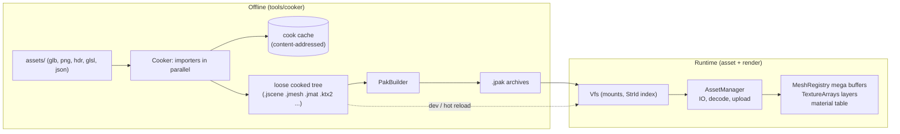
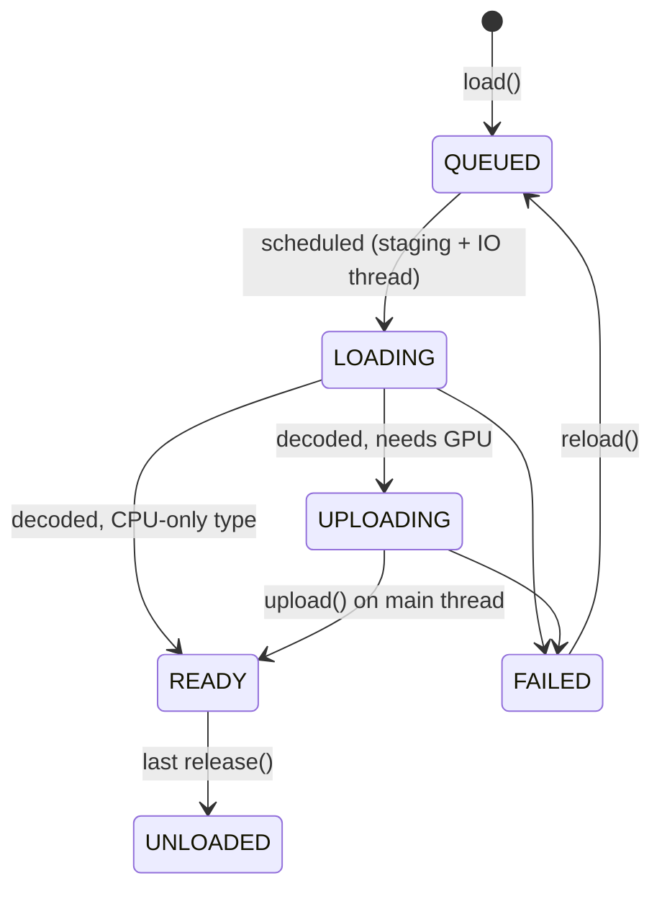
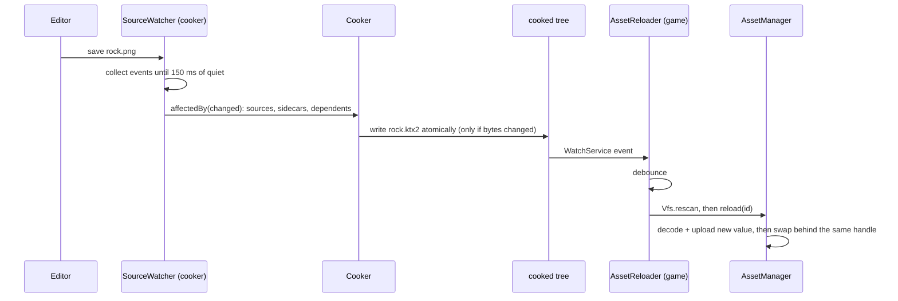

# 10. Assets: from glTF to the GPU

A game ships thousands of files: meshes from Blender, textures from painting tools, HDR skies,
shaders, level descriptions. None of them is in the shape a GPU wants. This chapter follows those
files through Jeddy's asset pipeline, from the source tree on disk to bytes in GPU buffers, and
explains the geometry and the data formats on the way.

You will learn:

- why Jeddy cooks assets offline, and how the cooker decides what to cook again (a
  content-addressed cache);
- how a glTF 2.0 file is read (buffers, views, accessors) and turned into meshes, materials,
  textures and a scene;
- the mesh processing math: flat normals, tangent frames, the QTangent packing, half-float UVs,
  vertex cache optimization and LODs with a geometric error;
- the `.jmesh` byte layout and how it maps one-to-one onto the renderer's vertex arrays;
- texture processing: linear-space mipmaps with a Kaiser-windowed sinc filter, block compression
  (BC7, BC5, BC4) through UASTC, and the KTX2 container;
- environment maps (prefiltered cube maps and 9 spherical-harmonic coefficients);
- paks, the virtual file system and the asynchronous `AssetManager`, including hot reload.

Where it lives:

| Part | Module | Key classes |
|---|---|---|
| Offline cooker | `tools/cooker` (`dev.jeddy.cooker`) | `Cooker`, `CookerMain`, `CookCache`, `GltfSceneImporter`, `MeshProcessor`, `TextureCooker`, `KtxEncoder`, `MipGenerator`, `EnvironmentBaker`, `ShaderImporter`, `PhysicsImporter`, `PakBuilder`, `SourceWatcher` |
| Formats (shared) | `modules/asset` (`dev.jeddy.asset.format`, `dev.jeddy.asset.pak`) | `MeshData`, `MeshWriter`, `MeshEncoding`, `MaterialData`, `SceneData`, `Ktx2`, `Pak`, `PakWriter`, `PakFormat` |
| Runtime loading | `modules/asset` (`dev.jeddy.asset`) | `Vfs`, `AssetManager`, `AssetType`, `AssetLoader`, `StagingRing`, `AssetReloader` |
| GPU side | `modules/render` | `MeshRegistry`, `MeshAssets`, `TextureLoader`, `TextureArrays`, `MaterialAssets` |
| Build | `build-logic` | `dev.jeddy.assets` plugin (`Assets.kt`, `dev.jeddy.assets.gradle.kts`) |

The design is in [DESIGN §10](../DESIGN.md) and the byte-level specs are in
[`docs/formats/`](../formats/). The decisions that shaped it are D8, D11, D25–D27, D33–D36, D38,
D39 and D41 in DESIGN §17.

Here is the whole journey on one page. Keep it in mind; every section below zooms into one box.



---

## Why cook offline

A glTF file stores positions as 32-bit floats, normals as 32-bit floats, texture coordinates as
32-bit floats, and textures as PNG or JPEG. A GPU cannot sample a PNG. If the game loaded PNGs it
would have to decompress them (slow, on the CPU), generate mipmaps, and then upload 4 bytes per
texel, four times more video memory than a block-compressed texture needs. It would also have to
compute tangents, weld vertices and optimize index order on every launch.

So Jeddy splits the pipeline in two (DESIGN §1, goal 5):

- **The cooker** (offline, slow is fine, multithreaded) turns sources into GPU-ready files:
  block-compressed textures with full mip chains, meshes with packed 16-byte vertex attributes and
  cache-optimized indices, binary materials and scenes.
- **The runtime** (fast, allocation-conscious) maps those files into memory and copies the bytes
  into GPU buffers with almost no processing. "The file is the upload": a `.jmesh` vertex stream
  is a slice of the file that goes straight into a GL buffer.

Three decisions follow from this:

- **D8: BCn only, no runtime transcoding.** Textures are compressed to UASTC and then transcoded to
  BC7, BC5 or BC4 *in the cooker*. Desktop GPUs (the only targets, D1) decode BCn in hardware, so
  the runtime just uploads blocks.
- **D27: 16-byte vertex attributes.** A tangent frame packed into one quaternion (QTangent) plus two
  half-float UV sets fit in 16 bytes. Positions stay full 32-bit floats in their own stream so the
  depth prepass and shadow passes fetch only 12 bytes per vertex.
- **D35: a content-addressed cache.** Cooking a 2048² texture takes one to two seconds (D36). The cooker
  must know exactly which sources changed, so it hashes contents rather than trusting timestamps.

---

## The cooker

The cooker is an ordinary Java program, [`CookerMain`](../../tools/cooker/src/main/java/dev/jeddy/cooker/CookerMain.java),
with two commands:

```
jeddy-cook [cook] --source DIR --out DIR [--cache DIR] [--report DIR] [--threads N]
                  [--force] [--prune] [--watch] [--shader-include DIR]... [--no-validate]
jeddy-cook pak    --cooked DIR --out DIR [--layout FILE] [--level N] [--threads N] [--no-names]
```

`cook` turns a source tree into a loose cooked tree, `pak` packs a cooked tree into `.jpak`
archives. The exit status is 0 on success, 1 if a source failed, 2 on bad arguments. The real work
happens in [`Cooker`](../../tools/cooker/src/main/java/dev/jeddy/cooker/Cooker.java).

### Planning: sources, settings and importers

`Cooker.plan()` walks the source root (hidden entries and `.meta` sidecars are skipped) and, for
each file:

1. **Loads its settings** with [`ImportSettings.load`](../../tools/cooker/src/main/java/dev/jeddy/cooker/ImportSettings.java):
   a JSON object merged from `_defaults.meta` files in every directory from the source root down to
   the file (nearer wins), then the file's own `<name>.meta` sidecar. For example the demo's
   `assets/env/sky.hdr.meta` is `{"size": 64, "samples": 64}`.
2. **Picks an importer**: the `importer` setting if present (`"none"` skips the file), otherwise
   the first importer whose `accepts(path, settings)` returns true.
3. **Collects claims**: an importer can say that a source *consumes* other files. A `.gltf` claims
   its external `.bin` buffers and images; claimed files are not cooked on their own unless their
   settings say `"standalone": true`.

The importers are tried in this order:

```java
// tools/cooker/src/main/java/dev/jeddy/cooker/Cooker.java
public static List<Importer> defaultImporters() {
    return List.of(
            new GltfSceneImporter(),
            new PhysicsImporter(),
            new MaterialImporter(),
            new EnvironmentImporter(),
            new CubeLutImporter(),
            new TextureImporter(),
            new ShaderImporter(),
            new CopyImporter());
}
```

Order matters. A `<level>.physics.json` ends in `.json`, which the `CopyImporter` would accept,
but the `PhysicsImporter` comes first and accepts `*.physics.json`; a `.jlevel` goes to the
`LevelImporter` (M14, [chapter 14](14-editor.md)). A `.hdr` file goes to the
`EnvironmentImporter` unless its settings give it another `kind`. Besides these, a *built-in*
importer (`BrdfLutImporter`) runs once per cook without a source and writes
`engine/brdf_lut.ktx2`.

An [`Importer`](../../tools/cooker/src/main/java/dev/jeddy/cooker/Importer.java) is small: a name,
a version, `accepts`, an optional `claims`, and `cook(CookContext)`. The
[`CookContext`](../../tools/cooker/src/main/java/dev/jeddy/cooker/CookContext.java) hands it the
source bytes and settings, and receives outputs (`output(path, bytes)`), dependencies
(`readDependency(file)` reads a file and records its hash), warnings and report statistics.
Importers are stateless and may run on any thread.

### The content-addressed cache (D35)

Before cooking a source, `cookOne` computes a key:

```java
// tools/cooker/src/main/java/dev/jeddy/cooker/Cooker.java
private String key(Job job, byte[] bytes) {
    MessageDigest d = CookCache.digest();
    String header =
            "jeddy-cook "
                    + VERSION
                    + "\n"
                    + job.importer().name()
                    + " "
                    + job.importer().version()
                    + "\n"
                    + job.source()
                    + "\n"
                    + job.settings().canonical()
                    + "\n";
    d.update(header.getBytes(StandardCharsets.UTF_8));
    d.update(bytes);
    return HexFormat.of().formatHex(d.digest());
}
```

```math
\text{key} = \mathrm{SHA256}(\text{cooker version} \,\|\, \text{importer name, version} \,\|\, \text{source path} \,\|\, \text{canonical settings} \,\|\, \text{source bytes})
```

where $`\|`$ means "followed by" (the parts are hashed one after the other).

`canonical()` writes the settings as JSON with sorted keys, so `{"a":1,"b":2}` and `{"b":2,"a":1}`
give the same key. Anything that could change the output is in the key: bump `Cooker.VERSION` and
every result is cooked again; bump one importer's `version()` and only its sources are.

[`CookCache`](../../tools/cooker/src/main/java/dev/jeddy/cooker/CookCache.java) keeps three things
in the cache directory (by default `<out>.cache` next to the output; the Gradle plugin uses
`build/cook-cache`):

```
<cache>/
  entries/<key>.json        what a cook produced: outputs (path, sha256, size),
                            dependencies (path -> sha256), warnings, stats
  objects/<aa>/<sha256>     every output, stored once by its own content hash
  state.json                per source: key, importer, outputs, dependencies of its last cook
  report/report.json, report.html
```

A **hit** needs two things: an entry for the key, and every recorded dependency still having its
recorded hash. The second check matters for a glTF with external images: the `.gltf` text did not
change, but a texture it references did, so the key matches and the dependency hash does not.

On a hit the outputs are restored from `objects/`. On a miss the importer runs and the cache stores
the result. In both cases outputs are written **atomically** (a temporary sibling, then a move) and
**only when their bytes differ** from what is on disk:

```java
// tools/cooker/src/main/java/dev/jeddy/cooker/Cooker.java
private void writeOutput(Output o, byte[] data) throws IOException {
    Path target = outputFile(o.path());
    if (Files.isRegularFile(target)
            && Files.size(target) == data.length
            && CookCache.sha256(Files.readAllBytes(target)).equals(o.sha256())) {
        return; // unchanged: don't wake the runtime's reloader
    }
    CookCache.writeAtomically(target, data);
}
```

Why "only when changed"? The running game watches the cooked tree for hot reload (later in this
chapter). If the cooker rewrote unchanged files, every recook would reload every asset.

After all jobs finish, `run` does the bookkeeping: two sources that write the same output both
fail; outputs that a source no longer produces, and all outputs of deleted sources, are deleted
(with any directories they leave empty); a failed source keeps its previous outputs.

| Situation | What happens |
|---|---|
| First cook | miss, importer runs, entry and objects stored |
| Nothing changed | hit, outputs already identical, nothing written (status `CACHED`) |
| `rock.png.meta` changed `maxSize` | settings change the key: miss, recook |
| A glTF's external `wood.png` changed | key hits, dependency hash differs: recook |
| You undo that change | the old key and objects are still cached: instant hit |
| `--force` | the cache is ignored |
| `--prune` | entries and objects no source state uses are deleted |

### Parallelism

`run` executes one job per source with `jobs.parallelFor(..., todo.size(), 1)` on the core
`JobSystem`. The threads are split: `perJob = threads / min(threads, jobs)` is passed to each
`CookContext` as the thread count a single native encoder call may use (libktx's UASTC encoder is
multithreaded). Importers fan out further: the glTF importer cooks a file's meshes in one
`parallelFor` and its textures in another.

The cooker breaks the job system's "no blocking I/O on workers" rule on purpose, and says so in the
class comment: it is an offline tool, its jobs are long and mostly CPU-bound, and nothing
latency-sensitive shares its workers.

### The report

Every run writes [`CookReport`](../../tools/cooker/src/main/java/dev/jeddy/cooker/CookReport.java)
as `report.json` and a self-contained `report.html`. Each source is an `Item` with a `Status`
(`COOKED`, `CACHED`, `FAILED`, `REMOVED`), its time, outputs, warnings and importer statistics:
texture format, PSNR, SSIM and UASTC level; mesh vertices, triangles, LOD triangles and errors,
ACMR, ATVR and overdraw; shader permutations compiled. Statistics go through JSON even for a fresh
cook, so a cooked item reports exactly what a cached one will.

**Try it.** `CookerTest` covers the whole loop:

```
./gradlew :cooker:test --tests 'dev.jeddy.cooker.CookerTest'
```

`cooksEveryImporterThenServesTheCache`, `recooksWhatChangedAndRemovesStaleOutputs`,
`failuresAreIsolatedAndReported` and `forceIgnoresTheCacheAndPruneDropsUnusedEntries` are the
table above as code. The cooker loads libktx, meshoptimizer and a small MikkTSpace shim through
FFM, so its tests need the native libraries (DESIGN §6).

---

## glTF 2.0 import

glTF ("GL Transmission Format") is the Khronos format for 3D scenes. A `.gltf` file is JSON plus
external binary buffers; a `.glb` packs the JSON and one binary buffer into a single file.

### The container

[`GltfDocument`](../../tools/cooker/src/main/java/dev/jeddy/cooker/gltf/GltfDocument.java) reads
both. A GLB starts with a 12-byte header (`"glTF"`, version 2, total length) followed by chunks of
`(length, type, data)`, each padded to 4 bytes. Type `0x4E4F534A` (`"JSON"` read as little-endian
ASCII) is the JSON chunk; `0x004E4942` (`"BIN\0"`) is the binary chunk.

The JSON describes data in three layers:

```
buffers[0]       one big byte array (the BIN chunk, a .bin file or a base64 data: URI)
  |
bufferViews[3]   a byte range of a buffer: byteOffset, byteLength, optional byteStride
  |
accessors[7]     how to read elements from a view: count, type (SCALAR, VEC2, VEC3, VEC4, MAT4),
                 componentType (5126 FLOAT, 5123 UNSIGNED_SHORT, ...), normalized, sparse
```

A mesh primitive then says "`POSITION` is accessor 7, `NORMAL` is accessor 8, `indices` is
accessor 9". `GltfDocument.floats(a)` reads accessor `a` into a `float[]` of `count × components`,
honouring the stride, converting normalized integers, and applying sparse substitutions (a sparse
accessor overrides a few elements, which morph targets use). The normalized conversion follows the
glTF rules:

```java
// tools/cooker/src/main/java/dev/jeddy/cooker/gltf/GltfDocument.java
private static float component(ByteBuffer b, int at, int type, boolean normalized) {
    return switch (type) {
        case FLOAT -> b.getFloat(at);
        case UNSIGNED_BYTE -> normalized ? (b.get(at) & 0xFF) / 255f : b.get(at) & 0xFF;
        case BYTE -> normalized ? Math.max(b.get(at) / 127f, -1f) : b.get(at);
        case UNSIGNED_SHORT ->
                normalized ? (b.getShort(at) & 0xFFFF) / 65535f : b.getShort(at) & 0xFFFF;
        case SHORT -> normalized ? Math.max(b.getShort(at) / 32767f, -1f) : b.getShort(at);
        case UNSIGNED_INT -> Integer.toUnsignedLong(b.getInt(at));
        default -> throw new IllegalArgumentException("componentType " + type);
    };
}
```

Note the signed case: a signed byte −128 divided by 127 is −1.008, so it is clamped to −1. That is
how signed normalized integers ("snorm") work everywhere, including in GL's vertex fetch; we meet
it again in the QTangent.

### From document to import model

[`GltfImporter.importScene`](../../tools/cooker/src/main/java/dev/jeddy/cooker/gltf/GltfImporter.java)
turns the document into plain Java data:

- **Meshes**: a list of `Primitive`s, each a triangle list with `float[]` streams (`positions`,
  `normals`, `tangents`, `uv0`, `uv1`, `weights`), `int[] joints` and `int[] indices`. Only mode 4
  (triangles) is supported; other modes are skipped with a warning. A primitive without indices
  gets `0, 1, 2, ...`. Every index is checked against the vertex count.
- **Materials**: PBR metallic-roughness factors, `KHR_texture_transform` (scale, offset, rotation of
  the base color's UVs), `KHR_materials_emissive_strength`, alpha mode and cutoff, double-sided, and
  the five texture references with their UV set (`texCoord`).
- **Textures**: an image plus the sampler's wrap modes (`true` unless the sampler says
  `CLAMP_TO_EDGE`, 33071).
- **Lights** from `KHR_lights_punctual`.
- **Nodes**: name, parent, translation, rotation (quaternion `x, y, z, w`), scale, mesh, light, skin.
- **Skins and animations**, read as they are (joints, inverse bind matrices, keyframe times and
  values) and stored raw (D39). The animation module resamples them at load time
  ([09 Animation and skinning](09-animation-and-skinning.md), D79).

A glTF node may give a `matrix` instead of TRS. `GltfImporter.decompose` splits a column-major
affine matrix $M$ into translation, rotation and scale. With columns $c_0, c_1, c_2$ of the upper
3×3 part:

```math
t = (m_{12}, m_{13}, m_{14}), \qquad s_i = \lVert c_i \rVert, \qquad R = \left[\tfrac{c_0}{s_0}\ \tfrac{c_1}{s_1}\ \tfrac{c_2}{s_2}\right]
```

where $m_k$ is element $k$ of the 16-float column-major array. If $`\det M_{3\times3} < 0`$ the
matrix mirrors space; a rotation cannot mirror, so the code negates $s_0$ before dividing. The
rotation matrix is converted to a quaternion with the usual trace method (pick the largest of
$w, x, y, z$ to divide by, for numerical stability), the same algorithm the QTangent encoder uses
below (quaternions themselves are the subject of
[03 Rotations and transforms](03-rotations-and-transforms.md)).
`GltfImporterTest.decomposesMirroredMatrices` checks it.

### Cooking a scene

[`GltfSceneImporter`](../../tools/cooker/src/main/java/dev/jeddy/cooker/gltf/GltfSceneImporter.java)
is the importer. For `characters/knight.glb` it writes:

```
characters/knight.jscene                      the node hierarchy
characters/knight/<mesh>.jmesh                one per glTF mesh
characters/knight/<material>.jmat             one per glTF material
characters/knight/<image>_<usage>.ktx2        one per (image, usage, wrap, alpha cutoff)
```

Names are sanitized and lower-cased (`Cube.003` becomes `cube.003.jmesh`); duplicates get `_2`,
`_3`. The steps:

1. **Materials** become `.jmat` files (see "Materials" below). While building them, each texture
   reference registers a *texture job* keyed by `usage:image:second:wrap:alphaCutoff`. Two materials
   that use the same image for the same purpose share one texture; the same image used as a base
   color and as a normal map becomes two textures, because usage decides the format (D35).
2. **Meshes** cook in parallel through `MeshProcessor` (next section).
3. **Textures** cook in parallel through `TextureCooker`. The metallic-roughness and occlusion maps
   are packed into one **ORM** texture: R = occlusion, G = roughness, B = metallic. glTF already
   stores roughness in G and metallic in B, so only R is filled in, from the occlusion image
   resampled to the metallic-roughness size. If the two maps read different UV sets they cannot
   share a texture, and occlusion becomes a separate BC4 texture in its own slot.
4. **The scene**: only nodes reachable from the glTF's default scene are kept, ordered **parents
   first** by a depth-first walk:

```java
// tools/cooker/src/main/java/dev/jeddy/cooker/gltf/GltfSceneImporter.java
// Parents first: depth-first from the roots.
// ...
int[] remap = new int[nodes.size()];
java.util.Arrays.fill(remap, -1);
List<Integer> order = new ArrayList<>();
List<Integer> stack = new ArrayList<>();
for (int r = roots.size() - 1; r >= 0; r--) {
    stack.add(roots.get(r));
}
while (!stack.isEmpty()) {
    int n = stack.remove(stack.size() - 1);
    if (n < 0 || n >= nodes.size() || remap[n] >= 0) {
        continue;
    }
    remap[n] = order.size();
    order.add(n);
    List<Integer> c = children.get(n);
    for (int k = c.size() - 1; k >= 0; k--) {
        stack.add(c.get(k));
    }
}
```

`remap[old] = new` renumbers every reference (parents, skin joints, animation targets). Why parents
first? Because then a loader can spawn nodes in file order: when it reaches node `i`, node
`parent(i) < i` already exists. The format spec ([`jscene.md`](../formats/jscene.md)) promises
`parent < index`. Nodes outside the default scene are dropped with a warning; skins whose joints
are not all in the scene are dropped too.

**Try it.** `GltfSceneImporterTest.cooksAGlbIntoSceneMeshesMaterialsAndTextures` builds a crate in
memory and checks every output name, the parent order, the material feature bits, the texture
formats (BC7 sRGB for base color, BC5 for normals, BC7 UNORM for ORM) and that the ORM texture took
the metallic-roughness size:

```
./gradlew :cooker:test --tests 'dev.jeddy.cooker.gltf.*'
```

---

## Mesh processing

[`MeshProcessor.process`](../../tools/cooker/src/main/java/dev/jeddy/cooker/mesh/MeshProcessor.java)
turns the primitives of one glTF mesh into one `.jmesh`. Each primitive becomes one **submesh**, and
each distinct material becomes one **material slot**.

### Normals and tangents

Per-pixel lighting needs, per vertex, a normal $n$ and, for normal mapping, a tangent $t$ and a
bitangent $b$. The three form the **tangent frame**: $t$ points along increasing $u$ of the texture,
$b$ along increasing (or decreasing) $v$, and $n$ out of the surface. A normal map stores
perturbed normals in this frame, and the shader rotates them into world space with the matrix
$`[t\ b\ n]`$.

When a primitive has no normals, `flatNormals` computes one per triangle from two edges:

```math
n = \frac{(p_1 - p_0) \times (p_2 - p_0)}{\lVert (p_1 - p_0) \times (p_2 - p_0) \rVert}
```

The cross product points out of the side from which $p_0, p_1, p_2$ appear counterclockwise
(right-handed coordinates). A degenerate triangle (zero-length cross product) gets $n = (0, 0, 1)$.

When a primitive has UVs but no tangents (and the `tangents` setting is on, the default),
`MeshProcessor.mikk` calls **MikkTSpace** through a small native shim
(`JeddyTools.jeddy_mikk_generate_tangents`). MikkTSpace is the de facto standard tangent generator:
Blender bakes normal maps with it, so tangents from it match the baker's and the normal map looks
right. Note that `MeshProcessor` generates tangents whenever UVs exist; it does not look at
whether the material has a normal map.

Both flat normals and MikkTSpace produce values *per triangle corner*. So the processor first
"unwelds" the mesh, gathering each attribute by index so that every corner is its own vertex, and
welds identical vertices again afterwards.

The bitangent is not stored. It is $`b = (n \times t)\, w`$ where $w = \pm 1$ is the **handedness**
stored in the tangent's fourth component. Mirrored UVs (one half of a symmetric character reusing
the other half's texture) flip it. There is one convention trap, recorded as **D33**: MikkTSpace's
bitangent follows $+v$, but glTF's follows $-v$, because glTF puts the UV origin at the image's
top-left corner. So the cooker flips the sign:

```java
// tools/cooker/src/main/java/dev/jeddy/cooker/mesh/MeshProcessor.java
// MikkTSpace's bitangent follows +v; glTF's (the normal map's +Y) follows -v because
// its UV origin is the image's top-left corner, so flip the sign (DESIGN D33).
for (int i = 3; i < t.length; i += 4) {
    t[i] = -t[i];
}
```

`MeshProcessorTest.generatesTangentsFollowingGltfConventions` pins this down on a quad with known
UVs.

### Welding and meshoptimizer

The working vertex is 22 floats (`pos 3, normal 3, tangent 4, uv0 2, uv1 2, joints 4, weights 4`;
joints travel as float bits). The processor hands them to **meshoptimizer** through FFM:

```java
// tools/cooker/src/main/java/dev/jeddy/cooker/mesh/MeshProcessor.java
// Weld identical vertices (always: sources often duplicate them too).
MemorySegment remap = a.allocate(ValueLayout.JAVA_INT, vertices);
int unique =
        (int)
                meshopt_generateVertexRemap(
                        remap, idx, indices.length, vtx, vertices, size);
MemorySegment welded = a.allocate(size * Math.max(1, unique), 4);
meshopt_remapVertexBuffer(welded, vtx, vertices, size, remap);
meshopt_remapIndexBuffer(idx, idx, indices.length, remap);
long n = indices.length;
meshopt_optimizeVertexCache(idx, idx, n, unique);
meshopt_optimizeOverdraw(idx, idx, n, welded, unique, size, o.overdrawThreshold());
MemorySegment fetched = a.allocate(size * Math.max(1, unique), 4);
int finalCount =
        (int) meshopt_optimizeVertexFetch(fetched, idx, n, welded, unique, size);
```

What each pass buys:

- **Weld** (`generateVertexRemap`): byte-identical vertices become one, so the vertex shader runs
  once for them.
- **Vertex cache** (`optimizeVertexCache`): the GPU keeps recently transformed vertices in a small
  post-transform cache. Reordering triangles so that neighbours share recently used vertices
  lowers the **ACMR** (average cache miss ratio: vertex shader invocations per triangle; a perfect
  regular grid approaches 0.5, a naive order is near 3) and the **ATVR** (invocations per unique
  vertex; 1.0 is ideal).
- **Overdraw** (`optimizeOverdraw`): reorders clusters of triangles so that front-facing parts tend
  to draw first, so the depth test rejects more hidden pixels. The threshold (default 1.05) lets the
  vertex cache get up to 5% worse in exchange.
- **Vertex fetch** (`optimizeVertexFetch`): renumbers vertices in the order the indices first use
  them, so vertex reads walk memory forward.

The cook report records ACMR, ATVR and overdraw for LOD 0 (`meshopt_analyzeVertexCache` with a
16-entry cache, `meshopt_analyzeOverdraw`).

### LODs with a geometric error

A character seen from 30 meters does not need 600 triangles. The processor builds up to `lods`
levels (default 4) with `meshopt_simplify`:

```java
// tools/cooker/src/main/java/dev/jeddy/cooker/mesh/MeshProcessor.java
float scale = n == 0 ? 0 : meshopt_simplifyScale(fetched, finalCount, size);
// ...
for (int l = 1; l < o.lods() && n > 0; l++) {
    long target = Math.max(3, (long) (previous * o.lodRatio()) / 3 * 3);
    long got =
            meshopt_simplify(
                    dst,
                    idx,
                    n,
                    fetched,
                    finalCount,
                    size,
                    target,
                    o.lodError(),
                    0,
                    error);
    if (got == 0 || got > previous * 0.9) {
        break; // the simplifier hit the error budget: no useful smaller LOD
    }
    meshopt_optimizeVertexCache(dst, dst, got, finalCount);
    lods.add(dst.asSlice(0, got * 4).toArray(ValueLayout.JAVA_INT));
    errors[l] = error.get(ValueLayout.JAVA_FLOAT, 0) * scale;
    previous = got;
}
```

Every LOD asks for `lodRatio` (default 0.5) of the previous LOD's indices, but always simplifies
from LOD 0's index list against the same vertices; LODs only add index ranges, never vertices. The
simplifier collapses edges until it reaches the target or the error budget `lodError` (default
0.05, relative to the mesh size). It reports the error it reached as a fraction of the mesh's
extent; multiplying by `meshopt_simplifyScale` turns it into **mesh units** (meters). When the
simplifier cannot remove at least 10% more, the chain stops.

That error drives LOD selection at runtime. The renderer projects it to pixels and takes the
coarsest LOD whose error is below a threshold:

```java
// modules/render/src/main/java/dev/jeddy/render/draw/DrawBuilder.java
private int selectLod(int mesh, float scale, float distance) {
    int lods = meshes.lodCount(mesh);
    float k =
            orthographic
                    ? pixelsPerUnit * scale
                    : pixelsPerUnit * scale / Math.max(distance, 1e-3f);
    int lod = 0;
    for (int l = 1; l < lods; l++) {
        if (meshes.lodError(mesh, l) * k <= thresholdPixels) {
            lod = l;
        } else {
            break;
        }
    }
    return lod;
}
```

For a perspective camera, an error $e$ meters at distance $d$ covers about
$e \cdot \text{pixelsPerUnit} / d$ pixels (similar triangles, see
[04 Cameras and projection](04-cameras-and-projection.md)). For the orthographic iso camera the
distance does not matter, only the zoom.

### Quantization: QTangents, half floats, unorm weights

The final vertex in `.jmesh` is 12 bytes of position in one stream and 16 bytes of attributes in
another (D27). The attributes are where the bits are saved.

**The QTangent.** A tangent frame is three vectors (9 floats, 36 bytes) plus a sign. But the matrix
$`[t\ b\ n]`$ (columns $t$, $b$, $n$) with $b = n \times t$ is a rotation matrix (orthonormal,
determinant +1), and a rotation fits in
a unit quaternion: four numbers. Store those four as signed 16-bit integers and the frame costs 8
bytes. Where does the handedness go? A quaternion $q$ and $-q$ are the *same* rotation, so the sign
of the quaternion is free information. The encoder forces $w \ge 0$, then negates the whole
quaternion when the bitangent is mirrored. The decoder reads the sign of $w$ as the handedness.

[`MeshEncoding.encodeQTangent`](../../modules/asset/src/main/java/dev/jeddy/asset/format/MeshEncoding.java),
condensed:

```java
// modules/asset/src/main/java/dev/jeddy/asset/format/MeshEncoding.java
// ... normalize n; t -= n * dot(n, t); normalize t ...
// b = cross(n, t): the matrix [t b n] is a rotation.
float bx = ny * tz - nz * ty;
float by = nz * tx - nx * tz;
float bz = nx * ty - ny * tx;

float m00 = tx, m10 = ty, m20 = tz;
float m01 = bx, m11 = by, m21 = bz;
float m02 = nx, m12 = ny, m22 = nz;
// ... matrix to quaternion (trace method) into qx, qy, qz, qw ...
if (qw < 0) {
    qx = -qx;
    qy = -qy;
    qz = -qz;
    qw = -qw;
}
if (qw < W_BIAS) {
    float scale = (float) Math.sqrt(1 - W_BIAS * W_BIAS);
    float len = (float) Math.sqrt(qx * qx + qy * qy + qz * qz);
    qx = qx / len * scale;
    qy = qy / len * scale;
    qz = qz / len * scale;
    qw = W_BIAS;
}
if (handedness < 0) {
    qx = -qx;
    qy = -qy;
    qz = -qz;
    qw = -qw;
}
out[outOff] = snorm16(qx);
// ... qy, qz, qw likewise
```

The `W_BIAS` step handles one edge case: if $w$ is 0 (a 180° rotation), $+0$ and $-0$ round to the
same integer 0 and the sign would be lost. So $w$ is kept at least $1/32767$ (one quantization
step), and $x, y, z$ are rescaled so the quaternion stays unit length.

A worked example. A floor facing up: $n = (0, 1, 0)$, $t = (1, 0, 0)$. Then
$b = n \times t = (0, 0, -1)$ and

```math
[t\ b\ n] = \begin{pmatrix} 1 & 0 & 0 \\ 0 & 0 & 1 \\ 0 & -1 & 0 \end{pmatrix}
```

Write $m_{rc}$ for row $r$, column $c$ (the code's `m00` ... `m22`). When the trace
$m_{00} + m_{11} + m_{22}$ is positive, the trace method computes $s = 2\sqrt{1 + \text{trace}}$,
$w = s/4$, $x = (m_{21} - m_{12})/s$, $y = (m_{02} - m_{20})/s$, $z = (m_{10} - m_{01})/s$ (when
the trace is 0 or negative, the code starts from the largest diagonal element instead, so it never
divides by a tiny $s$). Here the trace is 1, so
$s = 2\sqrt{1 + 1} = 2.828$, $w = s/4 = 0.7071$,
$x = (m_{21} - m_{12})/s = (-1 - 1)/2.828 = -0.7071$, $y = z = 0$. That is a rotation of −90°
about $x$, which indeed takes $(0, 0, 1)$ to $(0, 1, 0)$. As `snorm16`
($\mathrm{round}(v \cdot 32767)$): $(-23170, 0, 0, 23170)$. A mirrored frame would store
$(23170, 0, 0, -23170)$.

The shader decodes with the quaternion rotation formula
$`v' = v + 2\, q_{xyz} \times (q_{xyz} \times v + w v)`$
([03 Rotations and transforms](03-rotations-and-transforms.md)):

```glsl
// modules/render/src/main/resources/dev/jeddy/render/shaders/engine/vertex.glsl
// ...
layout(location = 1) in vec4 jeddyQTangent; // snorm16 x4, normalized by the vertex fetch
// ...

vec3 jeddyQuatRotate(vec4 q, vec3 v) {
    return v + 2.0 * cross(q.xyz, cross(q.xyz, v) + q.w * v);
}

void jeddyTangentFrame(out vec3 normal, out vec3 tangent, out float handedness) {
    vec4 q = normalize(jeddyQTangent);
    normal = jeddyQuatRotate(q, vec3(0.0, 0.0, 1.0));
    tangent = jeddyQuatRotate(q, vec3(1.0, 0.0, 0.0));
    handedness = jeddyQTangent.w < 0.0 ? -1.0 : 1.0;
}
```

The normal is the rotated $+z$ axis, the tangent the rotated $+x$ axis. The vertex fetch has
already turned the four `snorm16` into floats in $[-1, 1]$ (the attribute is declared
`GL_SHORT`, normalized). `FormatsTest.qtangentsKeepTheFrameAndHandedness` round-trips random frames
through `MeshEncoding` and checks the error.

**Half-float UVs.** Each UV set is two IEEE 754 half floats (`Float.floatToFloat16`, Java 20+): 1
sign bit, 5 exponent bits, 10 mantissa bits. The spacing between representable numbers doubles at
every power of two:

| UV range | Step | In texels of a 1024² texture |
|---|---|---|
| $[0.25, 0.5)$ | $2^{-12} \approx 0.00024$ | 0.25 |
| $[0.5, 1)$ | $2^{-11} \approx 0.00049$ | 0.5 |
| $[1, 2)$ | $2^{-10} \approx 0.00098$ | 1 |
| $[8, 16)$ | $2^{-7} \approx 0.0078$ | 8 |

For UVs inside $[0, 1]$, as on the demo's texture atlases, the error is under half a texel. Tiling
UVs far from 0 (a floor with UVs up to 16) would visibly snap; that is the price of 4 bytes per UV
set instead of 8.

**Skin weights.** The optional skin stream stores four `u16` joint indices and four `unorm16`
weights ($\mathrm{round}(w \cdot 65535)$) per vertex: 16 bytes. See
[09 Animation and skinning](09-animation-and-skinning.md).

**Try it.**

```
./gradlew :cooker:test --tests 'dev.jeddy.cooker.mesh.MeshProcessorTest'
./gradlew :asset:test --tests 'dev.jeddy.asset.format.FormatsTest'
```

`buildsLodsWithIncreasingErrorAndFewerTriangles` and `mergesPrimitivesIntoSubmeshesWithSharedLodRanges`
are worth reading next to the code.

---

## The `.jmesh` format and the mega buffers

The full spec is [`docs/formats/jmesh.md`](../formats/jmesh.md);
[`MeshWriter`](../../modules/asset/src/main/java/dev/jeddy/asset/format/MeshWriter.java) writes it
and [`MeshData`](../../modules/asset/src/main/java/dev/jeddy/asset/format/MeshData.java) reads it.
Everything is little-endian and every section starts at a multiple of 64 bytes:

```
offset 0     header (128 B): magic "JMSH", version, flags (bit 0: skin), counts,
             bounds min/max, bounding sphere, section offsets, fileSize
       128   positions   f32 x,y,z                         12 B per vertex
   (64-aligned)
             attributes  QTangent snorm16x4 | uv0 f16x2 | uv1 f16x2   16 B per vertex
   (64-aligned)
             skin        u16 joints x4 | unorm16 weights x4           16 B per vertex (optional)
   (64-aligned)
             indices     u32, relative to the submesh's base vertex, LOD-major
   (64-aligned)
             submeshes   48 B each: material slot, baseVertex, vertexCount, flags, bounds
   (64-aligned)
             LODs        lodCount x {f32 error, u32 0}, then lodCount x submeshCount x {firstIndex, indexCount}
   (64-aligned)
             materials   materialSlotCount x u64 StrId of the default .jmat
```

A worked layout: 100 vertices, 300 indices, one submesh, two LODs, one material, no skin. Positions
start at 128 and take 1200 bytes (ending at 1328), so the attributes start at the next multiple of
64, which is 1344. Exercise 1 asks you to finish the computation.

Why separate streams instead of one interleaved 28-byte vertex? The depth prepass and the shadow
passes only need positions. With separate streams they read 12 bytes per vertex; with an
interleaved layout every cache line they fetch would be more than half attributes they discard.

### Reading in place

`MeshData.read(segment)` does not copy. It validates the header, checks every section against the
file size, every submesh against the vertex count, every LOD range against the index count and
**every index** against its submesh's vertex count, then keeps `asSlice` views:

```java
// modules/asset/src/main/java/dev/jeddy/asset/format/MeshData.java
positions = section(64, (long) vertexCount * POSITION_STRIDE, "positions");
attributes = section(72, (long) vertexCount * ATTRIBUTE_STRIDE, "attributes");
skin =
        hasSkin()
                ? section(80, (long) vertexCount * SKIN_STRIDE, "skin")
                : MemorySegment.NULL;
indices = section(88, (long) indexCount * 4, "indices");
```

Validating every index costs a loop on a worker thread, and it means a corrupt or malicious file is
rejected there instead of making the GPU read out of bounds.

### Uploading into the mega buffers

[`MeshRegistry`](../../modules/render/src/main/java/dev/jeddy/render/mesh/MeshRegistry.java) keeps
*every* loaded mesh in three big GL buffers (positions, attributes, indices, plus a skin buffer
once a skinned mesh appears), sub-allocated with free lists. One vertex array object describes all
of them, and its attribute formats are the `.jmesh` stream layouts, byte for byte:

```java
// modules/render/src/main/java/dev/jeddy/render/mesh/MeshRegistry.java
glEnableVertexArrayAttrib(vao, 0);
glVertexArrayAttribFormat(vao, 0, 3, GL_FLOAT, false, 0);
glVertexArrayAttribBinding(vao, 0, BINDING_POSITIONS);
glEnableVertexArrayAttrib(vao, 1);
glVertexArrayAttribFormat(vao, 1, 4, GL_SHORT, true, 0);
glVertexArrayAttribBinding(vao, 1, BINDING_ATTRIBUTES);
glEnableVertexArrayAttrib(vao, 2);
glVertexArrayAttribFormat(vao, 2, 2, GL_HALF_FLOAT, false, 8);
glVertexArrayAttribBinding(vao, 2, BINDING_ATTRIBUTES);
glEnableVertexArrayAttrib(vao, 3);
glVertexArrayAttribFormat(vao, 3, 2, GL_HALF_FLOAT, false, 12);
glVertexArrayAttribBinding(vao, 3, BINDING_ATTRIBUTES);
// Skin stream: integer joints and normalized weights. Enabled only once the buffer exists.
glVertexArrayAttribIFormat(vao, 4, 4, GL_UNSIGNED_SHORT, 0);
glVertexArrayAttribBinding(vao, 4, BINDING_SKIN);
glVertexArrayAttribFormat(vao, 5, 4, GL_UNSIGNED_SHORT, true, 8);
glVertexArrayAttribBinding(vao, 5, BINDING_SKIN);
```

| `.jmesh` stream, bytes | GL buffer binding | Attribute location | GL format | GLSL input |
|---|---|---|---|---|
| positions 0–11 | 0 (`BINDING_POSITIONS`, stride 12) | 0 | 3 × `GL_FLOAT` | `vec3 jeddyPosition` |
| attributes 0–7 | 1 (`BINDING_ATTRIBUTES`, stride 16) | 1 | 4 × `GL_SHORT`, normalized | `vec4 jeddyQTangent` |
| attributes 8–11 | 1 | 2 | 2 × `GL_HALF_FLOAT` | `vec2 jeddyUv0` |
| attributes 12–15 | 1 | 3 | 2 × `GL_HALF_FLOAT` | `vec2 jeddyUv1` |
| skin 0–7 | 2 (`BINDING_SKIN`, stride 16) | 4 | 4 × `GL_UNSIGNED_SHORT`, integer | joints |
| skin 8–15 | 2 | 5 | 4 × `GL_UNSIGNED_SHORT`, normalized | weights |

`MeshRegistry.add(MeshData)` allocates a vertex range and an index range, copies each stream
segment into its buffer at that offset (through the renderer's upload ring when it has room), and
records per-mesh tables. Submesh base vertices and LOD first indices are stored as **absolute**
positions in the mega buffers:

```java
// modules/render/src/main/java/dev/jeddy/render/mesh/MeshRegistry.java
for (int s = 0; s < sc; s++) {
    submeshBaseVertex[sBase + s] = (int) vOff + data.submeshBaseVertex(s);
    // ...
}
for (int l = 0; l < lc; l++) {
    lodError[lBase + l] = data.lodError(l);
    for (int s = 0; s < sc; s++) {
        drawFirstIndex[dBase + l * sc + s] = (int) iOff + data.lodFirstIndex(l, s);
        drawIndexCount[dBase + l * sc + s] = data.lodIndexCount(l, s);
    }
}
```

Those are exactly the `firstIndex` and `baseVertex` fields of a `DrawElementsIndirectCommand`, so
drawing any mesh at any LOD is one indirect command, and a whole pass is one
`glMultiDrawElementsIndirect`. That is the subject of
[06 Renderer architecture](06-renderer-architecture.md). The indices in the file are relative to
the submesh's base vertex precisely so that this works without rewriting a single index at load
time.

---

## Textures

A texture goes through four stages in the cooker: decode to linear floats, build mips, compress to
a block format, wrap in KTX2.

### Decoding into linear floats

[`ImageDecoder`](../../tools/cooker/src/main/java/dev/jeddy/cooker/texture/ImageDecoder.java) reads
PNG (8 and 16 bit), JPEG, BMP and GIF through the JDK's ImageIO, and TGA (uncompressed and RLE) and
Radiance HDR (`.hdr`, RGBE) with small built-in readers (D38: no third-party image library). The
result is an [`ImageRgba`](../../tools/cooker/src/main/java/dev/jeddy/cooker/texture/ImageRgba.java):
4 floats per pixel, row-major, top row first, **in linear space**.

Color textures (base color, emissive) are stored by artists in **sRGB**, a nonlinear encoding that
spends more of its 256 levels on dark values, where the eye is more sensitive. The decoder
linearizes them with the exact piecewise curve:

```math
c_{\text{lin}} = \begin{cases} c_s / 12.92 & c_s \le 0.04045 \\ \left(\dfrac{c_s + 0.055}{1.055}\right)^{2.4} & \text{otherwise} \end{cases}
\qquad
c_s = \begin{cases} 12.92\, c_{\text{lin}} & c_{\text{lin}} \le 0.0031308 \\ 1.055\, c_{\text{lin}}^{1/2.4} - 0.055 & \text{otherwise} \end{cases}
```

($c_s$ is the sRGB-encoded value and $c_{\text{lin}}$ the linear one, both in $[0, 1]$; the left
formula decodes, the right one encodes.)

Data textures (normal maps, ORM, masks) are already linear and are not converted. Alpha is always
linear. `TextureCooker.srgb(kind)` is true only for `Kind.COLOR`.

### Mipmaps in linear space

A mip chain halves the texture until it is 1×1. The GPU picks the level whose texels are about one
pixel on screen, which avoids shimmering. Two questions decide quality: in which space do you
average, and with which filter?

**Space.** Averaging must happen in linear space, because light adds linearly. A checkerboard of
black (sRGB 0) and white (sRGB 255) pixels emits half the light of white, so its average is linear
0.5, which is sRGB 188. Averaging the sRGB bytes gives 128, which is linear 0.216: the mip would be
less than half as bright as it should be, and distant textures would darken. Jeddy's mips are
correct because `ImageDecoder` linearizes first, `MipGenerator` filters the floats, and
`ImageRgba.toRgba8(srgb)` encodes back to sRGB at the end (through a 65536-entry lookup table).

**Filter.** A 2×2 box average is cheap but blurs and aliases. [`MipGenerator`](../../tools/cooker/src/main/java/dev/jeddy/cooker/texture/MipGenerator.java)
uses a **Kaiser-windowed sinc**. The ideal low-pass filter is the sinc,
$\mathrm{sinc}(x) = \sin(\pi x)/(\pi x)$, but it extends forever; the Kaiser window cuts it off
smoothly:

```math
w(t) = \mathrm{sinc}(t) \cdot \frac{I_0\!\left(\alpha \sqrt{1 - (t/R)^2}\right)}{I_0(\alpha)}, \qquad |t| < R
```

where $t$ is the distance from the destination pixel's center measured in *destination* pixels,
$R = 1.5$ (`RADIUS`, so the support is three destination pixels wide), $\alpha = 4$ (`ALPHA`), and
$I_0$ is the modified Bessel function of order 0, computed by its power series
$`I_0(x) = \sum_{k \ge 0} (x^2/4)^k / (k!)^2`$ in `bessel0`. The
weights of each output pixel are normalized to sum to 1. The filter is separable: one horizontal
pass, then one vertical pass.

For a 2:1 reduction the sample positions of output pixel 0 are source pixels −3 to 4, and the
normalized weights come out as (computed with the code's formulas):

| Source pixel | −3 | −2 | −1 | 0 | 1 | 2 | 3 | 4 |
|---|---|---|---|---|---|---|---|---|
| Weight | 0 | −0.021 | 0.0945 | 0.4265 | 0.4265 | 0.0945 | −0.021 | 0 |

The small negative lobes sharpen; a box filter would be $(0.5, 0.5)$ on pixels 0 and 1 only.
Out-of-range samples wrap (tiling textures) or clamp. Large images filter rows in parallel.

Two kinds of texture need extra care, both handled in `MipGenerator.chain`:

- **Normal maps**: averaging unit vectors gives shorter vectors. `renormalize` maps each texel from
  $[0, 1]$ back to $[-1, 1]$, normalizes, and maps back.
- **Alpha-tested textures** (foliage, fences): averaging alpha shrinks the area above the cutoff,
  so distant leaves thin out and vanish. `keepCoverage` measures the fraction of texels that pass
  the cutoff in level 0, then binary-searches (20 iterations, scale in $[0, 4]$) for an alpha scale
  that gives each level the same coverage.

`TextureTest.mipFilterPreservesAverageAndCoverage` checks both properties.

### Block compression: BC7, BC5, BC4

GPUs sample compressed textures directly. The BCn formats all work on 4×4 texel blocks of a fixed
size, so the GPU can find any texel's block with arithmetic and decode it in the texture unit:

| Format | Block | Bits per texel | Channels | Jeddy uses it for |
|---|---|---|---|---|
| RGBA8 (uncompressed) | 64 B per 16 texels | 32 | 4 | nothing shipped |
| BC7 | 16 B | 8 | RGBA, high quality | base color and emissive (sRGB), ORM (UNORM) |
| BC5 | 16 B | 8 | two independent channels | tangent-space normal maps |
| BC4 | 8 B | 4 | one channel | masks, separate occlusion |

A 1024² BC7 texture with its full chain of 11 levels is 87,383 blocks of 16 bytes: 1.33 MiB, a
quarter of RGBA8.

**Why BC5 for normals?** A tangent-space normal $(x, y, z)$ has $`z > 0`$ and unit length, so $z$ is
redundant: $z = \sqrt{1 - x^2 - y^2}$. BC5 spends its 16 bytes on just $x$ and $y$, each compressed
independently (like two BC4 blocks), which keeps them precise. The shader rebuilds $z$:

```glsl
// modules/render/src/main/resources/dev/jeddy/render/shaders/pbr/pbr.frag
vec2 xy = texture(jNormalMap, vec3(jeddySlotUv(m, 1u, vUv), float(m.layers.y))).rg * 2.0 - 1.0;
xy *= m.pbr.z;
vec3 tn = vec3(xy, sqrt(clamp(1.0 - dot(xy, xy), 0.0, 1.0)));
vec3 t = normalize(vTangent.xyz - n * dot(n, vTangent.xyz));
vec3 b = cross(n, t) * vTangent.w;
n = normalize(t * tn.x + b * tn.y + n * tn.z);
```

(`m.pbr.z` is the material's normal scale; the third texture coordinate is the array layer, see
below.)

### UASTC first, then BC (D8, D36)

[`KtxEncoder.encode`](../../tools/cooker/src/main/java/dev/jeddy/cooker/texture/KtxEncoder.java)
does not compress to BC7 directly. It drives libktx through FFM:

1. `ktxTexture2_Create` with the RGBA8 levels (`R8G8B8A8_SRGB` or `_UNORM`), mips supplied by
   `MipGenerator` (libktx does not generate mips with its Basis encoder).
2. `ktxTexture2_CompressBasisEx` with `uastc = true`: **UASTC** is a high-quality universal block
   format from Basis Universal, designed to be transcoded quickly into BC7, ASTC and others.
   Normal maps set `normalMap` and swizzle `"rrrg"` (X into RGB, Y into alpha, which is what the
   BC5 transcoder reads); masks swizzle `"rrr1"`.
3. A copy is transcoded to RGBA32 and compared with the input to compute **PSNR** (and, for BC7
   targets, SSIM). BC7 from UASTC is a near-lossless transcode, so this measures what ships.
4. `ktxTexture2_TranscodeBasis` to the target (`KTX_TTF_BC7_RGBA`, `KTX_TTF_BC5_RG`,
   `KTX_TTF_BC4_R`) with `KTX_TF_HIGH_QUALITY`.
5. `ktxTexture2_DeflateZstd` supercompresses each level with zstd (default level 10), and
   `ktxTexture2_WriteToMemory` produces the file.

Why the detour through UASTC? libktx's high-quality BC7 path *is* UASTC plus transcoding, and the
same pipeline produces BC5 and BC4. PSNR, the peak signal-to-noise ratio, is

```math
\mathrm{PSNR} = 10 \log_{10} \frac{255^2}{\mathrm{MSE}}\ \text{dB}
```

with MSE the mean squared error per channel. 40 dB means an RMS error of about 2.5 levels out of
255. [`TextureCooker.cook`](../../tools/cooker/src/main/java/dev/jeddy/cooker/texture/TextureCooker.java)
starts at UASTC level 0 (fastest) and retries one level higher, up to 2, while a color or ORM
texture is under `minPsnr` (40 dB) (D36: level 0 is 3–4× faster than level 1 and within 1 dB on most
content, but loses 8 dB or more on some saturated gradients):

```java
// tools/cooker/src/main/java/dev/jeddy/cooker/texture/TextureCooker.java
int level = o.uastcLevel();
KtxEncoder.Result r;
long encodeNanos = 0;
while (true) {
    r =
            KtxEncoder.encode(
                    top.width(),
                    top.height(),
                    levels,
                    new KtxEncoder.Settings(
                            target, srgb, level, o.rdo(), o.zstd(), threads));
    encodeNanos += r.nanos();
    if (r.psnr() >= o.minPsnr() || level >= 2) {
        break;
    }
    level++;
}
```

The usage, which picks the target, comes from the `kind` setting (`color`, `linear`, `normal`,
`mask`) or, for standalone images, from the file name suffix (`TextureCooker.guessKind`: `_n` or
`_normal` is a normal map, `_orm` linear, `_ao`, `_rough`, `_mask` a mask). The demo's
`textures/stone_n.png` becomes a BC5 texture by its name alone. `maxSize` drops top mips until the
texture fits.

### The KTX2 container

KTX2 is Khronos' container for GPU textures. Jeddy reads the subset it writes
([`docs/formats/ktx2.md`](../formats/ktx2.md)) with
[`Ktx2`](../../modules/asset/src/main/java/dev/jeddy/asset/format/Ktx2.java), again as a view
over the file's memory:

| Offset | Field (as `Ktx2` reads it) |
|---|---|
| 0 | 12-byte identifier `«KTX 20»\r\n\x1A\n` |
| 12 | `vkFormat` (Vulkan's format enum, e.g. 146 = `BC7_SRGB_BLOCK`) |
| 16 | `typeSize` (1 for block formats) |
| 20, 24, 28 | pixel width, height, depth |
| 32, 36 | layer count, face count (6 for cube maps) |
| 40 | level count |
| 44 | supercompression scheme (0 none, 2 zstd; BasisLZ and zlib are rejected) |
| 56, 60 | key/value data offset and length |
| 80 + 24·i | level index: byte offset, stored length, uncompressed length |

The reader checks that each level's uncompressed size matches the format: for a block format,

```math
\lceil w/4 \rceil \cdot \lceil h/4 \rceil \cdot \text{blockBytes} \cdot \text{depth} \cdot \text{layers} \cdot \text{faces}
```

where $w$, $h$ and depth are the level's size. Decoding a level is a copy or a zstd decompression straight into
the caller's memory:

```java
// modules/asset/src/main/java/dev/jeddy/asset/format/Ktx2.java
public long decodeLevel(
        int level, MemorySegment dst, long dstOffset, ZstdDecompressor decompressor) {
    long raw = levelRawLengths[level];
    if (supercompression == SUPERCOMPRESSION_NONE) {
        MemorySegment.copy(file, levelOffsets[level], dst, dstOffset, raw);
        return raw;
    }
    long n =
            decompressor.decompress(
                    dst, dstOffset, raw, file, levelOffsets[level], levelLengths[level]);
    // ... size check
    return n;
}
```

Zstd per level, not per file, means the loader can decompress levels independently, and the block
data inside is already GPU-ready.

### Textures at runtime: array layers

[`TextureLoader`](../../modules/render/src/main/java/dev/jeddy/render/material/TextureLoader.java)
decodes on a worker (reads the KTX2, decompresses zstd levels into native memory) and uploads on
the main thread. A plain 2D texture does not get a GL texture of its own: it becomes a **layer of
a 2D array texture** in [`TextureArrays`](../../modules/render/src/main/java/dev/jeddy/render/material/TextureArrays.java).
Arrays ("buckets") are keyed by (GL internal format, width, height, level count), start with 4
layers and double on the GPU (`glCopyImageSubData`) when full. A texture is referenced by one
`int`:

```math
\text{ref} = (\text{bucket} \ll 16) \mid \text{layer}
```

Why arrays? A pass draws many materials with one multi-draw. If each material had its own texture
objects, the renderer would have to rebind between draws and split the multi-draw. With arrays, a
pass binds a few arrays once and each material row in a storage buffer carries
`(bucket << 16 | layer)` references; the shader samples `sampler2DArray` with the layer as the
third coordinate. This is ADR [0001](../adr/0001-texture-binding.md) and D41; the material table
is covered in [06 Renderer architecture](06-renderer-architecture.md). Cube maps, 3D LUTs and
arrays bypass the buckets and get their own texture.

The `vkFormat` maps to a GL internal format in `GpuFormats.internalFormat`: `BC7_SRGB_BLOCK` to
`GL_COMPRESSED_SRGB_ALPHA_BPTC_UNORM`, `BC5_UNORM_BLOCK` to `GL_COMPRESSED_RG_RGTC2`,
`BC4_UNORM_BLOCK` to `GL_COMPRESSED_RED_RGTC1`, and so on. The sRGB format makes the texture unit
linearize on sampling, so shaders always see linear color.

**Try it.**

```
./gradlew :cooker:test --tests 'dev.jeddy.cooker.texture.TextureTest'
```

---

## Materials (`.jmat`)

A material is small, so it is a fixed 128-byte header plus a texture table
([`docs/formats/jmat.md`](../formats/jmat.md),
[`MaterialData`](../../modules/asset/src/main/java/dev/jeddy/asset/format/MaterialData.java)):
shading model, flags, a **feature mask**, alpha mode and cutoff, base color, emissive and strength,
metallic, roughness, normal scale, occlusion strength, UV transform, and up to 64 texture entries
of `(slot, flags, StrId of the .ktx2)`.

Materials come from glTF files or from hand-written `*.jmat.json` files
([`MaterialImporter`](../../tools/cooker/src/main/java/dev/jeddy/cooker/material/MaterialImporter.java)).
The demo's `materials/stone.jmat.json`:

```json
{
 "baseColor": [1, 1, 1, 1],
 "roughness": 0.8,
 "metallic": 0,
 "textures": {
  "baseColor": "../textures/stone.png",
  "normal": "../textures/stone_n.png"
 }
}
```

Texture paths name the *source* image; the importer maps them to the cooked `.ktx2` path and warns
when the image is missing or its usage does not fit the slot.

The feature mask is derived by `MaterialData.Builder.deriveFeatures()`, which every cook calls:

| Bit | Define | Set when |
|---|---|---|
| 0 | `BASE_COLOR_MAP` | a base color texture |
| 1 | `NORMAL_MAP` | a normal map |
| 2 | `ORM_MAP` | an ORM texture |
| 3 | `EMISSIVE_MAP` | an emissive texture |
| 4 | `OCCLUSION_MAP` | a separate occlusion texture (slot 4) |
| 5 | `ALPHA_MASK` | alpha test |
| 6 | `ALPHA_BLEND` | alpha blending |
| 7 | `DOUBLE_SIDED` | double-sided |
| 8 | `UV_TRANSFORM` | a non-identity UV transform |
| 9 | `UV1` | some texture samples the second UV set |

Bits 0–15 belong to the engine; bits 16–31 are free for custom features (the `features` key of a
`.jmat.json`). `MaterialData.FEATURE_NAMES` lists the defines, and the renderer's
`MaterialSystem.features()` uses them as shader `#define`s: the feature mask *is* the shader
permutation. A material without a normal map runs a program compiled without the normal-map code,
not one with a branch on a uniform.

At runtime, the material loader declares each texture as a dependency while decoding
(`context.dependsOn(textures, m.textureId(i))`), so textures load with the material's priority and
are released with it.

---

## Environment maps

An HDR sky (equirectangular, Radiance `.hdr`) cooks into one KTX2 file that holds everything image-
based lighting needs ([`EnvironmentImporter`](../../tools/cooker/src/main/java/dev/jeddy/cooker/env/EnvironmentImporter.java),
[`EnvironmentBaker`](../../tools/cooker/src/main/java/dev/jeddy/cooker/env/EnvironmentBaker.java)).
The physics of it is in [07 Lighting and shadows](07-lighting-and-shadows.md); here is what the
cooker computes.

**Equirect to cube.** Each texel of each cube face (in GL's face order +X, −X, +Y, −Y, +Z, −Z and
GL's face coordinate table) has a direction $(x, y, z)$. The equirect image is sampled at

```math
u = \frac12 + \frac{\operatorname{atan2}(x, -z)}{2\pi}, \qquad v = \frac{\arccos y}{\pi}
```

so the image center looks down $-Z$ and row 0 is straight up. A `rotation` setting turns the sky
about $+Y$.

**Specular mips.** Mip $i$ of the cube is the radiance convolved with the GGX lobe for
$\text{roughness} = i / (\text{levels} - 1)$, $\alpha = \text{roughness}^2$. `filterTexel` draws
Hammersley points $(\xi_1, \xi_2)$ and turns them into half-vectors with

```math
\phi = 2\pi \xi_1, \qquad \cos\theta = \sqrt{\frac{1 - \xi_2}{1 + (\alpha^2 - 1)\,\xi_2}}
```

which samples the GGX distribution in proportion to $`D(h)\,(n \cdot h)`$. With the view direction
equal to the normal ($V = N$, the usual prefiltering assumption) the reflected direction's density
is $\mathrm{pdf} = D/4$. **Filtered importance sampling** (Křivánek and Colbert) reads each sample
from the source mip whose texel solid angle matches the sample's solid angle:

```math
\text{lod} = \tfrac12 \log_2 \frac{\Omega_s}{\Omega_p} + 1, \qquad \Omega_s = \frac{1}{N_s \cdot \mathrm{pdf}}, \qquad \Omega_p = \frac{4\pi}{6 n^2}
```

where $N_s$ is the number of samples, $\Omega_s$ the solid angle one sample stands for, $n$ the
face size of the unfiltered cube and $\Omega_p$ the average solid angle of one of its texels
($4\pi$ steradians shared by $6n^2$ texels). The level is clamped at 0, so a few samples see a
pre-blurred image instead of hitting single bright texels (no fireflies).
Mips go down to 4×4; the default face size is 256 (the demo uses 64).

**Diffuse irradiance as SH9.** Diffuse light from a whole sphere is smooth, so 9 spherical-harmonic
coefficients per channel describe it well (Ramamoorthi and Hanrahan). `irradianceSh9` projects the
cube onto the real SH basis $Y_{00}, Y_{1,-1}, \ldots, Y_{22}$, weighting each texel by its solid
angle:

```math
c_i = \sum_{\text{texels}} L(\omega)\, Y_i(\omega)\, \Delta\Omega, \qquad \Delta\Omega = \frac{4/n^2}{(1 + s^2 + t^2)^{3/2}}
```

with $L(\omega)$ the radiance in the texel's direction $\omega$, $Y_i$ the $i$-th basis function,
$n$ the face size in texels and $(s, t) \in [-1, 1]^2$ the texel center on its face. Then each band
is convolved with the clamped cosine by multiplying with $\pi$, $2\pi/3$, $2\pi/3$, $2\pi/3$,
$\pi/4$, ... $\pi/4$. Check with a uniform sky $L = 1$: $Y_{00}$ is the constant
$1/(2\sqrt{\pi}) = 0.282095$ and the solid angles add up to $4\pi$, so
$c_0 = 0.282095 \cdot 4\pi = 3.545$, times $\pi$ gives
11.137, and evaluating $E = 11.137 \cdot Y_{00} = 11.137 \cdot 0.282095 = \pi$. That is the right
answer: a surface under a uniform unit sky receives irradiance $\pi$.
`EnvironmentTest.uniformLightGivesPiIrradianceAndAFlatPrefilter` checks exactly this.

The 27 floats go into the KTX2 key/value data under `jeddy.sh9` (D39), so a lighting environment is
one standard file. The cube is `R16G16B16A16_SFLOAT`. The split-sum BRDF LUT (`brdfLut`, Smith-GGX
with $k = \alpha/2$) is the built-in output `engine/brdf_lut.ktx2`; the renderer generates its own
copy at startup with a compute shader instead (D43), so it works without cooked engine assets.

---

## Shaders

[`ShaderImporter`](../../tools/cooker/src/main/java/dev/jeddy/cooker/shader/ShaderImporter.java)
does not transform shaders; it *checks* them. For a stage file (`.vert`, `.frag`, `.comp`, `.geom`,
`.tesc`, `.tese`) it runs the runtime's own `ShaderPreprocessor` (moved to `asset` for this, D34)
once per permutation listed in the `permutations` setting, and compiles each expansion with
`glslangValidator` when that tool is on the `PATH`. The demo's `shaders/ground.frag.meta`:

```json
{"permutations": [[], ["FOG"]]}
```

checks `ground.frag` with no defines and with `FOG` defined. Missing includes, include cycles and
compile errors fail the cook with line numbers mapped back through the includes. Included files are
recorded as dependencies (`ctx.readDependency`), so editing `common/fog.glsl` recooks every shader
that includes it. The output is the **unmodified** source: the runtime expands includes and defines
itself, so one cooked tree serves every permutation.

---

## Physics bakes

Levels need collision, navigation and visibility data, all derived from the same geometry.
[`PhysicsImporter`](../../tools/cooker/src/main/java/dev/jeddy/cooker/physics/PhysicsImporter.java)
reads a `<level>.physics.json` ([format](../formats/physics-json.md)) that points at the level's
glTF and assigns triangle flags to node names by glob rules (first match wins). The demo's crypt
was such a level until M14; it is now a `.jlevel` composition of prefabs whose `LevelImporter`
runs the same bake ([chapter 14](14-editor.md)), with the same rules by placement *layer*:
`floor*` walkable, `wall` blocking movement, sight and projectiles (and fading for the camera),
`prop` blocking movement and projectiles, and everything else left out.

The importer flattens the node hierarchy into world-space triangles. It composes each node's
column-major TRS matrix with its parent's (`worldMatrix`, memoized) and transforms every vertex.
One detail is worth noticing:

```java
// tools/cooker/src/main/java/dev/jeddy/cooker/physics/PhysicsImporter.java
float[] m = worldMatrix(nodes, i, world);
boolean flip = det3(m) < 0;
// ...
if (flip) {
    mesh.addTriangle(a, c, b, flags);
} else {
    mesh.addTriangle(a, b, c, flags);
}
```

A transform with a negative determinant (a mirror, for example scale $(-1, 1, 1)$) reverses the
winding of every triangle, which would flip the computed normals. Swapping two indices restores
it, so "walkable" floors still face up.

Then `PhysicsBake` (shared with the `LevelImporter`, D90) bakes three outputs (D58):
`<level>.jcol` (the collision BVH), one `<level>.<size>.jnav` per agent size class (the navmesh),
and `<level>.jocc` (the fog-of-war occlusion grid). How each is built is the subject of
[11 Physics, navigation and crowds](11-physics-navigation-crowds.md). The glTF is a dependency, not
a claim: the scene importer still cooks it for rendering.

---

## Paks

Thousands of loose files are slow to open and easy to tamper with. For release, cooked files go
into `.jpak` archives designed to be memory-mapped ([`docs/formats/jpak.md`](../formats/jpak.md)).

### The format

```
+---------------------------+ 0
| header (64 bytes)         |  magic "JPAK", version, flags, entryCount n,
|                           |  dictionaryIndex, tocOffset (=64), namesOffset,
|                           |  dataOffset, fileSize, tocCrc32c
+---------------------------+ 64
| TOC, structure of arrays: |  ids        i64[n]  StrId of the path, sorted (signed)
|   each column 8-aligned   |  offsets    u64[n]
|                           |  storedSizes u32[n]
|                           |  rawSizes   u32[n]
|                           |  crcs       u32[n]  CRC32C of the stored bytes
|                           |  codecs     u8[n]   0 stored, 1 zstd, 2 zstd + dictionary
+---------------------------+ (optional) name table: u16 length + UTF-8 path per entry
| names                     |
+---------------------------+ dataOffset, a multiple of 4096
| entry data                |  each entry 64-aligned; entries >= 1 MiB 4096-aligned
+---------------------------+ fileSize
```

The TOC is a **structure of arrays** ([12 Java performance](12-java-performance.md)): opening a
pak copies each column into a primitive Java array with one bulk `MemorySegment.copy`, and
`Pak.find(id)` is `Arrays.binarySearch` over the sorted `long[] ids`. Its size for $n$ entries is

```math
\text{tocSize}(n) = 2\cdot\mathrm{align}_8(8n) + 3\cdot\mathrm{align}_8(4n) + \mathrm{align}_8(n)
```

(`PakFormat.tocSize`; $`\mathrm{align}_8(x)`$ rounds $x$ up to a multiple of 8): two 8-byte columns,
three 4-byte columns and one 1-byte column. For $n = 5$: $2 \cdot 40 + 3 \cdot 24 + 8 = 160$ bytes. The 64-byte entry
alignment is a cache line and enough for GPU upload alignment; page alignment for big entries lets
the OS read them page by page. [`Pak.open`](../../modules/asset/src/main/java/dev/jeddy/asset/pak/Pak.java)
maps the file with `FileChannel.map`, checks the header and the TOC's CRC32C, and validates every
entry's bounds and codec before anything is read.

### Writing and packing

[`PakWriter`](../../modules/asset/src/main/java/dev/jeddy/asset/pak/PakWriter.java) compresses each
entry with zstd (level 19 for release, `Zstd.RELEASE_LEVEL`). In `AUTO` mode it stores an entry
uncompressed when compression saves less than 1/16 of its size, which is what happens to
already-compressed data such as zstd-supercompressed KTX2 and Ogg audio:

```java
// modules/asset/src/main/java/dev/jeddy/asset/pak/PakWriter.java
if (storeIfLarger && (size < 64 || n > size - size / 16)) {
    put(path, id, CODEC_STORED, stagedBytes(src, size), size);
} else {
    put(
            path,
            id,
            useDictionary ? CODEC_ZSTD_DICTIONARY : CODEC_ZSTD,
            stagedBytes(dst, n),
            size);
}
```

[`PakBuilder`](../../tools/cooker/src/main/java/dev/jeddy/cooker/pak/PakBuilder.java) splits the
cooked tree into paks with a layout file. The demo's `samples/iso-demo/paks.json`:

```json
{
  "default": "data",
  "level": 19,
  "paks": [
    {"name": "shared", "include": ["engine/**", "shaders/**", "config/**", "audio/**"]},
    {"name": "yard", "include": ["models/yard/**", "models/yard.jscene"]},
    {"name": "crypt", "include": ["levels/**"]},
    {"name": "characters", "include": ["characters/**"]}
  ]
}
```

Files go to the first pak whose glob matches; the rest go to `data.jpak`. Grouping by area lets a
game mount and unmount a level's data as a unit.

**Trained dictionaries.** zstd compresses by finding repetitions. A 144-byte `.jmat` has almost
nothing to repeat inside itself, but a hundred `.jmat` files share their structure: the same magic,
the same header layout, similar factors. A zstd **dictionary** is a sample of that shared content,
trained from the files themselves (`ZstdDictionary.train`); compressing each small file "against"
it finds the repetitions across files. `PakBuilder` trains one dictionary per pak (64 KiB by
default) from entries up to 16 KiB, but only when there are at least 32 samples, and never from
`.ktx2`, `.ogg`, `.mp3` or `.flac` files (already compressed, they teach the dictionary nothing). The dictionary is stored
uncompressed as the entry `__jpak/dictionary`. After writing, every entry's CRC is verified, and
`paks.json` in the output lists the paks.

---

## The runtime

### Asset ids

Every asset is named by a 64-bit **`StrId`**: FNV-1a over the UTF-8 bytes of its *normalized* path
([`AssetPaths`](../../modules/asset/src/main/java/dev/jeddy/asset/AssetPaths.java): forward
slashes, lower case, no `.` or `..` segments). FNV-1a is

```math
h_0 = \texttt{0xcbf29ce484222325}, \qquad h_{k+1} = (h_k \oplus \text{byte}_k) \cdot \texttt{0x100000001b3} \pmod{2^{64}}
```

([`StrId`](../../modules/core/src/main/java/dev/jeddy/core/id/StrId.java)). Hashing allocates
nothing, the cooker and the runtime compute the same id on every platform, and a reference inside
a file (a mesh's default material, a material's textures, a scene's meshes) is just a `long`.
`PakWriter` rejects two paths with the same id at build time.

### The virtual file system

[`Vfs`](../../modules/asset/src/main/java/dev/jeddy/asset/Vfs.java) mounts paks
(`mountPak`) and loose cooked directories (`mountDirectory`); later mounts override earlier ones,
so a patch pak or the cooker's output directory shadows shipped data. `mountContent(dir)` mounts
every `.jpak` in a directory in name order, or the directory itself as a loose tree if it has no
paks. `Vfs.contentDirectory(fallback)` finds the content: `-Djeddy.assets.dir`, else `paks/` under
`-Djeddy.app.dir` (set by packaged launchers), else the fallback.

Lookups do not search the mounts one by one. Every mount change rebuilds one immutable hash map
from asset id to a packed location and publishes it through a `volatile` field (D25):

```java
// modules/asset/src/main/java/dev/jeddy/asset/Vfs.java
LongIntMap map = new LongIntMap(total, -1);
Mount[] order = mounts.toArray(new Mount[0]);
for (int mi = 0; mi < order.length; mi++) {
    Mount m = order[mi];
    int n = m.entryCount();
    for (int e = 0; e < n; e++) {
        map.put(m.entryId(e), (mi << ENTRY_BITS) | e);
    }
}
index = new Index(map, order);
```

The location packs the mount index in the high bits and the entry index in the low 24
(`ENTRY_BITS`). Because later mounts are inserted later, they overwrite earlier entries with the
same id: "later wins" falls out of insertion order. A lookup is one hash probe, lock-free and
allocation-free.

Reading has two paths. A pak entry is decompressed **straight from the mapping into the caller's
memory** (`Pak.read`), with no intermediate copy. A loose file is read with a `FileChannel`. Readers
count themselves in per mount, and `unmount` waits for them before unmapping, because zstd reads
pass raw addresses into the mapping; `Vfs.pin` keeps a stored entry mapped past `unmount` for
streamed audio (D63).

### The `AssetManager` pipeline (D26)

[`AssetManager`](../../modules/asset/src/main/java/dev/jeddy/asset/AssetManager.java) loads assets
asynchronously. Each kind of asset is an [`AssetType<T>`](../../modules/asset/src/main/java/dev/jeddy/asset/AssetType.java)
registered with an [`AssetLoader<T>`](../../modules/asset/src/main/java/dev/jeddy/asset/AssetLoader.java):

```java
// modules/asset/src/main/java/dev/jeddy/asset/AssetLoader.java
public interface AssetLoader<T> {
    T decode(long id, MemorySegment data, DecodeContext context) throws Exception;

    default boolean needsUpload() {
        return false;
    }

    default T upload(T decoded, MemorySegment data) throws Exception {
        return decoded;
    }

    default void unload(T value) {}
}
```

`decode` runs on job workers; `upload` runs on the main (GL) thread; `unload` frees what the value
holds. A handle is a generational `int` from a `HandlePool`; loading the same id twice returns the
same handle with one more reference. The state of each slot is a byte read and written with
acquire/release semantics through a `VarHandle`, so any thread can ask `isReady(handle)`:



The stages, and the thread each runs on:

```mermaid
sequenceDiagram
  participant G as Owner (game thread)
  participant IO as IO (virtual threads)
  participant W as JobSystem workers
  participant M as Main (GL) thread
  G->>G: load(id): handle, priority heap
  G->>G: update(): pick most urgent, reserve staging region
  G->>IO: ioQueue
  IO->>IO: loose: read file into staging<br/>pak: prefetch pages (MemorySegment.load)
  IO->>W: decodeQueue + submit decode job
  W->>W: pak: zstd from mapping into staging<br/>loader.decode(); dependsOn(...)
  W->>M: uploadQueue (GPU types)
  M->>M: pumpUploads(budget): loader.upload()<br/>state READY (release store)
  M->>G: completed queue
  G->>G: update(): free staging, load dependencies
```

Slots move between stages through lock-free `MpmcIntQueue`s of slot indices. Some details worth
reading in the code:

- **Priorities.** The queue is an `IntHeap` keyed by a float priority; lower loads first (for
  example the distance to the camera). Dependencies load with their parent's priority.
- **IO on virtual threads.** For pak entries the IO thread only *touches* the pages
  (`MemorySegment.load()`), so the page faults happen there and not on a job worker. The idle IO
  threads park untimed (D65), because a timed poll allocated a stack chunk 20 times a second.
- **Main-thread uploads under a budget.** `pumpUploads(budgetNanos)` uploads until the budget is
  spent, but always at least one asset, so progress never stalls. `WorldRenderer` calls it each
  frame with 4 ms by default.

```java
// modules/asset/src/main/java/dev/jeddy/asset/AssetManager.java
long start = System.nanoTime();
int uploaded = 0;
while ((s = uploadQueue.poll()) != MpmcIntQueue.EMPTY) {
    AssetType type = types[typeOf[s]];
    try {
        Object value = type.loader.upload(pending[s], data[s]);
        if (reloading[s]) {
            // ... swap in the new value, unload the old one
        } else {
            VALUE.setRelease(values, s, value);
            setState(s, AssetState.READY);
        }
    } catch (Throwable t) {
        // ... record the error; FAILED unless this was a reload
    }
    pending[s] = null;
    offer(completed, s);
    uploaded++;
    if (System.nanoTime() - start >= budgetNanos) {
        break;
    }
}
```

- **Dependencies.** While decoding, a loader calls `context.dependsOn(type, id)` (a mesh for each
  default material, a material for each texture). When the asset completes, the owner thread loads
  them; they are released with it. `isComplete(handle)` is true when the asset and all its
  dependencies have finished.
- **Zero allocation when idle.** All per-slot state is fixed-size SoA arrays
  (`AssetManagerTest.idleFramesAllocateNothing`). Each load allocates a little (the decoded value,
  dependency lists), which is fine: loading is not a per-frame hot path.

### The staging ring

Decoding needs memory to decompress into. Allocating native memory per asset would be slow and
unbounded, so the manager owns one ring of 64 MiB by default,
[`StagingRing`](../../modules/asset/src/main/java/dev/jeddy/asset/StagingRing.java). Regions are
allocated in request order and freed in any order; space is reclaimed from the oldest region
forward:

```
capacity 100 (units), regions allocated A(30) B(40) C(20), then B finishes first:

 0         30                  70        90   100
 |AAAAAAAAA|bbbbbbbbbbbbbbbbbbb|CCCCCCCCC|....|     B freed but not reclaimed:
 ^head                                   ^tail      A is still the oldest live region

A finishes: head jumps over A and the freed B to C's start.

 |.........|...................|CCCCCCCCC|....|
                               ^head     ^tail

Next request D(25) does not fit before the end (90 + 25 > 100): the tail end is skipped
and D starts at physical 0 (logical 100), allowed while end - head <= capacity.
```

Positions are logical and grow forever; the physical offset is `start % capacity`. A full ring
makes `schedule()` stop and wait for completions, which, together with `maxInFlight` (default
32), bounds the memory used by loads in flight. Assets larger than half the ring get a dedicated
`Arena` while they load.

### Hot reload (D11)

During development the game mounts the loose cooked tree and the cooker runs as a separate process
in watch mode. They never talk to each other; the file system is the only interface, which keeps
`asset` from depending on the cooker.



[`SourceWatcher`](../../tools/cooker/src/main/java/dev/jeddy/cooker/watch/SourceWatcher.java)
registers every source directory (and new ones as they appear) and returns a set of changed files
once the tree has been quiet for the debounce interval; `Cooker.affectedBy` expands it to sources
whose sidecars, directory defaults or recorded dependencies changed.
[`AssetReloader`](../../modules/asset/src/main/java/dev/jeddy/asset/AssetReloader.java) watches the
cooked directory mount on a daemon thread, ignores the cooker's temporary files (names starting
with `.`), and `poll()` (on the owner thread) rescans the mount and calls `AssetManager.reload(id)`
for settled changes.

The reload is in place: the asset stays `READY` with its old value until the new one has been
decoded and uploaded; then the value is swapped, the old one unloaded, and `AssetType.version`
incremented. A failed reload logs the error and keeps the old value. Render code that holds a
handle never notices, except that the mesh or texture changes.

**Try it.** `HotReloadTest.editingASourceReloadsTheRunningAsset` runs the whole loop in one JVM:

```
./gradlew :cooker:test --tests 'dev.jeddy.cooker.watch.HotReloadTest'
./gradlew :asset:test --tests 'dev.jeddy.asset.AssetManagerTest'
./gradlew :bench:jmh -Pjmh.includes=AssetBench
```

`AssetBench` measures `pakFind`, `vfsSize` and `vfsRead64KiB`.

---

## The Gradle side

Game projects never call the cooker by hand. The `dev.jeddy.assets` plugin
([`dev.jeddy.assets.gradle.kts`](../../build-logic/src/main/kotlin/dev.jeddy.assets.gradle.kts),
task classes in [`Assets.kt`](../../build-logic/src/main/kotlin/dev/jeddy/gradle/Assets.kt)) adds
a `jeddyAssets { }` extension and two tasks:

| Setting | Default |
|---|---|
| `sourceDir` | `assets/` |
| `cookedDir` | `build/cooked` |
| `cacheDir` | `build/cook-cache` |
| `pakDir` | `build/paks` |
| `pakLayout` | `paks.json` next to the build script, if it exists |
| `pakLevel` | 19 |
| `threads` | all cores |
| `shaderIncludeDirs`, `validateShaders` | none, true |

- `cookAssets` runs `CookerMain cook --source ... --out ... --cache ... --threads ...` in a
  `javaexec` on the cooker's module path (`mainModule = dev.jeddy.cooker`). Gradle only decides
  whether anything changed at all (its inputs are the source directory); the cooker's cache makes
  the cook itself incremental per source, so the task is `@DisableCachingByDefault`. Extra cooker
  arguments come from `-Pjeddy.cook.args`, for example `-Pjeddy.cook.args=--force`.
- `packAssets` runs `CookerMain pak` on the cooked tree.

Inside this repository the cooker comes from the `:cooker` project; elsewhere from
`dev.jeddy:jeddy-cooker` at the plugin's version. The iso demo applies the plugin, adds the engine
shader directory to `shaderIncludeDirs`, and makes `run` depend on `packAssets`:

```
./gradlew :iso-demo:cookAssets      # source tree -> build/cooked
./gradlew :iso-demo:packAssets      # build/cooked -> build/paks/*.jpak
./gradlew :iso-demo:run             # packs first, then mounts build/paks
```

---

## Worked example: `knight.glb` from source to pixels

`samples/iso-demo/assets/characters/knight.glb` is a KayKit character assembled by the demo's
`tools/kaykit.py` (D68). Its JSON chunk holds 57 nodes, 15 meshes, one skin, no animations (the
clips live in the shared `characters/anims/heroes.glb` library), one material `knight_texture` and
one PNG image of the same name. Nine meshes are rigid (swords, shields, the helmet and the cape)
with `POSITION`, `NORMAL` and `TEXCOORD_0`; six (arms, legs, body, head) are skinned and add
`JOINTS_0` and `WEIGHTS_0`. The
material is `doubleSided`, with `metallicFactor` 0, `roughnessFactor` 0.5 and a base color texture.

**1. Planning.** `GltfSceneImporter.accepts` matches the `.glb` extension. A GLB has no external
files, so it claims nothing. The source has no `.meta` sidecar, so settings are only the
directory defaults (none here).

**2. Key and cache.** The key hashes cooker version 1, `gltf 1`, `characters/knight.glb`, `{}` and
the 380 KB of the file. On a rebuild with nothing changed this hits and the 18 outputs are left
alone.

**3. Material.** `knight_texture` becomes `characters/knight/knight_texture.jmat`: flags
`FLAG_CASTS_SHADOWS | FLAG_DOUBLE_SIDED`, alpha opaque, metallic 0, roughness 0.5, one texture in
`SLOT_BASE_COLOR`, feature mask `BASE_COLOR_MAP | DOUBLE_SIDED`. The texture job is
`basecolor:0:-1:true:-1.0`: usage `basecolor`, image 0, no second image, wrapping (the sampler gives
no wrap modes, so glTF's default REPEAT applies), no alpha cutoff. Its output name is
`characters/knight/knight_texture_basecolor.ktx2`.

**4. Meshes.** Fifteen `MeshProcessor.process` calls run in parallel, one per glTF mesh, each
writing `characters/knight/<name>.jmesh` (`cube.003.jmesh`, ..., `prototypepete_body.020.jmesh`).
Every mesh has normals and UVs but no tangents, so each is unwelded, gets MikkTSpace tangents with
the glTF sign (D33), and is welded and optimized again. The six skinned meshes keep their skin
stream. LODs are built until the simplifier stops paying off.

**5. Texture.** The PNG is decoded and linearized (sRGB), mipped with the Kaiser filter in linear
space, re-encoded to sRGB bytes, compressed to UASTC level 0, measured, transcoded to BC7 sRGB and
zstd-supercompressed.

**6. Scene.** `characters/knight.jscene` holds the 57 nodes parents first, the 15 mesh references
as `StrId`s, and the skin with its joints remapped to the new node order.

On one local cook (`samples/iso-demo/build/cook-cache/report/report.json`, not committed; your
numbers will differ), the report showed for this source: 18 outputs, 510,849 bytes in total; the
texture 1024², 11 levels, BC7 sRGB, PSNR 57.6 dB at UASTC level 0 (no retry needed), 59,482 bytes
after zstd (a flat-shaded atlas compresses very well, far below the 1.33 MiB of raw BC7 blocks);
`cube.003.jmesh` 420 vertices, 300 triangles, ACMR 1.407, with a second LOD of 162 triangles at an
error of 0.078 m.

**7. Packing.** `PakBuilder` matches `characters/**` and puts all of it in `characters.jpak`. The
nine characters and two animation libraries give that pak many small `.jmat`, `.jscene` and
`.jmesh` entries, enough to train a dictionary (on the same local build, `paks.json` reported a
65,536-byte dictionary for `characters`).

**8. Loading.** The demo's `IsoDemo` mounts `build/paks` with `Vfs.mountContent`. `DemoGame`
registers a `scene` type with `WorldAssets.scenes()` and calls
`scenes.load("characters/knight.jscene")`. The IO thread prefetches the entry's pages, a worker
decompresses it into staging, `SceneData.read` decodes it, and the state becomes `READY` (scenes
need no upload).

**9. Spawning.** `Characters.spawn` calls `World.instantiateAnimated`, which, for each mesh node
that the demo's `Characters::equipment` callback does not hide (it hides the alternative swords
and shields, so 10 of the knight's 15 meshes are used), calls
`addRenderable(e, scene.meshId(m), RenderPacket.MESH_MATERIALS, f)`, which calls
`meshes.load(meshId)`. The `mesh` type's loader (`MeshAssets`) runs `MeshData.read` on a worker
(full validation) and declares `knight_texture.jmat` as a dependency of every mesh. The material's
loader declares `knight_texture_basecolor.ktx2`. `TextureLoader.decode` decompresses the 11 levels
on a worker.

**10. Upload.** On the main thread, within the 4 ms budget: `MeshRegistry.add` copies each mesh's
positions, attributes, indices and skin streams into the mega buffers; `TextureArrays.allocate`
finds (or creates) the bucket for BC7 sRGB 1024², 11 levels, and the levels are uploaded into a
free layer; `MaterialAssets` adds the material row with the texture reference `(bucket << 16 |
layer)`. `MeshAssets.update` points each mesh's material slot at the material's index once it is
ready.

**11. Pixels.** The knight's renderables enter the render packet, `DrawBuilder` picks a LOD from
the projected error, and the draw is one indirect command with the mesh's absolute `firstIndex` and
`baseVertex`. The vertex shader decodes the QTangent, the fragment shader samples the BC7 sRGB
layer (linearized by the hardware), and, because the material is double-sided, back faces flip
their normal. The rest of that story is in chapters [06](06-renderer-architecture.md),
[07](07-lighting-and-shadows.md) and [09](09-animation-and-skinning.md).

---

## Exercises

1. **Lay out a `.jmesh` by hand.** For 100 vertices, 300 indices, one submesh, two LODs, one
   material slot and no skin, compute every section offset and the file size. Then check your
   answer with a small test in `FormatsTest` that writes such a mesh with `MeshWriter` and reads the
   offsets back from the header (bytes 64–127).
   <details><summary>Hint</summary>

   Use align(x, 64) after every section. Positions 128 (1200 B), attributes 1344 (1600 B), no skin
   so indices at 2944 (1200 B), submeshes 4160 (48 B), LODs 4224 (8·2 + 8·2·1 = 32 B), materials
   4288, file size 4296.
   </details>

2. **QTangent by hand.** Encode the frame $n = (0, 0, 1)$, $t = (0, 1, 0)$ with handedness $-1$.
   Which four `short`s do you get? Add the case to `FormatsTest.qtangentsKeepTheFrameAndHandedness`
   and decode it with `MeshEncoding.qtangentNormal`, `qtangentTangent` and `qtangentHandedness`.
   <details><summary>Hint</summary>

   $b = n \times t = (-1, 0, 0)$. The matrix $`[t\ b\ n]`$ is a 90° rotation about $z$:
   $q = (0, 0, \sin 45°, \cos 45°)$. Negate it for the handedness: $(0, 0, -23170, -23170)$.
   </details>

3. **sRGB-correct mips.** In a test next to `TextureTest`, build a 2×2 black-and-white
   checkerboard as RGBA8 bytes and run it through `ImageRgba.fromRgba8(2, 2, bytes, srgb)`,
   `MipGenerator.chain(image, MipGenerator.Options.COLOR)` and `toRgba8(srgb)` on the last level,
   once with `srgb = true` and once with `srgb = false`. What byte does the 1×1 level hold each
   time, and which is right for a base color texture?
   <details><summary>Hint</summary>

   With wrapping, the 2:1 Kaiser weights fold onto the two pixels as exactly 0.5 and 0.5, so the
   filtered value is 0.5 in whatever space you filter in. `srgb = true`: linear 0.5, stored as sRGB
   188 (right). `srgb = false`: 128, which a sampler reading an sRGB texture turns into linear 0.216
   (too dark). Then read `mipFilterPreservesAverageAndCoverage`.
   </details>

4. **A new importer.** Write a `CsvTableImporter` that turns `*.table.csv` (rows of numbers) into a
   little-endian binary file `<name>.table` (`u32 rows, u32 columns`, then `f32` values). Register
   it in `Cooker.defaultImporters()` before `CopyImporter`, and test it the way `CookerTest` does:
   cook twice and check the second run is `CACHED`.
   <details><summary>Hint</summary>

   Implement `name()`, `version()`, `accepts()` and `cook(ctx)`; write with
   `ctx.output(ctx.outputBase() + ".table", bytes)` (`outputBase()` cuts the path at the first dot
   of the file name, so `levels/loot.table.csv` gives `levels/loot`). `CopyImporter` accepts
   `.csv`, so order matters. Bump `version()` whenever your output format changes.
   </details>

5. **Pak alignment.** Write a test in `PakTest` that packs three small files plus one 2 MiB file
   with `PakWriter` and checks, through `Pak`, that every entry offset is a multiple of 64 and the
   large one a multiple of 4096. What is `tocSize(4)`?
   <details><summary>Hint</summary>

   `Pak.offset(i)`, `storedSize(i)` and `codec(i)` expose each entry; `PakTest.roundTripsEveryCodec`
   already checks alignment this way, so compare your test with it afterwards.
   $\text{tocSize}(4) = 2 \cdot 32 + 3 \cdot 16 + 8 = 120$.
   </details>

6. **Priorities and the staging ring.** In a copy of `AssetManagerTest.loadsByPriorityWithReferenceCounts`,
   use `new AssetManager.Config().maxInFlight(1).stagingBytes(256)` and load five assets with
   priorities 5, 1, 4, 2, 3 before the first `update()`. In which order do they become ready? What
   changes if one asset is larger than 128 bytes?
   <details><summary>Hint</summary>

   With one load in flight the heap order decides (lower values load first): 1, 2, 3, 4, 5. An
   asset larger than half the ring gets a dedicated `Arena` (see `schedule()`). The test's pak
   entries are 1000 bytes, so with a 256-byte ring every one of them takes that path; make the
   entries smaller (the third argument of the test's `pak(...)` helper) to see the ring in use.
   </details>

7. **Octahedral normals (harder).** Implement an alternative normal encoding, octahedral mapping
   into two `snorm16`, as static methods next to `MeshEncoding`, and write a test that compares its
   worst-case angular error with the QTangent normal over 100,000 random unit vectors. Which one is
   more precise per bit, and what does the QTangent buy that octahedral normals do not?
   <details><summary>Hint</summary>

   Project onto the octahedron $|x| + |y| + |z| = 1$, fold the lower hemisphere over, quantize
   $(x, y)$. The QTangent spends 64 bits on the whole frame plus handedness; octahedral spends 32
   bits on the normal alone.
   </details>

8. **Hot reload timing (harder).** Read `HotReloadTest`, then measure, with `System.nanoTime()`,
   how long it takes from writing the source to the asset's `version` changing. Identify the two
   debounce intervals on the way (cooker and reloader) and where each is set.
   <details><summary>Hint</summary>

   `SourceWatcher.poll(..., debounceMillis)` and the `debounceMillis` argument of the
   `AssetReloader` constructor. `HotReloadTest` passes 100 ms and 50 ms; the real
   `jeddy-cook --watch` uses 150 ms (in `CookerMain`), and a game picks its own reloader value.
   </details>

## Further reading

- *glTF 2.0 Specification*, Khronos Group:
  <https://registry.khronos.org/glTF/specs/2.0/glTF-2.0.html>
- *KTX File Format Specification, version 2.0*, Khronos Group:
  <https://registry.khronos.org/KTX/specs/2.0/ktxspec.v2.html>
- Arseny Kapoulkine, *meshoptimizer* (vertex cache, overdraw, fetch and simplification):
  <https://github.com/zeux/meshoptimizer>
- Morten S. Mikkelsen, *Simulation of Wrinkled Surfaces Revisited* (2008), the thesis behind
  MikkTSpace.
- Jaroslav Křivánek and Mark Colbert, *Real-time Shading with Filtered Importance Sampling* (2008).
- Ravi Ramamoorthi and Pat Hanrahan, *An Efficient Representation for Irradiance Environment Maps*
  (SIGGRAPH 2001).
- Brian Karis, *Real Shading in Unreal Engine 4* (SIGGRAPH 2013 course notes), for the split-sum
  approximation.
- Tomas Akenine-Möller et al., *Real-Time Rendering*, 4th edition: the chapters on texturing
  (mipmapping, texture compression).
- Jason Gregory, *Game Engine Architecture*: the chapter on resources and the file system.
- Yann Collet and Murray Kucherawy, *Zstandard Compression and the application/zstd Media Type*
  (RFC 8878), including dictionaries.

---

[← 09 Animation and skinning](09-animation-and-skinning.md) · [Index](README.md) · [11 Physics, navigation and crowds →](11-physics-navigation-crowds.md)
