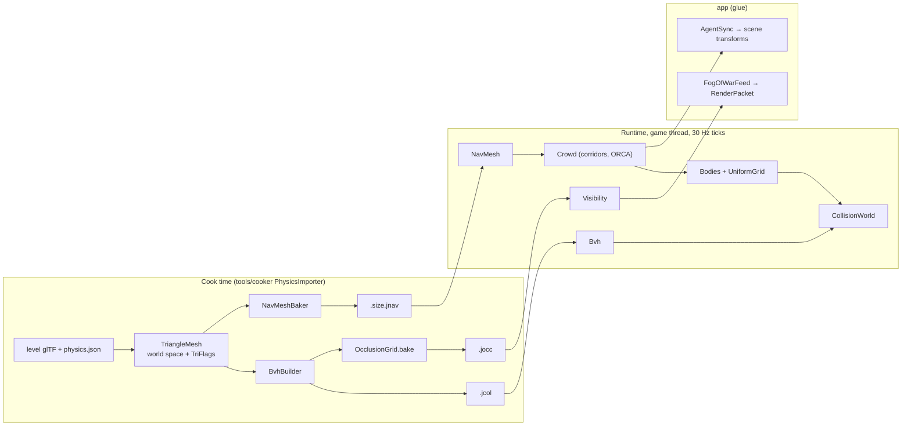
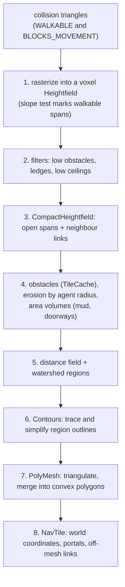

# 11. Physics: collision, navigation and crowds

An isometric CRPG does not need falling crates and ragdolls. It needs to answer questions, fast and
many times per tick: what is under the mouse cursor? Which units does this fireball hit? Can this
archer see that goblin? How does the party walk to the door without bumping into each other? Which
cells of the map are hidden by the fog of war?

Jeddy's `physics` module is pure-Java *gameplay* physics (D3): static collision, dynamic bodies,
queries, navigation meshes, pathfinding, crowds, formations, visibility and triggers, with no
rigid-body solver. This chapter teaches the geometry and algorithms behind each, and shows how the
code implements them.

You will learn:

- the slab test for rays against boxes, and Möller–Trumbore ray–triangle intersection, derived;
- how a bounding volume hierarchy (BVH) is built with the binned surface area heuristic (SAH),
  stored flat, and traversed;
- a uniform grid broadphase rebuilt every tick with a parallel counting sort;
- the shapes of spell queries (sphere, cylinder, cone, line, box, prism), sweeps and picking;
- how a navigation mesh is baked from triangles, Recast-style: voxels, filters, erosion, distance
  field, watershed regions, contours, convex polygons, tiles;
- A* over polygons with an admissible heuristic, string pulling with the funnel algorithm, and path
  corridors;
- crowd simulation with ORCA (optimal reciprocal collision avoidance) and its little 2D linear
  program;
- formations with the Hungarian algorithm, fog of war with symmetric shadowcasting, triggers, and
  turn-based movement ranges.

Where it lives, all under [`modules/physics/src/main/java/dev/jeddy/physics`](../../modules/physics/src/main/java/dev/jeddy/physics):

| Package | What | Key classes |
|---|---|---|
| `bvh` | static collision | `TriangleMesh`, `TriFlags`, `BvhBuilder`, `Bvh`, `RayHit` |
| `grid` | dynamic bodies, broadphase | `Bodies`, `UniformGrid` |
| `query` | collision queries | `CollisionWorld`, `QueryContext`, `RayBatch` |
| `nav.bake` | navmesh baking | `NavMeshBaker`, `Heightfield`, `CompactHeightfield`, `Contours`, `PolyMesh`, `NavBakeConfig`, `TileCache` |
| `nav` | navmesh runtime | `NavMesh`, `NavTile`, `NavMeshQuery`, `NavNodePool`, `QueryFilter`, `PathCorridor`, `NavPathBatch`, `NavDoors`, `TurnBasedNav` |
| `crowd` | agents and formations | `Crowd`, `Orca`, `AgentParams`, `Formation`, `FormationMove` |
| `vis` | fog of war | `OcclusionGrid`, `Visibility` |
| `trigger` | volumes | `Triggers` |
| `debug` | debug drawing | `DebugSink` |

The design is in [DESIGN §11](../DESIGN.md); decisions D51–D57 cover the navigation and crowd
choices. The math primitives live in [`Intersect`](../../modules/math/src/main/java/dev/jeddy/math/Intersect.java)
in the `math` module ([02 Math foundations](02-math-foundations.md)).



**Conventions.** Right-handed, Y up, meters. The ground is the XZ plane, and most 2D algorithms
(navmesh polygons, crowds, the broadphase, fog of war) work in $(x, z)$. A triangle's normal is
$(b - a) \times (c - a)$; a floor triangle faces up when its vertices go counterclockwise seen from
above. [`TriangleMesh.addGround`](../../modules/physics/src/main/java/dev/jeddy/physics/bvh/TriangleMesh.java)
builds floors that way.

---

## Rays and boxes: the slab test

A **ray** is $`r(t) = o + t\,d`$ for $t \ge 0$: origin $o$, direction $d$. Jeddy never requires $d$ to
be a unit vector; $t$ is then measured in units of $\lVert d \rVert$. Passing $d = b - a$ and
$t_{\max} = 1$ turns a ray into the segment from $a$ to $b$, which line-of-sight queries use.

An **axis-aligned bounding box** (AABB) is
$`[\min_x, \max_x] \times [\min_y, \max_y] \times [\min_z, \max_z]`$. It is the intersection of three
**slabs**, the space between two parallel planes per axis. The ray is inside the $x$ slab for $t$ between

```math
t_1 = \frac{\min_x - o_x}{d_x}, \qquad t_2 = \frac{\max_x - o_x}{d_x}
```

(in either order, depending on the sign of $d_x$). It is inside the box when it is inside all three
slabs at once, so the overlap of three intervals:

```math
t_{\text{near}} = \max_{k} \min(t_{1,k}, t_{2,k}), \qquad t_{\text{far}} = \min_{k} \max(t_{1,k}, t_{2,k})
```

The ray hits if $`t_{\text{far}} \ge \max(t_{\text{near}}, 0)`$ (the overlap is not empty and not
entirely behind the origin) and $`t_{\text{near}} \le t_{\max}`$.

```
  y   (sketch, not to scale; the z axis points out of the page)
  3 |
    |  o  (0, 2.5)
  2 |    '.
    |       '.
  1 |    +-----*-----------+     * entry, t = 1.5, at (1.5, 1): top face
    |    |       '.        |
    |    |          '.     |     box [1, 3] x [0, 1]
  0 +----+-------------*---+----> x
    0    1             ^   3
                 exit, t = 2.5, at (2.5, 0): bottom face
```

A worked example: $o = (0, 2.5, 0.5)$, $d = (1, -1, 0)$, box $[1, 3] \times [0, 1] \times [0, 1]$.
The $x$ slab gives $t \in [1, 3]$. For $y$, $1/d_y = -1$, so $t_1 = (0 - 2.5)(-1) = 2.5$,
$t_2 = (1 - 2.5)(-1) = 1.5$: $t \in [1.5, 2.5]$. For $z$, $d_z = 0$ so $1/d_z = +\infty$ and the
slab gives $(-\infty, +\infty)$ because $o_z$ is inside it. The overlap is $[1.5, 2.5]$: the ray
enters at $t = 1.5$, at $(1.5, 1, 0.5)$, through the top face.

The code precomputes $1/d$ once per ray and multiplies, because a division is several times more
expensive than a multiplication and the BVH tests two boxes per visited node:

```java
// modules/physics/src/main/java/dev/jeddy/physics/bvh/Bvh.java
private static float slab(
        float[] n,
        int o,
        float ox,
        float oy,
        float oz,
        float ix,
        float iy,
        float iz,
        float maxT) {
    float t1 = (n[o] - ox) * ix;
    float t2 = (n[o + 4] - ox) * ix;
    float tmin = Math.min(t1, t2);
    float tmax = Math.max(t1, t2);
    t1 = (n[o + 1] - oy) * iy;
    t2 = (n[o + 5] - oy) * iy;
    tmin = Math.max(tmin, Math.min(t1, t2));
    tmax = Math.min(tmax, Math.max(t1, t2));
    t1 = (n[o + 2] - oz) * iz;
    t2 = (n[o + 6] - oz) * iz;
    tmin = Math.max(tmin, Math.min(t1, t2));
    tmax = Math.min(tmax, Math.max(t1, t2));
    // NaN (0 × ∞ on a slab plane) fails both comparisons: treated as a miss.
    return tmax >= Math.max(tmin, 0f) && tmin <= maxT
            ? Math.max(tmin, 0f)
            : Float.POSITIVE_INFINITY;
}
```

IEEE 754 does the edge cases for free: a zero direction component gives an infinite inverse, and
the slab becomes $(-\infty, +\infty)$ or empty, which is right. The one bad case is an origin *exactly* on a slab plane with a zero
direction: $0 \cdot \infty = \text{NaN}$. Java's `Math.min` and `Math.max` propagate NaN, every
comparison with NaN is false, and the function reports a miss. The same test, standalone, is
`Intersect.rayAabb`.

---

## Rays and triangles: Möller–Trumbore

Every point of a triangle $`v_0 v_1 v_2`$ can be written with **barycentric coordinates**
$u, v \ge 0$, $u + v \le 1$:

```math
p(u, v) = (1 - u - v)\, v_0 + u\, v_1 + v\, v_2 = v_0 + u\, e_1 + v\, e_2, \qquad e_1 = v_1 - v_0,\ e_2 = v_2 - v_0
```

```
          v2
          /\          u = weight of v1, v = weight of v2
         /  \         u >= 0, v >= 0, u + v <= 1  <=>  inside
     e2 /    \
       /   *  \       * = v0 + u e1 + v e2
      /________\
    v0    e1    v1
```

The ray hits the triangle's plane where $`o + t\,d = v_0 + u\,e_1 + v\,e_2`$. Move the unknowns to the
left, with $s = o - v_0$:

```math
-t\,d + u\,e_1 + v\,e_2 = s \quad\Longleftrightarrow\quad \begin{bmatrix} -d & e_1 & e_2 \end{bmatrix} \begin{bmatrix} t \\ u \\ v \end{bmatrix} = s
```

Three equations, three unknowns. **Cramer's rule** solves them with determinants, and a 3×3
determinant is a scalar triple product, $`\det[a\ b\ c] = a \cdot (b \times c)`$. Rearranging the
triple products (they are invariant under cyclic shifts and change sign when two vectors swap)
gives two reusable cross products, $p = d \times e_2$ and $q = s \times e_1$:

```math
\det = e_1 \cdot p, \qquad u = \frac{s \cdot p}{\det}, \qquad v = \frac{d \cdot q}{\det}, \qquad t = \frac{e_2 \cdot q}{\det}
```

That is the **Möller–Trumbore** algorithm: no plane equation, no stored normal, two cross products,
and early exits as soon as $u$ or $v$ falls outside $[0, 1]$. [`Bvh.trace`](../../modules/physics/src/main/java/dev/jeddy/physics/bvh/Bvh.java)
runs it on every triangle of a leaf:

```java
// modules/physics/src/main/java/dev/jeddy/physics/bvh/Bvh.java
// Möller–Trumbore, two-sided.
float e1x = tri[v + 3] - tri[v];
float e1y = tri[v + 4] - tri[v + 1];
float e1z = tri[v + 5] - tri[v + 2];
float e2x = tri[v + 6] - tri[v];
float e2y = tri[v + 7] - tri[v + 1];
float e2z = tri[v + 8] - tri[v + 2];
float px = dy * e2z - dz * e2y;
float py = dz * e2x - dx * e2z;
float pz = dx * e2y - dy * e2x;
float det = e1x * px + e1y * py + e1z * pz;
if (det > -1e-12f && det < 1e-12f) {
    continue;
}
float inv = 1f / det;
float sx = ox - tri[v];
float sy = oy - tri[v + 1];
float sz = oz - tri[v + 2];
float u = (sx * px + sy * py + sz * pz) * inv;
if (u < 0f || u > 1f) {
    continue;
}
float qx = sy * e1z - sz * e1y;
float qy = sz * e1x - sx * e1z;
float qz = sx * e1y - sy * e1x;
float w = (dx * qx + dy * qy + dz * qz) * inv;
if (w < 0f || u + w > 1f) {
    continue;
}
float d = (e2x * qx + e2y * qy + e2z * qz) * inv;
if (d >= 0f && d <= best) {
    best = d;
    found = t;
    bu = u;
    bv = w;
    // ...
}
```

(`w` is the $v$ of the formulas; `v` is already the triangle's offset in the array.)

A worked example: the floor triangle $v_0 = (0,0,0)$, $v_1 = (1,0,0)$, $v_2 = (0,0,1)$ and a ray
straight down from $o = (0.25, 1, 0.25)$, $d = (0, -1, 0)$. Then $e_1 = (1,0,0)$, $e_2 = (0,0,1)$,
$p = d \times e_2 = (-1, 0, 0)$, $\det = e_1 \cdot p = -1$. With $s = (0.25, 1, 0.25)$:
$u = (s \cdot p)/\det = (-0.25)/(-1) = 0.25$; $q = s \times e_1 = (0, 0.25, -1)$;
$v = (d \cdot q)/\det = (-0.25)/(-1) = 0.25$; $t = (e_2 \cdot q)/\det = (-1)/(-1) = 1$. The hit is at
$t = 1$, the point $(0.25, 0, 0.25)$, which is indeed $`0.5\,v_0 + 0.25\,v_1 + 0.25\,v_2`$.

The sign of $\det$ tells which side the ray came from. Here it is negative: this triangle's winding
gives the normal $`e_1 \times e_2 = (0, -1, 0)`$, pointing down, and the ray hit its back. The code
accepts both signs (a **two-sided** test); only $`|\det| < 10^{-12}`$, a ray parallel to the plane, is
rejected. `RayHit` gets the distance, the barycentrics, the triangle's flags and its unit geometric
normal (which may face away from the ray).

**A second algorithm.** `Intersect.rayTriangle` in the `math` module implements the *watertight*
test of Woop, Benthin and Wald (2013): it shears the triangle into the ray's coordinate system and
evaluates edge functions, falling back to `double` when one is exactly zero, so a ray can never slip
through the shared edge of two triangles. `BvhTest.raycastsMatchBruteForce` uses it as the reference
when it checks the BVH against brute force. The BVH itself runs Möller–Trumbore, which does less
work per triangle. Its edge tests are inclusive ($u = 0$ and $u + v = 1$ count as hits), so a ray
through a shared edge hits both triangles in exact arithmetic; only float rounding can open a gap.
Exercise 7 swaps in the watertight test and measures what it costs.

---

## Building the BVH: binned SAH

A level has hundreds of thousands of triangles. Testing a ray against all of them is out of the
question; a **bounding volume hierarchy** groups them in a tree of boxes, so a ray only visits the
boxes it crosses. The quality of the tree decides the speed, and the standard measure of quality is
the **surface area heuristic**.

### The SAH cost

Suppose a ray is known to hit a parent box $P$. If rays are spread uniformly over directions and
positions, the probability that it also hits a child box $C$ inside $P$ is the ratio of their
surface areas (a result from integral geometry, Cauchy's formula for convex bodies):

```math
\Pr(\text{hit } C \mid \text{hit } P) = \frac{A(C)}{A(P)}
```

So the expected cost of splitting $P$ into children $L$ and $R$ holding $N_L$ and $N_R$ triangles
is

```math
C_{\text{split}} = C_{\text{trav}} + \frac{A(L)\, N_L + A(R)\, N_R}{A(P)}\, C_{\text{isect}}
```

and the cost of keeping $P$ as a leaf is $`C_{\text{leaf}} = N\, C_{\text{isect}}`$. Jeddy uses
$C_{\text{trav}} = 1$ (`TRAVERSAL_COST`) and $C_{\text{isect}} = 1$. The code's `area(x, y, z)`
returns $xy + yz + zx$, half the surface area; the factor of 2 cancels in the ratio.

A worked example. Four triangles whose boxes are unit cubes side by side along $x$: $[0,1]$,
$[1,2]$, $[2,3]$, $[3,4]$ (all $[0,1]$ in $y$ and $z$). The parent box is $4 \times 1 \times 1$,
$A(P) = 4 + 1 + 4 = 9$.

| Split | Left box, $A$, $N$ | Right box, $A$, $N$ | $C_{\text{split}}$ |
|---|---|---|---|
| after 1 | $1{\times}1{\times}1$, 3, 1 | $3{\times}1{\times}1$, 7, 3 | $1 + (3 \cdot 1 + 7 \cdot 3)/9 = 3.67$ |
| after 2 | $2{\times}1{\times}1$, 5, 2 | $2{\times}1{\times}1$, 5, 2 | $1 + (5 \cdot 2 + 5 \cdot 2)/9 = 3.22$ |
| after 3 | (mirror of after 1) | | 3.67 |
| leaf | | | 4 |

The middle split wins, and it beats the leaf, so the node splits. In general SAH rewards putting
many triangles into small boxes, which is the same as cutting empty space away from the children.

### Binning

Evaluating every possible split is expensive. **Binned SAH** (Wald 2007) evaluates only a few
candidate planes per axis. [`BvhBuilder.split`](../../modules/physics/src/main/java/dev/jeddy/physics/bvh/BvhBuilder.java):

1. Computes the node's bounds (from triangle boxes) and the bounds of the triangle **centroids**.
2. Per axis, maps each centroid to one of 16 bins (`BINS`) along the centroid extent with
   $k = 16 (1 - 10^{-5}) / \text{extent}$; the factor keeps the largest centroid in bin 15. Each bin
   accumulates a count and a box.
3. Sweeps the bins **right to left**, storing the area and count of everything right of each
   boundary, then **left to right**, growing the left box and evaluating the cost at each of the 15
   boundaries. That is 45 candidates per node, in $O(N + \text{bins})$ per axis.
4. Compares the best split cost with the leaf cost:

```java
// modules/physics/src/main/java/dev/jeddy/physics/bvh/BvhBuilder.java
float splitCost =
        bestAxis < 0
                ? Float.MAX_VALUE
                : TRAVERSAL_COST + bestCost / Math.max(nodeArea, 1e-20f);
if (count <= MAX_LEAF && count <= splitCost) {
    return -1;
}
if (bestAxis < 0) {
    // All centroids coincide: split the range in half.
    return start + count / 2;
}
```

A node becomes a leaf when it has at most 8 triangles (`MAX_LEAF`) *and* a leaf is no more
expensive than the best split. Then the triangle order is partitioned in place by bin (a two-index
swap loop), and the two halves recurse. Depth is capped at `Bvh.MAX_DEPTH - 2` = 62.

In the four-cube example the centroids are 0.5, 1.5, 2.5, 3.5, so $k = 16/3 \approx 5.33$ and the
cubes fall into bins 0, 5, 10 and 15. Boundaries after bins 0–4 give the "after 1" split, after
5–9 "after 2", after 10–14 "after 3".

### Parallel build

The top of the tree is built breadth-first on the calling thread. As soon as there are enough open
ranges (`workers * 4`) or a range is small (at most `PARALLEL_FROM / 4` = 1024 triangles), the range
is parked as a *pending subtree*. The pending subtrees are then built with `jobs.parallelFor`, each
into its own growable `Tree`, and finally `flatten` stitches everything together depth-first. Small
meshes (under 4096 triangles) or a `null` job system build sequentially.
`BvhTest.parallelBuildsMatchSequentialOnes` checks that a parallel and a sequential build of 50,000
triangles return the same hits. TASKS M8-01 records about 0.25 s for 180k triangles.

### The flattened layout

The runtime tree is one `float[]` with 8 floats (32 bytes) per node, in depth-first order (DESIGN
§11.1):

| Float | Leaf | Interior |
|---|---|---|
| 0–2 | box min x, y, z | box min x, y, z |
| 3 | index of the first triangle (int bits) | index of the **right** child (int bits) |
| 4–6 | box max x, y, z | box max x, y, z |
| 7 | triangle count > 0 (int bits) | 0 |

Integers are stored with `Float.intBitsToFloat` and read with `Float.floatToRawIntBits`, so the
whole node is one array and two cache lines hold four nodes. The **left** child is not stored: in
depth-first order it is always the next node.

```
 node index:  0          1          2         3         4
            [root]     [L]        [LL]      [LR]      [R] ...
            right=4    right=3    leaf      leaf
              |  \______________________________________^
              +--> left child = index + 1
```

Triangles are reordered into leaf order with their three vertices inline (9 floats), so a leaf
reads one contiguous range; per-triangle flags and original mesh indices are parallel `int[]`s.
That is also the `.jcol` file format ([`jcol.md`](../formats/jcol.md)): `Bvh.read` copies four
arrays and is done.

### Traversal

```java
// modules/physics/src/main/java/dev/jeddy/physics/bvh/Bvh.java
int sp = 0;
stack[sp] = 0;
entry[sp++] = rootT;
while (sp > 0) {
    sp--;
    if (entry[sp] > best) {
        continue; // a closer hit was found since this node was pushed
    }
    int node = stack[sp];
    int o = node * NODE_FLOATS;
    int count = Float.floatToRawIntBits(n[o + 7]);
    if (count > 0) {
        // ... test the leaf's triangles (above)
        continue;
    }
    int left = node + 1;
    int right = Float.floatToRawIntBits(n[o + 3]);
    float tl = slab(n, left * NODE_FLOATS, ox, oy, oz, ix, iy, iz, best);
    float tr = slab(n, right * NODE_FLOATS, ox, oy, oz, ix, iy, iz, best);
    // Push the farther child first so the nearer one is visited next.
    if (tl <= tr) {
        if (tr != Float.POSITIVE_INFINITY) {
            stack[sp] = right;
            entry[sp++] = tr;
        }
        if (tl != Float.POSITIVE_INFINITY) {
            stack[sp] = left;
            entry[sp++] = tl;
        }
    } else {
        // ... the mirror image
    }
}
```

Three ideas make this fast:

- **Near child first.** Both children are tested; the nearer one is pushed last, so it is popped
  first. A hit found there shrinks `best`.
- **Pruning by entry distance.** Each stack entry remembers where the ray entered that box. When it
  is popped, a box that starts beyond the best hit so far is skipped without a test. The slab test
  itself also takes `best` as its $t_{\max}$.
- **An explicit `int[]` stack** (`RayHit.stack`, `Bvh.MAX_DEPTH * 2` = 128 entries) instead of
  recursion. It lives in the caller's `RayHit`, so a query allocates nothing and any number of
  threads can query one immutable `Bvh` at once.

`raycastAny` returns at the first hit in range: for line of sight it does not matter *which*
wall blocks. TASKS M8-01 records about 1 M closest-hit rays per second on one core of the CI
container against a 180k-triangle terrain (`PhysicsBench.raycastTerrain`), and
`BvhTest.raycastsAllocateNothingAndAreFast` proves zero allocation.

---

## Dynamic bodies and the uniform grid

Units move every tick, so a BVH (expensive to build) is the wrong structure for them.
[`Bodies`](../../modules/physics/src/main/java/dev/jeddy/physics/grid/Bodies.java) stores them as
structure-of-arrays: vertical cylinders (units), spheres and yawed boxes, each with collision
layers and an owning entity. [`UniformGrid`](../../modules/physics/src/main/java/dev/jeddy/physics/grid/UniformGrid.java)
is the broadphase: a grid of square cells over the level's XZ footprint, **rebuilt from scratch
every tick**.

Rebuilding is a **counting sort** in three passes:

1. **Histogram.** For each body, compute the range of cells its footprint covers
   (`cellX(x - extent)` to `cellX(x + extent)`, same in $z$) and count one entry per covered cell.
2. **Prefix sum.** Turn counts into start offsets: `cellStart[c]` is the sum of the counts of all
   cells before `c`.
3. **Scatter.** Walk the bodies again and write each body index into the next free slot of each of
   its cells.

A worked example with three cells and four bodies:

| Body | covers cells |
|---|---|
| b0 | 2 |
| b1 | 0 |
| b2 | 0, 1 |
| b3 | 2 |

Histogram `[2, 1, 2]`, prefix sum `cellStart = [0, 2, 3, 5]`, and the scatter fills
`entries = [b1, b2 | b2 | b0, b3]`. The cost is $O(n + \text{cells})$, no allocation once the
arrays are big enough, and the order inside each cell is ascending body index: **stable**.

With 8192 bodies or more (`PARALLEL_FROM`) and a job system, the histogram and scatter passes run in
8 chunks in parallel. Each chunk has its own histogram, and the (serial) prefix sum interleaves them
so that every chunk knows *in advance* where to write in every cell:

```java
// modules/physics/src/main/java/dev/jeddy/physics/grid/UniformGrid.java
// Prefix sums: cell starts, then each chunk's first slot in each cell.
int total = 0;
for (int c = 0; c < cells; c++) {
    cellStart[c] = total;
    for (int k = 0; k < chunks; k++) {
        int h = histogram[k][c];
        histogram[k][c] = total;
        total += h;
    }
}
```

Chunk 0's bodies land before chunk 1's in every cell, so the parallel result is identical to the
serial one. Determinism matters: ORCA and the trigger events read neighbours in cell order, and a
different order would give different (equally valid but not reproducible) results. TASKS M8-02
records 0.22–0.25 ms for 5000 bodies.

A body spanning several cells appears in each of them. `query` reports it **once** with a small
trick: it reports body $i$ only from the first cell that both the body's cell range and the query's
cell range contain, that is, from cell $`(\max(x_0^{(i)}, a_x), \max(z_0^{(i)}, a_z))`$, where
$`(x_0^{(i)}, z_0^{(i)})`$ is the body's first (lowest) cell and $`(a_x, a_z)`$ the query's. No "visited"
set, no allocation.

---

## Collision queries

[`CollisionWorld`](../../modules/physics/src/main/java/dev/jeddy/physics/query/CollisionWorld.java)
combines the static `Bvh` with `Bodies` and their grid. Static triangles are selected by a
`TriFlags` mask, bodies by a layer mask. Each thread passes its own
[`QueryContext`](../../modules/physics/src/main/java/dev/jeddy/physics/query/QueryContext.java)
(results plus scratch: a `RayHit`, a candidate list, a stack), so queries allocate nothing and run
concurrently between `update()` calls.

The triangle flags ([`TriFlags`](../../modules/physics/src/main/java/dev/jeddy/physics/bvh/TriFlags.java)):

| Bits | Meaning |
|---|---|
| 0 `WALKABLE` | characters can stand on it |
| 1 `BLOCKS_LOS` | blocks line of sight and the fog of war |
| 2 `BLOCKS_PROJECTILE` | stops arrows and ranged spells |
| 3 `CAMERA_FADE` | roofs and walls that fade for the iso camera |
| 4 `BLOCKS_MOVEMENT` | collides with moving characters |
| 8–15 | surface type (footsteps, decals) |
| 16–21 | navigation area (cost class) |

### Rays against bodies: walking the grid

`raycast` first asks the BVH, which sets `best`, then walks the grid cells under the ray in 2D
with the **Amanatides–Woo DDA** ("digital differential analyzer"): the ray crosses vertical cell
boundaries every $`\Delta t_x = \text{cell}/|d_x|`$ and horizontal ones every
$`\Delta t_z = \text{cell}/|d_z|`$. Keep the parameter of the next crossing on each axis and always step the
smaller one:

```
  z
  |  .   .   .   .
  |  .   .   . / .      cells visited in order along the ray;
  |  .   .   ./  .      at each step, whichever boundary (x or z)
  |  .   .  /.   .      comes first is crossed
  |  .   ./  .   .
  |  .  /.   .   .
  +--o-----------------> x
```

```java
// modules/physics/src/main/java/dev/jeddy/physics/query/CollisionWorld.java
float exit = Math.min(tNextX, tNextZ);
if (best <= exit || exit > maxT) {
    return; // nothing beyond this cell can be nearer
}
if (tNextX < tNextZ) {
    cx += stepX;
    if (cx < 0 || cx >= g.cellsX()) {
        return;
    }
    tNextX += tDeltaX;
} else {
    // ... the same for z
}
```

The early exit is the key: once a hit is closer than the point where the ray leaves the current
cell, no later cell can hold anything nearer.

Each body shape has its exact ray test:

- **Sphere** (`Intersect.raySphere`): with $m = o - c$, solve $`\lVert m + t\,d \rVert^2 = r^2`$, a
  quadratic $a t^2 + 2b t + c = 0$ with $a = d \cdot d$, $b = m \cdot d$, $c = m \cdot m - r^2$:
  $t = (-b - \sqrt{b^2 - ac})/a$. If $c \le 0$ the origin is inside ($t = 0$); if $`b > 0`$ the ray
  points away.
- **Vertical cylinder** (`Intersect.rayVerticalCylinder`): the same quadratic in $(x, z)$ only for
  the side, then the two caps as planes.
- **Yawed box**: rotate the ray into the box's frame ($`x' = \cos\theta\,x - \sin\theta\,z`$,
  $`z' = \sin\theta\,x + \cos\theta\,z`$), do an AABB slab test there, and rotate the normal back.

### Overlaps for spells

Area spells ask "which units are inside this shape?". Every overlap query takes the shape's
bounding rectangle, collects candidates from the grid, and tests each body exactly. Results are
**entity ids** appended to a caller's `IntList`.

| Query | Shape | Exact test |
|---|---|---|
| `overlapSphere` | ball | sphere–sphere, cylinder by clamping the center's height, box in its frame |
| `overlapCylinder` | vertical cylinder (radius, height) | height ranges overlap and footprints overlap |
| `overlapCone` | cone seen from above | `Intersect.sectorCircle` |
| `overlapLine` | rectangle (lightning bolt) | `Intersect.rectCircle` |
| `overlapBox` | yawed box | separating-axis test for box bodies, circle–rectangle for others |
| `overlapPrism` | any polygon, extruded | point in polygon, or an edge within the radius |

(There is no capsule overlap; `Intersect.rayCapsule` exists for rays.)

The cone test is a nice piece of 2D geometry. Put the cone's apex at the origin with unit axis
$a$ and half-angle $\theta$. For a circle with center $c$ and radius $r$, decompose $c$ into its
component along the axis and its distance from the axis:

```math
\text{along} = c \cdot a, \qquad \text{perp} = \sqrt{\lVert c \rVert^2 - \text{along}^2}
```

In the 2D plane spanned by the axis and $c$, the cone's edge is the line through the origin at angle
$\theta$, with outward unit normal $(-\sin\theta, \cos\theta)$ in (along, perp) coordinates. The
signed distance of the center from that line is

```math
\text{closest} = \text{perp} \cos\theta - \text{along} \sin\theta
```

and the circle reaches into the cone if that is at most $r$, and if it is between the apex and the
far end ($-r \le \text{along} \le \text{range} + r$):

```java
// modules/math/src/main/java/dev/jeddy/math/Intersect.java (coneSphere, which sectorCircle calls)
float lenSq = vx * vx + vy * vy + vz * vz;
float along = vx * axisX + vy * axisY + vz * axisZ;
float perp = (float) Math.sqrt(Math.max(0, lenSq - along * along));
float closest = cosHalf * perp - along * sinHalf;
return !(closest > r || along > range + r || along < -r);
```

It is a cheap and slightly generous test: the far end is checked along the axis rather than
radially, so circles just beyond the arc near the cone's edges also count (Exercise 3 asks for a
query of your own; you could tighten this one the same way).

### Sweeps, line of sight and picking

`sweepCylinder` moves a unit's cylinder horizontally by $`(d_x, d_z)`$ and returns the fraction of
the motion that is free plus the contact normal, for sliding. The trick is the **Minkowski sum**:
a circle of radius $r$ moving against a segment hits it exactly when the circle's *center*, a point,
hits the segment inflated by $r$ (a 2D capsule). So `sweepCircleSegment` tests a moving point
against the two parallel sides and the two end circles, and `sweepCircleCircle` is the ray–sphere
quadratic again with $t \in [0, 1]$. Static triangles are projected onto XZ and only those whose
height range reaches between the step height and the head count as walls, so steps and floors do
not block.

`lineOfSight` casts `raycastAny` from eye to eye with $t_{\max} = 1 - 10^{-4}$ and optionally checks
bodies in between (ignoring the two entities themselves).

`pick` is the mouse-cursor query (DESIGN §11.3): one ray for units, with their radii grown by
`unitPadding` so small units are easier to click, and one for interactables; both also test solid
static triangles, so a wall in front hides what is behind it. A unit wins if it is nearest;
otherwise an interactable, or `PICK_GROUND` when the nearest thing is a `WALKABLE` triangle, else
`PICK_NONE`. The iso demo turns the mouse position into a world ray with the camera
([04 Cameras and projection](04-cameras-and-projection.md)) and picks:

```java
// samples/iso-demo/src/main/java/dev/jeddy/samples/iso/DemoGame.java
camera.screenRay(g.x() / ww * 2 - 1, 1 - g.y() / wh * 2, rayOrigin, rayDirection);
int kind =
        level.collision.pick(
                rayOrigin[0],
                rayOrigin[1],
                rayOrigin[2],
                rayDirection[0],
                rayDirection[1],
                rayDirection[2],
                400,
                Level.UNITS,
                0,
                0.3f,
                pickQuery);
int unit = kind == CollisionWorld.PICK_UNIT ? pickQuery.entity : -1;
groundValid = kind == CollisionWorld.PICK_GROUND;
```

### Batches

[`RayBatch`](../../modules/physics/src/main/java/dev/jeddy/physics/query/RayBatch.java) takes many
rays as SoA arrays (`rays`, `maxT` in; `t`, `entity`, `triangle`, `normals` out) and runs them as
one `parallelFor` with grain 64, each worker using its own `QueryContext` from a `PerWorker`. AI
perception and projectile updates for a hundred units cost one dispatch.

### The fireball

The demo's [`Spells`](../../samples/iso-demo/src/main/java/dev/jeddy/samples/iso/Spells.java) uses
one overlap query per explosion: a vertical cylinder of radius 4 m and height 3 m, starting half a
meter below the impact point, against the `UNITS` layer:

```java
// samples/iso-demo/src/main/java/dev/jeddy/samples/iso/Spells.java
private void explode(int i, CollisionWorld world, Enemies enemies) {
    hits.clear();
    world.overlapCylinder(
            toX[i], toY[i] - 0.5f, toZ[i], RADIUS, HEIGHT, Level.UNITS, hits, query);
    for (int k = 0; k < hits.size(); k++) {
        int a = hits.get(k);
        float dx = world.bodies().x[world.bodies().indexOf(a)] - toX[i];
        float dz = world.bodies().z[world.bodies().indexOf(a)] - toZ[i];
        float t = Math.min(1, (float) Math.sqrt(dx * dx + dz * dz) / RADIUS);
        enemies.damage(a, CENTER_DAMAGE + (EDGE_DAMAGE - CENTER_DAMAGE) * t);
    }
    // ... sound
}
```

Damage falls off linearly from 40 at the center to 18 at the edge. The `IntList` and the
`QueryContext` were sized for every body at construction, so the explosion allocates nothing.

**Try it.**

```
./gradlew :physics:test --tests 'dev.jeddy.physics.bvh.BvhTest'
./gradlew :physics:test --tests 'dev.jeddy.physics.query.CollisionWorldTest'
./gradlew :bench:jmh -Pjmh.includes=PhysicsBench
```

---

## Navigation meshes

Characters walk on floors, around walls, up stairs no higher than a step. A **navigation mesh**
(navmesh) describes where an agent of a given size can stand: a set of convex polygons covering the
walkable area, shrunk by the agent's radius so the agent's *center* can go anywhere on it. Paths
become sequences of polygons, which are far fewer than grid cells, and straight lines within a
convex polygon are always walkable.

Jeddy bakes navmeshes the way **Recast** does (Mikko Mononen's library, the industry standard),
ported to Java with SoA arrays (DESIGN §11.4). One navmesh is baked per agent **size class**
(Pathfinder's Small, Medium, Large, Huge), because a troll does not fit where a halfling does.
[`NavMeshBaker`](../../modules/physics/src/main/java/dev/jeddy/physics/nav/bake/NavMeshBaker.java)
runs the pipeline per tile:



The settings are a [`NavBakeConfig`](../../modules/physics/src/main/java/dev/jeddy/physics/nav/bake/NavBakeConfig.java).
The demo's crypt (`crypt.physics.json`) uses cell size 0.2 m, cell height 0.1 m, 32 m tiles
(`PhysicsImporter` turns that into $32 / 0.2 = 160$ cells), the default 45° slope limit, and a
Medium agent of radius 0.4 m, height 1.8 m, climb 0.4 m. In voxels: `walkableRadius` $= \lceil 0.4/0.2 \rceil = 2$
cells, `walkableHeight` $= \lceil 1.8/0.1 \rceil = 18$, `walkableClimb`
$= \lfloor 0.4/0.1 \rfloor = 4$.

### Step 1: voxelize

A [`Heightfield`](../../modules/physics/src/main/java/dev/jeddy/physics/nav/bake/Heightfield.java)
is a 2D grid of columns. Each column holds a sorted linked list of **spans**: solid intervals
$[\min, \max)$ in voxel units, each with an area id (0 = not walkable). Spans live in SoA arrays
(`smin`, `smax`, `area`, `next`) with an `int` free list instead of objects.

```
 y (voxels)
  |      column (x, z)
 30 +    +--+
    |    |##|  span: a table top, area 63 (walkable)
 22 +    +--+
    |    |  |  open space (18 voxels needed for an agent)
 10 +    +--+
    |    |##|  span: the floor, area 63
  0 +    +--+
```

Each triangle is rasterized by clipping it against the grid, the way Recast's `rasterizeTri` does:
`dividePoly` splits the triangle along the plane $z = z_{\text{row}}$ at the next row boundary,
then the row's polygon along $x = x_{\text{col}}$ at the next column boundary. For each resulting piece the minimum and maximum $y$ become a span
in that column.

Whether a span is walkable is decided by the slope of its triangle. With the triangle normal $n$,
the angle to vertical is below the limit when $`n_y / \lVert n \rVert > \cos(\text{maxSlope})`$:

```java
// modules/physics/src/main/java/dev/jeddy/physics/nav/bake/NavMeshBaker.java
float slope = (float) Math.cos(Math.toRadians(cfg.maxSlopeDegrees()));
// ...
int area = Heightfield.NULL_AREA;
if ((flags & TriFlags.WALKABLE) != 0 && len > 0 && ny / len > slope) {
    int custom = TriFlags.area(flags);
    area = custom != 0 ? custom : GROUND_AREA;
}
```

With a 45° limit, $\cos 45° = 0.707$. `BLOCKS_MOVEMENT` triangles rasterize too, as non-walkable
solid spans. When two spans in a column overlap they merge into one, and the area of the merged
span follows its *top* surface: if the tops are within the climb of each other the larger area id
wins, otherwise the higher top's area wins. That is **D51**: Recast keeps the larger id, which let a
walkable floor under a solid block propagate its walkability onto the block's top.

### Step 2: filters

Three filters fix what rasterization cannot know:

- **Low hanging obstacles** (`filterLowHangingWalkableObstacles`): a non-walkable span whose top is
  within the climb of the walkable span below it becomes walkable (a curb, a step).
- **Ledges** (`filterLedgeSpans`): a walkable span next to a drop deeper than the climb, or whose
  reachable neighbours differ in height by more than the climb, is not walkable. An agent's center
  should not stand on the edge of a cliff.
- **Low ceilings** (`filterWalkableLowHeightSpans`): a walkable span with less than
  `walkableHeight` voxels of clearance above it is not walkable (you cannot stand under a table).

### Step 3: the compact heightfield

The algorithms that follow care about **open space**, not solid space. [`CompactHeightfield`](../../modules/physics/src/main/java/dev/jeddy/physics/nav/bake/CompactHeightfield.java)
stores, per walkable span, its floor height `y` (the solid span's top) and clearance `h` (up to the
next solid span), packed by column (`cellIndex`, `cellCount`). For each of the four directions it
finds the neighbour column's span an agent can step to (enough shared clearance, height difference
within the climb) and stores that span's index *within its column* in 6 bits of `con`:

```java
// modules/physics/src/main/java/dev/jeddy/physics/nav/bake/CompactHeightfield.java
int getCon(int span, int dir) {
    return con[span] >>> (dir * 6) & 0x3f;
}

/** Index of the span neighbouring span {@code i} of column {@code (x, z)} in {@code dir}. */
int neighbour(int x, int z, int i, int dir) {
    return cellIndex[(x + DX[dir]) + (z + DZ[dir]) * width] + getCon(i, dir);
}
```

Directions 0–3 are $-x$, $+z$, $+x$, $-z$ (`DX = {-1, 0, 1, 0}`, `DZ = {0, 1, 0, -1}`), and `0x3f`
(`NOT_CONNECTED`) means no neighbour. From here on the heightfield is a graph, and multi-level
geometry (a bridge over a road) is handled naturally because spans connect only to spans they can
step to.

### Step 4: erosion

The navmesh is for the agent's *center*, so walkable space must be shrunk by the radius. `erode`
marks spans at the boundary (missing or non-walkable neighbour) with distance 0 and computes a
**chamfer distance transform** in two raster passes: forward (top-left to bottom-right) and backward.
Each span takes the minimum of its neighbours' distances plus 2 for a straight step and plus 3 for a
diagonal one. The units are half-cells: 2 approximates 1 cell and 3 approximates
$\sqrt 2 \approx 1.41$ cells (×2 = 2.83). Spans whose distance is below $2 \times$ `walkableRadius`
(in these half-cell units, so closer than `walkableRadius` cells) are removed.

A 7-cell-wide corridor, straight distances only:

```
cells:      #  .  .  .  .  .  .  .  #       (# = wall)
distance:      0  2  4  6  4  2  0
radius 2 cells -> threshold 4: keep d >= 4
kept:                4  6  4               (2 cells removed on each side)
```

`NavBakeTest.aFloorWithABlockBakesToPolygonsAroundIt` checks the result on a 20×20 m floor with a
4×4 m block: the expected walkable area is $18.8^2 - 4.8^2$. The outer edge loses one cell to the
ledge filter plus 0.4 m to erosion (0.6 m per side), the block grows by the radius alone.

Temporary obstacles from the [`TileCache`](../../modules/physics/src/main/java/dev/jeddy/physics/nav/bake/TileCache.java)
are marked *before* erosion, so agents keep their radius from them too (D54). Then **area volumes**
(`markVolume`, a polygon with a height range from the level's `physics.json`) relabel the spans
inside them: mud, water, hazards, doorways.

### Step 5: distance field and watershed regions

To build polygons we first split the walkable area into simple, hole-free **regions**. Recast's
method is a **watershed** partition:

1. `buildDistanceField` computes, for every span, the chamfer distance to the nearest border (a
   span whose four neighbours are not all of the same area), then smooths it with a 3×3 box blur.
   The distance field is a landscape: high in the middle of open areas, zero at walls.
2. `buildRegions` "floods" the landscape from the top down. Starting at the maximum distance and
   descending two units at a time, it first **expands** the existing regions into newly flooded
   spans (`expandRegions`), then starts a **new region** at every flooded span that is still
   unclaimed (`floodRegion`). Like water rising from many springs, regions grow from the centers of
   open areas and meet along ridges.
3. Regions smaller than `minRegionArea` cells are dropped and those smaller than `mergeRegionArea`
   merge into a neighbour (`mergeAndFilterRegions`, Recast's rules). The tile border is painted
   with special `BORDER_REG` regions first, so regions stop exactly at the tile edge.

### Step 6: contours

[`Contours`](../../modules/physics/src/main/java/dev/jeddy/physics/nav/bake/Contours.java) walks
around each region's border, span edge by span edge, recording raw vertices with the id of the
region (or nothing) on the other side. Then it **simplifies**:

1. Keep the vertices where the neighbour changes (region to region, region to wall, area to area).
   Those must survive so that adjacent regions share their boundary vertices.
2. Repeatedly, for each simplified edge, find the raw vertex farthest from it; if its distance is
   more than `maxSimplificationError`, insert it (the Douglas–Peucker idea). The comparison uses
   squared distances in voxel units, so the demo's 1.3 means 1.3 cells.
3. Split wall edges longer than `maxEdgeLength` (12 m by default), which keeps polygons from becoming
   long slivers along walls.

Holes (a pillar inside a room) are merged into their region's outline with a bridge, so every
contour is a simple polygon.

### Step 7: convex polygons

[`PolyMesh`](../../modules/physics/src/main/java/dev/jeddy/physics/nav/bake/PolyMesh.java) turns
each contour into convex polygons of at most `maxVertsPerPoly` = 6 vertices:

1. **Triangulate** by ear clipping, cutting off the shortest diagonals first.
2. **Weld** vertices through a hash of $(x, z)$; two vertices are the same if they match in $x$ and
   $z$ and differ by at most 2 voxels in $y$.
3. **Merge** triangles greedily into larger polygons: repeatedly find the pair sharing the
   *longest* edge whose union is still convex and has at most 6 vertices. Convexity is checked at
   the two vertices where the polygons join, with the 2D cross product
   (`uleft`).
4. **Adjacency**: each polygon edge records the polygon across it. An open edge lying on the tile's
   side becomes a **portal** to the neighbouring tile, `0x8000 | side`.

There is no *detail mesh* (D52): Recast adds extra triangles inside polygons to follow uneven
terrain; Jeddy's polygon vertices carry the surface height and heights inside come from the
polygon's triangle fan. Iso CRPG floors are mostly flat.

### Step 8: tiles

Levels are baked in **tiles** (for example 32 m), in parallel with `forEachTile`. Each tile
voxelizes its area plus a border of `walkableRadius + 3` cells, so that erosion and regions near the
edge see the neighbours' geometry and polygons on both sides of a tile edge line up exactly. The
result per tile is a [`NavTile`](../../modules/physics/src/main/java/dev/jeddy/physics/nav/NavTile.java)
in SoA form: world-space vertices, polygons of up to 6 vertex indices, a neighbour per edge
(`NO_NEIGHBOUR` for a wall, a polygon index, or `PORTAL | side`), an area per polygon, runtime
flags, and a small AABB tree over the polygons (median splits) for nearest-polygon searches.
**Off-mesh links** (jumps, ladders, teleports) are two-vertex polygons of type `TYPE_OFFMESH`. The
`.jnav` file ([`jnav.md`](../formats/jnav.md)) stores the tiles of one size class.

At run time [`NavMesh`](../../modules/physics/src/main/java/dev/jeddy/physics/nav/NavMesh.java)
holds tiles in slots and addresses a polygon by one `int`:

```math
\text{ref} = \text{salt}\ (4\text{ bits}) \;\|\; \text{tile slot}\ (12) \;\|\; \text{polygon}\ (16)
```

Removing a tile bumps its slot's salt, so a stale reference held by some agent fails `isValid`
instead of silently pointing at a new tile's polygon: the same idea as the generational `int`
handles of `core`'s `HandlePool`. When a tile is added, its portal edges are linked to the
neighbouring tile's polygons. A portal edge may touch several polygons on the other side, so each
link stores the sub-range of the edge it covers (`bmin`, `bmax`): a **partial portal**.

### Changing the navmesh at run time

- **Doors** (D56): door polygons carry `NavFlags.DOOR`. [`NavDoors`](../../modules/physics/src/main/java/dev/jeddy/physics/nav/NavDoors.java)
  maps door boxes to them (doorways are baked as area volumes so their polygons match the door) and
  toggles `NavFlags.DISABLED`, which [`QueryFilter`](../../modules/physics/src/main/java/dev/jeddy/physics/nav/QueryFilter.java)
  excludes by default. A creature that can open doors uses a filter without that exclusion.
- **Temporary obstacles** (D54): `TileCache.build` bakes like `NavMeshBaker` but keeps each tile's
  compact heightfield from *before* erosion. `addCylinder` and `addBox` mark the touched tiles
  dirty; `update(mesh, jobs)` rebuilds them on job workers in the background (copying the cached
  voxels and marking obstacles before erosion) and swaps finished tiles into the mesh on the game
  thread.

**Try it.**

```
./gradlew :physics:test --tests 'dev.jeddy.physics.nav.NavBakeTest'
./gradlew :physics:test --tests 'dev.jeddy.physics.nav.DynamicNavTest'
```

`slopesLedgesAndLowCeilingsAreFiltered` bakes a 60° ramp (rejected) and a 1 m high table (its top is
walkable, the space under it is not).

---

## Pathfinding: A* over polygons

The navmesh is a graph: polygons are nodes, links (shared edges, portals, off-mesh links) are edges.
[`NavMeshQuery.findPath`](../../modules/physics/src/main/java/dev/jeddy/physics/nav/NavMeshQuery.java)
finds the cheapest chain of polygons, the **corridor**, from the start polygon to the goal polygon
with **A\***.

### A* in one paragraph

A* keeps an **open list** of nodes to expand, ordered by $f = g + h$: $g$ is the cost of the best
path found so far from the start, $h$ an estimate of the remaining cost to the goal. It repeatedly
expands the node with the smallest $f$, updating its neighbours' $g$ when it finds a cheaper way to
them. If $h$ never *overestimates* the true remaining cost (it is **admissible**), the first time the
goal is expanded its path is optimal. With $h = 0$, A* is Dijkstra's algorithm; a better $h$ expands
fewer nodes.

### Costs, positions and the heuristic

A polygon is an area, not a point, so the search needs a position per node. Jeddy places a node at
the **midpoint of the portal** through which it was first reached. The cost of an edge is the 3D
distance between the two node positions times the **area cost** of the polygon being crossed:

```java
// modules/physics/src/main/java/dev/jeddy/physics/nav/NavMeshQuery.java
if (fl == 0) {
    // First visit: the node sits at the middle of the portal it was reached by.
    portalFromLink(bestTile, bestPoly, tl, l, nb, portal);
    pos[node * 3] = (portal[0] + portal[3]) * 0.5f;
    pos[node * 3 + 1] = (portal[1] + portal[4]) * 0.5f;
    pos[node * 3 + 2] = (portal[2] + portal[5]) * 0.5f;
}
float nx = pos[node * 3];
float ny = pos[node * 3 + 1];
float nz = pos[node * 3 + 2];
float cost = bestCost + filter.cost(bx, by, bz, nx, ny, nz, bestArea);
float heuristic;
if (nb == qEndRef) {
    cost += filter.cost(nx, ny, nz, qex, qey, qez, mesh.polyArea(nb));
    heuristic = 0;
} else {
    heuristic = dist(nx, ny, nz, qex, qey, qez) * hScale;
}
float total = cost + heuristic;
```

Area costs come from the `QueryFilter`: `areaCost(area, multiplier)` with 1 for normal ground, 2 for
difficult terrain, $+\infty$ to forbid. With mud at cost 2, crossing 4 m of mud costs 8, so a 5.5 m
detour on dry ground (cost 5.5) wins.

The heuristic is the straight-line distance to the goal, scaled:

```math
h(n) = \lVert n - \text{goal} \rVert \cdot 0.999 \cdot \min_{a} \text{cost}(a)
```

Why is it admissible? Any path to the goal is at least as long as the straight line (triangle
inequality), and every meter of it costs at least the cheapest area cost. So the true remaining
cost is at least $\lVert n - \text{goal} \rVert \cdot \min_a \text{cost}(a)$. If a level has a road
of cost 0.5, `minCost()` is 0.5 and the heuristic halves; without that, A* could skip the road. The
factor 0.999 (`H_SCALE`) keeps float rounding from ever making $h$ slightly too large.

Because node positions are portal midpoints chosen at first visit, $g$ is an approximation of the
true walking distance, and the heuristic is not perfectly *consistent* with these costs. The code
therefore allows a closed node to be reopened when a cheaper route to it appears (`flags` go back to
`OPEN`). The corridor it returns is then straightened by the funnel (next section), which computes
the true shortest path *within* the corridor.

### Data structures that do not allocate

- The open list is an [`IntHeap`](../../modules/core/src/main/java/dev/jeddy/core/collections/IntHeap.java):
  a binary min-heap of `int` node indices keyed by `float`, with a position array so that `push` on
  an item already present updates its key (decrease-key) in $O(\log n)$.
- Nodes live in a [`NavNodePool`](../../modules/physics/src/main/java/dev/jeddy/physics/nav/NavNodePool.java):
  SoA arrays (`ref`, `parent`, `flags`, `cost`, `total`, `pos`) plus an open-addressing hash from
  polygon reference to node (4096 slots for the typical 2048 nodes, linear probing). Clearing it
  before every search would cost more than many short searches, so each slot carries a
  **generation stamp**: a slot counts as occupied only if its stamp equals the current generation,
  and `reset()` just increments the generation.

```java
// modules/physics/src/main/java/dev/jeddy/physics/nav/NavNodePool.java
void reset() {
    count = 0;
    if (++generation == 0) {
        Arrays.fill(hashStamp, 0);
        generation = 1;
    }
}
```

(Only when the counter wraps around, every $2^{32}$ searches, is the table really cleared.)

### Partial paths, slicing, batches

- **Unreachable goals** (D55): the search ends when the open list is empty. `finalizeSlicedFindPath`
  then returns the corridor to the searched polygon whose *closest point* is nearest the goal, not
  the node with the best heuristic (which compares portal midpoints and can stop a tile away), and
  sets `PARTIAL`. An agent clicked onto an island walks to the nearest shore.
- **Time slicing**: `initSlicedFindPath`, `updateSlicedFindPath(maxIterations)`,
  `finalizeSlicedFindPath` spread a long search over several ticks; `findPath` is the three in a row.
- **Batches**: [`NavPathBatch`](../../modules/physics/src/main/java/dev/jeddy/physics/nav/NavPathBatch.java)
  runs SoA path requests as one `parallelFor` with one `NavMeshQuery` per worker. TASKS M8-07 records
  1000 paths across a 200×200 m map at about 60–80 ms on one core.

---

## String pulling: the funnel algorithm

The corridor is a chain of polygons; the agent needs **corners** to walk to. Imagine a string tied
to the start and pulled tight through the corridor to the goal: it touches the corridor's walls only
at the corners it must turn around. The **funnel algorithm** finds those corners in one pass over
the portals.

Each portal between consecutive polygons is a segment with a left and a right end. The algorithm
keeps an **apex** (the last corner) and a funnel: a left and a right boundary point. For each new
portal:

- Try to move the funnel's **right** point to the portal's right end. If that *narrows* the funnel
  (the new point is inside the wedge), accept it. If it would cross over the left boundary, the
  left point is a corner: emit it, make it the new apex, and restart from there.
- Do the same for the **left** side, mirrored.
- The goal is treated as a last portal whose two ends coincide.

"Inside" and "crosses" are sign tests of [`NavGeometry.triArea2D`](../../modules/physics/src/main/java/dev/jeddy/physics/nav/NavGeometry.java):

```math
\text{triArea2D}(a, b, c) = (c_x - a_x)(b_z - a_z) - (b_x - a_x)(c_z - a_z)
```

which is minus the 2D cross product of $b - a$ and $c - a$. Drawing the XZ plane with $x$ to the
right and $z$ **up the page** (as Recast's diagrams do), a positive value means $c$ lies to the
**right** of the directed line $a \to b$. (Seen from the game's camera above, with $+Y$ toward you,
$z$ points down the screen and left and right swap; the names follow Recast.)

```java
// modules/physics/src/main/java/dev/jeddy/physics/nav/NavMeshQuery.java (findStraightPath)
// Right side.
if (NavGeometry.triArea2D(apexX, apexZ, rightX, rightZ, prx, prz) <= 0) {
    if (vequal(apexX, apexY, apexZ, rightX, rightY, rightZ)
            || NavGeometry.triArea2D(apexX, apexZ, leftX, leftZ, prx, prz) > 0) {
        rightX = prx;
        // ... tighten the right side
        rightIndex = i;
    } else {
        // The right side crossed the left: the left point is a corner.
        apexX = leftX;
        // ... emit the corner, reset the funnel to the new apex
        i = apexIndex;
        continue;
    }
}

// Left side.
// ... the mirror image, with the signs of the two tests reversed
```

A worked example in the z-up drawing. Apex $A = (0, 0)$, goal $G = (6, 0)$, two portals: $P_1$ from
$L_1 = (2, 2)$ to $R_1 = (2, -1)$, and $P_2$ from $L_2 = (4, 3)$ to $R_2 = (4, 2)$.

```
 z
 3 |              L2 o
 2 |  L1 o           o R2   <- becomes a corner
 1 |     |
 0 | A * |                 * G
-1 |  R1 o
   +--+--+--+--+--+--+--+---> x
      1  2  3  4  5  6
```

1. $P_1$: the funnel is empty (apex = left = right), so right $\leftarrow R_1$, left $\leftarrow L_1$.
2. $P_2$, right side: $`\text{triArea2D}(A, R_1, R_2) = 4 \cdot (-1) - 2 \cdot 2 = -8 \le 0`$, so
   $R_2$ is inside on the right; against the left,
   $`\text{triArea2D}(A, L_1, R_2) = 4 \cdot 2 - 2 \cdot 2 = 4 \gt 0`$, no crossing: right
   $\leftarrow R_2$. Left side: $`\text{triArea2D}(A, L_1, L_2) = 4 \cdot 2 - 2 \cdot 3 = 2 \ge 0`$,
   inside; against the new right, $`\text{triArea2D}(A, R_2, L_2) = 4 \cdot 2 - 4 \cdot 3 = -4 \lt 0`$,
   no crossing: left $\leftarrow L_2$.
3. Goal, right side: $`\text{triArea2D}(A, R_2, G) = 6 \cdot 2 - 4 \cdot 0 = 12 > 0`$: $G$ is outside
   the funnel on the right, the right point stays. Left side: $\text{triArea2D}(A, L_2, G) = 18 \ge 0$
   (inside on the left), but $\text{triArea2D}(A, R_2, G) = 12$ is not $`< 0`$: the left boundary would
   cross the right one. So $R_2 = (4, 2)$ is a corner; it becomes the apex.
4. From the new apex the goal is directly visible: the path is $A \to (4, 2) \to G$.

Partial portals use only the linked part of the edge, and an off-mesh link appears as a corner
flagged `STRAIGHT_OFFMESH`, so the agent knows to jump there.

### Path corridors

An agent does not search once and follow blindly. A [`PathCorridor`](../../modules/physics/src/main/java/dev/jeddy/physics/nav/PathCorridor.java)
(Detour's `dtPathCorridor`) keeps the agent's polygons up to the goal *valid as it moves*:

- `movePosition` moves the agent with `NavMeshQuery.moveAlongSurface` (a small breadth-first search
  that slides along walls and never leaves the mesh) and splices the polygons it crossed into the
  start of the corridor.
- `findCorners` string-pulls only the next few corners (the crowd asks for 4).
- `optimizePathVisibility` casts a navmesh ray toward a corner further ahead; if it gets there, the
  polygons it crossed replace the start of the corridor (a shortcut).
- `optimizePathTopology` re-plans the corridor's start with a small sliced search now and then.
- `isValid` and `trimInvalidPath` notice polygons that disappeared (a tile rebuilt, a door closed).

**Try it.**

```
./gradlew :physics:test --tests 'dev.jeddy.physics.nav.NavMeshQueryTest'
./gradlew :physics:test --tests 'dev.jeddy.physics.nav.NavPathTest'
```

`areaCostsAndFlagsSteerPaths` and `unreachableGoalsGivePartialPathsAndJumpsCrossGaps` are good
starting points.

---

## Crowds

A party of six and sixty skeletons must move together without walking through each other.
[`Crowd`](../../modules/physics/src/main/java/dev/jeddy/physics/crowd/Crowd.java) is structured like
Detour's `dtCrowd`, with SoA agent slots and a fixed sequence of phases per tick:

```java
// modules/physics/src/main/java/dev/jeddy/physics/crowd/Crowd.java
public void update(float seconds) {
    // ... activeList, previous positions
    checkPathValidity();
    solveRequests();
    optimizeTopology();
    // Neighbours come from the grid of last tick's (synced) positions.
    grid.rebuild(bodies);
    run(steerKernel);
    run(orcaKernel);
    run(integrateKernel);
    for (int it = 0; it < COLLISION_ITERATIONS; it++) {
        run(collideKernel);
        run(applyKernel);
    }
    run(moveKernel);
    detectStuck();
    // ... copy positions into the bodies
}
```

1. **`checkPathValidity`**: agents whose polygon vanished snap to the nearest one; corridors with
   invalid polygons ahead are trimmed; a replan is requested where needed.
2. **`solveRequests`**: at most `maxRequestsPerTick` path requests (default 16) are solved, in
   parallel through a `NavPathBatch`. The rest wait in a queue. Partial paths head for the reachable
   point nearest the target.
3. **`optimizeTopology`**: up to 4 agents per tick that waited longest (every 0.5 s each) re-plan
   their corridor's start.
4. **steer**: find up to 8 neighbours in the crowd's own 2 m grid, find corners, compute the
   desired velocity.
5. **ORCA**: turn the desired velocity into a collision-free one.
6. **integrate**: change the velocity toward the new one under the acceleration limit, move.
7. **collide**: four iterations pushing overlapping agents apart (70% of the overlap, shared).
8. **move**: constrain the new position to the navmesh with `PathCorridor.movePosition`; agents on
   off-mesh links follow a scripted motion instead (`animate`).
9. **`detectStuck`**: an agent that wants to move (desired speed above 25% of max) but moves less
   than 10% of that for `stuckSeconds` (1.5 s) repaths; after `maxRepaths` (5) it gives up
   (`TARGET_FAILED`).

The per-agent phases run as `parallelFor` kernels, and every kernel **reads others' state from
before the phase and writes only its own** (`dvx` in steer, `nvx` in ORCA, `vx`/`px` in integrate,
`dispX` in collide then applied separately). That is why `CrowdTest.parallelUpdatesMatchSerialOnes`
can compare positions with `assertArrayEquals`: the result is identical for any number of workers.

### Steering

The desired velocity points at the first corner. With `ANTICIPATE_TURNS`, it blends toward the
second corner to cut curves smoothly:

```math
\text{dir} = d_0 - \hat d_1 \cdot \frac{\lVert d_0 \rVert}{2}
```

where $d_0$ is the vector to the first corner and $\hat d_1$ the unit vector to the second. Over the
last two radii before the goal the speed ramps down linearly
($\text{speed} = v_{\max} \cdot \min(\text{dist}, 2r) / 2r$), and the agent counts as arrived within `arrivalDistance` (0.1 m).

**Separation** pushes away from neighbours with weight $w (1 - (d/\text{range})^2)$ along the
direction away from each, then rescales so it never adds speed. It is faded by the arrival
slow-down (D57): otherwise neighbours standing at their goals would push an agent away from its own
goal forever.

### ORCA: reciprocal velocity obstacles

Local avoidance answers: given my preferred velocity and my neighbours' positions and velocities,
which velocity avoids them for the next $\tau$ seconds and is closest to what I want? Jeddy uses
**ORCA** (van den Berg, Guy, Lin and Manocha), following the RVO2 library, instead of Detour's
sampled planner (D53): it is cheaper per agent, smooth in dense crowds, and deterministic.

**The velocity obstacle.** Take agents $A$ and $B$, relative position $`p = p_B - p_A`$, combined
radius $`r = r_A + r_B`$, and relative velocity $`v = v_A - v_B`$. They collide within $\tau$ if, for
some $t \in (0, \tau]$, $`\lVert v\,t - p \rVert < r`$. Dividing by $t$:

```math
\left\lVert v - \frac{p}{t} \right\rVert < \frac{r}{t}
```

For each $t$ this is a disc of radius $r/t$ around $p/t$. The union over $t \in (0, \tau]$ is a cone
with its apex at the origin, cut off near the origin by the disc for $t = \tau$ (center $p/\tau$,
radius $r/\tau$):

```
 relative-velocity plane (Orca's x, y = world x, z)

                   .-'' leg
              .-''        .----.
   origin *<''           ( p/τ  )   cut-off circle, radius r/τ
              '-..        '----'
                  '-.. leg
   velocities inside the cone, beyond the circle, collide within τ
```

**The ORCA half-plane.** If the current relative velocity is inside (or near) this obstacle, let
$u$ be the smallest change that moves it to the obstacle's boundary, and $n$ the outward normal
there. Each agent takes **half** of the responsibility: $A$ must pick a velocity in the half-plane

```math
\text{ORCA}_{A|B} = \left\{ v' \;:\; \left(v' - \left(v_A + \tfrac12 u\right)\right) \cdot n \ge 0 \right\}
```

and $B$ the mirror one. If both do, they avoid each other without coordinating. (An agent whose
neighbour does not avoid takes full responsibility: `share = 1` in `orcaRange`.) `Orca.addAgent`
stores each half-plane as a point and a unit direction, with valid velocities to the **left** of the
direction:

```java
// modules/physics/src/main/java/dev/jeddy/physics/crowd/Orca.java
if (distSq > rSq) {
    float invH = 1f / horizon;
    // Relative velocity relative to the cut-off circle's centre.
    float wx = relVx - invH * relPx;
    float wy = relVy - invH * relPy;
    float wLenSq = wx * wx + wy * wy;
    float dot1 = wx * relPx + wy * relPy;
    if (dot1 < 0 && dot1 * dot1 > rSq * wLenSq) {
        // Project on the cut-off circle.
        float wLen = (float) Math.sqrt(wLenSq);
        float unitX = wx / wLen;
        float unitY = wy / wLen;
        ldx = unitY;
        ldy = -unitX;
        float s = r * invH - wLen;
        ux = s * unitX;
        uy = s * unitY;
    } else {
        // Project on a leg of the cone.
        // ... leg directions, then u = projection of v on the leg minus v
    }
} else {
    // Already overlapping: resolve within one step.
    // ... (dt takes the place of the horizon)
    // ...
}
int i = lineCount++;
px[i] = avx + responsibility * ux;
py[i] = avy + responsibility * uy;
dx[i] = ldx;
dy[i] = ldy;
```

$w = v - p/\tau$ is the relative velocity seen from the cut-off circle's center. If $w$ points back
toward the apex side within the circle's angular extent, the nearest boundary is the circle and
$`u = (r/\tau - \lVert w \rVert)\,\hat w`$; otherwise it is one of the two legs, chosen by the sign of
$\det(p, w)$.

**A worked example** (numbers computed with the code's formulas). Two Medium agents ($r = 0.8$
combined) 4 m apart, walking at each other at 1 m/s: $p = (4, 0)$, $v = (1, 0) - (-1, 0) = (2, 0)$.

- With the default horizon $\tau = 1.5$ s: $p/\tau = (2.667, 0)$, $w = (-0.667, 0)$, $`w \cdot p < 0`$:
  the cut-off circle case. $`u = (0.533 - 0.667)\,(-1, 0) = (0.133, 0)`$, and $A$'s half-plane is
  $`v'_x \le 1.067`$. $A$'s preferred $(1, 0)$ satisfies it: nothing happens yet. Indeed, at 2 m/s
  closing speed they would touch after $(4 - 0.8)/2 = 1.6$ s, just beyond the horizon.
- With $\tau = 3$ s: $p/\tau = (1.333, 0)$, $w = (0.667, 0)$, $`w \cdot p > 0`$: the leg case. The leg
  direction is $(-0.980, 0.2)$, $u = (-0.080, -0.392)$, and $A$'s line passes through
  $(1, 0) + \tfrac12 u = (0.960, -0.196)$. The preferred velocity violates it, so the solver projects
  it onto the line: $A$ slows slightly and sidesteps at $0.196$ m/s to $-z$, and $B$ mirrors it.

A longer horizon makes agents react earlier and more gently; a shorter one makes them react late and
sharply. `Crowd.setTimeHorizon` changes it (Exercise 6).

**The linear program.** Each agent now has up to 8 half-planes and a speed limit
$\lVert v' \rVert \le v_{\max}$. It wants the velocity closest to its preferred one inside all of
them. `Orca.solve` does it RVO2's way, incrementally:

1. Start from the preferred velocity, clamped to the speed circle.
2. Go through the half-planes in order. If the current answer satisfies half-plane $i$, keep it.
   Otherwise the new optimum lies **on** line $i$ (a classic LP fact: the constraint that was
   violated becomes tight). `program1` solves that 1D problem: the line meets the speed circle in an
   interval $`[t_L, t_R]`$ (from $\lVert P + t D \rVert^2 = R^2$, a quadratic in $t$), each earlier
   half-plane clips the interval from one side, and the answer is the preferred velocity's
   projection onto the line, clamped to the interval.
3. If an interval becomes empty, there is no velocity that satisfies everything (a dense crowd).
   `program3` then minimizes the *largest violation* instead: it is the same incremental scheme one
   dimension up, solved by projecting the constraints onto each violated line.

```java
// modules/physics/src/main/java/dev/jeddy/physics/crowd/Orca.java
public void solve(float prefX, float prefY, float maxSpeed) {
    int fail = program2(px, py, dx, dy, lineCount, maxSpeed, prefX, prefY, false);
    if (fail < lineCount) {
        program3(fail, maxSpeed);
    }
}
```

Walls are not ORCA lines (D53): agents slide along the navmesh in the `move` phase instead, which
keeps the program small.

### After ORCA

`integrateRange` limits the change of velocity to `maxAcceleration × dt` (12 m/s² by default), so
agents do not turn on a dime. `collideRange` and `applyRange` then push apart pairs that still
overlap; the push is computed for everyone from the same positions, then applied, four times
(`COLLISION_ITERATIONS`). Finally `moveRange` clamps each agent to the navmesh.

**Try it.**

```
./gradlew :physics:test --tests 'dev.jeddy.physics.crowd.CrowdTest'
./gradlew :bench:jmh -Pjmh.includes='PhysicsBench.crowd256'
```

`headOnAgentsAvoidEachOther` sends two agents at each other (offset by 5 cm to break the symmetry)
and checks they never come closer than 0.75 m; `groupsCrossThroughEachOther` swaps two groups of 20;
`updatesAllocateNothing` checks 48 agents for zero allocation. TASKS M8-08 records about 1 ms per
tick for 256 agents on one worker.

---

## Formations

Click with the whole party selected and they should arrive in a wedge, not in a heap.
[`Formation`](../../modules/physics/src/main/java/dev/jeddy/physics/crowd/Formation.java) holds slot
offsets as (right, back) pairs relative to the click point and the facing, with templates `line`,
`column`, `wedge`, `box` and `circle`.

`place` turns slots into world positions. With the facing $`f = (f_x, 0, f_z)`$ normalized, the right
vector in a right-handed Y-up system is $`f \times \hat y = (-f_z, 0, f_x)`$, and a slot lands at

```math
s = c + \text{right}_i \cdot (-f_z, f_x) - \text{back}_i \cdot (f_x, f_z) \quad \text{(in XZ)}
```

A slot behind a wall would send a member around the building. So `place` casts a **navmesh ray**
from the click point to each slot; if it hits a wall, the slot is pulled back along the ray to
`margin` meters short of it.

**Who goes where.** With $n$ members and $n$ slots, the assignment that minimizes the total
distance walked is found by the **Hungarian algorithm** (Kuhn–Munkres) in $O(n^3)$; `assign`
implements the version with dual potentials $u, v$ on a cost matrix of XZ distances. Minimizing the
total distance has a nice side effect: **paths never cross**. Suppose members $a$ and $b$ walked
straight to slots $s_a$ and $s_b$ and the paths crossed at a point $X$. Swapping their slots would
cost

```math
\lVert a - s_b \rVert + \lVert b - s_a \rVert \;\le\; (\lVert a - X \rVert + \lVert X - s_b \rVert) + (\lVert b - X \rVert + \lVert X - s_a \rVert) = \lVert a - s_a \rVert + \lVert b - s_b \rVert
```

by the triangle inequality, strictly less unless the points are collinear. So a crossing assignment
is never the minimum.

[`FormationMove`](../../modules/physics/src/main/java/dev/jeddy/physics/crowd/FormationMove.java)
then **paces** the group every tick so they arrive together: it estimates each member's time to its
slot at normal speed, takes the group time as the median, unless the slowest member could not make
that even at catch-up speed, and sets each member's speed to
$`\text{base} \cdot \mathrm{clamp}(t_i / t_{\text{group}}, 0.7, 1.3)`$. Speeds return to normal on
arrival. The demo cycles formations with `G` (`Party`).

---

## Visibility and fog of war

The fog of war hides what the party cannot see and dims what it has seen before (DESIGN §11.5). It
works on a 2D grid, not on triangles: line of sight is computed per cell, for every cell, every
time a party member moves.

### The occlusion grid

[`OcclusionGrid`](../../modules/physics/src/main/java/dev/jeddy/physics/vis/OcclusionGrid.java) is
one bit per square cell (0.5 m in the demo), packed in `long[]` words row by row. It is baked from
the BVH's `BLOCKS_LOS` triangles whose height range overlaps an eye-height band (the demo uses 0.5
to 2 m, so low props do not block sight). Each triangle is projected onto XZ and marks every cell
it touches, tested with the **separating axis theorem** in 2D: a triangle and a box do not overlap
if and only if some axis separates their projections, and in 2D it suffices to try the box's two
axes (the bounding-box test) and the three edge normals of the triangle. Walls are vertical, so
their projection is a segment; the test handles that degenerate triangle too. Doors can flip cells
at run time (`setSegment`), which bumps the grid's `version`.

### Symmetric shadowcasting

[`Visibility`](../../modules/physics/src/main/java/dev/jeddy/physics/vis/Visibility.java) computes
what each viewer sees with **symmetric shadowcasting** (Albert Ford's algorithm), not ray marching.
Shadowcasting visits each cell about once and handles the shadows of walls as intervals of slopes;
"symmetric" means that if A sees B then B sees A, which matters for fairness (the goblin you can see
can see you).

The plane around the viewer is split into four quadrants (north is $-z$, east $+x$, south $+z$, west
$-x$). Each quadrant is scanned row by row, moving away from the viewer. A row at depth $d$ covers
the columns between a start slope and an end slope, initially $-1$ and $+1$ (a 90° wedge):

```
  quadrant "north" (rows go toward -z), viewer at @

  depth 3:   . . . # # . .        columns from round(d * start) to round(d * end)
  depth 2:     . . # . .          a wall (#) splits the row: the visible part
  depth 1:       . . .            continues as narrower rows
                   @
```

Slopes are stored as exact rationals, numerator and denominator in `int`s, of the form
$`(2\,\text{col} - 1) / (2\,\text{depth})`$: the slope through the left edge of a cell. No floating
point means no cracks between rows. For each cell in a row:

- A **wall** is always revealed (you see the wall's face).
- A **floor** cell is revealed only if it is *symmetric*: its center lies within the row's slopes,
  $\text{depth} \cdot \text{start} \le \text{col} \le \text{depth} \cdot \text{end}$. This is what
  makes visibility symmetric.
- Going from wall to floor starts a new interval at the floor cell's left edge (new start slope).
- Going from floor to wall pushes the next row for the interval so far, with end slope at the wall's
  left edge.
- At the end of a row that ended on floor, the next row continues with the current slopes.

The column range uses exact rounding:
$\text{minCol} = \lfloor d \cdot \text{start} + \tfrac12 \rfloor$ ("round ties up") and
$\text{maxCol} = \lceil d \cdot \text{end} - \tfrac12 \rceil$ ("round ties down"), written as `floorDiv(2 * depth * sn + sd, 2 * sd)` and the matching `ceilDiv`. Cells are
revealed only within the sight radius ($dx^2 + dz^2 \le r^2 + r$, which rounds the circle's edge).

Each viewer's result is a small square bit patch around it. Patches are recomputed in parallel
(`parallelFor` over the viewers that moved more than `moveThreshold`, whose radius changed, or whose
grid version changed) and then OR-ed into the `visible` bitset; `explored |= visible` remembers
everything ever seen. TASKS M8-10 records 12 viewers on a 400² grid in about 1.4–1.8 ms.

`pack(byte[])` writes one byte per cell: 255 visible, 128 explored, 0 unexplored, the format the
renderer's fog of war consumes (D48). The CPU side answers `isVisible(x, z)` for AI and stealth.

### Feeding the renderer

[`FogOfWarFeed`](../../modules/app/src/main/java/dev/jeddy/app/physics/FogOfWarFeed.java) in `app`
connects the two modules, which do not know each other (DESIGN §3.2):

```java
// modules/app/src/main/java/dev/jeddy/app/physics/FogOfWarFeed.java
public boolean update() {
    int recomputed = visibility.update();
    if (recomputed == 0 && !invalid) {
        return false;
    }
    invalid = false;
    visibility.pack(cells);
    version++;
    return true;
}
```

`extract(packet)` copies the cells into a render packet only if the packet does not already hold
this version, so the renderer re-uploads its fog texture
([`render/fog/FogOfWar.java`](../../modules/render/src/main/java/dev/jeddy/render/fog/FogOfWar.java))
only when something changed.

---

## Triggers

[`Triggers`](../../modules/physics/src/main/java/dev/jeddy/physics/trigger/Triggers.java) are
volumes that report when entities enter or leave them (traps, dialogs, area transitions, ambient
sound zones): vertical prisms (a polygon footprint between two heights), yawed boxes and spheres. A
body is inside when its base point is.

Each `update(bodies, grid)` collects every trigger's current occupants through the grid and keeps
each trigger's list **sorted by entity id** (insertion sort; the lists are short). Enter and exit
events then fall out of a **merge** of the previous and current sorted lists, like merging two
sorted arrays:

```java
// modules/physics/src/main/java/dev/jeddy/physics/trigger/Triggers.java
private void diff(int t) {
    int a = previousStart[t];
    int aEnd = previousStart[t + 1];
    int b = currentStart[t];
    int bEnd = currentStart[t + 1];
    while (a < aEnd || b < bEnd) {
        if (b == bEnd || a < aEnd && previous[a] < current[b]) {
            event(id[t], previous[a++], EXIT);
        } else if (a == aEnd || current[b] < previous[a]) {
            event(id[t], current[b++], ENTER);
        } else {
            a++;
            b++;
        }
    }
}
```

An id only in the previous list left, an id only in the current list entered, an id in both did
nothing. Events are `(trigger, entity, kind)` triples in a flat `int[]`, in trigger order and
ascending entity order: deterministic, and allocation-free once warm. `app.audio.AmbienceTriggers`
uses them for ambient zones.

---

## Turn-based helpers

In turn-based combat the player sees how far a character can move this turn, and what it would
cost. [`TurnBasedNav`](../../modules/physics/src/main/java/dev/jeddy/physics/nav/TurnBasedNav.java)
provides it:

- **`flood(startRef, x, y, z, movement, filter)`** is **Dijkstra** over the polygons, using the same
  `NavNodePool` and `IntHeap` as A* but with no heuristic, stopping at the movement budget (the
  demo uses 9 m). A polygon is entered at the point of its portal **closest to where the previous
  polygon was entered** (`segmentParam2D` clamps the projection to the portal), which is a tight
  estimate of the walking distance: exact on open ground, slightly high around chains of corners.
  Costs include area costs, so difficult terrain at ×2 halves the range through it.
- **`costTo(ref, x, y, z)`** prices any point: the polygon's entry cost plus the straight distance
  from its entry point, or $+\infty$ when out of range. The demo shows it at the cursor.
- **`boundary`** lists the polygons at the edge of the range (for the overlay outline) and
  **`rasterize`** writes a byte grid of in-range cells for an overlay texture.
- **`pathCost`** prices a string-pulled path by splitting each leg by the polygons (and areas) it
  crosses, using navmesh raycasts.
- **`threatCrossings`** finds where a path enters and leaves enemy reach circles, ordered along the
  path, to preview attacks of opportunity.

The threat query is a segment–circle intersection. For a leg from $a$ with direction $d$ (length 1
in parameter $t$) and an enemy at $e$ with reach $r$, solve $`\lVert a + t\,d - e \rVert^2 = r^2`$:
with $f = a - e$, $A = d \cdot d$, $`B = 2\, f \cdot d`$, $C = f \cdot f - r^2$,

```math
t_{0,1} = \frac{-B \mp \sqrt{B^2 - 4AC}}{2A}
```

The path enters at $t_0$ if $`0 < t_0 \le 1`$ and leaves at $t_1$ if $`0 \le t_1 < 1`$. Example: a leg
from $(0, 0)$ to $(10, 0)$ and an enemy at $(5, 1)$ with 2 m reach: $A = 100$, $B = -100$,
$C = 22$, $\sqrt{10000 - 8800} = 34.64$, so $t_0 = 0.327$ and $t_1 = 0.673$: the path enters the
reach at 3.27 m and leaves at 6.73 m (check: $5 \mp \sqrt{2^2 - 1^2} = 5 \mp 1.732$). Leaving a reach
provokes an attack of opportunity in Pathfinder, so the UI can warn about it.

In the demo, `T` toggles the overlay: `DemoGame.updateTurnBased` floods from the leader's polygon
whenever it moves and draws the boundary polygons with `NavMesh.debugDrawPolygons`.

---

## How the app glues it together

`physics` knows neither the scene nor the renderer (DESIGN §3.2). The iso demo's fixed tick
([`DemoGame`](../../samples/iso-demo/src/main/java/dev/jeddy/samples/iso/DemoGame.java)) orders the
systems explicitly (D67):

```java
// samples/iso-demo/src/main/java/dev/jeddy/samples/iso/DemoGame.java
enemies.think(dt, party);
// ...
party.tick();
party.fight(dt, enemies);
// ...
level.crowd.update(dt);
// ...
sync.apply(dt);
// ...
level.collision.update();
// ...
spells.tick(dt, level.collision, enemies);
// ...
for (int i = 0; i < Party.SIZE; i++) {
    int m = party.agent[i];
    level.visibility.setViewer(i, level.crowd.x(m), level.crowd.z(m), Party.SIGHT);
}
level.fog.update();
enemies.updateVisibility(level.visibility);
// ...
world.updateTransforms(ctx.jobs());
```

(The cut lines are the demo's allocation probe marks.) The pieces:

- **`Level`** builds the runtime objects from the loaded assets: a `NavMesh` from the `.jnav`, one
  `NavMeshQuery` and a `QueryFilter`, a `Crowd` over the level's bounds, a `CollisionWorld` over the
  `.jcol` BVH **and the crowd's own `Bodies`** (every agent is a cylinder on layer `UNITS` whose
  entity id is its agent index), and a `Visibility` plus `FogOfWarFeed` over the `.jocc` grid.
- **AI and gameplay** (`Enemies.think`, `Party.tick`, `Party.fight`) issue move requests and
  `FormationMove` orders.
- **`Crowd.update`** moves the agents and writes their positions into the bodies.
- **[`AgentSync`](../../modules/app/src/main/java/dev/jeddy/app/world/AgentSync.java)** copies each
  agent's position into its entity's transform and turns it toward its motion. Models face $+Z$, and
  a yaw $\theta$ about $+Y$ maps $+Z$ to $(\sin\theta, 0, \cos\theta)$, so the facing of a velocity is
  `Math.atan2(vx, vz)`. The turn is rate-limited (10 rad/s by default) after wrapping the difference
  into $[-\pi, \pi)$, so characters do not snap around.
- **`collision.update()`** rebuilds the broadphase from the new positions, so the fireball's overlap
  query and the next frame's picking see this tick's units.
- **Visibility**: party members are the viewers; `FogOfWarFeed.update` repacks only if a viewer's
  patch was recomputed, and `extract` hands the bytes to the render packet at frame time.
- **`world.updateTransforms`** propagates transforms through the scene hierarchy
  ([03 Rotations and transforms](03-rotations-and-transforms.md)).

### Debug views

Every physics structure can draw itself through [`DebugSink`](../../modules/physics/src/main/java/dev/jeddy/physics/debug/DebugSink.java),
a functional interface with the same shape as the renderer's `DebugDraw.line`, so the app passes a
method reference and no module depends on the other: `NavMesh.debugDraw` (walls, portals, off-mesh
arcs, crosses on disabled polygons), `Crowd.debugDraw`, `Bvh.debugDraw` (boxes of the top levels),
`Bodies.debugDraw`, `Triggers.debugDraw` and `OcclusionGrid.debugDraw`. The demo keeps
`debugSink = renderer.debugDraw()::line` and uses it for the turn-based boundary; Exercise 4 adds
the full navmesh.

**Try it.** Run the demo (`./gradlew :iso-demo:run`), select the party, right-click to move in
formation (`G` cycles formations), press `F` and click to throw a fireball, press `T` for the
turn-based range.

---

## Exercises

1. **Ray–sphere by hand, then as a test.** Re-derive `Intersect.raySphere` from
   $`\lVert m + t\,d \rVert^2 = r^2`$. Then write a test that compares it, for 10,000 random rays, with
   a brute-force march (step $t$ by 0.001 and find the first point inside the sphere).
   <details><summary>Hint</summary>

   Expand to $(d \cdot d) t^2 + 2 (m \cdot d) t + (m \cdot m - r^2) = 0$ and use the
   half-$b$ form $t = (-b - \sqrt{b^2 - ac})/a$. The march only agrees to within its step, so compare with a tolerance of about 0.001 times $\lVert d \rVert$.
   </details>

2. **SAH cost by hand.** A node holds six unit-cube triangles at $x \in [0,1], [1,2], [2,3]$ and
   $[7,8], [8,9], [9,10]$ (all $[0,1]$ in $y$ and $z$). Compute the cost of the split between the two
   clusters, of the split after the first cube, and of a leaf. Which wins, and does `BvhBuilder`
   split this node at all, given `MAX_LEAF = 8`?
   <details><summary>Hint</summary>

   Parent $10 \times 1 \times 1$: $A = 10 + 1 + 10 = 21$. Cluster
   split: two $3 \times 1 \times 1$ boxes, $A = 7$ each: $1 + (7 \cdot 3 + 7 \cdot 3)/21 = 3$. After the
   first cube: $1 + (3 \cdot 1 + 19 \cdot 5)/21 = 5.67$ (the right box is $9 \times 1 \times 1$,
   $A = 19$). Leaf: 6. Since $6 \le 8$ but $`6 > 3`$, it splits between the clusters.
   </details>

3. **A capsule overlap for spells.** Add `CollisionWorld.overlapCapsule(ax, az, bx, bz, r, yMin,
   yMax, layerMask, out, q)`: a horizontal capsule (a segment inflated by `r`) between two heights,
   for a lightning bolt with rounded ends. Test it in `CollisionWorldTest` with bodies inside, just
   outside the rounded ends, and beside the segment.
   <details><summary>Hint</summary>

   Candidates from the capsule's bounding rectangle; then a body
   circle (radius from `circleRadiusAt`) touches the capsule if
   `Intersect.pointSegmentDistanceSquared2` from its center is at most $(r + r_b)^2$. Follow
   `overlapLine` for the structure.
   </details>

4. **See the navmesh.** In the demo, add a key (say `N`) that toggles drawing the whole navmesh with
   `level.nav.debugDraw(debugSink, debugThread, 0.05f)` and the crowd with
   `level.crowd.debugDraw(debugSink, debugThread)`, next to the existing `debugDrawPolygons` call in
   the extract code. Find the portals between tiles and the area volume in the crypt
   (`crypt.physics.json`).
   <details><summary>Hint</summary>

   Copy the `turnBasedOn` pattern: a boolean field toggled in
   `handleInput` with `in.wasKeyPressed(Scancode.N)`, checked where `debugDrawPolygons` is called.
   `DebugDrawTest` shows which colors mean walls, portals and links.
   </details>

5. **Difficult terrain.** `TurnBasedNavTest.movementRangeHonoursDifficultTerrain` floods 9 m of
   movement from $x = 12$ on a field whose half beyond $x = 15$ is mud (area 5) at cost 2, and
   expects the cost to $(17, 10)$ to be $3 + 2 \cdot 2 = 7$ and about 12 in-range cells east of the
   start. Predict both values, and whether $(19, 10)$ becomes reachable, when the mud costs 1.2
   instead. Change `areaCost(5, 2)` and the assertions, and check.
   <details><summary>Hint</summary>

   Cost to $(17, 10)$: $3 + 2 \cdot 1.2 = 5.4$. East range:
   $3 + (9 - 3)/1.2 = 8$ m, so 16 cells of 0.5 m. $(19, 10)$ costs $3 + 4 \cdot 1.2 = 7.8 \le 9$:
   reachable now.
   </details>

6. **The ORCA time horizon.** Add `c.setTimeHorizon(...)` to `CrowdTest.headOnAgentsAvoidEachOther`
   and print `minDist` for horizons 0.5, 1.5 (default), 3 and 6 s. Explain the trend with the worked
   example of the ORCA section, then try `groupsCrossThroughEachOther` with the same values.
   <details><summary>Hint</summary>

   Short horizons start avoiding late (the half-plane stays slack
   until the collision is less than $\tau$ away), so the swerve is sharp and the closest distance
   smaller; long horizons start early and keep more distance, but in dense groups they over-constrain
   and agents slow down.
   </details>

7. **Watertight BVH rays (harder).** Replace Möller–Trumbore in `Bvh.trace` with the watertight test
   (port the core of `Intersect.rayTriangle`, keeping the per-ray shear constants outside the loop),
   check that `BvhTest` still passes, and compare `PhysicsBench.raycastTerrain` before and after.
   <details><summary>Hint</summary>

   The axis permutation `kx, ky, kz` and `sx, sy, sz` depend only on
   the ray: compute them once before the traversal loop. Run
   `./gradlew :bench:jmh -Pjmh.includes='PhysicsBench.raycastTerrain'`.
   </details>

8. **Fog through a door (harder).** Write a test that bakes an `OcclusionGrid` for two rooms joined
   by a doorway, places a viewer in one room, and checks that a cell in the other room is visible
   through the open doorway, hidden after `setSegment(...)` closes it, and visible again after it
   reopens. Wrap the `Visibility` in a `FogOfWarFeed` and check that its `version()` changes each time.
   <details><summary>Hint</summary>

   `setSegment` bumps the grid's `version`, which marks every viewer
   dirty in `Visibility.update`. `VisibilityTest.wallsHideWhatIsBehindThemButAreSeen` shows how to
   build a grid by hand.
   </details>

## Further reading

- Christer Ericson, *Real-Time Collision Detection* (Morgan Kaufmann, 2005): slabs, SAT, BVHs, grids.
- Tomas Möller and Ben Trumbore, *Fast, Minimum Storage Ray/Triangle Intersection* (Journal of
  Graphics Tools, 1997).
- Sven Woop, Carsten Benthin and Ingo Wald, *Watertight Ray/Triangle Intersection* (JCGT, 2013).
- Ingo Wald, *On fast Construction of SAH-based Bounding Volume Hierarchies* (IEEE Symposium on
  Interactive Ray Tracing, 2007).
- John Amanatides and Andrew Woo, *A Fast Voxel Traversal Algorithm for Ray Tracing* (Eurographics,
  1987).
- Recast & Detour (Mikko Mononen and contributors), the source this navmesh and crowd follow:
  <https://github.com/recastnavigation/recastnavigation>
- Peter E. Hart, Nils J. Nilsson and Bertram Raphael, *A Formal Basis for the Heuristic Determination
  of Minimum Cost Paths* (1968), the A* paper.
- D. T. Lee and F. P. Preparata, *Euclidean Shortest Paths in the Presence of Rectilinear Barriers*
  (Networks, 1984), the origin of the funnel algorithm.
- Jur van den Berg, Stephen J. Guy, Ming Lin and Dinesh Manocha, *Reciprocal n-Body Collision
  Avoidance* (Robotics Research, 2011), the ORCA paper; and Paolo Fiorini and Zvi Shiller, *Motion
  Planning in Dynamic Environments Using Velocity Obstacles* (1998).
- Harold W. Kuhn, *The Hungarian Method for the Assignment Problem* (1955).
- Albert Ford, *Symmetric Shadowcasting* (2021), the field-of-view algorithm `Visibility` uses.
- Ian Millington, *AI for Games*: pathfinding, steering and formations.

---

[← 10 Assets](10-assets.md) · [Index](README.md) · [12 Fast Java →](12-java-performance.md)
