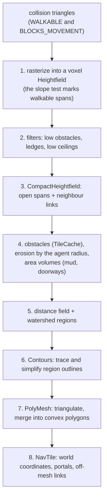

# 11 — Physics: collision, navigation and crowds

*An isometric CRPG does not need falling crates and ragdolls. It needs answers, fast and many times a
tick: what is under the mouse cursor? Which units does this fireball hit? Can this archer see that
goblin? How does the party walk to the door without bumping into each other or into the skeletons
coming the other way? Where can the fighter go this turn through the mud? Which cells of the map are
hidden by the fog of war? Jeddy's `physics` module is pure-Java gameplay physics (D3) — static
collision, dynamic bodies, queries, navigation meshes, pathfinding, crowds, formations, visibility and
triggers, with no rigid-body solver. This chapter derives the geometry and the algorithms behind each
piece with worked numbers: the slab and Möller–Trumbore tests, BVHs built with the surface area
heuristic, grids and counting sort, Recast-style navmesh baking, A* with a proof that it finds the
cheapest path, the funnel algorithm, ORCA's velocity obstacles, the Hungarian algorithm and symmetric
shadowcasting. Then it writes the module's real code, class by class, and shows how the demo uses it,
the tests that prove it, measured numbers and exercises.*

**Before you start.** You need [Lesson 0](lessons/00-foundations.md): the notation of §2 (sums,
powers and roots, `mod`, rounding, intervals, big-O in §2.8), bits, masks, shifts and packing (§4–§6),
how a `float` is stored and why it rounds (§7), the Java heap and the zero-allocation rule (§8.2), and
caches and threads (§9). From chapter [02](02-math-foundations.md) you need vectors, the dot and cross
products, projection, planes and half-spaces, and bounding boxes; everything else is derived here.
[Lesson 3](lessons/03-data-layout.md) explains the struct-of-arrays layout used everywhere in Part B
(§4) and the handles with generations that the navmesh's polygon references copy (§6).
[Lesson 4](lessons/04-binary-formats.md) builds the byte stream the crowd and the fog of war save
themselves with.

**What you will build**

| Piece | File | What it does |
|---|---|---|
| Triangle soup and flags | [`TriangleMesh`](../../modules/physics/src/main/java/dev/jeddy/physics/bvh/TriangleMesh.java), [`TriFlags`](../../modules/physics/src/main/java/dev/jeddy/physics/bvh/TriFlags.java) | world-space triangles with surface, walkability and blocking flags |
| Static collision | [`BvhBuilder`](../../modules/physics/src/main/java/dev/jeddy/physics/bvh/BvhBuilder.java), [`Bvh`](../../modules/physics/src/main/java/dev/jeddy/physics/bvh/Bvh.java), [`RayHit`](../../modules/physics/src/main/java/dev/jeddy/physics/bvh/RayHit.java) | binned-SAH build in parallel; flat 32-byte nodes; closest and any-hit rays, box queries, `.jcol` |
| Moving bodies | [`Bodies`](../../modules/physics/src/main/java/dev/jeddy/physics/grid/Bodies.java), [`UniformGrid`](../../modules/physics/src/main/java/dev/jeddy/physics/grid/UniformGrid.java) | cylinders, spheres and turned boxes as arrays; a grid rebuilt every tick by a parallel counting sort |
| Queries | [`CollisionWorld`](../../modules/physics/src/main/java/dev/jeddy/physics/query/CollisionWorld.java), [`QueryContext`](../../modules/physics/src/main/java/dev/jeddy/physics/query/QueryContext.java), [`RayBatch`](../../modules/physics/src/main/java/dev/jeddy/physics/query/RayBatch.java) | rays, spell overlaps, sweeps, line of sight, picking, batched rays |
| Navmesh baking | [`Heightfield`](../../modules/physics/src/main/java/dev/jeddy/physics/nav/bake/Heightfield.java), [`CompactHeightfield`](../../modules/physics/src/main/java/dev/jeddy/physics/nav/bake/CompactHeightfield.java), [`Contours`](../../modules/physics/src/main/java/dev/jeddy/physics/nav/bake/Contours.java), [`PolyMesh`](../../modules/physics/src/main/java/dev/jeddy/physics/nav/bake/PolyMesh.java), [`NavMeshBaker`](../../modules/physics/src/main/java/dev/jeddy/physics/nav/bake/NavMeshBaker.java) | voxels, filters, erosion, regions, contours, convex polygons, tiles, `.jnav` |
| Navmesh runtime | [`NavTile`](../../modules/physics/src/main/java/dev/jeddy/physics/nav/NavTile.java), [`NavMesh`](../../modules/physics/src/main/java/dev/jeddy/physics/nav/NavMesh.java) | tiles, salted polygon references, links across partial portals and off-mesh links |
| Queries and paths | [`NavMeshQuery`](../../modules/physics/src/main/java/dev/jeddy/physics/nav/NavMeshQuery.java), [`NavGeometry`](../../modules/physics/src/main/java/dev/jeddy/physics/nav/NavGeometry.java), [`QueryFilter`](../../modules/physics/src/main/java/dev/jeddy/physics/nav/QueryFilter.java), [`NavNodePool`](../../modules/physics/src/main/java/dev/jeddy/physics/nav/NavNodePool.java) | nearest polygon, navmesh raycast, sliding moves, A* (whole and sliced), the funnel |
| Corridors and batches | [`PathCorridor`](../../modules/physics/src/main/java/dev/jeddy/physics/nav/PathCorridor.java), [`NavPathBatch`](../../modules/physics/src/main/java/dev/jeddy/physics/nav/NavPathBatch.java) | paths kept valid as agents move; many paths in one parallel dispatch |
| Dynamic navigation | [`NavDoors`](../../modules/physics/src/main/java/dev/jeddy/physics/nav/NavDoors.java), [`TileCache`](../../modules/physics/src/main/java/dev/jeddy/physics/nav/bake/TileCache.java) | doors as polygon flags; obstacles rebuilt in the background |
| Crowds | [`Orca`](../../modules/physics/src/main/java/dev/jeddy/physics/crowd/Orca.java), [`Crowd`](../../modules/physics/src/main/java/dev/jeddy/physics/crowd/Crowd.java), [`AgentParams`](../../modules/physics/src/main/java/dev/jeddy/physics/crowd/AgentParams.java) | ORCA's half-planes and linear programs; steering, avoidance, collisions, jumps, stuck agents, saves |
| Formations | [`Formation`](../../modules/physics/src/main/java/dev/jeddy/physics/crowd/Formation.java), [`FormationMove`](../../modules/physics/src/main/java/dev/jeddy/physics/crowd/FormationMove.java) | slot templates, the Hungarian assignment, paced arrival |
| Fog of war | [`OcclusionGrid`](../../modules/physics/src/main/java/dev/jeddy/physics/vis/OcclusionGrid.java), [`Visibility`](../../modules/physics/src/main/java/dev/jeddy/physics/vis/Visibility.java) | a bit grid baked from walls; symmetric shadowcasting per viewer, in parallel |
| Triggers, turn-based, debug | [`Triggers`](../../modules/physics/src/main/java/dev/jeddy/physics/trigger/Triggers.java), [`TurnBasedNav`](../../modules/physics/src/main/java/dev/jeddy/physics/nav/TurnBasedNav.java), [`DebugSink`](../../modules/physics/src/main/java/dev/jeddy/physics/debug/DebugSink.java) | enter/exit events; movement ranges, path costs, attacks of opportunity; debug lines |
| The proof | [the tests](../../modules/physics/src/test/java/dev/jeddy/physics), [`PhysicsBench`](../../bench/src/main/java/dev/jeddy/bench/PhysicsBench.java) | 68 tests: brute-force references, determinism, zero allocation; benchmarks |

The design is in [DESIGN §11](../DESIGN.md); decisions D51–D58 cover navigation, the crowd and the
occlusion file. The math primitives live in
[`Intersect`](../../modules/math/src/main/java/dev/jeddy/math/Intersect.java) in the `math` module.
How the fog reaches the screen is in chapter [08](08-effects-and-post.md) (on fog of war), and how the
crowd and the fog are saved in chapter [16](16-saves.md) (on saves).

**Contents**

- Part A — The ideas
  1. [What gameplay physics is](#1-what-gameplay-physics-is)
  2. [Rays against boxes: the slab test](#2-rays-against-boxes-the-slab-test)
  3. [Rays against triangles: Möller–Trumbore](#3-rays-against-triangles-möllertrumbore)
  4. [Bounding volume hierarchies and the surface area heuristic](#4-bounding-volume-hierarchies-and-the-surface-area-heuristic)
  5. [Grids and counting sort: the broadphase](#5-grids-and-counting-sort-the-broadphase)
  6. [Shapes for spells, sweeps and line of sight](#6-shapes-for-spells-sweeps-and-line-of-sight)
  7. [Navigation meshes and how Recast bakes them](#7-navigation-meshes-and-how-recast-bakes-them)
  8. [Shortest paths: Dijkstra and A*](#8-shortest-paths-dijkstra-and-a)
  9. [String pulling: the funnel algorithm](#9-string-pulling-the-funnel-algorithm)
  10. [Local avoidance: velocity obstacles and ORCA](#10-local-avoidance-velocity-obstacles-and-orca)
  11. [Formations](#11-formations)
  12. [Visibility and fog of war](#12-visibility-and-fog-of-war)
  13. [Triggers: enter and exit from sorted lists](#13-triggers-enter-and-exit-from-sorted-lists)
  14. [Turn-based movement: a budgeted Dijkstra, and reach circles](#14-turn-based-movement-a-budgeted-dijkstra-and-reach-circles)
- Part B — Building it
  15. [Step 1: the module](#15-step-1-the-module)
  16. [Step 2: TriFlags and TriangleMesh](#16-step-2-triflags-and-trianglemesh)
  17. [Step 3: Bvh, the flattened tree, and RayHit](#17-step-3-bvh-the-flattened-tree-and-rayhit)
  18. [Step 4: BvhBuilder](#18-step-4-bvhbuilder)
  19. [Step 5: Bodies](#19-step-5-bodies)
  20. [Step 6: UniformGrid](#20-step-6-uniformgrid)
  21. [Step 7: CollisionWorld and QueryContext](#21-step-7-collisionworld-and-querycontext)
  22. [Step 8: the voxel heightfield](#22-step-8-the-voxel-heightfield)
  23. [Step 9: the compact heightfield](#23-step-9-the-compact-heightfield)
  24. [Step 10: Contours](#24-step-10-contours)
  25. [Step 11: PolyMesh](#25-step-11-polymesh)
  26. [Step 12: NavMeshBaker and tiles](#26-step-12-navmeshbaker-and-tiles)
  27. [Step 13: NavTile, NavMesh and references](#27-step-13-navtile-navmesh-and-references)
  28. [Step 14: the query toolkit](#28-step-14-the-query-toolkit)
  29. [Step 15: NavMeshQuery](#29-step-15-navmeshquery)
  30. [Step 16: PathCorridor and NavPathBatch](#30-step-16-pathcorridor-and-navpathbatch)
  31. [Step 17: dynamic navigation](#31-step-17-dynamic-navigation)
  32. [Step 18: Orca, the avoidance solver](#32-step-18-orca-the-avoidance-solver)
  33. [Step 19: Crowd](#33-step-19-crowd)
  34. [Step 20: Formation and FormationMove](#34-step-20-formation-and-formationmove)
  35. [Step 21: OcclusionGrid and Visibility](#35-step-21-occlusiongrid-and-visibility)
  36. [Step 22: Triggers](#36-step-22-triggers)
  37. [Step 23: TurnBasedNav](#37-step-23-turnbasednav)
  38. [Step 24: DebugSink](#38-step-24-debugsink)
- Part C — Using it and proving it
  39. [How the demo uses it](#39-how-the-demo-uses-it)
  40. [The tests, walked through](#40-the-tests-walked-through)
  41. [Things to run, and what they measured](#41-things-to-run-and-what-they-measured)
  42. [Exercises](#42-exercises)
  43. [Glossary](#43-glossary)
  44. [Further reading](#44-further-reading)

---

# Part A — The ideas

## 1. What gameplay physics is

### 1.1 The questions a CRPG asks

An isometric role-playing game does not need falling crates or ragdolls. It needs answers, many of
them, thirty times a second:

- What is under the mouse cursor: a skeleton, the floor, or a wall in front of both?
- Which units does this fireball hit, and which ones does the lightning bolt touch?
- Can the archer see the goblin, or is there a pillar between them?
- How does the party walk to the door, around the table, without walking through each other or
  through the sixty skeletons coming the other way?
- Where can the fighter go this turn with 9 m of movement, if half of the room is mud?
- Which cells of the map are hidden by the fog of war?

Each answer is a piece of geometry (a ray against a triangle, a circle against a cone), a search
(the shortest route through a graph), or a small optimisation (the velocity closest to the one I want
that does not hit anyone). Part A of this chapter derives each one from the definitions of chapter
[02](02-math-foundations.md) — vectors, the dot and cross products, planes, boxes — with worked
numbers. Part B writes the `physics` module's real code. Part C shows how the demo uses it, walks
through the tests and gives exercises.

### 1.2 No rigid bodies (D3)

Decision **D3** in [DESIGN §17](../DESIGN.md) set the scope at the project's start: **pure-Java
gameplay physics** — kinematic movement, static collision, queries, navigation meshes, pathfinding
and line of sight — and **no rigid bodies**. A rigid-body solver (the part of a physics engine that
makes boxes tumble and stack, integrating forces and torques and resolving contacts between
thousands of pairs) is a large, numerically delicate piece of software, and nothing in a
Pathfinder-style game needs it: characters move where the rules say they move, and spells hit what
the rules say they hit. Leaving it out keeps the module small, deterministic and free of native
libraries (it uses no FFM at all; D17 even keeps the `restricted` lint on in `physics`, so a native
call there would fail the build).

So the module has three kinds of things:

| Kind | Examples | Changes |
|---|---|---|
| **Static** | the level's walls and floors (triangles), the navigation mesh, the occlusion grid | baked once by the cooker; doors and obstacles patch them |
| **Dynamic** | units (vertical cylinders), props (spheres, turned boxes), crowd agents | every tick |
| **Queries** | rays, overlaps, sweeps, line of sight, picking, paths | asked by gameplay, any number per tick |

### 1.3 Cook time and run time

Everything that can be computed before the game runs is computed by the cooker (chapter
[10](10-assets.md), on assets): it collects the level's collision triangles, builds the bounding
volume hierarchy (§4), bakes one navigation mesh per creature size (§7) and an occlusion grid for the
fog of war (§12), and writes three files. At run time the game loads them and adds what moves.


Decision **D58** named the outputs (`.jcol`, `.<size>.jnav`, `.jocc`, described in
[`docs/formats`](../formats/jcol.md)), and **D90** derives them from a `.jlevel` of prefab
placements through the same `PhysicsBake` that the older `<level>.physics.json` path uses.

### 1.4 Conventions: the ground plane and the 2D cross product

The engine is right-handed, Y up, in meters (chapter [02](02-math-foundations.md), on the axes). The
ground is the **XZ plane**, and most algorithms of this chapter — navmesh polygons, the broadphase
grid, crowds, the fog of war — are **2D on $(x, z)$**: they ignore height, or treat it separately.

Two-dimensional geometry needs one tool chapter 02 did not name: the **2D cross product** of two
vectors $a = (a_x, a_z)$ and $b = (b_x, b_z)$,

```math
\operatorname{cross}(a, b) = a_x b_z - a_z b_x .
```

It is closely related to the 3D cross product: $(a_x, 0, a_z) \times (b_x, 0, b_z) =
(0,\; a_z b_x - a_x b_z,\; 0)$, whose $y$ component is $-\operatorname{cross}(a, b)$ — with the
engine's axis order the sign flips, so keep the two apart. Like the 3D product, its absolute value is
the area of the parallelogram spanned by $a$ and $b$, and its sign says on which side of $a$ the
vector $b$ lies.

Which side is "left" depends on how you draw the plane. This chapter, like Recast's documentation,
draws XZ with **$x$ to the right and $z$ up the page**. In that drawing $`\operatorname{cross}(a, b) > 0`$
means $b$ is counterclockwise from $a$ (to its left). Example: $a = (1, 0)$, $b = (0, 1)$ gives
$`1 \cdot 1 - 0 \cdot 0 = 1 > 0`$: $+z$ is to the left of $+x$, as it is on the page.

```
 z
 ^
 |   b = (0, 1)
 |   ^
 |   |   cross(a, b) = 1 > 0: b is to the LEFT of a
 |   |
 +---+------> a = (1, 0)                 x
```

Seen from the game's camera, looking down with $+Y$ toward you, $z$ points *down* the screen (chapter
[02](02-math-foundations.md), on the right-hand rule: $\hat x \times \hat y = \hat z$ with $\hat x$
right and $\hat y$ toward you puts $\hat z$ down). In that view left and right swap. Every "left" in
this chapter means the z-up drawing unless it says otherwise.

**Triangle winding.** A triangle's normal is $(b - a) \times (c - a)$. A floor triangle faces up
($+Y$) when, seen from above with $+Y$ toward you, its corners go counterclockwise.
[`TriangleMesh.addGround`](../../modules/physics/src/main/java/dev/jeddy/physics/bvh/TriangleMesh.java)
builds its quads that way (§16 checks it with numbers).

## 2. Rays against boxes: the slab test

### 2.1 Rays and the parameter t

A **ray** is the set of points

```math
r(t) = o + t\,d, \qquad t \ge 0,
```

with an **origin** $o$ and a **direction** $d$ (chapter [02](02-math-foundations.md) introduced
`Ray3f`). Jeddy never requires $d$ to have length 1: $t$ is then measured in units of $\lVert d
\rVert$. Passing $d = b - a$ and stopping at $t_{\max} = 1$ turns a ray into the **segment** from $a$
to $b$, which line-of-sight queries use: $t = 0.5$ is the middle of the segment whatever its length.
Every ray query takes such a $t_{\max}$ and ignores hits beyond it.

### 2.2 Slabs

An **axis-aligned bounding box** (AABB) is
$[\min_x, \max_x] \times [\min_y, \max_y] \times [\min_z, \max_z]$ (chapter
[02](02-math-foundations.md), on bounding volumes). Read it as the intersection of three **slabs**:
the region between the two planes $x = \min_x$ and $x = \max_x$, the same for $y$, the same for $z$.
A point is in the box exactly when it is in all three slabs.

Take the $x$ slab first. The ray's $x$ coordinate is $`o_x + t\,d_x`$. It crosses the plane
$x = \min_x$ when $`o_x + t\,d_x = \min_x`$, so at

```math
t_1 = \frac{\min_x - o_x}{d_x}, \qquad\text{and the other plane at}\qquad t_2 = \frac{\max_x - o_x}{d_x}.
```

Between those two values of $t$ the ray is inside the $x$ slab. Which one is smaller depends on the
sign of $d_x$: a ray going toward $-x$ meets $\max_x$ first. So the ray is inside the $x$ slab for
$t \in [\min(t_1, t_2), \max(t_1, t_2)]$.

The ray is inside the box when it is inside all three slabs **at the same time**, so the intersection
of three intervals. The intersection of intervals starts at the latest start and ends at the
earliest end:

```math
t_{\text{near}} = \max_{k \in \{x,y,z\}} \min(t_{1,k}, t_{2,k}), \qquad t_{\text{far}} = \min_{k \in \{x,y,z\}} \max(t_{1,k}, t_{2,k}).
```

The ray hits the box when this interval is not empty, $t_{\text{far}} \ge t_{\text{near}}$; when it is
not entirely behind the origin, $t_{\text{far}} \ge 0$; and when it starts before the limit,
$t_{\text{near}} \le t_{\max}$. The engine folds the first two into $t_{\text{far}} \ge \max(t_{\text{near}}, 0)$.
The entry point is at $\max(t_{\text{near}}, 0)$: 0 means the origin is already inside.

### 2.3 Worked example

$o = (0, 2.5, 0.5)$, $d = (1, -1, 0)$, box $[1, 3] \times [0, 1] \times [0, 1]$.

```
  y   (the z axis points out of the page)
  3 |
    |  o  (0, 2.5)
  2 |    '.
    |       '.
  1 |    +-----*-----------+     * entry, t = 1.5, at (1.5, 1): the top face
    |    |       '.        |
    |    |          '.     |     box [1, 3] x [0, 1]
  0 +----+-------------*---+----> x
    0    1             ^   3
                 exit, t = 2.5, at (2.5, 0): the bottom face
```

- $x$ slab: $1/d_x = 1$, so $t_1 = (1 - 0) \cdot 1 = 1$ and $t_2 = (3 - 0) \cdot 1 = 3$: $t \in [1, 3]$.
- $y$ slab: $1/d_y = -1$, so $t_1 = (0 - 2.5)(-1) = 2.5$ and $t_2 = (1 - 2.5)(-1) = 1.5$: in either
  order, $t \in [1.5, 2.5]$.
- $z$ slab: $d_z = 0$, so $1/d_z = +\infty$; $t_1 = (0 - 0.5) \cdot \infty = -\infty$ and
  $t_2 = (1 - 0.5) \cdot \infty = +\infty$. The ray runs parallel to the $z$ planes and its $o_z$ is
  between them, so it is inside the $z$ slab for every $t$: $(-\infty, +\infty)$.

$t_{\text{near}} = \max(1, 1.5, -\infty) = 1.5$ and $t_{\text{far}} = \min(3, 2.5, +\infty) = 2.5$.
The interval $[1.5, 2.5]$ is not empty: the ray enters at $t = 1.5$, at $(1.5, 1, 0.5)$, through the
top face, and leaves at $t = 2.5$ through the bottom. (Computed in `float`: $1/d = (1, -1, +\infty)$,
the six $t$ values as above.)

### 2.4 Division by zero, infinities and NaN

The code never tests $d_x = 0$. It computes $1/d_x$ once per ray, and IEEE 754 arithmetic (L00 §7.3)
does the rest:

- $1/0 = +\infty$ and $1/(-0) = -\infty$ (a `float` has a negative zero). A slab with an infinite
  inverse gives $t$ values of $\pm\infty$: the whole line when the origin is between the planes, as
  above, or an empty interval (both $+\infty$, or both $-\infty$) when it is outside. Both are right.
- The one bad case is an origin **exactly on a slab plane** with a zero direction component:
  $(\min_x - o_x) \cdot (1/d_x) = 0 \cdot \infty$, which is **NaN**. Java's `Math.min` and `Math.max`
  return NaN when either argument is NaN, so the NaN reaches the final comparison, and every
  comparison with NaN is false. The function reports a miss.

So a ray that grazes a box face exactly, running inside the face's plane, misses. For a box around a
flat floor ($\min_y = \max_y = 0$) a horizontal ray at exactly $y = 0$ misses the box — and it would
miss the floor triangles anyway, since a ray parallel to a triangle's plane cannot hit it (§3.5).

Why multiply by a precomputed $1/d$ rather than divide? A BVH traversal tests two boxes per node it
visits and hundreds of nodes per ray. A division takes a modern CPU several times longer than a
multiplication and cannot start as often; three divisions per ray and six multiplications per box is
the classic trade.

## 3. Rays against triangles: Möller–Trumbore

### 3.1 Barycentric coordinates

Take a triangle with corners $v_0, v_1, v_2$ and its two **edge vectors** $e_1 = v_1 - v_0$ and
$e_2 = v_2 - v_0$. Every point $p$ of the triangle's plane can be reached from $v_0$ by going some
amount $u$ along $e_1$ and some amount $v$ along $e_2$:

```math
p(u, v) = v_0 + u\,e_1 + v\,e_2 = (1 - u - v)\,v_0 + u\,v_1 + v\,v_2 .
```

The second form expands $e_1$ and $e_2$. The three numbers $`(1 - u - v,\; u,\; v)`$ are the point's
**barycentric coordinates**: weights of the three corners that add up to 1. The point is inside the
triangle exactly when all three weights are non-negative: $u \ge 0$, $v \ge 0$ and $u + v \le 1$.

```
          v2
          /\          u = weight of v1, v = weight of v2
         /  \         u >= 0, v >= 0, u + v <= 1  <=>  inside
     e2 /    \
       /   *  \       * = v0 + u e1 + v e2
      /________\
    v0    e1    v1
```

Check with the corners: $v_1$ is $u = 1, v = 0$; the middle of the edge $v_1 v_2$ is
$u = v = 0.5$, on the boundary $u + v = 1$.

### 3.2 Cramer's rule from the triple product

Möller–Trumbore solves three linear equations with three unknowns. Chapter
[02](02-math-foundations.md) showed (on determinants and the triple product) that a $3 \times 3$
determinant with columns $a, b, c$ is the **triple product** $`\det[a\;b\;c] = a \cdot (b \times c)`$,
which is zero when the three vectors lie in one plane, and that swapping two columns flips its sign
while a cyclic shift keeps it: $a \cdot (b \times c) = b \cdot (c \times a) = c \cdot (a \times b)$.
That is all the next derivation needs.

Suppose $x_1 a + x_2 b + x_3 c = s$ for known vectors $a, b, c, s$ and unknown numbers
$x_1, x_2, x_3$. Take the dot product of both sides with $b \times c$:

```math
x_1\, a \cdot (b \times c) + x_2\, b \cdot (b \times c) + x_3\, c \cdot (b \times c) = s \cdot (b \times c).
```

$b \times c$ is perpendicular to both $b$ and $c$ (chapter 02, on the cross product), so the middle
dot products are 0, and

```math
x_1 = \frac{s \cdot (b \times c)}{a \cdot (b \times c)}.
```

Dotting with $c \times a$ instead isolates $x_2 = s \cdot (c \times a) / \det$, and dotting with
$a \times b$ isolates $x_3 = s \cdot (a \times b) / \det$, where $\det = a \cdot (b \times c)$, written
three ways by the cyclic rule. This is **Cramer's rule**. It fails only when $\det = 0$: the three
column vectors are in one plane and the system has no unique answer.

### 3.3 The algorithm

The ray meets the triangle's plane where $`o + t\,d = v_0 + u\,e_1 + v\,e_2`$. Move the unknowns left and
call $s = o - v_0$:

```math
t\,(-d) + u\,e_1 + v\,e_2 = s .
```

That is Cramer's setting with columns $a = -d$, $b = e_1$, $c = e_2$. Define two cross products, which
is all the algorithm will compute:

```math
p = d \times e_2, \qquad q = s \times e_1 .
```

Now each piece of Cramer's rule, rearranged with the cyclic rule and the sign rule
($`x \times y = -\,y \times x`$) until only $p$ and $q$ appear:

- $\det = (-d) \cdot (e_1 \times e_2) = e_1 \cdot (e_2 \times (-d)) = e_1 \cdot (d \times e_2) = e_1 \cdot p$.
- $u = s \cdot (e_2 \times (-d)) / \det = s \cdot (d \times e_2) / \det = s \cdot p / \det$.
- $`v = s \cdot ((-d) \times e_1) / \det = -\,s \cdot (d \times e_1)/\det = -\,d \cdot (e_1 \times s)/\det = d \cdot (s \times e_1)/\det = d \cdot q / \det`$
  (a cyclic shift, then $`-\,e_1 \times s = s \times e_1`$).
- $t = s \cdot (e_1 \times e_2) / \det = e_2 \cdot (s \times e_1) / \det = e_2 \cdot q / \det$.

```math
\det = e_1 \cdot p, \qquad u = \frac{s \cdot p}{\det}, \qquad v = \frac{d \cdot q}{\det}, \qquad t = \frac{e_2 \cdot q}{\det}.
```

That is **Möller–Trumbore** (Möller and Trumbore, 1997): no plane equation and no stored normal, two
cross products and four dot products per triangle, and early exits — as soon as $u$ falls outside
$[0, 1]$ there is no need to compute $q$.

### 3.4 Worked example

The floor triangle $v_0 = (0,0,0)$, $v_1 = (1,0,0)$, $v_2 = (0,0,1)$ and a ray straight down from
$o = (0.25, 1, 0.25)$, $d = (0, -1, 0)$:

1. $e_1 = (1, 0, 0)$, $e_2 = (0, 0, 1)$.
2. $`p = d \times e_2 = ((-1)(1) - 0 \cdot 0,\; 0 \cdot 0 - 0 \cdot 1,\; 0 \cdot 0 - (-1) \cdot 0) = (-1, 0, 0)`$.
3. $\det = e_1 \cdot p = -1$. Not near zero: the ray is not parallel to the plane.
4. $s = o - v_0 = (0.25, 1, 0.25)$; $u = s \cdot p / \det = (-0.25)/(-1) = 0.25$. In $[0, 1]$: go on.
5. $`q = s \times e_1 = (1 \cdot 0 - 0.25 \cdot 0,\; 0.25 \cdot 1 - 0.25 \cdot 0,\; 0.25 \cdot 0 - 1 \cdot 1) = (0, 0.25, -1)`$.
6. $v = d \cdot q / \det = (-0.25)/(-1) = 0.25$; $u + v = 0.5 \le 1$: inside.
7. $t = e_2 \cdot q / \det = (-1)/(-1) = 1$.

The hit is at $t = 1$, the point $(0.25, 0, 0.25)$, which is indeed
$`0.5\,v_0 + 0.25\,v_1 + 0.25\,v_2`$. (These values were checked with `numpy`.)

### 3.5 Two-sided hits, the determinant's sign, and watertightness

**The sign of the determinant** says which side the ray came from. $\det = e_1 \cdot (d \times e_2)
= -\,d \cdot (e_1 \times e_2)$, and $e_1 \times e_2$ is the triangle's normal $n$. So
$`\det = -\,d \cdot n`$: positive when the ray travels against the normal (it hits the front),
negative when it travels with it (it hits the back). In the example $n = e_1 \times e_2 = (0, -1, 0)$:
this triangle's winding makes it face *down*, and the ray hit its back. Jeddy accepts both signs —
a **two-sided** test — because a wall must stop a ray from either side. Only
$`\lvert\det\rvert < 10^{-12}`$, a ray parallel to the plane, is rejected.

**Edges count.** The tests are inclusive: $u = 0$ or $u + v = 1$ is a hit. Two triangles that share an
edge both claim it, so in exact arithmetic a ray through a shared edge cannot slip between them.
In `float` arithmetic it can, by a hair: $u$ for one triangle and $1 - u - v$ for its neighbour are
computed differently and may both round to slightly negative values. The `math` module's
`Intersect.rayTriangle` implements the **watertight** test of Woop, Benthin and Wald (2013), which
transforms the triangle into a coordinate system where the ray is the $+z$ axis, evaluates three 2D
edge functions, and recomputes them in `double` when one comes out exactly zero; with it no ray can
pass between two triangles that share an edge. `BvhTest.raycastsMatchBruteForce` uses it as the
reference. The BVH itself runs Möller–Trumbore, which does less work per triangle; Exercise 7 swaps
in the watertight test and measures the cost.

## 4. Bounding volume hierarchies and the surface area heuristic

### 4.1 Why a tree of boxes

The demo's crypt bakes about 141,000 collision triangles (`docs/TASKS.md`, M14-04) and a 300 × 300 m
terrain in the benchmark has 180,000. Testing a ray against every one is out of the question at a million rays a
second. A **bounding volume hierarchy** (BVH) groups the triangles into a binary tree of boxes: the
root box holds everything, each interior node splits its triangles between two child boxes, and a
**leaf** holds a few triangles. A ray that misses a box skips everything inside it. With a good tree
a ray visits a few dozen boxes and tests a handful of triangles.

```
            [root: everything]
             /              \
     [west half]         [east half]
       /     \              /      \
   [leaf]  [leaf]       [leaf]   [leaf]
   3 tris  5 tris       8 tris   2 tris
```

How the triangles are split decides the speed. The standard measure of a split's quality is the
**surface area heuristic** (SAH). It rests on one question.

### 4.2 How often does a ray hit a box?

Suppose a ray is known to hit a parent box $P$. What is the probability that it also hits a child box
$C$ inside $P$? Assume the rays come from **uniformly random directions**, and that for a given
direction they are spread uniformly over the area they cover.

For a fixed direction, the rays that hit a convex object are those that pass through its **shadow**:
its projection onto a plane perpendicular to the direction. So for that direction the probability is
$\text{shadow}(C) / \text{shadow}(P)$. Averaged over directions it becomes the ratio of **average
shadows**, and a theorem of Cauchy says the average shadow of any convex body is one quarter of its
surface area. For a box it can be derived from scratch:

1. A box of sides $X, Y, Z$, seen along the unit direction $(a, b, c)$, casts a shadow of area
   $\lvert a \rvert YZ + \lvert b \rvert XZ + \lvert c \rvert XY$: each pair of faces contributes its
   area times the cosine of the angle between its normal and the direction (the dot product, chapter
   02), and we see exactly one face of each pair.
2. Pick a direction uniformly on the sphere. **Archimedes' hat-box theorem** says that the height
   $c$ of a uniform point on the unit sphere is uniform on $[-1, 1]$ (a band of the sphere between two
   heights has the same area as the matching band of the cylinder around it). So the average of
   $\lvert c \rvert$ is the average of a uniform number on $[0, 1]$: $\tfrac12$. By symmetry the
   same holds for $\lvert a \rvert$ and $\lvert b \rvert$.
3. The average shadow is therefore $\tfrac12 (YZ + XZ + XY)$, and the surface area is
   $2(XY + YZ + ZX)$: the average shadow is a quarter of the surface area.

A Monte Carlo check with 200,000 random directions: a $1 \times 1 \times 1$ cube averages a shadow of
1.4996 (exact 1.5 = 6/4); a $4 \times 1 \times 1$ box 4.505 (exact 4.5); a $2 \times 3 \times 0.5$ box
4.247 (exact 4.25); and the average of $\lvert c \rvert$ comes out 0.4998.

So, under the uniform-ray assumption,

```math
\Pr(\text{hit } C \mid \text{hit } P) = \frac{A(C)}{A(P)},
```

with $A$ the surface area. An isometric camera's rays are not uniform — they all point down at about
the same angle — so this is a heuristic, but it is the one every production BVH builder uses, and it
works well in practice.

### 4.3 The SAH cost

Price a node by the expected work of a ray that reaches it. Keeping $P$ as a leaf with $N$ triangles
costs $N$ triangle tests: $`C_{\text{leaf}} = N\,C_{\text{isect}}`$. Splitting it into children $L$ and
$R$ holding $N_L$ and $N_R$ triangles costs one traversal step, plus the triangle tests of each child
times the probability that the ray reaches that child:

```math
C_{\text{split}} = C_{\text{trav}} + \frac{A(L)\,N_L + A(R)\,N_R}{A(P)}\; C_{\text{isect}} .
```

(This prices the children as if they were leaves; the greedy builder applies the same formula again
when it splits them.) Jeddy uses $C_{\text{trav}} = 1$ (`TRAVERSAL_COST`) and $C_{\text{isect}} = 1$.
`BvhBuilder`'s private `area(x, y, z)` returns $xy + yz + zx$, **half** the surface area: the factor 2
cancels in the ratio $A(L)/A(P)$, so there is no point multiplying by it. (`Aabb3f.surfaceArea` in
the `math` module returns the full area; the builder does not use it.)

### 4.4 Worked example

Four triangles whose bounding boxes are unit cubes side by side along $x$: $[0,1]$, $[1,2]$, $[2,3]$,
$[3,4]$, all $[0,1]$ in $y$ and $z$. The parent box is $4 \times 1 \times 1$, half-area
$4 \cdot 1 + 1 \cdot 1 + 1 \cdot 4 = 9$.

| Split | Left box, half-area, $N$ | Right box, half-area, $N$ | $C_{\text{split}}$ |
|---|---|---|---|
| after 1 cube | $1{\times}1{\times}1$, 3, 1 | $3{\times}1{\times}1$, 7, 3 | $1 + (3 \cdot 1 + 7 \cdot 3)/9 = 3.67$ |
| after 2 cubes | $2{\times}1{\times}1$, 5, 2 | $2{\times}1{\times}1$, 5, 2 | $1 + (5 \cdot 2 + 5 \cdot 2)/9 = 3.22$ |
| after 3 cubes | (mirror of after 1) | | 3.67 |
| leaf | | | 4 |

The middle split wins, and it beats the leaf, so the node splits. In general the SAH rewards putting
many triangles into small boxes, which is the same as cutting empty space away from the children.

### 4.5 Binning

Evaluating every possible split of $N$ triangles along three axes is expensive. **Binned SAH** (Wald,
2007) evaluates only a few candidate planes per axis:

1. Compute the node's box (from the triangles' boxes) and the box of the triangles' **centroids**
   (the centres of their boxes).
2. Per axis, map each centroid to one of $B = 16$ **bins** spread over the centroid box's extent on
   that axis: $\text{bin} = \lfloor (c - c_{\min}) \cdot k \rfloor$ with
   $`k = 16\,(1 - 10^{-5}) / \text{extent}`$. Without the factor $1 - 10^{-5}$, the largest centroid
   would land in bin 16, which does not exist. Each bin accumulates a triangle count and a box.
3. The 15 boundaries between bins are the candidate planes. Sweep the bins **right to left** once,
   growing a box and a count, and store, for each boundary, the area and count of everything to its
   right. Then sweep **left to right**, growing the left box, and price each boundary with the SAH.
   Three axes times 15 boundaries is 45 candidates per node, in $O(N + B)$ work per axis.
4. Compare the best candidate with the leaf.

In the four-cube example the centroids are 0.5, 1.5, 2.5 and 3.5, the extent is 3, so
$k = 16 \cdot 0.99999 / 3 = 5.33328$ and the cubes fall into bins $\lfloor 0 \rfloor = 0$,
$\lfloor 5.33 \rfloor = 5$, $\lfloor 10.67 \rfloor = 10$ and $\lfloor 15.9998 \rfloor = 15$. The
boundaries after bins 0–4 all give the "after 1 cube" split, after bins 5–9 "after 2", after bins
10–14 "after 3": binning finds the same best split here.

### 4.6 Traversal: near child first, and pruning

A query walks the tree from the root. Three ideas make the walk fast:

- **Near child first.** At an interior node, test both children's boxes and visit the one the ray
  enters first. Hits found there shrink the best distance so far.
- **Pruning by entry distance.** Remember where the ray entered each box you put aside. When you come
  back to it, if that entry point is already beyond the best hit, skip the whole subtree without
  testing anything. The slab test of §2 also takes the best distance as its $t_{\max}$, so boxes
  beyond it are rejected immediately.
- **No recursion.** Keep the boxes put aside on an explicit `int` stack instead of making recursive
  calls. That makes the query allocation-free (the stack lives in a caller's object) and lets any
  number of threads query one immutable tree at once.

For line of sight it does not matter *which* wall blocks the view, only *whether* one does:
`raycastAny` returns at the first hit within range.

## 5. Grids and counting sort: the broadphase

### 5.1 Why not a BVH for moving units

Units move every tick. A BVH takes time to build (the 180k-triangle terrain takes about a quarter of a
second, §41), and refitting it as things move makes its boxes overlap more and more. A game with a
few hundred units on a mostly flat map has a cheaper option: a **uniform grid** of square cells over
the level's XZ footprint, **rebuilt from scratch every tick**. A query for "what is near this
rectangle" looks only at the cells the rectangle covers. This first, coarse filter is the
**broadphase**; the exact shape tests that follow are the **narrow phase**.

Each body's **footprint** is the axis-aligned rectangle around its shape seen from above: a cylinder
of radius $r$ at $(x, z)$ covers $[x - r, x + r] \times [z - r, z + r]$. The body is listed in every
cell its footprint touches. The cells of a world coordinate are

```math
\text{cellX}(x) = \operatorname{clamp}\!\left(\left\lfloor \frac{x - \text{minX}}{\text{cell}} \right\rfloor,\; 0,\; \text{cellsX} - 1\right),
```

so a body outside the grid is put into the border cells instead of being lost.

### 5.2 Counting sort

Building "a list of bodies per cell" with a list object per cell would allocate. A **counting sort**
builds all the lists in one flat `int` array, in three passes:

1. **Histogram.** For each body, find the cells its footprint covers and add 1 to each cell's
   counter.
2. **Prefix sum.** Turn the counts into start offsets: `cellStart[c]` is the sum of the counts of all
   cells before `c`. Cell `c`'s list will occupy `entries[cellStart[c] .. cellStart[c + 1])`.
3. **Scatter.** Walk the bodies again, in the same order, and write each body's index into the next
   free slot of each of its cells.

A worked example with three cells and four bodies:

| Body | covers cells |
|---|---|
| b0 | 2 |
| b1 | 0 |
| b2 | 0, 1 |
| b3 | 2 |

The histogram is `[2, 1, 2]` (cell 0 gets b1 and b2, cell 1 gets b2, cell 2 gets b0 and b3). The
prefix sum gives `cellStart = [0, 2, 3, 5]` (the last value is the total, 5 entries). The scatter
visits b0 (into slot 3, the first of cell 2), b1 (slot 0), b2 (slots 1 and 2), b3 (slot 4):
`entries = [b1, b2 | b2 | b0, b3]`. The cost is $O(n + \text{cells})$, and once the arrays are big
enough nothing is allocated.

The order inside each cell is ascending body index, because the scatter walks the bodies in order.
That property is called **stable**, and it matters.

### 5.3 Determinism and the parallel version

The crowd's avoidance (§10) and the trigger events (§13) read neighbours in cell order. If the order
changed from run to run, the results would change too — equally valid, but not reproducible, and a
game whose replays and saves diverge is very hard to debug. So the grid promises the same order every
time, **including when the rebuild runs on several threads**.

With 8192 bodies or more (`PARALLEL_FROM`) and a job system, the histogram and scatter passes run in
8 chunks of bodies in parallel. Each chunk counts into its **own** histogram, so no two threads write
the same counter. The serial prefix sum then interleaves the chunks: for each cell in turn, chunk 0's
entries first, then chunk 1's, and it replaces each chunk's count with the slot where that chunk will
start writing in that cell. In the example, with chunk 0 = {b0, b1} and chunk 1 = {b2, b3}:

| | cell 0 | cell 1 | cell 2 |
|---|---|---|---|
| chunk 0 histogram | 1 (b1) | 0 | 1 (b0) |
| chunk 1 histogram | 1 (b2) | 1 (b2) | 1 (b3) |
| `cellStart` | 0 | 2 | 3 |
| chunk 0 first slot | 0 | 2 | 3 |
| chunk 1 first slot | 1 | 2 | 4 |

Now each chunk scatters into slots that no other chunk touches, and since chunk 0's bodies precede
chunk 1's in every cell, the result is identical to the serial one: `[b1, b2 | b2 | b0, b3]`.

### 5.4 Each body once

A body that spans several cells is listed in each of them, so a query whose rectangle covers two of
those cells would find it twice. The grid avoids that without a "visited" set: it reports body $i$
only from the **first cell that both rectangles share**, the cell

```math
\big(\max(x_0^{(i)}, a_x),\; \max(z_0^{(i)}, a_z)\big),
```

where $(x_0^{(i)}, z_0^{(i)})$ is the body's lowest cell and $(a_x, a_z)$ the query's. Example: a body
covering cells $x \in [2, 4]$, $z \in [1, 2]$ and a query over $x \in [3, 5]$, $z \in [0, 1]$ share
the cells $x \in [3, 4]$, $z = 1$; the body is reported only from cell $(\max(2, 3), \max(1, 0)) =
(3, 1)$. Both rectangles are clamped to the grid the same way, so the shared region is never empty
when the body is found at all.

### 5.5 Walking a ray through a grid (Amanatides–Woo)

A ray query against the bodies must visit the cells under the ray, in order, and stop as soon as
nothing further can be nearer. The **Amanatides–Woo** algorithm (1987, a "digital differential
analyzer", DDA) does it with additions only.

Work in 2D on $(x, z)$ with the ray $`o + t\,d`$. Along $x$ the ray crosses a vertical cell boundary
every

```math
\Delta t_x = \frac{\text{cell}}{\lvert d_x \rvert}
```

(it takes $t = \text{cell}/\lvert d_x \rvert$ to move one cell width in $x$), and likewise
$\Delta t_z = \text{cell}/\lvert d_z \rvert$. Keep $t_x^{\text{next}}$ and $t_z^{\text{next}}$, the
values of $t$ at the next $x$ and $z$ boundaries. At each step, the nearer of the two is where the ray
leaves the current cell: step into the neighbouring cell on that axis and add $\Delta t$ to that axis's
next crossing.

Worked example: cells of 2 m from the origin, ray from $(1, 0.5)$ with $d = (3, 1)$, $t_{\max} = 2.5$.

- $\Delta t_x = 2/3 = 0.667$, $\Delta t_z = 2/1 = 2$.
- The first $x$ boundary is $x = 2$: $t_x^{\text{next}} = (2 - 1)/3 = 0.333$. The first $z$ boundary
  is $z = 2$: $t_z^{\text{next}} = (2 - 0.5)/1 = 1.5$.

| Cell visited | leaves at | through | next crossings after the step |
|---|---|---|---|
| (0, 0) | 0.333 | $x$ | $x$: 1.0, $z$: 1.5 |
| (1, 0) | 1.0 | $x$ | $x$: 1.667, $z$: 1.5 |
| (2, 0) | 1.5 | $z$ | $x$: 1.667, $z$: 3.5 |
| (2, 1) | 1.667 | $x$ | $x$: 2.333, $z$: 3.5 |
| (3, 1) | 2.333 | $x$ | $x$: 3.0, $z$: 3.5 |
| (4, 1) | 3.0 | — | beyond $t_{\max} = 2.5$: stop |

**The early exit.** Suppose a body in cell (2, 0) is hit at $t = 1.2$. That cell is left at
$t = 1.5$. Any body in a later cell is entered at $t \ge 1.5$, so nothing beyond can be nearer, and the
walk stops: "the best hit is before the exit of the current cell". Why is that safe even for a body
that spans several cells? If the ray hits a body at $t^\ast$, the hit point lies inside the body's
footprint, so the cell containing the hit point is one of the body's cells; the ray reaches that cell
by $t^\ast$, so the body is tested no later than then.

## 6. Shapes for spells, sweeps and line of sight

Units are **vertical cylinders** (a radius and a height, standing on their base), props are
**spheres** or **boxes turned by a yaw** about $+Y$. Spells ask which bodies are inside a sphere, a
cylinder, a cone, a line or a polygon. Each pair has an exact test. This section derives the ones the
code uses.

### 6.1 Ray against a sphere

A sphere is the points at distance $r$ from its centre $c$. The ray $`o + t\,d`$ touches it when
$`\lVert o + t\,d - c \rVert = r`$. Write $m = o - c$ and square both sides (lengths are positive, so
nothing is lost; chapter 02, on the dot product, gives $\lVert v \rVert^2 = v \cdot v$):

```math
(m + t\,d) \cdot (m + t\,d) = r^2 \;\Longleftrightarrow\; (d \cdot d)\,t^2 + 2\,(m \cdot d)\,t + (m \cdot m - r^2) = 0 .
```

A quadratic $a t^2 + 2b t + c = 0$ with $a = d \cdot d$, $b = m \cdot d$, $c = m \cdot m - r^2$. Using
the "half-$b$" form of the quadratic formula (divide the usual one by 2):

```math
t = \frac{-b \pm \sqrt{b^2 - a c}}{a}.
```

The smaller root, with the minus sign, is where the ray enters. Two shortcuts come first in the
code: if $c \le 0$, the origin is inside the sphere ($\lVert m \rVert \le r$): return $t = 0$. If
$`b > 0`$, the ray points away from the centre ($`m \cdot d > 0`$ means $d$ has a component along $m$,
which points from the centre to the origin) and, starting outside, it can never hit. If
$`b^2 - ac < 0`$ there is no real root: a miss.

Worked example: $o = (0, 0, 0)$, $d = (1, 0, 0)$, sphere at $c = (5, 0.6, 0)$ with $r = 1$.
$m = (-5, -0.6, 0)$, $a = 1$, $b = -5$, $c = 25.36 - 1 = 24.36$; $b^2 - ac = 25 - 24.36 = 0.64$;
$t = (5 - 0.8)/1 = 4.2$. Check: $(4.2, 0, 0)$ is at distance $\sqrt{0.8^2 + 0.6^2} = 1$ from the
centre.

### 6.2 Ray against a vertical cylinder

A unit's cylinder has its axis along $Y$ through $(c_x, c_z)$, radius $r$, between heights $y_{\min}$
and $y_{\max}$. Its **side** is a circle in $(x, z)$ swept up and down, so the side test is §6.1 in 2D:
the same quadratic with only the $x$ and $z$ components, followed by a check that the hit's height
$`o_y + t\,d_y`$ lies within $[y_{\min}, y_{\max}]$. The **caps** are two discs in the planes
$y = y_{\min}$ and $y = y_{\max}$: intersect the ray with each plane, $t = (y_{\text{cap}} - o_y)/d_y$
(chapter 02, on rays and planes), and keep the hit if its $(x, z)$ is within $r$ of the axis. The
answer is the smallest valid $t$ of the three; an origin already inside the cylinder gives 0.

### 6.3 Turned boxes: work in the box's frame

A prop box stands on its base at $(b_x, b_y, b_z)$ with half extents $h_x, h_z$ along its own axes, a
height, and a **yaw** $\theta$ about $+Y$. Its local axes, written in world coordinates, are the
images of $(1, 0)$ and $(0, 1)$ under the yaw rotation (chapter [03](03-rotations-and-transforms.md),
on rotations about $Y$):

```math
x\text{ axis} \to (\cos\theta,\; -\sin\theta), \qquad z\text{ axis} \to (\sin\theta,\; \cos\theta) \qquad \text{in } (x, z).
```

So a local point $(l_x, l_z)$ is at world $(b_x + \cos\theta\, l_x + \sin\theta\, l_z,\;
b_z - \sin\theta\, l_x + \cos\theta\, l_z)$. A turned box is hard to test directly, but in its own
frame it is an ordinary AABB. So turn the *ray* by $-\theta$ instead, with the transpose of that
rotation (chapter 02, on rotation inverses: a rotation's inverse is its transpose):

```math
l_x = \cos\theta\,p_x - \sin\theta\,p_z, \qquad l_z = \sin\theta\,p_x + \cos\theta\,p_z,
```

where $p$ is the origin relative to the box's base; directions turn the same way, without the
subtraction. Run the slab test of §2 against $[-h_x, h_x] \times [0, \text{height}] \times [-h_z,
h_z]$, then turn the hit normal back with the forward rotation.

Worked example, from `CollisionWorldTest`: a crate at $(-4, 0, 5)$ with $h_x = 1$, $h_z = 0.5$,
height 1, yaw 30°, and a ray from $(-10, 0.5, 5)$ along $+x$. In the crate's frame,
$p = (-6, 0)$ becomes $l = (-5.196, -3.0)$ and $d = (1, 0)$ becomes $(0.866, 0.5)$. The $x$ slab gives
$t \in [4.845, 7.155]$, the $z$ slab $t \in [5.0, 7.0]$, the $y$ slab everything: entry at
$t = 5$, the world point $x = -5$, which is what the test expects. The entry came from the $z$ slab at
$l_z = -0.5$: the local normal is $(0, -1)$, and turned back it is
$(\cos\theta \cdot 0 + \sin\theta \cdot (-1),\; -\sin\theta \cdot 0 + \cos\theta \cdot (-1)) =
(-0.5, -0.866)$, facing the ray as it should. (Computed in Python, and the real query returns
$t = 5.0$ and normal $(-0.5, -0.866)$.)

### 6.4 Circles and spheres against shapes: the closest point

Most overlap tests reduce to one idea: **find the point of the shape closest to the circle's (or
sphere's) centre, and compare its distance with the radius**. For an axis-aligned box the closest
point is the centre **clamped** to the box on each axis: if the centre is left of the box, the
closest $x$ is the box's left side; if inside, it is the centre's own $x$. Then

```math
\text{overlap} \iff (q_x - c_x)^2 + (q_z - c_z)^2 \le r^2, \qquad q = \operatorname{clamp}(c, \min, \max).
```

Squared lengths again avoid the square root (chapter 02, on comparing squared lengths). Variations
used by the code:

- **A body cylinder against a sphere**: clamp the sphere's centre height to the cylinder's height
  range ($dy$), take the horizontal distance minus the cylinder radius, floored at 0 ($\text{radial}$),
  and test $\text{radial}^2 + dy^2 \le r^2$.
- **A turned box**: clamp in the box's frame (§6.3).
- **A line spell**: a rectangle that starts at $a$, runs $\ell$ metres along the unit direction $u$
  and is $w$ wide. In the rectangle's frame the centre has coordinates
  $\text{along} = (c - a) \cdot u$ and $\text{side} = (c - a) \cdot u^\perp$, with
  $u^\perp = (-u_z, u_x)$; clamp them to $[0, \ell]$ and $[-w/2, w/2]$ and compare as above
  (`Intersect.rectCircle`).
- **A segment** against a circle (prism edges): the closest point of the segment $a b$ to $c$ is
  $`a + s\,(b - a)`$ with $s = \operatorname{clamp}\big((c - a) \cdot (b - a) / \lVert b - a \rVert^2,
  0, 1\big)$: the projection onto a line from [chapter 02](02-math-foundations.md) (on projection),
  kept within the segment.
- **A sphere body's slice**: at heights $[y_{\min}, y_{\max}]$ a sphere's horizontal cross-section is
  a circle of radius $\sqrt{r^2 - dy^2}$, with $dy$ the distance from the centre to the nearest height
  in the range (Pythagoras). Prisms and boxes test that circle.

### 6.5 Cones seen from above

A cone spell (a breath weapon) is a **circular sector** seen from above: apex $a$, unit axis $\hat u$,
half-angle $\theta$, length $L$. Does a circle of centre $c$ and radius $r$ touch it?

Put the apex at the origin and describe the centre by two numbers: how far it is along the axis, and
how far from the axis:

```math
\text{along} = c \cdot \hat u, \qquad \text{perp} = \sqrt{\lVert c \rVert^2 - \text{along}^2}
```

(Pythagoras: $c$ is the hypotenuse of a right triangle whose legs are its components along and across
the axis). In the plane of the axis and $c$, with coordinates (along, perp), the cone's edge is the
line through the origin at angle $\theta$ from the axis, direction $(\cos\theta, \sin\theta)$. A unit
vector perpendicular to it, pointing out of the cone, is $(-\sin\theta, \cos\theta)$. The signed
distance of the centre from the edge line is the dot product with that normal (chapter 02, on planes
and signed distance):

```math
\text{closest} = \text{perp}\cos\theta - \text{along}\sin\theta .
```

Negative means the centre is inside the wedge. The circle reaches into the cone if that distance is
at most $r$; the code adds a range test along the axis, $-r \le \text{along} \le L + r$:

```
 perp
  ^             cone edge (angle θ)
  |            /
  |    c *    /         closest = perp·cos θ − along·sin θ
  |      |   /          (distance from c to the edge line, positive outside)
  |      |  /
  |      | /
  +------+------------> along (the axis)
 apex
```

Worked example (`CollisionWorldTest.overlapsFindBodiesByShape`): a cone from the origin along $+z$,
$L = 7$, $\theta = 30°$. The orb at $(3, 5)$ with $r = 0.4$: along $= 5$, perp $= 3$, closest
$= 0.866 \cdot 3 - 5 \cdot 0.5 = 0.098 \le 0.4$: it touches, although its centre is at
$\arctan(3/5) = 31°$, just outside the wedge. The chest at $(6, -6)$: along $`= -6 < -0.4`$: behind
the apex. The real query returns the crate, the unit and the orb (the crate counts by the circle
around its footprint, radius $\sqrt{1^2 + 0.5^2} = 1.118$: closest $= 0.964$).

The test is cheap and **slightly generous**. The far end is tested along the axis, not along the
arc: with $L = 10$, $\theta = 45°$ and $r = 1$, a circle centred on the cone's edge line at distance
11.5 from the apex has along $= 8.13 \le 11$ and closest $= 0$: it is reported, although its nearest
point is 0.5 m beyond the arc. Near the apex, behind it, the test is also a little generous. For a
spell template that is acceptable; Exercise 10 makes the far end exact.

### 6.6 Rectangles: the separating axis theorem

Two convex shapes do **not** overlap exactly when some straight line separates them — equivalently,
when there is some direction (an **axis**) onto which their projections (their "shadows" on that
line) do not overlap. That is the **separating axis theorem**. Its useful half for polygons: if no
axis separates them, they overlap, and it suffices to try the axes perpendicular to the polygons'
edges. Two rectangles have two edge directions each, so four axes.

Project a turned rectangle with centre $p$, unit axes $\hat a_x, \hat a_z$ and half extents
$h_x, h_z$ onto a unit axis $\hat L$: its centre lands at $p \cdot \hat L$, and its shadow reaches
$\rho = h_x \lvert \hat a_x \cdot \hat L \rvert + h_z \lvert \hat a_z \cdot \hat L \rvert$ to either
side (each half extent contributes its length times the cosine of its angle to $\hat L$, whichever way
it points). Two rectangles are separated on $\hat L$ when

```math
\lvert (p_B - p_A) \cdot \hat L \rvert > \rho_A + \rho_B .
```

`overlapBox` runs this test on the four axes; the occlusion grid (§12.1) uses the same theorem for a
triangle against a square cell.

### 6.7 Sweeps: the Minkowski sum

A charge or a knockback moves a unit's cylinder horizontally by $(\Delta x, \Delta z)$; the question
is how far it gets before touching something, and what the contact normal is (for sliding along a
wall). Seen from above that is a **circle of radius $r$ moving along a segment**.

The trick is the **Minkowski sum**: a circle of radius $r$ touches an obstacle exactly when its
*centre*, a point, touches the obstacle grown by $r$ in every direction. So move a point instead:

- against another circle of radius $r_b$: the point against a circle of radius $r + r_b$, which is
  the ray–circle quadratic of §6.1 with $t \in [0, 1]$ (the motion is the ray's direction, so
  $t = 1$ is the end of the move);
- against a wall segment $ab$: the point against the segment grown by $r$, a 2D **capsule**: two
  straight sides at distance $r$ from the segment's line, and two half-circles of radius $r$ at the
  ends.

```
             r
        .---------------------------.      the segment a—b grown by r
       (  a *===================* b  )     (a 2D capsule)
        '---------------------------'
                      ^
                      | the centre of the moving circle, as a point
                      o
```

For the straight sides: the signed distance of the centre from the segment's line is
$s = (p - a) \cdot \hat n$ with $\hat n$ the line's unit normal, and its rate of change along the move
is $ds = \Delta \cdot \hat n$. If the move approaches the line ($`s \cdot ds < 0`$), the distance
becomes $r$ at $t = (\lvert s \rvert - r)/\lvert ds \rvert$; that contact counts if
$t \in [0, 1]$ and the touching point projects inside the segment. The ends are point-against-circle
tests. The smallest valid $t$ wins.

Worked example (`CollisionWorldTest`): a unit of radius 0.5 at $(8, 10)$ walks $(4, 0)$ east into a
wall whose face is the line $x = 10$. Distance to the line 2, minus the radius: 1.5 m of the 4 m move
is free, $t = 0.375$, the centre stops at $x = 9.5$ and the normal is $(-1, 0)$. Against a unit:
walking $(0, 10)$ from $(0, 0)$ toward a unit at $(0, 5)$, both of radius 0.5, the combined radius
is 1 and contact happens at $t = (5 - 1)/10 = 0.4$, with normal $(0, -1)$.

Two rules make sweeps behave in a game. **Shapes already overlapping do not block** (the unit can
always move out of a bad position). And static triangles count as walls only if their height range
reaches into $`[y + \text{stepHeight},\; y + \text{height}]`$: the floor and steps lower than the step
height never stop a walk.

## 7. Navigation meshes and how Recast bakes them

### 7.1 What a navmesh is, and why polygons

Characters walk on floors, around walls and furniture, up steps no higher than a step. A
**navigation mesh** (navmesh) describes where a character of a given size can stand: a set of
**convex polygons** covering the walkable floor, **shrunk by the character's radius**, so that the
character's *centre* can be anywhere on it without its body touching a wall.

Why polygons rather than a grid of cells? A room that a grid describes with thousands of cells is a
handful of polygons, so searches over polygons (§8) visit far fewer nodes. And **convex** is the key
word: in a convex polygon the straight segment between any two points stays inside, so moving in a
straight line within a polygon is always legal. A path becomes a chain of polygons — a **corridor** —
and the only places where a character must turn are where the corridor bends (§9).

```
   +---------+-------------+        a corridor of convex polygons from S to G;
   |  S      |             |        inside each polygon any straight line is walkable,
   |   \     |      +------+        so the path only bends at polygon boundaries
   |    \    |      |
   +-----\---+  ....|
         .\.........|
          G
```

Jeddy bakes navmeshes the way **Recast** does — Mikko Mononen's open-source library, the industry
standard — ported to Java with arrays instead of objects (DESIGN §11.4). This section explains each
stage with numbers; Part B walks through the code (§22–§26).

### 7.2 One mesh per size class

A troll does not fit where a halfling does. Since the navmesh is shrunk by the agent's radius and
needs room for the agent's height, one mesh is baked per **size class** (Pathfinder's Small, Medium,
Large, Huge), each to its own `.<size>.jnav` file. The demo's crypt bakes one: `medium`, radius
0.4 m, height 1.8 m, climb 0.4 m.

The bake settings are a
[`NavBakeConfig`](../../modules/physics/src/main/java/dev/jeddy/physics/nav/bake/NavBakeConfig.java).
The crypt's come from the settings block of `crypt.jlevel`, written by the demo's content script
`samples/iso-demo/tools/kaykit.py`: cell size 0.2 m, cell height 0.1 m, 32 m tiles, a 45° slope
limit. The cooker's `PhysicsImporter.navConfig` turns the tile size into cells:
$\operatorname{round}(32 / 0.2) = 160$. In voxel units (a **voxel** is one cell of a 3D grid, here
0.2 × 0.1 × 0.2 m):

| Setting | Formula | Value |
|---|---|---|
| `walkableHeight` | $\lceil 1.8 / 0.1 \rceil$ | 18 voxels |
| `walkableClimb` | $\lfloor 0.4 / 0.1 \rfloor$ | 4 voxels |
| `walkableRadius` | $\lceil 0.4 / 0.2 \rceil$ | 2 cells |
| `borderSize` | radius + 3 | 5 cells |
| tile | | 160 × 160 cells (32 m) |

The height rounds up (more clearance is safer) and the climb rounds down (a smaller step is safer).
All three divisions are exact in `float` (1.8f / 0.1f gives exactly 18.0, checked), so the rounding
direction does not bite here; with a cell size of 0.15, the radius becomes
$\lceil 2.67 \rceil = 3$ cells, 0.45 m.

### 7.3 The pipeline

[`NavMeshBaker`](../../modules/physics/src/main/java/dev/jeddy/physics/nav/bake/NavMeshBaker.java)
runs Recast's pipeline once per tile:



### 7.4 Voxels and spans

The first step turns triangles into **voxels**. A
[`Heightfield`](../../modules/physics/src/main/java/dev/jeddy/physics/nav/bake/Heightfield.java) is
a 2D grid of **columns** (one per $(x, z)$ cell). Each column holds a sorted list of **spans**:
intervals $[\min, \max)$ of solid voxels, counted in cell heights from the heightfield's bottom, each
with an **area id** (0 means "not walkable"):

```
 y (voxels)
  |      column (x, z)
 30 +    +--+
    |    |##|  span [22, 30): a table top, area 63 (walkable)
 22 +    +--+
    |    |  |  open space: 12 voxels (1.2 m) — not enough for an 18-voxel agent
 10 +    +--+
    |    |##|  span [0, 10): the floor, area 63
  0 +    +--+
```

Each triangle is **rasterized** by clipping it against the grid, the way Recast's `rasterizeTri`
does: cut the triangle by the plane $z = z_{\text{row}}$ at the next row boundary, which leaves the
piece inside the current row; cut that piece by $x = x_{\text{col}}$ at the next column boundary,
which leaves the piece inside one cell. The lowest and highest $y$ of that small polygon become a span
in that column (rounded outward to whole voxels: down for the bottom, up for the top). Cutting a
polygon by a plane is simple: walk its edges, keep the vertices on the near side, and where an edge
crosses the plane insert the crossing point, at the fraction $s = d_j / (d_j - d_i)$ along the edge,
where $d$ is each vertex's signed distance to the plane.

A flat floor at exactly $y = 0$ rasterizes to the span $[0, 1)$, because a span is at least one
voxel tall. Its top, where an agent stands, is therefore at $1 \times 0.1 = 0.1$ m: every navmesh
vertex over the test floors sits at $y = 0.1$, and the tests allow 0.15 m when they check "on the
floor".

When a new span overlaps spans already in its column, they **merge** into one span covering both.
What is the merged span's area? It is the area of its *top surface*, because that is where an agent
would stand: if the two tops are within the climb of each other, the larger area id wins (the walkable
one, usually); otherwise the area of whichever reaches higher wins. That is decision **D51**: Recast
always keeps the larger id, which let a walkable floor under a solid block (whose own top is not
walkable) make the block's top walkable.

### 7.5 Walkable slopes

Whether a triangle is walkable at all is decided before it is rasterized, by its slope. With the
triangle's normal $n$ (from the cross product of two edges), the angle $\varphi$ between the normal
and straight up satisfies $\cos\varphi = n_y / \lVert n \rVert$ (the dot product of the unit normal
with $(0, 1, 0)$, chapter 02). The floor is walkable when $\varphi$ is below the limit, that is when

```math
\frac{n_y}{\lVert n \rVert} > \cos(\text{maxSlope}),
```

because cosine decreases from 1 at 0° to 0 at 90°. With the 45° limit, $\cos 45° = 0.707$. The test
ramp in `NavBakeTest.slopesLedgesAndLowCeilingsAreFiltered` rises 6.93 m over 4 m: its normal makes
an angle $\arctan(6.93/4) = 60°$ with the vertical, $`\cos 60° = 0.5 < 0.707`$: not walkable.
Triangles flagged `BLOCKS_MOVEMENT` (walls, furniture) rasterize too, as non-walkable solid spans, so
they cut the open space above the floor.

### 7.6 Filters

Rasterization cannot know three things, which three filters fix (all Recast's):

- **Low hanging obstacles** (`filterLowHangingWalkableObstacles`): a non-walkable span whose top is
  within the climb of the walkable span just below it becomes walkable. A curb or a low step that is
  part of a non-walkable object can still be stepped on.
- **Ledges** (`filterLedgeSpans`): a walkable span next to a drop deeper than the climb is not
  walkable, and neither is one whose reachable neighbours differ in height from each other by more
  than the climb (a steep spot). An agent's centre should not stand on the edge of a cliff, because
  its body would hang over it. Outside the heightfield counts as a bottomless drop, so the outermost
  cells of a floor are always removed: that is the "one ledge cell" the tests account for.
- **Low ceilings** (`filterWalkableLowHeightSpans`): a walkable span with less than `walkableHeight`
  voxels of clearance above it, up to the next span's bottom, is not walkable. In the figure of §7.4
  the floor under the table has 12 voxels of clearance, less than 18: you cannot stand under the
  table.

### 7.7 Open space: the compact heightfield

The algorithms that follow care about **open space** — where an agent can stand — not solid space.
[`CompactHeightfield`](../../modules/physics/src/main/java/dev/jeddy/physics/nav/bake/CompactHeightfield.java)
keeps only the walkable spans and stores, for each, its **floor** $y$ (the solid span's top) and its
**clearance** $h$ (up to the next solid span), packed column by column.

For each of the four directions — 0 is $-x$, 1 is $+z$, 2 is $+x$, 3 is $-z$ — it finds the span in
the neighbouring column that an agent can step to: their open spaces overlap by at least
`walkableHeight`, and their floors differ by at most `walkableClimb`. It stores that neighbour's index
**within its column** (0 for the lowest walkable span there, 1 for the next) in 6 bits of an `int`,
four directions in 24 bits; the value 63 (`NOT_CONNECTED`, all six bits set) means "no neighbour"
(L00 §6.4 for packing). From here on the heightfield is a **graph**, and multi-level geometry such as
a bridge over a road works naturally: the bridge's spans connect to the bridge, the road's to the
road.

### 7.8 Erosion and the chamfer distance

The navmesh is for the agent's centre, so the walkable area must be shrunk by the agent's radius.
`erode` computes, for every walkable span, its distance to the nearest non-walkable place, and
removes the spans that are too close.

Computing true Euclidean distances is expensive. A **chamfer distance transform** approximates them in
two raster passes: give every **boundary** span (one whose four neighbours are not all walkable)
distance 0 and every other span "infinity"; then sweep the grid from the first cell to the last and
let each span take the minimum of (its own value) and (each already-visited neighbour's value plus
the step cost); then sweep back from the last cell to the first doing the same with the other
neighbours (the classic two-pass scheme of Rosenfeld and Pfaltz, 1966: the forward pass, in increasing
$z$ then $x$, looks at the four neighbours it has already visited — $-x$, $-z$ and the two diagonals
on the $-z$ side — and the backward pass at the other four). The step costs are **2 for a straight step
and 3 for a diagonal one**. The units are half
cells: 2 stands for 1 cell, and 3 stands for $\sqrt 2 \approx 1.414$ cells, whose exact value in half
cells would be 2.83 — so the diagonal is overestimated by about 6 %, a good trade for integer
arithmetic.

A span is removed when its distance is below $2 \times$ `walkableRadius` (in half cells: closer than
`walkableRadius` cells). A corridor 7 cells wide between two walls, straight distances only:

```
cells:      #  .  .  .  .  .  .  .  #       (# = wall, . = walkable)
distance:      0  2  4  6  4  2  0
radius 2 cells -> threshold 4: keep d >= 4
kept:                4  6  4               (2 cells removed on each side)
```

`NavBakeTest.aFloorWithABlockBakesToPolygonsAroundIt` checks the result on a 20 × 20 m floor with a
4 × 4 m block in the middle, with the demo's 0.2 m cells: the expected walkable area is
$18.8^2 - 4.8^2 = 330.4$ m². The outer edge loses one cell to the ledge filter plus 0.4 m to erosion
(0.6 m per side: $20 - 1.2 = 18.8$); the block grows by the radius alone (0.4 m per side:
$4 + 0.8 = 4.8$), because its sides are walls, not drops. The real bake gives 328.94 m², 0.4 % less,
the rest being the corners the contours cut (§7.10).

Temporary obstacles from the `TileCache` (§7.12) are marked **before** erosion, so agents keep their
radius from them too (D54). **Area volumes** — a polygon with a height range, from the level's
areas — relabel the spans inside them *after* erosion: mud, water, hazards, doorways.

### 7.9 Watershed regions

To build polygons, the walkable area is first split into simple, hole-free **regions**. Recast's
method is a **watershed** partition, named after how water fills a landscape:

1. **The distance field.** `buildDistanceField` computes, for every span, the chamfer distance (§7.8)
   to the nearest **border** — here a span whose four neighbours are not all of the same area — and
   smooths it with a 3 × 3 box blur (the average of a span and its eight neighbours, for spans farther
   than 2 from a border). Read the result as a landscape turned upside down: high in the middle of
   open areas, zero at walls.
2. **Flooding.** `buildRegions` lowers a water level from the top of the landscape, two units at a
   time. At each level it first **expands** the existing regions into spans that the new level just
   reached (each such span joins the neighbouring region whose expansion distance is smallest; at
   most 8 rounds per level, as many as needed at the end), then starts a **new region** at every reached span still unclaimed and floods it to all
   connected spans down to two units below the level (`floodRegion`) — unless that would touch another
   region. Like springs that rise in the centres of open areas, regions grow outward and meet along
   ridges: narrow passages.
3. **Cleanup.** Regions smaller than `minRegionArea` spans are dropped (unless they reach the tile's
   border, where they may continue in the next tile), and regions smaller than `mergeRegionArea`
   merge into their smallest neighbour, as do regions that touch no wall at all
   (`mergeAndFilterRegions`, Recast's rules). Before flooding, the
   tile's border strip is painted with four special `BORDER_REG` regions, so regions stop exactly at
   the tile edge.

Here is the real bake code run on two 8 × 8 m rooms joined by a 3 m wide, 3 m long corridor, with
0.5 m cells so the figure fits (radius 0.5 m = 1 cell, so a threshold of 2; the probe program that
printed it calls `rasterizeTile`, `erode`, `buildDistanceField`, `buildRegions`, `Contours` and
`PolyMesh` in turn; row 0 is the south edge):

```
distance field after the blur (base 36: a = 10)        regions (A = id 5, B = id 6)
 15 ......................................               ......................................
 14 .##############........##############.               .##############........##############.
 13 .#000000000000#........#000000000000#.               .#AAAAAAAAAAAA#........#BBBBBBBBBBBB#.
 12 .#022222222220#........#022222222220#.               .#AAAAAAAAAAAA#........#BBBBBBBBBBBB#.
 11 .#023444444320#........#023444444320#.               .#AAAAAAAAAAAA#........#BBBBBBBBBBBB#.
 10 .#0245666665320#......#0235666665420#.               .#AAAAAAAAAAAAA#......#BBBBBBBBBBBBB#.
  9 .#02467888765320######02356788876420#.               .#AAAAAAAAAAAAAA######BBBBBBBBBBBBBB#.
  8 .#0246899997643200000023467999986420#.               .#AAAAAAAAAAAAAAAAABBBBBBBBBBBBBBBBB#.
  7 .#0246899997643200000023467999986420#.               .#AAAAAAAAAAAAAAAAABBBBBBBBBBBBBBBBB#.
  6 .#02467888765320######02356788876420#.               .#AAAAAAAAAAAAAA######BBBBBBBBBBBBBB#.
  5 .#0245666665320#......#0235666665420#.               .#AAAAAAAAAAAAA#......#BBBBBBBBBBBBB#.
  4 .#023444444320#........#023444444320#.               .#AAAAAAAAAAAA#........#BBBBBBBBBBBB#.
  3 .#022222222220#........#022222222220#.               .#AAAAAAAAAAAA#........#BBBBBBBBBBBB#.
  2 .#000000000000#........#000000000000#.               .#AAAAAAAAAAAA#........#BBBBBBBBBBBB#.
  1 .##############........##############.               .##############........##############.
  0 ......................................               ......................................
   '.' no walkable span (the ledge filter removed the edge cells), '#' eroded away
```

The maximum distance is 10 (`maxDistance`), so the water level starts at 10 and its first step
takes it to 8: the spans at distance 8 and 9, the two room centres, spring first, each room in its
own region, and each flood spreads down to distance 6. Later levels grow both regions outward; the
corridor (distance 0) is reached only at the end, where both regions expand into it and meet in the
middle. The four border regions took ids 1–4, so the first real region is 5. The landscape must be
deep enough for this to happen: with rooms of 5 m instead of 8 (maximum distance 4), the first level
is 2, its flood reaches down to 0, and everything connected becomes one region.

### 7.10 Contours and Douglas–Peucker

[`Contours`](../../modules/physics/src/main/java/dev/jeddy/physics/nav/bake/Contours.java) walks
around each region's border, span edge by span edge, and records a **raw** vertex at each cell
corner, tagged with what lies on the other side (another region's id, or 0 for a wall). The region
outline of room A above has 58 raw vertices. Then it **simplifies**:

1. **Keep the vertices where the neighbour changes** — region to region, region to wall, area to area.
   Two regions must agree on their shared boundary, so its endpoints are pinned. A region with no
   neighbouring region starts from just two points: its lowest-left and highest-right raw vertices.
2. **Douglas–Peucker.** For each simplified edge that runs along a wall (or an area border), find the
   raw vertex farthest from it; if its distance is more than `maxSimplificationError`, insert it
   and repeat. The comparison uses squared distances in cell units, so the demo's 1.3 means 1.3 cells,
   26 cm at 0.2 m cells. Edges between two regions are not tessellated: they stay straight, which
   keeps both sides identical.
3. **Split long wall edges** longer than `maxEdgeLength` (12 m in the demo, 60 cells), so polygons do
   not become long slivers along walls.

The distance of a point $p$ from the segment $ab$ is the length of $p$ minus its closest point on the
segment (§6.4). In the example, room A's simplified outline is

$`(19, 9)\,(19, 7)\,(14, 5)\,(14, 2)\,(2, 2)\,(2, 14)\,(14, 14)\,(14, 11)`$

in cells from the tile corner: $(19, 9)$ and $(19, 7)$ are the region-change vertices where the
corridor meets region B; the other six came from Douglas–Peucker. The edge from $(14, 5)$ to
$(19, 7)$ cuts the corner where the corridor leaves the room. The raw corner $(16, 7)$ lies
$\lvert 5 \cdot 2 - 2 \cdot 2 \rvert / \sqrt{5^2 + 2^2} = 6 / 5.39 = 1.11$ cells from it — less than
1.3, so it was dropped, and the polygon includes a small triangle of non-walkable space there. That is
the price of simplification: up to `maxSimplificationError` cells of error, in exchange for few, large
polygons.

**Holes** (a pillar inside a room) give a second contour, wound the other way. `mergeHoles` joins each
hole to its region's outline with a **bridge**: a diagonal from the hole's leftmost vertex to the
nearest outline vertex that it can see without crossing anything, walked in once and out once. The
result is one simple polygon again.

### 7.11 Ear clipping and merging into convex polygons

[`PolyMesh`](../../modules/physics/src/main/java/dev/jeddy/physics/nav/bake/PolyMesh.java) turns
each contour into convex polygons of at most `maxVertsPerPoly` = 6 vertices:

1. **Triangulate by ear clipping.** Three consecutive vertices $v_{i-1}, v_i, v_{i+1}$ form an
   **ear** when the diagonal $v_{i-1} v_{i+1}$ lies inside the polygon and crosses no edge; cutting
   off an ear leaves a polygon with one vertex fewer, so $n - 2$ cuts triangulate an $n$-gon. Recast's
   variant always cuts the ear with the **shortest diagonal**, which avoids long slivers. "Inside" and
   "crosses" are sign tests of the 2D cross product (§1.4).
2. **Weld vertices** through a hash of $(x, z)$: two vertices are the same if they match in $x$ and
   $z$ and differ by at most 2 voxels in $y$.
3. **Merge triangles** greedily into larger polygons: repeatedly find the pair of polygons sharing the
   **longest** edge whose union is still convex and has at most 6 vertices, and merge them. Long shared
   edges first gives fat polygons. Convexity needs checking only at the two vertices where the
   polygons join: at each, the turn from the incoming edge of one polygon to the outgoing edge of the
   other must keep the polygon's winding — a 2D cross product sign (`uleft`).
4. **Remove border vertices** that the contours marked (`BORDER_VERTEX`, from Recast's rules at tile
   borders) and re-triangulate the hole each leaves.
5. **Adjacency.** Each polygon edge records the polygon on its other side. An open edge lying on the
   tile's side becomes a **portal** to the neighbouring tile, coded `0x8000 | side`.

The two rooms above became five polygons (cell units; the hexagon of room A is the region outline
minus its two corner triangles):

```
 poly 0 (A): (14,11) (19,9) (19,7) (14,5) (2,2) (2,14)   neighbours: -, 3, -, 2, -, 1
 poly 1 (A): (2,14) (14,14) (14,11)                      neighbours: -, -, 0
 poly 2 (A): (14,5) (14,2) (2,2)                         neighbours: -, -, 0
 poly 3 (B): (19,7) (19,9) (22,9) (22,7)                 neighbours: 0, -, 4, -
 poly 4 (B): (24,2) (22,7) (22,9) (24,14) (36,14) (36,2) neighbours: -, 3, -, -, -, -
```

Each is convex: the 2D cross products of consecutive edges are all negative (for poly 0: −10, −10,
−9, −144, −144, −9) — the navmesh's winding, clockwise in the z-up drawing.

There is **no detail mesh** (decision **D52**). Recast adds extra triangles inside each polygon so
that heights follow uneven terrain; Jeddy's polygon vertices carry the surface height and heights
inside come from the polygon's triangle fan (§28). Isometric CRPG floors are mostly flat, and uneven
terrain gets more, smaller polygons from the edge-length limit.

### 7.12 Tiles, portals and polygon references

Levels are baked in **tiles** (32 m in the demo), in parallel. Each tile voxelizes its own area plus
a border of `walkableRadius + 3` cells on every side, so that erosion and regions near the edge see
the neighbours' geometry and the polygons on both sides of a tile edge line up exactly; the border is
cut off again when the contours are made.

At run time [`NavMesh`](../../modules/physics/src/main/java/dev/jeddy/physics/nav/NavMesh.java)
keeps tiles in slots, links the polygons of neighbouring tiles through their portal edges, and names a
polygon by one `int`, a **polygon reference**:

```
 bit:   31 .. 28 | 27 ............ 16 | 15 ................ 0
         salt(4) |   tile slot (12)   |   polygon index (16)
```

For example the reference `0x10040011` is salt 1, slot 4, polygon 17. Up to 4096 tiles, up to 65536
polygons per tile. Removing a tile **bumps its slot's salt**, so a stale reference that some agent
still holds fails `isValid` instead of silently naming a polygon of whatever tile takes the slot
next — the same idea as the generation in [lesson 3](lessons/03-data-layout.md)'s handles (L03 §6).
The salt runs from 1 to 15 and never 0, so no valid reference is ever 0, the "null" reference. With
4 bits it can repeat: a reference held across exactly 15 removals of the same slot would validate
again — keep that in mind before storing references for a long time.

A portal edge may touch several polygons on the other side, because the two tiles were simplified
separately. Each **link** therefore stores the sub-range of the edge it covers, as fractions
$[b_{\min}, b_{\max}] \subseteq [0, 1]$: a **partial portal**. `NavMeshQueryTest.tilesLinkAcrossPortals`
checks that the links of every portal edge add up to its whole length.

**Off-mesh links** — a jump across a gap, a ladder, a teleport — are two-vertex "polygons" of type
`TYPE_OFFMESH`, stored in the tile where they start and attached to the nearest ground polygons at
both ends when the tiles load.

## 8. Shortest paths: Dijkstra and A*

### 8.1 The navmesh as a graph

A **graph** is a set of **nodes** joined by **edges**, each edge with a non-negative **cost**. The
navmesh is one: its polygons are the nodes, and its links (shared edges inside a tile, portals between
tiles, off-mesh links) are the edges. Finding a path means finding the cheapest chain of nodes from
the polygon under the start point to the polygon under the goal — the **corridor**. The cost of the
chain is the sum of its edges' costs.

The cost of an edge is a distance times the **area cost** of the ground it crosses: 1 for normal
floor, 2 for difficult terrain (mud), $+\infty$ to forbid an area altogether. With mud at cost 2,
crossing 4 m of mud costs 8, so a 5.5 m detour on dry ground (cost 5.5) is preferred.

### 8.2 Dijkstra's algorithm

**Dijkstra's algorithm** (1959) finds the cheapest path from a start node to every node, in order of
cost. It keeps, for each node it has reached, $g(n)$ — the cost of the best path found so far — and an
**open list** of reached nodes not yet finished, and repeats:

1. Take the open node with the smallest $g$ out of the list ("expand" it, and mark it **closed**).
2. For each neighbour $m$, compute $g(n) + c(n, m)$. If $m$ is new, or this is cheaper than its
   current $g(m)$, set $g(m)$ to it, remember $n$ as $m$'s **parent**, and put $m$ in the open list.

When the goal is taken out of the list, following the parents back gives the cheapest path.

**Why it is right.** When a node $n$ is taken out with value $g(n)$, any other path from the start to
$n$ must leave the set of closed nodes somewhere, through an open node $m$ (or one not reached yet,
behind an open one). That open node has $g(m) \ge g(n)$ — otherwise it would have been taken first —
and the rest of the path from $m$ to $n$ costs at least 0, since costs are never negative. So no
other path is cheaper than $g(n)$.

**The open list** must give "the smallest" quickly and let values change. A **binary heap** does both
in $O(\log n)$ steps (§28).

### 8.3 A*: adding a guess

Dijkstra expands nodes in order of their distance from the start, in every direction at once — it
explores the whole neighbourhood before reaching a goal on one side. **A\*** (Hart, Nilsson and
Raphael, 1968) adds a **heuristic** $h(n)$: an estimate of the remaining cost from $n$ to the goal. It
orders the open list by

```math
f(n) = g(n) + h(n),
```

the estimated cost of the cheapest complete path through $n$. Everything else is Dijkstra. With
$h = 0$ it *is* Dijkstra; a good $h$ steers the search toward the goal and expands far fewer nodes.

### 8.4 Admissibility, and why A* finds the cheapest path

A heuristic is **admissible** when it never overestimates: $h(n) \le h^\ast(n)$ for every node, where
$h^\ast(n)$ is the true cost of the cheapest path from $n$ to the goal. In particular $h(\text{goal})
= 0$.

**Theorem.** With an admissible heuristic and non-negative edge costs, the path A* returns when it
takes the goal out of the open list is a cheapest one. (A* here may **reopen** a closed node when it
later finds a cheaper path to it, as the engine's code allows.)

**Proof.** Let $C^\ast$ be the cost of a cheapest path $S = n_0, n_1, \dots, n_k = G$, and suppose, to
get a contradiction, that A* takes $G$ out with $`g(G) > C^\ast`$.

First a fact that holds at every moment until $G$ is taken out: *some node of this cheapest path is
in the open list with its optimal cost* $g^\ast$ (the cost of the cheapest path from $S$ to it).
Before anything has been taken out, that node is $S$, with $g = 0$. Afterwards, let $n_j$ be the last
node of the path such that $n_0, \dots, n_j$ have all been closed with their optimal costs ($n_0 = S$
qualifies). When $n_j$ was last expanded, with its optimal cost, it offered $n_{j+1}$ the cost
$g^\ast(n_j) + c(n_j, n_{j+1})$, which is $g^\ast(n_{j+1})$ because a prefix of a cheapest path is a
cheapest path; so now $g(n_{j+1}) = g^\ast(n_{j+1})$ — it cannot be lower. And $n_{j+1}$ is open: it is
not closed with its optimal cost (or $j$ would not be the last such index), and if it had been closed
earlier with a worse cost, the better offer from $n_j$ reopened it (the reopening branch this theorem
assumes). Call it $n_i$.

Now compare that node with $G$ at the moment $G$ is taken out:

```math
f(n_i) = g^\ast(n_i) + h(n_i) \;\le\; g^\ast(n_i) + h^\ast(n_i) = C^\ast \;<\; g(G) = f(G).
```

The first step is admissibility; the equality holds because $n_i$ is on a cheapest path; the last uses
$h(G) = 0$. So $n_i$ has a smaller $f$ than $G$ and would have been taken out first — a
contradiction. Therefore $g(G) = C^\ast$. ∎

### 8.5 Consistency

A stronger property is useful. A heuristic is **consistent** when, for every edge,

```math
h(n) \le c(n, m) + h(m)
```

— a triangle inequality: the estimate from $n$ is never more than one step plus the estimate from
there. A consistent heuristic with $h(G) = 0$ is admissible (add the inequality along any path to the
goal). It gives more: $f$ never decreases along a path ($f(m) = g(n) + c + h(m) \ge g(n) + h(n) =
f(n)$), so nodes come out of the open list in order of $f$, and when a node is taken out its $g$ is
already optimal — **a closed node is never reopened**. The last step is §8.4's argument with $n$ in
place of $G$: if $n$ were taken out with $g(n) > g^\ast(n)$, some node $n_i$ of the cheapest path to
$n$ would be open with its optimal cost, and $f(n_i) = g^\ast(n_i) + h(n_i) \le g^\ast(n) + h(n) <
g(n) + h(n) = f(n)$ (the middle step is the consistency inequality added along the path from $n_i$ to
$n$), so $n_i$ would have come out first.

### 8.6 The engine's costs and heuristic

A polygon is an area, not a point, but the search needs a position per node to measure costs.
Following Detour (Recast's runtime companion), Jeddy places a node at the **midpoint of the portal
through which it was first reached**, and keeps it there. The search's costs are then:

- **edge** $n \to m$: the 3D distance between the two node positions, times the area cost of
  $n$'s polygon (the segment runs through $n$'s polygon from where $n$ was entered to the portal into
  $m$);
- **into the goal polygon**: in addition, the distance from its node position to the goal point,
  times the goal polygon's area cost, so the goal's $g$ is a complete path's cost.

The heuristic is the straight-line distance to the goal, scaled:

```math
h(n) = \lVert P_n - \text{goal} \rVert \cdot 0.999 \cdot \min_a \text{areaCost}(a),
```

and $h = 0$ for the goal polygon.

**It is admissible.** Any path from $P_n$ to the goal is at least as long as the straight line
(triangle inequality, chapter 02), and every metre of it costs at least the cheapest area cost
$k = \min_a \text{areaCost}(a)$. So the true remaining cost is at least $k \lVert P_n - \text{goal}
\rVert \ge h(n)$.

**It is consistent.** For an edge between two positions,
$c(n, m) = \lVert P_n - P_m \rVert \cdot \text{areaCost}(n) \ge k \lVert P_n - P_m \rVert$, so

```math
h(n) = 0.999\,k\,\lVert P_n - \text{goal} \rVert \le 0.999\,k\,\big(\lVert P_n - P_m \rVert + \lVert P_m - \text{goal} \rVert\big) \le c(n, m) + h(m).
```

Into the goal polygon the extra last leg plays the role of $h(m)$, with the same inequality.

Two details make this hold in practice:

- **`minCost`.** If a level has a road of cost 0.5, the cheapest metre costs 0.5, and a heuristic that
  assumed 1 would overestimate near the road (§8.7). `QueryFilter.minCost()` returns the smallest
  area cost, and the heuristic is scaled by it. The price is a weaker guess: on the 200 × 200 m test
  map with 1000 random paths, A* expanded 328 nodes per search with all costs 1, and 763 when one road
  area cost 0.4 (measured with a copy of the search loop that counts; §41).
- **`H_SCALE` = 0.999.** Distances are computed in `float`, and a rounding error of one unit in the
  last place could make $h$ a hair larger than the cost it must not exceed. A 0.1 % margin removes the
  risk.

The code nevertheless lets a closed node be reopened when a cheaper route to it appears — the branch
Detour has. Detour needs it: its heuristic is not scaled by the minimum area cost, so with area costs
below 1 it is neither admissible nor consistent. In Jeddy the proof above says the branch never fires,
and measurement agrees: the counting copy saw **0 reopenings in 3000 searches** (with all costs 1,
with mud at 3, and with a road at 0.4), against 38,000–62,000 cheaper routes found to nodes still open.
The branch is a harmless safeguard.

### 8.7 Worked example: the road

A start $S = (0, 0)$, a goal $G = (10, 0)$, and two ways: straight across normal ground through
$M = (5, 0)$ — two edges of cost 5 — or a step north to a road, $R_1 = (0, 1)$, along the road to
$R_2 = (10, 1)$, and back: edges of cost 1, $10 \times 0.5 = 5$ and 1. The road route costs 7, the
straight one 10.

| Search | Pops (node, $g$, $f$) | Result |
|---|---|---|
| Dijkstra ($h = 0$) | S (0, 0), R1 (1, 1), M (5, 5), R2 (6, 6), G (7, 7) | 7, five pops |
| A*, $h = 1 \times$ distance | S (0, 10), M (5, 10), G (10, 10) | **10: wrong** |
| A*, $h = 0.5 \times$ distance | S (0, 5), R1 (1, 6.03), R2 (6, 6.5), G (7, 7) | 7, four pops |

With the unscaled heuristic, $R_1$ gets $f = 1 + \sqrt{101} = 11.05$: the guess $\sqrt{101} = 10.05$
overestimates the true remaining cost 6, so A* finishes the straight route (all $f = 10$) before ever
expanding the road. With $h$ scaled by the minimum cost 0.5 the guess for $R_1$ is 5.02, below 6, and
A* takes the road. (Traced in Python with the formulas above.)

### 8.8 What "cheapest" means here

A* finds the cheapest corridor **for the costs it uses**, and those measure a zigzag through portal
midpoints, not the path a character will walk. On the test room of `NavMeshQueryTest`
(`pathsGoAroundTheBlock`: from $(2, 10)$ to $(18, 10)$ around the 4.8 m eroded block) the search's
cost to the goal is 20.40, while the string-pulled path (§9) through the same corridor is 16.96 m
long. Two consequences:

- The corridor is then straightened by the funnel algorithm, which computes the true shortest path
  *within* it.
- The positions depend on which portal reached each node first, so the costs are an approximation, and
  the cheapest corridor by those costs is not always the one containing the truly shortest path. For
  navmeshes of reasonably shaped polygons the difference is small; it is the trade every Detour-style
  pathfinder makes for searching polygons instead of points.

**Unreachable goals (D55).** If the goal is on an island the start cannot reach, the open list runs
empty without ever taking out the goal polygon. The search then returns the corridor to the searched
polygon whose **closest point** to the goal is nearest, flagged `PARTIAL`; a character clicked onto an
island walks to the nearest shore. Decision **D55** chose the closest point rather than the node with
the smallest heuristic (Detour's choice), because the heuristic compares portal midpoints, and the
midpoint nearest the goal can belong to a polygon a whole tile away from the true nearest shore.

## 9. String pulling: the funnel algorithm

### 9.1 Corners from a corridor

The corridor is a chain of polygons; a character needs **corners** to walk to. Imagine a string tied
to the start, threaded through the corridor and pulled tight at the goal. It touches the corridor's
walls only at the corners it must turn around. The **funnel algorithm** (Lee and Preparata, 1984; in
games often called "simple stupid funnel" after Mononen's write-up) finds those corners in one pass
over the **portals**, the edges between consecutive polygons.

Each portal is a segment with a **left** and a **right** end, as seen when walking along the
corridor. The algorithm keeps an **apex** (the last corner, at first the start point) and a
**funnel**: a left boundary point and a right boundary point. The two rays from the apex through them
bound the wedge of directions in which the string can still go straight.

```
            L ·-------------------·  left boundary
             /
   apex   * <   the funnel: every direction between
             \  the two boundaries is reachable in a straight line
            R ·-------------------·  right boundary
```

### 9.2 Left and right with triArea2D

The tests use
[`NavGeometry.triArea2D`](../../modules/physics/src/main/java/dev/jeddy/physics/nav/NavGeometry.java),
Recast's `dtTriArea2D`:

```math
\text{triArea2D}(a, b, c) = (c_x - a_x)(b_z - a_z) - (b_x - a_x)(c_z - a_z) = -\operatorname{cross}(b - a,\; c - a).
```

It is twice the signed area of the triangle $abc$, with the sign flipped relative to §1.4's 2D cross
product. So in the z-up drawing a **positive value means $c$ is to the right** of the directed line
$a \to b$, and a negative value means it is to the left. (The navmesh's polygons are wound so that
consecutive vertices give a positive value: clockwise in the z-up drawing.)

### 9.3 The algorithm

For each new portal, try to move the funnel's sides to the portal's ends:

- **Right side.** If the portal's right end is not outside the funnel on the right
  ($\text{triArea2D}(\text{apex}, \text{right}, \text{newRight}) \le 0$), the funnel can narrow: if
  the new right point also does not cross over the left boundary
  ($`\text{triArea2D}(\text{apex}, \text{left}, \text{newRight}) > 0`$), move the right side there.
  If it does cross, the string must bend around the **left** point: it becomes a **corner** — emit it,
  make it the new apex, reset the funnel to it, and restart the scan from the portal after it.
- **Left side.** The mirror image, with the signs reversed.
- The **goal** is treated as a last portal whose two ends coincide.

A side that would *widen* the funnel is simply not moved: the string is already free to go there.

### 9.4 Worked example

In the z-up drawing: start $A = (0, 0)$, goal $G = (6, 0)$, and two portals: $P_1$ from
$L_1 = (2, 2)$ to $R_1 = (2, -1)$, and $P_2$ from $L_2 = (4, 3)$ to $R_2 = (4, 2)$.

```
 z
 3 |              L2 o
 2 |  L1 o           o R2   <- becomes a corner
 1 |     |
 0 | A * |                 * G
-1 |  R1 o
   +--+--+--+--+--+--+--+---> x
      1  2  3  4  5  6
```

1. **$P_1$.** The funnel is empty (apex, left and right all at $A$), so both sides move: right
   $\leftarrow R_1$, left $\leftarrow L_1$.
2. **$P_2$, right side.** $\text{triArea2D}(A, R_1, R_2) = (4)(-1) - (2)(2) = -8 \le 0$: $R_2$ is not
   outside on the right. Against the left: $`\text{triArea2D}(A, L_1, R_2) = (4)(2) - (2)(2) = 4 > 0`$:
   no crossing. Right $\leftarrow R_2$.
   **Left side.** $\text{triArea2D}(A, L_1, L_2) = (4)(2) - (2)(3) = 2 \ge 0$: not outside on the left.
   Against the new right: $`\text{triArea2D}(A, R_2, L_2) = (4)(2) - (4)(3) = -4 < 0`$: no crossing.
   Left $\leftarrow L_2$.
3. **The goal.** Right side: $`\text{triArea2D}(A, R_2, G) = (6)(2) - (4)(0) = 12 > 0`$: $G$ is outside
   the funnel on the right, which would widen it; the right point stays. Left side:
   $\text{triArea2D}(A, L_2, G) = (6)(3) - (4)(0) = 18 \ge 0$, but $\text{triArea2D}(A, R_2, G) = 12$
   is not $`< 0`$: moving the left boundary to $G$ would cross the right one. So the **right** point
   $R_2 = (4, 2)$ is a corner; it becomes the apex, and the scan restarts after $P_2$.
4. From the new apex the goal is directly visible: both sides move to $G$, and the path is
   $A \to (4, 2) \to G$.

This is right: the second portal lies entirely above $z = 2$, so the string from $A$ to $G$ must rise
to $z = 2$ at $x = 4$ and come back down. (These values come from a Python port of the code's loop.)

Two refinements in the engine: a **partial portal** contributes only its linked sub-segment (§7.12),
and crossing into an off-mesh link produces a corner flagged `STRAIGHT_OFFMESH`, so the character
knows to jump there.

## 10. Local avoidance: velocity obstacles and ORCA

### 10.1 The problem

Paths are planned against walls, not against other characters: they move. Each tick, each agent knows
the velocity it would like — toward its next corner — and the positions and velocities of a few
neighbours. **Local avoidance** answers: *which velocity, as close as possible to the preferred one,
avoids every neighbour for the next $\tau$ seconds?* The span $\tau$ is the **time horizon**.

Jeddy uses **ORCA**, optimal reciprocal collision avoidance (van den Berg, Guy, Lin and Manocha,
2011), following their RVO2 library, instead of Detour's sampled planner. Decision **D53** records
why: it is cheaper per agent, smooth in dense crowds, and deterministic. Velocities in this section
are 2D, on $(x, z)$; the code calls the second coordinate `y`.

### 10.2 The velocity obstacle, derived

Take agents $A$ and $B$, discs of radii $r_A$ and $r_B$ at positions $p_A$, $p_B$, moving at constant
velocities $v_A$, $v_B$. Write

```math
p = p_B - p_A, \qquad r = r_A + r_B, \qquad v = v_A - v_B
```

(the relative position, the combined radius, the relative velocity). After $t$ seconds the distance
between their centres is $`\lVert (p_A + v_A t) - (p_B + v_B t) \rVert = \lVert v\,t - p \rVert`$. They
collide within the horizon if, for some $t \in (0, \tau]$,

```math
\lVert v\,t - p \rVert < r \quad\Longleftrightarrow\quad \left\lVert v - \frac{p}{t} \right\rVert < \frac{r}{t}
```

(divide both sides by $`t > 0`$). For each $t$, the right-hand form describes a **disc** in the plane of
velocities: centre $p/t$, radius $r/t$. The set of all relative velocities that collide within $\tau$
is the union of these discs for $t \in (0, \tau]$, the **velocity obstacle** $\text{VO}^\tau$.

What does that union look like? As $t$ grows from $\tau$ to $\infty$, the disc's centre $p/t$ slides
from $p/\tau$ toward the origin and its radius shrinks in proportion. All these discs are copies of
the disc of centre $p$ and radius $r$, scaled toward the origin by $1/t$. Their union is a **cone**
with its apex at the origin, bounded by the two lines from the origin tangent to the disc
$(p, r)$ — the **legs** — and cut off near the origin by the disc for $t = \tau$, the **cut-off
circle** with centre $p/\tau$ and radius $r/\tau$:

```
 relative-velocity plane (x, z)

                  .-'' left leg
             .-''        .----.
  origin *<''           ( p/τ  )   cut-off circle, centre p/τ, radius r/τ
             '-..        '----'
                 '-.. right leg
  the relative velocities inside the cone and beyond the circle collide within τ
```

The half-angle $\alpha$ of the cone satisfies $\sin\alpha = r / \lVert p \rVert$ (the right triangle
formed by the origin, the disc's centre and a tangent point has hypotenuse $\lVert p \rVert$ and
opposite side $r$), and the legs have length $\sqrt{\lVert p \rVert^2 - r^2}$ to the tangent points.
The VO is **convex**: a scaled copy $sD$ of the disc for any $s \ge 1/\tau$, and a mix of two points
from two copies, $\lambda s_1 x_1 + (1 - \lambda) s_2 x_2$, is a point of the copy scaled by
$\lambda s_1 + (1 - \lambda)s_2$, because the disc is convex.

### 10.3 The nearest boundary point

If the current relative velocity $v$ is inside the VO (or close to it), let $u$ be the **smallest
change of $v$ that reaches the VO's boundary**, and $\hat n$ the outward unit normal there. The
boundary has three pieces — two legs and an arc of the cut-off circle — and which one is nearest
depends on where $v$ is.

**The arc.** Measure $v$ from the cut-off circle's centre: $w = v - p/\tau$. The arc that belongs to
the boundary faces the apex; a tangent point on a leg is where the radius is perpendicular to the leg,
which is at angle $90° - \alpha$ from the direction $-p$ pointing back to the apex. So the nearest
boundary point is on the arc exactly when $w$ points back toward the apex within that angle:

```math
\cos\angle(w, -p) > \cos(90° - \alpha) = \sin\alpha = \frac{r}{\lVert p \rVert}
\;\Longleftrightarrow\; \frac{-\,w \cdot p}{\lVert w \rVert\,\lVert p \rVert} > \frac{r}{\lVert p \rVert}
\;\Longleftrightarrow\; w \cdot p < 0 \;\text{and}\; (w \cdot p)^2 > r^2 \lVert w \rVert^2 .
```

(The last form avoids square roots: both sides of the middle inequality are positive only when
$`w \cdot p < 0`$, and then it can be squared.) The nearest arc point is along $\hat w$ at distance
$r/\tau$ from the centre, so

```math
u = \left(\frac{r}{\tau} - \lVert w \rVert\right)\hat w, \qquad \hat n = \hat w .
```

When $v$ is inside the circle, $`\lVert w \rVert < r/\tau`$ and $u$ points outward; outside, $u$ points
back toward the boundary. Either way $v + u$ is the boundary point.

**A leg.** Otherwise the nearest boundary point is on one of the legs. $w$ to the left of $p$
($`\operatorname{cross}(p, w) > 0`$) means the left leg. A leg is a line through the origin with unit
direction $\hat \ell$ — $\hat p$ turned by $\pm\alpha$ — and the nearest point of a line through the
origin to $v$ is the projection $`(v \cdot \hat\ell)\,\hat\ell`$ (chapter 02, on projection), so

```math
u = (v \cdot \hat\ell)\,\hat\ell - v .
```

**Overlapping already.** If $\lVert p \rVert \le r$ the agents overlap now, and the cone is undefined.
ORCA then uses the cut-off circle for the time step $\Delta t$ instead of $\tau$: separate within one
step.

### 10.4 The ORCA half-plane, and why sharing works

ORCA's idea: instead of forbidding the whole VO, give each agent a **half-plane** of allowed velocities
and let each take **half** of the needed change. $A$ must choose a velocity $`v'_A`$ in

```math
\text{ORCA}_{A \mid B} = \left\{ v' \;:\; \left(v' - \left(v_A + \tfrac12 u\right)\right) \cdot \hat n \ge 0 \right\},
```

a half-plane whose boundary line passes through $v_A + u/2$, perpendicular to $\hat n$. $B$ builds the
mirror image: from $B$'s side every relative quantity changes sign, so $B$ gets $u_B = -u$,
$\hat n_B = -\hat n$:

```math
\text{ORCA}_{B \mid A} = \left\{ v' \;:\; \left(v' - \left(v_B - \tfrac12 u\right)\right) \cdot (-\hat n) \ge 0 \right\}.
```

**Claim.** If $A$ picks any $`v'_A \in \text{ORCA}_{A \mid B}`$ and $B$ any $v'_B \in
\text{ORCA}_{B \mid A}$, their new relative velocity is outside the VO: no collision within $\tau$.

**Proof.** Add the two inequalities. The first says $v'_A \cdot \hat n \ge v_A \cdot \hat n +
\tfrac12 u \cdot \hat n$; the second, $v'_B \cdot \hat n \le v_B \cdot \hat n - \tfrac12 u \cdot \hat n$.
Subtracting,

```math
(v'_A - v'_B) \cdot \hat n \;\ge\; (v_A - v_B) \cdot \hat n + u \cdot \hat n = (v + u) \cdot \hat n .
```

So the new relative velocity lies in the half-plane bounded by the line through the boundary point
$v + u$ perpendicular to $\hat n$, on the outer side. That line touches the convex VO at $v + u$
(since $v + u$ is the VO's point nearest to $v$, the VO lies entirely on the inner side of the line
through it perpendicular to $u$ — a property of nearest points of convex sets). So the new relative
velocity is not in the VO. ∎

Neither agent knows what the other will choose; each only needs to stay in its own half-plane. An
agent whose neighbour does not avoid (a standing statue, a character on an off-mesh link) takes **full
responsibility**: $u$ instead of $u/2$ (D53).

The code stores each half-plane as a **point** on its boundary line and a unit **direction** along
the line, with valid velocities on its **left**: direction $(\hat n_y, -\hat n_x)$, which turned
counterclockwise by 90° gives back $\hat n$. For a leg the direction is the leg direction itself,
oriented so that the outside of the cone is on its left: the left leg points away from the apex, the
right leg back toward it.

### 10.5 Worked example

Two Medium agents ($r = 0.4 + 0.4 = 0.8$) 4 m apart, walking at each other at 1 m/s:
$p_A = (0, 0)$, $p_B = (4, 0)$, $v_A = (1, 0)$, $v_B = (-1, 0)$, so $p = (4, 0)$ and $v = (2, 0)$.
Closing at 2 m/s, they would touch after $(4 - 0.8)/2 = 1.6$ s.

**With the default horizon, $\tau = 1.5$ s:** $p/\tau = (2.667, 0)$, $w = v - p/\tau = (-0.667, 0)$.
$`w \cdot p = -2.667 < 0`$ and $`(w \cdot p)^2 = 7.11 > r^2 \lVert w \rVert^2 = 0.64 \times 0.444 = 0.284`$:
the arc case. $\hat w = (-1, 0)$, $u = (0.8/1.5 - 0.667)(-1, 0) = (0.533 - 0.667)(-1, 0) =
(0.133, 0)$. $A$'s line passes through $v_A + u/2 = (1.067, 0)$ with direction $(0, 1)$; left of
$(0, 1)$ is $-x$, so $A$ must keep $`v'_x \le 1.067`$. Its preferred $(1, 0)$ already does: nothing
happens yet, as expected since the collision is 1.6 s away, just beyond the horizon. Here $v$ is
outside the VO ($`\lVert w \rVert = 0.667 > r/\tau = 0.533`$), so $u$ points toward the boundary, and
the half-plane leaves $A$ some slack: it could even speed up to 1.067 m/s.

**With $\tau = 3$ s:** $p/\tau = (1.333, 0)$, $w = (0.667, 0)$, $`w \cdot p = 2.667 > 0`$: a leg.
$\operatorname{cross}(p, w) = 0$, not $`> 0`$, so the code picks the right leg. $\sin\alpha = 0.8/4 =
0.2$ ($\alpha = 11.5°$), leg length $\sqrt{16 - 0.64} = 3.919$, and the right leg's direction, oriented
toward the apex, is $(-0.980, 0.2)$. $v \cdot \hat\ell = -1.960$, so
$`u = -1.960\,(-0.980, 0.2) - (2, 0) = (-0.080, -0.392)`$. $A$'s line passes through
$v_A + u/2 = (0.960, -0.196)$. The preferred velocity $(1, 0)$ is on the wrong side
($\operatorname{cross}$ of the direction with the line point minus $(1, 0)$ is $`0.2 > 0`$), so the
solver moves it onto the line: its projection is the line point itself, and $A$ walks at
$(0.960, -0.196)$ — slightly slower, sidestepping toward $-z$ at 0.196 m/s. $B$, computing the same
from its side, gets $(-0.960, 0.196)$: the mirror sidestep toward $+z$. They pass each other.

A longer horizon makes agents react earlier and more gently; a shorter one, later and more sharply.
`Crowd.setTimeHorizon` changes it (Exercise 6). (All numbers from a Python port of `Orca.addAgent`
and the solver.)

### 10.6 Picking the velocity: a small linear program

Each agent now has up to 8 half-planes (one per neighbour) and a speed limit, the disc
$\lVert v' \rVert \le v_{\max}$. It wants the allowed velocity **closest to its preferred one**. This
is a tiny optimisation problem — a **linear program** with a circular constraint — and `Orca.solve`
solves it RVO2's way, incrementally:

1. Start from the preferred velocity, clamped to the speed disc.
2. Add the half-planes one at a time. If the current answer satisfies half-plane $i$, keep it.
   Otherwise, **the new best answer lies on line $i$**, and finding it is a 1D problem (`program1`):
   the line meets the speed disc in an interval $[t_L, t_R]$ of the line's parameter; each earlier
   half-plane cuts that interval from one side; the answer is the preferred velocity's projection
   onto the line, clamped into the interval.

**Why the new optimum is on the violated line.** Let $x$ be the best point for the first $i - 1$
constraints, and suppose it violates constraint $i$. Let $y$ be the best point for all $i$ constraints,
and suppose $y$ is strictly inside half-plane $i$, not on its line. The segment from $y$ to $x$ stays in
the first $i - 1$ constraints (an intersection of half-planes and a disc is convex), and the distance to
the preferred velocity is smaller at $x$ than at $y$, and strictly smaller at every point of the segment
near $y$ (the squared distance is a strictly convex function, so on the segment it lies below the chord
between its end values). Points of the segment near $y$ are still inside half-plane $i$, since $y$ is
strictly inside. So a better point than $y$ satisfies all $i$ constraints — a contradiction. ∎

**The 1D problem.** A line $`P + t\,D`$ with a unit direction $D$ meets the disc where
$\lVert P + t D \rVert^2 = v_{\max}^2$, that is $t^2 + 2 (P \cdot D)\,t + (\lVert P \rVert^2 -
v_{\max}^2) = 0$:

```math
t = -(P \cdot D) \pm \sqrt{(P \cdot D)^2 - \lVert P \rVert^2 + v_{\max}^2},
```

no solution meaning the line misses the speed disc. An earlier half-plane $j$ (point $P_j$, direction
$D_j$) requires $\operatorname{cross}(D_j, P + tD - P_j) \ge 0$; with
$\text{numer} = \operatorname{cross}(D_j, P - P_j)$ and $\text{denom} = \operatorname{cross}(D, D_j)$
that is $\text{numer} - t \cdot \text{denom} \ge 0$: an upper bound $t \le \text{numer}/\text{denom}$
when $`\text{denom} > 0`$, a lower bound when $`\text{denom} < 0`$, and for parallel lines either always
or never true. The best point is the projection, $t = D \cdot (\text{pref} - P)$, clamped. In the
$\tau = 3$ example, $t = (-0.980)(0.040) + (0.2)(0.196) = 0$: the projection of $(1, 0)$ is the line's
point itself.

### 10.7 When no velocity is safe

In a dense crowd the half-planes may have no common point inside the speed disc: an interval in step 2
becomes empty. `program3` then changes the goal: minimise the **largest violation** of any constraint,
i.e. find the velocity that is "least unsafe". That is the same incremental scheme one dimension up;
RVO2 solves it by projecting the earlier constraints onto each violated line (each pair of lines gives
the line of points equally far from both) and running the 2D program on those, optimising in the
direction away from the violated line. The code is short (§32), and its result is what lets dense
groups push through each other in `CrowdTest.groupsCrossThroughEachOther` instead of freezing.

Walls are **not** ORCA constraints (D53). Agents slide along the navmesh in the crowd's move phase
(§33), which keeps the linear program small.

## 11. Formations

### 11.1 Slots, facing and the right vector

Click with the whole party selected and they should arrive in a wedge, not in a heap. A
[`Formation`](../../modules/physics/src/main/java/dev/jeddy/physics/crowd/Formation.java) holds
**slots** as offsets (right, back) relative to the click point and a **facing** direction: how many
metres to the right of the facing, and how many behind.

With the facing $f = (f_x, 0, f_z)$ normalised and up $\hat y$, "right" is the cross product
$f \times \hat y = (f_y \cdot 0 - f_z \cdot 1,\; f_z \cdot 0 - f_x \cdot 0,\; f_x \cdot 1 - f_y \cdot 0) =
(-f_z, 0, f_x)$ (chapter 02, on the cross product: in a right-handed system, forward × up points
right). Facing $+x$, right is $+z$; facing $+z$, right is $-x$. A slot with offsets
$`(\text{right}_i, \text{back}_i)`$ lands at

```math
s_i = c + \text{right}_i\,(-f_z, f_x) - \text{back}_i\,(f_x, f_z) \qquad \text{(in } x, z\text{)}.
```

`FormationTest.slotsFollowTheFacing` checks it: a line of three, 1.5 m apart, clicked at $(10, 10)$
facing $+x$, has its slots at $z = 8.5$, 10 and 11.5.

A slot behind a wall would send a member around the building. So `place` casts a **navmesh ray**
(§29) from the click point to each slot; if it hits a wall, the slot is pulled back along the ray to
`margin` metres short of it: with the hit at fraction $t_{\text{hit}}$ of a slot $d$ metres away,
the slot moves to fraction $\max(0, t_{\text{hit}} - \text{margin}/d)$.

### 11.2 The assignment problem

With $n$ members and $n$ slots, who goes where? Minimising the **total distance walked** is the
classic **assignment problem**: given a cost matrix $c_{ij}$ (member $i$ to slot $j$), choose a
one-to-one assignment $\sigma$ minimising $`\sum_i c_{i\,\sigma(i)}`$. Trying all $n!$ assignments is
720 for a party of six, but grows fast; the **Hungarian algorithm** (Kuhn, 1955, refined by Munkres)
solves it in $O(n^3)$.

### 11.3 The Hungarian algorithm

The algorithm keeps two lists of numbers, **potentials** $u_i$ (one per member) and $v_j$ (one per
slot), with the invariant that every **reduced cost** is non-negative:

```math
c_{ij} - u_i - v_j \ge 0 \quad\text{for all } i, j .
```

**Why that proves optimality.** For any assignment $\sigma$,
$\sum_i c_{i\sigma(i)} \ge \sum_i (u_i + v_{\sigma(i)}) = \sum_i u_i + \sum_j v_j$, because each term is
at least its potentials and every slot appears once. So $\sum u + \sum v$ is a lower bound on every
assignment's cost. If the algorithm ends with an assignment whose pairs all have reduced cost **zero**,
its cost equals the lower bound — nothing can be cheaper.

The algorithm adds members one at a time. For member $i$ it searches for an **augmenting path**:
starting from $i$, it tentatively grows a tree of slots reachable through zero reduced costs, and when
it cannot grow, it raises the potentials of the tree's members and lowers those of its slots by the
smallest reduced cost $\delta$ leading out of the tree — which keeps every reduced cost non-negative and
creates a new zero. When the tree reaches a free slot, the assignments along the path shift by one,
and member $i$ is placed.

A worked example with integer costs (rows are members, columns slots):

```math
c = \begin{bmatrix} 4 & 1 & 3 \\ 2 & 0 & 5 \\ 3 & 2 & 2 \end{bmatrix}
```

- **Member 1.** Its reduced costs are 4, 1, 3; the smallest is $\delta = 1$, at slot 2. Raising
  $u_1$ to 1 makes that reduced cost 0, and slot 2 is free: member 1 takes slot 2.
- **Member 2.** Its reduced costs are 2, 0, 5. The zero is slot 2, but member 1 holds it, so the tree
  grows through member 1, whose reduced costs to the slots still outside the tree are $4 - 1 = 3$ and
  $3 - 1 = 2$. The cheapest way out of the tree is $\delta = 2$ (member 2 to slot 1, or member 1 to
  slot 3; the first found wins). Raising the tree's members ($u_2 = 2$, $u_1 = 3$) and lowering its
  slot ($v_2 = -2$) by 2 keeps the zero at member 1 → slot 2 and creates one at member 2 → slot 1,
  which is free: member 2 takes slot 1, member 1 keeps slot 2.
- **Member 3.** Its reduced costs are now $3$, $2 + 2 = 4$ and $2$: $\delta = 2$ at slot 3, free.
  $u_3 = 2$, and member 3 takes slot 3.

The result: member 1 → slot 2 (cost 1), member 2 → slot 1 (cost 2), member 3 → slot 3 (cost 2),
total **5**. The potentials are $u = (3, 2, 2)$ and $v = (0, -2, 0)$, and
$\sum u + \sum v = 7 - 2 = 5$: equal to the lower bound, so no assignment is cheaper. The reduced
costs $c_{ij} - u_i - v_j$ are all non-negative, with zeros at the chosen pairs:

```math
\begin{bmatrix} 1 & 0 & 0 \\ 0 & 0 & 3 \\ 1 & 2 & 0 \end{bmatrix}
```

(Traced with a Python port of `assign`; the engine's code, in §34, keeps the same arrays.)

### 11.4 Minimum total distance means no crossing paths

Minimising the total distance has a pleasant side effect: **the members' straight paths never cross**.
Suppose members at $a$ and $b$ walked straight to slots $s_a$ and $s_b$ and the two paths crossed at
a point $X$. Swapping their slots would cost

```math
\lVert a - s_b \rVert + \lVert b - s_a \rVert \;\le\; (\lVert a - X \rVert + \lVert X - s_b \rVert) + (\lVert b - X \rVert + \lVert X - s_a \rVert) = \lVert a - s_a \rVert + \lVert b - s_b \rVert
```

by the triangle inequality, applied twice; the equality regroups the four pieces, since $X$ lies on
both original paths. The inequality is strict unless the points are collinear. So a crossing
assignment is never the minimum. Example: $a = (0, 0)$ and $b = (4, 0)$ going to $(4, 4)$ and
$(0, 4)$ respectively cross, with total $2\sqrt{32} = 11.31$; swapped, the total is 8.

### 11.5 Pacing

[`FormationMove`](../../modules/physics/src/main/java/dev/jeddy/physics/crowd/FormationMove.java)
then **paces** the group every tick so they arrive together. It estimates each moving member's time to
its slot at normal speed (straight-line distance over speed), takes the group's time as the **median**
— unless the slowest member could not make that even at catch-up speed — and sets each member's speed
to

```math
v_i = v_{\text{base}} \cdot \operatorname{clamp}\!\left(\frac{t_i}{t_{\text{group}}},\; 0.7,\; 1.3\right), \qquad t_{\text{group}} = \max\!\left(\frac{t_{\text{slowest}}}{1.3},\; t_{\text{median}}\right).
```

Example: estimates of 2, 3, 4 and 8 s. The median (the middle of the sorted list, index 2 of 4) is
4 s, but the slowest needs $8/1.3 = 6.15$ s even at catch-up speed, so the group time is 6.15 s. The
paces are $2/6.15 = 0.33$, $0.49$, $0.65$ — all raised to the minimum 0.7 — and $8/6.15 = 1.3$. Speeds
return to normal on arrival.

## 12. Visibility and fog of war

The fog of war hides what the party cannot see and dims what it has seen before (DESIGN §11.5). It
works on a 2D grid, not on triangles: visibility is computed for every cell around each party member,
every time one of them moves.

### 12.1 The occlusion grid and the 2D separating axis test

[`OcclusionGrid`](../../modules/physics/src/main/java/dev/jeddy/physics/vis/OcclusionGrid.java)
stores one bit per square cell (0.5 m in the demo), packed 64 to a `long`, row by row (L00 §6 for bit
packing). It is baked from the BVH's `BLOCKS_LOS` triangles whose height range overlaps an eye-height
band (the crypt uses 0.5 to 2 m, so low props do not block sight). Each such triangle is projected
onto XZ and marks every cell it touches.

"Touches" is the separating axis theorem of §6.6 for a triangle against a square: they do not overlap
exactly when some axis separates their shadows, and in 2D it suffices to try the square's two axes
(that is the bounding-box test) and the normals of the triangle's three edges. A vertical wall
projects to a **degenerate** triangle — a segment — and the same test handles it: two of its edges are
along the segment (their normals coincide) and any zero-length edge has no normal and is skipped.

### 12.2 Symmetric shadowcasting

[`Visibility`](../../modules/physics/src/main/java/dev/jeddy/physics/vis/Visibility.java) computes what
each viewer sees with **symmetric shadowcasting**, Albert Ford's algorithm (2021), not by casting a ray
to every cell. Shadowcasting visits each cell about once and treats the shadow of each wall as an
interval of **slopes**; "symmetric" means that if A sees B then B sees A — which matters for fairness
in a tactics game: the goblin you can see can see you.

The plane around the viewer is split into four quadrants — north is $-z$, east $+x$, south $+z$, west
$-x$. Each quadrant is scanned row by row, away from the viewer. A **row** at depth $d$ (its distance
from the viewer along the quadrant's direction) covers the columns between a **start slope** and an
**end slope**, initially $-1$ and $+1$: a 90° wedge.

```
  quadrant "north" (rows go toward -z), viewer at @

  depth 3:   . . . # # . .        columns from round(d · start) to round(d · end)
  depth 2:     . . # . .          a wall (#) splits the row: the part before it
  depth 1:       . . .            continues as a narrower row
                   @
```

For each cell of a row:

- A **wall** cell is always revealed: you see the wall's face.
- A **floor** cell is revealed only if it is **symmetric**: its *centre* lies within the row's slopes,
  $d \cdot \text{start} \le \text{col} \le d \cdot \text{end}$. This is what makes visibility
  symmetric.
- Going from wall to floor starts a new interval: the start slope becomes the slope through the floor
  cell's left edge, $`(2\,\text{col} - 1)/(2d)`$.
- Going from floor to wall closes an interval: the next row is pushed with the end slope at the wall
  cell's left edge.
- If the row ends on floor, the next row continues with the current slopes.

### 12.3 Exact slopes and rounding

Slopes are kept as **exact fractions**, numerator and denominator in `int`s, always of the form
$`(2\,\text{col} - 1)/(2d)`$ or $\pm 1/1$. No floating point means no cracks between rows. The row's
first and last columns use Ford's rounding: the first column rounds $d \cdot \text{start}$ to the
nearest integer with ties going **up**, the last rounds $d \cdot \text{end}$ with ties going **down**:

```math
\text{minCol} = \left\lfloor d \cdot \text{start} + \tfrac12 \right\rfloor = \left\lfloor \frac{2 d\, s_n + s_d}{2 s_d} \right\rfloor, \qquad \text{maxCol} = \left\lceil d \cdot \text{end} - \tfrac12 \right\rceil = \left\lceil \frac{2 d\, e_n - e_d}{2 e_d} \right\rceil,
```

with $\text{start} = s_n/s_d$ and $\text{end} = e_n/e_d$; the right-hand forms are integer arithmetic.
At depth 3 with slopes $-1$ and $1$: $\lfloor -5/2 \rfloor = -3$ and $\lceil 5/2 \rceil = 3$, seven
columns.

Cells are revealed only within the sight radius $R$ (in cells): $dx^2 + dz^2 \le R^2 + R$. Adding $R$
rounds the circle's edge outward by about half a cell, since $\sqrt{R^2 + R} \approx R + \tfrac12$. An
open grid with $R = 10$ reveals 349 cells (counted with the Python port of the scan listed at the end of
§12.4), close to $\pi (R^2 + R) = 345.6$; `VisibilityTest.openGroundShowsADisc`
checks that the count is within 30 of $\pi \cdot 110$ and that no revealed cell lies outside
$dx^2 + dz^2 \le 110$.

### 12.4 Worked example

A viewer at cell $(5, 5)$ with radius 4, and two wall cells $(5, 3)$ and $(6, 3)$ two rows to the north
(the figure's rows are $z = 0$ at the top, so north is up):

```
   x: 0123456789A
 z=0  ...........
 z=1  ...oo......
 z=2  ..ooo...o..
 z=3  .oooo##ooo.        # walls (seen), o visible floor, . hidden or out of range
 z=4  .ooooooooo.
 z=5  .oooo@oooo.
 z=6  .ooooooooo.
 z=7  .ooooooooo.
 z=8  ..ooooooo..
 z=9  ...ooooo...
```

The north quadrant's trace: depth 1 covers columns $-1..1$, all floor. Depth 2 covers $-2..2$; columns
0 and 1 are the walls (revealed), and the floor-to-wall step at column 0 pushes a row for depth 3 with
end slope $(2 \cdot 0 - 1)/(2 \cdot 2) = -1/4$; the wall-to-floor step at column 2 sets the start slope
to $(2 \cdot 2 - 1)/4 = 3/4$, and the row ends on floor, so depth 3 also continues with slopes
$3/4 \ldots 1$. In that row, column 2 — the cell $(7, 2)$ — is in range ($\lfloor 3 \cdot 3/4 + 1/2
\rfloor = 2$) but not symmetric ($2 < 3 \cdot 3/4 = 2.25$): it is not revealed. Indeed the straight line
from the viewer's centre $(5.5, 5.5)$ to its centre $(7.5, 2.5)$ passes through the wall cell
$(6, 3)$. (Traced with a Python port of `Visibility.Scanner`; on 230 random grids the port found no
asymmetric pair.)

<details><summary>The Python port used for this trace and for the cell counts</summary>

Save it as `c9.py` and run `python3 c9.py`. It is a line-for-line port of `Visibility.Scanner`'s
loop (§35.3) with the same integer rounding; `log=True` prints every row and cell of the first
quadrant. The second part counts the cells an open grid reveals for $R = 5$ and $R = 10$ (97 and 349,
against $\pi(R^2 + R) = 94.2$ and $345.6$), checks the rounding examples of §12.3, and the last part
tests symmetry on 300 random 30 × 30 grids with 120 wall cells each.

```python
import math
def floordiv(a,b): return a//b
def ceildiv(a,b): return -((-a)//b)
def scan(blocked, ox, oz, radius, log=False):
    vis=set(); r2=radius*radius+radius
    def reveal(x,z):
        if (x-ox)**2+(z-oz)**2<=r2: vis.add((x,z))
    reveal(ox,oz)
    for quad in range(4):
        def tx(d,c): return ox+c if quad in (0,2) else (ox+d if quad==1 else ox-d)
        def tz(d,c): return oz-d if quad==0 else (oz+d if quad==2 else oz+c)
        stack=[(1,-1,1,1,1)]
        while stack:
            depth,sn,sd,en,ed=stack.pop()
            if depth>radius: continue
            minc=floordiv(2*depth*sn+sd,2*sd); maxc=ceildiv(2*depth*en-ed,2*ed)
            if log and quad==0: print(f"  row depth {depth} start {sn}/{sd} end {en}/{ed}: cols {minc}..{maxc}")
            prev=-1
            for col in range(minc,maxc+1):
                x,z=tx(depth,col),tz(depth,col); wall=blocked(x,z)
                sym=col*sd>=depth*sn and col*ed<=depth*en
                if wall or sym: reveal(x,z)
                if log and quad==0: print(f"    col {col} cell ({x},{z}) wall {wall} symmetric {sym}")
                if prev==1 and not wall: sn,sd=2*col-1,2*depth
                if prev==0 and wall: stack.append((depth+1,sn,sd,2*col-1,2*depth))
                prev=1 if wall else 0
            if prev==0: stack.append((depth+1,sn,sd,en,ed))
    return vis
# example: viewer at (5,5) on 11x11, wall cell at (5,3) (two rows north)
W=11
walls={(5,3),(6,3)}
def blocked(x,z): return x<0 or z<0 or x>=W or z>=W or (x,z) in walls
v=scan(blocked,5,5,4,log=True)
for z in range(W):
    print("".join('@' if (x,z)==(5,5) else ('#' if (x,z) in walls and (x,z) in v else ('X' if (x,z) in walls else ('o' if (x,z) in v else '.'))) for x in range(W)))
# disc count
import random
open_=lambda x,z: False
for r in (5,10):
    cnt=len(scan(lambda x,z: False,0,0,r)); print("disc r",r,"cells",cnt,"pi(r^2+r)",math.pi*(r*r+r),"pi r^2",math.pi*r*r)
print("rounding examples: depth 3 start -1/1 ->", floordiv(2*3*-1+1,2), "end 1/1 ->", ceildiv(2*3*1-1,2))
print("depth 2 start -1 end 1:", floordiv(-4+1,2), ceildiv(4-1,2))
# symmetry check random
random.seed(3); bad=0; tot=0
for trial in range(300):
    ws={(random.randrange(30),random.randrange(30)) for _ in range(120)}
    bl=lambda x,z: x<0 or z<0 or x>=30 or z>=30 or (x,z) in ws
    a=(random.randrange(5,25),random.randrange(5,25)); b=(a[0]+random.randrange(-6,7),a[1]+random.randrange(-6,7))
    if bl(*a) or bl(*b): continue
    va=scan(bl,a[0],a[1],8); vb=scan(bl,b[0],b[1],8); tot+=1
    if (b in va)!=(a in vb): bad+=1
print("symmetry violations",bad,"of",tot)
```

The printed figure of the 11 × 11 example and the counts:

```
...........
...oo......
..ooo...o..
.oooo##ooo.
.ooooooooo.
.oooo@oooo.
.ooooooooo.
.ooooooooo.
..ooooooo..
...ooooo...
...........
disc r 5 cells 97 pi(r^2+r) 94.24777960769379 pi r^2 78.53981633974483
disc r 10 cells 349 pi(r^2+r) 345.57519189487726 pi r^2 314.1592653589793
rounding examples: depth 3 start -1/1 -> -3 end 1/1 -> 3
depth 2 start -1 end 1: -2 2
symmetry violations 0 of 230
```

</details>

## 13. Triggers: enter and exit from sorted lists

[`Triggers`](../../modules/physics/src/main/java/dev/jeddy/physics/trigger/Triggers.java) are volumes
that report when entities enter or leave them: traps, dialogue zones, area transitions, ambient sound
zones. Shapes are vertical prisms (a polygon footprint between two heights), turned boxes and spheres,
and a body is "inside" when its base point is.

Each tick computes every trigger's current occupants, as a list **sorted by entity id**. Comparing it
with the previous tick's sorted list is a **merge**, like merging two sorted arrays: walk both with one
index each; an id only in the old list **exited**, an id only in the new one **entered**, an id in both
did nothing.

```
 previous: [3, 7, 9]          compare 3 vs 5: 3 only in previous -> EXIT 3
 current:  [5, 7]             compare 7 vs 5: 5 only in current  -> ENTER 5
                              7 vs 7: both -> nothing; 9 left over -> EXIT 9
```

That costs time proportional to the lists' lengths, and the events come out in a fixed order: by
trigger, then by entity. Deterministic, and allocation-free once the arrays have grown.

## 14. Turn-based movement: a budgeted Dijkstra, and reach circles

In turn-based combat the player sees how far a character can move this turn and what a move would cost.
[`TurnBasedNav`](../../modules/physics/src/main/java/dev/jeddy/physics/nav/TurnBasedNav.java) provides
it with two ideas.

**The movement range** is Dijkstra (§8.2) over the polygons, with no heuristic and no goal, stopping at
the movement budget. A polygon is entered at the point of its portal **closest to where the previous
polygon was entered**, a tight estimate of the walking distance: exact on open ground, slightly high
around chains of corners. Costs include area costs, so mud at ×2 halves the range through it.

Example from `TurnBasedNavTest.movementRangeHonoursDifficultTerrain`: a 30 × 20 m field whose half
beyond $x = 15$ is mud (area 5) at cost 2, and 9 m of movement from $(12, 10)$. Walking east, the
mud's portal at $x = 15$ is entered at its closest point $(15, 10)$ after 3 m (cost 3); the point
$(17, 10)$ is 2 m further inside mud, cost $3 + 2 \times 2 = 7$. The range ends where the cost reaches
9: west at $12 - 9 = 3$, east at $15 + (9 - 3)/2 = 18$ — so the raster row through $z = 10$ has 18
in-range cells of 0.5 m to the west and 12 to the east.

**The threat crossings** are where a path enters and leaves an enemy's **reach circle** — leaving one
provokes an attack of opportunity in Pathfinder. For a leg from $a$ with direction $d$ (so $t = 1$ is
the leg's end) and an enemy at $e$ with reach $r$, solve $`\lVert a + t\,d - e \rVert^2 = r^2`$. With
$f = a - e$ that is the quadratic $A t^2 + B t + C = 0$ with $A = d \cdot d$, $`B = 2\, f \cdot d`$,
$C = f \cdot f - r^2$:

```math
t_{0,1} = \frac{-B \mp \sqrt{B^2 - 4AC}}{2A}.
```

The path enters at $t_0$ if $`0 < t_0 \le 1`$, and leaves at $t_1$ if $`0 \le t_1 < 1`$. Example: a leg
from $(0, 0)$ to $(10, 0)$ and an enemy at $(5, 1)$ with 2 m reach: $A = 100$, $B = -100$,
$C = 25 + 1 - 4 = 22$, $\sqrt{10000 - 8800} = 34.64$, so $t_0 = 0.327$ and $t_1 = 0.673$: the path
enters the reach 3.27 m along the leg and leaves at 6.73 m. Check: the circle crosses the line $z = 0$
where $(x - 5)^2 + 1 = 4$, at $x = 5 \mp \sqrt 3 = 5 \mp 1.732$.

---

# Part B — Building it

Part B writes the module in the order a reader would: the triangle soup and its flags, the BVH that
answers rays, the bodies and grid that move every tick, the queries over both; then the navmesh baker
stage by stage, the runtime navmesh and its queries, corridors, dynamic changes; then the crowd,
formations, fog of war, triggers and the turn-based helpers. Every excerpt is the repository's code.
Long methods are shown in stages; `// ...` marks lines left out, and the text says what they do.

## 15. Step 1: the module

The module's build script applies the library convention plugin and depends on `core` (collections,
the job system, the binary stream) and `math` (the `Intersect` and `Poly2` helpers):

```kotlin
plugins {
    id("jeddy.java-library")
}

dependencies {
    api(project(":core"))
    api(project(":math"))
}
```

Nothing else: no third-party code, no native libraries (CLAUDE.md rule 5 and D3). The module
descriptor exports one package per subsystem:

```java
module dev.jeddy.physics {
    requires transitive dev.jeddy.core;
    requires transitive dev.jeddy.math;

    exports dev.jeddy.physics.bvh;
    exports dev.jeddy.physics.crowd;
    exports dev.jeddy.physics.debug;
    exports dev.jeddy.physics.grid;
    exports dev.jeddy.physics.nav;
    exports dev.jeddy.physics.nav.bake;
    exports dev.jeddy.physics.query;
    exports dev.jeddy.physics.trigger;
    exports dev.jeddy.physics.vis;
}
```

`requires transitive` means a module that reads `physics` also reads `core` and `math`, because the
public API mentions their types (`IntList`, `JobSystem`, `ByteWriter`). Following DESIGN §3.2,
`physics` depends on neither `scene` nor `render`: the `app` module and the game glue them together
(§39).

| Package | What it holds |
|---|---|
| `bvh` | static collision: `TriangleMesh`, `TriFlags`, `BvhBuilder`, `Bvh`, `RayHit` |
| `grid` | dynamic bodies and the broadphase: `Bodies`, `UniformGrid` |
| `query` | collision queries: `CollisionWorld`, `QueryContext`, `RayBatch` |
| `nav.bake` | navmesh baking: `NavBakeConfig`, `Heightfield`, `CompactHeightfield`, `Contours`, `PolyMesh`, `NavMeshBaker`, `TileCache` |
| `nav` | navmesh runtime: `NavTile`, `NavMesh`, `NavFlags`, `QueryFilter`, `NavNodePool`, `NavGeometry`, `NavMeshQuery`, `PathCorridor`, `NavPathBatch`, `NavDoors`, `TurnBasedNav` |
| `crowd` | agents and formations: `AgentParams`, `Orca`, `Crowd`, `Formation`, `FormationMove` |
| `vis` | fog of war: `OcclusionGrid`, `Visibility` |
| `trigger` | `Triggers` |
| `debug` | `DebugSink` |

## 16. Step 2: TriFlags and TriangleMesh

Every collision triangle carries one `int` of flags saying what it is for.
[`TriFlags`](../../modules/physics/src/main/java/dev/jeddy/physics/bvh/TriFlags.java) names them:

```java
public final class TriFlags {
    /** Characters can stand on it (if the slope allows). */
    public static final int WALKABLE = 1;

    /** Blocks line of sight and the fog-of-war occlusion grid. */
    public static final int BLOCKS_LOS = 2;

    /** Stops arrows and ranged spells. */
    public static final int BLOCKS_PROJECTILE = 4;

    /** Roofs and walls that fade for the iso camera. */
    public static final int CAMERA_FADE = 8;

    /** Collides with moving characters (walls, furniture). */
    public static final int BLOCKS_MOVEMENT = 16;

    /** Every flag that makes a triangle solid for queries. */
    public static final int SOLID = WALKABLE | BLOCKS_LOS | BLOCKS_PROJECTILE | BLOCKS_MOVEMENT;

    /** First bit of the surface type. */
    public static final int SURFACE_SHIFT = 8;

    /** First bit of the navigation area. */
    public static final int AREA_SHIFT = 16;
```

| Bits | Meaning |
|---|---|
| 0 `WALKABLE` | characters can stand on it (if the slope allows, §7.5) |
| 1 `BLOCKS_LOS` | blocks line of sight and the fog of war |
| 2 `BLOCKS_PROJECTILE` | stops arrows and ranged spells |
| 3 `CAMERA_FADE` | roofs and walls that fade for the iso camera |
| 4 `BLOCKS_MOVEMENT` | collides with moving characters |
| 8–15 | surface type (footstep sounds, decals): 256 values |
| 16–21 | navigation area (cost class): 64 values |

A query passes a **mask** and considers a triangle only if `(flags & mask) != 0` (L00 §6.2): picking
uses `SOLID`, line of sight uses `BLOCKS_LOS`. The two small fields are packed above the flags (L00
§6.4):

```java
/** Returns the surface type (0..255) of {@code flags}. */
public static int surface(int flags) {
    return flags >>> SURFACE_SHIFT & 0xFF;
}

/** Returns the navigation area (0..63) of {@code flags}. */
public static int area(int flags) {
    return flags >>> AREA_SHIFT & 0x3F;
}

/** Returns {@code flags} with surface type {@code surface}. */
public static int withSurface(int flags, int surface) {
    return flags & ~(0xFF << SURFACE_SHIFT) | (surface & 0xFF) << SURFACE_SHIFT;
}

/** Returns {@code flags} with navigation area {@code area}. */
public static int withArea(int flags, int area) {
    return flags & ~(0x3F << AREA_SHIFT) | (area & 0x3F) << AREA_SHIFT;
}
```

`surface` shifts the field down and masks off its neighbours. `withSurface` clears the field
(`~(0xFF << 8)` is every bit except bits 8–15), then ORs in the new value, masked to its width first
so that a too-large value cannot spill into the next field.

[`TriangleMesh`](../../modules/physics/src/main/java/dev/jeddy/physics/bvh/TriangleMesh.java) is the
input of the BVH and navmesh builders: a growable triangle soup in three flat arrays.

```java
private float[] vertices;
private int[] indices;
private int[] flags;
private int vertexCount;
private int triangleCount;

/** Creates an empty mesh. */
public TriangleMesh() {
    this(64, 64);
}

/** Creates an empty mesh with room for the given counts. */
public TriangleMesh(int vertexCapacity, int triangleCapacity) {
    vertices = new float[Math.max(3, vertexCapacity * 3)];
    indices = new int[Math.max(3, triangleCapacity * 3)];
    flags = new int[Math.max(1, triangleCapacity)];
}

/** Wraps existing arrays (not copied). */
public TriangleMesh(
        float[] vertices, int vertexCount, int[] indices, int[] flags, int triangles) {
    this.vertices = vertices;
    this.vertexCount = vertexCount;
    this.indices = indices;
    this.flags = flags;
    this.triangleCount = triangles;
}

/** Appends a vertex and returns its index. */
public int addVertex(float x, float y, float z) {
    if ((vertexCount + 1) * 3 > vertices.length) {
        vertices = Arrays.copyOf(vertices, vertices.length * 2);
    }
    int v = vertexCount++;
    vertices[v * 3] = x;
    vertices[v * 3 + 1] = y;
    vertices[v * 3 + 2] = z;
    return v;
}
```

Vertices are `x, y, z` triples in one `float[]` (struct of arrays would split them; here every use
reads all three together, so interleaving them keeps a vertex's numbers next to each other). The arrays
double when full (`Arrays.copyOf`), so appending $n$ items costs $O(n)$ in total. This class runs at
cook time, so allocating is fine. The third constructor wraps existing arrays without copying, for
the cooker, which builds them itself.

```java
/** Appends a triangle and returns its index. */
public int addTriangle(int a, int b, int c, int triangleFlags) {
    if ((triangleCount + 1) * 3 > indices.length) {
        indices = Arrays.copyOf(indices, indices.length * 2);
    }
    if (triangleCount == flags.length) {
        flags = Arrays.copyOf(flags, flags.length * 2);
    }
    int t = triangleCount++;
    indices[t * 3] = a;
    indices[t * 3 + 1] = b;
    indices[t * 3 + 2] = c;
    flags[t] = triangleFlags;
    return t;
}
```

`addBox` is a helper for tests and simple levels: the 8 corners come from the three low bits of
`i` (bit 0 picks $x$, bit 1 $y$, bit 2 $z$), and each face is a quad of corner indices split into two
triangles:

```java
/** Appends an axis-aligned box as 12 outward-facing triangles. */
public void addBox(
        float minX, float minY, float minZ, float maxX, float maxY, float maxZ, int boxFlags) {
    int b = vertexCount;
    for (int i = 0; i < 8; i++) {
        addVertex(
                (i & 1) == 0 ? minX : maxX,
                (i & 2) == 0 ? minY : maxY,
                (i & 4) == 0 ? minZ : maxZ);
    }
    int[] q = {
        0, 2, 3, 1, // -z
        4, 5, 7, 6, // +z
        0, 4, 6, 2, // -x
        1, 3, 7, 5, // +x
        0, 1, 5, 4, // -y
        2, 6, 7, 3 // +y
    };
    for (int f = 0; f < 6; f++) {
        int o = f * 4;
        addTriangle(b + q[o], b + q[o + 1], b + q[o + 2], boxFlags);
        addTriangle(b + q[o], b + q[o + 2], b + q[o + 3], boxFlags);
    }
}

/** Appends a flat quad on the XZ plane at height {@code y}, facing up. */
public void addGround(float minX, float minZ, float maxX, float maxZ, float y, int quadFlags) {
    int a = addVertex(minX, y, minZ);
    int b = addVertex(maxX, y, minZ);
    int c = addVertex(maxX, y, maxZ);
    int d = addVertex(minX, y, maxZ);
    addTriangle(a, d, c, quadFlags);
    addTriangle(a, c, b, quadFlags);
}
```

The quads are wound so their normals point out of the box. Check the top face, corners 2, 6, 7: with
$\Delta x, \Delta z$ the box's sizes, $e_1 = v_6 - v_2 = (0, 0, \Delta z)$ and
$e_2 = v_7 - v_2 = (\Delta x, 0, \Delta z)$, so $e_1 \times e_2 = (0 \cdot \Delta z - \Delta z \cdot 0,\;
\Delta z \Delta x - 0 \cdot \Delta z,\; 0) = (0, \Delta x \Delta z, 0)$: up. In `addGround`, the first
triangle $(a, d, c)$ has $e_1 = d - a = (0, 0, \Delta z)$ and $e_2 = c - a = (\Delta x, 0, \Delta z)$,
the same cross product: the floor faces up. (Allocating the `int[] q` table on every call is fine for
a builder; the same line in a per-frame path would not be.)

## 17. Step 3: Bvh, the flattened tree, and RayHit

### 17.1 The layout

The runtime tree is one `float[]` with **8 floats (32 bytes) per node**, in **depth-first order**
(DESIGN §11.1):

| Float | Leaf | Interior node |
|---|---|---|
| 0–2 | box min $x, y, z$ | box min $x, y, z$ |
| 3 | index of the first triangle (`int` bits) | index of the **right** child (`int` bits) |
| 4–6 | box max $x, y, z$ | box max $x, y, z$ |
| 7 | triangle count, > 0 (`int` bits) | 0 |

Two integers live in a `float[]`: `Float.intBitsToFloat(i)` stores the 32 bits of the `int` unchanged
in a `float` slot, and `Float.floatToRawIntBits(f)` reads them back (L00 §7.2 for the bits of a
float; "raw" means even bit patterns that happen to be NaNs come back unchanged). A whole node is
therefore one contiguous 32-byte record, and one 64-byte cache line holds two nodes (L00 §9.3). The
**left** child is not stored at all: in depth-first order it is always the next node.

```
 node index:  0          1          2         3         4
            [root]     [L]        [LL]      [LR]      [R] ...
            right=4    right=3    leaf      leaf
              |  \_____________________________________^
              +--> left child = index + 1
```

The triangles are copied into **leaf order** with their three vertices inline, 9 floats each, so a
leaf's triangles are one contiguous range — no index lookups during traversal. Their flags and their
original indices in the source mesh are parallel `int[]`s.

```java
public final class Bvh {
    /** Format magic of serialized BVHs ({@code .jcol}, docs/formats/jcol.md). */
    public static final int MAGIC = 0x4C4F434A; // "JCOL"

    /** Format version. */
    public static final int VERSION = 1;

    /** Floats per node. */
    public static final int NODE_FLOATS = 8;

    /** Deepest traversal stack a query may need. */
    public static final int MAX_DEPTH = 64;

    final float[] nodes;
    final int nodeCount;
    final float[] triangles;
    final int[] flags;
    final int[] ids;
    final int triangleCount;

    Bvh(float[] nodes, int nodeCount, float[] triangles, int[] flags, int[] ids, int count) {
        this.nodes = nodes;
        this.nodeCount = nodeCount;
        this.triangles = triangles;
        this.flags = flags;
        this.ids = ids;
        this.triangleCount = count;
    }
```

The fields are package-private and `final`: once built, a `Bvh` never changes, which is what makes
concurrent queries safe without locks (a `final` field is guaranteed visible to every thread after the
constructor, the Java memory model's rule for final fields). `MAX_DEPTH` bounds the tree's depth, and
with it the traversal stack.

**The result object.** [`RayHit`](../../modules/physics/src/main/java/dev/jeddy/physics/bvh/RayHit.java)
holds a query's answer and the query's scratch space:

```java
public final class RayHit {
    /** Distance along the ray in units of its direction's length (+∞ when nothing was hit). */
    public float t = Float.POSITIVE_INFINITY;

    /** Stored triangle index ({@link Bvh#triangleId} gives the mesh index), or -1. */
    public int triangle = -1;

    /** The triangle's {@link TriFlags}. */
    public int flags;

    /** Barycentric coordinates of the hit (weights of vertices 1 and 2). */
    public float u;

    /** Barycentric coordinate of vertex 2. */
    public float v;

    /** Unit geometric normal of the hit triangle (winding order; may face away from the ray). */
    public float nx;

    /** Normal y. */
    public float ny;

    /** Normal z. */
    public float nz;

    final int[] stack = new int[Bvh.MAX_DEPTH * 2];
    final float[] entry = new float[Bvh.MAX_DEPTH * 2];

    /** Creates an empty hit. */
    public RayHit() {}

    /** Returns whether the last query hit something. */
    public boolean hit() {
        return triangle >= 0;
    }
```

The two package-private arrays are the traversal stack (node indices) and each entry's distance.
Putting them in the caller's object is what makes `raycast` allocate nothing: each thread keeps one
`RayHit` and reuses it. `MAX_DEPTH * 2` = 128 entries is more than enough: a depth-first walk that
pushes at most two children per node never holds more than the depth plus one entries.

### 17.2 slab: the box test

```java
/** Entry distance of the ray into node box at {@code o}, or +∞ if it misses within maxT. */
private static float slab(
        float[] n,
        int o,
        float ox,
        float oy,
        float oz,
        float ix,
        float iy,
        float iz,
        float maxT) {
    float t1 = (n[o] - ox) * ix;
    float t2 = (n[o + 4] - ox) * ix;
    float tmin = Math.min(t1, t2);
    float tmax = Math.max(t1, t2);
    t1 = (n[o + 1] - oy) * iy;
    t2 = (n[o + 5] - oy) * iy;
    tmin = Math.max(tmin, Math.min(t1, t2));
    tmax = Math.min(tmax, Math.max(t1, t2));
    t1 = (n[o + 2] - oz) * iz;
    t2 = (n[o + 6] - oz) * iz;
    tmin = Math.max(tmin, Math.min(t1, t2));
    tmax = Math.min(tmax, Math.max(t1, t2));
    // NaN (0 × ∞ on a slab plane) fails both comparisons: treated as a miss.
    return tmax >= Math.max(tmin, 0f) && tmin <= maxT
            ? Math.max(tmin, 0f)
            : Float.POSITIVE_INFINITY;
}
```

This is §2 line by line. `o` is the node's offset in the array; `n[o..o+2]` is the min corner and
`n[o+4..o+6]` the max corner (`n[o+3]` is the child index, skipped). `ix, iy, iz` are $1/d$,
precomputed once per ray. Each axis computes its two plane crossings and narrows `[tmin, tmax]` with
`Math.max` of the lower ends and `Math.min` of the upper ends. The return value is the **entry
distance**, clamped to 0 for an origin inside the box, or $+\infty$ for a miss — so the caller can
both test and sort with one number. The `maxT` argument receives the best hit so far: a box that
starts beyond it is a miss.

### 17.3 trace: the traversal

`raycast` and `raycastAny` are one private method with a flag (the `// ...` below stands for
`raycastAny`, identical to `raycast` but passing `true`; the second `// ...`, inside the leaf loop, is
the triangle test quoted right after the block):

```java
public boolean raycast(
        float ox,
        float oy,
        float oz,
        float dx,
        float dy,
        float dz,
        float maxT,
        int mask,
        RayHit hit) {
    return trace(ox, oy, oz, dx, dy, dz, maxT, mask, hit, false);
}
// ...
private boolean trace(
        float ox,
        float oy,
        float oz,
        float dx,
        float dy,
        float dz,
        float maxT,
        int mask,
        RayHit hit,
        boolean any) {
    hit.t = Float.POSITIVE_INFINITY;
    hit.triangle = -1;
    if (nodeCount == 0) {
        return false;
    }
    float ix = 1f / dx;
    float iy = 1f / dy;
    float iz = 1f / dz;
    float best = maxT;
    int found = -1;
    float bu = 0;
    float bv = 0;
    float[] n = nodes;
    float[] tri = triangles;
    int[] fl = flags;
    int[] stack = hit.stack;
    float[] entry = hit.entry;
    float rootT = slab(n, 0, ox, oy, oz, ix, iy, iz, best);
    if (rootT == Float.POSITIVE_INFINITY) {
        return false;
    }
    int sp = 0;
    stack[sp] = 0;
    entry[sp++] = rootT;
```

`raycastAny` is the same with `true` as the last argument. Before the loop: reset the result, compute
the inverse direction once, copy fields into locals (`n`, `tri`, `fl`, the stack arrays — the JIT then
knows they cannot change during the loop and keeps them in registers), test the root box, and push the
root with its entry distance. The loop pops a node:

```java
    while (sp > 0) {
        sp--;
        if (entry[sp] > best) {
            continue; // a closer hit was found since this node was pushed
        }
        int node = stack[sp];
        int o = node * NODE_FLOATS;
        int count = Float.floatToRawIntBits(n[o + 7]);
        if (count > 0) {
            int first = Float.floatToRawIntBits(n[o + 3]);
            for (int t = first, end = first + count; t < end; t++) {
                if ((fl[t] & mask) == 0) {
                    continue;
                }
            // ...
            }
            continue;
        }
```

`entry[sp] > best` is the **pruning** of §4.6: a node pushed earlier, whose box starts beyond a hit
found since, is dropped without any test. For a leaf (count > 0) every triangle whose flags pass the
mask goes through Möller–Trumbore — the code in the elided lines:

```java
int v = t * 9;
// Möller–Trumbore, two-sided.
float e1x = tri[v + 3] - tri[v];
float e1y = tri[v + 4] - tri[v + 1];
float e1z = tri[v + 5] - tri[v + 2];
float e2x = tri[v + 6] - tri[v];
float e2y = tri[v + 7] - tri[v + 1];
float e2z = tri[v + 8] - tri[v + 2];
float px = dy * e2z - dz * e2y;
float py = dz * e2x - dx * e2z;
float pz = dx * e2y - dy * e2x;
float det = e1x * px + e1y * py + e1z * pz;
if (det > -1e-12f && det < 1e-12f) {
    continue;
}
float inv = 1f / det;
float sx = ox - tri[v];
float sy = oy - tri[v + 1];
float sz = oz - tri[v + 2];
float u = (sx * px + sy * py + sz * pz) * inv;
if (u < 0f || u > 1f) {
    continue;
}
float qx = sy * e1z - sz * e1y;
float qy = sz * e1x - sx * e1z;
float qz = sx * e1y - sy * e1x;
float w = (dx * qx + dy * qy + dz * qz) * inv;
if (w < 0f || u + w > 1f) {
    continue;
}
float d = (e2x * qx + e2y * qy + e2z * qz) * inv;
if (d >= 0f && d <= best) {
    best = d;
    found = t;
    bu = u;
    bv = w;
    if (any) {
        return finish(hit, found, best, bu, bv);
    }
}
```

This is §3.3: `p` is $d \times e_2$, `det` is $e_1 \cdot p$, `u` is $s \cdot p / \det$, `q` is
$s \times e_1$, `w` is the $v$ of the formulas (the name `v` is taken: it is the triangle's offset in
the array), and `d` is the distance $t$. Each test exits as early as possible: a near-zero
determinant (a parallel ray), then `u` out of range before `q` is even computed, then `w`. A hit
counts if it is in front of the origin and no farther than the best so far (`d <= best`). For
`raycastAny` the first such hit ends the query. Note `1f / det` computed once and multiplied three
times, the same trade as the slab test's.

For an interior node:

```java
        int left = node + 1;
        int right = Float.floatToRawIntBits(n[o + 3]);
        float tl = slab(n, left * NODE_FLOATS, ox, oy, oz, ix, iy, iz, best);
        float tr = slab(n, right * NODE_FLOATS, ox, oy, oz, ix, iy, iz, best);
        // Push the farther child first so the nearer one is visited next.
        if (tl <= tr) {
            if (tr != Float.POSITIVE_INFINITY) {
                stack[sp] = right;
                entry[sp++] = tr;
            }
            if (tl != Float.POSITIVE_INFINITY) {
                stack[sp] = left;
                entry[sp++] = tl;
            }
        } else {
            if (tl != Float.POSITIVE_INFINITY) {
                stack[sp] = left;
                entry[sp++] = tl;
            }
            stack[sp] = right;
            entry[sp++] = tr;
        }
    }
    return found >= 0 && finish(hit, found, best, bu, bv);
}
```

Both children are tested, and the **farther one is pushed first**, so the nearer one is on top and is
popped next (§4.6). A child that misses (entry $+\infty$) is not pushed at all. In the `else` branch
`tl > tr`, so `tr` is finite and the right child is pushed without a check. Ties (`tl == tr`, for
example both 0 when the origin is inside both) go to the first branch.

### 17.4 finish: the hit's details

```java
private boolean finish(RayHit hit, int t, float distance, float u, float v) {
    hit.t = distance;
    hit.triangle = t;
    hit.flags = flags[t];
    hit.u = u;
    hit.v = v;
    int o = t * 9;
    float[] tri = triangles;
    float e1x = tri[o + 3] - tri[o];
    float e1y = tri[o + 4] - tri[o + 1];
    float e1z = tri[o + 5] - tri[o + 2];
    float e2x = tri[o + 6] - tri[o];
    float e2y = tri[o + 7] - tri[o + 1];
    float e2z = tri[o + 8] - tri[o + 2];
    float nx = e1y * e2z - e1z * e2y;
    float ny = e1z * e2x - e1x * e2z;
    float nz = e1x * e2y - e1y * e2x;
    float len = (float) Math.sqrt(nx * nx + ny * ny + nz * nz);
    float inv = len > 0 ? 1 / len : 0;
    hit.nx = nx * inv;
    hit.ny = ny * inv;
    hit.nz = nz * inv;
    return true;
}
```

The normal is computed only once, for the final hit, not for every candidate: $e_1 \times e_2$,
normalized. It follows the triangle's winding, so it may face away from the ray (§3.5); callers that
need "toward the ray" flip it when $`n \cdot d > 0`$. `len > 0 ? 1 / len : 0` guards against a
degenerate triangle with zero area.

### 17.5 overlapBox: triangles in a box

The navmesh baker and the cylinder sweep need every triangle near a box, not a ray hit:

```java
public int overlapBox(
        float minX,
        float minY,
        float minZ,
        float maxX,
        float maxY,
        float maxZ,
        int mask,
        int[] stack,
        TriangleVisitor visitor) {
    if (nodeCount == 0) {
        return 0;
    }
    float[] n = nodes;
    int sp = 0;
    stack[sp++] = 0;
    int visited = 0;
    while (sp > 0) {
        int node = stack[--sp];
        int o = node * NODE_FLOATS;
        if (n[o] > maxX
                || n[o + 4] < minX
                || n[o + 1] > maxY
                || n[o + 5] < minY
                || n[o + 2] > maxZ
                || n[o + 6] < minZ) {
            continue;
        }
        int count = Float.floatToRawIntBits(n[o + 7]);
        if (count > 0) {
            int first = Float.floatToRawIntBits(n[o + 3]);
            for (int t = first; t < first + count; t++) {
                if ((flags[t] & mask) != 0
                        && triangleOverlapsBox(t, minX, minY, minZ, maxX, maxY, maxZ)) {
                    visited++;
                    if (!visitor.visit(t)) {
                        return visited;
                    }
                }
            }
        } else {
            stack[sp++] = Float.floatToRawIntBits(n[o + 3]);
            stack[sp++] = node + 1;
        }
    }
    return visited;
}

private boolean triangleOverlapsBox(
        int t, float minX, float minY, float minZ, float maxX, float maxY, float maxZ) {
    int o = t * 9;
    float[] v = triangles;
    float lx = Math.min(v[o], Math.min(v[o + 3], v[o + 6]));
    float hx = Math.max(v[o], Math.max(v[o + 3], v[o + 6]));
    float ly = Math.min(v[o + 1], Math.min(v[o + 4], v[o + 7]));
    float hy = Math.max(v[o + 1], Math.max(v[o + 4], v[o + 7]));
    float lz = Math.min(v[o + 2], Math.min(v[o + 5], v[o + 8]));
    float hz = Math.max(v[o + 2], Math.max(v[o + 5], v[o + 8]));
    return lx <= maxX && hx >= minX && ly <= maxY && hy >= minY && lz <= maxZ && hz >= minZ;
}

/** Receives triangles from {@link #overlapBox}. */
@FunctionalInterface
public interface TriangleVisitor {
    /**
     * Called with a stored triangle index.
     *
     * @return {@code false} to stop
     */
    boolean visit(int triangle);
}
```

The same flattened walk, simpler: no ordering, so it pushes both children (`right` first, then
`node + 1`, so the left subtree is visited first) and prunes with the box-against-box test (two boxes
are disjoint exactly when some axis separates them, chapter 02). The triangle test is a bounding-box
test too: **conservative** — a triangle whose box touches the query box is reported even if the
triangle itself does not — which is what both callers want, since they test exactly afterwards. The
caller passes the stack and a **visitor**, a functional interface; returning `false` stops the walk.
A visitor that is a field of the caller (not a lambda capturing local variables created per call) keeps
the query allocation-free.

### 17.6 The .jcol format

The cooker writes the four arrays as they are, behind a 16-byte header; that is the whole `.jcol` file
([`jcol.md`](../formats/jcol.md)):

```java
/** Returns the serialized size in bytes. */
public int byteSize() {
    return 16 + nodeCount * NODE_FLOATS * 4 + triangleCount * (9 * 4 + 4 + 4);
}

/** Serializes into a new little-endian byte array ({@code .jcol}). */
public byte[] toBytes() {
    ByteBuffer b = ByteBuffer.allocate(byteSize()).order(ByteOrder.LITTLE_ENDIAN);
    b.putInt(MAGIC).putInt(VERSION).putInt(nodeCount).putInt(triangleCount);
    for (int i = 0; i < nodeCount * NODE_FLOATS; i++) {
        b.putFloat(nodes[i]);
    }
    for (int i = 0; i < triangleCount * 9; i++) {
        b.putFloat(triangles[i]);
    }
    for (int i = 0; i < triangleCount; i++) {
        b.putInt(flags[i]);
    }
    for (int i = 0; i < triangleCount; i++) {
        b.putInt(ids[i]);
    }
    return b.array();
}

/**
 * Reads a serialized BVH from {@code data} (little-endian; position to limit).
 *
 * @throws IllegalArgumentException if it is not a valid {@code .jcol}
 */
public static Bvh read(ByteBuffer data) {
    ByteBuffer b = data.duplicate().order(ByteOrder.LITTLE_ENDIAN);
    if (b.remaining() < 16 || b.getInt() != MAGIC) {
        throw new IllegalArgumentException("not a .jcol collision BVH");
    }
    int version = b.getInt();
    if (version != VERSION) {
        throw new IllegalArgumentException(".jcol version " + version + " is not supported");
    }
    int nodes = b.getInt();
    int tris = b.getInt();
    long need = (long) nodes * NODE_FLOATS * 4 + (long) tris * 44;
    if (nodes < 0 || tris < 0 || need > b.remaining()) {
        throw new IllegalArgumentException(".jcol is truncated");
    }
    float[] n = new float[nodes * NODE_FLOATS];
    b.asFloatBuffer().get(n);
    b.position(b.position() + n.length * 4);
    float[] t = new float[tris * 9];
    b.asFloatBuffer().get(t);
    b.position(b.position() + t.length * 4);
    int[] f = new int[tris];
    b.asIntBuffer().get(f);
    b.position(b.position() + tris * 4);
    int[] ids = new int[tris];
    b.asIntBuffer().get(ids);
    return new Bvh(n, nodes, t, f, ids, tris);
}
```

Each triangle takes $9 \times 4 + 4 + 4 = 44$ bytes, each node 32. `read` checks the magic number
("JCOL" read as a little-endian `int`), the version, and that the file is long enough — computed in
`long`, so a corrupt count cannot overflow the check (L00 §4.3) — then copies each array with one bulk
`get`. `Bvh.read` copies four arrays and is done; no tree is rebuilt at load time. Lesson
[L04](lessons/04-binary-formats.md) covers little-endian files and versioning in depth.

## 18. Step 4: BvhBuilder

[`BvhBuilder`](../../modules/physics/src/main/java/dev/jeddy/physics/bvh/BvhBuilder.java) runs at
cook time (and at load time for small sets), so it may allocate; it must be fast on large levels and
produce the same tree whether it runs on one thread or many.

### 18.1 The working data

```java
public final class BvhBuilder {
    /** Most triangles in a leaf. */
    public static final int MAX_LEAF = 8;

    private static final int BINS = 16;
    private static final float TRAVERSAL_COST = 1f;
    private static final int PARALLEL_FROM = 4096;

    private BvhBuilder() {}
```

```java
/** Per-triangle bounds and centroids, and the triangle order being partitioned. */
private static final class Prims {
    final float[] min;
    final float[] max;
    final float[] centroid;
    final int[] order;

    Prims(int n) {
        min = new float[n * 3];
        max = new float[n * 3];
        centroid = new float[n * 3];
        order = new int[n];
    }
}

/** Binning scratch, one per thread. */
private static final class Scratch {
    final int[] count = new int[BINS];
    final float[] box = new float[BINS * 6];
    final float[] rightArea = new float[BINS];
    final int[] rightCount = new int[BINS];

    void reset() {
        Arrays.fill(count, 0);
        for (int i = 0; i < BINS; i++) {
            box[i * 6] = box[i * 6 + 1] = box[i * 6 + 2] = Float.MAX_VALUE;
            box[i * 6 + 3] = box[i * 6 + 4] = box[i * 6 + 5] = -Float.MAX_VALUE;
        }
    }

    void add(int bin, float[] min, float[] max, int o) {
        count[bin]++;
        int b = bin * 6;
        box[b] = Math.min(box[b], min[o]);
        box[b + 1] = Math.min(box[b + 1], min[o + 1]);
        box[b + 2] = Math.min(box[b + 2], min[o + 2]);
        box[b + 3] = Math.max(box[b + 3], max[o]);
        box[b + 4] = Math.max(box[b + 4], max[o + 1]);
        box[b + 5] = Math.max(box[b + 5], max[o + 2]);
    }
}

/** A growable tree with child links, built by one thread. */
private static final class Tree {
    float[] bounds;
    int[] left;
    int[] right;
    int[] first;
    int[] end;
    int[] subtree;
    int count;

    Tree(int capacity) {
        bounds = new float[capacity * 6];
        left = new int[capacity];
        right = new int[capacity];
        first = new int[capacity];
        end = new int[capacity];
        subtree = new int[capacity];
    }

    int add() {
        if (count == left.length) {
            int cap = count * 2;
            bounds = Arrays.copyOf(bounds, cap * 6);
            left = Arrays.copyOf(left, cap);
            right = Arrays.copyOf(right, cap);
            first = Arrays.copyOf(first, cap);
            end = Arrays.copyOf(end, cap);
            subtree = Arrays.copyOf(subtree, cap);
        }
        int i = count++;
        left[i] = -1;
        right[i] = -1;
        subtree[i] = -1;
        return i;
    }

    int count(int node) {
        return end[node] - first[node];
    }
}
```

- `Prims` holds every triangle's box and centroid, and `order`: the permutation of triangle indices
  that the build sorts in place. A node owns a contiguous range `order[start, end)`; splitting a node
  partitions its range, like quicksort.
- `Scratch` holds the 16 bins: counts, boxes, and the right-to-left sweep's areas and counts. One per
  thread.
- `Tree` is a growable tree with explicit child links, used while building; `first`/`end` are the
  node's range, `subtree` marks a placeholder whose subtree was built separately (§18.3). `add` fills
  a new node with `-1` links: a leaf until proven otherwise.

### 18.2 split: the binned SAH

`split` is the heart: it sets a node's box and either makes it a leaf (returns −1) or partitions its
range and returns the split index. In stages. First, the bounds of the triangles and of their
centroids, in one pass:

```java
private static int split(Prims p, Tree t, int node, int start, int end, int depth, Scratch s) {
    float bx0 = Float.MAX_VALUE, by0 = Float.MAX_VALUE, bz0 = Float.MAX_VALUE;
    float bx1 = -Float.MAX_VALUE, by1 = -Float.MAX_VALUE, bz1 = -Float.MAX_VALUE;
    float cx0 = Float.MAX_VALUE, cy0 = Float.MAX_VALUE, cz0 = Float.MAX_VALUE;
    float cx1 = -Float.MAX_VALUE, cy1 = -Float.MAX_VALUE, cz1 = -Float.MAX_VALUE;
    int[] order = p.order;
    for (int i = start; i < end; i++) {
        int o = order[i] * 3;
        bx0 = Math.min(bx0, p.min[o]);
        by0 = Math.min(by0, p.min[o + 1]);
        bz0 = Math.min(bz0, p.min[o + 2]);
        bx1 = Math.max(bx1, p.max[o]);
        by1 = Math.max(by1, p.max[o + 1]);
        bz1 = Math.max(bz1, p.max[o + 2]);
        cx0 = Math.min(cx0, p.centroid[o]);
        cy0 = Math.min(cy0, p.centroid[o + 1]);
        cz0 = Math.min(cz0, p.centroid[o + 2]);
        cx1 = Math.max(cx1, p.centroid[o]);
        cy1 = Math.max(cy1, p.centroid[o + 1]);
        cz1 = Math.max(cz1, p.centroid[o + 2]);
    }
    float[] b = t.bounds;
    b[node * 6] = bx0;
    b[node * 6 + 1] = by0;
    b[node * 6 + 2] = bz0;
    b[node * 6 + 3] = bx1;
    b[node * 6 + 4] = by1;
    b[node * 6 + 5] = bz1;
    t.first[node] = start;
    t.end[node] = end;
    int count = end - start;
    if (count <= 1 || depth >= Bvh.MAX_DEPTH - 2) {
        return -1;
    }
```

Twelve float locals instead of two arrays: they stay in registers. A node with one triangle, or one at
depth `MAX_DEPTH - 2` = 62, is a leaf at once — the depth cap keeps the traversal stack bounded even
for pathological inputs (thousands of identical triangles). Then the binning of §4.5, per axis:

```java
    float nodeArea = area(bx1 - bx0, by1 - by0, bz1 - bz0);
    float bestCost = Float.MAX_VALUE;
    int bestAxis = -1;
    int bestBin = -1;
    float[] cmin = {cx0, cy0, cz0};
    float[] cext = {cx1 - cx0, cy1 - cy0, cz1 - cz0};
    for (int axis = 0; axis < 3; axis++) {
        if (cext[axis] <= 1e-12f) {
            continue;
        }
        float k = BINS * (1 - 1e-5f) / cext[axis];
        s.reset();
        for (int i = start; i < end; i++) {
            int o = order[i] * 3;
            int bin = (int) ((p.centroid[o + axis] - cmin[axis]) * k);
            s.add(bin, p.min, p.max, o);
        }
        // Sweep: right-to-left areas, then left-to-right costs.
        float rx0 = Float.MAX_VALUE, ry0 = Float.MAX_VALUE, rz0 = Float.MAX_VALUE;
        float rx1 = -Float.MAX_VALUE, ry1 = -Float.MAX_VALUE, rz1 = -Float.MAX_VALUE;
        int rc = 0;
        for (int i = BINS - 1; i > 0; i--) {
            if (s.count[i] > 0) {
                rx0 = Math.min(rx0, s.box[i * 6]);
                ry0 = Math.min(ry0, s.box[i * 6 + 1]);
                rz0 = Math.min(rz0, s.box[i * 6 + 2]);
                rx1 = Math.max(rx1, s.box[i * 6 + 3]);
                ry1 = Math.max(ry1, s.box[i * 6 + 4]);
                rz1 = Math.max(rz1, s.box[i * 6 + 5]);
                rc += s.count[i];
            }
            s.rightArea[i] = rc == 0 ? 0 : area(rx1 - rx0, ry1 - ry0, rz1 - rz0);
            s.rightCount[i] = rc;
        }
        float lx0 = Float.MAX_VALUE, ly0 = Float.MAX_VALUE, lz0 = Float.MAX_VALUE;
        float lx1 = -Float.MAX_VALUE, ly1 = -Float.MAX_VALUE, lz1 = -Float.MAX_VALUE;
        int lc = 0;
        for (int i = 0; i < BINS - 1; i++) {
            if (s.count[i] > 0) {
                lx0 = Math.min(lx0, s.box[i * 6]);
                ly0 = Math.min(ly0, s.box[i * 6 + 1]);
                lz0 = Math.min(lz0, s.box[i * 6 + 2]);
                lx1 = Math.max(lx1, s.box[i * 6 + 3]);
                ly1 = Math.max(ly1, s.box[i * 6 + 4]);
                lz1 = Math.max(lz1, s.box[i * 6 + 5]);
                lc += s.count[i];
            }
            int r = s.rightCount[i + 1];
            if (lc == 0 || r == 0) {
                continue;
            }
            float cost = area(lx1 - lx0, ly1 - ly0, lz1 - lz0) * lc + s.rightArea[i + 1] * r;
            if (cost < bestCost) {
                bestCost = cost;
                bestAxis = axis;
                bestBin = i;
            }
        }
    }
```

- An axis whose centroids all coincide (`cext <= 1e-12`) cannot be split and is skipped.
- `k = BINS * (1 - 1e-5f) / cext[axis]` maps the centroid extent to $[0, 16)$ (§4.5), and the cast
  `(int)` truncates to the bin index.
- The **right-to-left** sweep runs from bin 15 down to bin 1, growing a box `r*` and a count `rc`,
  and stores `rightArea[i]` and `rightCount[i]`: the area and count of bins $i$ to 15.
- The **left-to-right** sweep runs from bin 0 to bin 14, growing `l*` and `lc`, and prices the
  boundary after bin $i$: left = bins $0..i$, right = bins $i+1..15$. An empty side is not a split.
- The cost here is $`A(L)\,N_L + A(R)\,N_R`$ only; the constant and the division by $A(P)$ are the same
  for every candidate of this node, so they are added once, afterwards.

```java
    float splitCost =
            bestAxis < 0
                    ? Float.MAX_VALUE
                    : TRAVERSAL_COST + bestCost / Math.max(nodeArea, 1e-20f);
    if (count <= MAX_LEAF && count <= splitCost) {
        return -1;
    }
    if (bestAxis < 0) {
        // All centroids coincide: split the range in half.
        return start + count / 2;
    }
    // Partition by bin.
    float k = BINS * (1 - 1e-5f) / cext[bestAxis];
    float origin = cmin[bestAxis];
    int i = start;
    int j = end - 1;
    while (i <= j) {
        int bin = (int) ((p.centroid[order[i] * 3 + bestAxis] - origin) * k);
        if (bin <= bestBin) {
            i++;
        } else {
            int tmp = order[i];
            order[i] = order[j];
            order[j--] = tmp;
        }
    }
    if (i == start || i == end) {
        return start + count / 2;
    }
    return i;
}

private static float area(float x, float y, float z) {
    return x * y + y * z + z * x;
}
```

`splitCost` is the full SAH formula of §4.3 (`Math.max(nodeArea, 1e-20f)` avoids dividing by zero:
the half-area $xy + yz + zx$ is zero only for a box that is a line or a point, with two of its sizes
zero). The leaf test compares it
with the leaf cost, which is just `count` because $C_{\text{isect}} = 1$: **a node becomes a leaf when
it has at most 8 triangles and a leaf is no more expensive than the best split.** A node with more than
8 triangles always splits; if no axis could be binned (every centroid in one point), it splits the
range in half.

The **partition** is a two-index swap loop: `i` moves right while its triangle belongs left, otherwise
it swaps with `j` and `j` moves left, until they cross. Every triangle with `bin <= bestBin` ends up
before `i`. It recomputes each bin with the same `k` and `origin`, so the result matches the counts.
The last check (`i == start || i == end`) is a guard: if rounding ever put everything on one side, a
half split still guarantees progress.

### 18.3 build: the parallel top

```java
/** Builds a BVH over every triangle of {@code mesh}; {@code jobs} may be {@code null}. */
public static Bvh build(TriangleMesh mesh, JobSystem jobs) {
    int n = mesh.triangleCount();
    float[] v = mesh.vertices();
    int[] idx = mesh.indices();
    Prims p = new Prims(n);
    for (int t = 0; t < n; t++) {
        int a = idx[t * 3] * 3;
        int b = idx[t * 3 + 1] * 3;
        int c = idx[t * 3 + 2] * 3;
        for (int k = 0; k < 3; k++) {
            float lo = Math.min(v[a + k], Math.min(v[b + k], v[c + k]));
            float hi = Math.max(v[a + k], Math.max(v[b + k], v[c + k]));
            p.min[t * 3 + k] = lo;
            p.max[t * 3 + k] = hi;
            p.centroid[t * 3 + k] = (lo + hi) * 0.5f;
        }
        p.order[t] = t;
    }
    if (n == 0) {
        return new Bvh(new float[0], 0, new float[0], new int[0], new int[0], 0);
    }
```

First every triangle's box and centroid. Then the top of the tree, **breadth first**, on the calling
thread, with a queue of open ranges:

```java
    // Top of the tree on this thread, until the open ranges are small or numerous enough.
    Tree top = new Tree(64);
    int workers = jobs == null ? 1 : jobs.threadSlots();
    int target = jobs == null || n < PARALLEL_FROM ? 0 : workers * 4;
    int[] pendingNode = new int[64];
    int[] pendingStart = new int[64];
    int[] pendingEnd = new int[64];
    int[] pendingDepth = new int[64];
    int pending = 0;
    int root = top.add();
    int[] queueNode = new int[256];
    int[] queueStart = new int[256];
    int[] queueEnd = new int[256];
    int[] queueDepth = new int[256];
    int head = 0;
    int tail = 0;
    queueNode[tail] = root;
    queueStart[tail] = 0;
    queueEnd[tail] = n;
    queueDepth[tail++] = 0;
    Scratch scratch = new Scratch();
    while (head < tail) {
        int node = queueNode[head];
        int start = queueStart[head];
        int end = queueEnd[head];
        int depth = queueDepth[head++];
        boolean small = end - start <= PARALLEL_FROM / 4;
        if (target > 0 && (small || tail - head + pending >= target)) {
            // Leave it for a parallel subtree build.
            if (pending == pendingNode.length) {
                pendingNode = Arrays.copyOf(pendingNode, pending * 2);
                pendingStart = Arrays.copyOf(pendingStart, pending * 2);
                pendingEnd = Arrays.copyOf(pendingEnd, pending * 2);
                pendingDepth = Arrays.copyOf(pendingDepth, pending * 2);
            }
            pendingNode[pending] = node;
            pendingStart[pending] = start;
            pendingEnd[pending] = end;
            pendingDepth[pending++] = depth;
            continue;
        }
        if (target == 0) {
            buildRecursive(p, top, node, start, end, depth, scratch);
            continue;
        }
        int mid = split(p, top, node, start, end, depth, scratch);
        if (mid < 0) {
            continue; // became a leaf
        }
        if (tail + 2 > queueNode.length) {
            int cap = queueNode.length * 2;
            queueNode = Arrays.copyOf(queueNode, cap);
            queueStart = Arrays.copyOf(queueStart, cap);
            queueEnd = Arrays.copyOf(queueEnd, cap);
            queueDepth = Arrays.copyOf(queueDepth, cap);
        }
        int left = top.add();
        int right = top.add();
        top.left[node] = left;
        top.right[node] = right;
        queueNode[tail] = left;
        queueStart[tail] = start;
        queueEnd[tail] = mid;
        queueDepth[tail++] = depth + 1;
        queueNode[tail] = right;
        queueStart[tail] = mid;
        queueEnd[tail] = end;
        queueDepth[tail++] = depth + 1;
    }
```

`target` is the number of independent subtrees worth handing to workers: four per worker thread, or 0
(build everything here) when there is no job system or fewer than 4096 triangles. A range is **parked**
as a pending subtree once it is small (at most `PARALLEL_FROM / 4` = 1024 triangles) or once the
queue plus the parked ranges reach the target. Otherwise it is split, and its two children join the
queue. Breadth first matters: it produces many medium ranges rather than one deep chain, which is what
balances the parallel work.

The parked ranges are built in parallel, each into its own `Tree` and with its own `Scratch`:

```java
    // Subtrees in parallel; each top-level placeholder points at its subtree.
    Tree[] subtrees = new Tree[pending];
    if (pending > 0) {
        int[] pn = pendingNode;
        int[] ps = pendingStart;
        int[] pe = pendingEnd;
        int[] pd = pendingDepth;
        jobs.parallelFor(
                (from, to, thread) -> {
                    Scratch s = new Scratch();
                    for (int i = from; i < to; i++) {
                        Tree t = new Tree(Math.max(16, (pe[i] - ps[i]) / 2));
                        int r = t.add();
                        buildRecursive(p, t, r, ps[i], pe[i], pd[i], s);
                        subtrees[i] = t;
                    }
                },
                pending,
                1);
        for (int i = 0; i < pending; i++) {
            top.subtree[pendingNode[i]] = i;
        }
    }
```

The lambda allocates — a `Scratch` and a `Tree` per call — which is fine at cook time. The threads
write disjoint parts of `order` (each pending range is disjoint from the others) and their own trees,
so no locking is needed; `parallelFor` returns only when all are done, which also publishes their
writes to the calling thread (the job system's completion is a synchronizing operation, L00 §9.5).
`buildRecursive` is the plain recursive version of the same split loop:

```java
private static void buildRecursive(
        Prims p, Tree t, int node, int start, int end, int depth, Scratch s) {
    int mid = split(p, t, node, start, end, depth, s);
    if (mid < 0) {
        return;
    }
    int left = t.add();
    int right = t.add();
    t.left[node] = left;
    t.right[node] = right;
    buildRecursive(p, t, left, start, mid, depth + 1, s);
    buildRecursive(p, t, right, mid, end, depth + 1, s);
}
```

### 18.4 flatten: stitching the trees together

```java
    // Flatten depth first, left child adjacent.
    int total = top.count;
    for (Tree t : subtrees) {
        total += t.count;
    }
    float[] nodes = new float[total * Bvh.NODE_FLOATS];
    float[] tris = new float[n * 9];
    int[] flags = new int[n];
    int[] ids = new int[n];
    for (int i = 0; i < n; i++) {
        int t = p.order[i];
        ids[i] = t;
        flags[i] = mesh.flags()[t];
        for (int k = 0; k < 3; k++) {
            int vi = idx[t * 3 + k] * 3;
            tris[i * 9 + k * 3] = v[vi];
            tris[i * 9 + k * 3 + 1] = v[vi + 1];
            tris[i * 9 + k * 3 + 2] = v[vi + 2];
        }
    }
    int[] cursor = {0};
    flatten(top, root, subtrees, nodes, cursor);
    return new Bvh(nodes, cursor[0], tris, flags, ids, n);
}
```

```java
private static int flatten(Tree t, int node, Tree[] subtrees, float[] out, int[] cursor) {
    if (t.subtree[node] >= 0) {
        Tree s = subtrees[t.subtree[node]];
        return flatten(s, 0, subtrees, out, cursor);
    }
    int at = cursor[0]++;
    int o = at * Bvh.NODE_FLOATS;
    System.arraycopy(t.bounds, node * 6, out, o, 3);
    System.arraycopy(t.bounds, node * 6 + 3, out, o + 4, 3);
    if (t.left[node] < 0) {
        out[o + 3] = Float.intBitsToFloat(t.first[node]);
        out[o + 7] = Float.intBitsToFloat(t.count(node));
        return at;
    }
    flatten(t, t.left[node], subtrees, out, cursor);
    int right = flatten(t, t.right[node], subtrees, out, cursor);
    out[o + 3] = Float.intBitsToFloat(right);
    out[o + 7] = Float.intBitsToFloat(0);
    return at;
}
```

`flatten` writes nodes in depth-first order with a shared cursor (a one-element array, so the
recursive calls can advance it). A placeholder (`subtree >= 0`) is replaced by its subtree's root.
For an interior node it writes the left subtree first — which is why the left child is always at
`index + 1` — then the right, whose root index it stores in float 3. The triangles are copied in the
final `order`, so leaf `first` indices point into the inline triangle array.

**Determinism.** The parallel build visits the same ranges as the sequential one and makes the same
split decisions (`split` depends only on the range's contents), so the trees answer every ray
identically: `BvhTest.parallelBuildsMatchSequentialOnes` builds 50,000 random triangles both ways and
compares 2000 rays' distances and triangle ids.

## 19. Step 5: Bodies

[`Bodies`](../../modules/physics/src/main/java/dev/jeddy/physics/grid/Bodies.java) stores the
dynamic collision shapes as a **struct of arrays** (lesson [L03](lessons/03-data-layout.md) §4): one
array per field, indexed by body. Three shapes share the arrays:

```java
public final class Bodies {
    /** Shape: vertical cylinder standing on its base (units, columns). */
    public static final int CYLINDER = 0;

    /** Shape: sphere around its center (projectiles, floating objects). */
    public static final int SPHERE = 1;

    /** Shape: box standing on its base, turned by a yaw about +Y (crates, tables). */
    public static final int BOX = 2;

    /** Base (cylinder, box) or center (sphere) x. */
    public float[] x;

    /** Base or center y. */
    public float[] y;

    /** Base or center z. */
    public float[] z;

    /** Cylinder and sphere radius; for boxes the radius of the XZ footprint's bounding circle. */
    public float[] radius;

    /** Cylinder and box height (sphere: 0). */
    public float[] height;

    /** Box half extent along its local x. */
    public float[] halfX;

    /** Box half extent along its local z. */
    public float[] halfZ;

    /** Box yaw (radians about +Y); change it with {@link #setYaw}. */
    public float[] yaw;

    /** Half extent of the footprint's axis-aligned box along x (derived; see {@link #setYaw}). */
    public float[] extentX;

    /** Half extent of the footprint's axis-aligned box along z. */
    public float[] extentZ;

    /** Shape ({@link #CYLINDER}, {@link #SPHERE}, {@link #BOX}). */
    public int[] shape;

    /** Collision layer bits. */
    public int[] layers;

    /** Owning entity. */
    public int[] entity;

    private int count;
    private final IntIntMap byEntity = new IntIntMap(64, -1);
```

Every shape has a base point, a `radius` and a `height`; boxes also use `halfX`, `halfZ` and `yaw`.
Two **derived** fields, `extentX` and `extentZ`, are the half sizes of the footprint's axis-aligned
rectangle (§5.1), which is all the grid needs. For a cylinder or sphere both equal the radius; for a
box turned by $\theta$ they come from §6.6's projection formula applied to the $x$ and $z$ axes:

```java
/** Turns box {@code i} and updates its footprint extents. */
public void setYaw(int i, float boxYaw) {
    yaw[i] = boxYaw;
    if (shape[i] == BOX) {
        float c = Math.abs((float) Math.cos(boxYaw));
        float s = Math.abs((float) Math.sin(boxYaw));
        extentX[i] = c * halfX[i] + s * halfZ[i];
        extentZ[i] = s * halfX[i] + c * halfZ[i];
    }
}
```

$e_x = \lvert\cos\theta\rvert h_x + \lvert\sin\theta\rvert h_z$. Example: a 2 × 1 m box ($h_x = 1$,
$h_z = 0.5$) turned 30° has $e_x = 0.866 + 0.25 = 1.116$ and $e_z = 0.5 + 0.433 = 0.933$. A box's
`radius` is the radius of its footprint's bounding circle, $\sqrt{h_x^2 + h_z^2}$ (1.118 here), which
the cone and line spells use (§6.5).

Bodies are **dense**: indices $0 .. n-1$ are all in use, so loops run over a contiguous range. Adding
appends; removing moves the last body into the hole (**swap-removal**, L03 §8.3):

```java
private int add(int entityId, int bodyShape, int bodyLayers) {
    if (byEntity.containsKey(entityId)) {
        throw new IllegalArgumentException("entity " + entityId + " already has a body");
    }
    if (count == x.length) {
        allocate(count * 2);
    }
    int i = count++;
    shape[i] = bodyShape;
    layers[i] = bodyLayers;
    entity[i] = entityId;
    halfX[i] = 0;
    halfZ[i] = 0;
    yaw[i] = 0;
    byEntity.put(entityId, i);
    return i;
}

/** Adds a vertical cylinder standing at {@code (x, y, z)}; returns its index. */
public int addCylinder(
        int entityId, float bx, float by, float bz, float r, float h, int bodyLayers) {
    int i = add(entityId, CYLINDER, bodyLayers);
    x[i] = bx;
    y[i] = by;
    z[i] = bz;
    radius[i] = r;
    height[i] = h;
    extentX[i] = r;
    extentZ[i] = r;
    return i;
}
```

```java
/**
 * Removes body {@code i}, moving the last body into its place.
 *
 * @return the index the moved body had (now {@code i}), or -1 if {@code i} was last
 */
public int remove(int i) {
    byEntity.remove(entity[i]);
    int last = --count;
    if (i == last) {
        return -1;
    }
    x[i] = x[last];
    y[i] = y[last];
    z[i] = z[last];
    radius[i] = radius[last];
    height[i] = height[last];
    halfX[i] = halfX[last];
    halfZ[i] = halfZ[last];
    yaw[i] = yaw[last];
    extentX[i] = extentX[last];
    extentZ[i] = extentZ[last];
    shape[i] = shape[last];
    layers[i] = layers[last];
    entity[i] = entity[last];
    byEntity.put(entity[i], i);
    return last;
}
```

Because indices move, a game names its bodies by **entity id**; `byEntity`, an open-addressing
`int → int` map from `core`, finds the current index (`indexOf`). `remove` returns the index the moved
body used to have, so a caller that caches indices can fix them. The crowd's bodies use the agent
index as the entity id (§33).

`bottom` and `top` give a body's height range, for queries with a vertical extent:

```java
/** Lowest y of body {@code i}. */
public float bottom(int i) {
    return shape[i] == SPHERE ? y[i] - radius[i] : y[i];
}

/** Highest y of body {@code i}. */
public float top(int i) {
    return shape[i] == SPHERE ? y[i] + radius[i] : y[i] + height[i];
}
```

## 20. Step 6: UniformGrid

[`UniformGrid`](../../modules/physics/src/main/java/dev/jeddy/physics/grid/UniformGrid.java) is §5 in
code. Its fields:

```java
public final class UniformGrid {
    private static final int PARALLEL_FROM = 8192;
    private static final int CHUNKS = 8;

    private final float minX;
    private final float minZ;
    private final float cell;
    private final float inverseCell;
    private final int cellsX;
    private final int cellsZ;
    private final JobSystem jobs;
    private final int[] cellStart;
    private int[] entries = new int[1024];
    private int entryCount;
    private int[] x0 = new int[256];
    private int[] z0 = new int[256];
    private int[] x1 = new int[256];
    private int[] z1 = new int[256];
    private int[] layers = new int[256];
    private final int[][] histogram;
    private int bodyCount;
    private Bodies bodies;
    private int chunks;
    private final JobKernel rangesKernel = this::rangesChunk;
    private final JobKernel scatterKernel = this::scatterChunk;

    /**
     * Creates a grid of {@code cellSize}-meter cells covering {@code [minX, minX + sizeX) × [minZ,
     * minZ + sizeZ)}; bodies outside are clamped to the border cells. {@code jobs} may be {@code
     * null}.
     */
    public UniformGrid(
            float minX, float minZ, float sizeX, float sizeZ, float cellSize, JobSystem jobs) {
        this.minX = minX;
        this.minZ = minZ;
        this.cell = cellSize;
        this.inverseCell = 1f / cellSize;
        this.cellsX = Math.max(1, (int) Math.ceil(sizeX / cellSize));
        this.cellsZ = Math.max(1, (int) Math.ceil(sizeZ / cellSize));
        this.jobs = jobs;
        cellStart = new int[cellsX * cellsZ + 1];
        histogram = new int[CHUNKS][cellsX * cellsZ];
    }
```

- `cellStart` has one more entry than there are cells: the last holds the total, so cell `c`'s
  entries are always `cellStart[c] .. cellStart[c + 1]` with no special case for the last cell.
- `x0, z0, x1, z1` cache each body's cell range from the histogram pass, so the scatter pass and every
  query reuse it; `layers` caches the body's layer bits (queries filter by them without touching
  `Bodies`).
- `histogram` is `CHUNKS` = 8 rows of per-cell counters, one row per chunk of bodies (§5.3).
- The two `JobKernel` fields are **method references created once**, in the constructor. Writing
  `this::rangesChunk` inside `rebuild` would create a new object on every call (a method reference that
  captures `this` allocates), which the per-tick rebuild must not do.

The cell of a coordinate, clamped:

```java
/** Returns the cell column of world {@code x}, clamped to the grid. */
public int cellX(float x) {
    return Math.clamp((int) Math.floor((x - minX) * inverseCell), 0, cellsX - 1);
}

/** Returns the cell row of world {@code z}, clamped to the grid. */
public int cellZ(float z) {
    return Math.clamp((int) Math.floor((z - minZ) * inverseCell), 0, cellsZ - 1);
}
```

`Math.floor` before the cast rounds toward $-\infty$; a plain `(int)` cast rounds toward zero, which
would put $x = -0.5$ m (relative to the origin) into cell 0 instead of cell −1. The clamp then moves
anything outside the grid into the border cells. Multiplying by `inverseCell` instead of dividing by
`cell` is the usual trade.

**The rebuild.**

```java
/** Re-sorts every body of {@code b} into the cells its footprint covers. */
public void rebuild(Bodies b) {
    bodies = b;
    int n = b.count();
    bodyCount = n;
    if (x0.length < n) {
        int cap = Math.max(n, x0.length * 2);
        x0 = new int[cap];
        z0 = new int[cap];
        x1 = new int[cap];
        z1 = new int[cap];
        layers = new int[cap];
    }
    boolean parallel = jobs != null && n >= PARALLEL_FROM;
    chunks = parallel ? CHUNKS : 1;
    int cells = cellsX * cellsZ;
    if (parallel) {
        jobs.parallelFor(rangesKernel, chunks, 1);
    } else {
        rangesChunk(0, 1, 0);
    }
    // Prefix sums: cell starts, then each chunk's first slot in each cell.
    int total = 0;
    for (int c = 0; c < cells; c++) {
        cellStart[c] = total;
        for (int k = 0; k < chunks; k++) {
            int h = histogram[k][c];
            histogram[k][c] = total;
            total += h;
        }
    }
    cellStart[cells] = total;
    entryCount = total;
    if (entries.length < total) {
        entries = new int[Math.max(total, entries.length * 2)];
    }
    if (parallel) {
        jobs.parallelFor(scatterKernel, chunks, 1);
    } else {
        scatterChunk(0, 1, 0);
    }
    bodies = null;
}

private int chunkStart(int k) {
    return (int) ((long) bodyCount * k / chunks);
}
```

`rebuild` grows the per-body caches only when the body count exceeds them (never in a steady game),
runs the histogram pass, does the prefix sum on the calling thread, grows `entries` if needed, and
runs the scatter pass. `bodies` is stored in a field for the kernels to read and cleared afterwards so
the grid holds no reference between ticks. `chunkStart(k)` splits the bodies into `chunks` equal
ranges; the `long` cast keeps `bodyCount * k` from overflowing for large counts.

The prefix sum is §5.3's interleaving: for each cell, each chunk's count is replaced by the first slot
that chunk will write in that cell, and the running `total` advances by the count. With one chunk
it degenerates to the plain prefix sum of §5.2.

```java
/** Footprint cell ranges and the chunk's histogram. */
private void rangesChunk(int from, int to, int thread) {
    Bodies b = bodies;
    for (int k = from; k < to; k++) {
        int[] hist = histogram[k];
        Arrays.fill(hist, 0);
        for (int i = chunkStart(k), end = chunkStart(k + 1); i < end; i++) {
            float ex = b.extentX[i];
            float ez = b.extentZ[i];
            int ax = cellX(b.x[i] - ex);
            int az = cellZ(b.z[i] - ez);
            int bx = cellX(b.x[i] + ex);
            int bz = cellZ(b.z[i] + ez);
            x0[i] = ax;
            z0[i] = az;
            x1[i] = bx;
            z1[i] = bz;
            layers[i] = b.layers[i];
            for (int cz = az; cz <= bz; cz++) {
                int row = cz * cellsX;
                for (int cx = ax; cx <= bx; cx++) {
                    hist[row + cx]++;
                }
            }
        }
    }
}

private void scatterChunk(int from, int to, int thread) {
    for (int k = from; k < to; k++) {
        int[] next = histogram[k];
        for (int i = chunkStart(k), end = chunkStart(k + 1); i < end; i++) {
            for (int cz = z0[i]; cz <= z1[i]; cz++) {
                int row = cz * cellsX;
                for (int cx = x0[i]; cx <= x1[i]; cx++) {
                    entries[next[row + cx]++] = i;
                }
            }
        }
    }
}
```

`rangesChunk` computes each body's cell rectangle from its footprint and counts it into every cell;
`scatterChunk` writes the body's index into every cell, at `next[cell]++` — the slot reserved for this
chunk, then advanced. Each chunk touches only its own histogram row and its own slots, so the
parallel version needs no locks and gives the same result as the serial one.

**The query** reports each body once (§5.4):

```java
/**
 * Appends to {@code out} every body (index into the rebuilt {@link Bodies}) whose footprint
 * cells overlap the rectangle and whose layers share a bit with {@code layerMask}, each once,
 * in grid order. Candidates only: callers test the exact shapes. Allocates nothing unless
 * {@code out} grows.
 *
 * @return the number of bodies appended
 */
public int query(float qx0, float qz0, float qx1, float qz1, int layerMask, IntList out) {
    int ax = cellX(qx0);
    int az = cellZ(qz0);
    int bx = cellX(qx1);
    int bz = cellZ(qz1);
    int added = 0;
    for (int cz = az; cz <= bz; cz++) {
        for (int cx = ax; cx <= bx; cx++) {
            int c = cz * cellsX + cx;
            for (int e = cellStart[c], end = cellStart[c + 1]; e < end; e++) {
                int i = entries[e];
                // Report a multi-cell body only from the first cell both rectangles share.
                if ((layers[i] & layerMask) == 0
                        || cx != Math.max(x0[i], ax)
                        || cz != Math.max(z0[i], az)) {
                    continue;
                }
                out.add(i);
                added++;
            }
        }
    }
    return added;
}
```

It returns candidates: bodies whose footprint *rectangles* share a cell with the query rectangle. The
exact shape test is the caller's (§21). `out.add` appends to a caller-owned `IntList` from `core`,
which grows only if it is too small; callers size it for the largest crowd (§21), so steady-state
queries allocate nothing. `cellBegin`, `cellEnd`, `entries` and `firstCell` expose the cell lists to
the ray walk of §21.1, which visits cells itself.

## 21. Step 7: CollisionWorld and QueryContext

[`CollisionWorld`](../../modules/physics/src/main/java/dev/jeddy/physics/query/CollisionWorld.java)
combines the static `Bvh` with the `Bodies` and their grid. It has three final fields and no other
state:

```java
private final Bvh bvh;
private final Bodies bodies;
private final UniformGrid grid;

/** Creates a world over a static BVH ({@code null} for none), bodies and their grid. */
public CollisionWorld(Bvh staticWorld, Bodies bodies, UniformGrid grid) {
    this.bvh = staticWorld;
    this.bodies = bodies;
    this.grid = grid;
}

/** Returns the static BVH, or {@code null}. */
public Bvh staticWorld() {
    return bvh;
}

/** Returns the bodies. */
public Bodies bodies() {
    return bodies;
}

/** Returns the broadphase grid. */
public UniformGrid grid() {
    return grid;
}

/** Rebuilds the broadphase after the bodies moved (once per tick). */
public void update() {
    grid.rebuild(bodies);
}
```

All per-query state lives in a
[`QueryContext`](../../modules/physics/src/main/java/dev/jeddy/physics/query/QueryContext.java) that
each thread owns:

```java
public final class QueryContext {
    final RayHit rayHit = new RayHit();
    final IntList candidates;
    final int[] stack = new int[Bvh.MAX_DEPTH * 2];
    final float[] scratch = new float[16];
    final CollisionWorld.SweepVisitor sweep = new CollisionWorld.SweepVisitor();

    /** Distance of the last hit along the query direction (fraction for sweeps). */
    public float t;

    /** Hit point. */
    public float x;

    /** Hit point y. */
    public float y;

    /** Hit point z. */
    public float z;

    /** Hit normal (unit; for sweeps a horizontal normal). */
    public float nx;

    /** Normal y. */
    public float ny;

    /** Normal z. */
    public float nz;

    /** Entity of the body hit, or -1 when the static world was hit (or nothing). */
    public int entity = -1;

    /** Body index hit, or -1. */
    public int body = -1;

    /** Static triangle hit (BVH order), or -1. */
    public int triangle = -1;

    /** {@code TriFlags} of the static triangle hit. */
    public int triangleFlags;

    /** What {@link CollisionWorld#pick} found: one of the {@code PICK_*} constants. */
    public int pickKind;

    /** Creates a context. */
    public QueryContext() {
        this(64);
    }

    /**
     * Creates a context whose broadphase candidate list holds {@code expectedBodies} without
     * growing: size it for the most bodies one query can touch (a crowd) to keep queries
     * allocation-free from the first.
     */
    public QueryContext(int expectedBodies) {
        candidates = new IntList(Math.max(16, expectedBodies));
    }

    void clear() {
        t = Float.POSITIVE_INFINITY;
        entity = -1;
        body = -1;
        triangle = -1;
        triangleFlags = 0;
        nx = ny = nz = 0;
    }
```

The context holds both the scratch a query needs (a `RayHit` with its traversal stack, the candidate
list, a stack for box queries, 16 floats, and the visitor for sweeps) and the single-result outputs
(`t`, the point, the normal, what was hit). The constructor taking `expectedBodies` exists so that a
game can size the candidate list for its whole crowd: a list that had to grow during play would
allocate in the middle of a frame. Thread rule: `update` (the grid rebuild) once per tick on the
physics thread, then any number of threads may query concurrently, each with its own context.

### 21.1 Rays

```java
private boolean ray(
        float ox,
        float oy,
        float oz,
        float dx,
        float dy,
        float dz,
        float maxT,
        int triangleMask,
        int layerMask,
        int ignoreEntity,
        QueryContext q,
        boolean any,
        float unitPadding) {
    q.clear();
    float best = maxT;
    if (bvh != null && triangleMask != 0) {
        RayHit h = q.rayHit;
        boolean hit =
                any
                        ? bvh.raycastAny(ox, oy, oz, dx, dy, dz, best, triangleMask, h)
                        : bvh.raycast(ox, oy, oz, dx, dy, dz, best, triangleMask, h);
        if (hit) {
            best = h.t;
            q.t = h.t;
            q.triangle = h.triangle;
            q.triangleFlags = h.flags;
            q.nx = h.nx;
            q.ny = h.ny;
            q.nz = h.nz;
            if (any) {
                return point(q, ox, oy, oz, dx, dy, dz);
            }
        }
    }
    if (layerMask != 0 && bodies.count() > 0) {
        rayBodies(ox, oy, oz, dx, dy, dz, best, layerMask, ignoreEntity, q, any, unitPadding);
    }
    return q.hit() && point(q, ox, oy, oz, dx, dy, dz);
}

private static boolean point(
        QueryContext q, float ox, float oy, float oz, float dx, float dy, float dz) {
    q.x = ox + dx * q.t;
    q.y = oy + dy * q.t;
    q.z = oz + dz * q.t;
    return true;
}
```

A ray first asks the BVH, with `best = maxT`. A static hit shrinks `best`, so the body walk below can
stop earlier. For `any`, the first static hit is enough. `point` fills in the hit position
$`o + t\,d`$. Then the grid walk of §5.5:

```java
/** Walks the grid cells under the ray (2D DDA) and tests their bodies. */
private void rayBodies(
        float ox,
        float oy,
        float oz,
        float dx,
        float dy,
        float dz,
        float maxT,
        int layerMask,
        int ignoreEntity,
        QueryContext q,
        boolean any,
        float padding) {
    UniformGrid g = grid;
    float cell = g.cellSize();
    int cx = g.cellX(ox);
    int cz = g.cellZ(oz);
    int stepX = dx > 0 ? 1 : -1;
    int stepZ = dz > 0 ? 1 : -1;
    float tDeltaX = dx == 0 ? Float.POSITIVE_INFINITY : cell / Math.abs(dx);
    float tDeltaZ = dz == 0 ? Float.POSITIVE_INFINITY : cell / Math.abs(dz);
    float boundaryX = g.minX() + (cx + (dx > 0 ? 1 : 0)) * cell;
    float boundaryZ = g.minZ() + (cz + (dz > 0 ? 1 : 0)) * cell;
    float tNextX = dx == 0 ? Float.POSITIVE_INFINITY : Math.max(0, (boundaryX - ox) / dx);
    float tNextZ = dz == 0 ? Float.POSITIVE_INFINITY : Math.max(0, (boundaryZ - oz) / dz);
    float best = q.hit() ? q.t : maxT;
    int[] entries = g.entries();
    Bodies b = bodies;
    while (true) {
        for (int e = g.cellBegin(cx, cz), end = g.cellEnd(cx, cz); e < end; e++) {
            int i = entries[e];
            if ((g.layersOf(i) & layerMask) == 0 || b.entity[i] == ignoreEntity) {
                continue;
            }
            float t = rayBody(i, ox, oy, oz, dx, dy, dz, best, padding, q.scratch);
            if (t < best) {
                best = t;
                q.t = t;
                q.body = i;
                q.entity = b.entity[i];
                q.triangle = -1;
                q.triangleFlags = 0;
                q.nx = q.scratch[0];
                q.ny = q.scratch[1];
                q.nz = q.scratch[2];
                if (any) {
                    return;
                }
            }
        }
        float exit = Math.min(tNextX, tNextZ);
        if (best <= exit || exit > maxT) {
            return; // nothing beyond this cell can be nearer
        }
        if (tNextX < tNextZ) {
            cx += stepX;
            if (cx < 0 || cx >= g.cellsX()) {
                return;
            }
            tNextX += tDeltaX;
        } else {
            cz += stepZ;
            if (cz < 0 || cz >= g.cellsZ()) {
                return;
            }
            tNextZ += tDeltaZ;
        }
    }
}
```

- The starting cell is the origin's, clamped (an origin outside the grid starts in a border cell,
  which is harmless: bodies are tested exactly).
- `stepX` is the direction to move in $x$; `tDeltaX` is §5.5's $\Delta t_x$, infinite for a ray with
  no $x$ motion (then it never steps in $x$).
- `boundaryX` is the next vertical cell boundary in the ray's direction: the cell's right edge when
  moving right, its left edge otherwise; `tNextX` is the $t$ where the ray reaches it, floored at 0.
- In each cell, every body whose cached layers match and that is not the ignored entity gets its exact
  test (`rayBody`), with the current `best` as its limit. A body spanning several cells may be tested
  more than once; that costs a little time but cannot change the answer.
- `exit = min(tNextX, tNextZ)` is where the ray leaves the cell. If the best hit is before it, or the
  ray's length ends before it, the walk stops (§5.5's early exit). Otherwise it steps on the nearer
  axis, and stops at the grid's edge.

A vertical ray ($d_x = d_z = 0$) has both crossings infinite: it tests its one cell and stops.

### 21.2 rayBody: the exact tests

```java
/** Ray against body {@code i}; writes the hit normal into {@code n[0..3)}. */
private float rayBody(
        int i,
        float ox,
        float oy,
        float oz,
        float dx,
        float dy,
        float dz,
        float maxT,
        float padding,
        float[] n) {
    Bodies b = bodies;
    float t;
    switch (b.shape[i]) {
        case Bodies.SPHERE -> {
            float r = b.radius[i] + padding;
            t = Intersect.raySphere(ox, oy, oz, dx, dy, dz, b.x[i], b.y[i], b.z[i], r);
            if (t <= maxT) {
                n[0] = (ox + dx * t - b.x[i]) / r;
                n[1] = (oy + dy * t - b.y[i]) / r;
                n[2] = (oz + dz * t - b.z[i]) / r;
            }
        }
        case Bodies.CYLINDER -> {
            float r = b.radius[i] + padding;
            float top = b.y[i] + b.height[i];
            t =
                    Intersect.rayVerticalCylinder(
                            ox, oy, oz, dx, dy, dz, b.x[i], b.z[i], r, b.y[i], top);
            if (t <= maxT) {
                float py = oy + dy * t;
                if (py >= top - 1e-4f) {
                    n[0] = 0;
                    n[1] = 1;
                    n[2] = 0;
                } else if (py <= b.y[i] + 1e-4f) {
                    n[0] = 0;
                    n[1] = -1;
                    n[2] = 0;
                } else {
                    n[0] = (ox + dx * t - b.x[i]) / r;
                    n[1] = 0;
                    n[2] = (oz + dz * t - b.z[i]) / r;
                }
            }
        }
```

The sphere and the vertical cylinder use `Intersect.raySphere` and `Intersect.rayVerticalCylinder`
from the `math` module (§6.1–6.2). `padding` grows the radius: picking uses it to make small units
easier to click (§21.5). The normal of a sphere hit is the hit point minus the centre, divided by the
radius (a unit vector, since the point is on the sphere). For a cylinder, a hit within $10^{-4}$ of a
cap height is a cap hit with normal $\pm\hat y$; otherwise the normal is horizontal, from the axis to
the hit point.

```java
        default -> {
            // Into the box's frame: x' = c·x − s·z, z' = s·x + c·z (yaw about +Y).
            float c = (float) Math.cos(b.yaw[i]);
            float s = (float) Math.sin(b.yaw[i]);
            float px = ox - b.x[i];
            float pz = oz - b.z[i];
            float lx = c * px - s * pz;
            float lz = s * px + c * pz;
            float ldx = c * dx - s * dz;
            float ldz = s * dx + c * dz;
            float hx = b.halfX[i] + padding;
            float hz = b.halfZ[i] + padding;
            t =
                    Intersect.rayAabb(
                            lx,
                            oy - b.y[i],
                            lz,
                            ldx,
                            dy,
                            ldz,
                            -hx,
                            0,
                            -hz,
                            hx,
                            b.height[i],
                            hz,
                            maxT);
            if (t <= maxT) {
                float hxp = lx + ldx * t;
                float hyp = oy - b.y[i] + dy * t;
                float hzp = lz + ldz * t;
                float ex = Math.abs(Math.abs(hxp) - hx);
                float ey = Math.min(Math.abs(hyp), Math.abs(hyp - b.height[i]));
                float ez = Math.abs(Math.abs(hzp) - hz);
                float nlx = 0;
                float nlz = 0;
                n[1] = 0;
                if (ey <= ex && ey <= ez) {
                    n[1] = hyp > b.height[i] * 0.5f ? 1 : -1;
                } else if (ex <= ez) {
                    nlx = Math.signum(hxp);
                } else {
                    nlz = Math.signum(hzp);
                }
                // Back to the world: x = c·x' + s·z', z = −s·x' + c·z'.
                n[0] = c * nlx + s * nlz;
                n[2] = -s * nlx + c * nlz;
            }
        }
    }
    return t;
}
```

The box is §6.3: turn the origin (relative to the base) and the direction by $-\theta$, run the slab
test against the local box, and turn the normal back. Which face was hit? The code measures how far
the local hit point is from each face pair — `ex` from the $x$ faces, `ey` from the bottom or top,
`ez` from the $z$ faces — and takes the smallest: that face's normal, with the sign of the hit
coordinate. Ties go to $y$, then $x$.

### 21.3 Overlaps for spells

Area spells ask "which bodies touch this shape?". Every overlap query has the same structure:
take the shape's footprint rectangle, collect **candidates** from the grid, test each exactly, and
append the **entity ids** of those that touch to a caller's `IntList`:

```java
/** Appends the entities of bodies touching a sphere. */
public int overlapSphere(
        float cx, float cy, float cz, float r, int layerMask, IntList out, QueryContext q) {
    IntList c = candidates(cx - r, cz - r, cx + r, cz + r, layerMask, q);
    int added = 0;
    for (int k = 0; k < c.size(); k++) {
        int i = c.get(k);
        if (bodySphere(i, cx, cy, cz, r)) {
            out.add(bodies.entity[i]);
            added++;
        }
    }
    return added;
}

/**
 * Appends the entities of bodies touching a vertical cylinder standing at {@code (x, y, z)}.
 */
public int overlapCylinder(
        float x,
        float y,
        float z,
        float r,
        float h,
        int layerMask,
        IntList out,
        QueryContext q) {
    IntList c = candidates(x - r, z - r, x + r, z + r, layerMask, q);
    int added = 0;
    for (int k = 0; k < c.size(); k++) {
        int i = c.get(k);
        if (overlapsY(i, y, y + h) && bodyCircle(i, x, z, r, y, y + h)) {
            out.add(bodies.entity[i]);
            added++;
        }
    }
    return added;
}
```

```java
private IntList candidates(
        float x0, float z0, float x1, float z1, int layerMask, QueryContext q) {
    IntList c = q.candidates;
    c.clear();
    grid.query(x0, z0, x1, z1, layerMask, c);
    return c;
}

private boolean overlapsY(int i, float yMin, float yMax) {
    return bodies.bottom(i) <= yMax && bodies.top(i) >= yMin;
}

/** Radius of body {@code i}'s horizontal section within {@code [yMin, yMax]}. */
private float circleRadiusAt(int i, float yMin, float yMax) {
    Bodies b = bodies;
    if (b.shape[i] != Bodies.SPHERE) {
        return b.radius[i];
    }
    float y = Math.clamp(b.y[i], yMin, yMax);
    float dy = y - b.y[i];
    float r2 = b.radius[i] * b.radius[i] - dy * dy;
    return r2 > 0 ? (float) Math.sqrt(r2) : 0;
}

/** Body {@code i}'s footprint (at heights {@code [yMin, yMax]}) against a circle. */
private boolean bodyCircle(int i, float x, float z, float r, float yMin, float yMax) {
    Bodies b = bodies;
    if (b.shape[i] == Bodies.BOX) {
        float c = (float) Math.cos(b.yaw[i]);
        float s = (float) Math.sin(b.yaw[i]);
        float px = x - b.x[i];
        float pz = z - b.z[i];
        float lx = c * px - s * pz;
        float lz = s * px + c * pz;
        float qx = Math.clamp(lx, -b.halfX[i], b.halfX[i]) - lx;
        float qz = Math.clamp(lz, -b.halfZ[i], b.halfZ[i]) - lz;
        return qx * qx + qz * qz <= r * r;
    }
    float br = circleRadiusAt(i, yMin, yMax);
    return Intersect.circleCircle(x, z, r, b.x[i], b.z[i], br);
}

private boolean bodySphere(int i, float cx, float cy, float cz, float r) {
    Bodies b = bodies;
    switch (b.shape[i]) {
        case Bodies.SPHERE -> {
            float dx = cx - b.x[i];
            float dy = cy - b.y[i];
            float dz = cz - b.z[i];
            float rr = r + b.radius[i];
            return dx * dx + dy * dy + dz * dz <= rr * rr;
        }
        case Bodies.CYLINDER -> {
            float dy = cy - Math.clamp(cy, b.y[i], b.y[i] + b.height[i]);
            float dx = cx - b.x[i];
            float dz = cz - b.z[i];
            float d = (float) Math.sqrt(dx * dx + dz * dz);
            float radial = Math.max(0, d - b.radius[i]);
            return radial * radial + dy * dy <= r * r;
        }
        default -> {
            float c = (float) Math.cos(b.yaw[i]);
            float s = (float) Math.sin(b.yaw[i]);
            float px = cx - b.x[i];
            float pz = cz - b.z[i];
            float lx = c * px - s * pz;
            float lz = s * px + c * pz;
            float qx = Math.clamp(lx, -b.halfX[i], b.halfX[i]) - lx;
            float qy = Math.clamp(cy - b.y[i], 0, b.height[i]) - (cy - b.y[i]);
            float qz = Math.clamp(lz, -b.halfZ[i], b.halfZ[i]) - lz;
            return qx * qx + qy * qy + qz * qz <= r * r;
        }
    }
}
```

| Query | Shape | Exact test |
|---|---|---|
| `overlapSphere` | ball | sphere–sphere; a cylinder by clamping the centre's height (§6.4); a box in its frame |
| `overlapCylinder` | vertical cylinder | height ranges overlap, then footprints: a box in its frame, a sphere by its slice at those heights |
| `overlapCone` | sector seen from above, between two heights | `Intersect.sectorCircle` (§6.5); boxes by their bounding circle |
| `overlapLine` | rectangle (a lightning bolt) | `Intersect.rectCircle` (§6.4); boxes by their bounding circle |
| `overlapBox` | turned box | separating axes against box bodies (§6.6), circle–rectangle for the others |
| `overlapPrism` | any simple polygon, extruded | centre in the polygon (even–odd rule), or an edge within the slice radius |

`circleRadiusAt` is §6.4's slice: a cylinder's or box's radius is the same at every height, a sphere's
shrinks away from its centre. `overlapsY` compares height ranges, and `bodyCircle` and `bodySphere`
are §6.4's clamping tests per shape.

The turned-box test against a box body is §6.6 with the four axes of the two boxes:

```java
/** Separating-axis test of two yawed rectangles in XZ. */
private boolean boxesOverlap(float x, float z, float hx, float hz, float c, float s, int i) {
    Bodies b = bodies;
    float c2 = (float) Math.cos(b.yaw[i]);
    float s2 = (float) Math.sin(b.yaw[i]);
    // Axes: each box's local x and z in world coordinates.
    float[] ax = {c, s, c2, s2};
    float[] az = {-s, c, -s2, c2};
    float tx = b.x[i] - x;
    float tz = b.z[i] - z;
    for (int k = 0; k < 4; k++) {
        float axisX = ax[k];
        float axisZ = az[k];
        float d = Math.abs(tx * axisX + tz * axisZ);
        float ra = hx * Math.abs(c * axisX - s * axisZ) + hz * Math.abs(s * axisX + c * axisZ);
        float rb =
                b.halfX[i] * Math.abs(c2 * axisX - s2 * axisZ)
                        + b.halfZ[i] * Math.abs(s2 * axisX + c2 * axisZ);
        if (d > ra + rb) {
            return false;
        }
    }
    return true;
}
```

`ra` is the query box's projected half size on the axis, written out: the query box's local $x$ axis
is $(c, -s)$ in world coordinates, so its dot product with the axis is `c * axisX - s * axisZ`, and its
local $z$ axis is $(s, c)$. `rb` is the same for the body. Note the two `float[]` initialisers on the
first lines of the method: they allocate two 4-element arrays — 64 bytes — **every time a box body is
a candidate**. `CollisionWorldTest.queriesAllocateNothing` does not call `overlapBox`, and a probe that
did measured 256,000 bytes per 4000 calls against one box body: the JIT does not remove these arrays.
It is harmless for an occasional spell, and Exercise 9 removes it.

There is no capsule overlap; `Intersect.rayCapsule` exists for rays, and Exercise 3 adds one.

### 21.4 Sweeps

```java
public boolean sweepCylinder(
        float x,
        float y,
        float z,
        float r,
        float h,
        float stepHeight,
        float dx,
        float dz,
        int triangleMask,
        int layerMask,
        int ignoreEntity,
        QueryContext q) {
    q.clear();
    q.t = Float.POSITIVE_INFINITY;
    float best = 1;
    float yLow = y + stepHeight;
    float yHigh = y + h;
    float minX = Math.min(x, x + dx) - r;
    float maxX = Math.max(x, x + dx) + r;
    float minZ = Math.min(z, z + dz) - r;
    float maxZ = Math.max(z, z + dz) + r;
    float[] n = q.scratch;
    if (bvh != null && triangleMask != 0) {
        SweepVisitor v = q.sweep;
        v.set(bvh, x, z, dx, dz, r, yLow, yHigh);
        bvh.overlapBox(minX, yLow, minZ, maxX, yHigh, maxZ, triangleMask, q.stack, v);
        if (v.best < best) {
            best = v.best;
            q.t = v.best;
            q.triangle = v.triangle;
            q.triangleFlags = bvh.triangleFlags(v.triangle);
            q.nx = v.nx;
            q.ny = 0;
            q.nz = v.nz;
        }
    }
    if (layerMask != 0) {
        IntList c = candidates(minX, minZ, maxX, maxZ, layerMask, q);
        Bodies b = bodies;
        for (int k = 0; k < c.size(); k++) {
            int i = c.get(k);
            if (b.entity[i] == ignoreEntity || !overlapsY(i, yLow, yHigh)) {
                continue;
            }
            float t;
            if (b.shape[i] == Bodies.BOX) {
                t = sweepCircleBox(i, x, z, dx, dz, r, best, n);
            } else {
                float rr = r + circleRadiusAt(i, yLow, yHigh);
                t = sweepCircleCircle(x, z, dx, dz, b.x[i], b.z[i], rr, n);
            }
            if (t < best) {
                best = t;
                q.t = t;
                q.body = i;
                q.entity = b.entity[i];
                q.triangle = -1;
                q.nx = n[0];
                q.ny = 0;
                q.nz = n[1];
            }
        }
    }
    if (!q.hit()) {
        return false;
    }
    q.x = x + dx * q.t;
    q.y = y;
    q.z = z + dz * q.t;
    return true;
}
```

The sweep looks at everything in the rectangle swept by the circle (the start and end positions grown
by $r$), in the height band from the step height to the head. Static triangles come through
`Bvh.overlapBox` and a visitor; bodies through the grid. The best (smallest) fraction wins, and its
normal is kept for sliding. The visitor is a reusable object in the context, not a lambda, so the
query allocates nothing:

```java
    @Override
    public boolean visit(int t) {
        bvh.vertex(t, 0, a);
        bvh.vertex(t, 1, b);
        bvh.vertex(t, 2, c);
        float lo = Math.min(a[1], Math.min(b[1], c[1]));
        float hi = Math.max(a[1], Math.max(b[1], c[1]));
        if (hi < yLow || lo > yHigh) {
            return true;
        }
        sweepEdge(t, a, b);
        sweepEdge(t, b, c);
        sweepEdge(t, c, a);
        return true;
    }

    private void sweepEdge(int t, float[] p, float[] q) {
        float time = sweepCircleSegment(x, z, dx, dz, p[0], p[2], q[0], q[2], r, n);
        if (time < best) {
            best = time;
            triangle = t;
            nx = n[0];
            nz = n[1];
        }
    }
```

Each triangle in the band is projected onto XZ and its three edges are swept against as segments: a
wall's triangles project to segments, and sweeping against all three edges of a projected triangle is
the same as against its outline. The point-against-capsule test is §6.7:

```java
/** Moving point vs 2D capsule (segment a–b inflated by r). */
static float sweepCircleSegment(
        float x,
        float z,
        float dx,
        float dz,
        float ax,
        float az,
        float bx,
        float bz,
        float r,
        float[] n) {
    float ex = bx - ax;
    float ez = bz - az;
    float len2 = ex * ex + ez * ez;
    // Already touching: no contact (can move out).
    float d2 = Intersect.pointSegmentDistanceSquared2(x, z, ax, az, bx, bz);
    if (d2 <= r * r) {
        return Float.POSITIVE_INFINITY;
    }
    float best = Float.POSITIVE_INFINITY;
    float bnx = 0;
    float bnz = 0;
    if (len2 > EPSILON) {
        float len = (float) Math.sqrt(len2);
        float nx = -ez / len;
        float nz = ex / len;
        float s = (x - ax) * nx + (z - az) * nz;
        float ds = dx * nx + dz * nz;
        if (s * ds < 0) {
            float t = (Math.abs(s) - r) / Math.abs(ds);
            if (t >= 0 && t <= 1) {
                float px = x + dx * t - ax;
                float pz = z + dz * t - az;
                float along = (px * ex + pz * ez) / len2;
                if (along >= 0 && along <= 1) {
                    best = t;
                    float sign = Math.signum(s);
                    bnx = nx * sign;
                    bnz = nz * sign;
                }
            }
        }
    }
    float ta = sweepCircleCircle(x, z, dx, dz, ax, az, r, n);
    if (ta < best) {
        best = ta;
        bnx = n[0];
        bnz = n[1];
    }
    float tb = sweepCircleCircle(x, z, dx, dz, bx, bz, r, n);
    if (tb < best) {
        best = tb;
        bnx = n[0];
        bnz = n[1];
    }
    n[0] = bnx;
    n[1] = bnz;
    return best;
}
```

- If the start is already within $r$ of the segment, there is no contact: a body can always move out
  of an overlap.
- The side test: `(nx, nz)` is the segment's unit normal ($e$ turned by 90°), `s` the signed distance
  of the centre from the segment's line, `ds` its rate along the move. `s * ds < 0` means moving
  toward the line; the contact time is `(|s| - r) / |ds|`; `along` checks that the touching point
  projects inside the segment. The normal is the segment's normal, flipped to the centre's side.
- The two ends are point-against-circle sweeps:

```java
/** Moving point vs circle of radius {@code rr}; normal into {@code n[0], n[1]}. */
static float sweepCircleCircle(
        float x, float z, float dx, float dz, float cx, float cz, float rr, float[] n) {
    float mx = x - cx;
    float mz = z - cz;
    float c = mx * mx + mz * mz - rr * rr;
    float bb = mx * dx + mz * dz;
    if (c <= 0 || bb >= 0) {
        return Float.POSITIVE_INFINITY; // overlapping already, or moving away
    }
    float a = dx * dx + dz * dz;
    float disc = bb * bb - a * c;
    if (disc < 0 || a < EPSILON) {
        return Float.POSITIVE_INFINITY;
    }
    float t = (float) ((-bb - Math.sqrt(disc)) / a);
    if (t < 0 || t > 1) {
        return Float.POSITIVE_INFINITY;
    }
    n[0] = (mx + dx * t) / rr;
    n[1] = (mz + dz * t) / rr;
    return t;
}
```

This is §6.1 in 2D with $t \in [0, 1]$: $c = \lVert m \rVert^2 - r^2$, $b = m \cdot \Delta$ (the
half-$b$), overlapping or moving away returns "no contact", and the normal at contact is the centre
minus the circle's centre, divided by the radius.

### 21.5 Line of sight and picking

```java
public boolean lineOfSight(
        float ax,
        float ay,
        float az,
        float eyeA,
        float bx,
        float by,
        float bz,
        float eyeB,
        int triangleMask,
        int layerMask,
        int entityA,
        int entityB,
        QueryContext q) {
    float oy = ay + eyeA;
    float dx = bx - ax;
    float dy = by + eyeB - oy;
    float dz = bz - az;
    q.clear();
    if (bvh != null
            && triangleMask != 0
            && bvh.raycastAny(ax, oy, az, dx, dy, dz, 1f - 1e-4f, triangleMask, q.rayHit)) {
        return false;
    }
    if (layerMask == 0) {
        return true;
    }
    IntList c =
            candidates(
                    Math.min(ax, bx),
                    Math.min(az, bz),
                    Math.max(ax, bx),
                    Math.max(az, bz),
                    layerMask,
                    q);
    for (int k = 0; k < c.size(); k++) {
        int i = c.get(k);
        int e = bodies.entity[i];
        if (e == entityA || e == entityB) {
            continue;
        }
        if (rayBody(i, ax, oy, az, dx, dy, dz, 1f, 0, q.scratch) <= 1f) {
            return false;
        }
    }
    return true;
}
```

Line of sight is a segment from eye to eye ($t_{\max} = 1$, §2.1), stopped a hair short
($1 - 10^{-4}$) so a target standing against a wall is not hidden by the wall it touches. Static
geometry first, with `raycastAny` (any wall will do); then, if units block sight, each body in the
rectangle between the two points except the two entities themselves.

**Picking** is the mouse-cursor query (DESIGN §11.3):

```java
public int pick(
        float ox,
        float oy,
        float oz,
        float dx,
        float dy,
        float dz,
        float maxT,
        int unitLayers,
        int interactableLayers,
        float unitPadding,
        QueryContext q) {
    int solid = dev.jeddy.physics.bvh.TriFlags.SOLID;
    // Units first with padding, then interactables without; the nearer wins.
    boolean unit =
            ray(ox, oy, oz, dx, dy, dz, maxT, solid, unitLayers, -1, q, false, unitPadding);
    float unitT = unit && q.entity >= 0 ? q.t : Float.POSITIVE_INFINITY;
    int unitEntity = q.entity;
    int unitBody = q.body;
    boolean other =
            ray(ox, oy, oz, dx, dy, dz, maxT, solid, interactableLayers, -1, q, false, 0);
    if (unitT != Float.POSITIVE_INFINITY && (!other || unitT <= q.t)) {
        q.t = unitT;
        q.entity = unitEntity;
        q.body = unitBody;
        q.triangle = -1;
        point(q, ox, oy, oz, dx, dy, dz);
        q.pickKind = PICK_UNIT;
        return PICK_UNIT;
    }
    if (!other) {
        q.pickKind = PICK_NONE;
        return PICK_NONE;
    }
    if (q.entity >= 0) {
        q.pickKind = PICK_INTERACTABLE;
    } else {
        q.pickKind =
                (q.triangleFlags & dev.jeddy.physics.bvh.TriFlags.WALKABLE) != 0
                        ? PICK_GROUND
                        : PICK_NONE;
    }
    return q.pickKind;
}
```

Two rays share the static test (`SOLID` triangles, so a wall in front hides what is behind it): one for
units, with their radii grown by `unitPadding` so a small unit is easier to click, and one for
interactables, unpadded. A unit wins if it is the nearest (ties go to the unit). Otherwise the second
ray's answer decides: an interactable, or `PICK_GROUND` when the nearest thing is a `WALKABLE`
triangle (its point is where to walk), or `PICK_NONE` — for example the top of a wall, which is solid
but not walkable.

### 21.6 RayBatch

AI perception and projectiles ask many rays per tick.
[`RayBatch`](../../modules/physics/src/main/java/dev/jeddy/physics/query/RayBatch.java) takes them as
struct-of-arrays inputs and runs them as one `parallelFor` (DESIGN §11.3's `QueryBatch`):

```java
/**
 * Casts every ray against {@code w} (closest hits, or any hit when {@code anyHit}); {@code
 * jobs} may be {@code null}. Allocates nothing.
 */
public void run(CollisionWorld w, int triangles, int layers, boolean anyHit, JobSystem jobs) {
    world = w;
    triangleMask = triangles;
    layerMask = layers;
    any = anyHit;
    if (jobs != null && count > GRAIN) {
        jobs.parallelFor(kernel, count, GRAIN);
    } else {
        runRange(0, count, 0);
    }
    world = null;
}

private void runRange(int start, int end, int thread) {
    QueryContext q = contexts.get(thread);
    CollisionWorld w = world;
    for (int i = start; i < end; i++) {
        int o = i * 6;
        boolean hit =
                any
                        ? w.raycastAny(
                                rays[o],
                                rays[o + 1],
                                rays[o + 2],
                                rays[o + 3],
                                rays[o + 4],
                                rays[o + 5],
                                maxT[i],
                                triangleMask,
                                layerMask,
                                -1,
                                q)
                        : w.raycast(
                                rays[o],
                                rays[o + 1],
                                rays[o + 2],
                                rays[o + 3],
                                rays[o + 4],
                                rays[o + 5],
                                maxT[i],
                                triangleMask,
                                layerMask,
                                -1,
                                q);
        t[i] = hit ? q.t : Float.POSITIVE_INFINITY;
        entity[i] = hit ? q.entity : -1;
        triangle[i] = hit ? q.triangle : -1;
        normals[i * 3] = q.nx;
        normals[i * 3 + 1] = q.ny;
        normals[i * 3 + 2] = q.nz;
    }
}
```

`GRAIN` = 64 rays per job: fewer would cost more in dispatch than they save (L03 §15 on when a
parallel loop pays). Each worker takes its own `QueryContext` from a `PerWorker` (a `core` class
holding one object per job-system thread slot, created at construction), and writes only its own
rays' outputs — disjoint array slots, so no synchronization is needed beyond the `parallelFor`
itself. `CollisionWorldTest.rayBatchesMatchSingleQueriesInParallel` checks 2000 batched rays against
the same rays cast one by one.

## 22. Step 8: the voxel heightfield

### 22.1 NavBakeConfig

The bake settings are a record (one per agent size class):

```java
public record NavBakeConfig(
        float cellSize,
        float cellHeight,
        float agentHeight,
        float agentRadius,
        float agentMaxClimb,
        float maxSlopeDegrees,
        int tileSize,
        int minRegionArea,
        int mergeRegionArea,
        float maxEdgeLength,
        float maxSimplificationError,
        int maxVertsPerPoly) {

    /** Medium-sized humanoids (Pathfinder "Medium"): radius 0.4 m, height 1.8 m, 32 m tiles. */
    public static final NavBakeConfig MEDIUM =
            new NavBakeConfig(0.15f, 0.1f, 1.8f, 0.4f, 0.4f, 45f, 213, 8, 20, 12f, 1.3f, 6);

    /** Checks the ranges. */
    public NavBakeConfig {
        if (cellSize <= 0 || cellHeight <= 0 || agentHeight <= 0 || agentRadius < 0) {
            throw new IllegalArgumentException("invalid navmesh voxel or agent settings");
        }
        if (maxVertsPerPoly < 3 || maxVertsPerPoly > 6) {
            throw new IllegalArgumentException("maxVertsPerPoly must be 3..6");
        }
    }
```

The **compact constructor** (the block with no parameter list) runs before the fields are assigned
and rejects nonsense early. `MEDIUM` is a default for Medium humanoids: 0.15 m cells, 213 cells per
tile ($213 \times 0.15 = 31.95$ m), at most 6 vertices per polygon. The cooker builds its own from the
level's settings (§7.2). `forAgent(radius, height, climb)` returns a copy for another size class —
records are immutable, so "changing" one means making a new one. The conversions to voxels are the
formulas of §7.2:

```java
/** Agent height in voxels (rounded up). */
int walkableHeight() {
    return (int) Math.ceil(agentHeight / cellHeight);
}

/** Max climb in voxels (rounded down). */
int walkableClimb() {
    return (int) Math.floor(agentMaxClimb / cellHeight);
}

/** Agent radius in cells (rounded up). */
int walkableRadius() {
    return (int) Math.ceil(agentRadius / cellSize);
}

/** Border around each tile in cells, so tiles match at their edges. */
int borderSize() {
    return walkableRadius() + 3;
}

/** Max edge length in cells. */
int maxEdgeCells() {
    return (int) (maxEdgeLength / cellSize);
}
```

### 22.2 Spans without objects

[`Heightfield`](../../modules/physics/src/main/java/dev/jeddy/physics/nav/bake/Heightfield.java)
stores its spans in four parallel `int` arrays and links them into per-column lists with `next`
indices — a linked list without objects:

```java
final class Heightfield {
    /** Area of non-walkable spans. */
    static final int NULL_AREA = 0;

    /** Default walkable area. */
    static final int WALKABLE_AREA = 63;

    static final int MAX_HEIGHT = (1 << 13) - 1;

    final int width;
    final int height;
    final float minX;
    final float minY;
    final float minZ;
    final float maxY;
    final float cs;
    final float ch;
    final int[] columns; // first span per column, -1 none
    int[] smin = new int[1024];
    int[] smax = new int[1024];
    int[] area = new int[1024];
    int[] next = new int[1024];
    private int spanCount;
    private int free = -1;

    // Clipping scratch: 7 vertices × 3 floats each.
    private final float[] in = new float[7 * 3 * 2];
    private final float[] row = new float[7 * 3 * 2];
    private final float[] p1 = new float[7 * 3 * 2];
    private final float[] p2 = new float[7 * 3 * 2];
    private final float[] distances = new float[14];
    private final int[] counts = new int[2];

    Heightfield(
            int width,
            int height,
            float minX,
            float minY,
            float minZ,
            float maxY,
            float cs,
            float ch) {
        this.width = width;
        this.height = height;
        this.minX = minX;
        this.minY = minY;
        this.minZ = minZ;
        this.maxY = maxY;
        this.cs = cs;
        this.ch = ch;
        columns = new int[width * height];
        Arrays.fill(columns, -1);
    }

    private int allocSpan() {
        if (free >= 0) {
            int s = free;
            free = next[s];
            return s;
        }
        if (spanCount == smin.length) {
            int cap = spanCount * 2;
            smin = Arrays.copyOf(smin, cap);
            smax = Arrays.copyOf(smax, cap);
            area = Arrays.copyOf(area, cap);
            next = Arrays.copyOf(next, cap);
        }
        return spanCount++;
    }

    private void freeSpan(int s) {
        next[s] = free;
        free = s;
    }
```

`columns[c]` is the first span of column `c`, or −1. Freed spans go onto a **free list** threaded
through the same `next` array (`free` is its head), so merging spans recycles their slots instead of
growing the arrays. `MAX_HEIGHT` = $2^{13} - 1$ = 8191 voxels is Recast's span height limit: 819 m
at 0.1 m voxels. The clipping buffers hold up to 7 vertices: a triangle clipped by two planes gains at
most one vertex per cut, and the code keeps room to spare.

### 22.3 addSpan: merging, and D51

```java
/** Adds a span to column {@code (x, z)}, merging overlapping ones (Recast's addSpan). */
void addSpan(int x, int z, int min, int max, int spanArea, int mergeThreshold) {
    int idx = x + z * width;
    int s = allocSpan();
    smin[s] = min;
    smax[s] = max;
    area[s] = spanArea;
    next[s] = -1;
    if (columns[idx] < 0) {
        columns[idx] = s;
        return;
    }
    int prev = -1;
    int cur = columns[idx];
    int newTop = max;
    while (cur >= 0) {
        if (smin[cur] > smax[s]) {
            break;
        } else if (smax[cur] < smin[s]) {
            prev = cur;
            cur = next[cur];
        } else {
            if (smin[cur] < smin[s]) {
                smin[s] = smin[cur];
            }
            if (smax[cur] > smax[s]) {
                smax[s] = smax[cur];
            }
            // The top surface decides the area: both when the tops are within the merge
            // threshold, the existing span's when it reaches higher (D51).
            if (Math.abs(newTop - smax[cur]) <= mergeThreshold) {
                area[s] = Math.max(area[s], area[cur]);
            } else if (smax[cur] > newTop) {
                area[s] = area[cur];
            }
            newTop = smax[s];
            int nx = next[cur];
            freeSpan(cur);
            if (prev >= 0) {
                next[prev] = nx;
            } else {
                columns[idx] = nx;
            }
            cur = nx;
        }
    }
    if (prev >= 0) {
        next[s] = next[prev];
        next[prev] = s;
    } else {
        next[s] = columns[idx];
        columns[idx] = s;
    }
}
```

The column's list is sorted by height. Walking it:

- a span entirely above the new one (`smin[cur] > smax[s]`) ends the walk: the new span goes before
  it;
- a span entirely below it (`smax[cur] < smin[s]`) is skipped (and remembered as `prev`);
- anything else **overlaps** (or touches): the new span grows to cover both, the old one is unlinked
  and freed, and the walk continues — a new span can swallow several old ones.

The area rule is D51 (§7.4): `newTop` tracks the top of the span as it was *before* this merge. If the
two tops are within `mergeThreshold` voxels (the climb), both surfaces are effectively the same floor
and the larger area id wins; if the old span reaches higher, its area wins, because its top is now the
merged span's top; if the new span reaches higher, its own area stays. Finally the new span is linked
in after `prev`, or at the head.

### 22.4 Rasterizing a triangle

`rasterizeTriangle` is Recast's `rasterizeTri`. In stages. First, reject a triangle outside the
heightfield, and find its rows:

```java
void rasterizeTriangle(
        float ax,
        float ay,
        float az,
        float bx,
        float by,
        float bz,
        float cx,
        float cy,
        float cz,
        int triArea,
        int mergeThreshold) {
    float maxX = minX + width * cs;
    float maxZ = minZ + height * cs;
    float tminX = Math.min(ax, Math.min(bx, cx));
    float tmaxX = Math.max(ax, Math.max(bx, cx));
    float tminY = Math.min(ay, Math.min(by, cy));
    float tmaxY = Math.max(ay, Math.max(by, cy));
    float tminZ = Math.min(az, Math.min(bz, cz));
    float tmaxZ = Math.max(az, Math.max(bz, cz));
    if (tminX > maxX
            || tmaxX < minX
            || tminY > maxY
            || tmaxY < minY
            || tminZ > maxZ
            || tmaxZ < minZ) {
        return;
    }
    float ics = 1f / cs;
    float ich = 1f / ch;
    float bySpan = maxY - minY;
    int z0 = (int) ((tminZ - minZ) * ics);
    int z1 = (int) ((tmaxZ - minZ) * ics);
    z0 = Math.clamp(z0, -1, height - 1);
    z1 = Math.clamp(z1, 0, height - 1);
    float[] bufIn = in;
    float[] bufRow = row;
    float[] bufA = p1;
    float[] bufB = p2;
    bufIn[0] = ax;
    bufIn[1] = ay;
    bufIn[2] = az;
    bufIn[3] = bx;
    bufIn[4] = by;
    bufIn[5] = bz;
    bufIn[6] = cx;
    bufIn[7] = cy;
    bufIn[8] = cz;
    int nvIn = 3;
    int[] counts = this.counts;
```

Row `z` covers $[\text{minZ} + z \cdot cs, \text{minZ} + (z+1) \cdot cs)$. `z0` may be −1 so that
the first cut also trims off any part of the triangle below the heightfield. Then, per row:

```java
    for (int z = z0; z <= z1; z++) {
        float cellZ = minZ + z * cs;
        dividePoly(bufIn, nvIn, bufRow, bufA, cellZ + cs, 2, counts);
        int nvRow = counts[0];
        nvIn = counts[1];
        float[] t = bufIn;
        bufIn = bufA;
        bufA = t;
        if (nvRow < 3 || z < 0) {
            continue;
        }
        float rowMin = bufRow[0];
        float rowMax = bufRow[0];
        for (int i = 1; i < nvRow; i++) {
            rowMin = Math.min(rowMin, bufRow[i * 3]);
            rowMax = Math.max(rowMax, bufRow[i * 3]);
        }
        int x0 = (int) ((rowMin - minX) * ics);
        int x1 = (int) ((rowMax - minX) * ics);
        if (x1 < 0 || x0 >= width) {
            continue;
        }
        x0 = Math.clamp(x0, -1, width - 1);
        x1 = Math.clamp(x1, 0, width - 1);
        int nv2 = nvRow;
```

`dividePoly(bufIn, nvIn, bufRow, bufA, cellZ + cs, 2, counts)` cuts the remaining polygon by the plane
$z = $ the row's upper edge (axis 2 is $z$): the part below goes to `bufRow` (this row's piece), the
rest to `bufA`, which becomes the input for the next row — hence the swap of the two buffers, which
avoids copying. The row's piece's $x$ range gives its columns. Then the same cut along $x$, per column:

```java
        for (int x = x0; x <= x1; x++) {
            float cellX = minX + x * cs;
            dividePoly(bufRow, nv2, bufA, bufB, cellX + cs, 0, counts);
            int nv = counts[0];
            nv2 = counts[1];
            float[] u = bufRow;
            bufRow = bufB;
            bufB = u;
            if (nv < 3 || x < 0) {
                continue;
            }
            float spanMin = bufA[1];
            float spanMax = bufA[1];
            for (int i = 1; i < nv; i++) {
                spanMin = Math.min(spanMin, bufA[i * 3 + 1]);
                spanMax = Math.max(spanMax, bufA[i * 3 + 1]);
            }
            spanMin -= minY;
            spanMax -= minY;
            if (spanMax < 0 || spanMin > bySpan) {
                continue;
            }
            spanMin = Math.max(spanMin, 0);
            spanMax = Math.min(spanMax, bySpan);
            int ismin = Math.clamp((int) Math.floor(spanMin * ich), 0, MAX_HEIGHT);
            int ismax = Math.clamp((int) Math.ceil(spanMax * ich), ismin + 1, MAX_HEIGHT);
            addSpan(x, z, ismin, ismax, triArea, mergeThreshold);
        }
    }
```

The cell's piece has $y$ range `[spanMin, spanMax]`, made relative to the heightfield's bottom, clipped
to its height, and converted to voxels: floor for the bottom, ceiling for the top, at least one voxel
tall. That is why a floor at $y = 0$ becomes the span $[0, 1)$ (§7.4).

The cut itself:

```java
private void dividePoly(
        float[] src, int n, float[] out1, float[] out2, float x, int axis, int[] counts) {
    float[] d = distances;
    for (int i = 0; i < n; i++) {
        d[i] = x - src[i * 3 + axis];
    }
    int m = 0;
    int k = 0;
    for (int i = 0, j = n - 1; i < n; j = i, i++) {
        boolean ina = d[j] >= 0;
        boolean inb = d[i] >= 0;
        if (ina != inb) {
            float s = d[j] / (d[j] - d[i]);
            out1[m * 3] = src[j * 3] + (src[i * 3] - src[j * 3]) * s;
            out1[m * 3 + 1] = src[j * 3 + 1] + (src[i * 3 + 1] - src[j * 3 + 1]) * s;
            out1[m * 3 + 2] = src[j * 3 + 2] + (src[i * 3 + 2] - src[j * 3 + 2]) * s;
            out2[k * 3] = out1[m * 3];
            out2[k * 3 + 1] = out1[m * 3 + 1];
            out2[k * 3 + 2] = out1[m * 3 + 2];
            m++;
            k++;
            if (d[i] > 0) {
                System.arraycopy(src, i * 3, out1, m * 3, 3);
                m++;
            } else if (d[i] < 0) {
                System.arraycopy(src, i * 3, out2, k * 3, 3);
                k++;
            }
        } else {
            if (d[i] >= 0) {
                System.arraycopy(src, i * 3, out1, m * 3, 3);
                m++;
                if (d[i] != 0) {
                    continue;
                }
            }
            System.arraycopy(src, i * 3, out2, k * 3, 3);
            k++;
        }
    }
    counts[0] = m;
    counts[1] = k;
}
```

`d[i]` is each vertex's signed distance to the plane, positive on the low side (`x - coordinate`). The
loop walks the edges $j \to i$. When the two ends are on different sides, the crossing point
$`\text{src}_j + (\text{src}_i - \text{src}_j)\,s`$ with $s = d_j / (d_j - d_i)$ goes to both outputs
(it is on the plane); then the end vertex goes to the side it belongs to. When both ends are on the
same side, the end vertex goes there — a vertex exactly on the plane ($d = 0$) goes to both. This is
the classic Sutherland–Hodgman clipping step, producing both halves at once.

### 22.5 The filters

```java
/** Walkable spans just below a non-walkable one within the climb make it walkable too. */
void filterLowHangingWalkableObstacles(int walkableClimb) {
    for (int c = 0; c < columns.length; c++) {
        int prev = -1;
        boolean prevWalkable = false;
        int prevArea = NULL_AREA;
        for (int s = columns[c]; s >= 0; s = next[s]) {
            boolean walkable = area[s] != NULL_AREA;
            if (!walkable && prevWalkable && Math.abs(smax[s] - smax[prev]) <= walkableClimb) {
                area[s] = prevArea;
            }
            prevWalkable = walkable;
            prevArea = area[s];
            prev = s;
        }
    }
}
```

**Low hanging obstacles**: walking up a column, a non-walkable span directly above a walkable one,
whose top is within the climb of the walkable span's top, takes the walkable span's area. Note that
`walkable` is computed *before* the span is changed and `prevWalkable` takes that original value:
otherwise a stack of low non-walkable spans would chain the walkability all the way up.

```java
/** Removes walkable spans at ledges (a drop beyond the climb to a neighbour, or steep). */
void filterLedgeSpans(int walkableHeight, int walkableClimb) {
    int[] dxs = {-1, 0, 1, 0};
    int[] dzs = {0, 1, 0, -1};
    for (int z = 0; z < height; z++) {
        for (int x = 0; x < width; x++) {
            for (int s = columns[x + z * width]; s >= 0; s = next[s]) {
                if (area[s] == NULL_AREA) {
                    continue;
                }
                int bot = smax[s];
                int top = next[s] >= 0 ? smin[next[s]] : MAX_HEIGHT;
                int minh = MAX_HEIGHT;
                int asmin = smax[s];
                int asmax = smax[s];
                for (int dir = 0; dir < 4; dir++) {
                    int dx = x + dxs[dir];
                    int dz = z + dzs[dir];
                    if (dx < 0 || dz < 0 || dx >= width || dz >= height) {
                        minh = Math.min(minh, -walkableClimb - bot);
                        continue;
                    }
                    int ns = columns[dx + dz * width];
                    int nbot = -walkableClimb;
                    int ntop = ns >= 0 ? smin[ns] : MAX_HEIGHT;
                    if (Math.min(top, ntop) - Math.max(bot, nbot) > walkableHeight) {
                        minh = Math.min(minh, nbot - bot);
                    }
                    for (; ns >= 0; ns = next[ns]) {
                        nbot = smax[ns];
                        ntop = next[ns] >= 0 ? smin[next[ns]] : MAX_HEIGHT;
                        if (Math.min(top, ntop) - Math.max(bot, nbot) > walkableHeight) {
                            minh = Math.min(minh, nbot - bot);
                            if (Math.abs(nbot - bot) <= walkableClimb) {
                                asmin = Math.min(asmin, nbot);
                                asmax = Math.max(asmax, nbot);
                            }
                        }
                    }
                }
                if (minh < -walkableClimb || asmax - asmin > walkableClimb) {
                    area[s] = NULL_AREA;
                }
            }
        }
    }
}
```

**Ledges**, for each walkable span with floor `bot` and ceiling `top`:

- For each of the four neighbour columns: a column outside the heightfield counts as a drop to
  $-\infty$ (`-walkableClimb - bot`). Otherwise first consider the space *below* the neighbour's
  first span (floor at `-walkableClimb`, a virtual floor below everything), then every span's top as
  a floor. A neighbour floor counts only if the gap between the two floors and the lower ceiling is at
  least `walkableHeight` — an agent could actually stand in the overlap.
- `minh` is the lowest neighbour floor relative to this one. Below `-walkableClimb` means a drop
  deeper than the climb: a **ledge**.
- `asmin` and `asmax` track the reachable neighbours' floors (those within the climb). If they differ
  by more than the climb, the span sits on a slope too steep to stand on even though each step is
  climbable.

```java
/** Removes walkable spans without the clearance of an agent above them. */
void filterWalkableLowHeightSpans(int walkableHeight) {
    for (int c = 0; c < columns.length; c++) {
        for (int s = columns[c]; s >= 0; s = next[s]) {
            int top = next[s] >= 0 ? smin[next[s]] : MAX_HEIGHT;
            if (top - smax[s] < walkableHeight) {
                area[s] = NULL_AREA;
            }
        }
    }
}
```

**Low ceilings**: the open space from this span's top to the next span's bottom must be at least the
agent's height. Every filter runs once per tile, over every column; they are cook-time code.

## 23. Step 9: the compact heightfield

### 23.1 Building it, and the neighbour links

[`CompactHeightfield`](../../modules/physics/src/main/java/dev/jeddy/physics/nav/bake/CompactHeightfield.java)
keeps only walkable spans, column by column (`cellIndex[c]` is the first, `cellCount[c]` how many):

```java
final class CompactHeightfield {
    static final int NOT_CONNECTED = 0x3f;
    static final int BORDER_REG = 0x8000;
    private static final int[] DX = {-1, 0, 1, 0};
    private static final int[] DZ = {0, 1, 0, -1};

    final int width;
    final int height;
    final int spanCount;
    final float minX;
    final float minY;
    final float minZ;
    final float cs;
    final float ch;
    final int walkableHeight;
    final int walkableClimb;
    final int[] cellIndex;
    final int[] cellCount;
    final int[] y;
    final int[] h;
    final int[] con;
    final int[] reg;
    final int[] area;
    int[] dist;
    int maxDistance;
    int maxRegions;
    int borderSize;

    static int dx(int dir) {
        return DX[dir];
    }

    static int dz(int dir) {
        return DZ[dir];
    }

    CompactHeightfield(Heightfield hf, int walkableHeight, int walkableClimb) {
        this.width = hf.width;
        this.height = hf.height;
        this.minX = hf.minX;
        this.minY = hf.minY;
        this.minZ = hf.minZ;
        this.cs = hf.cs;
        this.ch = hf.ch;
        this.walkableHeight = walkableHeight;
        this.walkableClimb = walkableClimb;
        int n = hf.walkableSpanCount();
        spanCount = n;
        cellIndex = new int[width * height];
        cellCount = new int[width * height];
        y = new int[n];
        h = new int[n];
        con = new int[n];
        reg = new int[n];
        area = new int[n];
        int idx = 0;
        for (int c = 0; c < width * height; c++) {
            cellIndex[c] = idx;
            for (int s = hf.columns[c]; s >= 0; s = hf.next[s]) {
                if (hf.area[s] == Heightfield.NULL_AREA) {
                    continue;
                }
                int bot = hf.smax[s];
                int top = hf.next[s] >= 0 ? hf.smin[hf.next[s]] : 0xffff;
                y[idx] = Math.clamp(bot, 0, 0xffff);
                h[idx] = Math.clamp(top - bot, 0, 0xff);
                area[idx] = hf.area[s];
                idx++;
                cellCount[c]++;
            }
        }
```

A compact span's `y` is the solid span's top (the floor), its `h` the clearance up to the next solid
span, clamped to 255 (an agent never needs more). `reg` and `dist` are filled later. Then the links:

```java
    // Neighbour links.
    for (int z = 0; z < height; z++) {
        for (int x = 0; x < width; x++) {
            int c = x + z * width;
            for (int i = cellIndex[c], end = i + cellCount[c]; i < end; i++) {
                int links = 0;
                for (int dir = 0; dir < 4; dir++) {
                    int link = NOT_CONNECTED;
                    int nx = x + DX[dir];
                    int nz = z + DZ[dir];
                    if (nx >= 0 && nz >= 0 && nx < width && nz < height) {
                        int nc = nx + nz * width;
                        for (int k = cellIndex[nc], kend = k + cellCount[nc]; k < kend; k++) {
                            int bot = Math.max(y[i], y[k]);
                            int top = Math.min(y[i] + h[i], y[k] + h[k]);
                            if (top - bot >= walkableHeight
                                    && Math.abs(y[k] - y[i]) <= walkableClimb) {
                                int layer = k - cellIndex[nc];
                                if (layer < NOT_CONNECTED) {
                                    link = layer;
                                }
                                break;
                            }
                        }
                    }
                    links |= link << (dir * 6);
                }
                con[i] = links;
            }
        }
    }
}
```

For each span and each direction, scan the neighbour column's spans for the first one that shares
enough open space (`top - bot >= walkableHeight`) and whose floor is within the climb. Its index within
the column, `layer`, goes into six bits of `links` at bit `dir * 6` (L00 §6.4); a column with 63 or
more walkable spans would not fit in six bits, so such a layer is treated as not connected. Reading a
link back:

```java
int getCon(int span, int dir) {
    return con[span] >>> (dir * 6) & 0x3f;
}

/** Index of the span neighbouring span {@code i} of column {@code (x, z)} in {@code dir}. */
int neighbour(int x, int z, int i, int dir) {
    return cellIndex[(x + DX[dir]) + (z + DZ[dir]) * width] + getCon(i, dir);
}
```

`con[span] >>> (dir * 6) & 0x3f` — shift the direction's field down, keep six bits (`>>>` binds
tighter than `&`). `neighbour` turns the link into a span index: the neighbour column's first span plus
the layer. Callers check `getCon(i, dir) != NOT_CONNECTED` first. The direction tables `DX` and `DZ`
are $`\{-1, 0, 1, 0\}`$ and $`\{0, 1, 0, -1\}`$: $-x$, $+z$, $+x$, $-z$.

A second constructor copies a compact heightfield for a rebuild (the tile cache, §31): the span layout
and links are shared, never modified, while `area` is cloned and `reg` starts empty.

### 23.2 Erosion

```java
/** Marks spans closer than {@code radius} cells to an edge as not walkable. */
void erode(int radius) {
    int[] d = new int[spanCount];
    Arrays.fill(d, 0xff);
    for (int z = 0; z < height; z++) {
        for (int x = 0; x < width; x++) {
            int c = x + z * width;
            for (int i = cellIndex[c], end = i + cellCount[c]; i < end; i++) {
                if (area[i] == Heightfield.NULL_AREA) {
                    d[i] = 0;
                    continue;
                }
                int nc = 0;
                for (int dir = 0; dir < 4; dir++) {
                    if (getCon(i, dir) != NOT_CONNECTED
                            && area[neighbour(x, z, i, dir)] != Heightfield.NULL_AREA) {
                        nc++;
                    }
                }
                if (nc != 4) {
                    d[i] = 0;
                }
            }
        }
    }
    chamfer(d, false);
    int threshold = radius * 2;
    for (int i = 0; i < spanCount; i++) {
        if (d[i] < threshold) {
            area[i] = Heightfield.NULL_AREA;
        }
    }
}

/** Two-pass 3-4 chamfer distance transform over the span graph (2 straight, 3 diagonal). */
private void chamfer(int[] d, boolean wide) {
    int cap = wide ? 0xffff : 0xff;
    for (int z = 0; z < height; z++) {
        for (int x = 0; x < width; x++) {
            int c = x + z * width;
            for (int i = cellIndex[c], end = i + cellCount[c]; i < end; i++) {
                relax(d, x, z, i, 0, 3, cap);
                relax(d, x, z, i, 3, 2, cap);
            }
        }
    }
    for (int z = height - 1; z >= 0; z--) {
        for (int x = width - 1; x >= 0; x--) {
            int c = x + z * width;
            for (int i = cellIndex[c], end = i + cellCount[c]; i < end; i++) {
                relax(d, x, z, i, 2, 1, cap);
                relax(d, x, z, i, 1, 0, cap);
            }
        }
    }
}

private void relax(int[] d, int x, int z, int i, int dir, int dir2, int cap) {
    if (getCon(i, dir) == NOT_CONNECTED) {
        return;
    }
    int ax = x + DX[dir];
    int az = z + DZ[dir];
    int ai = cellIndex[ax + az * width] + getCon(i, dir);
    int nd = Math.min(d[ai] + 2, cap);
    if (nd < d[i]) {
        d[i] = nd;
    }
    if (getCon(ai, dir2) != NOT_CONNECTED) {
        int aai = cellIndex[(ax + DX[dir2]) + (az + DZ[dir2]) * width] + getCon(ai, dir2);
        nd = Math.min(d[aai] + 3, cap);
        if (nd < d[i]) {
            d[i] = nd;
        }
    }
}
```

`erode` seeds the distances (§7.8): a non-walkable span, or a walkable span with fewer than four
walkable neighbours, is a boundary with distance 0; everything else starts at 255. `chamfer` makes the
two passes: forward over the grid, `relax` with direction 0 ($-x$) and its diagonal through direction
3 ($-z$), then direction 3 and its diagonal through 2 ($+x$) — the four neighbours already visited;
backward, the other four. `relax` takes the neighbour's distance plus 2, then, if that neighbour has a
link in the second direction, the diagonal's distance plus 3. The diagonal is reached *through* a
straight neighbour, so it is only used when that path is walkable — the span graph, not the raw grid.
`cap` keeps values from overflowing 255 (erosion) or 65535 (the distance field, `wide`).

### 23.3 The distance field

```java
/** Distance to the nearest area border, box-blurred (Recast's rcBuildDistanceField). */
void buildDistanceField() {
    int[] src = new int[spanCount];
    Arrays.fill(src, 0xffff);
    for (int z = 0; z < height; z++) {
        for (int x = 0; x < width; x++) {
            int c = x + z * width;
            for (int i = cellIndex[c], end = i + cellCount[c]; i < end; i++) {
                int nc = 0;
                for (int dir = 0; dir < 4; dir++) {
                    if (getCon(i, dir) != NOT_CONNECTED
                            && area[neighbour(x, z, i, dir)] == area[i]) {
                        nc++;
                    }
                }
                if (nc != 4) {
                    src[i] = 0;
                }
            }
        }
    }
    chamfer(src, true);
    int max = 0;
    for (int v : src) {
        max = Math.max(max, v);
    }
    maxDistance = max;
    // Box blur (threshold 1 → 2).
    int[] dst = new int[spanCount];
    int threshold = 2;
    for (int z = 0; z < height; z++) {
        for (int x = 0; x < width; x++) {
            int c = x + z * width;
            for (int i = cellIndex[c], end = i + cellCount[c]; i < end; i++) {
                int cd = src[i];
                if (cd <= threshold) {
                    dst[i] = cd;
                    continue;
                }
                int sum = cd;
                for (int dir = 0; dir < 4; dir++) {
                    if (getCon(i, dir) != NOT_CONNECTED) {
                        int ax = x + DX[dir];
                        int az = z + DZ[dir];
                        int ai = cellIndex[ax + az * width] + getCon(i, dir);
                        sum += src[ai];
                        int dir2 = (dir + 1) & 3;
                        if (getCon(ai, dir2) != NOT_CONNECTED) {
                            int ai2 =
                                    cellIndex[(ax + DX[dir2]) + (az + DZ[dir2]) * width]
                                            + getCon(ai, dir2);
                            sum += src[ai2];
                        } else {
                            sum += cd;
                        }
                    } else {
                        sum += cd * 2;
                    }
                }
                dst[i] = (sum + 5) / 9;
            }
        }
    }
    dist = dst;
}
```

Two differences from erosion: a border is a change of *area* (a mud volume's edge is a border too,
because a region must not mix areas), and the result is blurred. The blur averages a span with its
eight neighbours — the four straight ones and the four diagonals reached through them, with the span's
own value substituted for a missing neighbour (twice for a missing straight one, which also hides its
diagonal) — and rounds: `(sum + 5) / 9`. Spans at distance 2 or less keep their value, so borders
stay sharp.

### 23.4 Watershed regions

```java
/** Splits the walkable area into regions (Recast's rcBuildRegions, watershed partitioning). */
void buildRegions(int border, int minRegionArea, int mergeRegionArea) {
    int[] srcReg = new int[spanCount];
    int[] srcDist = new int[spanCount];
    final int stacks = 8;
    Stack[] lvl = new Stack[stacks];
    for (int k = 0; k < stacks; k++) {
        lvl[k] = new Stack();
    }
    Stack stack = new Stack();
    int regionId = 1;
    int level = (maxDistance + 1) & ~1;
    int expandIters = 8;
    if (border > 0) {
        int bw = Math.min(width, border);
        int bh = Math.min(height, border);
        paintRect(0, bw, 0, height, regionId++ | BORDER_REG, srcReg);
        paintRect(width - bw, width, 0, height, regionId++ | BORDER_REG, srcReg);
        paintRect(0, width, 0, bh, regionId++ | BORDER_REG, srcReg);
        paintRect(0, width, height - bh, height, regionId++ | BORDER_REG, srcReg);
    }
    borderSize = border;
    int sId = -1;
    while (level > 0) {
        level = level >= 2 ? level - 2 : 0;
        sId = (sId + 1) & (stacks - 1);
        if (sId == 0) {
            sortCellsByLevel(level, srcReg, lvl);
        } else {
            appendStacks(lvl[sId - 1], lvl[sId], srcReg);
        }
        expandRegions(expandIters, level, srcReg, srcDist, lvl[sId], false);
        Stack s = lvl[sId];
        for (int j = 0; j < s.n; j += 3) {
            int x = s.v[j];
            int z = s.v[j + 1];
            int i = s.v[j + 2];
            if (i >= 0 && srcReg[i] == 0) {
                if (floodRegion(x, z, i, level, regionId, srcReg, srcDist, stack)) {
                    regionId++;
                }
            }
        }
    }
    expandRegions(expandIters * 8, 0, srcReg, srcDist, stack, true);
    maxRegions = regionId;
    mergeAndFilterRegions(minRegionArea, mergeRegionArea, srcReg);
    System.arraycopy(srcReg, 0, reg, 0, spanCount);
}
```

This is §7.9's flooding:

- `level = (maxDistance + 1) & ~1` rounds the top up to an even number (`& ~1` clears bit 0).
- The tile's border strip, `border` cells wide on each side, is painted with four region ids flagged
  `BORDER_REG` (`0x8000`), so no region crosses into it.
- Each loop step lowers the level by 2. To find the spans the new level reaches without scanning the
  whole grid each time, spans are bucketed by level into 8 **stacks** every 8 steps
  (`sortCellsByLevel`): stack 0 holds the spans at or above the current level, stack 1 the next two
  units down, and so on; the steps in between move the leftovers of the previous stack forward
  (`appendStacks`). The `(sId + 1) & (stacks - 1)` cycles 0..7 (8 is a power of two, L00 §6.5).
- `expandRegions` grows existing regions into the newly reached spans, then `floodRegion` seeds new
  regions in what is left. A final `expandRegions` at level 0 with a larger iteration budget claims the
  last spans, and `mergeAndFilterRegions` applies the cleanup of §7.9.

```java
private boolean floodRegion(
        int x, int z, int i, int level, int r, int[] srcReg, int[] srcDist, Stack stack) {
    int a = area[i];
    stack.clear();
    stack.push(x, z, i);
    srcReg[i] = r;
    srcDist[i] = 0;
    int lev = level >= 2 ? level - 2 : 0;
    int count = 0;
    while (stack.n > 0) {
        int ci = stack.v[--stack.n];
        int cz = stack.v[--stack.n];
        int cx = stack.v[--stack.n];
        int ar = 0;
        for (int dir = 0; dir < 4; dir++) {
            if (getCon(ci, dir) == NOT_CONNECTED) {
                continue;
            }
            int ax = cx + DX[dir];
            int az = cz + DZ[dir];
            int ai = cellIndex[ax + az * width] + getCon(ci, dir);
            if (area[ai] != a) {
                continue;
            }
            int nr = srcReg[ai];
            if ((nr & BORDER_REG) != 0) {
                continue;
            }
            if (nr != 0 && nr != r) {
                ar = nr;
                break;
            }
            int dir2 = (dir + 1) & 3;
            if (getCon(ai, dir2) != NOT_CONNECTED) {
                int ai2 =
                        cellIndex[(ax + DX[dir2]) + (az + DZ[dir2]) * width] + getCon(ai, dir2);
                if (area[ai2] != a) {
                    continue;
                }
                int nr2 = srcReg[ai2];
                if (nr2 != 0 && nr2 != r) {
                    ar = nr2;
                    break;
                }
            }
        }
        if (ar != 0) {
            srcReg[ci] = 0;
            continue;
        }
        count++;
        for (int dir = 0; dir < 4; dir++) {
            if (getCon(ci, dir) == NOT_CONNECTED) {
                continue;
            }
            int ax = cx + DX[dir];
            int az = cz + DZ[dir];
            int ai = cellIndex[ax + az * width] + getCon(ci, dir);
            if (area[ai] != a) {
                continue;
            }
            if (dist[ai] >= lev && srcReg[ai] == 0) {
                srcReg[ai] = r;
                srcDist[ai] = 0;
                stack.push(ax, az, ai);
            }
        }
    }
    return count > 0;
}
```

`floodRegion` is a depth-first flood with an explicit stack of $(x, z, \text{span})$ triples (a
`Stack` of `int`s). Before claiming a span it looks at its four neighbours and their diagonals: if any
belongs to *another* region, the span is given up (`srcReg[ci] = 0`) — two regions must not touch
diagonally either, or their boundary would be ambiguous. Otherwise the span counts, and its same-area
neighbours down to `level - 2` join the region.

`expandRegions` (lines 422–501) repeatedly gives each waiting span the region of the neighbour whose
`srcDist` (the distance from that region's seed, grown by 2 per step) is smallest; the new values are
collected in a `dirty` list and applied after the pass, so the order in which spans are visited does
not matter within a pass. `mergeAndFilterRegions` (lines 621–781) is Recast's region cleanup, ported
with the same rules: it builds, per region, its span count, the list of regions it touches in contour
order (`walkRegionContour`), and the regions directly above or below it in the same columns (`floors`,
which forbid a merge: two overlapping regions on different levels must stay apart); removes too-small
groups of connected regions that do not reach the tile border; merges small regions into their smallest
compatible neighbour until nothing changes; and finally renumbers the surviving regions from 1. The
four border regions keep their slots during the renumbering, which is why the first real region in
§7.9's example is 5.

## 24. Step 10: Contours

[`Contours`](../../modules/physics/src/main/java/dev/jeddy/physics/nav/bake/Contours.java) produces,
per region, a simplified outline in cell units with the tile border removed. Each vertex is four
`int`s: $x$, $y$, $z$ and a flags word.

```java
final class Contours {
    static final int BORDER_VERTEX = 0x10000;
    static final int AREA_BORDER = 0x20000;
    static final int REG_MASK = 0xffff;

    /** One contour: simplified and raw vertices, region and area. */
    static final class Contour {
        int[] verts;
        int nverts;
        int[] rverts;
        int nrverts;
        int reg;
        int area;
    }

    final List<Contour> contours = new ArrayList<>();
    final int width;
    final int height;
    final int borderSize;

    Contours(CompactHeightfield chf, float maxError, int maxEdgeLen) {
        int w = chf.width;
        int h = chf.height;
        borderSize = chf.borderSize;
        width = w - borderSize * 2;
        height = h - borderSize * 2;
        int[] flags = new int[chf.spanCount];
        for (int z = 0; z < h; z++) {
            for (int x = 0; x < w; x++) {
                int c = x + z * w;
                for (int i = chf.cellIndex[c], end = i + chf.cellCount[c]; i < end; i++) {
                    int res = 0;
                    int r = chf.reg[i];
                    if (r == 0 || (r & CompactHeightfield.BORDER_REG) != 0) {
                        flags[i] = 0;
                        continue;
                    }
                    for (int dir = 0; dir < 4; dir++) {
                        int nr = 0;
                        if (chf.getCon(i, dir) != CompactHeightfield.NOT_CONNECTED) {
                            nr = chf.reg[chf.neighbour(x, z, i, dir)];
                        }
                        if (nr == r) {
                            res |= 1 << dir;
                        }
                    }
                    flags[i] = res ^ 0xf;
                }
            }
        }
```

The first pass computes, for every span, four bits: bit `dir` set means "the neighbour in that
direction is *not* in my region" (`res ^ 0xf` flips the four "same region" bits). A span with all four
bits clear is inside its region; all four set means an isolated span, too small to outline. The others
lie on a contour, and each contour is walked once:

```java
    IntArray verts = new IntArray();
    IntArray simplified = new IntArray();
    for (int z = 0; z < h; z++) {
        for (int x = 0; x < w; x++) {
            int c = x + z * w;
            for (int i = chf.cellIndex[c], end = i + chf.cellCount[c]; i < end; i++) {
                if (flags[i] == 0 || flags[i] == 0xf) {
                    flags[i] = 0;
                    continue;
                }
                int r = chf.reg[i];
                if (r == 0 || (r & CompactHeightfield.BORDER_REG) != 0) {
                    continue;
                }
                verts.clear();
                simplified.clear();
                walkContour(chf, x, z, i, flags, verts);
                simplify(verts, simplified, maxError, maxEdgeLen);
                removeDegenerateSegments(simplified);
                if (simplified.n / 4 >= 3) {
                    Contour cont = new Contour();
                    cont.nverts = simplified.n / 4;
                    cont.verts = Arrays.copyOf(simplified.v, simplified.n);
                    cont.nrverts = verts.n / 4;
                    cont.rverts = Arrays.copyOf(verts.v, verts.n);
                    if (borderSize > 0) {
                        for (int j = 0; j < cont.nverts; j++) {
                            cont.verts[j * 4] -= borderSize;
                            cont.verts[j * 4 + 2] -= borderSize;
                        }
                        for (int j = 0; j < cont.nrverts; j++) {
                            cont.rverts[j * 4] -= borderSize;
                            cont.rverts[j * 4 + 2] -= borderSize;
                        }
                    }
                    cont.reg = r;
                    cont.area = chf.area[i];
                    contours.add(cont);
                }
            }
        }
    }
    mergeHoles(chf.maxRegions);
}
```

The walk clears the bits of the edges it has visited, so a span's other contour edges are not walked
again. The vertices are made relative to the tile (subtracting `borderSize`), and a contour that
simplifies to fewer than three vertices is dropped. `walkContour` follows the region's border keeping
the outside on its left, Recast's way:

```java
private static void walkContour(
        CompactHeightfield chf, int x, int z, int i, int[] flags, IntArray points) {
    int dir = 0;
    while ((flags[i] & (1 << dir)) == 0) {
        dir++;
    }
    int startDir = dir;
    int starti = i;
    int area = chf.area[i];
    boolean[] border = new boolean[1];
    int iter = 0;
    while (++iter < 40000) {
        if ((flags[i] & (1 << dir)) != 0) {
            border[0] = false;
            boolean areaBorder = false;
            int px = x;
            int py = cornerHeight(chf, x, z, i, dir, border);
            int pz = z;
            switch (dir) {
                case 0 -> pz++;
                case 1 -> {
                    px++;
                    pz++;
                }
                case 2 -> px++;
                default -> {}
            }
            int r = 0;
            if (chf.getCon(i, dir) != CompactHeightfield.NOT_CONNECTED) {
                int ai = chf.neighbour(x, z, i, dir);
                r = chf.reg[ai];
                if (area != chf.area[ai]) {
                    areaBorder = true;
                }
            }
            if (border[0]) {
                r |= BORDER_VERTEX;
            }
            if (areaBorder) {
                r |= AREA_BORDER;
            }
            points.add(px);
            points.add(py);
            points.add(pz);
            points.add(r);
            flags[i] &= ~(1 << dir);
            dir = (dir + 1) & 3;
        } else {
            if (chf.getCon(i, dir) == CompactHeightfield.NOT_CONNECTED) {
                return;
            }
            int ni = chf.neighbour(x, z, i, dir);
            x += CompactHeightfield.dx(dir);
            z += CompactHeightfield.dz(dir);
            i = ni;
            dir = (dir + 3) & 3;
        }
        if (starti == i && startDir == dir) {
            break;
        }
    }
}
```

At an edge that is a contour edge, it records a vertex at the edge's corner — the `switch` turns the
direction into which corner of the cell it is — with the height from `cornerHeight` (the highest
floor of the up to four spans meeting at that corner) and the region on the other side, then turns
clockwise (`dir + 1`). At an edge that is not a contour edge, it steps into the neighbour and turns
counter-clockwise (`dir + 3`, which is $-1$ modulo 4). The loop stops when it is back at the starting
span and direction (or, defensively, after 40,000 steps). `AREA_BORDER` marks vertices where the area
changes; `BORDER_VERTEX` comes from `cornerHeight` and marks tile-border vertices that `PolyMesh` will
remove.

**Simplifying**, in three stages. First the vertices that must stay:

```java
private static void simplify(
        IntArray raw, IntArray simplified, float maxError, int maxEdgeLen) {
    int[] points = raw.v;
    int pn = raw.n / 4;
    boolean hasConnections = false;
    for (int i = 0; i < pn; i++) {
        if ((points[i * 4 + 3] & REG_MASK) != 0) {
            hasConnections = true;
            break;
        }
    }
    if (hasConnections) {
        for (int i = 0; i < pn; i++) {
            int ii = (i + 1) % pn;
            boolean differentRegs =
                    (points[i * 4 + 3] & REG_MASK) != (points[ii * 4 + 3] & REG_MASK);
            boolean areaBorders =
                    (points[i * 4 + 3] & AREA_BORDER) != (points[ii * 4 + 3] & AREA_BORDER);
            if (differentRegs || areaBorders) {
                simplified.add(points[i * 4]);
                simplified.add(points[i * 4 + 1]);
                simplified.add(points[i * 4 + 2]);
                simplified.add(i);
            }
        }
    }
    if (simplified.n == 0) {
        int llx = points[0], lly = points[1], llz = points[2], lli = 0;
        int urx = points[0], ury = points[1], urz = points[2], uri = 0;
        for (int i = 0; i < pn; i++) {
            int x = points[i * 4];
            int y = points[i * 4 + 1];
            int z = points[i * 4 + 2];
            if (x < llx || (x == llx && z < llz)) {
                llx = x;
                lly = y;
                llz = z;
                lli = i;
            }
            if (x > urx || (x == urx && z > urz)) {
                urx = x;
                ury = y;
                urz = z;
                uri = i;
            }
        }
        simplified.add(llx);
        simplified.add(lly);
        simplified.add(llz);
        simplified.add(lli);
        simplified.add(urx);
        simplified.add(ury);
        simplified.add(urz);
        simplified.add(uri);
    }
```

A raw vertex is kept where the neighbouring region or the area-border status changes between it and
the next one. A region with no neighbouring region at all starts with its lowest-left and upper-right
vertices. Each kept vertex remembers its raw index (the fourth `int`), so the stages below can scan the
raw points between two kept ones. Then Douglas–Peucker:

```java
    for (int i = 0; i < simplified.n / 4; ) {
        int ii = (i + 1) % (simplified.n / 4);
        int ax = simplified.v[i * 4];
        int az = simplified.v[i * 4 + 2];
        int ai = simplified.v[i * 4 + 3];
        int bx = simplified.v[ii * 4];
        int bz = simplified.v[ii * 4 + 2];
        int bi = simplified.v[ii * 4 + 3];
        float maxd = 0;
        int maxi = -1;
        int ci;
        int cinc;
        int endi;
        if (bx > ax || (bx == ax && bz > az)) {
            cinc = 1;
            ci = (ai + cinc) % pn;
            endi = bi;
        } else {
            cinc = pn - 1;
            ci = (bi + cinc) % pn;
            endi = ai;
            int t = ax;
            ax = bx;
            bx = t;
            t = az;
            az = bz;
            bz = t;
        }
        if ((points[ci * 4 + 3] & REG_MASK) == 0 || (points[ci * 4 + 3] & AREA_BORDER) != 0) {
            while (ci != endi) {
                float d = distancePtSeg(points[ci * 4], points[ci * 4 + 2], ax, az, bx, bz);
                if (d > maxd) {
                    maxd = d;
                    maxi = ci;
                }
                ci = (ci + cinc) % pn;
            }
        }
        if (maxi != -1 && maxd > maxError * maxError) {
            insert(simplified, i + 1, points, maxi);
        } else {
            i++;
        }
    }
```

For the edge from kept vertex `a` to `b`, it scans the raw points strictly between them and finds the
farthest (`distancePtSeg` returns the squared distance to the segment, §6.4); if that exceeds
`maxError` squared, the point is inserted after `a` and the same edge — now shorter — is examined
again; otherwise it moves on. Two details from Recast: the scan always runs in the same direction
along the segment (the endpoints are swapped so it goes from the lexicographically smaller point), so
that two regions sharing a boundary would choose the same points; and only wall edges and area borders
are tessellated (`(points[ci * 4 + 3] & REG_MASK) == 0 || AREA_BORDER`), while edges between two
regions stay straight. The third stage (lines 355–387) splits wall edges longer than `maxEdgeLen` at
their middle raw vertex, and the last loop moves each vertex's region and border flags into place.

`mergeHoles` (lines 419–461) finds contours wound the "wrong" way — holes, detected by the sign of their
area (§7.10) — and for each hole, sorted from left to right, `mergeRegionHoles` looks for a diagonal
from one of its vertices to an outline vertex that lies inside the outline's angle at that vertex
(`inConeContour`) and crosses no edge of the outline or the remaining holes (`intersectSegContour`),
trying the nearest outline vertices first; `mergeContours` then splices the hole into the outline
through that diagonal. The 2D tests at the end of the file are Recast's integer predicates:
`area2` is twice the signed triangle area (§1.4's cross product), `left` and `leftOn` its sign,
`intersectProp` a proper segment crossing (the two ends of each segment on opposite sides of the
other), and `between` the collinear case.

## 25. Step 11: PolyMesh

[`PolyMesh`](../../modules/physics/src/main/java/dev/jeddy/physics/nav/bake/PolyMesh.java) turns the
contours into convex polygons. It stores polygons in Recast's layout: per polygon, `nvp` vertex
indices then `nvp` neighbour links, unused slots `0xffff`:

```java
final class PolyMesh {
    static final int NULL_IDX = 0xffff;
    static final int MULTIPLE_REGS = 0;
    private static final int BUCKETS = 1 << 12;

    int[] verts; // x, y, z per vertex in voxels
    int nverts;
    int[] polys; // nvp vertex indices then nvp neighbour links per polygon
    int[] regs;
    int[] areas;
    int npolys;
    final int nvp;
    int maxpolys;

    PolyMesh(Contours cset, int nvp) {
        this.nvp = nvp;
        int maxVertices = 0;
        int maxTris = 0;
        int maxVertsPerCont = 0;
        for (Contours.Contour c : cset.contours) {
            if (c.nverts < 3) {
                continue;
            }
            maxVertices += c.nverts;
            maxTris += c.nverts - 2;
            maxVertsPerCont = Math.max(maxVertsPerCont, c.nverts);
        }
        if (maxVertices >= 0xfffe) {
            throw new IllegalStateException(
                    "too many navmesh vertices in one tile: " + maxVertices);
        }
        int[] vflags = new int[maxVertices + 1];
        verts = new int[Math.max(3, maxVertices * 3)];
        polys = new int[Math.max(1, maxTris * nvp * 2)];
        Arrays.fill(polys, NULL_IDX);
        regs = new int[Math.max(1, maxTris)];
        areas = new int[Math.max(1, maxTris)];
        maxpolys = maxTris;
        int[] nextVert = new int[Math.max(1, maxVertices)];
        int[] firstVert = new int[BUCKETS];
        Arrays.fill(firstVert, -1);
        int[] indices = new int[Math.max(1, maxVertsPerCont)];
        int[] tris = new int[Math.max(3, maxVertsPerCont * 3)];
        int[] tmp = new int[Math.max(1, (maxVertsPerCont + 1) * nvp)];
```

The capacities are known in advance: an $n$-vertex contour triangulates into $n - 2$ triangles, so
the totals over all contours bound the vertex and polygon counts. A tile with 65534 or more vertices
is refused, because indices must fit in 16 bits. Per contour:

```java
    for (Contours.Contour cont : cset.contours) {
        if (cont.nverts < 3) {
            continue;
        }
        for (int j = 0; j < cont.nverts; j++) {
            indices[j] = j;
        }
        int ntris = triangulate(cont.nverts, cont.verts, indices, tris);
        if (ntris <= 0) {
            ntris = -ntris;
        }
        for (int j = 0; j < cont.nverts; j++) {
            int v = j * 4;
            indices[j] =
                    addVertex(
                            cont.verts[v],
                            cont.verts[v + 1],
                            cont.verts[v + 2],
                            firstVert,
                            nextVert);
            if ((cont.verts[v + 3] & Contours.BORDER_VERTEX) != 0) {
                vflags[indices[j]] = 1;
            }
        }
        int np = 0;
        Arrays.fill(tmp, NULL_IDX);
        for (int j = 0; j < ntris; j++) {
            int t0 = tris[j * 3];
            int t1 = tris[j * 3 + 1];
            int t2 = tris[j * 3 + 2];
            if (t0 != t1 && t0 != t2 && t1 != t2) {
                tmp[np * nvp] = indices[t0];
                tmp[np * nvp + 1] = indices[t1];
                tmp[np * nvp + 2] = indices[t2];
                np++;
            }
        }
        if (np == 0) {
            continue;
        }
        np = mergePolys(tmp, np, null, verts);
        for (int j = 0; j < np; j++) {
            int p = npolys * nvp * 2;
            System.arraycopy(tmp, j * nvp, polys, p, nvp);
            regs[npolys] = cont.reg;
            areas[npolys] = cont.area;
            npolys++;
        }
    }
```

1. Triangulate (`triangulate` returns a negative count if it had to give up on a degenerate contour;
   the triangles it did produce are kept).
2. Add the contour's vertices to the shared vertex list, welding duplicates:

```java
private int addVertex(int x, int y, int z, int[] firstVert, int[] nextVert) {
    int bucket = (int) ((0x8da6b343L * x + 0xcb1ab31fL * z) & (BUCKETS - 1));
    int i = firstVert[bucket];
    while (i != -1) {
        int v = i * 3;
        if (verts[v] == x && Math.abs(verts[v + 1] - y) <= 2 && verts[v + 2] == z) {
            return i;
        }
        i = nextVert[i];
    }
    i = nverts++;
    verts[i * 3] = x;
    verts[i * 3 + 1] = y;
    verts[i * 3 + 2] = z;
    nextVert[i] = firstVert[bucket];
    firstVert[bucket] = i;
    return i;
}
```

   A bucket of a 4096-entry hash table (`BUCKETS` = $2^{12}$) holds a chain of vertices linked through
   `nextVert`. The hash multiplies $x$ and $z$ by two large odd constants and keeps the low 12 bits
   (`& (BUCKETS - 1)`, L00 §6.5). Two vertices are the same when $x$ and $z$ match and their heights
   differ by at most 2 voxels: the two sides of a region boundary may have computed slightly different
   corner heights.
3. Copy the non-degenerate triangles into `tmp` and merge them (`mergePolys`), then append the merged
   polygons with the contour's region and area.

**Merging.** `mergePolys` (lines 172–213) repeatedly scans all pairs, asks `mergeValue` for the
pair's score, merges the best pair, and moves the last polygon into the freed slot; it stops when no
pair scores above 0. The score:

```java
private static boolean uleft(int[] v, int a, int b, int c) {
    return (v[b * 3] - v[a * 3]) * (v[c * 3 + 2] - v[a * 3 + 2])
                    - (v[c * 3] - v[a * 3]) * (v[b * 3 + 2] - v[a * 3 + 2])
            < 0;
}

private int mergeValue(int[] pa, int ao, int[] pb, int bo, int[] vs, int[] out) {
    int na = countVerts(pa, ao);
    int nb = countVerts(pb, bo);
    if (na + nb - 2 > nvp) {
        return -1;
    }
    int ea = -1;
    int eb = -1;
    for (int i = 0; i < na; i++) {
        int va0 = pa[ao + i];
        int va1 = pa[ao + (i + 1) % na];
        if (va0 > va1) {
            int t = va0;
            va0 = va1;
            va1 = t;
        }
        for (int j = 0; j < nb; j++) {
            int vb0 = pb[bo + j];
            int vb1 = pb[bo + (j + 1) % nb];
            if (vb0 > vb1) {
                int t = vb0;
                vb0 = vb1;
                vb1 = t;
            }
            if (va0 == vb0 && va1 == vb1) {
                ea = i;
                eb = j;
                break;
            }
        }
    }
    if (ea == -1 || eb == -1) {
        return -1;
    }
    int va = pa[ao + (ea + na - 1) % na];
    int vb = pa[ao + ea];
    int vc = pb[bo + (eb + 2) % nb];
    if (!uleft(vs, va, vb, vc)) {
        return -1;
    }
    va = pb[bo + (eb + nb - 1) % nb];
    vb = pb[bo + eb];
    vc = pa[ao + (ea + 2) % na];
    if (!uleft(vs, va, vb, vc)) {
        return -1;
    }
    va = pa[ao + ea];
    vb = pa[ao + (ea + 1) % na];
    int dx = vs[va * 3] - vs[vb * 3];
    int dz = vs[va * 3 + 2] - vs[vb * 3 + 2];
    out[0] = ea;
    out[1] = eb;
    return dx * dx + dz * dz;
}
```

- Too many vertices after the merge (`na + nb - 2 > nvp`): refused.
- Find the shared edge: an edge of `pa` with the same two vertex indices as an edge of `pb` (compared
  with the smaller index first, since the two polygons run along it in opposite directions).
- **Convexity** at the two vertices where the polygons join: the vertex before the shared edge in
  `pa`, the edge's start, and the vertex after the shared edge in `pb` must make a "left" turn
  (`uleft`: the 2D cross product of §1.4, in Recast's sign) — and the same at the other end.
- The score is the shared edge's **squared length**: longest edges merge first (§7.11).

`mergePolyVerts` (lines 285–297) writes the merged polygon: `pa`'s vertices after the shared edge,
then `pb`'s.

**Ear clipping.** `triangulate` (lines 625–707) is Recast's: it first marks every vertex whose
neighbours' diagonal is valid (`diagonal(i, i + 2)`) with the `CAN_REMOVE` bit (`0x80000000`, the sign
bit, kept in the same `int` as the index, which `INDEX_MASK` = `0x0fffffff` strips). Then, while more
than three vertices remain, it cuts the marked ear with the **shortest** diagonal, emits its triangle,
removes the middle vertex, and re-tests the two vertices on either side. If no ear is marked — a
nearly degenerate contour — it retries with "loose" tests that accept touching edges, and if that also
fails, gives up. A diagonal is valid when it lies inside the polygon's angle at its start (`inCone`)
and crosses no polygon edge (`diagonalie`).

**After all contours.** Vertices flagged `BORDER_VERTEX` are removed where possible
(`canRemoveVertex`, `removeVertex`: the polygons using the vertex are deleted, the hole they leave is
re-triangulated and re-merged). Then `buildAdjacency` (lines 564–621) finds each edge's polygon on the
other side, Recast's way: each edge is stored once from the polygon that walks it from the smaller to
the larger vertex index, in lists hanging off its first vertex, and the polygon that walks it the other
way finds it there. Finally the open edges on the tile's sides become portals:

```java
    if (cset.borderSize > 0) {
        int w = cset.width;
        int h = cset.height;
        for (int i = 0; i < npolys; i++) {
            int p = i * nvp * 2;
            for (int j = 0; j < nvp; j++) {
                if (polys[p + j] == NULL_IDX) {
                    break;
                }
                if (polys[p + nvp + j] != NULL_IDX) {
                    continue;
                }
                int nj = j + 1;
                if (nj >= nvp || polys[p + nj] == NULL_IDX) {
                    nj = 0;
                }
                int va = polys[p + j] * 3;
                int vb = polys[p + nj] * 3;
                if (verts[va] == 0 && verts[vb] == 0) {
                    polys[p + nvp + j] = 0x8000;
                } else if (verts[va + 2] == h && verts[vb + 2] == h) {
                    polys[p + nvp + j] = 0x8000 | 1;
                } else if (verts[va] == w && verts[vb] == w) {
                    polys[p + nvp + j] = 0x8000 | 2;
                } else if (verts[va + 2] == 0 && verts[vb + 2] == 0) {
                    polys[p + nvp + j] = 0x8000 | 3;
                }
            }
        }
    }
```

An open edge whose two vertices both lie on $x = 0$ is on side 0 ($-x$), on $z = h$ side 1 ($+z$),
on $x = w$ side 2 ($+x$), on $z = 0$ side 3 ($-z$) — the same numbering as the directions. The link
becomes `0x8000 | side`.

## 26. Step 12: NavMeshBaker and tiles

[`NavMeshBaker`](../../modules/physics/src/main/java/dev/jeddy/physics/nav/bake/NavMeshBaker.java)
ties the stages together. Area volumes and off-mesh links are records:

```java
/** Default walkable area id. */
public static final int GROUND_AREA = 63;

/**
 * A volume that marks the navmesh inside it with an area (difficult terrain, water, hazard): a
 * convex polygon {@code xz} between {@code yMin} and {@code yMax}.
 */
public record AreaVolume(float[] xz, float yMin, float yMax, int area) {}

/**
 * An off-mesh link (jump, ladder, door, teleport) from {@code start} to {@code end}, usable
 * both ways or one way; {@code radius} is how far its ends may be from the mesh.
 */
public record OffMeshLink(
        float startX,
        float startY,
        float startZ,
        float endX,
        float endY,
        float endZ,
        float radius,
        boolean bidirectional,
        int area,
        int userId) {}

private NavMeshBaker() {}

/** Bakes {@code mesh} with no area volumes or links. */
public static NavMeshData bake(TriangleMesh mesh, NavBakeConfig cfg, JobSystem jobs) {
    return bake(mesh, cfg, List.of(), List.of(), jobs);
}

/** Bakes {@code mesh} for the agent in {@code cfg}; {@code jobs} may be {@code null}. */
public static NavMeshData bake(
        TriangleMesh mesh,
        NavBakeConfig cfg,
        List<AreaVolume> volumes,
        List<OffMeshLink> links,
        JobSystem jobs) {
    Layout l = layout(mesh, cfg, jobs);
    NavTile[] out = new NavTile[l.tilesX * l.tilesZ];
    forEachTile(
            l,
            jobs,
            (tx, tz, t) ->
                    out[t] =
                            bakeTile(
                                    l.bvh,
                                    cfg,
                                    tx,
                                    tz,
                                    l.originX,
                                    l.originZ,
                                    l.tileCells,
                                    l.bottom,
                                    l.top,
                                    volumes,
                                    links));
    return data(l, cfg, out);
}
```

The `TileWork` lambda captures the layout and settings — `bake` allocates freely; it is cook-time
code. The layout:

```java
static Layout layout(TriangleMesh mesh, NavBakeConfig cfg, JobSystem jobs) {
    float[] v = mesh.vertices();
    float minX = Float.MAX_VALUE, minY = Float.MAX_VALUE, minZ = Float.MAX_VALUE;
    float maxX = -Float.MAX_VALUE, maxY = -Float.MAX_VALUE, maxZ = -Float.MAX_VALUE;
    for (int i = 0; i < mesh.vertexCount(); i++) {
        minX = Math.min(minX, v[i * 3]);
        minY = Math.min(minY, v[i * 3 + 1]);
        minZ = Math.min(minZ, v[i * 3 + 2]);
        maxX = Math.max(maxX, v[i * 3]);
        maxY = Math.max(maxY, v[i * 3 + 1]);
        maxZ = Math.max(maxZ, v[i * 3 + 2]);
    }
    float cs = cfg.cellSize();
    int tileCells =
            cfg.tileSize() > 0
                    ? cfg.tileSize()
                    : (int) Math.ceil(Math.max(maxX - minX, maxZ - minZ) / cs) + 1;
    float tileWorld = tileCells * cs;
    int tilesX = Math.max(1, (int) Math.ceil((maxX - minX) / tileWorld));
    int tilesZ = Math.max(1, (int) Math.ceil((maxZ - minZ) / tileWorld));
    Bvh bvh = BvhBuilder.build(mesh, jobs);
    return new Layout(
            bvh,
            minX,
            minZ,
            tileCells,
            tileWorld,
            tilesX,
            tilesZ,
            minY - 1,
            maxY + cfg.agentHeight() + 1);
}

static void forEachTile(Layout l, JobSystem jobs, TileWork work) {
    int tiles = l.tilesX * l.tilesZ;
    if (jobs != null && tiles > 1) {
        jobs.parallelFor(
                (from, to, thread) -> {
                    for (int i = from; i < to; i++) {
                        work.bake(i % l.tilesX, i / l.tilesX, i);
                    }
                },
                tiles,
                1);
    } else {
        for (int i = 0; i < tiles; i++) {
            work.bake(i % l.tilesX, i / l.tilesX, i);
        }
    }
}
```

`layout` measures the mesh, chooses the tile size (the configured one, or one tile for the whole
level when it is 0), counts the tiles, builds a BVH over the triangles (the baker finds each tile's
triangles with `Bvh.overlapBox`, §17.5), and sets the height range from one metre below the lowest
vertex to one metre plus an agent's height above the highest. `forEachTile` runs the tiles as a
`parallelFor` with a grain of 1: tiles are big, independent units of work, and each writes only its
own slot of the output array.

**Rasterizing a tile:**

```java
static CompactHeightfield rasterizeTile(
        Bvh bvh,
        NavBakeConfig cfg,
        int tx,
        int tz,
        float originX,
        float originZ,
        int tileCells,
        float minY,
        float maxY) {
    float cs = cfg.cellSize();
    float ch = cfg.cellHeight();
    int border = cfg.borderSize();
    float tileMinX = originX + tx * tileCells * cs;
    float tileMinZ = originZ + tz * tileCells * cs;
    float bminX = tileMinX - border * cs;
    float bminZ = tileMinZ - border * cs;
    int size = tileCells + border * 2;
    Heightfield hf = new Heightfield(size, size, bminX, minY, bminZ, maxY, cs, ch);
    float slope = (float) Math.cos(Math.toRadians(cfg.maxSlopeDegrees()));
    int climb = cfg.walkableClimb();
    float[] a = new float[3];
    float[] b = new float[3];
    float[] c = new float[3];
    int[] stack = new int[Bvh.MAX_DEPTH * 2];
    bvh.overlapBox(
            bminX,
            minY,
            bminZ,
            bminX + size * cs,
            maxY,
            bminZ + size * cs,
            TriFlags.WALKABLE | TriFlags.BLOCKS_MOVEMENT,
            stack,
            t -> {
                bvh.vertex(t, 0, a);
                bvh.vertex(t, 1, b);
                bvh.vertex(t, 2, c);
                int flags = bvh.triangleFlags(t);
                float e1x = b[0] - a[0], e1y = b[1] - a[1], e1z = b[2] - a[2];
                float e2x = c[0] - a[0], e2y = c[1] - a[1], e2z = c[2] - a[2];
                float nx = e1y * e2z - e1z * e2y;
                float ny = e1z * e2x - e1x * e2z;
                float nz = e1x * e2y - e1y * e2x;
                float len = (float) Math.sqrt(nx * nx + ny * ny + nz * nz);
                int area = Heightfield.NULL_AREA;
                if ((flags & TriFlags.WALKABLE) != 0 && len > 0 && ny / len > slope) {
                    int custom = TriFlags.area(flags);
                    area = custom != 0 ? custom : GROUND_AREA;
                }
                hf.rasterizeTriangle(
                        a[0], a[1], a[2], b[0], b[1], b[2], c[0], c[1], c[2], area, climb);
                return true;
            });
    int walkableHeight = cfg.walkableHeight();
    hf.filterLowHangingWalkableObstacles(climb);
    hf.filterLedgeSpans(walkableHeight, climb);
    hf.filterWalkableLowHeightSpans(walkableHeight);
    CompactHeightfield chf = new CompactHeightfield(hf, walkableHeight, climb);
    return chf.spanCount == 0 ? null : chf;
}
```

The heightfield covers the tile plus `borderSize` cells on every side (§7.12). The visitor computes
each triangle's normal and applies the slope test of §7.5: walkable triangles within the slope get
their own navigation area from the flags (`TriFlags.area`), or the default ground area 63. The lambda
captures `a`, `b`, `c` and `hf`, allocated once per tile. Then the three filters, and the compact
heightfield; an empty tile returns `null`.

**Finishing a tile:**

```java
static NavTile finishTile(
        CompactHeightfield chf,
        NavBakeConfig cfg,
        int tx,
        int tz,
        float originX,
        float originZ,
        int tileCells,
        float minY,
        List<AreaVolume> volumes,
        List<OffMeshLink> links,
        float[] obstacles,
        int obstacleCount) {
    float cs = cfg.cellSize();
    float ch = cfg.cellHeight();
    float tileMinX = originX + tx * tileCells * cs;
    float tileMinZ = originZ + tz * tileCells * cs;
    if (chf == null) {
        return offMeshOnly(tx, tz, tileMinX, tileMinZ, tileCells * cs, links);
    }
    for (int o = 0; o < obstacleCount; o++) {
        markObstacle(chf, obstacles, o * TileCache.OBSTACLE_FLOATS);
    }
    chf.erode(cfg.walkableRadius());
    for (AreaVolume vol : volumes) {
        markVolume(chf, vol);
    }
    chf.buildDistanceField();
    chf.buildRegions(cfg.borderSize(), cfg.minRegionArea(), cfg.mergeRegionArea());
    Contours contours = new Contours(chf, cfg.maxSimplificationError(), cfg.maxEdgeCells());
    PolyMesh pm = new PolyMesh(contours, cfg.maxVertsPerPoly());
    return toTile(pm, tx, tz, tileMinX, tileMinZ, minY, cs, ch, tileCells * cs, links);
}
```

The order is the pipeline of §7.3: obstacles (from the tile cache, before erosion: D54), erosion, area
volumes, distance field, regions, contours, polygons, and finally `toTile`. `finishTile` is separate
from `rasterizeTile` precisely so the tile cache can keep the compact heightfield of the first and
re-run the second with new obstacles (§31). Marking an area volume:

```java
private static void markVolume(CompactHeightfield chf, AreaVolume vol) {
    float[] xz = vol.xz();
    int n = xz.length / 2;
    float lx = Float.MAX_VALUE,
            lz = Float.MAX_VALUE,
            hx = -Float.MAX_VALUE,
            hz = -Float.MAX_VALUE;
    for (int i = 0; i < n; i++) {
        lx = Math.min(lx, xz[i * 2]);
        hx = Math.max(hx, xz[i * 2]);
        lz = Math.min(lz, xz[i * 2 + 1]);
        hz = Math.max(hz, xz[i * 2 + 1]);
    }
    int x0 = Math.max(0, (int) ((lx - chf.minX) / chf.cs));
    int x1 = Math.min(chf.width - 1, (int) ((hx - chf.minX) / chf.cs));
    int z0 = Math.max(0, (int) ((lz - chf.minZ) / chf.cs));
    int z1 = Math.min(chf.height - 1, (int) ((hz - chf.minZ) / chf.cs));
    int ymin = (int) ((vol.yMin() - chf.minY) / chf.ch);
    int ymax = (int) ((vol.yMax() - chf.minY) / chf.ch);
    for (int z = z0; z <= z1; z++) {
        for (int x = x0; x <= x1; x++) {
            float px = chf.minX + (x + 0.5f) * chf.cs;
            float pz = chf.minZ + (z + 0.5f) * chf.cs;
            if (!dev.jeddy.math.Poly2.contains(xz, n, px, pz)) {
                continue;
            }
            int c = x + z * chf.width;
            for (int i = chf.cellIndex[c], end = i + chf.cellCount[c]; i < end; i++) {
                if (chf.area[i] != Heightfield.NULL_AREA
                        && chf.y[i] >= ymin
                        && chf.y[i] <= ymax) {
                    chf.area[i] = vol.area();
                }
            }
        }
    }
}
```

Every column whose cell centre is inside the volume's polygon (even–odd rule, `Poly2.contains`) has
its walkable spans in the height range relabelled. Since this runs after erosion, mud reaches as far
as the walkable floor does, not one radius less.

**Converting to a tile.** `toTile` (lines 392–469) turns voxel coordinates into world coordinates —
$x = \text{tileMinX} + v_x \cdot cs$, $y = \text{minY} + v_y \cdot ch$, $z$ likewise — copies the
polygons into `NavTile`'s fixed six-slot layout (unused slots −1), translates the neighbour codes
(`0xffff` → `NO_NEIGHBOUR`, `0x8000 | side` → `NavTile.PORTAL | side`, an index stays an index), and
appends one two-vertex polygon per off-mesh link that **starts** in the tile, with its direction,
radius and game id. A tile with off-mesh links but no ground (`offMeshOnly`) still exists, so the
links can attach to the neighbours' polygons.

## 27. Step 13: NavTile, NavMesh and references

The baker's output is a list of tiles. At run time the tiles live in a `NavMesh`, which links them
together, hands out **references** to polygons, and lets tiles come and go while the game runs. This
step writes the three classes that hold the data: `NavTile` (one tile), `NavMeshData` (the `.jnav`
file) and `NavMesh` (the live grid of tiles and their links).

### 27.1 NavTile: one tile as arrays

[`NavTile`](../../modules/physics/src/main/java/dev/jeddy/physics/nav/NavTile.java) is a struct of
arrays (lesson [L03](lessons/03-data-layout.md) §4). Its constants:

```java
/** Most vertices per polygon. */
public static final int MAX_VERTS = 6;

/** Neighbour value of a wall edge. */
public static final int NO_NEIGHBOUR = -1;

/** Neighbour flag of a portal edge on the tile's side (low bits: the side). */
public static final int PORTAL = 0x40000000;

/** Polygon type: a ground polygon. */
public static final int TYPE_GROUND = 0;

/** Polygon type: an off-mesh link (2 vertices: start, end). */
public static final int TYPE_OFFMESH = 1;
```

Its public fields, one entry per vertex or per polygon:

| Field | Size | Holds |
|---|---|---|
| `verts` | 3 × `vertCount` floats | world-space $x, y, z$ of every vertex (the baker converted the voxel coordinates) |
| `polys` | 6 × `polyCount` ints | vertex indices of each polygon, padded with −1 |
| `neighbours` | 6 × `polyCount` ints | per edge: a polygon index in this tile, `NO_NEIGHBOUR` (−1, a wall) or `PORTAL \| side` |
| `polyVertCount` | `polyCount` ints | 3..6 for ground polygons, 2 for off-mesh links |
| `area` | `polyCount` ints | area id, 1..63 (63 is ordinary ground); `QueryFilter` maps it to a cost |
| `flags` | `polyCount` ints | `NavFlags` bits, changed at run time (doors) |
| `type` | `polyCount` ints | `TYPE_GROUND` or `TYPE_OFFMESH` |
| `offMeshBidirectional`, `offMeshRadius`, `offMeshUserId` | `polyCount` each | off-mesh link properties |
| `bounds` | 6 floats | the tile's box |

Edge $e$ of polygon $p$ runs from vertex `polys[p * 6 + e]` to vertex `polys[p * 6 + (e + 1) % n]`,
and `neighbours[p * 6 + e]` says what is on the other side of it. Fixed six-slot rows waste a few
ints for triangles but let every access be one multiply and add, with no per-polygon offsets table.
`PORTAL` is bit 30: far above any polygon index, below the sign bit, so a portal value is positive
and different from both `NO_NEIGHBOUR` and every index. The flags come from
[`NavFlags`](../../modules/physics/src/main/java/dev/jeddy/physics/nav/NavFlags.java):

```java
public final class NavFlags {
    /** Walkable ground (every baked polygon has it). */
    public static final int WALK = 1;

    /** A door polygon (see {@link NavDoors}). */
    public static final int DOOR = 1 << 1;

    /** Temporarily impassable (a closed door, a blocked bridge); default filters exclude it. */
    public static final int DISABLED = 1 << 2;

    private NavFlags() {}
}
```

The constructor fills `flags` with 1 (`WALK`) for every polygon (line 109): baked polygons are all
walkable, and doors and other run-time changes add bits later.

**The polygon tree.** Finding the polygon under a point is the most common query (every click,
every agent added). A tile of a few hundred polygons is small enough for a simple tree: a binary tree
of boxes over the polygons, built once in the constructor by median splits. Its storage, after the
public fields:

```java
// Polygon AABB tree: nodes (min xyz, max xyz) with children or a polygon.
final float[] nodeBounds;
final int[] nodeData; // >= 0: polygon (leaf); < 0: -(right child) (left is next)
final int nodeCount;
```

Node $k$ has its box at `nodeBounds[k * 6 .. k * 6 + 6)`. `nodeData[k]` is the polygon index for a
leaf (one polygon per leaf, so the value is $\ge 0$) and $-(\text{right child})$ for an inner node;
the left child is always node $k + 1$, the same layout as the collision BVH's (§17.1). Node 0 is the
root, so an inner node's right child is never 0, and the sign alone tells the two cases apart. The
builder:

```java
private int buildTree(int[] items, int from, int to, float[] pb, int[] count) {
    int node = count[0]++;
    int o = node * 6;
    nodeBounds[o] = nodeBounds[o + 1] = nodeBounds[o + 2] = Float.MAX_VALUE;
    nodeBounds[o + 3] = nodeBounds[o + 4] = nodeBounds[o + 5] = -Float.MAX_VALUE;
    for (int i = from; i < to; i++) {
        int b = items[i] * 6;
        for (int c = 0; c < 3; c++) {
            nodeBounds[o + c] = Math.min(nodeBounds[o + c], pb[b + c]);
            nodeBounds[o + 3 + c] = Math.max(nodeBounds[o + 3 + c], pb[b + 3 + c]);
        }
    }
    if (to - from == 1) {
        nodeData[node] = items[from];
        return node;
    }
    int axis = 0;
    float ext = -1;
    for (int c = 0; c < 3; c += 2) {
        float e = nodeBounds[o + 3 + c] - nodeBounds[o + c];
        if (e > ext) {
            ext = e;
            axis = c;
        }
    }
    // Sort the range by centroid along the axis (insertion sort: tiles have few polygons).
    for (int i = from + 1; i < to; i++) {
        int it = items[i];
        float key = pb[it * 6 + axis] + pb[it * 6 + 3 + axis];
        int j = i - 1;
        while (j >= from && pb[items[j] * 6 + axis] + pb[items[j] * 6 + 3 + axis] > key) {
            items[j + 1] = items[j];
            j--;
        }
        items[j + 1] = it;
    }
    int mid = (from + to) >>> 1;
    buildTree(items, from, mid, pb, count);
    int right = buildTree(items, mid, to, pb, count);
    nodeData[node] = -right;
    return node;
}
```

- `count` is a one-element array used as a mutable counter shared by the recursive calls (this runs
  once per tile load, so the tiny allocation does not matter).
- The node box is the union of its polygons' boxes.
- The split axis is the longer of $x$ and $z$ of the node box: the loop runs `c = 0` then `c = 2`
  (`c += 2` skips $y$, because navmeshes are flat-ish and a $y$ split separates little). The code
  comment in the constructor says "the longest axis of the centroids", but the code measures the
  node's box, not the centroids' box — a small difference that only changes split quality.
- The sort key is `min + max` of the polygon's box on that axis, which is twice the box centre;
  comparing twice the centre orders the same way as comparing the centre, and saves a multiply.
  Insertion sort is $O(n^2)$ in the worst case but a tile has at most a few hundred polygons, and it
  allocates nothing.
- The left half `[from, mid)` is built first, so it lands at `node + 1`; the right child's index is
  whatever the counter says afterwards, stored negated.

A tree of $n$ polygons has exactly $2n - 1$ nodes (every inner node has two children, so a tree with
$n$ leaves has $n - 1$ inner nodes); the arrays are sized $2n$. The depth is $\lceil \log_2 n \rceil$:
11 for a tile of 2000 polygons, far below the 64-entry stack the queries pass.

The query is an iterative depth-first walk with an explicit stack and a visitor:

```java
public void queryPolygons(
        float minX,
        float minY,
        float minZ,
        float maxX,
        float maxY,
        float maxZ,
        int[] stack,
        PolyVisitor visitor) {
    if (nodeCount == 0) {
        return;
    }
    int sp = 0;
    stack[sp++] = 0;
    while (sp > 0) {
        int node = stack[--sp];
        int o = node * 6;
        if (nodeBounds[o] > maxX
                || nodeBounds[o + 3] < minX
                || nodeBounds[o + 1] > maxY
                || nodeBounds[o + 4] < minY
                || nodeBounds[o + 2] > maxZ
                || nodeBounds[o + 5] < minZ) {
            continue;
        }
        int d = nodeData[node];
        if (d >= 0) {
            visitor.visit(this, d);
        } else {
            stack[sp++] = -d;
            stack[sp++] = node + 1;
        }
    }
}

/** Receives polygons from {@link #queryPolygons}. */
@FunctionalInterface
public interface PolyVisitor {
    /** Called with a polygon of {@code tile}. */
    void visit(NavTile tile, int poly);
}
```

The six comparisons are the box overlap test of chapter [02](02-math-foundations.md) (on bounding
boxes): two boxes are disjoint exactly when one is entirely on one side of the other on some axis.
Overlapping leaves call the visitor; inner nodes push both children. `PolyVisitor` is a functional
interface, and the queries pass a method reference created once in a field (§29.1), so the walk
allocates nothing.

### 27.2 The .jnav file

[`NavMeshData`](../../modules/physics/src/main/java/dev/jeddy/physics/nav/NavMeshData.java) is a
record of the tile grid's origin and tile size, the agent the mesh was baked for, and the tiles. It
writes the `.jnav` format (described in `docs/formats/jnav.md`):

```java
/** Serializes (little-endian). */
public byte[] toBytes() {
    int size = 4 * 4 + 6 * 4;
    for (NavTile t : tiles) {
        size += t.byteSize();
    }
    ByteBuffer b = ByteBuffer.allocate(size).order(ByteOrder.LITTLE_ENDIAN);
    b.putInt(MAGIC).putInt(VERSION).putInt(tiles.size()).putInt(0);
    b.putFloat(originX).putFloat(originZ).putFloat(tileSize);
    b.putFloat(agentRadius).putFloat(agentHeight).putFloat(agentClimb);
    for (NavTile t : tiles) {
        t.write(b);
    }
    return b.array();
}
```

and each tile writes itself:

```java
/** Returns the serialized size. */
int byteSize() {
    return 4 * 4 + vertCount * 12 + polyCount * (MAX_VERTS * 8 + 4 * 4 + 4 + 4);
}

void write(ByteBuffer b) {
    b.putInt(tileX).putInt(tileZ).putInt(vertCount).putInt(polyCount);
    for (int i = 0; i < vertCount * 3; i++) {
        b.putFloat(verts[i]);
    }
    for (int p = 0; p < polyCount; p++) {
        for (int k = 0; k < MAX_VERTS; k++) {
            b.putInt(polys[p * MAX_VERTS + k]);
        }
        for (int k = 0; k < MAX_VERTS; k++) {
            b.putInt(neighbours[p * MAX_VERTS + k]);
        }
        b.putInt(polyVertCount[p])
                .putInt(area[p])
                .putInt(type[p])
                .putInt(offMeshBidirectional[p]);
        b.putFloat(offMeshRadius[p]).putInt(offMeshUserId[p]);
    }
}
```

The magic `0x56414E4A` is the bytes `J N A V` read as a little-endian `int` (`J` = 0x4A is the lowest
byte; lesson [L04](lessons/04-binary-formats.md) §2 derives little-endian order and §11.3 four-letter
tags). The header is 40 bytes: four ints (magic, version, tile count, a reserved 0) and six floats.
A tile is 16 bytes of header, 12 per vertex and

```math
\underbrace{6 \cdot 4}_{\text{vertex ids}} + \underbrace{6 \cdot 4}_{\text{neighbours}} + \underbrace{4 \cdot 4}_{\text{count, area, type, two-way}} + \underbrace{4}_{\text{radius}} + \underbrace{4}_{\text{user id}} = 72
```

bytes per polygon, which is what `byteSize` computes (`MAX_VERTS * 8` is the two 6-int rows). The
test room's single-tile bake (§41) has 25 vertices and 16 polygons:
$16 + 25 \cdot 12 + 16 \cdot 72 = 1468$ bytes. The flags are not written: they are run-time state,
and every loaded polygon starts as `WALK`. The polygon tree is not written either; `read` calls the
constructor, which rebuilds it. `read` checks the magic and the version first and refuses anything
else (L04 §8 on why a reader must refuse versions it does not know).

### 27.3 NavMesh: slots, salts and references

[`NavMesh`](../../modules/physics/src/main/java/dev/jeddy/physics/nav/NavMesh.java) holds up to 4096
tiles. Its state:

```java
/** The invalid reference. */
public static final int NULL_REF = 0;

private static final int POLY_BITS = 16;
private static final int TILE_BITS = 12;
private static final int MAX_TILES = 1 << TILE_BITS;

private final float originX;
private final float originZ;
private final float tileSize;
private final float walkableClimb;
private final NavTile[] tiles = new NavTile[MAX_TILES];
private final int[] salt = new int[MAX_TILES];
private final TileLinks[] links = new TileLinks[MAX_TILES];
private final int[] tileByPos;
private final int gridW;
private final int gridH;
private final int gridMinX;
private final int gridMinZ;
private int[] freeSlots = new int[MAX_TILES];
private int freeCount;
private int tileCount;
```

- `tiles`, `salt` and `links` are indexed by **slot**: a tile occupies one slot from load to
  unload.
- `tileByPos` maps a tile's grid coordinates to its slot (−1 when not loaded). The grid covers
  $[-\text{gridW}/2, \text{gridW}/2) \times [-\text{gridH}/2, \text{gridH}/2)$; `slotAt` (lines
  217–225) subtracts `gridMinX` and `gridMinZ` and checks the range. The constructor from
  `NavMeshData` uses a 1024 × 1024 grid: $2^{20}$ ints, 4 MiB per `NavMesh` whatever the level's
  size — cheap insurance against levels that stream far from the origin.
- `freeSlots` is a stack of unused slots. The constructor fills it with $4095, 4094, \ldots, 0$, so
  the first `pop` (`freeSlots[--freeCount]`) returns slot 0.

A **polygon reference** is one `int` that names a polygon of a loaded tile:

```
 bit  31    28 27              16 15                         0
     +-------+------------------+----------------------------+
     | salt  |   tile slot      |      polygon index         |
     | 4 bit |   12 bit         |      16 bit                |
     +-------+------------------+----------------------------+
```

```java
static int tileOf(int ref) {
    return ref >>> POLY_BITS & (MAX_TILES - 1);
}

static int polyOf(int ref) {
    return ref & ((1 << POLY_BITS) - 1);
}

private int ref(int tileSlot, int poly) {
    return salt[tileSlot] << (POLY_BITS + TILE_BITS) | tileSlot << POLY_BITS | poly;
}

/** Returns whether {@code ref} names a polygon of a loaded tile. */
public boolean isValid(int ref) {
    if (ref == NULL_REF) {
        return false;
    }
    int t = tileOf(ref);
    return tiles[t] != null
            && ref >>> (POLY_BITS + TILE_BITS) == salt[t]
            && polyOf(ref) < tiles[t].polyCount;
}
```

The packing is that of L00 §6.4: shift each field to its place and OR them together; to read one
back, shift it down and mask it. `>>>` (unsigned shift) matters for the salt: with salt 15 the top
bit is set and the `int` is negative (L00 §5), and `>>` would drag the sign bit down. Worked example:
the reference `0x10040011` decodes to salt `0x10040011 >>> 28` = 1, slot `(0x10040011 >>> 16) &
0xfff` = 4, polygon `0x10040011 & 0xffff` = 0x11 = 17. With salt 15 the same polygon is
`0xF0040011`, which as an `int` is $-268{,}173{,}295$; `>>> 28` still gives 15. Reference 0 (`NULL_REF`)
is never a real polygon, because salts start at 1 (line 142).

Why the salt? A game keeps references in many places — corridors, door lists, AI memory. When a tile
is removed (streaming, a rebuild around an obstacle), its slot is reused for some other tile, and an
old reference would silently name a polygon of the new tile. So `removeTile` bumps the slot's salt:

```java
/** Removes the tile at {@code (tx, tz)} and every link into it. */
public void removeTile(int tx, int tz) {
    int slot = slotAt(tx, tz);
    if (slot < 0) {
        return;
    }
    for (int s = 0; s < MAX_TILES; s++) {
        if (tiles[s] != null && s != slot) {
            links[s].unlinkTile(slot);
        }
    }
    tiles[slot] = null;
    links[slot] = null;
    tileByPos[(tx - gridMinX) + (tz - gridMinZ) * gridW] = -1;
    salt[slot] = (salt[slot] & 0xf) + 1 > 0xf ? 1 : salt[slot] + 1;
    freeSlots[freeCount++] = slot;
    tileCount--;
}
```

Line 296 counts $1, 2, \ldots, 15$ and then wraps to 1, skipping 0. `isValid` compares the reference's
salt with the slot's current salt, so references from before the removal fail. This is the
generation idea of lesson [L03](lessons/03-data-layout.md)'s handles (L03 §6). Four bits buy only 15
generations: a reference that survives exactly 15 reloads of the same slot becomes valid again (the
**ABA problem**). Detour makes the same trade, and code that keeps references across loads
re-resolves them by position instead (`NavDoors.refresh`, §31.1). `removeTile` first walks every
loaded tile and unlinks links into the removed slot (`TileLinks.unlinkTile`, below); that is
$O(\text{tiles} \times \text{polygons})$ and fine for a load-time operation.

### 27.4 Links

`neighbours` says only "a portal on side 2"; which polygon of which tile is behind it is known only
once the neighbour is loaded, and a portal edge can face several polygons of the next tile, each over
part of the edge. So the run-time adjacency is a separate list of **links** per polygon, kept per tile
as a struct of arrays with singly linked lists:

```java
/** Links of one tile's polygons (SoA pool with per-polygon lists). */
static final class TileLinks {
    int[] first;
    int[] ref = new int[64];
    int[] edge = new int[64];
    int[] side = new int[64]; // -1 internal or off-mesh, else the portal side
    float[] bmin = new float[64];
    float[] bmax = new float[64];
    int[] next = new int[64];
    int count;
    int free = -1;

    TileLinks(int polys) {
        first = new int[polys];
        Arrays.fill(first, -1);
    }

    int add(int poly, int toRef, int edgeIndex, int portalSide, float min, float max) {
        int l;
        if (free >= 0) {
            l = free;
            free = next[l];
        } else {
            if (count == ref.length) {
                int cap = count * 2;
                ref = Arrays.copyOf(ref, cap);
                edge = Arrays.copyOf(edge, cap);
                side = Arrays.copyOf(side, cap);
                bmin = Arrays.copyOf(bmin, cap);
                bmax = Arrays.copyOf(bmax, cap);
                next = Arrays.copyOf(next, cap);
            }
            l = count++;
        }
        ref[l] = toRef;
        edge[l] = edgeIndex;
        side[l] = portalSide;
        bmin[l] = min;
        bmax[l] = max;
        next[l] = first[poly];
        first[poly] = l;
        return l;
    }
```

- `first[p]` is the first link of polygon `p` (−1: none); `next[l]` the following one. Adding
  pushes at the head, $O(1)$.
- A link records the target reference, the edge it crosses (`edge`), the tile side for portals
  (`side`, −1 for internal and off-mesh links), and the part of the edge it covers as fractions
  $[\text{bmin}, \text{bmax}] \subseteq [0, 1]$.
- Removed links go on a free list threaded through `next` (`free`), so a tile that loses and regains
  its neighbours reuses entries instead of growing.
- The arrays start at 64 entries and double when full. That allocates, but only while tiles load.

Queries read links through `firstLink`, `nextLink`, `linkTarget`, `linkEdge`, `linkSide`, `linkMin`
and `linkMax` (lines 484–517): small accessors the JIT inlines, so a loop
`for (l = mesh.firstLink(ref); l >= 0; l = mesh.nextLink(ref, l))` is a walk over a few ints.

### 27.5 addTile and internal links

```java
/** Adds a tile, links it to its loaded neighbours and returns its slot. */
public int addTile(NavTile t) {
    if (slotAt(t.tileX, t.tileZ) >= 0) {
        throw new IllegalStateException(
                "tile (" + t.tileX + ", " + t.tileZ + ") is already loaded");
    }
    int gx = t.tileX - gridMinX;
    int gz = t.tileZ - gridMinZ;
    if (gx < 0 || gz < 0 || gx >= gridW || gz >= gridH || freeCount == 0) {
        throw new IllegalStateException("no room for tile (" + t.tileX + ", " + t.tileZ + ")");
    }
    int slot = freeSlots[--freeCount];
    tiles[slot] = t;
    links[slot] = new TileLinks(t.polyCount);
    tileByPos[gx + gz * gridW] = slot;
    tileCount++;
    connectInternal(slot);
    for (int side = 0; side < 4; side++) {
        int ns = slotAt(t.tileX + sideX(side), t.tileZ + sideZ(side));
        if (ns >= 0) {
            connectExternal(slot, ns, side);
            connectExternal(ns, slot, (side + 2) & 3);
        }
    }
    // Off-mesh links: this tile's, and neighbours' that end here.
    connectOffMesh(slot, slot);
    for (int dz = -1; dz <= 1; dz++) {
        for (int dx = -1; dx <= 1; dx++) {
            int ns = slotAt(t.tileX + dx, t.tileZ + dz);
            if (ns >= 0 && ns != slot) {
                connectOffMesh(ns, slot);
                connectOffMesh(slot, ns);
            }
        }
    }
    return slot;
}
```

In order: take a slot, record the tile, link its own polygons, link both ways with each of the four
side neighbours that is loaded (`(side + 2) & 3` is the opposite side: 0 ↔ 2, 1 ↔ 3; `& 3` is
`mod 4`, L00 §6.5), and attach off-mesh links whose ends lie here or in the eight surrounding tiles.
`sideX` and `sideZ` (lines 301–307) turn a side into a grid step: side 0 is $(-1, 0)$, 1 is $(0, +1)$,
2 is $(+1, 0)$, 3 is $(0, -1)$ — the same numbering as the baker's directions.

Internal links copy the tile's own adjacency:

```java
private void connectInternal(int slot) {
    NavTile t = tiles[slot];
    TileLinks tl = links[slot];
    for (int p = 0; p < t.polyCount; p++) {
        if (t.type[p] != NavTile.TYPE_GROUND) {
            continue;
        }
        for (int e = 0; e < t.polyVertCount[p]; e++) {
            int nb = t.neighbours[p * NavTile.MAX_VERTS + e];
            if (nb >= 0 && (nb & NavTile.PORTAL) == 0) {
                tl.add(p, ref(slot, nb), e, -1, 0, 1);
            }
        }
    }
}
```

An internal edge covers its whole length, so `bmin` = 0 and `bmax` = 1.

### 27.6 connectExternal: partial portals

Two neighbouring tiles were baked separately. The baker gave both the same border (§7.12), so their
walkable areas agree near the shared side, but their polygons were simplified independently: a
portal edge of one tile can face two or three polygons of the other. `connectExternal` links each
portal edge of tile `from` on `side` to every polygon of tile `to` whose opposite portal edge overlaps
it:

```java
/** Links portal edges of {@code from} on {@code side} to polygons of {@code to}. */
private void connectExternal(int from, int to, int side) {
    NavTile a = tiles[from];
    NavTile b = tiles[to];
    TileLinks tl = links[from];
    int opposite = (side + 2) & 3;
    for (int p = 0; p < a.polyCount; p++) {
        if (a.type[p] != NavTile.TYPE_GROUND) {
            continue;
        }
        int n = a.polyVertCount[p];
        for (int e = 0; e < n; e++) {
            int nb = a.neighbours[p * NavTile.MAX_VERTS + e];
            if (nb == NavTile.NO_NEIGHBOUR
                    || (nb & NavTile.PORTAL) == 0
                    || (nb & 0xf) != side) {
                continue;
            }
            int va = a.vertex(p, e);
            int vb = a.vertex(p, (e + 1) % n);
            // Slab coordinates along the shared side: z for x-sides, x for z-sides.
            int axis = side == 0 || side == 2 ? 2 : 0;
            float aPos = a.verts[va + (2 - axis)];
            float a0 = a.verts[va + axis];
            float a1 = a.verts[vb + axis];
            float ay0 = a.verts[va + 1];
            float ay1 = a.verts[vb + 1];
            float amin = Math.min(a0, a1);
            float amax = Math.max(a0, a1);
            for (int q = 0; q < b.polyCount; q++) {
                if (b.type[q] != NavTile.TYPE_GROUND) {
                    continue;
                }
                int m = b.polyVertCount[q];
                for (int f = 0; f < m; f++) {
                    int nbq = b.neighbours[q * NavTile.MAX_VERTS + f];
                    if (nbq == NavTile.NO_NEIGHBOUR
                            || (nbq & NavTile.PORTAL) == 0
                            || (nbq & 0xf) != opposite) {
                        continue;
                    }
                    int vc = b.vertex(q, f);
                    int vd = b.vertex(q, (f + 1) % m);
                    if (Math.abs(b.verts[vc + (2 - axis)] - aPos) > 0.01f) {
                        continue;
                    }
                    float b0 = b.verts[vc + axis];
                    float b1 = b.verts[vd + axis];
                    float lo = Math.max(amin, Math.min(b0, b1));
                    float hi = Math.min(amax, Math.max(b0, b1));
                    if (hi - lo < 0.01f) {
                        continue;
                    }
                    // Heights at the overlap's middle must match within the climb.
                    float mid = (lo + hi) * 0.5f;
                    float ya = lerpY(a0, ay0, a1, ay1, mid);
                    float yb = lerpY(b0, b.verts[vc + 1], b1, b.verts[vd + 1], mid);
                    if (Math.abs(ya - yb) > walkableClimb + 0.01f) {
                        continue;
                    }
                    // Part of edge e (from va to vb) covered by the neighbour, as fractions.
                    float t0 = (lo - a0) / (a1 - a0);
                    float t1 = (hi - a0) / (a1 - a0);
                    tl.add(
                            p,
                            ref(to, q),
                            e,
                            side,
                            Math.clamp(Math.min(t0, t1), 0, 1),
                            Math.clamp(Math.max(t0, t1), 0, 1));
                }
            }
        }
    }
}

private static float lerpY(float x0, float y0, float x1, float y1, float x) {
    if (x1 == x0) {
        return y0;
    }
    return y0 + (y1 - y0) * (x - x0) / (x1 - x0);
}
```

Step by step, for portal edge $e$ of polygon $p$ (from vertex $v_a$ to $v_b$):

1. **The slab coordinate.** On an $x$ side (0 or 2) the shared line is $x = \text{const}$ and
   positions along it are $z$; on a $z$ side the reverse. `axis` is the coordinate *along* the side
   (2 = $z$ for $x$ sides, 0 = $x$ for $z$ sides) and `2 - axis` the one *across* it. `aPos` is the
   edge's position across the side.
2. **Candidates.** Every ground polygon $q$ of the other tile with a portal edge on the opposite side,
   at the same position across (within 1 cm: both tiles' vertices sit on the same voxel line, up to
   float rounding).
3. **Overlap.** The two edges cover the intervals $[a_{\min}, a_{\max}]$ and $[\min(b_0, b_1),
   \max(b_0, b_1)]$ along the side; their intersection is $[\text{lo}, \text{hi}]$ with
   $\text{lo} = \max$ of the two lower ends and $\text{hi} = \min$ of the two upper ends. Shorter than
   1 cm: no link (touching at a corner is not a passage).
4. **Height.** At the middle of the overlap, the two edges' heights are interpolated (`lerpY`, the
   line through two points evaluated at a third) and must agree within the climb: two floors one
   above the other share the vertical line of a tile side, but must not link.
5. **Fractions.** The overlap's ends as parameters along edge $e$: a point at coordinate $c$ on the
   edge is $v_a + t (v_b - v_a)$ with $t = (c - a_0) / (a_1 - a_0)$. The link stores
   $[\min(t_0, t_1), \max(t_0, t_1)]$, clamped to $[0, 1]$.

**Worked example.** Tile A's polygon $p$ has a portal on side 2 ($+x$) from $v_a = (6.4, 0, 4.0)$ to
$v_b = (6.4, 0, 1.0)$ — downward in $z$, as the clockwise winding requires on an east edge (§9.2).
Tile B, to the east, has two polygons with west (side 0) portals on $x = 6.4$: $q_1$ over
$z \in [0, 2.5]$ and $q_2$ over $z \in [2.5, 6.4]$.

- `axis` = 2, $a_0 = 4$, $a_1 = 1$, $a_{\min} = 1$, $a_{\max} = 4$.
- $q_1$: lo $= \max(1, 0) = 1$, hi $= \min(4, 2.5) = 2.5$. $t_0 = (1 - 4)/(1 - 4) = 1$,
  $t_1 = (2.5 - 4)/(-3) = 0.5$. Link $p \to q_1$ over $[0.5, 1]$.
- $q_2$: lo $= 2.5$, hi $= 4$. $t_0 = 0.5$, $t_1 = 0$. Link $p \to q_2$ over $[0, 0.5]$.

The two links cover $[0, 1]$ together. `NavMeshQueryTest.tilesLinkAcrossPortals` checks exactly
this on the tiled test room: for every portal edge facing a loaded tile, the links' lengths sum to 1
(within 0.02). The query side turns a link back into a segment (§29.3): for $q_2$,
$v_a + 0 \cdot (v_b - v_a) = (6.4, 0, 4)$ and $v_a + 0.5 (v_b - v_a) = (6.4, 0, 2.5)$.

### 27.7 Off-mesh links

An off-mesh link (a jump, a ladder) is a two-vertex polygon stored in the tile where it **starts**
(§26). It does nothing until it is attached to ground polygons at both ends:

```java
/**
 * Connects the off-mesh links of tile {@code from} whose start or end lies in tile {@code to}
 * to the nearest ground polygon there.
 */
private void connectOffMesh(int from, int to) {
    NavTile a = tiles[from];
    NavTile b = tiles[to];
    float[] near = new float[3];
    for (int p = 0; p < a.polyCount; p++) {
        if (a.type[p] != NavTile.TYPE_OFFMESH) {
            continue;
        }
        float r = a.offMeshRadius[p];
        for (int end = 0; end < 2; end++) {
            if (from != to && end == 0) {
                continue; // starts are always in their own tile
            }
            int v = a.vertex(p, end);
            float x = a.verts[v];
            float y = a.verts[v + 1];
            float z = a.verts[v + 2];
            if (tileX(x) != b.tileX || tileZ(z) != b.tileZ) {
                continue;
            }
            int q = nearestGroundPoly(b, x, y, z, r, near);
            if (q < 0) {
                continue;
            }
            int offRef = ref(from, p);
            int groundRef = ref(to, q);
            // off-mesh → ground at this end.
            links[from].add(p, groundRef, end, -1, 0, 1);
            // ground → off-mesh where travel may enter: the start, or either end if two-way.
            if (end == 0 || a.offMeshBidirectional[p] != 0) {
                links[to].add(q, offRef, 0xff, -1, end, end);
            }
        }
    }
}

/** Nearest ground polygon of tile {@code t} within {@code r} (2D) of the point, or -1. */
int nearestGroundPoly(NavTile t, float x, float y, float z, float r, float[] out) {
    int best = -1;
    float bestD = Float.MAX_VALUE;
    for (int p = 0; p < t.polyCount; p++) {
        if (t.type[p] != NavTile.TYPE_GROUND) {
            continue;
        }
        NavGeometry.closestPointOnPoly(t, p, x, y, z, out);
        float dx = out[0] - x;
        float dz = out[2] - z;
        float dy = out[1] - y;
        float d = dx * dx + dz * dz;
        if (d <= r * r && Math.abs(dy) <= Math.max(walkableClimb, r) * 2 && d < bestD) {
            bestD = d;
            best = p;
        }
    }
    return best;
}
```

- `end` 0 is the start, 1 the end. When attaching to another tile only the end is considered (the
  start always lies in the link's own tile).
- `tileX(x) != b.tileX`: the endpoint must lie in tile `to`.
- `nearestGroundPoly` scans the tile's ground polygons for the closest point within the link's radius
  in $x z$, with a height difference of at most twice the larger of climb and radius.
- Two links are made: **link → ground** at this end (edge = the endpoint index, so a query knows
  which end it leaves from), and **ground → link** where travel may enter: always at the start, and
  at the end too if the link is two-way. The ground → link entry uses edge `0xff` as a marker and
  stores the endpoint index in `bmin` and `bmax` (`end, end`), which `portalFromLink` reads back
  (§29.3).

`new float[3]` in `connectOffMesh` allocates once per call; it runs only when tiles load.

The navmesh draws itself for the debug view (`debugDraw`, lines 541–616): walls light grey, internal
edges faint blue (each drawn once, from the polygon with the smaller index), linked portals cyan,
unlinked ones orange, off-mesh links as arcs (green two-way, yellow one-way) and a red cross on
disabled polygons. It allocates nothing (§38).

## 28. Step 14: the query toolkit

Before the queries themselves, four small pieces they all use: 2D geometry on polygons, the filter
that says which polygons may be used and what they cost, a pool of search nodes that resets in
$O(1)$, and a heap with decrease-key.

### 28.1 NavGeometry: inside, height, closest point

[`NavGeometry`](../../modules/physics/src/main/java/dev/jeddy/physics/nav/NavGeometry.java) is a
class of static methods on one polygon of one tile, mostly in the $x z$ plane. `triArea2D` was
derived with the funnel (§9.2).

**Point in polygon.**

```java
/** Returns whether {@code (x, z)} is inside polygon {@code p} (crossing number, in XZ). */
public static boolean pointInPoly(NavTile t, int p, float x, float z) {
    int n = t.polyVertCount[p];
    float[] v = t.verts;
    boolean inside = false;
    for (int i = 0, j = n - 1; i < n; j = i++) {
        int vi = t.vertex(p, i);
        int vj = t.vertex(p, j);
        float xi = v[vi];
        float zi = v[vi + 2];
        float xj = v[vj];
        float zj = v[vj + 2];
        if ((zi > z) != (zj > z) && x < (xj - xi) * (z - zi) / (zj - zi) + xi) {
            inside = !inside;
        }
    }
    return inside;
}
```

This is the **crossing number** test: walk from the point toward $+x$ and count how many polygon
edges the walk crosses. Each crossing switches between outside and inside, so an odd count means
inside. For the edge from $(x_i, z_i)$ to $(x_j, z_j)$:

- it crosses the horizontal line through the point only if one end is above and the other is not:
  `(zi > z) != (zj > z)`. The half-open rule ("above" is strict, "not above" includes equal) makes a
  vertex exactly at height $z$ count for exactly one of its two edges, so a walk through a vertex is
  not counted twice.
- the edge's $x$ at height $z$ is the line through the two ends evaluated there:
  $x_i + (x_j - x_i)\frac{z - z_i}{z_j - z_i}$ (the division is safe: the first condition guarantees
  $z_i \ne z_j$).
- the walk toward $+x$ crosses it if the point is to the left of that $x$.

Worked example: the square $(0,0), (0,4), (4,4), (4,0)$ and the point $(1, 2)$. Only the two vertical
edges straddle $z = 2$. The west edge's $x$ there is 0, and $`1 < 0`$ is false; the east edge's is 4,
and $`1 < 4`$ is true. One crossing: inside. For $(5, 2)$ neither is true: outside. The test works for
any simple polygon; navmesh polygons are convex, but the cost is the same.

**Height on a polygon (D52).** There is no detail mesh (D52): the polygon's vertices carry the
surface's height, and the height inside comes from the polygon's **triangle fan** — the triangles
$(v_0, v_k, v_{k+1})$ for $k = 1, \ldots, n-2$:

```java
/**
 * Returns the height of polygon {@code p} at {@code (x, z)} from its triangle fan, or {@code
 * NaN} when the point is not over the polygon.
 */
public static float polyHeight(NavTile t, int p, float x, float z) {
    int n = t.polyVertCount[p];
    float[] v = t.verts;
    int a = t.vertex(p, 0);
    float ax = v[a];
    float ay = v[a + 1];
    float az = v[a + 2];
    for (int k = 1; k + 1 < n; k++) {
        int b = t.vertex(p, k);
        int c = t.vertex(p, k + 1);
        float v0x = v[c] - ax;
        float v0y = v[c + 1] - ay;
        float v0z = v[c + 2] - az;
        float v1x = v[b] - ax;
        float v1y = v[b + 1] - ay;
        float v1z = v[b + 2] - az;
        float v2x = x - ax;
        float v2z = z - az;
        float denom = v0x * v1z - v0z * v1x;
        if (Math.abs(denom) < 1e-12f) {
            continue;
        }
        float u = v1z * v2x - v1x * v2z;
        float w = v0x * v2z - v0z * v2x;
        if (denom < 0) {
            denom = -denom;
            u = -u;
            w = -w;
        }
        float eps = HEIGHT_EPS * denom;
        if (u >= -eps && w >= -eps && u + w <= denom + eps) {
            return ay + (v0y * u + v1y * w) / denom;
        }
    }
    return Float.NaN;
}
```

For one fan triangle $(a, b, c)$, write the point relative to $a$ as a combination of the two edges,
in $x z$:

```math
p - a = u'\,(c - a) + w'\,(b - a), \qquad \text{i.e.} \qquad
\begin{aligned} v_{2x} &= u'\,v_{0x} + w'\,v_{1x} \\ v_{2z} &= u'\,v_{0z} + w'\,v_{1z} \end{aligned}
```

with $v_0 = c - a$, $v_1 = b - a$, $v_2 = p - a$. That is two equations in two unknowns. Cramer's
rule (derived for three unknowns in §3.2; the 2 × 2 case is the same with determinants of 2 × 2
matrices) gives

```math
D = v_{0x} v_{1z} - v_{0z} v_{1x}, \qquad
u' = \frac{v_{2x} v_{1z} - v_{1x} v_{2z}}{D}, \qquad
w' = \frac{v_{0x} v_{2z} - v_{0z} v_{2x}}{D}.
```

The code's `denom`, `u` and `w` are $D$, $u' D$ and $w' D$: it delays the division. The point is in
the triangle when $u' \ge 0$, $w' \ge 0$ and $u' + w' \le 1$ (it is then a weighted average of the
three corners with non-negative weights: barycentric coordinates). Multiplying those inequalities by
$D$ keeps their direction only if $`D > 0`$, which is why the code flips all three signs when
`denom < 0`. The tolerance `eps` is $10^{-4} D$ — relative, so it means the same for big and small
triangles — and accepts points a hair outside, so a point on the diagonal between two fan triangles,
or on the polygon's edge, is not lost to rounding. Because a triangle is flat, the same weights give
its height:

```math
y = a_y + u'\,v_{0y} + w'\,v_{1y} = a_y + \frac{v_{0y}\,u + v_{1y}\,w}{D},
```

the code's line 77. `Math.abs(denom) < 1e-12f` skips degenerate (zero-area) fan triangles.

**Worked example.** A ramp quad $a = (0, 0, 0)$, $b = (0, 0, 4)$, $c = (4, 2, 4)$, $d = (4, 2, 0)$,
rising along $x$ with $y = x/2$, and the point $(3, 1)$ in $x z$:

- Fan triangle $(a, b, c)$: $v_0 = (4, 2, 4)$, $v_1 = (0, 0, 4)$, $v_2 = (3, 1)$. $D = 4 \cdot 4 -
  4 \cdot 0 = 16$, $u = 4 \cdot 3 - 0 \cdot 1 = 12$, $w = 4 \cdot 1 - 4 \cdot 3 = -8$: $w < 0$, the
  point is outside this triangle.
- Fan triangle $(a, c, d)$: $v_0 = (4, 2, 0)$, $v_1 = (4, 2, 4)$. $D = 4 \cdot 4 - 0 \cdot 4 = 16$,
  $u = 4 \cdot 3 - 4 \cdot 1 = 8$, $w = 4 \cdot 1 - 0 \cdot 3 = 4$, $u + w = 12 \le 16$: inside.
  Height $= 0 + (2 \cdot 8 + 2 \cdot 4) / 16 = 1.5$.

And indeed $y = 3/2$ on the ramp at $x = 3$ (checked in Python). The cost of D52: on a curved surface
the fan is only as accurate as the polygon is small, which is why uneven terrain gets more, smaller
polygons from the edge-length limit.

**Closest point.**

```java
/**
 * Writes the point of polygon {@code p} closest to {@code (x, y, z)} into {@code out[0..3)}:
 * the point itself at the polygon's height when it is over the polygon (returns {@code true}),
 * else the closest point on the polygon's boundary in XZ (returns {@code false}).
 */
public static boolean closestPointOnPoly(
        NavTile t, int p, float x, float y, float z, float[] out) {
    if (pointInPoly(t, p, x, z)) {
        float h = polyHeight(t, p, x, z);
        if (h == h) {
            out[0] = x;
            out[1] = h;
            out[2] = z;
            return true;
        }
    }
    closestPointOnBoundary(t, p, x, z, out);
    return false;
}

/** Writes the closest point on polygon {@code p}'s boundary to {@code (x, z)} (in XZ). */
public static void closestPointOnBoundary(NavTile t, int p, float x, float z, float[] out) {
    int n = t.polyVertCount[p];
    float[] v = t.verts;
    float best = Float.MAX_VALUE;
    for (int i = 0; i < n; i++) {
        int a = t.vertex(p, i);
        int b = t.vertex(p, i + 1 < n ? i + 1 : 0);
        float s = segmentParam2D(x, z, v[a], v[a + 2], v[b], v[b + 2]);
        float px = v[a] + (v[b] - v[a]) * s;
        float pz = v[a + 2] + (v[b + 2] - v[a + 2]) * s;
        float dx = px - x;
        float dz = pz - z;
        float d = dx * dx + dz * dz;
        if (d < best) {
            best = d;
            out[0] = px;
            out[1] = v[a + 1] + (v[b + 1] - v[a + 1]) * s;
            out[2] = pz;
        }
    }
}

/** Returns the parameter (0..1) of the point of segment {@code ab} closest to {@code p}. */
public static float segmentParam2D(float px, float pz, float ax, float az, float bx, float bz) {
    float dx = bx - ax;
    float dz = bz - az;
    float d = dx * dx + dz * dz;
    if (d <= 0) {
        return 0;
    }
    return Math.clamp(((px - ax) * dx + (pz - az) * dz) / d, 0f, 1f);
}

/** Returns the squared XZ distance from {@code p} to segment {@code ab}. */
public static float distPtSegSqr2D(float px, float pz, float ax, float az, float bx, float bz) {
    float s = segmentParam2D(px, pz, ax, az, bx, bz);
    float dx = ax + (bx - ax) * s - px;
    float dz = az + (bz - az) * s - pz;
    return dx * dx + dz * dz;
}
```

If the point is over the polygon (and the fan gives a height: `h == h` is false only for NaN), the
closest point is straight below or above it. Otherwise it is the closest point on the boundary: for
each edge, the closest point on the segment (the clamped projection of §6.4, `segmentParam2D`),
keeping the nearest. The height comes from interpolating the edge's two vertex heights with the same
parameter. `segmentParam2D` returns 0 for a zero-length segment instead of dividing by zero.

### 28.2 Clipping a segment: Cyrus–Beck

The navmesh raycast (§29.4) must know where a segment enters and leaves a convex polygon, and through
which edges:

```java
/**
 * Clips segment {@code s → e} against convex polygon {@code p} in XZ (Cyrus-Beck). Writes the
 * entry and exit parameters to {@code out[0]} and {@code out[1]} and the entry and exit edge
 * indices (or -1 where the segment starts or ends inside) to {@code edges[0]} and {@code
 * edges[1]}. Returns {@code false} when the segment misses the polygon.
 */
public static boolean intersectSegmentPoly2D(
        NavTile t, int p, float sx, float sz, float ex, float ez, float[] out, int[] edges) {
    final float eps = 1e-8f;
    int n = t.polyVertCount[p];
    float[] v = t.verts;
    float tmin = 0;
    float tmax = 1;
    int segMin = -1;
    int segMax = -1;
    float dirX = ex - sx;
    float dirZ = ez - sz;
    for (int i = 0, j = n - 1; i < n; j = i++) {
        int vi = t.vertex(p, i);
        int vj = t.vertex(p, j);
        float edgeX = v[vi] - v[vj];
        float edgeZ = v[vi + 2] - v[vj + 2];
        float diffX = sx - v[vj];
        float diffZ = sz - v[vj + 2];
        float num = edgeZ * diffX - edgeX * diffZ;
        float den = dirZ * edgeX - dirX * edgeZ;
        if (Math.abs(den) < eps) {
            if (num < 0) {
                return false; // parallel and outside this edge
            }
            continue;
        }
        float tt = num / den;
        if (den < 0) {
            if (tt > tmin) { // entering across edge j
                tmin = tt;
                segMin = j;
                if (tmin > tmax) {
                    return false;
                }
            }
        } else if (tt < tmax) { // leaving across edge j
            tmax = tt;
            segMax = j;
            if (tmax < tmin) {
                return false;
            }
        }
    }
    out[0] = tmin;
    out[1] = tmax;
    edges[0] = segMin;
    edges[1] = segMax;
    return true;
}
```

**Derivation.** A convex polygon is the intersection of the half-planes on the inner side of its
edges (chapter [02](02-math-foundations.md), on half-spaces). With the navmesh's clockwise winding
(in the drawing with $z$ up), the inside is to the **right** of each edge: for the edge from $v_j$ to
$v_i$ with direction $E = v_i - v_j$, a point $q$ is inside its half-plane when the 2D cross product
(§1.4) $`E \times (q - v_j) = E_x (q - v_j)_z - E_z (q - v_j)_x \le 0`$. Define the **inside measure**

```math
f(q) = -\,E \times (q - v_j) = E_z (q_x - v_{jx}) - E_x (q_z - v_{jz}),
```

positive inside. Along the segment $`q(t) = s + t\,d`$ with $d = e - s$, the cross product is linear in
$t$:

```math
f(q(t)) = \underbrace{E_z (s_x - v_{jx}) - E_x (s_z - v_{jz})}_{\texttt{num}} \;-\; t\,\underbrace{(d_z E_x - d_x E_z)}_{\texttt{den}}.
```

It is zero at $t = \text{num}/\text{den}$. If `den` $`< 0`$, $f$ grows with $t$: the segment is outside
before that point and inside after — it **enters** there, so the entry parameter $t_{\min}$ can only
move up to it. If `den` $`> 0`$, $f$ shrinks: the segment **leaves** there, and $t_{\max}$ moves down.
If `den` $\approx 0$ the segment is parallel to the edge: $f$ is constant, equal to `num`, and a
negative `num` means the whole segment is outside this edge — a miss. After all edges the segment's
part inside the polygon is $[t_{\min}, t_{\max}]$, empty (a miss) as soon as $`t_{\min} > t_{\max}`$.
Starting from $[0, 1]$ clips to the segment itself. This is the **Cyrus–Beck** algorithm (1978),
and the same idea as the slab test of §2 with the polygon's edges as slabs.

**Worked example.** The square $v_0 = (0,0)$, $v_1 = (0,4)$, $v_2 = (4,4)$, $v_3 = (4,0)$ (clockwise
with $z$ up) and the segment from $s = (-2, 1)$ to $e = (6, 3)$, so $d = (8, 2)$:

| Edge $j \to i$ | $E$ | num | den | $t$ | Effect |
|---|---|---|---|---|---|
| 3 → 0 (south) | $(-4, 0)$ | 4 | −8 | −0.5 | entering, but $`-0.5 < t_{\min} = 0`$: no change |
| 0 → 1 (west) | $(0, 4)$ | −8 | −32 | 0.25 | entering: $t_{\min} = 0.25$, `segMin` = 0 |
| 1 → 2 (north) | $(4, 0)$ | 12 | 8 | 1.5 | leaving, but $`1.5 > t_{\max} = 1`$: no change |
| 2 → 3 (east) | $(0, -4)$ | 24 | 32 | 0.75 | leaving: $t_{\max} = 0.75$, `segMax` = 2 |

The segment is inside for $t \in [0.25, 0.75]$: it enters through edge 0 (the west edge, from $v_0$ to
$v_1$) at $(0, 1.5)$ and leaves through edge 2 at $(4, 2.5)$ (computed in Python). Edge indices name
the edge from vertex $j$ to vertex $j + 1$, the same numbering as `neighbours`, so `edges[1]` is
directly the edge whose neighbour the raycast must look up.

### 28.3 QueryFilter: which polygons, at what cost

[`QueryFilter`](../../modules/physics/src/main/java/dev/jeddy/physics/nav/QueryFilter.java):

```java
public final class QueryFilter {
    /** Number of area ids (0..63). */
    public static final int AREAS = 64;

    private final float[] areaCost = new float[AREAS];
    private float minCost = 1f;

    /** Polygons must have at least one of these flags. */
    public int include = 0xffff_ffff;

    /** Polygons must have none of these flags ({@link NavFlags#DISABLED} by default). */
    public int exclude = NavFlags.DISABLED;

    /** Creates a filter that passes every polygon at unit cost. */
    public QueryFilter() {
        Arrays.fill(areaCost, 1f);
    }

    /** Sets the cost multiplier of an area (1 is normal; {@code +∞} forbids it). */
    public QueryFilter areaCost(int area, float cost) {
        areaCost[area] = cost;
        float m = Float.POSITIVE_INFINITY;
        for (float c : areaCost) {
            m = Math.min(m, c);
        }
        minCost = m;
        return this;
    }

    /** Returns the smallest area cost (scales the A* heuristic so it never overestimates). */
    public float minCost() {
        return minCost;
    }

    /** Returns the cost multiplier of an area. */
    public float areaCost(int area) {
        return areaCost[area];
    }

    /** Returns whether polygon {@code ref} of {@code mesh} passes the flag and area tests. */
    public boolean passes(NavMesh mesh, int ref) {
        NavTile t = mesh.tile(ref);
        int p = mesh.poly(ref);
        int f = t.flags[p];
        return (f & include) != 0
                && (f & exclude) == 0
                && areaCost[t.area[p]] < Float.POSITIVE_INFINITY;
    }

    /** Returns the cost of moving from {@code a} to {@code b} inside a polygon of {@code area}. */
    public float cost(float ax, float ay, float az, float bx, float by, float bz, int area) {
        float dx = bx - ax;
        float dy = by - ay;
        float dz = bz - az;
        return (float) Math.sqrt(dx * dx + dy * dy + dz * dz) * areaCost[area];
    }
```

- A polygon **passes** when its flags share a bit with `include`, share none with `exclude`, and its
  area cost is finite. The default (include everything, exclude `DISABLED`) is what makes closed doors
  impassable (§31.1); a filter for creatures that open doors sets `exclude = 0` (D56).
- **Cost** is the 3D distance times the area's multiplier: walking 2 m across mud of cost 2 costs 4,
  the same as 4 m of normal ground. `+∞` forbids an area outright, and `passes` rejects it so a search
  never even creates a node for it.
- `minCost` is the smallest multiplier, recomputed whenever one changes. The heuristic is scaled by it
  (§8.6) — without it, a cost below 1 would make the heuristic overestimate.

The filter is configured once and then read by any number of queries on any threads; it is never
written during a search, so it needs no synchronization (DESIGN §11.4 on thread ownership).

### 28.4 NavNodePool: generations instead of clearing

An A* search needs a record per visited polygon: parent, cost so far, total estimate, position, and
whether it is open or closed. It also needs to find "the record of polygon $r$" quickly. A
`HashMap<Integer, Node>` would allocate on every visit. The node pool keeps the records as a struct
of arrays and finds them with its own hash table:

```java
final class NavNodePool {
    static final int OPEN = 1;
    static final int CLOSED = 2;

    final int capacity;
    final int[] ref;
    final int[] parent;
    final int[] flags;
    final float[] cost;
    final float[] total;
    final float[] pos; // x, y, z per node
    private final int[] hashStamp;
    private final int[] hashNode;
    private final int hashMask;
    private int generation = 1;
    private int count;

    NavNodePool(int capacity) {
        this.capacity = capacity;
        ref = new int[capacity];
        parent = new int[capacity];
        flags = new int[capacity];
        cost = new float[capacity];
        total = new float[capacity];
        pos = new float[capacity * 3];
        int h = Integer.highestOneBit(Math.max(4, capacity * 2 - 1)) << 1;
        hashStamp = new int[h];
        hashNode = new int[h];
        hashMask = h - 1;
    }

    /** Forgets every node. */
    void reset() {
        count = 0;
        if (++generation == 0) {
            Arrays.fill(hashStamp, 0);
            generation = 1;
        }
    }

    /** Returns the number of nodes in use. */
    int count() {
        return count;
    }

    private int hash(int r) {
        int h = r * 0x9E3779B1;
        return (h ^ h >>> 15) & hashMask;
    }

    /** Returns the node of {@code r}, or -1. */
    int find(int r) {
        int h = hash(r);
        while (hashStamp[h] == generation) {
            int n = hashNode[h];
            if (ref[n] == r) {
                return n;
            }
            h = (h + 1) & hashMask;
        }
        return -1;
    }

    /** Returns the node of {@code r}, creating a fresh one; -1 when the pool is full. */
    int get(int r) {
        int h = hash(r);
        while (hashStamp[h] == generation) {
            int n = hashNode[h];
            if (ref[n] == r) {
                return n;
            }
            h = (h + 1) & hashMask;
        }
        if (count == capacity) {
            return -1;
        }
        int n = count++;
        hashStamp[h] = generation;
        hashNode[h] = n;
        ref[n] = r;
        parent[n] = -1;
        flags[n] = 0;
        cost[n] = 0;
        total[n] = 0;
        return n;
    }
```

**The table.** Open addressing with linear probing: a polygon's home slot is `hash(r)`; if that slot
is taken by another polygon, try the next one, and so on. `find` stops at the first empty slot
(the polygon is not there); `get` puts a new node there.

**The size.** `Integer.highestOneBit(max(4, 2c - 1)) << 1` is the smallest power of two that is at
least $2c$: `highestOneBit` of $2c - 1$ is the largest power of two $\le 2c - 1$, and doubling it
gives a power of two $`> 2c - 1`$, that is $\ge 2c$. So the table is at most half full (load factor
$\le 0.5$), which keeps probe runs short: with linear probing an unsuccessful lookup at load $\alpha$
probes about $\tfrac{1}{2}\big(1 + 1/(1 - \alpha)^2\big)$ slots, 2.5 at $\alpha = 0.5$ (Knuth's
classic result). For the 4096 nodes of the demo's query the table has 8192 slots; for 2048 nodes,
4096. A power of two lets `& hashMask` replace `% size` (L00 §6.5).

**The hash.** `r * 0x9E3779B1` is **Fibonacci hashing**: $\mathtt{0x9E3779B1} = 2\,654\,435\,761
\approx 2^{32}/\varphi$ with $\varphi$ the golden ratio. Multiplying by it (with 32-bit overflow,
L00 §4.3) scatters consecutive integers far apart in the high bits. Polygon references differ mostly
in their low bits (polygon index) and middle bits (tile slot); `h ^ h >>> 15` folds the well-mixed
high bits down into the low bits that the mask keeps. Worked example with 8192 slots: references
`0x10040011`, `0x10040012` (the next polygon) and `0x10050011` (same polygon index, next slot) land
in slots 1063, 807 and 4233 (computed in Python with 32-bit arithmetic).

**The generation trick.** Each slot has a stamp. A slot counts as used only when its stamp equals the
pool's current `generation`. `reset` just increments the generation: every slot becomes "empty" at
once, in $O(1)$, without touching 8192 entries. When the counter wraps to 0 after $2^{32}$ resets —
about 2.3 years at 60 searches a second — the stamps are cleared for real so an ancient stamp cannot
match. `get` initializes the new node's fields itself, so stale data from earlier searches never
leaks. When all `capacity` nodes are used, `get` returns −1 and the search records
`OUT_OF_NODES` (§29.6).

### 28.5 IntHeap: the open list

A* repeatedly takes the open node with the smallest $f$, and sometimes lowers the $f$ of a node
already open. [`IntHeap`](../../modules/core/src/main/java/dev/jeddy/core/collections/IntHeap.java)
(in `core`, also used by `TurnBasedNav`) is a binary min-heap of `int` items with `float` keys and a
`position` array that remembers where each item sits, so a key can change in $O(\log n)$ (the `// ...`
between `push` and `siftUp` stands for `decreaseKey`, `pop`, `remove` and `clear`, described below):

```java
public void push(int item, float key) {
    if (item < 0) {
        throw new IllegalArgumentException("negative item " + item);
    }
    if (item >= position.length) {
        int old = position.length;
        position = Arrays.copyOf(position, Math.max(item + 1, old * 2));
        Arrays.fill(position, old, position.length, -1);
    }
    int at = position[item];
    if (at >= 0) {
        float old = keys[at];
        keys[at] = key;
        if (key < old) {
            siftUp(at);
        } else {
            siftDown(at);
        }
        return;
    }
    if (size == items.length) {
        items = Arrays.copyOf(items, size * 2);
        keys = Arrays.copyOf(keys, size * 2);
    }
    items[size] = item;
    keys[size] = key;
    position[item] = size;
    siftUp(size++);
}
// ...
private void siftUp(int i) {
    int item = items[i];
    float key = keys[i];
    while (i > 0) {
        int parent = (i - 1) >>> 1;
        if (keys[parent] <= key) {
            break;
        }
        items[i] = items[parent];
        keys[i] = keys[parent];
        position[items[i]] = i;
        i = parent;
    }
    items[i] = item;
    keys[i] = key;
    position[item] = i;
}
```

The heap is an array where item $i$'s children are $2i + 1$ and $2i + 2$ and its parent
$\lfloor (i - 1)/2 \rfloor$ (`(i - 1) >>> 1`), and every parent's key is $\le$ its children's. `push`
of a new item appends it and **sifts it up**: while its parent's key is larger, move the parent down
one level. Sifting moves the hole rather than swapping (each step is one copy instead of three) and
updates `position` for every item it moves. `push` of an item already present is the decrease-key:
it changes the key in place and sifts up (or down, if the key grew). `pop` moves the last item to the
root and sifts it down. All three are $O(\log n)$: a heap of $n$ items has $\lfloor \log_2 n \rfloor
+ 1$ levels, 13 for 4096 open nodes.

`NavMeshQuery` creates its heap with universe and capacity equal to its node count, so node indices
are always in range and the heap never grows: no allocation during a search.

## 29. Step 15: NavMeshQuery

[`NavMeshQuery`](../../modules/physics/src/main/java/dev/jeddy/physics/nav/NavMeshQuery.java) answers
every question about the navmesh: which polygon is under a point, how high the ground is there, can I
walk straight from here to there, where does a short move end, and which corridor and corners lead to
a goal. One query object belongs to one thread at a time; parallel path requests use one per worker
(§30.6).

### 29.1 Status codes and state

Results go into caller arrays, and the outcome into a **status** word of bits:

```java
/** The query failed (bad input, or no route). */
public static final int FAILURE = 1;

/** The query succeeded (check the detail bits). */
public static final int SUCCESS = 1 << 1;

/** A sliced query is still running. */
public static final int IN_PROGRESS = 1 << 2;

/** Detail: the path leads to the reachable polygon closest to the goal, not the goal. */
public static final int PARTIAL = 1 << 3;

/** Detail: the search ran out of nodes; the result may be suboptimal or partial. */
public static final int OUT_OF_NODES = 1 << 4;

/** Detail: the output array was too small; the result was truncated. */
public static final int BUFFER_TOO_SMALL = 1 << 5;

/** Straight path vertex flag: the start point. */
public static final int STRAIGHT_START = 1;

/** Straight path vertex flag: the end point. */
public static final int STRAIGHT_END = 2;

/** Straight path vertex flag: the start of an off-mesh link (its ref is the link). */
public static final int STRAIGHT_OFFMESH = 4;

private static final float H_SCALE = 0.999f;
private static final int TINY_NODES = 64;
```

A path call can succeed *partially* and *with a truncated buffer* at once, so the outcome is a set of
bits rather than one enum value (an enum would also allocate nothing, but cannot say two things at
once without a combinatorial list). Callers test `(status & PARTIAL) != 0` and so on (L00 §6.2).
`H_SCALE` is the heuristic's 0.999 margin (§8.6); `TINY_NODES` sizes the small search of
`moveAlongSurface`.

The fields are the query's scratch, allocated once:

```java
private final NavMesh mesh;
private final NavNodePool nodes;
private final NavNodePool tiny;
private final IntHeap open;
private final int[] tinyQueue = new int[TINY_NODES];
private final int[] stack = new int[64];
private final float[] p3 = new float[3];
private final float[] portal = new float[6];
private final float[] seg = new float[2];
private final int[] segEdges = new int[2];
private final int[] neis = new int[8];
private int lastStatus;

// Nearest-polygon search state (the visitor reads it; no capturing lambdas).
private final NavTile.PolyVisitor nearestVisitor = this::visitNearest;
private QueryFilter nFilter;
private int nBase;
private float nx;
private float ny;
private float nz;
private float nBestDist;
private int nBestRef;
private final float[] nBest = new float[3];

// Polygon collection state.
private final NavTile.PolyVisitor collectVisitor = this::visitCollect;
private int[] cOut;
private int cCount;
private int cMax;

// Sliced path query state.
private int qStatus;
private int qStartRef;
private int qEndRef;
private float qex;
private float qey;
private float qez;
private QueryFilter qFilter;
private int qLastBest;
private float qLastBestCost;
private boolean qOutOfNodes;

/** Creates a query over {@code mesh} with {@code maxNodes} search nodes (2048 is typical). */
public NavMeshQuery(NavMesh mesh, int maxNodes) {
    this.mesh = mesh;
    this.nodes = new NavNodePool(maxNodes);
    this.tiny = new NavNodePool(TINY_NODES);
    this.open = new IntHeap(maxNodes, maxNodes);
}
```

Two details matter for the zero-allocation rule (DESIGN §4):

- The polygon tree calls back a `PolyVisitor` (§27.1). A lambda that used the query's arguments
  would **capture** them, and a capturing lambda is a new object per call. Instead the arguments go
  into fields (`nFilter`, `nx`, `ny`, `nz`, ...) and the visitor is a method reference to an instance
  method, `this::visitNearest`, created **once** when the query is constructed. It captures only
  `this`, and it is stored, so no call creates it again.
- The open list and both node pools are sized at construction. A search that needs more nodes than
  `maxNodes` stops growing and reports `OUT_OF_NODES` instead of allocating.

### 29.2 The nearest polygon

```java
/**
 * Returns the polygon nearest to {@code (x, y, z)} among those whose bounds overlap the box of
 * half extents {@code (hx, hy, hz)} around it, writing the nearest point on it to {@code out};
 * 0 when there is none. Points over a polygon within the agent climb of it count as on it.
 */
public int findNearestPoly(
        float x,
        float y,
        float z,
        float hx,
        float hy,
        float hz,
        QueryFilter filter,
        float[] out) {
    nFilter = filter;
    nx = x;
    ny = y;
    nz = z;
    nBestDist = Float.MAX_VALUE;
    nBestRef = NavMesh.NULL_REF;
    int tx0 = mesh.tileX(x - hx);
    int tx1 = mesh.tileX(x + hx);
    int tz0 = mesh.tileZ(z - hz);
    int tz1 = mesh.tileZ(z + hz);
    for (int tz = tz0; tz <= tz1; tz++) {
        for (int tx = tx0; tx <= tx1; tx++) {
            int slot = mesh.slotAt(tx, tz);
            if (slot < 0) {
                continue;
            }
            nBase = mesh.slotRefBase(slot);
            mesh.tileInSlot(slot)
                    .queryPolygons(
                            x - hx,
                            y - hy,
                            z - hz,
                            x + hx,
                            y + hy,
                            z + hz,
                            stack,
                            nearestVisitor);
        }
    }
    nFilter = null;
    if (nBestRef != NavMesh.NULL_REF && out != null) {
        out[0] = nBest[0];
        out[1] = nBest[1];
        out[2] = nBest[2];
    }
    lastStatus = nBestRef != NavMesh.NULL_REF ? SUCCESS : FAILURE;
    return nBestRef;
}

private void visitNearest(NavTile t, int p) {
    if (t.type[p] != NavTile.TYPE_GROUND) {
        return;
    }
    int ref = nBase | p;
    if (!nFilter.passes(mesh, ref)) {
        return;
    }
    boolean over = NavGeometry.closestPointOnPoly(t, p, nx, ny, nz, p3);
    float d;
    if (over) {
        float dy = Math.abs(ny - p3[1]) - mesh.walkableClimb();
        d = dy > 0 ? dy * dy : 0;
    } else {
        float dx = p3[0] - nx;
        float dy = p3[1] - ny;
        float dz = p3[2] - nz;
        d = dx * dx + dy * dy + dz * dz;
    }
    if (d < nBestDist) {
        nBestDist = d;
        nBestRef = ref;
        nBest[0] = p3[0];
        nBest[1] = p3[1];
        nBest[2] = p3[2];
    }
}
```

The search box is the point plus half extents; every tile the box touches asks its polygon tree for
the polygons whose boxes overlap it (`nBase | p` turns a polygon index into a reference: the slot's
base reference has the salt and slot bits set and polygon 0). The visitor measures a distance for each
ground polygon that passes the filter:

- If the point is **over** the polygon, only the vertical gap counts, and a gap within the climb
  counts as zero: a character standing 0.1 m above the navmesh (the navmesh sits about one voxel above
  the floor, §7.4) is *on* it. Beyond the climb the squared excess counts.
- Otherwise the squared 3D distance to the closest point on the polygon's boundary.

The smallest distance wins. Zero ties keep the first polygon visited. The test
`nearestPolygonAndHeight` asks for the point $(9.5, 0, 10)$, inside the test room's block, with a
3 × 2 × 3 m box: the answer is on the eroded border, at $x \approx 7.6$ (the block's face at 8 minus
the 0.4 m radius) and $z \approx 10$.

`queryPolygons` (lines 194–233) is the same walk with a collecting visitor. It reports
`BUFFER_TOO_SMALL` when the output fills up — also when the polygons fit exactly, since it cannot know
whether more would have followed; a caller that sees the bit can retry with a bigger array.

### 29.3 Portals

The search, the funnel and the corridor all need "the segment between polygon $A$ and polygon $B$,
left end first":

```java
/**
 * Writes the portal between adjacent polygons {@code from} and {@code to} (left then right
 * point, 6 floats; one point twice for off-mesh links) to {@code out}. Returns {@code false}
 * when they are not linked.
 */
public boolean portalPoints(int from, int to, float[] out) {
    NavMesh.TileLinks tl = mesh.links(from);
    for (int l = tl.first[mesh.poly(from)]; l >= 0; l = tl.next[l]) {
        if (tl.ref[l] == to) {
            portalFromLink(mesh.tile(from), mesh.poly(from), tl, l, to, out);
            return true;
        }
    }
    return false;
}

/**
 * Writes the portal of link {@code l} of polygon {@code fp} of {@code ft} (leading to {@code
 * to}).
 */
private void portalFromLink(
        NavTile ft, int fp, NavMesh.TileLinks tl, int l, int to, float[] out) {
    float[] v = ft.verts;
    if (ft.type[fp] == NavTile.TYPE_OFFMESH) {
        setPortalPoint(v, ft.vertex(fp, tl.edge[l]), out);
        return;
    }
    int e = tl.edge[l];
    if (e == 0xff) { // entering an off-mesh link at its end bmin
        NavTile tt = mesh.tile(to);
        setPortalPoint(tt.verts, tt.vertex(mesh.poly(to), (int) tl.bmin[l]), out);
        return;
    }
    int n = ft.polyVertCount[fp];
    int a = ft.vertex(fp, e);
    int b = ft.vertex(fp, e + 1 < n ? e + 1 : 0);
    float t0 = 0;
    float t1 = 1;
    if (tl.side[l] >= 0) {
        t0 = tl.bmin[l];
        t1 = tl.bmax[l];
    }
    for (int k = 0; k < 3; k++) {
        float va = v[a + k];
        float d = v[b + k] - va;
        out[k] = va + d * t0;
        out[3 + k] = va + d * t1;
    }
}

private static void setPortalPoint(float[] v, int a, float[] out) {
    out[0] = out[3] = v[a];
    out[1] = out[4] = v[a + 1];
    out[2] = out[5] = v[a + 2];
}
```

- From an off-mesh link: the portal is the single point of the end it leaves from (`tl.edge[l]` is
  that end's vertex index, §27.7), written twice.
- Into an off-mesh link (`edge == 0xff`): the point where the link is entered, whose index was stored
  in `bmin`.
- Across an edge: the edge's two vertices, or for a partial portal (`side >= 0`) the sub-segment
  $`v_a + t\,(v_b - v_a)`$ for $t \in [\text{bmin}, \text{bmax}]$.

**Why the start vertex is the left end.** Polygons wind clockwise in the drawing with $z$ up, so the
inside is to the right of each edge (§28.2). Stand inside, facing the edge from $v_a$ to $v_b$ and
the neighbour beyond it: the edge runs from your left to your right. So for someone walking out of the
polygon through this edge, $v_a$ (and `out[0..3)`) is the **left** end and $v_b$ (`out[3..6)`) the
**right**. The funnel depends on that.

### 29.4 The navmesh raycast

"Can I walk in a straight line from here to there?" is asked for path shortcuts (§30.4), for pulling
formation slots back from walls (§34) and by AI. It is answered on the navmesh, not against the
collision geometry: the question is about walkable ground, and a low wall the eye can see over still
blocks walking.

```java
public void raycast(
        int startRef,
        float sx,
        float sy,
        float sz,
        float ex,
        float ey,
        float ez,
        QueryFilter filter,
        NavRayHit hit,
        int[] path) {
    hit.t = 0;
    hit.normalX = 0;
    hit.normalZ = 0;
    hit.edge = -1;
    hit.lastRef = startRef;
    hit.pathCount = 0;
    int maxPath = path == null ? 0 : path.length;
    lastStatus = SUCCESS;
    if (!mesh.isValid(startRef)) {
        lastStatus = FAILURE;
        return;
    }
    int cur = startRef;
    for (int guard = 0; guard < 65_536 && cur != NavMesh.NULL_REF; guard++) {
        NavTile t = mesh.tile(cur);
        int p = mesh.poly(cur);
        hit.lastRef = cur;
        if (!NavGeometry.intersectSegmentPoly2D(t, p, sx, sz, ex, ez, seg, segEdges)) {
            return; // could not enter the polygon (start outside it): stop here
        }
        if (seg[1] > hit.t) {
            hit.t = seg[1];
        }
        if (hit.pathCount < maxPath) {
            path[hit.pathCount++] = cur;
        } else if (maxPath > 0) {
            lastStatus |= BUFFER_TOO_SMALL;
        }
        int segMax = segEdges[1];
        if (segMax == -1) {
            hit.t = Float.MAX_VALUE; // the end is inside this polygon
            return;
        }
        int next = NavMesh.NULL_REF;
        for (int l = mesh.firstLink(cur); l >= 0; l = mesh.nextLink(cur, l)) {
            if (mesh.linkEdge(cur, l) != segMax) {
                continue;
            }
            int nb = mesh.linkTarget(cur, l);
            if (!filter.passes(mesh, nb)) {
                continue;
            }
            if (mesh.linkSide(cur, l) < 0
                    || (mesh.linkMin(cur, l) <= 0 && mesh.linkMax(cur, l) >= 1)) {
                next = nb;
                break;
            }
            // A partial portal: the crossing point must lie in the linked part of the edge.
            int n = t.polyVertCount[p];
            int a = t.vertex(p, segMax);
            int b = t.vertex(p, segMax + 1 < n ? segMax + 1 : 0);
            float hx = sx + (ex - sx) * seg[1];
            float hz = sz + (ez - sz) * seg[1];
            float u =
                    NavGeometry.segmentParam2D(
                            hx, hz, t.verts[a], t.verts[a + 2], t.verts[b], t.verts[b + 2]);
            if (u >= mesh.linkMin(cur, l) - 1e-3f && u <= mesh.linkMax(cur, l) + 1e-3f) {
                next = nb;
                break;
            }
        }
        if (next == NavMesh.NULL_REF) {
            int n = t.polyVertCount[p];
            int a = t.vertex(p, segMax);
            int b = t.vertex(p, segMax + 1 < n ? segMax + 1 : 0);
            float dx = t.verts[b] - t.verts[a];
            float dz = t.verts[b + 2] - t.verts[a + 2];
            float len = (float) Math.sqrt(dx * dx + dz * dz);
            if (len > 0) {
                hit.normalX = dz / len;
                hit.normalZ = -dx / len;
            }
            hit.edge = segMax;
            return;
        }
        cur = next;
    }
}
```

The ray walks from polygon to polygon:

1. Clip the segment against the current polygon (Cyrus–Beck, §28.2). `seg[1]` is where it leaves,
   `segEdges[1]` through which edge; −1 means the end point is inside this polygon: the ray reached
   its end, `t = MAX_VALUE`, no hit.
2. Otherwise look for a link across that edge to a polygon the filter accepts. Off-mesh entries have
   edge `0xff` and are never followed: a ray walks on the surface. An internal link or a full portal is
   taken at once; a partial portal only if the crossing point lies in its covered range. The crossing
   point is $`s + t_{\text{exit}}\,(e - s)`$, its parameter along the edge is `segmentParam2D`, and a
   millimetre of slack ($10^{-3}$) keeps rounding at the boundary between two partial links from
   stopping the ray.
3. No such link: the ray hits a **wall** at `seg[1]`. The normal is the edge direction
   $(d_x, d_z)$ turned to the right, $(d_z, -d_x)$, normalized — to the right, because the polygon's
   inside is to the right of its edges, so the normal points back into the navmesh.

`guard` caps the walk at 65,536 polygons, protection against an infinite loop on corrupted data.

**Worked example** (`raycastsStopAtWallsAndCrossTiles`). From $(2, 0, 10)$ toward $(18, 0, 10)$ in the
tiled test room the ray stops at $t = 0.35$, that is $x = 2 + 0.35 \cdot 16 = 7.6$: the block's west
face (8) minus the radius (0.4). The wall edge there runs downward in $z$, $d = (0, -1)$ after
normalizing, so the normal is $(-1, 0)$: west, back toward the start. Along the clear row $z = 3$ the
ray crosses several polygons in different tiles and reaches its end (`hit()` false).

### 29.5 moveAlongSurface: sliding on walls

A character moves a few centimetres per tick. Each step must stay on the navmesh and slide along walls
instead of stopping dead. `moveAlongSurface` is a small breadth-first search around the move:

```java
public int moveAlongSurface(
        int startRef,
        float sx,
        float sy,
        float sz,
        float ex,
        float ey,
        float ez,
        QueryFilter filter,
        float[] outPos,
        int[] visited) {
    lastStatus = FAILURE;
    if (!mesh.isValid(startRef)) {
        return 0;
    }
    tiny.reset();
    int startNode = tiny.get(startRef);
    tiny.flags[startNode] = NavNodePool.CLOSED;
    int head = 0;
    int tail = 0;
    tinyQueue[tail++] = startNode;
    float bestX = sx;
    float bestY = sy;
    float bestZ = sz;
    float bestDist = Float.MAX_VALUE;
    int bestNode = startNode;
    float searchX = (sx + ex) * 0.5f;
    float searchZ = (sz + ez) * 0.5f;
    float dmx = ex - sx;
    float dmz = ez - sz;
    float searchRad = (float) Math.sqrt(dmx * dmx + dmz * dmz) * 0.5f + 0.001f;
    float searchRadSqr = searchRad * searchRad;
    boolean reached = false;
    while (head < tail) {
        int cur = tinyQueue[head++];
        int curRef = tiny.ref[cur];
        NavTile t = mesh.tile(curRef);
        int p = mesh.poly(curRef);
        if (NavGeometry.pointInPoly(t, p, ex, ez)) {
            bestNode = cur;
            bestX = ex;
            bestZ = ez;
            reached = true;
            break;
        }
        int n = t.polyVertCount[p];
        float[] v = t.verts;
        for (int j = 0; j < n; j++) {
            int a = t.vertex(p, j);
            int b = t.vertex(p, j + 1 < n ? j + 1 : 0);
            int nn = 0;
            for (int l = mesh.firstLink(curRef); l >= 0; l = mesh.nextLink(curRef, l)) {
                if (mesh.linkEdge(curRef, l) != j) {
                    continue;
                }
                int nb = mesh.linkTarget(curRef, l);
                if (nn < neis.length && filter.passes(mesh, nb)) {
                    neis[nn++] = nb;
                }
            }
            if (nn == 0) {
                // A wall: the closest point on it is a candidate.
                float s = NavGeometry.segmentParam2D(ex, ez, v[a], v[a + 2], v[b], v[b + 2]);
                float px = v[a] + (v[b] - v[a]) * s;
                float pz = v[a + 2] + (v[b + 2] - v[a + 2]) * s;
                float dx = px - ex;
                float dz = pz - ez;
                float d = dx * dx + dz * dz;
                if (d < bestDist) {
                    bestDist = d;
                    bestX = px;
                    bestZ = pz;
                    bestNode = cur;
                }
                continue;
            }
            if (NavGeometry.distPtSegSqr2D(searchX, searchZ, v[a], v[a + 2], v[b], v[b + 2])
                    > searchRadSqr) {
                continue; // the edge is outside the move's neighbourhood
            }
            for (int k = 0; k < nn; k++) {
                int node = tiny.get(neis[k]);
                if (node < 0 || (tiny.flags[node] & NavNodePool.CLOSED) != 0) {
                    continue;
                }
                if (tail < tinyQueue.length) {
                    tiny.parent[node] = cur;
                    tiny.flags[node] |= NavNodePool.CLOSED;
                    tinyQueue[tail++] = node;
                }
            }
        }
    }
```

- The search uses the 64-node `tiny` pool and a plain array as its FIFO queue. Nodes are marked
  `CLOSED` when queued, so each polygon is queued once.
- A polygon that contains the target point ends the search: the target is reachable, and the move
  lands exactly there.
- Every **wall** edge (no passable link) of a visited polygon is a candidate: the closest point on it
  to the target. The best candidate is where the character slides to.
- Passable edges lead to neighbours, but only if the edge comes within the **search circle**: centred
  at the move's midpoint, with radius half the move's length plus 1 mm. Every point of the straight
  move is within that circle, so polygons beyond it cannot matter, and a long wall cannot drag the
  search across the map.

The rest writes the visited chain (start first) and the result's height:

```java
    // The polygons from the start to the best node.
    int len = 0;
    for (int node = bestNode; node >= 0; node = tiny.parent[node]) {
        len++;
    }
    int written = Math.min(len, visited == null ? 0 : visited.length);
    int i = len - 1;
    for (int node = bestNode; node >= 0; node = tiny.parent[node], i--) {
        if (i < written) {
            visited[i] = tiny.ref[node];
        }
    }
    int bestRef = tiny.ref[bestNode];
    float h = polyHeight(bestRef, bestX, bestZ);
    if (h != h) {
        closestPointOnPoly(bestRef, bestX, bestY, bestZ, p3);
        h = p3[1];
    }
    outPos[0] = bestX;
    outPos[1] = h;
    outPos[2] = bestZ;
    lastStatus = SUCCESS | (written < len ? BUFFER_TOO_SMALL : 0) | (reached ? 0 : PARTIAL);
    return written;
}
```

The parent chain from the best node back to the start is counted, then written backward so that
`visited[0]` is the start polygon; if the array is too short, the start part is kept. The height comes
from the polygon's fan (§28.1), or from its closest point if the slide point lies on an edge where
the fan test fails by a hair.

**Worked example** (`moveAlongSurfaceSlidesOnWalls`). From $(6, 0, 9)$ toward $(9, 0, 10)$ — into the
block. The search circle has centre $(7.5, 9.5)$ and radius $\sqrt{3^2 + 1^2}/2 + 0.001 = 1.582$. No
reachable polygon contains $(9, 10)$, which is inside the eroded block. The nearest wall point to it
is on the block's west face $x = 7.6$, at $(7.6, 10)$, 1.4 m away (the north and south faces at
$z = 12.4$ and $7.6$ are 2.4 m away). The character ends at $(7.6, 0, 10)$: stopped in $x$, and slid
1 m along the wall in $z$. A move from $(6, 0, 9)$ to $(5, 0, 7)$ in open floor lands exactly at
$(5, 7)$.

### 29.6 A*, whole or in slices

`findPath` is three calls:

```java
public int findPath(
        int startRef,
        int endRef,
        float sx,
        float sy,
        float sz,
        float ex,
        float ey,
        float ez,
        QueryFilter filter,
        int[] path) {
    int st = initSlicedFindPath(startRef, endRef, sx, sy, sz, ex, ey, ez, filter);
    if ((st & IN_PROGRESS) != 0) {
        updateSlicedFindPath(Integer.MAX_VALUE);
    }
    return finalizeSlicedFindPath(path);
}
```

so the search itself lives in the **sliced** API, which can also run a few expansions per call — for
example when a game wants to spread one long search over several frames. Starting a search:

```java
public int initSlicedFindPath(
        int startRef,
        int endRef,
        float sx,
        float sy,
        float sz,
        float ex,
        float ey,
        float ez,
        QueryFilter filter) {
    nodes.reset();
    open.clear();
    qStartRef = startRef;
    qEndRef = endRef;
    qex = ex;
    qey = ey;
    qez = ez;
    qFilter = filter;
    qOutOfNodes = false;
    qLastBest = -1;
    if (!mesh.isValid(startRef) || !mesh.isValid(endRef)) {
        qStatus = FAILURE;
        return qStatus;
    }
    int s = nodes.get(startRef);
    nodes.pos[s * 3] = sx;
    nodes.pos[s * 3 + 1] = sy;
    nodes.pos[s * 3 + 2] = sz;
    nodes.cost[s] = 0;
    float h = dist(sx, sy, sz, ex, ey, ez) * H_SCALE * filter.minCost();
    nodes.total[s] = h;
    qLastBest = s;
    qLastBestCost = h;
    if (startRef == endRef) {
        qStatus = SUCCESS;
        return qStatus;
    }
    nodes.flags[s] = NavNodePool.OPEN;
    open.push(s, h);
    qStatus = IN_PROGRESS;
    return qStatus;
}
```

The start node sits at the start point with $g = 0$ and $f = h$ (the heuristic of §8.6). The search
state lives in fields (`qStatus`, `qEndRef`, the goal, the filter), so it can be continued later.
Starting and ending in the same polygon needs no search at all. The expansion loop is §8.3's
algorithm:

```java
public int updateSlicedFindPath(int maxIterations) {
    if ((qStatus & IN_PROGRESS) == 0) {
        return qStatus;
    }
    QueryFilter filter = qFilter;
    float hScale = H_SCALE * filter.minCost();
    float[] pos = nodes.pos;
    int iter = 0;
    while (iter < maxIterations && !open.isEmpty()) {
        iter++;
        int best = open.pop();
        nodes.flags[best] = (nodes.flags[best] & ~NavNodePool.OPEN) | NavNodePool.CLOSED;
        int bestRef = nodes.ref[best];
        if (bestRef == qEndRef) {
            qLastBest = best;
            qStatus = SUCCESS | (qOutOfNodes ? OUT_OF_NODES : 0);
            return qStatus;
        }
        if (!mesh.isValid(bestRef)) {
            qStatus = FAILURE; // a tile went away under the search
            return qStatus;
        }
        int parentRef =
                nodes.parent[best] >= 0 ? nodes.ref[nodes.parent[best]] : NavMesh.NULL_REF;
        NavTile bestTile = mesh.tile(bestRef);
        int bestPoly = mesh.poly(bestRef);
        NavMesh.TileLinks tl = mesh.links(bestRef);
        int bestArea = bestTile.area[bestPoly];
        float bx = pos[best * 3];
        float by = pos[best * 3 + 1];
        float bz = pos[best * 3 + 2];
        float bestCost = nodes.cost[best];
        for (int l = tl.first[bestPoly]; l >= 0; l = tl.next[l]) {
            int nb = tl.ref[l];
            if (nb == NavMesh.NULL_REF || nb == parentRef || !filter.passes(mesh, nb)) {
                continue;
            }
            int node = nodes.get(nb);
            if (node < 0) {
                qOutOfNodes = true;
                continue;
            }
            int fl = nodes.flags[node];
            if (fl == 0) {
                // First visit: the node sits at the middle of the portal it was reached by.
                portalFromLink(bestTile, bestPoly, tl, l, nb, portal);
                pos[node * 3] = (portal[0] + portal[3]) * 0.5f;
                pos[node * 3 + 1] = (portal[1] + portal[4]) * 0.5f;
                pos[node * 3 + 2] = (portal[2] + portal[5]) * 0.5f;
            }
            float nx = pos[node * 3];
            float ny = pos[node * 3 + 1];
            float nz = pos[node * 3 + 2];
            float cost = bestCost + filter.cost(bx, by, bz, nx, ny, nz, bestArea);
            float heuristic;
            if (nb == qEndRef) {
                cost += filter.cost(nx, ny, nz, qex, qey, qez, mesh.polyArea(nb));
                heuristic = 0;
            } else {
                heuristic = dist(nx, ny, nz, qex, qey, qez) * hScale;
            }
            float total = cost + heuristic;
            if ((fl & (NavNodePool.OPEN | NavNodePool.CLOSED)) != 0
                    && total >= nodes.total[node]) {
                continue;
            }
            nodes.parent[node] = best;
            nodes.cost[node] = cost;
            nodes.total[node] = total;
            nodes.flags[node] = (fl & ~NavNodePool.CLOSED) | NavNodePool.OPEN;
            open.push(node, total);
            if (heuristic < qLastBestCost) {
                qLastBestCost = heuristic;
                qLastBest = node;
            }
        }
    }
    if (open.isEmpty()) {
        qStatus = SUCCESS | (qOutOfNodes ? OUT_OF_NODES : 0);
    }
    return qStatus;
}
```

Line by line against the proof of §8.4:

- **Pop and close** the open node with the smallest $f$. The goal test happens **when the goal is
  popped**, not when it is first reached: a path to the goal found earlier may not be the cheapest,
  and the proof needs the goal to come out of the queue with the smallest $f$.
- A polygon whose tile went away during a sliced search (the game removed a tile between slices) ends
  the search with `FAILURE`.
- For each link: skip the parent (going straight back can never be cheaper, since costs are
  positive), and polygons the filter rejects.
- `nodes.get(nb)` finds or creates the neighbour's node. A full pool sets `qOutOfNodes`; the search
  carries on with the nodes it has, so it can still finish, possibly with a worse or partial path.
- **First visit** (`fl == 0`): the node's position becomes the midpoint of the portal it was reached
  through, and stays there (§8.6).
- **Cost**: $g(\text{best}) + $ distance between the two positions times the cost of the area being
  crossed — `bestArea`, the polygon the segment runs through. Into the goal polygon the last leg to
  the goal point is added and $h = 0$, so the goal's $g$ is a complete path's cost.
- **Not better**: an open or closed node whose stored total is already at most the new one is left
  alone.
- **Better**: record parent and costs, mark it open (clearing `CLOSED`: this is the reopening branch
  that the consistency proof of §8.6 shows never runs in Jeddy, and the counting probe confirmed it,
  §41), and push it — `IntHeap.push` inserts it, or lowers its key if it is already queued.
- **Best guess**: the node with the smallest heuristic is remembered as `qLastBest`, the fallback if
  the search stops before reaching the goal.

The loop runs until `maxIterations` expansions are done or the open list is empty. An empty list
without reaching the goal means the goal is unreachable from here (with the nodes available).
`slicedSearchMatchesTheWholeSearch` runs the same query in slices of two expansions and checks that
the corridor is identical to the one-call search: slicing changes when the work happens, not what it
computes.

### 29.7 Finishing: chains and partial paths

```java
public int finalizeSlicedFindPath(int[] path) {
    if ((qStatus & FAILURE) != 0 || qLastBest < 0) {
        return failSliced();
    }
    int status = SUCCESS | (qOutOfNodes ? OUT_OF_NODES : 0);
    int end = qLastBest;
    if (nodes.ref[end] != qEndRef) {
        status |= PARTIAL;
        end = nearestReachedNode();
    }
    return writeChain(end, path, status);
}

/**
 * Returns the searched node whose polygon comes closest to the goal (the heuristic's best node
 * only compares portal midpoints), so unreachable goals lead as near as possible.
 */
private int nearestReachedNode() {
    int best = qLastBest;
    float bestD = Float.MAX_VALUE;
    for (int n = 0, count = nodes.count(); n < count; n++) {
        if (nodes.flags[n] == 0) {
            continue;
        }
        int ref = nodes.ref[n];
        NavTile t = mesh.tile(ref);
        int p = mesh.poly(ref);
        if (t.type[p] != NavTile.TYPE_GROUND) {
            continue;
        }
        NavGeometry.closestPointOnPoly(t, p, qex, qey, qez, p3);
        float dx = p3[0] - qex;
        float dy = p3[1] - qey;
        float dz = p3[2] - qez;
        float d = dx * dx + dy * dy + dz * dz;
        if (d < bestD - 1e-6f || (d < bestD + 1e-6f && nodes.cost[n] < nodes.cost[best])) {
            bestD = d;
            best = n;
        }
    }
    return best;
}
```

When the goal was not reached the result is `PARTIAL`, and the end of the corridor is chosen by
`nearestReachedNode`: among every node the search created and opened, the ground polygon whose
**closest point** to the goal is nearest — decision **D55** (§8.8), rather than the node with the
smallest heuristic, which measures to portal midpoints and can pick a polygon a tile away from the
true nearest shore. Ties within $10^{-6}$ m² prefer the cheaper node. In
`unreachableGoalsGivePartialPathsAndJumpsCrossGaps` the goal is across a 4 m gap with no jump: the
path ends at $x \approx 7.4$ m, the near edge of the gap (the floor ends at 8, minus a radius and a
voxel lost to the ledge filter, §7.6).

The chain is written by following parents from the end node:

```java
/** Writes the parent chain ending at {@code endNode}, start first; returns its length. */
private int writeChain(int endNode, int[] path, int status) {
    int len = 0;
    for (int n = endNode; n >= 0; n = nodes.parent[n]) {
        len++;
    }
    int written = Math.min(len, path.length);
    if (written < len) {
        status |= BUFFER_TOO_SMALL;
    }
    int i = len - 1;
    for (int n = endNode; n >= 0; n = nodes.parent[n], i--) {
        if (i < written) {
            path[i] = nodes.ref[n];
        }
    }
    lastStatus = status;
    qStatus = 0;
    qFilter = null;
    return written;
}
```

Parents point backward, so the code first counts the chain, then walks it again writing each
reference at its position from the start. If `path` is too short the **start** of the corridor is
kept (`i < written`) and `BUFFER_TOO_SMALL` set: a character can start walking along a truncated
corridor and re-plan later, while the end alone would be useless.

`finalizeSlicedFindPathPartial` (lines 759–777) serves re-planning (§30.4): the search ran from the
corridor's start toward its end, and the result ends at the furthest polygon **of the existing
corridor** that the search reached, so the new start can be spliced onto the old remainder.
`searchCost(ref)` (lines 809–812) reports $g$ of a polygon from the last search; §8.8's 20.40 for the
test room's goal came from it.

### 29.8 findStraightPath: the funnel in code

The funnel of §9 is `findStraightPath`, about 200 lines; shown in stages. First the endpoints are
clamped onto the first and last polygons (`closestPointOnPoly`), so a start slightly off the navmesh
still produces a sensible first corner, and the start corner is appended. Then the loop over portals,
first stage — which portal:

```java
for (int i = 0; i < pathCount; i++) {
    float plx;
    float ply;
    float plz;
    float prx;
    float pry;
    float prz;
    boolean toOff;
    if (i + 1 < pathCount) {
        if (!portalPoints(path[i], path[i + 1], portal)) {
            // path[i + 1] is gone: end at the closest point of path[i].
            closestPointOnPoly(path[i], ex, ey, ez, p3);
            count =
                    appendChecked(
                            p3[0],
                            p3[1],
                            p3[2],
                            STRAIGHT_END,
                            NavMesh.NULL_REF,
                            outPoints,
                            outFlags,
                            outRefs,
                            count,
                            maxPoints);
            lastStatus = SUCCESS | PARTIAL | (count >= maxPoints ? BUFFER_TOO_SMALL : 0);
            return count;
        }
        plx = portal[0];
        ply = portal[1];
        plz = portal[2];
        prx = portal[3];
        pry = portal[4];
        prz = portal[5];
        toOff = mesh.tile(path[i + 1]).type[mesh.poly(path[i + 1])] == NavTile.TYPE_OFFMESH;
        if (i == 0
                && NavGeometry.distPtSegSqr2D(apexX, apexZ, plx, plz, prx, prz) < 1e-6f) {
            if (toOff) {
                // Standing on an off-mesh link's start: the start point is that corner.
                if (outFlags != null) {
                    outFlags[0] |= STRAIGHT_OFFMESH;
                }
                if (outRefs != null) {
                    outRefs[0] = path[1];
                }
            }
            continue; // starting on the first portal
        }
    } else {
        plx = prx = endX;
        ply = pry = endY;
        plz = prz = endZ;
        toOff = false;
    }
```

- Portal $i$ lies between `path[i]` and `path[i + 1]`; after the last polygon the "portal" is the end
  point with both ends equal (§9.3).
- If `path[i + 1]` is no longer linked (a tile went away, a door closed), the path ends at the point
  of `path[i]` closest to the goal, flagged `PARTIAL`.
- `toOff` notes a portal into an off-mesh link; that portal is a single point (§29.3), so the funnel
  collapses there and it becomes a corner, flagged `STRAIGHT_OFFMESH`.
- If the start point lies on the very first portal (within 1 mm, squared $10^{-6}$), that portal is
  skipped — otherwise the funnel would start with zero width and emit the start twice.

Second stage, the right side (the left side, lines 983–1021, is its mirror image with the signs of the
two `triArea2D` tests reversed):

```java
// Right side.
if (NavGeometry.triArea2D(apexX, apexZ, rightX, rightZ, prx, prz) <= 0) {
    if (vequal(apexX, apexY, apexZ, rightX, rightY, rightZ)
            || NavGeometry.triArea2D(apexX, apexZ, leftX, leftZ, prx, prz) > 0) {
        rightX = prx;
        rightY = pry;
        rightZ = prz;
        rightRef = i + 1 < pathCount ? path[i + 1] : NavMesh.NULL_REF;
        rightOff = toOff;
        rightIndex = i;
    } else {
        // The right side crossed the left: the left point is a corner.
        apexX = leftX;
        apexY = leftY;
        apexZ = leftZ;
        apexIndex = leftIndex;
        int flags =
                leftRef == NavMesh.NULL_REF
                        ? STRAIGHT_END
                        : leftOff ? STRAIGHT_OFFMESH : 0;
        int before = count;
        count =
                append(
                        apexX, apexY, apexZ, flags, leftRef, outPoints, outFlags,
                        outRefs, count);
        if (count >= maxPoints) {
            lastStatus = status | BUFFER_TOO_SMALL;
            return count;
        }
        if (count > before && flags == STRAIGHT_END) {
            lastStatus = status;
            return count;
        }
        leftX = rightX = apexX;
        leftY = rightY = apexY;
        leftZ = rightZ = apexZ;
        leftIndex = rightIndex = apexIndex;
        i = apexIndex;
        continue;
    }
}
```

This is §9.3 line for line: if the new right point is not outside the funnel on the right, either the
funnel is still a point (`vequal(apex, right)`) or the new point does not cross the left boundary, and
the right side moves in; or it crosses, and the **left** point becomes a corner and the new apex. The
corner carries the flag and polygon recorded when that side point was set (`leftOff`, `leftRef`), and
`i = apexIndex` restarts the scan from the portal after the corner (the loop's `i++` adds the one).
A corner that is the end point (`STRAIGHT_END`) finishes the path early.

Corners go through `append`:

```java
/** Appends a corner, or updates the last one when it is at the same place. */
private static int append(
        float x,
        float y,
        float z,
        int flags,
        int ref,
        float[] pts,
        int[] fl,
        int[] refs,
        int count) {
    if (count > 0) {
        int o = (count - 1) * 3;
        if (vequal(pts[o], pts[o + 1], pts[o + 2], x, y, z)) {
            if (fl != null) {
                fl[count - 1] = flags;
            }
            if (refs != null) {
                refs[count - 1] = ref;
            }
            return count;
        }
    }
    int o = count * 3;
    pts[o] = x;
    pts[o + 1] = y;
    pts[o + 2] = z;
    if (fl != null) {
        fl[count] = flags;
    }
    if (refs != null) {
        refs[count] = ref;
    }
    return count + 1;
}

private static boolean vequal(float ax, float ay, float az, float bx, float by, float bz) {
    float dx = bx - ax;
    float dy = by - ay;
    float dz = bz - az;
    return dx * dx + dy * dy + dz * dz < 1e-8f;
}
```

Two corners closer than $10^{-4}$ m ($10^{-8}$ squared) are one: the later one updates the flags and
polygon of the earlier. This removes the duplicate corners that a funnel produces when consecutive
portals share an endpoint. After the loop the end point is appended with `STRAIGHT_END`.

**Measured on the test room** (`pathsGoAroundTheBlock`, and a probe printing the corners). From
$(2, 10)$ to $(18, 10)$ the corridor has 7 polygons and the straight path four corners:
$(2, 10)$, $(8, 7.6)$, $(12.4, 7.6)$, $(18, 10)$ — around the south side of the eroded block. Its
length is 16.955 m. The test's estimate is $2\sqrt{5.6^2 + 2.4^2} + 4.8 = 16.985$ m, the path around
the corners of a perfect 4.8 m square; the real one is 3 cm shorter because the eroded block's
south-west corner is cut off: the corner the string touches is $(8, 7.6)$, not $(7.6, 7.6)$ (the
test's comment calls the corners "chamfered by the contours"). The test allows 0.4 m and checks that the two middle corners are 2.4 m
(±0.25) from the block's centre in the max-norm and near its corners.

## 30. Step 16: PathCorridor and NavPathBatch

### 30.1 Why a corridor

A* gives a corridor of polygons once. A character then walks for seconds while things change: it is
pushed by others, it slides along walls, the goal moves, a door closes. Re-planning from scratch every
tick would cost hundreds of node expansions per agent per tick. Detour's answer, which Jeddy follows,
is the **path corridor**: keep the polygon list and **repair** it locally as the agent moves.
[`PathCorridor`](../../modules/physics/src/main/java/dev/jeddy/physics/nav/PathCorridor.java):

```java
public final class PathCorridor {
    private static final float MIN_TARGET_DIST = 0.01f;
    private static final int MAX_VISITED = 16;
    private static final int MAX_RAY_PATH = 32;

    private final float[] pos = new float[3];
    private final float[] target = new float[3];
    private final int[] path;
    private int count;
    private final int[] visited = new int[MAX_VISITED];
    private final int[] rayPath = new int[MAX_RAY_PATH];
    private final float[] scratch = new float[3];
    private final NavRayHit hit = new NavRayHit();

    /** Creates a corridor holding up to {@code maxPath} polygons. */
    public PathCorridor(int maxPath) {
        path = new int[maxPath];
    }

    /** Puts the corridor at {@code (x, y, z)} in polygon {@code ref}, with the target there too. */
    public void reset(int ref, float x, float y, float z) {
        pos[0] = target[0] = x;
        pos[1] = target[1] = y;
        pos[2] = target[2] = z;
        path[0] = ref;
        count = ref == NavMesh.NULL_REF ? 0 : 1;
    }

    /** Replaces the corridor with {@code polys[0..n)} leading to {@code (x, y, z)}. */
    public void setCorridor(float x, float y, float z, int[] polys, int n) {
        target[0] = x;
        target[1] = y;
        target[2] = z;
        count = Math.min(n, path.length);
        System.arraycopy(polys, 0, path, 0, count);
    }
```

`pos` is the agent's position, `target` the goal, and `path[0..count)` the polygons from the agent's
polygon to the goal's; `path[0]` always contains `pos`. The scratch arrays (`visited`, `rayPath`, a
`NavRayHit`) make every method allocation-free.

### 30.2 Corners

```java
public int findCorners(
        float[] cornerVerts,
        int[] cornerFlags,
        int[] cornerPolys,
        int maxCorners,
        NavMeshQuery q) {
    if (count == 0) {
        return 0;
    }
    int n =
            q.findStraightPath(
                    pos[0],
                    pos[1],
                    pos[2],
                    target[0],
                    target[1],
                    target[2],
                    path,
                    count,
                    cornerVerts,
                    cornerFlags,
                    cornerPolys,
                    maxCorners);
    // Drop the corners the agent is already at.
    int skip = 0;
    while (skip < n) {
        if ((cornerFlags[skip] & NavMeshQuery.STRAIGHT_OFFMESH) != 0
                || dist2DSqr(cornerVerts, skip * 3, pos[0], pos[2])
                        > MIN_TARGET_DIST * MIN_TARGET_DIST) {
            break;
        }
        skip++;
    }
    if (skip > 0) {
        n -= skip;
        System.arraycopy(cornerVerts, skip * 3, cornerVerts, 0, n * 3);
        System.arraycopy(cornerFlags, skip, cornerFlags, 0, n);
        if (cornerPolys != null) {
            System.arraycopy(cornerPolys, skip, cornerPolys, 0, n);
        }
    }
    // Stop at the first off-mesh link: the agent traverses it before steering further.
    for (int i = 0; i < n; i++) {
        if ((cornerFlags[i] & NavMeshQuery.STRAIGHT_OFFMESH) != 0) {
            return i + 1;
        }
    }
    return n;
}
```

The corners come from pulling the string through the whole corridor (§29.8) each tick — cheap, since
the funnel visits each portal a bounded number of times. Corners within 1 cm are dropped (the agent
has reached them), except off-mesh corners, which must be traversed explicitly. The list is cut after
the first off-mesh corner: beyond a jump the agent's steering must not look ahead.

### 30.3 Moving and splicing

```java
/**
 * Moves the agent toward {@code (x, y, z)} along the navmesh (sliding on walls), splicing the
 * crossed polygons into the corridor. Returns {@code false} when the corridor is empty or its
 * first polygon is gone.
 */
public boolean movePosition(float x, float y, float z, NavMeshQuery q, QueryFilter filter) {
    if (count == 0) {
        return false;
    }
    int n =
            q.moveAlongSurface(
                    path[0], pos[0], pos[1], pos[2], x, y, z, filter, scratch, visited);
    if ((q.lastStatus() & NavMeshQuery.SUCCESS) == 0) {
        return false;
    }
    count = mergeStartMoved(path, count, path.length, visited, n);
    float h = q.polyHeight(path[0], scratch[0], scratch[2]);
    pos[0] = scratch[0];
    pos[1] = h == h ? h : scratch[1];
    pos[2] = scratch[2];
    return true;
}
```

The move is a `moveAlongSurface` from the first polygon (§29.5); the polygons it passed through are
then **spliced** into the corridor's start:

```java
/** Splices polygons visited while moving (start first) into the corridor's start. */
static int mergeStartMoved(int[] path, int npath, int maxPath, int[] visited, int nvisited) {
    int furthestPath = -1;
    int furthestVisited = -1;
    for (int i = npath - 1; i >= 0 && furthestPath < 0; i--) {
        for (int j = nvisited - 1; j >= 0; j--) {
            if (path[i] == visited[j]) {
                furthestPath = i;
                furthestVisited = j;
            }
        }
    }
    if (furthestPath < 0) {
        return npath;
    }
    int req = nvisited - furthestVisited;
    int orig = Math.min(furthestPath + 1, npath);
    int size = Math.max(0, npath - orig);
    if (req + size > maxPath) {
        size = maxPath - req;
    }
    if (size > 0) {
        System.arraycopy(path, orig, path, req, size);
    }
    for (int i = 0; i < req; i++) {
        path[i] = visited[nvisited - 1 - i];
    }
    return req + size;
}
```

Find the furthest corridor polygon (largest $i$) that the move visited; for it, the earliest visit
(the inner loop runs downward and keeps overwriting, so it ends on the smallest $j$). Then the new
corridor is the visited polygons from the agent's current polygon back to that visit, reversed,
followed by the corridor after it. The examples of `NavPathTest.corridorSplicing`:

| Call | Before | Visited | After |
|---|---|---|---|
| `mergeStartMoved` | 1 2 3 4 | 1 2 | **2** 3 4 — moved forward into 2: furthest corridor polygon visited is 2 ($i = 1$, $j = 1$); `req` = 2 − 1 = 1 visited polygon (2 itself), then the corridor after $i$ |
| `mergeStartMoved` | 1 2 3 | 1 9 | **9 1** 2 3 — pushed backward into 9, off the corridor: the furthest match is 1 ($i = 0$, $j = 0$); `req` = 2, the visit reversed (9, 1), then 2 3 |
| `mergeStartShortcut` | 1 2 3 4 5 | 1 7 4 | **1 7** 4 5 — a shortcut rejoining at 4 ($i = 3$, $j = 2$): its first $j$ polygons replace the corridor up to 4 |
| `mergeEndMoved` | 1 2 3 | 3 8 9 | 1 2 3 **8 9** — the target moved from 3 through 8 to 9: append the visit after the match |

`mergeEndMoved` (lines 390–411) is the mirror for `moveTargetPosition` (lines 225–250), used when the
goal itself moves a little (a followed character): the target slides along the navmesh and the
polygons it crossed are appended. When nothing matches (the move left the corridor entirely, which a
one-tick move cannot do), the corridor is left alone and the caller's validity check notices.

### 30.4 Shortcuts: visibility and topology

The corridor A* found goes through portal midpoints (§8.8), and splicing can add detours. Two repairs
straighten it:

```java
/**
 * Shortens the start of the corridor when the agent can walk straight toward {@code next} (the
 * corner after the next one, typically): a navmesh raycast of up to {@code range} meters,
 * spliced in when it reaches its end.
 */
public void optimizePathVisibility(
        float nextX,
        float nextY,
        float nextZ,
        float range,
        NavMeshQuery q,
        QueryFilter filter) {
    if (count == 0) {
        return;
    }
    float dx = nextX - pos[0];
    float dz = nextZ - pos[2];
    float dist = (float) Math.sqrt(dx * dx + dz * dz);
    if (dist < 0.01f) {
        return;
    }
    dist = Math.min(dist + 0.01f, range);
    float s = range / dist;
    float gx = pos[0] + dx * s;
    float gz = pos[2] + dz * s;
    q.raycast(path[0], pos[0], pos[1], pos[2], gx, nextY, gz, filter, hit, rayPath);
    if (hit.pathCount > 1 && hit.t > 0.99f) {
        count = mergeStartShortcut(path, count, rayPath, hit.pathCount);
    }
}

/**
 * Re-plans the start of the corridor with a small search ({@code maxIterations} expansions)
 * toward its last polygon, splicing in any shorter route found; returns whether it did. Uses
 * the query's sliced search, so do not interleave it with another sliced search on {@code q}.
 */
public boolean optimizePathTopology(NavMeshQuery q, QueryFilter filter, int maxIterations) {
    if (count < 3) {
        return false;
    }
    q.initSlicedFindPath(
            path[0],
            path[count - 1],
            pos[0],
            pos[1],
            pos[2],
            target[0],
            target[1],
            target[2],
            filter);
    q.updateSlicedFindPath(maxIterations);
    int n = q.finalizeSlicedFindPathPartial(path, count, rayPath);
    if ((q.lastStatus() & NavMeshQuery.SUCCESS) != 0 && n > 0) {
        count = mergeStartShortcut(path, count, rayPath, n);
        return true;
    }
    return false;
}
```

- **Visibility.** Cast a navmesh ray toward a corner further ahead (the crowd passes the second
  corner). If it gets through ($`t > 0.99`$), the polygons it crossed are a valid straight route and
  replace the corridor up to where they rejoin it (`mergeStartShortcut`). The ray's length follows
  Detour: with the corner nearer than `range`, the ray is aimed at it and stretched to about `range`
  metres (`range / dist` > 1; "overshoot a little", which helps across open fields cut into many
  polygons by tile edges); with the corner further than `range`, the ray goes exactly to the corner
  (`dist` is clamped to `range`, so the factor is 1).
- **Topology.** A small sliced A* (the crowd allows 32 expansions) from the agent's polygon toward
  the corridor's last polygon; `finalizeSlicedFindPathPartial` (§29.7) returns the route to the
  furthest corridor polygon it reached, and it is spliced in. This finds shortcuts a ray cannot see
  (around a pillar the other way). It reuses the query's sliced state, so it must not interleave with
  another sliced search on the same query.

### 30.5 Off-mesh links, validity and repair

```java
public boolean moveOverOffMeshLink(
        int offMeshRef, int[] refs, float[] start, float[] end, NavMesh mesh) {
    int prevRef = NavMesh.NULL_REF;
    int polyRef = path[0];
    int npos = 0;
    while (npos < count && polyRef != offMeshRef) {
        prevRef = polyRef;
        polyRef = path[npos];
        npos++;
    }
    if (npos == count || polyRef != offMeshRef) {
        return false;
    }
    // The corridor continues from the polygon the link lands in.
    System.arraycopy(path, npos, path, 0, count - npos);
    count -= npos;
    refs[0] = prevRef;
    refs[1] = polyRef;
    NavTile t = mesh.tile(offMeshRef);
    int p = mesh.poly(offMeshRef);
    // Enter at the end attached to the previous polygon.
    int enter = 0;
    for (int l = mesh.firstLink(offMeshRef); l >= 0; l = mesh.nextLink(offMeshRef, l)) {
        if (mesh.linkTarget(offMeshRef, l) == prevRef) {
            enter = mesh.linkEdge(offMeshRef, l);
            break;
        }
    }
    int a = t.vertex(p, enter);
    int b = t.vertex(p, 1 - enter);
    for (int k = 0; k < 3; k++) {
        start[k] = t.verts[a + k];
        end[k] = t.verts[b + k];
        pos[k] = end[k];
    }
    return true;
}
```

When the agent reaches an off-mesh corner, the corridor drops everything up to and including the
link, reports the polygon before it and the link (`refs`), and the link's entry and exit points. The
entry end is the one whose link leads back to the polygon the agent came from (`linkEdge` of an
off-mesh polygon's link is the endpoint index, §27.7). The agent's position jumps to the exit; the
crowd animates the traversal between `start` and `end` (§33).

`isValid(maxLookAhead, ...)` (lines 301–309) checks that the next few polygons are still loaded and
pass the filter; `trimInvalidPath` (lines 316–337) cuts the corridor at the first bad polygon (moving
the target to the closest point of the last good one), or restarts it at a safe polygon if the first
one is bad. `fixPathStart` (lines 340–355) replaces the first polygon after the agent was moved
somewhere else (for example placed by a script); for a corridor of fewer than three polygons it builds
`[safe, NULL_REF, last]`, a corridor that is deliberately invalid at index 1, so the next validity
check asks for a new path — Detour's trick. (Detour also sets `path[1] = 0` in the other branch;
Jeddy does not, keeping longer corridors intact.)

### 30.6 NavPathBatch: many paths, one dispatch

A crowd that re-plans 24 agents in one tick should not run 24 searches one after another on the game
thread. [`NavPathBatch`](../../modules/physics/src/main/java/dev/jeddy/physics/nav/NavPathBatch.java)
collects requests in struct-of-arrays form and runs them as one `parallelFor`:

```java
/** Runs every request with {@code f}; {@code jobs} may be {@code null}. Allocates nothing. */
public void run(QueryFilter f, JobSystem jobs) {
    filter = f;
    dispatch(jobs);
    filter = null;
}

/**
 * Runs every request with its filter {@code filters[filterIndex[i]]}; {@code jobs} may be
 * {@code null}. Allocates nothing.
 */
public void run(QueryFilter[] filters, JobSystem jobs) {
    filterSet = filters;
    dispatch(jobs);
    filterSet = null;
}

private void dispatch(JobSystem jobs) {
    if (jobs != null && count > GRAIN) {
        jobs.parallelFor(kernel, count, GRAIN);
    } else {
        runRange(0, count, 0);
    }
}

private void runRange(int from, int to, int thread) {
    Worker w = workers.get(thread);
    NavMeshQuery q = w.query;
    QueryFilter single = filter;
    QueryFilter[] set = filterSet;
    float hx = searchExtents[0];
    float hy = searchExtents[1];
    float hz = searchExtents[2];
    for (int i = from; i < to; i++) {
        QueryFilter f = single != null ? single : set[filterIndex[i]];
        int o = i * 6;
        float sx = points[o];
        float sy = points[o + 1];
        float sz = points[o + 2];
        float ex = points[o + 3];
        float ey = points[o + 4];
        float ez = points[o + 5];
        int s = startRefs[i];
        if (s == NavMesh.NULL_REF) {
            s = q.findNearestPoly(sx, sy, sz, hx, hy, hz, f, w.p);
            sx = w.p[0];
            sy = w.p[1];
            sz = w.p[2];
        }
        int e = endRefs[i];
        if (e == NavMesh.NULL_REF) {
            e = q.findNearestPoly(ex, ey, ez, hx, hy, hz, f, w.p);
            ex = w.p[0];
            ey = w.p[1];
            ez = w.p[2];
        }
        if (s == NavMesh.NULL_REF || e == NavMesh.NULL_REF) {
            status[i] = NavMeshQuery.FAILURE;
            polyCount[i] = 0;
            cornerCount[i] = 0;
            continue;
        }
        int n = q.findPath(s, e, sx, sy, sz, ex, ey, ez, f, w.path);
        status[i] = q.lastStatus();
        polyCount[i] = n;
        System.arraycopy(w.path, 0, polys, i * maxPath, n);
        int c =
                n == 0
                        ? 0
                        : q.findStraightPath(
                                sx,
                                sy,
                                sz,
                                ex,
                                ey,
                                ez,
                                w.path,
                                n,
                                w.pts,
                                w.flags,
                                null,
                                maxCorners);
        cornerCount[i] = c;
        System.arraycopy(w.pts, 0, corners, i * maxCorners * 3, c * 3);
        System.arraycopy(w.flags, 0, cornerFlags, i * maxCorners, c);
    }
}
```

- Each worker thread has its own `Worker` with its own `NavMeshQuery` (nodes, heap, scratch) and
  output scratch, created up front by a `PerWorker` (one object per job-system thread slot). Workers
  share the mesh, which is read-only during `run`, and the filter, which is read-only too.
- Requests without polygons are snapped to the nearest polygon within `searchExtents` (half extents
  of 2 m in $x$ and $z$, 4 m in $y$).
- Each request writes only its own slices of the output arrays (`i * maxPath`, `i * maxCorners * 3`),
  so no two workers write the same element and no locks are needed (L00 §9.5).
- `GRAIN` = 4: one search costs tens of microseconds, so four per job is enough to amortize the
  dispatch.
- The kernel is a method reference in a `final` field (`kernel = this::runRange`), the filter is passed
  through a field, so `run` allocates nothing; `add` grows the arrays only when the capacity is
  exceeded.

`batchesRunInParallelWithTheSameResults` runs 300 random requests serially and on three workers and
compares every output array: identical, because each request's result depends only on its own inputs
and the read-only mesh. `thousandPathsAcrossA200mMap` is the benchmark of §41.

## 31. Step 17: dynamic navigation

The navmesh is baked offline, but games change: doors open and close, a wizard raises a wall of stone,
a barricade is built. Two mechanisms cover the two kinds of change.

### 31.1 Doors: flags, not geometry (D56)

A door does not change the walkable surface; it changes **who may cross** it. So doors are polygons
with a flag. [`NavDoors`](../../modules/physics/src/main/java/dev/jeddy/physics/nav/NavDoors.java)
keeps a box per door and the polygons inside it:

```java
/** Finds every door's polygons again (after tiles were rebuilt) and re-applies their state. */
public void refresh() {
    if (polyStart.length < count + 1) {
        polyStart = new int[count * 2 + 1];
    }
    int n = 0;
    NavMesh mesh = query.mesh();
    for (int d = 0; d < count; d++) {
        polyStart[d] = n;
        int o = d * 6;
        int k =
                query.queryPolygons(
                        boxes[o],
                        boxes[o + 1],
                        boxes[o + 2],
                        boxes[o + 3],
                        boxes[o + 4],
                        boxes[o + 5],
                        null,
                        found);
        for (int i = 0; i < k; i++) {
            NavGeometry.polyCenter(mesh.tile(found[i]), mesh.poly(found[i]), centre);
            if (centre[0] < boxes[o]
                    || centre[0] > boxes[o + 3]
                    || centre[2] < boxes[o + 2]
                    || centre[2] > boxes[o + 5]) {
                continue;
            }
            if (n == polys.length) {
                polys = Arrays.copyOf(polys, n * 2);
            }
            polys[n++] = found[i];
        }
    }
    polyStart[count] = n;
    for (int d = 0; d < count; d++) {
        apply(d);
    }
}

private void apply(int id) {
    NavMesh mesh = query.mesh();
    for (int i = polyStart[id]; i < polyStart[id + 1]; i++) {
        int ref = polys[i];
        if (!mesh.isValid(ref)) {
            continue;
        }
        int f = mesh.polyFlags(ref) | NavFlags.DOOR;
        mesh.setPolyFlags(ref, open[id] ? f & ~NavFlags.DISABLED : f | NavFlags.DISABLED);
    }
}
```

- `refresh` finds each door's polygons: those whose box overlaps the door box and whose **centre**
  (vertex average, `polyCenter`) lies inside it in $x z$. The centre test keeps the big room polygons
  that merely touch the door box out of the list.
- `apply` sets `DOOR` on them, and sets or clears `DISABLED` from the door's state. Default filters
  exclude `DISABLED` (§28.3), so a closed door blocks paths, rays and moves; a creature that can open
  doors uses a filter with `exclude = 0` and paths through, then opens the door when it gets there.
- For the polygons to match the door, the doorway is baked as an **area volume** (§26): the baker then
  never merges the doorway's floor with the rooms' floors, and the door gets polygons of its own.

This is **D56**. A closed door costs nothing to the search: its polygons fail `passes` and are never
expanded. Because references change when tiles are rebuilt (§27.3), `refresh` must be called after a
tile swap; it is cheap (one `queryPolygons` per door). `DynamicNavTest.doorsOpenAndClose` builds two
rooms joined by a doorway, closes the door (no path), paths through with an opener filter, rebuilds a
tile elsewhere, refreshes, and checks the door is still closed.

### 31.2 Temporary obstacles: the tile cache (D54)

A new wall changes the walkable surface, so the affected tiles must be re-baked. Re-voxelizing the
level's triangles is the slow part of a bake; the stages after the compact heightfield are fast. So
[`TileCache`](../../modules/physics/src/main/java/dev/jeddy/physics/nav/bake/TileCache.java) keeps
each tile's compact heightfield **from before erosion** and re-runs only the rest:

```java
/**
 * Bakes {@code mesh} like {@link NavMeshBaker#bake} and keeps the voxels for rebuilds; {@code
 * jobs} may be {@code null}.
 */
public static TileCache build(
        TriangleMesh mesh,
        NavBakeConfig cfg,
        List<NavMeshBaker.AreaVolume> volumes,
        List<NavMeshBaker.OffMeshLink> links,
        JobSystem jobs) {
    NavMeshBaker.Layout l = NavMeshBaker.layout(mesh, cfg, jobs);
    int tiles = l.tilesX() * l.tilesZ();
    CompactHeightfield[] voxels = new CompactHeightfield[tiles];
    NavTile[] out = new NavTile[tiles];
    NavMeshBaker.forEachTile(
            l,
            jobs,
            (tx, tz, t) -> {
                CompactHeightfield chf =
                        NavMeshBaker.rasterizeTile(
                                l.bvh(),
                                cfg,
                                tx,
                                tz,
                                l.originX(),
                                l.originZ(),
                                l.tileCells(),
                                l.bottom(),
                                l.top());
                voxels[t] = chf;
                out[t] =
                        NavMeshBaker.finishTile(
                                chf == null ? null : new CompactHeightfield(chf),
                                cfg,
                                tx,
                                tz,
                                l.originX(),
                                l.originZ(),
                                l.tileCells(),
                                l.bottom(),
                                volumes,
                                links,
                                null,
                                0);
            });
    return new TileCache(cfg, l, volumes, links, voxels, NavMeshBaker.data(l, cfg, out));
}
```

`build` is the normal bake (§26) split in its two halves: `rasterizeTile` produces the voxels, which
are kept, and `finishTile` gets a **copy** (`new CompactHeightfield(chf)`), because erosion and
region building modify the heightfield in place.

Obstacles are rows of seven floats (a type, then a cylinder's position, radius and height or a box's
corners). Adding or removing one marks the tiles it touches as dirty:

```java
/** Marks the tiles whose voxels (tile plus border) overlap the rectangle. */
private void touch(float minX, float minZ, float maxX, float maxZ) {
    float pad = cfg.borderSize() * cfg.cellSize();
    float w = layout.tileWorld();
    int x0 = Math.max(0, (int) Math.floor((minX - pad - layout.originX()) / w));
    int x1 =
            Math.min(
                    layout.tilesX() - 1, (int) Math.floor((maxX + pad - layout.originX()) / w));
    int z0 = Math.max(0, (int) Math.floor((minZ - pad - layout.originZ()) / w));
    int z1 =
            Math.min(
                    layout.tilesZ() - 1, (int) Math.floor((maxZ + pad - layout.originZ()) / w));
    for (int z = z0; z <= z1; z++) {
        for (int x = x0; x <= x1; x++) {
            int t = x + z * layout.tilesX();
            if (!dirty[t]) {
                dirty[t] = true;
                dirtyCount++;
            }
        }
    }
}
```

The padding is the border (§7.12): a tile's voxels reach `borderSize` cells beyond its edge, so an
obstacle just outside a tile still changes that tile's erosion.

**Rebuilding in the background.** `update` runs on the game thread between query phases:

```java
/**
 * Swaps in tiles whose rebuild finished and starts rebuilding tiles that changed since; with
 * {@code jobs == null} rebuilds synchronously. Returns the number of tiles swapped into {@code
 * mesh} (refresh door flags and the like when it is not 0).
 */
public int update(NavMesh mesh, JobSystem jobs) {
    int swapped = 0;
    if (handle != JobSystem.NO_JOB) {
        if (!jobs.isDone(handle)) {
            return 0;
        }
        jobs.wait(handle); // rethrows a failed rebuild
        handle = JobSystem.NO_JOB;
        swapped = swap(mesh);
    }
    if (dirtyCount == 0) {
        return swapped;
    }
    start();
    if (jobs == null) {
        rebuildRange(0, pendingCount, 0);
        return swapped + swap(mesh);
    }
    handle = jobs.submit(kernel, pendingCount, 1);
    return swapped;
}

/** Finishes the rebuild in flight and every pending change (loading screens, tests). */
public int flush(NavMesh mesh, JobSystem jobs) {
    int swapped = 0;
    while (busy()) {
        if (handle != JobSystem.NO_JOB) {
            jobs.wait(handle);
        }
        swapped += update(mesh, jobs);
    }
    return swapped;
}

private void start() {
    pendingCount = 0;
    for (int t = 0; t < dirty.length; t++) {
        if (dirty[t]) {
            dirty[t] = false;
            pending[pendingCount++] = t;
        }
    }
    dirtyCount = 0;
    // Snapshot the obstacles: the game may change them while the rebuild runs.
    snapshotCount = 0;
    if (snapshot.length < obstacleSlots * OBSTACLE_FLOATS) {
        snapshot = new float[obstacles.length];
    }
    for (int i = 0; i < obstacleSlots; i++) {
        if (alive[i]) {
            System.arraycopy(
                    obstacles,
                    i * OBSTACLE_FLOATS,
                    snapshot,
                    snapshotCount * OBSTACLE_FLOATS,
                    OBSTACLE_FLOATS);
            snapshotCount++;
        }
    }
}

private void rebuildRange(int from, int to, int thread) {
    NavMeshBaker.Layout l = layout;
    for (int k = from; k < to; k++) {
        int t = pending[k];
        CompactHeightfield src = voxels[t];
        results[k] =
                NavMeshBaker.finishTile(
                        src == null ? null : new CompactHeightfield(src),
                        cfg,
                        t % l.tilesX(),
                        t / l.tilesX(),
                        l.originX(),
                        l.originZ(),
                        l.tileCells(),
                        l.bottom(),
                        volumes,
                        links,
                        snapshot,
                        snapshotCount);
    }
}

private int swap(NavMesh mesh) {
    for (int k = 0; k < pendingCount; k++) {
        int t = pending[k];
        int tx = t % layout.tilesX();
        int tz = t / layout.tilesX();
        mesh.removeTile(tx, tz);
        if (results[k] != null) {
            mesh.addTile(results[k]);
            results[k] = null;
        }
    }
    int n = pendingCount;
    pendingCount = 0;
    return n;
}
```

1. If a rebuild is in flight and done, `wait` (which rethrows a worker's exception) and **swap** the
   new tiles in: remove the old tile, add the new one (`addTile` links it to its neighbours, §27.5).
   Only the game thread changes the mesh, and only here, so queries never see a half-swapped mesh.
2. If tiles are dirty, `start` takes them into `pending` and **snapshots** the live obstacles: the
   game may add or remove obstacles while the workers run, and they must work on a consistent list.
3. Submit `rebuildRange` as a job, one tile per item. Each copies its tile's voxels, marks the
   obstacles, and runs `finishTile` — erosion, regions, contours, polygons.

A quiet `update` (nothing in flight, nothing dirty) returns at once; `DynamicNavTest` checks with
`Allocations.assertNoAllocation` that it allocates nothing. Rebuilds allocate freely: they are the
cold path, on workers. `flush` loops `update` until nothing is pending (loading screens, tests).

Marking an obstacle (in `NavMeshBaker`):

```java
/** Blocks the spans an obstacle stands on (cylinder or box; see {@link TileCache}). */
private static void markObstacle(CompactHeightfield chf, float[] ob, int o) {
    boolean box = ob[o] != 0;
    float minX;
    float minZ;
    float maxX;
    float maxZ;
    float y0;
    float y1;
    if (box) {
        minX = ob[o + 1];
        y0 = ob[o + 2];
        minZ = ob[o + 3];
        maxX = ob[o + 4];
        y1 = ob[o + 5];
        maxZ = ob[o + 6];
    } else {
        float r = ob[o + 4];
        minX = ob[o + 1] - r;
        maxX = ob[o + 1] + r;
        minZ = ob[o + 3] - r;
        maxZ = ob[o + 3] + r;
        y0 = ob[o + 2];
        y1 = ob[o + 2] + ob[o + 5];
    }
    int x0 = Math.max(0, (int) Math.floor((minX - chf.minX) / chf.cs));
    int x1 = Math.min(chf.width - 1, (int) Math.floor((maxX - chf.minX) / chf.cs));
    int z0 = Math.max(0, (int) Math.floor((minZ - chf.minZ) / chf.cs));
    int z1 = Math.min(chf.height - 1, (int) Math.floor((maxZ - chf.minZ) / chf.cs));
    // Spans whose floor is within a climb below the obstacle's base up to its top.
    int ymin = (int) Math.floor((y0 - chf.minY) / chf.ch) - chf.walkableClimb;
    int ymax = (int) Math.ceil((y1 - chf.minY) / chf.ch);
    float r2 = box ? 0 : ob[o + 4] * ob[o + 4];
    for (int z = z0; z <= z1; z++) {
        for (int x = x0; x <= x1; x++) {
            float px = chf.minX + (x + 0.5f) * chf.cs;
            float pz = chf.minZ + (z + 0.5f) * chf.cs;
            if (!box) {
                float dx = px - ob[o + 1];
                float dz = pz - ob[o + 3];
                if (dx * dx + dz * dz > r2) {
                    continue;
                }
            } else if (px < minX || px > maxX || pz < minZ || pz > maxZ) {
                continue;
            }
            int c = x + z * chf.width;
            for (int i = chf.cellIndex[c], end = i + chf.cellCount[c]; i < end; i++) {
                if (chf.y[i] >= ymin && chf.y[i] <= ymax) {
                    chf.area[i] = Heightfield.NULL_AREA;
                }
            }
        }
    }
}
```

Each column whose cell centre is inside the circle or box gets its spans' area set to `NULL_AREA`,
for spans whose floor lies between one climb below the obstacle's base and its top: the floor under
the obstacle and anything the obstacle stands in, but not a bridge passing above it. Then erosion runs
on the result and pushes the walkable area back by the agent radius from the obstacle too — which is
why obstacles are marked **before** erosion (D54): marked after, agents would brush the obstacle's
surface.

**Worked example** (`obstaclesRebuildTilesInTheBackground`). A 20 × 10 m field, test settings (0.2 m
cells, 0.4 m radius = 2 cells, border 5 cells = 1.0 m), tiles of 32 cells = 6.4 m, so 4 × 2 tiles. A
pillar of radius 1 at $(10, 5)$ touches $x \in [9, 11]$, $z \in [4, 6]$, padded by 1 m to
$[8, 12] \times [3, 7]$: tile columns $\lfloor 8/6.4 \rfloor = 1$ to $\lfloor 12/6.4 \rfloor = 1$
and rows $\lfloor 3/6.4 \rfloor = 0$ to $\lfloor 7/6.4 \rfloor = 1$ — two tiles rebuild. The first
`update` returns 0 (the rebuild is running); a later one swaps the tiles in. A raycast along
$z = 5$ then stops at $x \approx 8.6 = 10 - 1 - 0.4$: the pillar plus the agent radius. The path's
corners all keep more than 1.3 m from the pillar's centre. Removing the pillar restores the straight
path; a wall of boxes across the field cuts it in two (no complete path).

**D54** records the choice: whole tiles rebuilt from cached voxels on job workers, rather than
Detour's tile cache, which stores compressed per-layer heightfields and rebuilds only the affected
layers. Jeddy's version is simpler and reuses the baker unchanged; its cost is memory — the voxels of
every tile stay in RAM — so levels without obstacles use the plain `NavMeshBaker` and keep nothing.

## 32. Step 18: Orca, the avoidance solver

[`Orca`](../../modules/physics/src/main/java/dev/jeddy/physics/crowd/Orca.java) turns §10 into code:
one half-plane per neighbour, then the incremental linear program. It works in 2D, and like RVO2 it
calls the second coordinate `y` (it is the world's $z$). One instance per worker thread; nothing is
allocated after construction.

### 32.1 The lines

```java
public final class Orca {
    private static final float EPSILON = 1e-5f;

    private final int maxLines;
    // Constraint lines: a point and a unit direction; valid velocities lie to the left.
    final float[] px;
    final float[] py;
    final float[] dx;
    final float[] dy;
    int lineCount;
    private final float[] qx;
    private final float[] qy;
    private final float[] ex;
    private final float[] ey;

    /** The velocity found by {@link #solve}. */
    public float resultX;

    /** The velocity found by {@link #solve}. */
    public float resultY;

    /** Creates a solver for up to {@code maxNeighbours} constraints. */
    public Orca(int maxNeighbours) {
        maxLines = maxNeighbours;
        px = new float[maxLines];
        py = new float[maxLines];
        dx = new float[maxLines];
        dy = new float[maxLines];
        qx = new float[maxLines];
        qy = new float[maxLines];
        ex = new float[maxLines];
        ey = new float[maxLines];
    }

    /** Forgets the constraints. */
    public void clear() {
        lineCount = 0;
    }

    /** Returns the number of constraints added. */
    public int lineCount() {
        return lineCount;
    }
```

Each constraint is a **line**: a point $(p_x, p_y)$ and a unit direction $(d_x, d_y)$, with the
allowed velocities on its **left** (§10.4). "Left of the line" has a one-line test with the 2D cross
product of §1.4: a velocity $q$ is on the left exactly when $\operatorname{cross}(d, q - p) \ge 0$,
and on the wrong side when `det(d, p - q) > 0` (the same quantity with the arguments' order
swapped, which flips the sign; `det` is the cross product, lines 159–161). The second set of arrays
(`qx`, `qy`, `ex`, `ey`) is scratch for `program3`.

### 32.2 addAgent: from a neighbour to a line

```java
public void addAgent(
        float ax,
        float ay,
        float avx,
        float avy,
        float bx,
        float by,
        float bvx,
        float bvy,
        float r,
        float horizon,
        float dt,
        float responsibility) {
    if (lineCount == maxLines) {
        return;
    }
    float relPx = bx - ax;
    float relPy = by - ay;
    float relVx = avx - bvx;
    float relVy = avy - bvy;
    float distSq = relPx * relPx + relPy * relPy;
    float rSq = r * r;
    float ldx;
    float ldy;
    float ux;
    float uy;
    if (distSq > rSq) {
        float invH = 1f / horizon;
        // Relative velocity relative to the cut-off circle's centre.
        float wx = relVx - invH * relPx;
        float wy = relVy - invH * relPy;
        float wLenSq = wx * wx + wy * wy;
        float dot1 = wx * relPx + wy * relPy;
        if (dot1 < 0 && dot1 * dot1 > rSq * wLenSq) {
            // Project on the cut-off circle.
            float wLen = (float) Math.sqrt(wLenSq);
            float unitX = wx / wLen;
            float unitY = wy / wLen;
            ldx = unitY;
            ldy = -unitX;
            float s = r * invH - wLen;
            ux = s * unitX;
            uy = s * unitY;
        } else {
            // Project on a leg of the cone.
            float leg = (float) Math.sqrt(distSq - rSq);
            if (relPx * wy - relPy * wx > 0) {
                ldx = (relPx * leg - relPy * r) / distSq;
                ldy = (relPx * r + relPy * leg) / distSq;
            } else {
                ldx = -(relPx * leg + relPy * r) / distSq;
                ldy = -(-relPx * r + relPy * leg) / distSq;
            }
            float dot2 = relVx * ldx + relVy * ldy;
            ux = dot2 * ldx - relVx;
            uy = dot2 * ldy - relVy;
        }
    } else {
        // Already overlapping: resolve within one step.
        float invT = 1f / dt;
        float wx = relVx - invT * relPx;
        float wy = relVy - invT * relPy;
        float wLen = (float) Math.sqrt(wx * wx + wy * wy);
        if (wLen < EPSILON) {
            // Same place, same velocity: step aside on an arbitrary but fixed side.
            wx = 1;
            wy = 0;
            wLen = 1;
        }
        float unitX = wx / wLen;
        float unitY = wy / wLen;
        ldx = unitY;
        ldy = -unitX;
        float s = r * invT - wLen;
        ux = s * unitX;
        uy = s * unitY;
    }
    int i = lineCount++;
    px[i] = avx + responsibility * ux;
    py[i] = avy + responsibility * uy;
    dx[i] = ldx;
    dy[i] = ldy;
}
```

Matched against §10.3 (with $p$ = `relP`, $v$ = `relV`, $r$, $\tau$ = `horizon`):

| Code | Math | Meaning |
|---|---|---|
| `relP = b - a`, `relV = av - bv` | $p = p_B - p_A$, $v = v_A - v_B$ | relative position and velocity |
| `distSq > rSq` | $`\lVert p \rVert > r`$ | not overlapping now |
| `w = relV - relP / horizon` | $w = v - p/\tau$ | $v$ seen from the cut-off circle's centre |
| `dot1 < 0 && dot1² > rSq · wLenSq` | $`w \cdot p < 0`$ and $`(w \cdot p)^2 > r^2 \lVert w \rVert^2`$ | nearest boundary point on the arc |
| `ld = (unit.y, -unit.x)` | direction $(\hat n_y, -\hat n_x)$ with $\hat n = \hat w$ | the line, valid side to the left |
| `u = (r/τ - wLen) · unit` | $`u = (r/\tau - \lVert w \rVert)\,\hat w`$ | smallest change to the boundary |
| `leg = sqrt(distSq - rSq)` | $\sqrt{\lVert p \rVert^2 - r^2}$ | distance to the tangent points |
| `relP × w > 0` | $`\operatorname{cross}(p, w) > 0`$ | left leg, else right leg |
| `u = (relV · ld) ld - relV` | $u = (v \cdot \hat\ell)\hat\ell - v$ | projection onto the leg |
| `p = av + responsibility · u` | $v_A + \tfrac12 u$ (or $+u$) | the shared (or full) responsibility |

**The leg directions.** The left leg is $\hat p$ turned counterclockwise by the half-angle $\alpha$,
with $\cos\alpha = \text{leg}/\lVert p \rVert$ and $\sin\alpha = r/\lVert p \rVert$. Turning a vector
$(x, y)$ counterclockwise by $\alpha$ gives $(x\cos\alpha - y\sin\alpha,\; x\sin\alpha +
y\cos\alpha)$ (the rotation matrix whose columns are the turned axes $(\cos\alpha, \sin\alpha)$
and $(-\sin\alpha, \cos\alpha)$; chapter [02](02-math-foundations.md), on rotation matrices), so with
$\hat p = p/\lVert p \rVert$:

```math
\hat\ell_{\text{left}} = \frac{(p_x\,\text{leg} - p_y\,r,\;\; p_x\,r + p_y\,\text{leg})}{\lVert p \rVert^2},
```

lines 110–111 (one $\lVert p \rVert$ from normalizing $p$, the other from $\cos$ and $\sin$). The right
leg is $\hat p$ turned **clockwise** by $\alpha$ — $(x\cos\alpha + y\sin\alpha,\; -x\sin\alpha +
y\cos\alpha)$ — and then **negated**, so that it points back toward the apex and the outside of the
cone is on its left (§10.4): lines 113–114. With the example of §10.5 ($p = (4, 0)$, $r = 0.8$,
leg $= \sqrt{15.36} = 3.919$), the right leg is $-(4 \cdot 3.919, -4 \cdot 0.8)/16 = (-0.980, 0.2)$,
the direction used there.

**Overlapping already** (lines 120–139): the cut-off circle of the time step $\Delta t$ (`dt`)
replaces the one of $\tau$, so the solver asks for separation within one tick. If the two agents are at
the same place with the same velocity, $w = 0$ has no direction; the code picks $(1, 0)$, "an
arbitrary but fixed side", so the result is deterministic.

**Full lists.** `lineCount == maxLines` drops further neighbours silently. The crowd passes at most
`MAX_NEIS` = 8 neighbours, the nearest first (§33.4), and sizes `Orca` for exactly 8, so nothing is
ever dropped in practice.

### 32.3 solve and the linear programs

```java
/**
 * Solves for the velocity nearest to {@code (prefX, prefY)} within {@code maxSpeed} that
 * satisfies the constraints (or violates them least); the answer goes to {@link #resultX} and
 * {@link #resultY}.
 */
public void solve(float prefX, float prefY, float maxSpeed) {
    int fail = program2(px, py, dx, dy, lineCount, maxSpeed, prefX, prefY, false);
    if (fail < lineCount) {
        program3(fail, maxSpeed);
    }
}

private static float det(float ax, float ay, float bx, float by) {
    return ax * by - ay * bx;
}

/** Optimizes along line {@code no} subject to lines {@code 0..no); false when infeasible. */
private boolean program1(
        float[] lpx,
        float[] lpy,
        float[] ldx,
        float[] ldy,
        int no,
        float radius,
        float optX,
        float optY,
        boolean directionOpt) {
    float dot = lpx[no] * ldx[no] + lpy[no] * ldy[no];
    float disc = dot * dot + radius * radius - (lpx[no] * lpx[no] + lpy[no] * lpy[no]);
    if (disc < 0) {
        return false; // the speed circle misses the line
    }
    float sq = (float) Math.sqrt(disc);
    float tLeft = -dot - sq;
    float tRight = -dot + sq;
    for (int i = 0; i < no; i++) {
        float denom = det(ldx[no], ldy[no], ldx[i], ldy[i]);
        float numer = det(ldx[i], ldy[i], lpx[no] - lpx[i], lpy[no] - lpy[i]);
        if (Math.abs(denom) <= EPSILON) {
            if (numer < 0) {
                return false; // parallel and on the wrong side
            }
            continue;
        }
        float t = numer / denom;
        if (denom >= 0) {
            tRight = Math.min(tRight, t);
        } else {
            tLeft = Math.max(tLeft, t);
        }
        if (tLeft > tRight) {
            return false;
        }
    }
    float t;
    if (directionOpt) {
        t = optX * ldx[no] + optY * ldy[no] > 0 ? tRight : tLeft;
    } else {
        t = ldx[no] * (optX - lpx[no]) + ldy[no] * (optY - lpy[no]);
        t = Math.clamp(t, tLeft, tRight);
    }
    resultX = lpx[no] + t * ldx[no];
    resultY = lpy[no] + t * ldy[no];
    return true;
}

/** Returns the count when every line is met, else the line that failed. */
private int program2(
        float[] lpx,
        float[] lpy,
        float[] ldx,
        float[] ldy,
        int count,
        float radius,
        float optX,
        float optY,
        boolean directionOpt) {
    if (directionOpt) {
        resultX = optX * radius;
        resultY = optY * radius;
    } else {
        float lenSq = optX * optX + optY * optY;
        if (lenSq > radius * radius) {
            float s = radius / (float) Math.sqrt(lenSq);
            resultX = optX * s;
            resultY = optY * s;
        } else {
            resultX = optX;
            resultY = optY;
        }
    }
    for (int i = 0; i < count; i++) {
        if (det(ldx[i], ldy[i], lpx[i] - resultX, lpy[i] - resultY) > 0) {
            float keepX = resultX;
            float keepY = resultY;
            if (!program1(lpx, lpy, ldx, ldy, i, radius, optX, optY, directionOpt)) {
                resultX = keepX;
                resultY = keepY;
                return i;
            }
        }
    }
    return count;
}
```

`program2` is the incremental algorithm of §10.6. It starts from the preferred velocity clamped to the
speed disc (or, in "direction mode", the point of the disc's rim in a given direction — `program3`'s
use). For each line in order: if the current result is on the wrong side (`det(d, p - result) > 0`),
the new optimum lies on that line (proved in §10.6), and `program1` finds it. If even that is
impossible, `program2` returns the index of the failing line, leaving the result as it was before
that line.

`program1` is the 1D problem of §10.6, line by line:

- `dot` $= P \cdot D$ and `disc` $= (P \cdot D)^2 + v_{\max}^2 - \lVert P \rVert^2$: the quadratic's
  discriminant (divided by 4). Negative: the line misses the speed disc.
- `tLeft`, `tRight` $= -(P \cdot D) \mp \sqrt{\text{disc}}$: where the line enters and leaves the disc.
- For each earlier line $i$: `denom` $= \operatorname{cross}(D, D_i)$ and `numer` $=
  \operatorname{cross}(D_i, P - P_i)$. The point $P + tD$ is on line $i$'s valid side when
  $\operatorname{cross}(D_i, P + tD - P_i) \ge 0$, i.e. $\text{numer} + t\,\operatorname{cross}(D_i,
  D) \ge 0$, i.e. $\text{numer} - t \cdot \text{denom} \ge 0$ (swapping a cross product's arguments
  flips its sign). For $`\text{denom} > 0`$ that bounds $t$ from above, for $`\text{denom} < 0`$ from below.
  Parallel lines ($|\text{denom}| \le 10^{-5}$) either never constrain ($\text{numer} \ge 0$) or make
  the problem infeasible.
- The answer: the projection of the preferred velocity onto the line, $t = D \cdot
  (\text{opt} - P)$, clamped into $[t_{\text{left}}, t_{\text{right}}]$; in direction mode, the end of
  the interval in the preferred direction.

Each `program1` call is $O(i)$, so `program2` is $O(n^2)$ in the worst case; with $n \le 8$ that is at
most 36 line tests per agent. (RVO2's paper shows the expected cost is $O(n)$ when the lines are taken
in random order; with eight lines, order does not matter.)

`program3` (lines 252–295) handles §10.7's infeasible case. For each line $i$ from the failing one
on, whose violation exceeds the best found so far: build, for every earlier line $j$, the line of points
**equally violating** $i$ and $j$ — through their intersection (or midway between parallel lines),
with direction $\hat d_j - \hat d_i$ normalized — and run `program2` in direction mode, pushing as far
as possible in the direction $(-d_{iy}, d_{ix})$, which is perpendicular to line $i$ toward its valid
side. The result minimizes the largest violation; `distance` tracks it.

## 33. Step 19: Crowd

[`Crowd`](../../modules/physics/src/main/java/dev/jeddy/physics/crowd/Crowd.java) is the largest class
of the module (1291 lines). It follows the structure of Detour's `dtCrowd` with ORCA in place of the
sampled velocity planner (D53). This section goes through it in the order of a tick.

### 33.1 Agents as arrays

An agent is an `int` slot. The settings come from
[`AgentParams`](../../modules/physics/src/main/java/dev/jeddy/physics/crowd/AgentParams.java), a
mutable bag of defaults for a Medium humanoid that `addAgent` copies:

```java
/** Steer toward a blend of the next two corners (smoother turns). */
public static final int ANTICIPATE_TURNS = 1;

/** Avoid other agents with ORCA. */
public static final int AVOIDANCE = 2;

/** Keep a little distance from neighbours (crowds spread out). */
public static final int SEPARATION = 4;

/** Shorten the corridor with navmesh raycasts. */
public static final int OPTIMIZE_VISIBILITY = 8;

/** Re-plan the corridor's start with small searches now and then. */
public static final int OPTIMIZE_TOPOLOGY = 16;

/** Every behaviour. */
public static final int ALL =
        ANTICIPATE_TURNS | AVOIDANCE | SEPARATION | OPTIMIZE_VISIBILITY | OPTIMIZE_TOPOLOGY;

/** Body radius in meters (Pathfinder Medium: 0.4). */
public float radius = 0.4f;

/** Body height in meters. */
public float height = 1.8f;

/** Top speed in m/s. */
public float maxSpeed = 3.5f;

/** Acceleration limit in m/s². */
public float maxAcceleration = 12f;

/** How far neighbours are considered, in meters (typically 6–12 radii). */
public float collisionQueryRange = 3f;

/** How far ahead the corridor is shortened by raycasts, in meters. */
public float pathOptimizationRange = 12f;

/** Separation strength (0 off; around 1–3 spreads crowds). */
public float separationWeight = 1f;

/** Distance from the target that counts as arrived, in meters. */
public float arrivalDistance = 0.1f;

/** Behaviour flags ({@link #ALL} by default). */
public int flags = ALL;

/** Index of the crowd's query filter the agent uses. */
public int filter;
```

The crowd keeps every per-agent value in its own array (a struct of arrays, L03 §4): `px`, `py`,
`pz`, `vx`, `vz` (velocity), `dvx`, `dvz` (desired velocity from steering), `nvx`, `nvz` (new velocity
from ORCA), `dispX`, `dispZ` (collision push), the settings, the target (`targetRef`, `tx`, `ty`,
`tz`), the neighbour lists (8 slots per agent in `nei` and `neiDist`), the corners (4 per agent),
timers, and a `PathCorridor` per agent (lines 86–144). The states:

```java
/** Agent state: not on the navmesh. */
public static final int STATE_INVALID = 0;

/** Agent state: walking on the navmesh. */
public static final int STATE_WALKING = 1;

/** Agent state: traversing an off-mesh link (jump, ladder). */
public static final int STATE_OFFMESH = 2;

/** Move target: none (standing). */
public static final int TARGET_NONE = 0;

/** Move target: no path, or the agent gave up after repeated repaths. */
public static final int TARGET_FAILED = 1;

/** Move target: following a path. */
public static final int TARGET_VALID = 2;

/** Move target: waiting for a path. */
public static final int TARGET_REQUESTING = 3;

/** Move target: moving at a requested velocity. */
public static final int TARGET_VELOCITY = 4;

/** Move target: arrived (the target, or the nearest reachable point if it was partial). */
public static final int TARGET_ARRIVED = 5;

private static final int MAX_NEIS = 8;
private static final int MAX_CORNERS = 4;
private static final int MAX_PATH = 256;
private static final int CHECK_LOOKAHEAD = 10;
private static final float TOPOLOGY_INTERVAL = 0.5f;
private static final int MAX_TOPOLOGY_PER_TICK = 4;
private static final int COLLISION_ITERATIONS = 4;
private static final float COLLISION_RESOLVE = 0.7f;
private static final int GRAIN = 16;
```

`state` says where the agent is (`INVALID`: off the navmesh; `WALKING`; `OFFMESH`: on a jump or
ladder); `targetState` what it is doing (`NONE`, `REQUESTING` a path, following a `VALID` one,
moving at a requested `VELOCITY`, `ARRIVED`, `FAILED`).

Each worker thread gets a `Scratch`: its own `NavMeshQuery` (1024 nodes), its own `Orca`, a candidate
list for neighbour queries sized for every agent, and corner arrays:

```java
private static final class Scratch {
    final NavMeshQuery query;
    final Orca orca = new Orca(MAX_NEIS);
    final IntList candidates;
    final float[] p = new float[3];
    final float[] a = new float[3];
    final float[] b = new float[3];
    final int[] refs = new int[2];
    final float[] corners = new float[MAX_CORNERS * 3];
    final int[] cornerFlags = new int[MAX_CORNERS];
    final int[] cornerPolys = new int[MAX_CORNERS];

    Scratch(NavMesh mesh, int maxAgents) {
        query = new NavMeshQuery(mesh, 1024);
        // A neighbour query returns each body at most once: sized for all of them, a dense
        // crowd never grows the list mid-game.
        candidates = new IntList(Math.max(64, maxAgents));
    }
}
```

The crowd also owns a `Bodies` of one cylinder per agent and a `UniformGrid` with 2 m cells over the
area given to the constructor (§19, §20), used to find neighbours, and exposed through `bodies()` so the
game's `CollisionWorld` can pick and hit agents (§39). Its constructor allocates all of this up front;
`addAgent` takes the first free slot, sets the parameters and calls `place`, which snaps the position
to the navmesh (`findNearestPoly` with half extents 2, 4, 2) and starts the corridor there.

`requestMoveTarget(i, x, y, z)` snaps the target the same way, stores it, and queues a path request
(`request`, a ring buffer of agent indices with a `queued` flag so an agent is never queued twice).
`requestMoveVelocity` switches the agent to direct control (a velocity, sliding on walls), and
`resetMoveTarget` stops it.

### 33.2 The tick

```java
/** Advances the crowd by {@code seconds}. */
public void update(float seconds) {
    dt = seconds;
    activeCount = 0;
    for (int i = 0; i < capacity; i++) {
        if (active[i]) {
            activeList[activeCount++] = i;
            prevX[i] = px[i];
            prevZ[i] = pz[i];
        }
    }
    checkPathValidity();
    solveRequests();
    optimizeTopology();
    // Neighbours come from the grid of last tick's (synced) positions.
    grid.rebuild(bodies);
    run(steerKernel);
    run(orcaKernel);
    run(integrateKernel);
    for (int it = 0; it < COLLISION_ITERATIONS; it++) {
        run(collideKernel);
        run(applyKernel);
    }
    run(moveKernel);
    detectStuck();
    for (int k = 0; k < activeCount; k++) {
        int i = activeList[k];
        bodies.setPosition(bodies.indexOf(i), px[i], py[i], pz[i]);
    }
}

private void run(JobKernel k) {
    if (jobs != null && activeCount > GRAIN) {
        jobs.parallelFor(k, activeCount, GRAIN);
    } else {
        k.run(0, activeCount, 0);
    }
}
```

```
 update(dt)
   collect active agents, remember positions
   checkPathValidity    game thread   corridors still valid? targets still reachable?
   solveRequests        batch         up to maxRequestsPerTick paths, one parallelFor
   optimizeTopology     game thread   up to 4 small re-plans per tick
   grid.rebuild         parallel      neighbours from last tick's positions
   steer                per agent     corners, desired velocity, separation, off-mesh start
   orca                 per agent     new velocity
   integrate            per agent     acceleration limit, move
   4 × (collide, apply) per agent     push overlapping agents apart
   move                 per agent     slide along the navmesh, splice the corridor
   detectStuck          game thread   repath or give up
   sync bodies
```

**Why the result does not depend on the number of workers.** Every per-agent phase reads the other
agents' values from before the phase and writes only its own. `steer` reads neighbours' positions,
which only `integrate` and `apply` change, in later phases; `orca` reads neighbours' velocities `vx`,
which only `integrate` changes; `collide` computes pushes into `dispX` from positions that only
`apply`, the next phase, changes. So each agent's result is a function of the state at the start of
the phase, whatever order and whichever thread computes it — the reason the push is split into
`collide` and `apply` instead of moving agents in place. `CrowdTest.parallelUpdatesMatchSerialOnes`
runs 40 agents for 25 seconds serially and on three workers and compares the positions bit for bit.
`GRAIN` = 16 agents per job, and a crowd of 16 agents or fewer runs on the calling thread.

### 33.3 Validity and path requests

`checkPathValidity` (lines 684–746) runs on the game thread for walking agents:

- If the polygon under the agent is gone or now excluded (a tile was unloaded, a door closed on it),
  find the nearest valid one, move the agent there and fix the corridor's start (§30.5); none within
  the extents: the agent becomes `INVALID`.
- If the target polygon is gone, re-snap the target; none: stop.
- For a valid path, check the next 10 polygons (`CHECK_LOOKAHEAD`); an invalid one trims the corridor
  and asks for a new path. A path that ran out of search nodes is re-planned when the agent nears
  the end of what was found.

Requests are solved in batches:

```java
private void solveRequests() {
    batch.clear();
    int n = 0;
    while (queueCount > 0 && n < maxRequestsPerTick) {
        int i = queue[queueHead];
        queueHead = (queueHead + 1) % capacity;
        queueCount--;
        queued[i] = false;
        if (!active[i] || targetState[i] != TARGET_REQUESTING || state[i] == STATE_INVALID) {
            continue;
        }
        PathCorridor c = corridors[i];
        float[] p = c.pos();
        int b = batch.add(c.firstPoly(), p[0], p[1], p[2], targetRef[i], tx[i], ty[i], tz[i]);
        batch.filterIndex[b] = filterIndex[i];
        batchAgent[n++] = i;
    }
    if (n == 0) {
        return;
    }
    batch.run(filters, jobs);
    Scratch s = scratch.get(0);
    for (int b = 0; b < n; b++) {
        int i = batchAgent[b];
        int st = batch.status[b];
        int count = batch.polyCount[b];
        PathCorridor c = corridors[i];
        if ((st & NavMeshQuery.SUCCESS) == 0 || count == 0) {
            targetState[i] = TARGET_FAILED;
            c.reset(c.firstPoly(), px[i], py[i], pz[i]);
            continue;
        }
        int[] polys = batch.polys;
        int o = b * batch.maxPath();
        float gx = tx[i];
        float gy = ty[i];
        float gz = tz[i];
        boolean isPartial = (st & NavMeshQuery.PARTIAL) != 0;
        if (isPartial) {
            // Head for the reachable point nearest the target.
            s.query.closestPointOnPoly(polys[o + count - 1], gx, gy, gz, s.p);
            gx = s.p[0];
            gy = s.p[1];
            gz = s.p[2];
        }
        System.arraycopy(polys, o, scratchPath, 0, count);
        c.setCorridor(gx, gy, gz, scratchPath, count);
        partial[i] = isPartial;
        outOfNodes[i] = (st & NavMeshQuery.OUT_OF_NODES) != 0;
        targetState[i] = TARGET_VALID;
        topologyTime[i] = 0;
        stuckTime[i] = 0;
    }
}
```

At most `maxRequestsPerTick` requests (16 by default; the demo sets 24) leave the queue per tick, the
rest wait: a hundred agents ordered at once spread their searches over several ticks instead of
stalling one. The batch runs them in parallel (§30.6), each with the agent's filter. A failed search
marks the target `FAILED`. A **partial** one (D55) changes the agent's goal to the closest point of the
last polygon, so it walks to the nearest reachable spot and then counts as arrived, with `isPartial`
telling the game. `CrowdTest.partialTargetsArriveAtTheNearestReachablePoint` clicks across a 4 m gap:
the agent arrives at $x \approx 7.4$, the near edge.

`optimizeTopology` (lines 803–838) gives every walking agent a small re-plan (§30.4, 32 expansions)
every 0.5 s, at most 4 per tick, preferring the agents that waited longest (a four-entry list kept
sorted by insertion).

### 33.4 Steering

```java
private void steer(int i, Scratch s) {
    dvx[i] = 0;
    dvz[i] = 0;
    if (state[i] != STATE_WALKING) {
        neiCount[i] = 0;
        cornerCount[i] = 0;
        return;
    }
    findNeighbours(i, s);
    PathCorridor c = corridors[i];
    QueryFilter f = filters[filterIndex[i]];
    int cb = i * MAX_CORNERS;
    int n = 0;
    if (targetState[i] == TARGET_VALID) {
        n = c.findCorners(s.corners, s.cornerFlags, s.cornerPolys, MAX_CORNERS, s.query);
        System.arraycopy(s.corners, 0, corners, cb * 3, n * 3);
        System.arraycopy(s.cornerFlags, 0, cornerFlags, cb, n);
        System.arraycopy(s.cornerPolys, 0, cornerPolys, cb, n);
        if (n > 0 && (flags[i] & AgentParams.OPTIMIZE_VISIBILITY) != 0) {
            int t = (cb + Math.min(1, n - 1)) * 3;
            c.optimizePathVisibility(
                    corners[t], corners[t + 1], corners[t + 2], optRange[i], s.query, f);
        }
    }
    cornerCount[i] = n;
    float x = px[i];
    float z = pz[i];
    if (n > 0) {
        int last = cb + n - 1;
        float ldx = corners[last * 3] - x;
        float ldz = corners[last * 3 + 2] - z;
        float lastDistSq = ldx * ldx + ldz * ldz;
        float r = radius[i];
        if ((cornerFlags[last] & NavMeshQuery.STRAIGHT_OFFMESH) != 0
                && lastDistSq < r * r * 2.25f * 2.25f) {
            if (c.moveOverOffMeshLink(cornerPolys[last], s.refs, s.a, s.b, mesh)) {
                startOffMesh(i, s);
                return;
            }
        }
    }
    if (targetState[i] == TARGET_VALID) {
        boolean end = n == 0 || (cornerFlags[cb + n - 1] & NavMeshQuery.STRAIGHT_END) != 0;
        if (end) {
            float ex = n == 0 ? x : corners[(cb + n - 1) * 3];
            float ez = n == 0 ? z : corners[(cb + n - 1) * 3 + 2];
            float d = (float) Math.sqrt((ex - x) * (ex - x) + (ez - z) * (ez - z));
            if (d <= arrival[i]) {
                targetState[i] = TARGET_ARRIVED;
                cornerCount[i] = 0;
                return;
            }
        }
```

In order: find the neighbours; get up to four corners from the corridor and, with
`OPTIMIZE_VISIBILITY`, try a shortcut toward the second corner (or the first, if there is only one);
start an off-mesh traversal when the last corner is an off-mesh corner within 2.25 radii (0.9 m for a
Medium agent); count as **arrived** when the last corner is the end and within `arrivalDistance`. Then
the desired velocity:

```java
    // Direction: the first corner, or a blend toward the second (anticipating turns).
    float d0x = corners[cb * 3] - x;
    float d0z = corners[cb * 3 + 2] - z;
    float dirX = d0x;
    float dirZ = d0z;
    if ((flags[i] & AgentParams.ANTICIPATE_TURNS) != 0 && n > 1) {
        float d1x = corners[(cb + 1) * 3] - x;
        float d1z = corners[(cb + 1) * 3 + 2] - z;
        float len0 = (float) Math.sqrt(d0x * d0x + d0z * d0z);
        float len1 = (float) Math.sqrt(d1x * d1x + d1z * d1z);
        if (len1 > 0.001f) {
            d1x /= len1;
            d1z /= len1;
        }
        dirX = d0x - d1x * len0 * 0.5f;
        dirZ = d0z - d1z * len0 * 0.5f;
    }
    float len = (float) Math.sqrt(dirX * dirX + dirZ * dirZ);
    if (len > 1e-6f) {
        // Slow down over the last two radii.
        float slow = radius[i] * 2;
        float toGoal = slow;
        if (end) {
            float ex = corners[(cb + n - 1) * 3] - x;
            float ez = corners[(cb + n - 1) * 3 + 2] - z;
            toGoal = Math.min((float) Math.sqrt(ex * ex + ez * ez), slow);
        }
        float speed = maxSpeed[i] * toGoal / slow;
        dvx[i] = dirX / len * speed;
        dvz[i] = dirZ / len * speed;
    }
} else if (targetState[i] == TARGET_VELOCITY) {
    dvx[i] = reqVx[i];
    dvz[i] = reqVz[i];
}
boolean moving = targetState[i] == TARGET_VALID || targetState[i] == TARGET_VELOCITY;
if (moving && (flags[i] & AgentParams.SEPARATION) != 0 && sepWeight[i] > 0) {
    separate(i);
}
```

**Turn anticipation.** With $d_0$ the vector to the first corner, $d_1$ to the second, the direction
is

```math
\text{dir} = d_0 - \tfrac12 \lVert d_0 \rVert\,\hat d_1 ,
```

Detour's `calcSmoothSteerDirection`. The term subtracts half of $d_0$'s length along the direction of
the *second* corner, so the result turns **away** from the next turn, not toward it (the comment on
line 902 and the `ANTICIPATE_TURNS` Javadoc say "toward"; the arithmetic says away). Because the
subtracted part is proportional to $\lVert d_0 \rVert$, the angle between `dir` and the corner
depends only on the angle between the two corners, not on the distance: the agent keeps heading a
fixed angle outside the corner and approaches it from the outside of the turn — it swings wide, like
a driver taking a bend wide. A right-angle example: $d_0 = (4, 0)$, $d_1 = (4, 4)$,
$\hat d_1 = (0.707, 0.707)$, $\lVert d_0 \rVert = 4$, so
$`\text{dir} = (4, 0) - 2\,(0.707, 0.707) = (2.586, -1.414)`$, 28.7° to the right of the corner while the
turn goes left. The crowd fixture of §33.9 shows it on a real agent at $(4.683, 8.559)$: if its next
corners are the block's corners of §29.8, $(8, 7.6)$ and $(12.4, 7.6)$, the corner lies at −16.1° and
the anticipated direction at −25.0°, and the agent's saved velocity points at −25.3° — turned away
from the corner as the formula predicts (computed in Python).

How much does it change? A probe running `anAgentWalksAroundTheBlockAndArrives`'s walk with and
without the flag (§41) measured: with anticipation the agent dips to $z = 7.265$ below the corner's
line $z = 7.6$ (without: 7.517, the overshoot from the acceleration limit alone), walks 17.00 m
instead of 16.89 m and arrives in 5.27 s instead of 5.23 s; the largest change of heading in one tick
is 6.6° with and 6.7° without. In this room the flag mostly widens the turn by about a quarter of a
metre; the acceleration limit, not the steering direction, is what keeps the turn smooth.

**Slow-down and arrival.** Near the end the speed ramps linearly to zero over the last two radii:

```math
\text{speed} = v_{\max} \cdot \frac{\min(\text{distance to end},\; 2r)}{2r} .
```

With $r = 0.4$ m and $v_{\max} = 3.5$ m/s: 3.5 m/s at 0.8 m or more, 1.75 at 0.4 m, 0.4375 at
0.1 m — where `arrivalDistance` (0.1 m) declares arrival. Without the ramp an agent at full speed
would overshoot and oscillate around the goal.

**Neighbours.**

```java
private void findNeighbours(int i, Scratch s) {
    float range = queryRange[i];
    float x = px[i];
    float z = pz[i];
    IntList cand = s.candidates;
    cand.clear();
    grid.query(x - range, z - range, x + range, z + range, -1, cand);
    int base = i * MAX_NEIS;
    int count = 0;
    int[] arr = cand.array();
    for (int k = 0, n = cand.size(); k < n; k++) {
        int j = bodies.entity[arr[k]];
        if (j == i || !active[j]) {
            continue;
        }
        if (Math.abs(py[j] - py[i]) >= (height[i] + height[j]) * 0.5f) {
            continue; // another floor
        }
        float dx = px[j] - x;
        float dz = pz[j] - z;
        float d = dx * dx + dz * dz;
        if (d > range * range) {
            continue;
        }
        // Insert sorted by distance, keeping the nearest MAX_NEIS (ties by index: stable).
        int at = count;
        if (count == MAX_NEIS) {
            if (d >= neiDist[base + MAX_NEIS - 1]) {
                continue;
            }
            at = MAX_NEIS - 1;
        } else {
            count++;
        }
        while (at > 0 && neiDist[base + at - 1] > d) {
            nei[base + at] = nei[base + at - 1];
            neiDist[base + at] = neiDist[base + at - 1];
            at--;
        }
        nei[base + at] = j;
        neiDist[base + at] = d;
    }
    neiCount[i] = count;
}
```

The grid returns candidate bodies in the square of side $2 \times$ `collisionQueryRange`; the loop keeps
the nearest 8 within the range, skipping agents on another floor (a height difference of at least the
average of the two heights). It is an insertion into a sorted array of at most 8: shifting larger
distances up, $O(8)$ per candidate. Ties keep the earlier candidate (the comparison is `>`, not
`>=`), and candidates come in a deterministic order from the grid (§20), so the neighbour list is
deterministic too.

**Separation** (with `SEPARATION`, for moving agents):

```java
private void separate(int i) {
    float range = queryRange[i];
    float inv = 1f / range;
    float w = sepWeight[i];
    float sx = 0;
    float sz = 0;
    float weights = 0;
    int base = i * MAX_NEIS;
    for (int k = 0; k < neiCount[i]; k++) {
        int j = nei[base + k];
        float dx = px[i] - px[j];
        float dz = pz[i] - pz[j];
        float d2 = dx * dx + dz * dz;
        if (d2 < 1e-5f || d2 > range * range) {
            continue;
        }
        float d = (float) Math.sqrt(d2);
        float weight = w * (1 - (d * inv) * (d * inv));
        sx += dx * weight / d;
        sz += dz * weight / d;
        weights += 1;
    }
    if (weights > 1e-4f) {
        float desired = (float) Math.sqrt(dvx[i] * dvx[i] + dvz[i] * dvz[i]);
        // Fade separation with the arrival slow-down, or it holds agents off their goals.
        float fade = desired / maxSpeed[i] / weights;
        dvx[i] += sx * fade;
        dvz[i] += sz * fade;
        float speed = (float) Math.sqrt(dvx[i] * dvx[i] + dvz[i] * dvz[i]);
        if (speed > desired && speed > 0) {
            dvx[i] *= desired / speed;
            dvz[i] *= desired / speed;
        }
    }
}
```

Each neighbour within range pushes away along the line between centres with weight
$`w\,(1 - (d/\text{range})^2)`$: full strength at contact, zero at the edge of the range (with range
3 m: 0.93 at 0.8 m, 0.75 at 1.5 m). The sum is divided by the number of neighbours and multiplied by
the agent's desired speed over its top speed, and the result's speed is capped at the desired speed,
so separation only bends the direction. The **fade** with the desired speed is **D57**: the desired
speed falls to zero on arrival (the slow-down above), and so does separation — otherwise neighbours
already standing at their goals would push an arriving agent away from its own, forever.

### 33.5 ORCA, integration and collisions

```java
private void orcaRange(int from, int to, int thread) {
    Orca orca = scratch.get(thread).orca;
    float h = timeHorizon;
    float step = dt;
    for (int k = from; k < to; k++) {
        int i = activeList[k];
        if (state[i] != STATE_WALKING) {
            nvx[i] = nvz[i] = 0;
            continue;
        }
        if ((flags[i] & AgentParams.AVOIDANCE) == 0) {
            nvx[i] = dvx[i];
            nvz[i] = dvz[i];
            continue;
        }
        orca.clear();
        int base = i * MAX_NEIS;
        for (int n = 0; n < neiCount[i]; n++) {
            int j = nei[base + n];
            float share =
                    state[j] == STATE_WALKING && (flags[j] & AgentParams.AVOIDANCE) != 0
                            ? 0.5f
                            : 1f;
            orca.addAgent(
                    px[i],
                    pz[i],
                    vx[i],
                    vz[i],
                    px[j],
                    pz[j],
                    vx[j],
                    vz[j],
                    radius[i] + radius[j],
                    h,
                    step,
                    share);
        }
        orca.solve(dvx[i], dvz[i], maxSpeed[i]);
        nvx[i] = orca.resultX;
        nvz[i] = orca.resultY;
    }
}

private void integrateRange(int from, int to, int thread) {
    float step = dt;
    for (int k = from; k < to; k++) {
        int i = activeList[k];
        if (state[i] != STATE_WALKING) {
            continue;
        }
        float ddx = nvx[i] - vx[i];
        float ddz = nvz[i] - vz[i];
        float ds = (float) Math.sqrt(ddx * ddx + ddz * ddz);
        float maxDelta = maxAccel[i] * step;
        if (ds > maxDelta) {
            ddx *= maxDelta / ds;
            ddz *= maxDelta / ds;
        }
        vx[i] += ddx;
        vz[i] += ddz;
        if (vx[i] * vx[i] + vz[i] * vz[i] > 1e-8f) {
            px[i] += vx[i] * step;
            pz[i] += vz[i] * step;
        } else {
            vx[i] = vz[i] = 0;
        }
    }
}
```

- **ORCA** builds one line per neighbour from the agents' **current** velocities `vx` (§32), with
  responsibility ½ for a neighbour that also avoids and 1 for one that does not (standing still on
  an off-mesh link, or with `AVOIDANCE` off) — D53. It solves for the velocity nearest the desired
  one within the agent's top speed.
- **Integration** limits the change of velocity to `maxAcceleration × dt` (12 m/s² × 1/30 s =
  0.4 m/s per tick): from standing to 3.5 m/s takes $3.5 / 12 = 0.29$ s, 9 ticks. Then
  $`p \leftarrow p + v\,\Delta t`$ (explicit Euler; with constant velocity over a tick it is exact).
  Velocities below $10^{-4}$ m/s snap to zero, so standing agents do not drift.

```java
private void collideRange(int from, int to, int thread) {
    for (int k = from; k < to; k++) {
        int i = activeList[k];
        dispX[i] = dispZ[i] = 0;
        if (state[i] != STATE_WALKING) {
            continue;
        }
        float sx = 0;
        float sz = 0;
        float w = 0;
        int base = i * MAX_NEIS;
        for (int n = 0; n < neiCount[i]; n++) {
            int j = nei[base + n];
            float dx = px[i] - px[j];
            float dz = pz[i] - pz[j];
            float r = radius[i] + radius[j];
            float d2 = dx * dx + dz * dz;
            if (d2 > r * r) {
                continue;
            }
            float d = (float) Math.sqrt(d2);
            float pen;
            if (d < 1e-4f) {
                // On top of each other: split sideways, in opposite directions.
                if (i > j) {
                    dx = -vz[i];
                    dz = vx[i];
                } else {
                    dx = vz[i];
                    dz = -vx[i];
                }
                if (dx == 0 && dz == 0) {
                    dx = i > j ? 1 : -1;
                }
                pen = 0.01f;
            } else {
                pen = (r - d) * 0.5f * COLLISION_RESOLVE / d;
            }
            sx += dx * pen;
            sz += dz * pen;
            w += 1;
        }
        if (w > 1e-4f) {
            dispX[i] = sx / w;
            dispZ[i] = sz / w;
        }
    }
}

private void applyRange(int from, int to, int thread) {
    for (int k = from; k < to; k++) {
        int i = activeList[k];
        px[i] += dispX[i];
        pz[i] += dispZ[i];
    }
}
```

ORCA keeps agents apart when it can; in dense crowds (§10.7) and with acceleration limits they still
overlap a little. `collide` pushes each overlapping pair apart: for overlap $o = r - d$, the push on
the agent is $\tfrac12 \cdot 0.7 \cdot o$ along the unit vector away from the neighbour (`pen` includes
the $1/d$ that normalizes `dx`, `dz`). The neighbour, in its own `collide`, computes the opposite
push, so one iteration closes 70 % of the overlap, 35 % from each side. With several overlapping
neighbours the pushes are **averaged** (divided by `w`, their count), which keeps an agent squeezed
from all sides from being thrown far. Four iterations leave $`0.3^4 = 0.81\,\%`$ of an isolated pair's
overlap. Two agents exactly on top of each other split sideways, perpendicular to their velocity, in
opposite directions decided by comparing indices — deterministic again.

### 33.6 Moving on the navmesh

```java
private void moveRange(int from, int to, int thread) {
    Scratch s = scratch.get(thread);
    for (int k = from; k < to; k++) {
        int i = activeList[k];
        if (state[i] == STATE_WALKING) {
            PathCorridor c = corridors[i];
            if (c.movePosition(px[i], py[i], pz[i], s.query, filters[filterIndex[i]])) {
                float[] p = c.pos();
                px[i] = p[0];
                py[i] = p[1];
                pz[i] = p[2];
            }
            int ts = targetState[i];
            if (ts == TARGET_NONE
                    || ts == TARGET_VELOCITY
                    || ts == TARGET_ARRIVED
                    || ts == TARGET_FAILED) {
                c.reset(c.firstPoly(), px[i], py[i], pz[i]);
            }
        } else if (state[i] == STATE_OFFMESH) {
            animate(i);
        }
    }
}
```

Everything so far moved the agent in the plane; `move` makes it legal. `movePosition` slides from the
corridor's position toward the integrated one along the navmesh (§29.5, §30.3), stopping at walls, and
splices the polygons crossed into the corridor. Walls are therefore handled here, not by ORCA (D53):
the linear program stays small, and an agent pushed into a wall by a neighbour slides along it. Agents
without a path keep a one-polygon corridor at their position.

### 33.7 Off-mesh links and getting stuck

When steering decides to take a link (§33.4), `startOffMesh` (lines 1024–1041) records three points —
where the agent is, the link's start and its end — and a duration of half the link's length over the
agent's top speed (at least 0.1 s): a 7 m jump at 3.5 m/s takes 1 s. `animate` (lines 1194–1224)
moves the agent along the first leg in 15 % of the time and along the link in the rest, then sets it
`WALKING` at the far end. During the traversal `offMeshUserId(i)` gives the link's game id and
`offMeshProgress(i)` 0..1, which the game uses to play a jump animation.
`CrowdTest.agentsJumpAcrossOffMeshLinks` checks the agent is between the link's ends while
`OFFMESH`, reports id 42, and arrives across the gap.

```java
private void detectStuck() {
    float step = dt;
    for (int k = 0; k < activeCount; k++) {
        int i = activeList[k];
        if (state[i] != STATE_WALKING || targetState[i] != TARGET_VALID) {
            stuckTime[i] = 0;
            continue;
        }
        float desired = (float) Math.sqrt(dvx[i] * dvx[i] + dvz[i] * dvz[i]);
        float mx = px[i] - prevX[i];
        float mz = pz[i] - prevZ[i];
        float actual = (float) Math.sqrt(mx * mx + mz * mz) / step;
        if (desired > 0.25f * maxSpeed[i] && actual < 0.1f * desired) {
            stuckTime[i] += step;
        } else {
            stuckTime[i] = Math.max(0, stuckTime[i] - step);
        }
        if (stuckTime[i] > stuckSeconds) {
            stuckTime[i] = 0;
            if (++repaths[i] > maxRepaths) {
                targetState[i] = TARGET_FAILED;
                corridors[i].reset(corridors[i].firstPoly(), px[i], py[i], pz[i]);
            } else {
                request(i);
            }
        }
    }
}
```

An agent that wants to move (desired speed above a quarter of its top speed) but moves at less than a
tenth of that accumulates "stuck" time; moving well drains it. Past `stuckSeconds` (1.5 s) it asks
for a new path; after `maxRepaths` (5) without arriving its target **fails**. A repath helps when the
corridor led into a jam or a newly closed area; giving up stops an agent from pushing against a wall
for ever. `stuckAgentsRepathThenGiveUp` gives an agent zero acceleration, sets the policy to 0.5 s
and 2 repaths, and checks it fails within three seconds.

`debugDraw` (lines 1259–1290) draws each agent's circle (color by state), its velocity (green), its
desired velocity (yellow) and the corners it steers for (white).

### 33.8 Cost

Per agent per tick: one grid query, up to 8 neighbours, the funnel over the corridor, sometimes a
navmesh raycast, an ORCA solve over at most 8 lines, four collision passes over 8 neighbours, and one
`moveAlongSurface`. `CrowdTest.twoHundredFiftySixAgentsUpdateQuickly` measures 256 agents re-planning
64 per tick and walking through each other: 1.20 ms per update on the one worker of this machine's
two cores (§41), against the test's 8 ms limit. `updatesAllocateNothing` runs 48 agents with repeated
orders under `Allocations.assertNoAllocation`.

### 33.9 The save format

A save holds the dynamic state only (D112): the level and its navmesh are reloaded from their files,
and the crowd writes its agents. Each module writes its own state with the engine's `ByteWriter`
(D113), which [lesson L04](lessons/04-binary-formats.md) builds from scratch; how the chunks of a save
are assembled, compressed and written in the background is [chapter 16](16-saves.md)'s topic (on
saves).

```java
// ---- Saves (DESIGN §21) -------------------------------------------------------------------

/** The layout {@link #write} uses; {@link #read} keeps every older one readable (D117). */
public static final int SAVE_FORMAT = 1;

/**
 * Writes every active agent in its slot: position, velocity, parameters and the move target
 * (saves). The corridor is not written: {@link #read} re-requests the target and the path is
 * solved again. Allocates nothing.
 */
public void write(ByteWriter w) {
    w.int32(SAVE_FORMAT);
    int n = 0;
    for (int i = 0; i < capacity; i++) {
        if (active[i]) {
            n++;
        }
    }
    w.int32(capacity);
    w.int32(n);
    for (int i = 0; i < capacity; i++) {
        if (!active[i]) {
            continue;
        }
        w.int32(i);
        w.float32(px[i]);
        w.float32(py[i]);
        w.float32(pz[i]);
        w.float32(vx[i]);
        w.float32(vz[i]);
        w.float32(radius[i]);
        w.float32(height[i]);
        w.float32(maxSpeed[i]);
        w.float32(maxAccel[i]);
        w.float32(queryRange[i]);
        w.float32(optRange[i]);
        w.float32(sepWeight[i]);
        w.float32(arrival[i]);
        w.int32(flags[i]);
        w.int32(filterIndex[i]);
        w.int32(targetState[i]);
        w.float32(tx[i]);
        w.float32(ty[i]);
        w.float32(tz[i]);
        w.float32(reqVx[i]);
        w.float32(reqVz[i]);
    }
}
```

The layout, little-endian (L04 §2):

```
 offset  size  field
      0     4  format (1)
      4     4  capacity (informative)
      8     4  n, the number of agents
     12    88  agent record × n:
               int slot | float x, y, z | float vx, vz
               float radius, height, maxSpeed, maxAccel, queryRange, optRange, sepWeight, arrival
               int flags | int filter | int targetState
               float target x, y, z | float requested vx, vz
```

$1 + 3 + 2 + 8 + 3 + 3 + 2 = 22$ fields of 4 bytes: 88 bytes per agent. The **corridor is not
saved**: it is a cache of a search, and polygon references are not stable across loads anyway
(§27.3). Instead `read` re-requests every target and solves the paths at once:

```java
public void read(ByteReader r) {
    int format = r.int32();
    if (format != 1) {
        throw new IllegalStateException("crowd save format " + format + "; this build reads 1");
    }
    for (int i = 0; i < capacity; i++) {
        removeAgent(i);
        queued[i] = false;
    }
    queueHead = 0; // pending requests belonged to the agents just removed
    queueCount = 0;
    r.int32(); // the saved capacity, informative
    int n = r.int32();
    for (int k = 0; k < n; k++) {
        int i = r.int32();
        float x = r.float32();
        float y = r.float32();
        float z = r.float32();
        float velX = r.float32();
        float velZ = r.float32();
        boolean fits = i >= 0 && i < capacity;
        if (fits) {
            radius[i] = r.float32();
            height[i] = r.float32();
            maxSpeed[i] = r.float32();
            maxAccel[i] = r.float32();
            queryRange[i] = r.float32();
            optRange[i] = r.float32();
            sepWeight[i] = r.float32();
            arrival[i] = r.float32();
            flags[i] = r.int32();
            filterIndex[i] = Math.clamp(r.int32(), 0, filters.length - 1);
            filter(filterIndex[i]);
            place(i, x, y, z);
            // The saved position was on the mesh already: keep its exact bits rather than
            // the re-projection's (a few ulps off in y), so that a save made right after a
            // load is the same bytes. The corridor starts there too.
            px[i] = prevX[i] = x;
            py[i] = y;
            pz[i] = prevZ[i] = z;
            corridors[i].reset(corridors[i].firstPoly(), x, y, z);
            vx[i] = velX;
            vz[i] = velZ;
        } else {
            r.skip(8 * 4 + 2 * 4);
        }
        int target = r.int32();
        float targetX = r.float32();
        float targetY = r.float32();
        float targetZ = r.float32();
        float requestedVx = r.float32();
        float requestedVz = r.float32();
        if (!fits) {
            continue;
        }
        switch (target) {
            case TARGET_VALID, TARGET_REQUESTING ->
                    requestMoveTarget(i, targetX, targetY, targetZ);
            case TARGET_VELOCITY -> requestMoveVelocity(i, requestedVx, requestedVz);
            case TARGET_ARRIVED, TARGET_FAILED -> targetState[i] = target; // nothing to walk
            default -> {}
        }
        // The saved target was the snapped point and may be stale (a velocity target, none):
        // keep its exact bits for the same reason as the position.
        tx[i] = targetX;
        ty[i] = targetY;
        tz[i] = targetZ;
        reqVx[i] = requestedVx;
        reqVz[i] = requestedVz;
    }
    // Solve every path now rather than over the next ticks: the loaded agents walk at once,
    // and their target states are what the save had.
    while (queueCount > 0) {
        solveRequests();
    }
}
```

- **Version first** (D117): a format this build does not know is refused, with a message, rather than
  misread.
- Every current agent is removed and each saved one is placed **in its saved slot**, because the game
  holds agent indices (party members, monsters) and they must name the same agents after a load.
- A slot beyond this crowd's capacity is **skipped**, reading past its 40 bytes of settings
  (`8 * 4 + 2 * 4`) and its target fields, so a save from a bigger crowd still loads the slots that
  fit.
- `place` snaps the position onto the navmesh, but the saved position (already on it) is then written
  back bit for bit, so saving right after loading produces the same bytes — handy for tests, and for
  players comparing saves.
- The `switch` restores the target: a walking agent re-requests its target, a velocity-driven one its
  velocity, an arrived or failed one keeps its state.
- `while (queueCount > 0) solveRequests()` solves every path before returning, so the loaded agents
  are `TARGET_VALID` and walk on the first tick.

`write` and `read` allocate nothing (`aSaveRestoresAgentsInTheirSlotsAndTheirTargets` checks both with
`Allocations.assertNoAllocation`). **The golden file**: `formatOneFixtureStillReads` keeps the bytes
of format 1 under
[`fixtures/crowd-v1.bin`](../../modules/physics/src/test/resources/dev/jeddy/physics/crowd/fixtures/crowd-v1.bin):
276 bytes $= 12 + 3 \times 88$. Decoded (with Python's `struct`): format 1, capacity 8, three agents;
agent 0 walking (`targetState` 2) at $(4.683, 0.1, 8.559)$ with velocity $(3.165, -1.495)$ (speed
3.50 m/s) toward $(18, 0.1, 10)$, flags 31 (`ALL`); agent 1 standing at $(2, 0.1, 4)$ with top speed
5; agent 2 standing at $(16, 0.1, 16)$. The heights are 0.1 because the navmesh lies one voxel above
the floor (§7.4). The test loads the file into a fresh crowd and checks that a format-2 header is
refused: when the format changes, this file stays and keeps proving that old saves load (D117; lesson
L04 §16 on golden files).

## 34. Step 20: Formation and FormationMove

### 34.1 Templates

[`Formation`](../../modules/physics/src/main/java/dev/jeddy/physics/crowd/Formation.java) stores the
slots as two arrays of offsets, to the right of the facing and behind the click point (§11.1), plus the
Hungarian algorithm's scratch:

```java
public final class Formation {
    private final float[] right;
    private final float[] back;
    private final int count;

    // Hungarian algorithm scratch (1-based, n ≤ count).
    private final float[] cost;
    private final float[] u;
    private final float[] v;
    private final int[] match;
    private final int[] way;
    private final float[] minv;
    private final boolean[] used;
    private final float[] p = new float[3];
    private final NavRayHit hit = new NavRayHit();

    /** Creates a formation from slot offsets {@code (right, back)} pairs. */
    public Formation(float[] rightBack) {
        count = rightBack.length / 2;
        right = new float[count];
        back = new float[count];
        for (int i = 0; i < count; i++) {
            right[i] = rightBack[i * 2];
            back[i] = rightBack[i * 2 + 1];
        }
        cost = new float[(count + 1) * (count + 1)];
        u = new float[count + 1];
        v = new float[count + 1];
        match = new int[count + 1];
        way = new int[count + 1];
        minv = new float[count + 1];
        used = new boolean[count + 1];
    }

    /** A line abreast, {@code spacing} meters apart, centred on the click point. */
    public static Formation line(int n, float spacing) {
        float[] o = new float[n * 2];
        for (int i = 0; i < n; i++) {
            o[i * 2] = (i - (n - 1) * 0.5f) * spacing;
        }
        return new Formation(o);
    }

    /** A single file, the first member on the click point. */
    public static Formation column(int n, float spacing) {
        float[] o = new float[n * 2];
        for (int i = 0; i < n; i++) {
            o[i * 2 + 1] = i * spacing;
        }
        return new Formation(o);
    }

    /** A wedge: the first member at the tip, the others alternating left and right behind. */
    public static Formation wedge(int n, float spacing) {
        float[] o = new float[n * 2];
        for (int i = 1; i < n; i++) {
            int rank = (i + 1) / 2;
            o[i * 2] = (i % 2 == 1 ? -1 : 1) * rank * spacing * 0.75f;
            o[i * 2 + 1] = rank * spacing;
        }
        return new Formation(o);
    }

    /** Rows of {@code columns} members, centred on the click point (Pathfinder's default box). */
    public static Formation box(int n, int columns, float spacing) {
        float[] o = new float[n * 2];
        int rows = (n + columns - 1) / columns;
        for (int i = 0; i < n; i++) {
            int r = i / columns;
            int inRow = Math.min(columns, n - r * columns);
            int c = i % columns;
            o[i * 2] = (c - (inRow - 1) * 0.5f) * spacing;
            o[i * 2 + 1] = (r - (rows - 1) * 0.5f) * spacing;
        }
        return new Formation(o);
    }

    /** A ring of radius {@code r} around the click point. */
    public static Formation circle(int n, float r) {
        float[] o = new float[n * 2];
        for (int i = 0; i < n; i++) {
            double a = Math.PI * 2 * i / n;
            o[i * 2] = (float) (Math.sin(a) * r);
            o[i * 2 + 1] = (float) (-Math.cos(a) * r);
        }
        return new Formation(o);
    }
```

- **Line**: slot $i$ at right $`(i - (n-1)/2)\,s`$: for $n = 3$, $s = 1.5$: $-1.5, 0, 1.5$.
- **Column**: slot $i$ at back $`i\,s`$.
- **Wedge**: slot 0 at the tip; slot $i \ge 1$ has rank $\lfloor (i+1)/2 \rfloor$ (1, 1, 2, 2, ...),
  alternates left (odd $i$) and right (even $i$), at right $`\pm\,\text{rank}\cdot 0.75\,s`$ and back
  $\text{rank}\cdot s$. The demo's wedge of six with $s = 1.7$: $(0, 0)$, $(-1.275, 1.7)$,
  $(1.275, 1.7)$, $(-2.55, 3.4)$, $(2.55, 3.4)$, $(-3.825, 5.1)$.
- **Box**: rows of `columns`, each row centred (the last row may be shorter) and the rows centred
  front to back.
- **Circle**: slot $i$ at angle $2\pi i/n$, right $= r\sin$, back $= -r\cos$: slot 0 straight ahead
  of the centre.

### 34.2 place

```java
public int place(
        float x,
        float y,
        float z,
        float dirX,
        float dirZ,
        int n,
        NavMeshQuery q,
        QueryFilter filter,
        float margin,
        float[] out) {
    float len = (float) Math.sqrt(dirX * dirX + dirZ * dirZ);
    float fx = len > 1e-6f ? dirX / len : 0;
    float fz = len > 1e-6f ? dirZ / len : 1;
    // Right-handed, Y up: right = forward × up.
    float rx = -fz;
    float rz = fx;
    int centre = NavMesh.NULL_REF;
    if (q != null) {
        centre = q.findNearestPoly(x, y, z, 2, 4, 2, filter, p);
        if (centre != NavMesh.NULL_REF) {
            x = p[0];
            y = p[1];
            z = p[2];
        }
    }
    int placed = 0;
    for (int i = 0; i < n; i++) {
        float sx = x + rx * right[i] - fx * back[i];
        float sz = z + rz * right[i] - fz * back[i];
        float sy = y;
        if (centre != NavMesh.NULL_REF) {
            q.raycast(centre, x, y, z, sx, y, sz, filter, hit, null);
            if (hit.hit()) {
                float dx = sx - x;
                float dz = sz - z;
                float d = (float) Math.sqrt(dx * dx + dz * dz);
                float t = d > 1e-6f ? Math.max(0, hit.t - margin / d) : 0;
                sx = x + dx * t;
                sz = z + dz * t;
            }
            int ref = q.findNearestPoly(sx, y, sz, 1, 4, 1, filter, p);
            if (ref != NavMesh.NULL_REF) {
                sx = p[0];
                sy = p[1];
                sz = p[2];
                placed++;
            }
        } else {
            placed++;
        }
        out[i * 3] = sx;
        out[i * 3 + 1] = sy;
        out[i * 3 + 2] = sz;
    }
    return placed;
}
```

The right vector $(-f_z, f_x)$ and the slot formula are §11.1's; a zero facing defaults to $+z$. With a
query, the click point is snapped to the navmesh, then each slot: a navmesh raycast from the centre
(§29.4); on a hit the slot moves to fraction $\max(0, t_{\text{hit}} - \text{margin}/d)$ of the way,
then it is snapped to the nearest polygon within 1 m. Worked example: a slot 3 m away whose ray hits
a wall at $t = 0.8$ (2.4 m), with margin 0.5 m: $t = 0.8 - 0.5/3 = 0.633$, so the slot lands 1.9 m
from the centre, 0.5 m short of the wall. `FormationTest.slotsBehindWallsArePulledBack` places a
column facing $-x$ right next to the test room's block, where the members behind the first would stand
inside it, and checks that all three slots end up outside the eroded block ($`x < 7.6`$).

### 34.3 assign: the Hungarian algorithm in code

```java
public void assign(float[] positions, float[] slots, int n, int[] slotOfMember) {
    int w = n + 1;
    for (int i = 1; i <= n; i++) {
        for (int j = 1; j <= n; j++) {
            float dx = positions[(i - 1) * 3] - slots[(j - 1) * 3];
            float dz = positions[(i - 1) * 3 + 2] - slots[(j - 1) * 3 + 2];
            cost[i * w + j] = (float) Math.sqrt(dx * dx + dz * dz);
        }
    }
    // Kuhn-Munkres with potentials (rows: members, columns: slots).
    for (int j = 0; j <= n; j++) {
        u[j] = 0;
        v[j] = 0;
        match[j] = 0;
        way[j] = 0;
    }
    for (int i = 1; i <= n; i++) {
        match[0] = i;
        int j0 = 0;
        for (int j = 0; j <= n; j++) {
            minv[j] = Float.MAX_VALUE;
            used[j] = false;
        }
        do {
            used[j0] = true;
            int i0 = match[j0];
            float delta = Float.MAX_VALUE;
            int j1 = 0;
            for (int j = 1; j <= n; j++) {
                if (used[j]) {
                    continue;
                }
                float cur = cost[i0 * w + j] - u[i0] - v[j];
                if (cur < minv[j]) {
                    minv[j] = cur;
                    way[j] = j0;
                }
                if (minv[j] < delta) {
                    delta = minv[j];
                    j1 = j;
                }
            }
            for (int j = 0; j <= n; j++) {
                if (used[j]) {
                    u[match[j]] += delta;
                    v[j] -= delta;
                } else {
                    minv[j] -= delta;
                }
            }
            j0 = j1;
        } while (match[j0] != 0);
        do {
            int j1 = way[j0];
            match[j0] = match[j1];
            j0 = j1;
        } while (j0 != 0);
    }
    for (int j = 1; j <= n; j++) {
        slotOfMember[match[j] - 1] = j - 1;
    }
}
```

This is the compact $O(n^3)$ form of Kuhn–Munkres with potentials that §11.3 traced by hand. The
arrays are 1-based so that index 0 can be a sentinel:

| Array | Meaning |
|---|---|
| `cost[i * w + j]` | $c_{ij}$, the $x z$ distance from member $i$ to slot $j$ |
| `u[i]`, `v[j]` | the potentials; reduced cost $c_{ij} - u_i - v_j \ge 0$ |
| `match[j]` | the member assigned to slot $j$ (0: free); `match[0]` is the member being added |
| `minv[j]` | the smallest reduced cost from the tree's members to slot $j$ |
| `way[j]` | the slot before $j$ on the cheapest path to it (to shift assignments along) |
| `used[j]` | slot $j$ is in the tree |

For each new member $i$ the `do` loop grows the tree: from the slot `j0` last added (its member
`i0`), update `minv` for slots outside the tree and pick the cheapest, `j1`, with reduced cost
`delta`. Then raise the potentials of the tree's members by `delta` and lower its slots' by `delta`
(every reduced cost inside the tree is unchanged; `minv` of the others drops by `delta`, so `j1`'s
becomes zero), and add `j1`. When `j1` is free (`match[j1] == 0`) the second `do` loop walks `way`
back to the sentinel, shifting each slot's member one step along the path: member $i$ is placed and
everyone on the path moved to a slot of equal reduced cost zero. $n$ members, each growing a tree of up
to $n$ slots with $O(n)$ work per slot: $O(n^3)$, a few hundred operations for a party of six.
`FormationTest.assignmentMinimizesTotalDistance` compares the result with the brute force over all
$6! = 720$ assignments in 50 random trials, and checks that `assign` allocates nothing.

### 34.4 FormationMove: ordering and pacing

[`FormationMove`](../../modules/physics/src/main/java/dev/jeddy/physics/crowd/FormationMove.java) ties
a formation to the crowd:

```java
public void order(
        int[] agents,
        int n,
        Formation formation,
        float x,
        float y,
        float z,
        float dirX,
        float dirZ) {
    release();
    n = Math.min(n, Math.min(members.length, formation.size()));
    count = n;
    float cx = 0;
    float cz = 0;
    for (int k = 0; k < n; k++) {
        int a = agents[k];
        members[k] = a;
        baseSpeed[k] = crowd.maxSpeed(a);
        positions[k * 3] = crowd.x(a);
        positions[k * 3 + 1] = crowd.y(a);
        positions[k * 3 + 2] = crowd.z(a);
        cx += crowd.x(a) / n;
        cz += crowd.z(a) / n;
    }
    if (dirX * dirX + dirZ * dirZ < 1e-8f) {
        dirX = x - cx;
        dirZ = z - cz;
    }
    QueryFilter filter = crowd.filter(0);
    formation.place(x, y, z, dirX, dirZ, n, query, filter, margin, slots);
    formation.assign(positions, slots, n, slotOf);
    for (int k = 0; k < n; k++) {
        int s = slotOf[k] * 3;
        crowd.requestMoveTarget(members[k], slots[s], slots[s + 1], slots[s + 2]);
    }
}
```

`order` remembers each member's normal speed, takes the members' centre, uses "from the group's centre
toward the click" as the facing when none is given (the party turns to face where it goes), places and
assigns the slots, and sends each member to its slot through the crowd. Every tick before
`Crowd.update`:

```java
/** Re-paces the members (call once per tick before {@link Crowd#update}). */
public void update() {
    if (count == 0) {
        return;
    }
    // Each moving member's time to arrive at normal speed (straight-line estimate).
    int moving = 0;
    float slowest = 0;
    for (int k = 0; k < count; k++) {
        int a = members[k];
        int ts = crowd.targetState(a);
        if (ts != Crowd.TARGET_VALID && ts != Crowd.TARGET_REQUESTING) {
            crowd.setMaxSpeed(a, baseSpeed[k]);
            continue;
        }
        int s = slotOf[k] * 3;
        float dx = slots[s] - crowd.x(a);
        float dz = slots[s + 2] - crowd.z(a);
        float t = (float) Math.sqrt(dx * dx + dz * dz) / baseSpeed[k];
        eta[moving++] = t;
        slowest = Math.max(slowest, t);
    }
    if (moving == 0) {
        release();
        return;
    }
    // The group's arrival time: the median member at normal speed, unless the last one cannot
    // make that even at catch-up speed.
    sortPrefix(eta, moving);
    float median = eta[moving / 2];
    float groupTime = Math.max(slowest / catchUp, median);
    for (int k = 0; k < count; k++) {
        int a = members[k];
        int ts = crowd.targetState(a);
        if (ts != Crowd.TARGET_VALID && ts != Crowd.TARGET_REQUESTING) {
            continue;
        }
        int s = slotOf[k] * 3;
        float dx = slots[s] - crowd.x(a);
        float dz = slots[s + 2] - crowd.z(a);
        float t = (float) Math.sqrt(dx * dx + dz * dz) / baseSpeed[k];
        float pace = groupTime > 1e-4f ? t / groupTime : 1;
        crowd.setMaxSpeed(a, baseSpeed[k] * Math.clamp(pace, minPace, catchUp));
    }
}

/** Ends the order: members keep their targets but get their normal speeds back. */
public void release() {
    for (int k = 0; k < count; k++) {
        if (crowd.isActive(members[k])) {
            crowd.setMaxSpeed(members[k], baseSpeed[k]);
        }
    }
    count = 0;
}

private static void sortPrefix(float[] a, int n) {
    for (int i = 1; i < n; i++) {
        float key = a[i];
        int j = i - 1;
        while (j >= 0 && a[j] > key) {
            a[j + 1] = a[j];
            j--;
        }
        a[j + 1] = key;
    }
}
```

This is §11.5's formula. The estimates are straight-line distances over normal speed: cheap, and good
enough to pace (a member going around a corner gets a slightly late estimate and speeds up when the
remaining distance shows it). The median comes from sorting the prefix of `eta` with an insertion
sort (six values). Members that arrived or failed get their normal speed back at once; when none is
moving, `release` restores everyone. `FormationTest.aPartyArrivesTogetherInFormation` orders six
agents, one of them 4 m behind the others, into a box 15 m away: all arrive within 0.25 m of their
slots, within 1.6 s of each other, with their normal speeds restored.

FormationMove saves its order (format 1: the member count, then per member its agent index, normal
speed and slot, then the slot positions; lines 179–210). It reads after the crowd, since the members'
targets live in the crowd's save. One small gap: `read` clamps the count to its capacity but does not
skip the extra records of a save written by a bigger mover, so such a save would be misread from
there on (games use one mover of a fixed size, so it does not arise in practice).

## 35. Step 21: OcclusionGrid and Visibility

### 35.1 The grid as bits

[`OcclusionGrid`](../../modules/physics/src/main/java/dev/jeddy/physics/vis/OcclusionGrid.java):

```java
public final class OcclusionGrid {
    /** Format magic of serialized grids ({@code .jocc}). */
    public static final int MAGIC = 0x43434F4A; // "JOCC"

    /** Format version. */
    public static final int VERSION = 1;

    private final float minX;
    private final float minZ;
    private final float cellSize;
    private final int width;
    private final int height;
    private final int wordsPerRow;
    private final long[] bits;
    private int version;

    /** Creates an open grid of {@code width × height} cells from {@code (minX, minZ)}. */
    public OcclusionGrid(float minX, float minZ, float cellSize, int width, int height) {
        this.minX = minX;
        this.minZ = minZ;
        this.cellSize = cellSize;
        this.width = width;
        this.height = height;
        this.wordsPerRow = (width + 63) >>> 6;
        this.bits = new long[wordsPerRow * height];
    }
```

One bit per cell, 64 cells to a `long`, each row padded to whole words: `wordsPerRow =
(width + 63) >>> 6` is $\lceil \text{width}/64 \rceil$ (the round-up of L00 §6.6). A 100 × 100 m level at 0.5 m cells is 200 × 200 cells, 4 words per row, 800 words: 6400
bytes. Cell $(x, z)$ is bit `x & 63` of word `z * wordsPerRow + (x >>> 6)`:

```java
/** Returns whether cell {@code (x, z)} blocks sight; cells outside the grid do. */
public boolean blocked(int x, int z) {
    if (x < 0 || z < 0 || x >= width || z >= height) {
        return true;
    }
    return (bits[z * wordsPerRow + (x >>> 6)] & 1L << (x & 63)) != 0;
}

/** Sets or clears cell {@code (x, z)} (doors, summoned walls) and bumps the version. */
public void setBlocked(int x, int z, boolean blocked) {
    int w = z * wordsPerRow + (x >>> 6);
    long bit = 1L << (x & 63);
    long before = bits[w];
    bits[w] = blocked ? before | bit : before & ~bit;
    if (bits[w] != before) {
        version++;
    }
}
```

Cells outside the grid count as blocked, so a viewer's sight stops at the level's edge without a
special case. `setBlocked` bumps `version` only when the bit really changed; `Visibility` compares
versions to know when every view must be recomputed (a door opened).

### 35.2 Baking: the 2D separating axis test

```java
/**
 * Bakes a grid over {@code sizeX × sizeZ} meters from {@code (minX, minZ)}: a cell blocks when
 * a triangle in {@code mask} whose height range reaches into {@code [yMin, yMax]} (eye height
 * above a single-floor level) touches it.
 */
public static OcclusionGrid bake(
        Bvh bvh,
        float minX,
        float minZ,
        float sizeX,
        float sizeZ,
        float cellSize,
        float yMin,
        float yMax,
        int mask) {
    int w = Math.max(1, (int) Math.ceil(sizeX / cellSize));
    int h = Math.max(1, (int) Math.ceil(sizeZ / cellSize));
    OcclusionGrid g = new OcclusionGrid(minX, minZ, cellSize, w, h);
    float[] a = new float[3];
    float[] b = new float[3];
    float[] c = new float[3];
    for (int t = 0; t < bvh.triangleCount(); t++) {
        if ((bvh.triangleFlags(t) & mask) == 0) {
            continue;
        }
        bvh.vertex(t, 0, a);
        bvh.vertex(t, 1, b);
        bvh.vertex(t, 2, c);
        if (Math.max(a[1], Math.max(b[1], c[1])) < yMin
                || Math.min(a[1], Math.min(b[1], c[1])) > yMax) {
            continue;
        }
        g.rasterize(a[0], a[2], b[0], b[2], c[0], c[2]);
    }
    return g;
}

/** Marks every cell the 2D triangle touches (degenerate triangles: their segment). */
void rasterize(float ax, float az, float bx, float bz, float cx, float cz) {
    int x0 = Math.max(0, cellX(Math.min(ax, Math.min(bx, cx))));
    int x1 = Math.min(width - 1, cellX(Math.max(ax, Math.max(bx, cx))));
    int z0 = Math.max(0, cellZ(Math.min(az, Math.min(bz, cz))));
    int z1 = Math.min(height - 1, cellZ(Math.max(az, Math.max(bz, cz))));
    for (int z = z0; z <= z1; z++) {
        float lz = minZ + z * cellSize;
        for (int x = x0; x <= x1; x++) {
            float lx = minX + x * cellSize;
            if (triangleTouchesBox(
                    ax, az, bx, bz, cx, cz, lx, lz, lx + cellSize, lz + cellSize)) {
                setBlocked(x, z, true);
            }
        }
    }
}

/** Separating-axis test of a 2D triangle (possibly degenerate) and a box. */
static boolean triangleTouchesBox(
        float ax,
        float az,
        float bx,
        float bz,
        float cx,
        float cz,
        float lx,
        float lz,
        float hx,
        float hz) {
    if (Math.max(ax, Math.max(bx, cx)) < lx
            || Math.min(ax, Math.min(bx, cx)) > hx
            || Math.max(az, Math.max(bz, cz)) < lz
            || Math.min(az, Math.min(bz, cz)) > hz) {
        return false;
    }
    return !separates(ax, az, bx, bz, ax, az, bx, bz, cx, cz, lx, lz, hx, hz)
            && !separates(bx, bz, cx, cz, ax, az, bx, bz, cx, cz, lx, lz, hx, hz)
            && !separates(cx, cz, ax, az, ax, az, bx, bz, cx, cz, lx, lz, hx, hz);
}

/** Whether the normal of edge p–q separates the triangle from the box. */
private static boolean separates(
        float px,
        float pz,
        float qx,
        float qz,
        float ax,
        float az,
        float bx,
        float bz,
        float cx,
        float cz,
        float lx,
        float lz,
        float hx,
        float hz) {
    float nx = -(qz - pz);
    float nz = qx - px;
    if (nx == 0 && nz == 0) {
        return false;
    }
    float t0 = nx * ax + nz * az;
    float t1 = nx * bx + nz * bz;
    float t2 = nx * cx + nz * cz;
    float tMin = Math.min(t0, Math.min(t1, t2));
    float tMax = Math.max(t0, Math.max(t1, t2));
    float b0 = nx * lx + nz * lz;
    float b1 = nx * hx + nz * lz;
    float b2 = nx * lx + nz * hz;
    float b3 = nx * hx + nz * hz;
    float bMin = Math.min(Math.min(b0, b1), Math.min(b2, b3));
    float bMax = Math.max(Math.max(b0, b1), Math.max(b2, b3));
    return tMax < bMin || tMin > bMax;
}
```

The bake walks the BVH's triangles (§17), keeps those with a flag in `mask` (`BLOCKS_LOS`) whose
height range overlaps the eye-height band $[y_{\min}, y_{\max}]$, and drops each onto the $x z$ plane.
`rasterize` tests every cell of the triangle's bounding box with `triangleTouchesBox`, the separating
axis theorem of §6.6 for a triangle and a square:

- The two box axes: the bounding-box comparison at the top.
- The three edge normals: for edge $p \to q$, the normal is the edge turned by 90°,
  $n = (-(q_z - p_z), q_x - p_x)$. Project the three triangle corners and the four box corners on
  $n$ (dot products); if the two intervals do not overlap, $n$ separates them.

For two convex shapes in 2D these five axes are enough: if no axis among the edge normals of both
shapes separates them, they overlap. A vertical wall projects to a segment, a triangle with two equal
corners: its zero edge has no normal (`nx == 0 && nz == 0` → not separating) and its two other edges
share one normal, so the test becomes "segment against box" with the segment's normal and the box's
axes, still complete.

**Worked example.** A wall from $(0, 0)$ to $(1, 1)$ (the triangle $a = (0, 0)$, $b = c = (1, 1)$)
and two 0.5 m cells:

- Cell $[1, 1.5] \times [0, 0.5]$. The bounding boxes touch at $x = 1$, so the first test passes. Edge
  $a \to b$: $n = (-1, 1)$; the triangle projects to $[0, 0]$ (every point of the line $z = x$), the
  box to $[-1.5, -0.5]$. Disjoint: separated, the cell stays open — the wall passes above it.
- Cell $[0.5, 1] \times [0.5, 1]$. The box projects to $[-0.5, 0.5]$, which contains 0; the edge
  $c \to a$ gives the opposite normal and the same answer; $b \to c$ has none. Not separated: blocked.

(Checked with a Python port.) The test is **conservative**: a wall exactly along a cell boundary marks
the cells on both sides, and a cell the wall merely touches at a corner is blocked. For fog of war
that is the right side to err on.

`setSegment` (lines 189–205) blocks or opens every cell a world-space segment touches, with the same
test on the degenerate triangle $(a, b, b)$: doors call it when they open and close. The `.jocc` file
(`toBytes` and `read`, lines 251–288) is a 28-byte header — magic `JOCC`, version, width, height, cell
size, origin — and the words; D58 added the version field the first format lacked.

### 35.3 Visibility: viewers and patches

[`Visibility`](../../modules/physics/src/main/java/dev/jeddy/physics/vis/Visibility.java) keeps two
bitsets of the grid's shape, `visible` and `explored`, and a list of **viewers** (party members, allies)
as arrays. Each viewer has its own **patch**: a square bitset of side $2r + 1$ cells around it, $r$ the
sight radius in cells, holding what that viewer sees.

```java
/**
 * Recomputes the views of viewers that moved (or whose grid changed) in parallel, then rebuilds
 * {@code visible} and grows {@code explored}.
 *
 * @return the number of viewers recomputed
 */
public int update() {
    dirtyCount = 0;
    int version = grid.version();
    for (int v = 0; v < viewerCount; v++) {
        float dx = vx[v] - cachedX[v];
        float dz = vz[v] - cachedZ[v];
        boolean moved = dx * dx + dz * dz > moveThreshold * moveThreshold;
        if (moved || cachedVersion[v] != version || cachedRadius[v] != vRadius[v]) {
            cachedX[v] = vx[v];
            cachedZ[v] = vz[v];
            cachedRadius[v] = vRadius[v];
            cachedVersion[v] = version;
            int r = (int) Math.ceil(vRadius[v] / grid.cellSize());
            int size = 2 * r + 1;
            int needed = size * ((size + 63) >>> 6);
            if (patch[v] == null || patch[v].length < needed) {
                patch[v] = new long[Math.max(needed, 64)];
            }
            patchSize[v] = size;
            patchX[v] = grid.cellX(vx[v]) - r;
            patchZ[v] = grid.cellZ(vz[v]) - r;
            dirtyList[dirtyCount++] = v;
        }
    }
    if (jobs != null && dirtyCount > 1) {
        jobs.parallelFor(kernel, dirtyCount, 1);
    } else {
        scanRange(0, dirtyCount, 0);
    }
    Arrays.fill(visible, 0);
    for (int v = 0; v < viewerCount; v++) {
        orPatch(v);
    }
    for (int i = 0; i < words; i++) {
        explored[i] |= visible[i];
    }
    return dirtyCount;
}

private void scanRange(int from, int to, int thread) {
    Scanner s = scanners[thread];
    for (int k = from; k < to; k++) {
        int v = dirtyList[k];
        long[] p = patch[v];
        int size = patchSize[v];
        int rowWords = (size + 63) >>> 6;
        Arrays.fill(p, 0, size * rowWords, 0);
        s.scan(this, v, p, size, rowWords);
    }
}

/** ORs viewer v's patch into {@code visible}, clipped to the grid. */
private void orPatch(int v) {
    long[] p = patch[v];
    int size = patchSize[v];
    int rowWords = (size + 63) >>> 6;
    int wpr = grid.wordsPerRow();
    int width = grid.width();
    for (int row = 0; row < size; row++) {
        int z = patchZ[v] + row;
        if (z < 0 || z >= grid.height()) {
            continue;
        }
        int base = row * rowWords;
        for (int w = 0; w < rowWords; w++) {
            long bitsWord = p[base + w];
            while (bitsWord != 0) {
                int b = Long.numberOfTrailingZeros(bitsWord);
                bitsWord &= bitsWord - 1;
                int x = patchX[v] + w * 64 + b;
                if (x >= 0 && x < width) {
                    visible[z * wpr + (x >>> 6)] |= 1L << (x & 63);
                }
            }
        }
    }
}
```

`update`:

1. A viewer's patch is **dirty** if it moved more than the threshold since its last scan, its radius
   changed, or the grid's version changed. The demo sets the threshold to 0.5 m: one cell. A party
   standing still costs no scans at all.
2. Dirty patches are rescanned in parallel, one viewer per job item (`parallelFor` with grain 1:
   each scan is a few thousand cells). Each worker has its own `Scanner`, and each scan writes only its
   own patch.
3. `visible` is cleared and every patch is OR-ed into it: `Long.numberOfTrailingZeros` finds the next
   set bit, and `bits &= bits - 1` clears it: subtracting 1 turns the lowest set bit into 0 and the
   zeros below it into ones, so the AND removes exactly that bit (the same trick L00 §6.5 uses to
   test for powers of two). The loop costs one iteration per visible cell, not per cell.
4. `explored |= visible`, word by word: once seen, a cell stays explored.

A patch for the demo's sight of 14 m at 0.5 m cells has $r = \lceil 14/0.5 \rceil = 28$, side 57, one
word per row: 57 `long`s. The array is allocated when a viewer first needs one (or a bigger one) —
setup, not a frame cost.

### 35.4 The Scanner: Ford's shadowcasting in integers

```java
/**
 * Symmetric shadowcasting for one viewer at a time, with an explicit row stack. Slopes are
 * exact rationals {@code (2·col − 1) / (2·depth)} kept as integer pairs.
 */
static final class Scanner {
    // Row stack: depth, start slope (num, den), end slope (num, den).
    private int[] rows = new int[5 * 64];
    private long[] p;
    private int size;
    private int rowWords;
    private int originX;
    private int originZ;
    private int patchOriginX;
    private int patchOriginZ;
    private int radius;
    private long radius2;
    private OcclusionGrid grid;

    void scan(Visibility vis, int v, long[] patchBits, int patchSize, int words) {
        grid = vis.grid;
        p = patchBits;
        size = patchSize;
        rowWords = words;
        radius = (patchSize - 1) / 2;
        radius2 = (long) radius * radius + radius; // round the circle's edge
        patchOriginX = vis.patchX[v];
        patchOriginZ = vis.patchZ[v];
        originX = patchOriginX + radius;
        originZ = patchOriginZ + radius;
        reveal(originX, originZ);
        for (int quadrant = 0; quadrant < 4; quadrant++) {
            scanQuadrant(quadrant);
        }
    }

    private void reveal(int x, int z) {
        int dx = x - originX;
        int dz = z - originZ;
        if ((long) dx * dx + (long) dz * dz > radius2) {
            return;
        }
        int px = x - patchOriginX;
        int pz = z - patchOriginZ;
        p[pz * rowWords + (px >>> 6)] |= 1L << (px & 63);
    }

    /** World cell x of quadrant tile (depth, col). */
    private int tx(int quadrant, int depth, int col) {
        return switch (quadrant) {
            case 0, 2 -> originX + col; // north, south
            case 1 -> originX + depth; // east
            default -> originX - depth; // west
        };
    }

    private int tz(int quadrant, int depth, int col) {
        return switch (quadrant) {
            case 0 -> originZ - depth;
            case 2 -> originZ + depth;
            default -> originZ + col;
        };
    }

    private void push(int sp, int depth, int sn, int sd, int en, int ed) {
        if ((sp + 1) * 5 > rows.length) {
            rows = Arrays.copyOf(rows, rows.length * 2);
        }
        int o = sp * 5;
        rows[o] = depth;
        rows[o + 1] = sn;
        rows[o + 2] = sd;
        rows[o + 3] = en;
        rows[o + 4] = ed;
    }

    private void scanQuadrant(int quadrant) {
        int sp = 0;
        push(sp++, 1, -1, 1, 1, 1);
        while (sp > 0) {
            int o = --sp * 5;
            int depth = rows[o];
            int sn = rows[o + 1];
            int sd = rows[o + 2];
            int en = rows[o + 3];
            int ed = rows[o + 4];
            if (depth > radius) {
                continue;
            }
            // Columns: round_ties_up(depth · start) .. round_ties_down(depth · end).
            int minCol = floorDiv(2 * depth * sn + sd, 2 * sd);
            int maxCol = ceilDiv(2 * depth * en - ed, 2 * ed);
            int prev = -1; // -1 none, 0 floor, 1 wall
            for (int col = minCol; col <= maxCol; col++) {
                int x = tx(quadrant, depth, col);
                int z = tz(quadrant, depth, col);
                boolean wall = grid.blocked(x, z);
                // Symmetric: col within [depth · start, depth · end].
                boolean symmetric =
                        (long) col * sd >= (long) depth * sn
                                && (long) col * ed <= (long) depth * en;
                if (wall || symmetric) {
                    reveal(x, z);
                }
                if (prev == 1 && !wall) {
                    // New start slope at this floor tile: (2·col − 1) / (2·depth).
                    sn = 2 * col - 1;
                    sd = 2 * depth;
                }
                if (prev == 0 && wall) {
                    push(sp++, depth + 1, sn, sd, 2 * col - 1, 2 * depth);
                }
                prev = wall ? 1 : 0;
            }
            if (prev == 0) {
                push(sp++, depth + 1, sn, sd, en, ed);
            }
        }
    }

    private static int floorDiv(int a, int b) {
        return Math.floorDiv(a, b);
    }

    private static int ceilDiv(int a, int b) {
        return -Math.floorDiv(-a, b);
    }
}
```

This is §12.2–§12.3 as code:

- **Rows as a stack.** Ford's algorithm is recursive (each row may spawn several narrower rows);
  the scanner keeps the rows still to scan in an `int` stack of 5-int records: depth and the two
  slopes as numerator–denominator pairs. It starts with 64 records and doubles if a pathological map
  needs more (an allocation that happens once, then the bigger array stays).
- **Quadrants.** `tx` and `tz` map (depth, column) of a quadrant to world cells: north is
  $(x + \text{col}, z - \text{depth})$, south $(x + \text{col}, z + \text{depth})$, east
  $(x + \text{depth}, z + \text{col})$, west $(x - \text{depth}, z + \text{col})$.
- **Columns.** `minCol` and `maxCol` are the rounding formulas of §12.3 in integer arithmetic:
  `floorDiv(2·depth·sn + sd, 2·sd)` is $\lfloor d \cdot s_n/s_d + \tfrac12 \rfloor$ and
  `ceilDiv(2·depth·en − ed, 2·ed)` is $\lceil d \cdot e_n/e_d - \tfrac12 \rceil$. `ceilDiv` is
  written as $-\lfloor -a/b \rfloor$ (a ceiling is a negated floor of the negation).
- **Symmetry test.** $\text{col}/1 \ge d \cdot s_n/s_d$ becomes `col * sd >= depth * sn` (multiplying
  by the positive $s_d$), in `long` so no product can overflow.
- **Transitions.** Wall → floor starts a new interval at slope $`(2\,\text{col} - 1)/(2d)`$, floor →
  wall pushes the narrower row below with that slope as its end, and a row ending on floor continues.
- **The radius.** `reveal` keeps cells with $dx^2 + dz^2 \le r^2 + r$, §12.3's rounded circle.

No floating point: two machines compute the same cells, which matters when the fog is part of a save
or a multiplayer state.

**Tests.** `VisibilityTest.openGroundShowsADisc` (one viewer, radius 10 cells: about
$\pi (r^2 + r) = 345.6$ cells, within 30; §12.3 counts 349), `wallsHideWhatIsBehindThemButAreSeen`
(the wall's own cells are lit, the cells behind are not, a cell around the wall's end is, and opening
a door cell with `setBlocked` makes the cells behind it visible on the next update),
`visibilityIsSymmetric` (300 random wall cells on a 48 × 48 grid; for 200 random pairs of open cells
up to 6 cells apart, A sees B exactly when B sees A),
`manyViewersUpdateInParallelWithoutAllocating` (12 viewers, the parallel result equal to the serial
one, no allocation per update).

### 35.5 Packing and saving

```java
/** The layout {@link #write} uses (D117). */
public static final int SAVE_FORMAT = 1;

/**
 * Writes the grid's size and the explored bits (saves; the visible bits are recomputed by the
 * next {@link #update}). Allocates nothing.
 */
public void write(ByteWriter w) {
    w.int32(SAVE_FORMAT);
    w.int32(grid.width());
    w.int32(grid.height());
    w.longs(explored);
}

/**
 * Reads what {@link #write} wrote. A save from a grid of another size (the level's occlusion
 * grid was re-cooked) is skipped and the exploration cleared, since its bits would land on the
 * wrong cells. Returns whether the bits were taken. Marks every viewer dirty so the next update
 * recomputes the visible bits.
 */
public boolean read(ByteReader r) {
    int format = r.int32();
    if (format != 1) {
        throw new IllegalStateException("fog save format " + format + "; this build reads 1");
    }
    int width = r.int32();
    int height = r.int32();
    int n = r.int32();
    boolean fits = width == grid.width() && height == grid.height() && n == explored.length;
    if (!fits) {
        r.skip(8 * n);
        clearExplored();
    } else {
        for (int i = 0; i < n; i++) {
            explored[i] = r.int64();
        }
    }
    for (int v = 0; v < viewerCount; v++) {
        cachedVersion[v] = Integer.MIN_VALUE; // every viewer rescans
    }
    return fits;
}

/**
 * Writes one byte per cell, row by row ({@code width × height}): {@link #VISIBLE}, {@link
 * #EXPLORED} or 0. Allocates nothing.
 */
public void pack(byte[] out) {
    int width = grid.width();
    int wpr = grid.wordsPerRow();
    for (int z = 0; z < grid.height(); z++) {
        int row = z * width;
        int wrow = z * wpr;
        for (int x = 0; x < width; x++) {
            long bit = 1L << (x & 63);
            int w = wrow + (x >>> 6);
            out[row + x] =
                    (visible[w] & bit) != 0 ? VISIBLE : (explored[w] & bit) != 0 ? EXPLORED : 0;
        }
    }
}
```

`pack` writes one byte per cell — 255 visible, 128 explored, 0 never seen — the grid the renderer
uploads as the fog texture (D48; the app's `FogOfWarFeed` does the upload bookkeeping, §39).
`isVisible(x, z)` answers the same question for AI and stealth checks on the CPU.

The save holds only `explored` (D112): `visible` is recomputed by the next `update`. A save from a
grid of another size (the level was re-cooked with a different occlusion grid) cannot be mapped onto
the new cells, so `read` skips its bits, clears the exploration and returns `false`. Either way every
viewer is marked dirty (`cachedVersion = Integer.MIN_VALUE`, which no grid version equals), so the
next update rescans without anyone moving. `aSaveRestoresWhatWasExploredAndTheViewersRescan` checks
both paths.

## 36. Step 22: Triggers

[`Triggers`](../../modules/physics/src/main/java/dev/jeddy/physics/trigger/Triggers.java) implements
§13. The volumes are arrays: an id the game chose, a shape, a layer mask, an active flag and eight
floats of parameters per trigger, plus a shared array of prism footprints:

```java
private int count;
private int[] id = new int[16];
private int[] shape = new int[16];
private int[] layers = new int[16];
private boolean[] active = new boolean[16];
// Shape parameters: prism (vertex offset, count, yMin, yMax), box (x, y, z, hx, hz, h, yaw),
// sphere (x, y, z, r).
private float[] params = new float[16 * 8];
private int[] polyOffset = new int[16];
private int[] polyCount = new int[16];
private float[] polygons = new float[64];
private int polygonFloats;
private final float[] bounds = new float[4];
// Occupants: previous and current, per trigger a sorted range in a flat array.
private int[] previous = new int[64];
private int[] previousStart = new int[17];
private int[] current = new int[64];
private int[] currentStart = new int[17];
private final IntList candidates = new IntList(64);
private int[] events = new int[48];
private int eventCount;
```

The occupants of all triggers live in one flat array, `current`, with trigger $t$'s occupants in
`current[currentStart[t] .. currentStart[t + 1])` — the **offsets layout** of a counting sort (§5.2),
which needs no array per trigger. `previous` and `previousStart` hold the last tick's.

```java
/**
 * Finds every trigger's occupants among {@code bodies} (through {@code grid}, rebuilt this
 * tick) and writes the enter and exit events. Allocates nothing once warm.
 */
public void update(Bodies bodies, UniformGrid grid) {
    eventCount = 0;
    int written = 0;
    for (int t = 0; t < count; t++) {
        currentStart[t] = written;
        if (active[t]) {
            footprint(t);
            candidates.clear();
            grid.query(bounds[0], bounds[1], bounds[2], bounds[3], layers[t], candidates);
            for (int k = 0; k < candidates.size(); k++) {
                int b = candidates.get(k);
                if (contains(t, bodies.x[b], bodies.y[b], bodies.z[b])) {
                    if (written == current.length) {
                        current = Arrays.copyOf(current, written * 2);
                    }
                    // Insertion keeps the trigger's range sorted by entity.
                    int e = bodies.entity[b];
                    int at = written++;
                    while (at > currentStart[t] && current[at - 1] > e) {
                        current[at] = current[at - 1];
                        at--;
                    }
                    current[at] = e;
                }
            }
        }
        currentStart[t + 1] = written;
        diff(t);
    }
    // The current occupants become the previous ones.
    int[] swap = previous;
    previous = current;
    current = swap;
    int[] swapStart = previousStart;
    previousStart = currentStart;
    currentStart = swapStart;
}

/** Merges trigger t's previous and current sorted ranges into events. */
private void diff(int t) {
    int a = previousStart[t];
    int aEnd = previousStart[t + 1];
    int b = currentStart[t];
    int bEnd = currentStart[t + 1];
    while (a < aEnd || b < bEnd) {
        if (b == bEnd || a < aEnd && previous[a] < current[b]) {
            event(id[t], previous[a++], EXIT);
        } else if (a == aEnd || current[b] < previous[a]) {
            event(id[t], current[b++], ENTER);
        } else {
            a++;
            b++;
        }
    }
}

private void event(int trigger, int entity, int kind) {
    if ((eventCount + 1) * 3 > events.length) {
        events = Arrays.copyOf(events, events.length * 2);
    }
    int o = eventCount++ * 3;
    events[o] = trigger;
    events[o + 1] = entity;
    events[o + 2] = kind;
}
```

For each active trigger: compute its $x z$ bounding rectangle (`footprint`; for a turned box the
half-extents $`|c|\,h_x + |s|\,h_z`$ and $`|s|\,h_x + |c|\,h_z`$, the box of a rotated rectangle), ask the
grid for the bodies in its layer mask inside it, and keep those whose position passes `contains`.
Each kept entity is inserted into the trigger's range in sorted order (insertion sort: a trigger holds
a handful of bodies). Then `diff` merges the previous and current ranges as in §13's diagram. Finally
the two arrays **swap roles** — no copy: the current occupants become the previous ones, and next tick
overwrites the old previous array.

`contains` (lines 259–287) is a point-in-shape test for the body's base point: for a prism, the height
range and `Poly2.contains` (the even–odd test of §28.1, from the math module); for a box, the point
turned into the box's frame (§6.3: local $`x = c\,p_x - s\,p_z`$, local $`z = s\,p_x + c\,p_z`$) and
compared with the half extents and the height; for a sphere, the 3D distance.

Events are `(trigger id, entity, kind)` triples in one `int` array, read after `update` with
`events()` and `eventCount()`. `TriggersTest.entitiesEnterAndExitPrismsBoxesAndSpheres` moves bodies
in and out of the three shapes and checks the exact event arrays (and no events when nothing changes);
`eventsAreSortedByEntityAndUpdatesAllocateNothing` puts 40 bodies into one trigger and checks the
entities come out ascending, with no allocation per update.

The engine's own consumer of these events is
[`AmbienceTriggers`](../../modules/app/src/main/java/dev/jeddy/app/audio/AmbienceTriggers.java) in the
`app` module: after `Triggers.update` on the game thread, it reads the event array and starts or stops
the ambient-sound zone whose id matches the trigger whenever the listener's entity (the camera focus or
the party leader) enters or leaves it; triggers without a zone are ignored. The demo's traps and area
transitions read the same array.

## 37. Step 23: TurnBasedNav

[`TurnBasedNav`](../../modules/physics/src/main/java/dev/jeddy/physics/nav/TurnBasedNav.java)
implements §14 with the same node pool and heap as the A* search.

### 37.1 The flood

```java
public int flood(int startRef, float x, float y, float z, float movement, QueryFilter filter) {
    nodes.reset();
    open.clear();
    budget = movement;
    floodFilter = filter;
    if (!mesh.isValid(startRef)) {
        return 0;
    }
    int s = nodes.get(startRef);
    nodes.pos[s * 3] = x;
    nodes.pos[s * 3 + 1] = y;
    nodes.pos[s * 3 + 2] = z;
    nodes.flags[s] = NavNodePool.OPEN;
    open.push(s, 0);
    float[] pos = nodes.pos;
    while (!open.isEmpty()) {
        int n = open.pop();
        nodes.flags[n] = NavNodePool.CLOSED;
        int ref = nodes.ref[n];
        int parentRef = nodes.parent[n] >= 0 ? nodes.ref[nodes.parent[n]] : NavMesh.NULL_REF;
        int area = mesh.polyArea(ref);
        float nx = pos[n * 3];
        float ny = pos[n * 3 + 1];
        float nz = pos[n * 3 + 2];
        for (int l = mesh.firstLink(ref); l >= 0; l = mesh.nextLink(ref, l)) {
            int nb = mesh.linkTarget(ref, l);
            if (nb == parentRef || !filter.passes(mesh, nb)) {
                continue;
            }
            portalPoints(ref, nb);
            float s0 =
                    NavGeometry.segmentParam2D(
                            nx, nz, portal[0], portal[2], portal[3], portal[5]);
            float cx = portal[0] + (portal[3] - portal[0]) * s0;
            float cy = portal[1] + (portal[4] - portal[1]) * s0;
            float cz = portal[2] + (portal[5] - portal[2]) * s0;
            float c = nodes.cost[n] + filter.cost(nx, ny, nz, cx, cy, cz, area);
            if (c > movement) {
                continue;
            }
            int m = nodes.get(nb);
            if (m < 0) {
                continue;
            }
            if (nodes.flags[m] != 0 && c >= nodes.cost[m]) {
                continue;
            }
            nodes.parent[m] = n;
            nodes.cost[m] = c;
            pos[m * 3] = cx;
            pos[m * 3 + 1] = cy;
            pos[m * 3 + 2] = cz;
            nodes.flags[m] = NavNodePool.OPEN;
            open.push(m, c);
        }
    }
    return nodes.count();
}
```

It is §8.2's Dijkstra with three changes:

- **No goal, a budget.** A neighbour whose cost would exceed `movement` is not created; the loop
  ends when the open list is empty.
- **Entry points.** A polygon's node position is the point of the portal **closest to the position
  the current polygon was entered at** (`segmentParam2D`, the clamped projection), not the portal's
  midpoint. Walking to the nearest point of the next doorway is what a character does on open ground,
  so the estimate is exact there and only slightly high around a chain of corners.
- **Costs** are the filter's: distance times the area cost of the polygon being crossed.

Can a closed polygon be reached more cheaply later? Its cost $c_m$ was the smallest in the queue when it
was closed. A neighbour closed later has a cost $c_{n'} \ge c_m$, and any step from it adds a
non-negative cost, so the new cost is at least $c_m$: no. The `c >= nodes.cost[m]` test keeps such
offers out.

`portalPoints` (lines 109–139) is a copy of the query's (§29.3), so the class needs no
`NavMeshQuery` of its own for the flood.

### 37.2 Using the flood: point costs, the overlay and the boundary

```java
/**
 * Returns the movement needed to reach {@code (x, y, z)} in polygon {@code ref}, or {@code +∞}
 * when it is out of range.
 */
public float costTo(int ref, float x, float y, float z) {
    int n = nodes.find(ref);
    if (n < 0) {
        return Float.POSITIVE_INFINITY;
    }
    float c =
            nodes.cost[n]
                    + floodFilter.cost(
                            nodes.pos[n * 3],
                            nodes.pos[n * 3 + 1],
                            nodes.pos[n * 3 + 2],
                            x,
                            y,
                            z,
                            mesh.polyArea(ref));
    return c <= budget ? c : Float.POSITIVE_INFINITY;
}
```

The cost to a point is the cost to its polygon's entry point plus the straight distance inside the
polygon times its area cost (a convex polygon contains the straight segment). Out of range or out of
budget: $+\infty$. `TurnBasedNavTest.movementRangeHonoursDifficultTerrain` checks §14's numbers: from
$(12, 10)$ with 9 m and mud at ×2 beyond $x = 15$, the cost to $(4, 10)$ is 8, to $(17, 10)$ is
$3 + 2 \cdot 2 = 7$, and $(2.5, 10)$ (9.5 m west) and $(19, 10)$ ($3 + 2 \cdot 4 = 11$) are out of
range.

`rasterize` (lines 227–267) writes the overlay: for each reached ground polygon, every cell of its
bounding box whose centre is inside the polygon and whose cost is within budget becomes 255. On the
test field the row through $z = 10$ has 18 cells (9 m) to the west of the start and 12 (3 m normal and
3 m of mud) to the east. `boundary` (lines 188–220) lists the polygons on the range's edge: those with a
vertex out of budget or a passable neighbour the flood did not reach — the outline the UI draws.

### 37.3 Path cost and threat crossings

`pathCost` (lines 276–316) prices a string-pulled path: for each leg, a navmesh raycast from the leg's
start polygon lists the polygons it crosses, and Cyrus–Beck (§28.2) gives the fraction of the leg in
each, which is paid at that polygon's area cost. A leg the raycast cannot walk is an off-mesh jump if
an off-mesh link joins its ends (paid at the link's area cost), otherwise the path is blocked ($+\infty$).
`pathCostSplitsLegsByArea`: 10 m of normal ground and 10 m of mud at ×2 cost 30 (within 0.3).

```java
public static int threatCrossings(
        float[] pts,
        int count,
        float[] enemies,
        int enemyCount,
        int[] outEnemy,
        float[] outDistance,
        int[] outKind) {
    int n = 0;
    int max = outEnemy.length;
    float walked = 0;
    for (int i = 0; i + 1 < count; i++) {
        float ax = pts[i * 3];
        float az = pts[i * 3 + 2];
        float dx = pts[i * 3 + 3] - ax;
        float dz = pts[i * 3 + 5] - az;
        float segLen = (float) Math.sqrt(dx * dx + dz * dz);
        if (segLen < 1e-6f) {
            continue;
        }
        float a = dx * dx + dz * dz;
        for (int e = 0; e < enemyCount; e++) {
            float ex = enemies[e * 3];
            float ez = enemies[e * 3 + 1];
            float r = enemies[e * 3 + 2];
            float fx = ax - ex;
            float fz = az - ez;
            float b = 2 * (fx * dx + fz * dz);
            float c = fx * fx + fz * fz - r * r;
            float disc = b * b - 4 * a * c;
            if (disc <= 0) {
                continue;
            }
            float sq = (float) Math.sqrt(disc);
            float t0 = (-b - sq) / (2 * a);
            float t1 = (-b + sq) / (2 * a);
            // Entering at t0 (if the leg starts outside), leaving at t1 (if it ends outside).
            if (t0 > 0 && t0 <= 1 && n < max) {
                n = insert(outEnemy, outDistance, outKind, n, e, walked + t0 * segLen, ENTER);
            }
            if (t1 >= 0 && t1 < 1 && n < max) {
                n = insert(outEnemy, outDistance, outKind, n, e, walked + t1 * segLen, EXIT);
            }
        }
        walked += segLen;
    }
    return n;
}

private static int insert(int[] enemy, float[] dist, int[] kind, int n, int e, float d, int k) {
    int at = n;
    while (at > 0 && dist[at - 1] > d) {
        enemy[at] = enemy[at - 1];
        dist[at] = dist[at - 1];
        kind[at] = kind[at - 1];
        at--;
    }
    enemy[at] = e;
    dist[at] = d;
    kind[at] = k;
    return n + 1;
}
```

The circle–segment quadratic of §14, per leg and enemy, in squared form until the one square root.
Crossings are inserted into the output in order of distance along the whole path (`walked` +
$t \cdot$ leg length), so the UI can list "leaves the goblin's reach after 1.5 m". A leg that
**starts** inside a reach has $t_0 \le 0$: no enter event, only the exit — and leaving is what
provokes. `threatCrossingsAreOrderedAlongThePath` uses the path $(0, 0) \to (10, 0) \to (10, 10)$ with
enemy 0 at $(5, 1)$, reach 2, enemy 1 at the start with reach 1.5, and enemy 2 far away. The events
are: exit enemy 1 at 1.5 m, enter enemy 0 at $5 - \sqrt3 = 3.268$ m, exit enemy 0 at $5 + \sqrt3 =
6.732$ m (the two values of §14's example), and nothing for enemy 2 (negative discriminant). Python
gives the same three.

## 38. Step 24: DebugSink

`physics` must not depend on `render` (CLAUDE.md, DESIGN §3), yet its structures should draw
themselves for debugging. The module defines the smallest possible interface:

```java
@FunctionalInterface
public interface DebugSink {
    /** Adds a line. */
    void line(int thread, float x0, float y0, float z0, float x1, float y1, float z1, int argb);

    /** Adds a horizontal circle of 16 segments. */
    default void circle(int thread, float cx, float cy, float cz, float r, int argb) {
        float px = cx + r;
        float pz = cz;
        for (int i = 1; i <= 16; i++) {
            double a = Math.PI * 2 * i / 16;
            float x = cx + (float) Math.cos(a) * r;
            float z = cz + (float) Math.sin(a) * r;
            line(thread, px, cy, pz, x, cy, z, argb);
            px = x;
            pz = z;
        }
    }

    /** Adds a vertical cylinder (two circles and four sides). */
    default void cylinder(int thread, float x, float y, float z, float r, float h, int argb) {
        circle(thread, x, y, z, r, argb);
        circle(thread, x, y + h, z, r, argb);
        line(thread, x + r, y, z, x + r, y + h, z, argb);
        line(thread, x - r, y, z, x - r, y + h, z, argb);
        line(thread, x, y, z + r, x, y + h, z + r, argb);
        line(thread, x, y, z - r, x, y + h, z - r, argb);
    }

    /** Adds the edges of an axis-aligned box. */
    default void box(
            int thread, float x0, float y0, float z0, float x1, float y1, float z1, int argb) {
        line(thread, x0, y0, z0, x1, y0, z0, argb);
        line(thread, x1, y0, z0, x1, y0, z1, argb);
        line(thread, x1, y0, z1, x0, y0, z1, argb);
        line(thread, x0, y0, z1, x0, y0, z0, argb);
        line(thread, x0, y1, z0, x1, y1, z0, argb);
        line(thread, x1, y1, z0, x1, y1, z1, argb);
        line(thread, x1, y1, z1, x0, y1, z1, argb);
        line(thread, x0, y1, z1, x0, y1, z0, argb);
        line(thread, x0, y0, z0, x0, y1, z0, argb);
        line(thread, x1, y0, z0, x1, y1, z0, argb);
        line(thread, x1, y0, z1, x1, y1, z1, argb);
        line(thread, x0, y0, z1, x0, y1, z1, argb);
    }

    /** Adds an arc from {@code a} to {@code b} rising {@code height} in the middle (jumps). */
    default void arc(
            int thread,
            float ax,
            float ay,
            float az,
            float bx,
            float by,
            float bz,
            float height,
            int argb) {
        float px = ax;
        float py = ay;
        float pz = az;
        for (int i = 1; i <= 8; i++) {
            float t = i / 8f;
            float x = ax + (bx - ax) * t;
            float y = ay + (by - ay) * t + height * 4 * t * (1 - t);
            float z = az + (bz - az) * t;
            line(thread, px, py, pz, x, y, z, argb);
            px = x;
            py = y;
            pz = z;
        }
    }
}
```

One abstract method, `line`, with the same parameters as the renderer's `DebugDraw.line`, so the app
passes a method reference — `renderer.debugDraw()::line` in the demo — and the physics classes draw
into the renderer's debug buffer without knowing it exists. The other shapes are `default` methods made
of lines: a circle of 16 segments, a cylinder, a box, and an arc for jumps, a parabola
$`y(t) = (1 - t)\,a_y + t\,b_y + 4h\,t(1 - t)`$ whose bump $`4h\,t(1 - t)`$ is 0 at both ends and $h$ at
$t = \tfrac12$. `thread` is the job-system slot of the caller, because the renderer's debug buffer has
one lane per thread, so drawing from parallel jobs needs no lock.

Drawn this way: the navmesh (§27.7), agents (§33.7), triggers (`Triggers.debugDraw`), the occlusion
grid's blocked cells (`OcclusionGrid.debugDraw`), the BVH's boxes (`Bvh.debugDraw`) and the bodies
(`Bodies.debugDraw`). `DebugDrawTest.everythingDraws` bakes a small navmesh with a jump and one
disabled polygon and counts the lines by color: more than 4 wall and 4 linked-portal lines, exactly 8
for the jump's arc and 2 for the disabled polygon's cross; then it draws all six structures under
`Allocations.assertNoAllocation`.

---

# Part C — Using it and proving it

## 39. How the demo uses it

### 39.1 Cook time

The cooker bakes the crypt's physics from its `.jlevel` (D90): the prefabs' triangles are composed
with their placements' transforms, the level's collision rules turn layers into `TriFlags`, and
`PhysicsBake` writes three files:

| File | Built by | Settings in the crypt |
|---|---|---|
| `levels/crypt.jcol` | `BvhBuilder` (§18) | — |
| `levels/crypt.medium.jnav` | `NavMeshBaker` (§26), one per size class | 0.2 m cells, 0.1 m layers, 32 m tiles (`PhysicsImporter.navConfig`: $\operatorname{round}(32/0.2) = 160$ cells), Medium agent 0.4 m × 1.8 m, climb 0.4 m; one area volume (area 5) over the west room's grates |
| `levels/crypt.jocc` | `OcclusionGrid.bake` (§35.2) | 0.5 m cells, eye band 0.5–2.0 m |

The settings come from `samples/iso-demo/tools/kaykit.py`, the script that assembles the level (D68).
Its comment calls the grates "cost x2 in the demo's filter", but the demo's `Level` creates a plain
`new QueryFilter()` and never calls `areaCost`, so area 5 costs 1 like any ground; Exercise 4 shows how
to see the area, and adding `filter.areaCost(5, 2)` makes the comment true.

### 39.2 Level: the runtime objects

[`Level`](../../samples/iso-demo/src/main/java/dev/jeddy/samples/iso/Level.java) builds everything
from the loaded files:

```java
nav = new NavMesh(navData);
query = new NavMeshQuery(nav, 4096);
filter = new QueryFilter();
crowd = new Crowd(nav, maxAgents, minX - 4, minZ - 4, sizeX + 8, sizeZ + 8, jobs);
crowd.setMaxRequestsPerTick(24);
collision =
        new CollisionWorld(
                bvh,
                crowd.bodies(),
                new UniformGrid(minX - 4, minZ - 4, sizeX + 8, sizeZ + 8, 2f, jobs));
visibility = new Visibility(occlusion, jobs);
visibility.setMoveThreshold(0.5f);
fog = new FogOfWarFeed(visibility);
```

- A `NavMesh` from the `.jnav`, one `NavMeshQuery` with 4096 nodes for the game thread's own queries
  (picking the ground, turn-based previews), and a default `QueryFilter`.
- A `Crowd` over the occlusion grid's footprint plus 4 m on every side, with 24 path requests per
  tick.
- A `CollisionWorld` over the `.jcol` BVH **and the crowd's own `Bodies`**: every agent is a cylinder
  on layer `UNITS` whose entity id is its agent index, so a ray or a fireball finds agents directly.
  The world has its own `UniformGrid` (2 m cells) over the same bodies.
- A `Visibility` over the `.jocc` grid with a 0.5 m move threshold, and a `FogOfWarFeed` for the
  renderer.

### 39.3 The fixed tick

`physics` knows neither the scene nor the renderer (DESIGN §3.2). The iso demo's fixed tick
([`DemoGame`](../../samples/iso-demo/src/main/java/dev/jeddy/samples/iso/DemoGame.java)) orders the
systems explicitly (D67):

```java
game.fixedUpdateStage(0, dt); // the skeletons think (SkeletonAi.think)
behaviourNanos = System.nanoTime() - b0;
a.mark(AllocProbe.THINK);
party.tick();
party.fight(dt, enemies);
combat.tick(dt);
party.updateDown();
if (options.autoTurns) {
    autoTurn(dt);
}
if (options.echoCombat) {
    echoCombatLog();
}
a.mark(AllocProbe.PARTY);
level.crowd.update(dt);
a.mark(AllocProbe.CROWD);
sync.apply(dt);
a.mark(AllocProbe.SYNC);
level.collision.update();
a.mark(AllocProbe.COLLISION);
b0 = System.nanoTime();
game.fixedUpdateStage(2, dt); // the fireballs fly and explode (Fireballs.fly)
behaviourNanos += System.nanoTime() - b0;
a.mark(AllocProbe.SPELLS);
for (int i = 0; i < Party.SIZE; i++) {
    int m = party.agent[i];
    level.visibility.setViewer(i, level.crowd.x(m), level.crowd.z(m), Party.SIGHT);
}
level.fog.update();
b0 = System.nanoTime();
game.fixedUpdateStage(1, dt); // see (parallel) and show
behaviourNanos += System.nanoTime() - b0;
a.mark(AllocProbe.VISIBILITY);
world.updateTransforms(ctx.jobs());
```

(The `a.mark(...)` lines are the demo's allocation probe; `behaviourNanos` times the behaviours.) In
order:

- **AI and gameplay.** `fixedUpdateStage(0)` runs the skeletons' `SkeletonAi.think`; `Party.tick`,
  `Party.fight` and `Combat.tick` issue move requests and `FormationMove` orders (chapter
  [15](15-rules.md) on the rules, chapter [22](22-components.md) on behaviours).
- **`Crowd.update`** moves every agent (§33.2) and writes the new positions into the bodies.
- **[`AgentSync`](../../modules/app/src/main/java/dev/jeddy/app/world/AgentSync.java)** copies each
  agent's position into its entity's transform and turns it toward its motion:

  ```java
  public void apply(float dt) {
      float maxTurn = turnRate * dt;
      for (int a = 0, n = Math.min(entity.length, crowd.capacity()); a < n; a++) {
          int e = entity[a];
          if (e == 0 || !crowd.isActive(a)) {
              continue;
          }
          world.transforms().setPosition(e, crowd.x(a), crowd.y(a), crowd.z(a));
          float vx = crowd.velocityX(a);
          float vz = crowd.velocityZ(a);
          float target;
          if (vx * vx + vz * vz > 0.04f) {
              target = (float) Math.atan2(vx, vz);
              wants[a] = false;
          } else if (wants[a]) {
              target = wantYaw[a];
          } else {
              continue;
          }
          float d = target - yaw[a];
          d -= (float) (Math.PI * 2) * (float) Math.floor((d + Math.PI) / (Math.PI * 2));
          if (Math.abs(d) <= maxTurn) {
              wants[a] = false; // facing reached: stop touching the transform
          }
          yaw[a] += Math.clamp(d, -maxTurn, maxTurn);
          world.setYaw(e, yaw[a]);
      }
  }
  ```

  Models face $+z$, and a yaw $\theta$ about $+y$ maps $+z$ to $(\sin\theta, 0, \cos\theta)$ (chapter
  [03](03-rotations-and-transforms.md), on rotations about an axis), so the yaw that faces a
  velocity $(v_x, v_z)$ is `atan2(vx, vz)` — note the argument order, $x$ first. Only a velocity
  faster than 0.2 m/s ($`v^2 > 0.04`$) sets the facing; below that its direction is noise, and the
  agent keeps its facing (or finishes a turn the game asked for through `wantYaw`). The difference
  $d = \theta_{\text{target}} - \theta$ is wrapped into $[-\pi, \pi)$ by
  $d - 2\pi\lfloor (d + \pi)/2\pi \rfloor$, so a turn from 170° to −170° goes 20° the short way, not
  340° the long way. Worked example: $d = 340° = 5.934$ rad gives
  $\lfloor (5.934 + 3.142)/6.283 \rfloor = 1$ and $d = 5.934 - 6.283 = -0.349$ rad $= -20°$. The
  turn is then limited to `turnRate × dt` (10 rad/s × 1/30 s = 0.333 rad = 19.1° per tick).
- **`collision.update()`** rebuilds the world's broadphase from the new positions, so the fireball's
  overlap query and the next frame's picking see this tick's units.
- **Spells.** `fixedUpdateStage(2)` flies the fireballs (`Fireballs.fly`, a behaviour of chapter
  [22](22-components.md)) and explodes those that arrived (§39.4).
- **Visibility.** The six party members are the viewers, each seeing `Party.SIGHT` = 14 m;
  `fog.update()` runs `Visibility.update` and repacks the fog bytes only when a viewer's patch was
  recomputed.
- **`world.updateTransforms`** propagates transforms through the scene hierarchy (chapter
  [03](03-rotations-and-transforms.md), on parent and local transforms).

### 39.4 The fireball

[`Spells`](../../samples/iso-demo/src/main/java/dev/jeddy/samples/iso/Spells.java) uses one overlap
query per explosion: a vertical cylinder of radius 4 m (`RADIUS`) and height 3 m (`HEIGHT`), starting
half a metre below the impact point, against the `UNITS` layer:

```java
/** The explosion: the units in the cylinder become the spell's targets; the boom plays. */
void explode(FireballView f) {
    hits.clear();
    collision.overlapCylinder(
            f.toX(), f.toY() - 0.5f, f.toZ(), RADIUS, HEIGHT, Level.UNITS, hits, query);
    combat.fireball(f.caster(), hits, hits.size());
    if (audio != null && boom != null) {
        int e = emitters[nextEmitter];
        nextEmitter = (nextEmitter + 1) % emitters.length;
        audio.setEmitter(e, f.toX(), f.toY() + 1, f.toZ());
        audio.play(boom, Audio.BUS_SFX, 1f, 5, 0, 0, e);
    }
}
```

The bodies the cylinder caught become the spell's targets: since M15 the rules roll each one's Reflex
save and deal `5d6`, halved on a success (chapter [15](15-rules.md), on the rules); before that the
demo scaled a flat damage by the distance. Since M22 a fireball is an entity with a `Fireball`
component and the flight is the `Fireballs.fly` behaviour (chapter [22](22-components.md)), which calls
`explode` with the view of its row. The `IntList` and the `QueryContext` were sized for every body at
construction (`Spells(audio, maxBodies)`), so the explosion allocates nothing. The cylinder starts
0.5 m low so a fireball that bursts at chest height still catches a creature's feet, and 3 m covers a
standing creature from there.

### 39.5 Picking

Every frame the mouse position becomes a ray (chapter [04](04-cameras-and-projection.md), on screen
rays) and one `pick` answers what is under the cursor:

```java
boolean uiKeys = demoUi.ui.wantsKeyboard() || demoUi.menuOpen;

// What is under the cursor.
camera.screenRay(g.x() / ww * 2 - 1, 1 - g.y() / wh * 2, rayOrigin, rayDirection);
int kind =
        level.collision.pick(
                rayOrigin[0],
                rayOrigin[1],
                rayOrigin[2],
                rayDirection[0],
                rayDirection[1],
                rayDirection[2],
                400,
                Level.UNITS,
                0,
                0.3f,
                pickQuery);
int unit = kind == CollisionWorld.PICK_UNIT ? pickQuery.entity : -1;
groundValid = kind == CollisionWorld.PICK_GROUND;
```

`pick` (§21.5) casts up to 400 m: units on the `UNITS` layer, their radii grown by 0.3 m so a small
character is easy to click, against the nearest solid wall, and interactables (mask 0 here: the demo
has none). A unit wins when it is the nearest; otherwise a `WALKABLE` triangle gives `PICK_GROUND` and
its point. A unit under the cursor can be selected or attacked; ground can be walked to, and the move
order is snapped to the navmesh by `Crowd.requestMoveTarget` (§33.1).

### 39.6 The fog to the renderer

[`FogOfWarFeed`](../../modules/app/src/main/java/dev/jeddy/app/physics/FogOfWarFeed.java) in `app`
connects the two modules, which do not know each other (DESIGN §3.2):

```java
/**
 * Updates the visibility (viewers that moved) and repacks when anything changed; returns
 * whether it did.
 */
public boolean update() {
    int recomputed = visibility.update();
    if (recomputed == 0 && !invalid) {
        return false;
    }
    invalid = false;
    visibility.pack(cells);
    version++;
    return true;
}

/** Returns the version of the packed cells (bumped on every repack). */
public int version() {
    return version;
}

/** Returns the packed cells (0 unexplored, 128 explored, 255 visible; do not modify). */
public byte[] cells() {
    return cells;
}

/** Copies the fog into {@code packet} unless it already holds this version. */
public void extract(RenderPacket packet) {
    if (version == 0 || (packet.fogOfWar != null && packet.fogVersion == version)) {
        return;
    }
    OcclusionGrid g = visibility.grid();
    packet.setFogOfWar(
            cells,
            g.width(),
            g.height(),
            g.minX(),
            g.minZ(),
            g.width() * g.cellSize(),
            g.height() * g.cellSize(),
            version);
}
```

`update` runs on the game thread each tick; it repacks the byte grid (`Visibility.pack`, §35.5) only
when a viewer's view was recomputed (or after `invalidate`), and bumps a version. `extract` runs at
frame time and copies the cells into the render packet only if the packet does not already hold this
version, so the renderer re-uploads its fog texture
([`render/fog/FogOfWar.java`](../../modules/render/src/main/java/dev/jeddy/render/fog/FogOfWar.java))
only when something changed (D48). Chapter [08](08-effects-and-post.md) covers the render side, on fog
of war.

### 39.7 Turn-based previews and debug views

In turn-based mode (key `T`) the demo floods the acting member's movement range when it moved or its
budget changed, and prices the hovered point:

```java
/** Floods the acting member's movement range when it moved, and prices the hovered point. */
private void updateTurnBased() {
    int m = combat.active() ? combat.memberOf(combat.current()) : party.leader();
    if (m < 0) {
        boundaryCount = 0;
        moveCost = -1;
        return;
    }
    int a = party.agent[m];
    float x = level.crowd.x(a);
    float z = level.crowd.z(a);
    float budget = moveBudget();
    if (m != floodMember
            || Math.abs(x - floodX) + Math.abs(z - floodZ) > 0.05f
            || budget != floodBudget) {
        floodMember = m;
        floodX = x;
        floodZ = z;
        floodBudget = budget;
        int ref =
                level.query.findNearestPoly(
                        x, level.crowd.y(a), z, 0.5f, 2f, 0.5f, level.filter, scratch);
        boundaryCount = 0;
        if (ref != NavMesh.NULL_REF) {
            turnBased.flood(ref, scratch[0], scratch[1], scratch[2], budget, level.filter);
            boundaryCount = turnBased.boundary(boundary);
        }
    }
    moveCost = -1;
    if (groundValid) {
        int ref =
                level.query.findNearestPoly(
                        groundX, groundY, groundZ, 0.3f, 1f, 0.3f, level.filter, scratch);
        if (ref != NavMesh.NULL_REF) {
            float c = turnBased.costTo(ref, scratch[0], scratch[1], scratch[2]);
            moveCost = Float.isInfinite(c) ? -1 : c;
        }
    }
```

Outside combat the budget is `TURN_MOVEMENT` = 9 m (Pathfinder's 30 ft); in combat it is what the rules
say the creature has left. `boundary` gives the polygons on the range's edge (§37.2), and at extract
time the demo draws them through the debug sink:

```java
if (turnBasedOn && boundaryCount > 0) {
    level.nav.debugDrawPolygons(
            debugSink, debugThread, boundary, boundaryCount, 0.08f, 0xFF40E0FF);
}
```

`debugSink` is `renderer.debugDraw()::line` (line 258), the method reference of §38. Exercise 4 adds the
whole navmesh and the crowd to the same view.

### 39.8 Saves

A save holds the dynamic state only (D112). The crowd writes its agents (§33.9), `FormationMove` the
walk in progress (§34.4), `Visibility` the explored bits (§35.5), and `AgentSync` the facings. Each
writes itself with `ByteWriter` (D113) behind its own format number with a golden fixture (D117).
[Chapter 16](16-saves.md) (on saves) shows how the demo assembles them into a `.jsave`, and
[lesson L04](lessons/04-binary-formats.md) builds the byte stream and the container (§16 there on
versions and golden files). The one subtle point is the floating-point re-projection of §33.9: a
loaded agent keeps its saved position bit for bit, so a save made right after a load is identical.

**Try it.** Run the demo (`./gradlew :iso-demo:run`), select the party, right-click to move in
formation (`G` cycles wedge, box, line, column and circle), press `F` and click to throw a fireball,
press `T` for the turn-based range.

## 40. The tests, walked through

The module has 68 tests in 13 classes (all pass: §41). They follow three patterns.

### 40.1 Compare with a slow, obviously correct answer

`BvhTest.raycastsMatchBruteForce` builds a BVH over 3000 random triangles and fires 2000 random rays,
half of them with a flag mask. For each, `bruteForce` tests every triangle with the watertight
`Intersect.rayTriangle` and keeps the nearest; the BVH's answer must agree on hit or miss, on $t$
(within $10^{-3}$ relative), on the flags, and on a unit normal, and `raycastAny` must agree that
something is there:

```java
@Test
void raycastsMatchBruteForce() {
    TriangleMesh m = randomMesh(3000, 1);
    Bvh bvh = BvhBuilder.build(m, null);
    assertEquals(3000, bvh.triangleCount());
    RayHit hit = new RayHit();
    Random r = new Random(2);
    int hits = 0;
    int[] which = new int[1];
    for (int i = 0; i < 2000; i++) {
        float[] o = {
            r.nextFloat() * 120 - 10, r.nextFloat() * 30 - 5, r.nextFloat() * 120 - 10
        };
        float[] d = {r.nextFloat() * 2 - 1, r.nextFloat() * 2 - 1, r.nextFloat() * 2 - 1};
        int mask = i % 2 == 0 ? -1 : TriFlags.BLOCKS_LOS;
        float expected = bruteForce(m, o, d, mask, which);
        boolean got = bvh.raycast(o[0], o[1], o[2], d[0], d[1], d[2], 1000, mask, hit);
        assertEquals(expected != Float.POSITIVE_INFINITY, got, "ray " + i);
        if (got) {
            hits++;
            assertEquals(expected, hit.t, 1e-3f * Math.max(1, expected), "ray " + i);
            assertTrue((hit.flags & mask) != 0);
            assertEquals(1f, hit.nx * hit.nx + hit.ny * hit.ny + hit.nz * hit.nz, 1e-4f);
            // Any-hit agrees that something is there, no farther than the limit.
            assertTrue(bvh.raycastAny(o[0], o[1], o[2], d[0], d[1], d[2], 1000, mask, hit));
        }
    }
    assertTrue(hits > 30, "some rays hit: " + hits);
}
```

A brute-force reference is the strongest test there is for an acceleration structure: the structure
may only make things faster, never different. The same idea checks the grid
(`UniformGridTest.queriesReturnEveryOverlappingBodyOnce`: every query against a scan of all bodies),
ray batches (`CollisionWorldTest.rayBatchesMatchSingleQueriesInParallel`), the Hungarian assignment
(`FormationTest.assignmentMinimizesTotalDistance`: all 720 assignments of six) and symmetric
visibility (`VisibilityTest.visibilityIsSymmetric`: the property itself, on random maps).

### 40.2 Same answer for any number of threads

`BvhTest.parallelBuildsMatchSequentialOnes`, `UniformGridTest.cellOrderIsStableAndParallelBuildsMatch`,
`NavBakeTest.tilesBakeInParallelAndMeetAtPortals`, `NavPathTest.batchesRunInParallelWithTheSameResults`,
`CrowdTest.parallelUpdatesMatchSerialOnes` and `VisibilityTest.manyViewersUpdateInParallelWithoutAllocating`
run the same work with and without workers and compare the results exactly — `assertArrayEquals` on
floats, bit for bit. That holds only because every parallel phase writes disjoint outputs from inputs
nobody changes during the phase (§33.2 for the crowd, §18.3 for the BVH, §20 for the grid). Determinism
is what makes replays, saves and bug reports reproducible.

### 40.3 No allocation on the hot paths

`Allocations.assertNoAllocation` (from `:testing`, D18) runs the body in rounds: warm up, then measure
the calling thread's allocated-bytes counter over a round, until a round allocates nothing or the
round limit is reached:

```java
@Test
void queriesAllocateNothing() {
    NavMeshQuery q = new NavMeshQuery(new NavMesh(tiled), 2048);
    QueryFilter f = new QueryFilter();
    float[] p = new float[3];
    int[] path = new int[256];
    float[] pts = new float[3 * 32];
    int[] flags = new int[32];
    int[] refs = new int[32];
    int[] visited = new int[16];
    NavRayHit hit = new NavRayHit();
    int start = q.findNearestPoly(2, 0, 10, 0.5f, 1, 0.5f, f, p);
    int end = q.findNearestPoly(18, 0, 10, 0.5f, 1, 0.5f, f, p);
    Allocations.assertNoAllocation(
            "navmesh queries",
            10,
            200,
            () -> {
                q.findNearestPoly(5, 0, 5, 1, 1, 1, f, p);
                q.raycast(start, 2, 0, 10, 18, 0, 10, f, hit, path);
                int n = q.findPath(start, end, 2, 0, 10, 18, 0, 10, f, path);
                q.findStraightPath(2, 0, 10, 18, 0, 10, path, n, pts, flags, refs, 32);
                q.moveAlongSurface(start, 2, 0, 10, 2.3f, 0, 10.2f, f, p, visited);
            });
}
```

Warming up first matters: the first calls run in the interpreter, which allocates for things the JIT
later removes (escape analysis, chapter [12](12-java-performance.md) on fast Java). The physics module
has such tests for BVH rays, grid rebuilds, collision queries (`queriesAllocateNothing`: a ray, the
sphere, cone and prism overlaps, a sweep, line of sight and picking — but not `overlapCylinder`,
`overlapLine` or `overlapBox`, and the last allocates, §21.3), navmesh queries, path batches,
the crowd update, the crowd's save and load, `Formation.assign`, the fog of war, triggers, the
turn-based flood, the idle tile cache, and the debug views.

One limit to know: the counter is the **calling thread's**. When a body runs a `parallelFor` on a
`JobSystem` with workers (`NavPathTest`'s batch, `CrowdTest.updatesAllocateNothing`,
`VisibilityTest.manyViewersUpdateInParallelWithoutAllocating`), allocations made on worker threads are
not counted. The kernels are the same code that runs on the calling thread, so in practice they are
covered, but a worker-only allocation would slip through; the demo's performance capture reads every
thread's counter (D66) and is the backstop.

### 40.4 Every test and what it shows

| Test class | Tests | What they check | Sections |
|---|---|---|---|
| `BvhTest` | 6 | brute-force rays, distance limit, parallel = serial build, box queries, `.jcol` round trip, speed and no allocation (`raycastsAllocateNothingAndAreFast`) | §17, §18 |
| `UniformGridTest` | 4 | every body once, stable cell order and parallel = serial, dense storage, 5k bodies fast without allocating | §19, §20 |
| `CollisionWorldTest` | 7 | nearest of static and bodies, overlaps by shape, sweeps, line of sight, picking order, ray batches, no allocation | §21 |
| `NavBakeTest` | 4 | area of the room's navmesh, tiles meet at portals, slopes/ledges/ceilings filtered, area volumes and off-mesh links | §22–§26 |
| `NavMeshQueryTest` | 10 | portal coverage, nearest and height, raycasts, paths around the block, sliced = whole, partial paths and jumps, sliding, costs and flags, tiles coming and going, no allocation | §27–§29 |
| `NavPathTest` | 5 | corridors followed around the block and over jumps, splicing, parallel batches, 1000 paths on 200 m | §30 |
| `DynamicNavTest` | 3 | background rebuild around a pillar, doors, crowds replanning | §31 |
| `TurnBasedNavTest` | 3 | range with mud, path cost by area, threat crossings | §37 |
| `CrowdTest` | 11 | walk around the block, head-on avoidance, groups crossing, determinism, jumps, stuck, partial targets, 256 agents, no allocation, save and golden file | §33 |
| `FormationTest` | 5 | slots follow the facing, wall pull-back, optimal assignment, arriving together, a walk across a save | §34 |
| `VisibilityTest` | 7 | disc, walls, symmetry, explored and pack, bake from triangles, parallel viewers, save | §35 |
| `TriggersTest` | 2 | enter and exit for three shapes, sorted events without allocating | §36 |
| `DebugDrawTest` | 1 | every structure draws, by color, without allocating | §38 |

## 41. Things to run, and what they measured

**The tests.**

```
./gradlew :physics:test
./gradlew :physics:test --tests 'dev.jeddy.physics.bvh.BvhTest'
./gradlew :physics:test --tests 'dev.jeddy.physics.query.CollisionWorldTest'
./gradlew :physics:test --tests 'dev.jeddy.physics.nav.NavBakeTest'
./gradlew :physics:test --tests 'dev.jeddy.physics.nav.NavMeshQueryTest'
./gradlew :physics:test --tests 'dev.jeddy.physics.nav.NavPathTest'
./gradlew :physics:test --tests 'dev.jeddy.physics.nav.DynamicNavTest'
./gradlew :physics:test --tests 'dev.jeddy.physics.crowd.CrowdTest'
```

Several tests print a measurement. On the machine this chapter was checked on (a container with 2
CPU cores, so job systems had one worker; JDK 27; 2026-10-14) the whole suite passed, 68 of 68, and
printed:

| Measurement (test) | Result here | Recorded in TASKS |
|---|---|---|
| BVH build, 180k triangles (`BvhTest`) | 265.6 ms | ≈ 0.25 s (M8-01) |
| closest-hit rays on that terrain, one thread (`BvhTest`) | 0.91 M rays/s | ≈ 1 M rays/s, 0.8–1.1 (M8-01) |
| grid rebuild, 5000 bodies, best of 5 × 400 (`UniformGridTest`) | 0.236 ms | 0.22–0.25 ms (M8-02) |
| navmesh of the 200 × 200 m map (`NavPathTest`) | 49 tiles, 2158 polygons, baked in 525 ms | 0.6–1 s (M8-05) |
| 1000 paths on it, corridor and corners (`NavPathTest`) | 74.1 ms on one thread, 59.6 ms with 1 worker; all 1000 complete, 42 polygons on average | 60–80 ms (M8-07) |
| crowd update, 256 agents re-planning and crossing (`CrowdTest`) | 1.20 ms with 1 worker | ≈ 1 ms (M8-08) |
| fog of war, 12 moving viewers, 20 m sight, 0.5 m cells, 400 × 400 grid (`VisibilityTest`) | 1.29 ms | 1.4–1.8 ms (M8-10) |

Timings in a unit test are rough (one run, a shared machine); they are there to catch a slowdown of
several times, not 10 %.

**The benchmarks.** JMH measures the same paths properly (forks, warm-up, many iterations):

```
./gradlew :bench:jmh -Pjmh.includes=PhysicsBench
./gradlew :bench:jmh -Pjmh.includes='PhysicsBench.raycastTerrain'
./gradlew :bench:jmh -Pjmh.includes='PhysicsBench.crowd256'
```

[`PhysicsBench`](../../bench/src/main/java/dev/jeddy/bench/PhysicsBench.java) has `raycastTerrain`
(one closest-hit ray on the 180k-triangle terrain), `gridRebuild5k`, `paths1000Serial`,
`paths1000Parallel` and `crowd256` (one tick of 256 agents retargeted every 4 s). The nightly baseline
on GitHub's Linux runners (`bench/baseline/linux-x64.json`, D77) holds 447 ns per ray (2.2 M rays/s),
70.9 µs per grid rebuild, 53.8 ms for 1000 serial paths and 20.5 ms in parallel, and 296 µs per crowd
tick. They are lower than the table above because the runner has more cores and the scenario of
`crowd256` differs from the test's.

**Probes made for this chapter.** Some numbers in Part A came from small programs compiled against the
module (in the scratch area, not in the repository):

- **A* reopenings** (§8.6): a copy of the search loop with counters, 1000 random paths on the 200 m map
  for each of three filters (all costs 1; a 60 × 60 m mud area at cost 3; mud plus a road at 0.4).
  Expansions per search: 328.1, 368.6 and 763.3. Cheaper routes found to nodes still open: 38,130,
  41,446 and 62,087. **Closed nodes reopened: 0, 0 and 0.**
- **The test room** (§7, §29.8): one tile of 16 polygons and 25 vertices with a walkable area of
  328.94 m² (the test's estimate is $18.8^2 - 4.8^2 = 330.40$); tiled at 6.4 m, 15 tiles and 22
  polygons, 327.88 m²; the path around the block of 7 polygons, search cost 20.40, corners
  $(2, 10)$, $(8, 7.6)$, $(12.4, 7.6)$, $(18, 10)$, length 16.955 m.
- **Turn anticipation** (§33.4): the walk around the block with and without `ANTICIPATE_TURNS`.
- **ORCA horizons** (Exercise 6).

**The demo.** `./gradlew :iso-demo:run`, then the keys of §39.8. The performance scene
(`--perf SECONDS`, described in `docs/running.md`) plays a scripted tour of the crypt with fireballs
and reports the time of each system and the allocations of every thread (D66).

## 42. Exercises

Exercises 1–8 are the chapter's original ones (4 and 6 corrected); 9–15 are new. Each has a hint and a
full solution; try the exercise before opening them.

### Exercise 1: ray–sphere by hand, then as a test

Re-derive `Intersect.raySphere` from $`\lVert m + t\,d \rVert^2 = r^2`$ (with $m$ = origin − centre).
Then write a test that compares it, for 10,000 random rays, with a brute-force march: step $t$ by 0.001
and take the first point inside the sphere.

<details><summary>Hint</summary>

Expand to $(d \cdot d) t^2 + 2 (m \cdot d) t + (m \cdot m - r^2) = 0$ and use the half-$b$ form of
§6.1. The march finds the first step inside, so it is late by up to one step: compare the two $t$
values with a tolerance of one step (0.001 in units of $t$; in space that is $0.001 \lVert d \rVert$).
Rays that only graze the sphere can slip between two steps.
</details>

<details><summary>Solution</summary>

With $a = d \cdot d$, $b = m \cdot d$ (half the linear coefficient), $c = m \cdot m - r^2$, the
quadratic $a t^2 + 2 b t + c = 0$ has roots $t = (-b \pm \sqrt{b^2 - ac})/a$, the formula of §6.1.
The code returns 0 when $c \le 0$ (the origin is inside), a miss when $`b > 0`$ (the sphere is behind
and the origin outside) or when $`b^2 - ac < 0`$, and otherwise the smaller root.

```java
@Test
void raySphereMatchesAMarch() {
    SplittableRandom rnd = new SplittableRandom(1);
    int compared = 0;
    for (int i = 0; i < 10_000; i++) {
        float ox = (float) rnd.nextDouble(-5, 5), oy = (float) rnd.nextDouble(-5, 5);
        float oz = (float) rnd.nextDouble(-5, 5);
        float dx = (float) rnd.nextDouble(-1, 1), dy = (float) rnd.nextDouble(-1, 1);
        float dz = (float) rnd.nextDouble(-1, 1);
        float r = (float) rnd.nextDouble(0.3, 2);
        float t = Intersect.raySphere(ox, oy, oz, dx, dy, dz, 0, 0, 0, r);
        float marched = Float.POSITIVE_INFINITY;
        for (int k = 0; k <= 20_000; k++) {
            float s = k * 0.001f;
            float x = ox + dx * s, y = oy + dy * s, z = oz + dz * s;
            if (x * x + y * y + z * z <= r * r) {
                marched = s;
                break;
            }
        }
        if (marched == Float.POSITIVE_INFINITY && t != Intersect.MISS) {
            // Only a graze may slip between two steps: the ray's closest approach is ~r.
            float dd = dx * dx + dy * dy + dz * dz;
            float s = -(ox * dx + oy * dy + oz * dz) / dd;
            float cx = ox + dx * s, cy = oy + dy * s, cz = oz + dz * s;
            assertEquals(r, (float) Math.sqrt(cx * cx + cy * cy + cz * cz), 0.01f, "ray " + i);
            continue;
        }
        if (t > 20) {
            continue; // beyond the march
        }
        assertEquals(marched, t, 0.0011f, "ray " + i);
        compared++;
    }
    assertTrue(compared > 1000);
}
```

It belongs in the math module's `IntersectTest`. The loop is up to $2 \times 10^8$ point tests; it
runs in well under a second once compiled.
</details>

### Exercise 2: the SAH cost by hand

A node holds six unit-cube triangles at $x \in [0,1], [1,2], [2,3]$ and $[7,8], [8,9], [9,10]$ (all
$[0,1]$ in $y$ and $z$). Compute the cost of the split between the two clusters, of the split after the
first cube, and of a leaf. Which wins, and does `BvhBuilder` split this node at all, given
`MAX_LEAF = 8`? What happens to each cluster of three?

<details><summary>Hint</summary>

Use the half areas of §4.3 (`BvhBuilder.area`: $xy + yz + zx$). Parent $10 \times 1 \times 1$:
$A = 10 + 1 + 10 = 21$. A node stays a leaf only if it has at most 8 triangles **and** its count is
not more than the split cost (line 302).
</details>

<details><summary>Solution</summary>

- Cluster split: two $3 \times 1 \times 1$ boxes, $A = 3 + 1 + 3 = 7$ each:
  $1 + (7 \cdot 3 + 7 \cdot 3)/21 = 3$.
- After the first cube: left $1 \times 1 \times 1$ ($A = 3$), right $9 \times 1 \times 1$
  ($A = 9 + 1 + 9 = 19$): $1 + (3 \cdot 1 + 19 \cdot 5)/21 = 5.67$.
- Leaf: 6.

The cluster split wins. The builder's bins agree: the centroids $0.5, 1.5, \ldots, 9.5$ span 9, so
$k = 16(1 - 10^{-5})/9$ puts them in bins 0, 1, 3, 12, 14, 15, and every boundary between bins 4 and 12
gives the same two clusters. Since $6 \le 8$ but $`6 > 3`$, the node splits.

Each cluster of three ($A = 7$) then compares a leaf (3) with its best split, one cube against two:
$1 + (3 \cdot 1 + 5 \cdot 2)/7 = 2.857$. That is less than 3, so it splits again. The pair of cubes
($A = 5$) would cost $1 + (3 + 3)/5 = 2.2$ to split, more than 2: it stays a leaf. Within a cluster the
centroids fall in bins 0, 7 and 15, and the two splits (after bin 0, or after bin 7) cost the same; the
loop keeps the first strictly cheaper one (`cost < bestCost`), so each cluster splits into one cube and
two. The tree is a root, two inner nodes and four leaves holding 1, 2, 1 and 2 triangles. (Checked in Python with the same formulas.)
</details>

### Exercise 3: a capsule overlap for spells

Add `CollisionWorld.overlapCapsule(ax, az, bx, bz, r, yMin, yMax, layerMask, out, q)`: a horizontal
capsule (a segment inflated by `r`) between two heights, for a lightning bolt with rounded ends. Test
it in `CollisionWorldTest` with bodies inside, just outside the rounded ends, and beside the segment.

<details><summary>Hint</summary>

Candidates from the capsule's bounding rectangle; then a body circle (radius from `circleRadiusAt`)
touches the capsule if `Intersect.pointSegmentDistanceSquared2` from its centre is at most
$(r + r_b)^2$ (§6.4: the distance from a point to a segment is the distance to its clamped
projection). Follow `overlapLine` for the structure.
</details>

<details><summary>Solution</summary>

```java
/**
 * Appends the entities of bodies touching a capsule seen from above: the segment from {@code (ax,
 * az)} to {@code (bx, bz)} inflated by {@code r}, between heights {@code yMin} and {@code yMax}.
 */
public int overlapCapsule(
        float ax, float az, float bx, float bz, float r, float yMin, float yMax,
        int layerMask, IntList out, QueryContext q) {
    IntList c =
            candidates(
                    Math.min(ax, bx) - r, Math.min(az, bz) - r,
                    Math.max(ax, bx) + r, Math.max(az, bz) + r, layerMask, q);
    int added = 0;
    Bodies b = bodies;
    for (int k = 0; k < c.size(); k++) {
        int i = c.get(k);
        if (!overlapsY(i, yMin, yMax)) {
            continue;
        }
        float rr = r + circleRadiusAt(i, yMin, yMax);
        if (Intersect.pointSegmentDistanceSquared2(b.x[i], b.z[i], ax, az, bx, bz) <= rr * rr) {
            out.add(b.entity[i]);
            added++;
        }
    }
    return added;
}
```

The test, with its own bodies (cylinders of radius 0.5) along a capsule from $(0, 0)$ to $(10, 0)$ of
radius 1, so a body touches when its centre is within 1.5 m of the segment:

```java
@Test
void capsulesHaveRoundEnds() {
    Bodies b = new Bodies(8);
    b.addCylinder(1, 5, 0, 1.4f, 0.5f, 2, UNITS);   // beside the middle, 1.4 m: in
    b.addCylinder(2, 5, 0, 1.6f, 0.5f, 2, UNITS);   // 1.6 m: out
    b.addCylinder(3, 11.4f, 0, 0, 0.5f, 2, UNITS);  // past the end, 1.4 m from it: in
    b.addCylinder(4, 10.9f, 0, 1.3f, 0.5f, 2, UNITS); // off the corner, sqrt(2.5) = 1.58 m: out
    CollisionWorld w = new CollisionWorld(level(), b, new UniformGrid(-20, -20, 40, 40, 2, null));
    w.update();
    out.clear();
    w.overlapCapsule(0, 0, 10, 0, 1, 0, 2, -1, out, q);
    assertArrayEquals(new int[] {1, 3}, sorted(out));
}
```

(`assertArrayEquals` needs a static import next to the class's others.) Body 4 is the interesting one: a rectangle test along the segment extended by the radius would accept
it; the rounded end does not.
</details>

### Exercise 4: see the navmesh

In the demo, add a key (say `N`) that toggles drawing the whole navmesh with
`level.nav.debugDraw(debugSink, debugThread, 0.05f)` and the crowd with
`level.crowd.debugDraw(debugSink, debugThread)`, next to the existing `debugDrawPolygons` call in the
extract code. Find the portals between tiles and the area volume in the crypt (the `areas` of
`crypt.jlevel`; `LevelData.toJson` prints them).

<details><summary>Hint</summary>

Copy the turn-based toggle's pattern: a `boolean` field toggled in `keys(...)` (not `handleInput`) with
`in.wasKeyPressed(Scancode.N)` (`N` is free), checked where `debugDrawPolygons` is called. `DebugDrawTest`
shows which colors mean walls, portals and links.
</details>

<details><summary>Solution</summary>

In `DemoGame`:

```java
private boolean navDebug; // next to turnBasedOn

// in keys(...):
if (in.wasKeyPressed(Scancode.N)) {
    navDebug = !navDebug;
}

// in the extract code, next to the debugDrawPolygons call:
if (navDebug) {
    level.nav.debugDraw(debugSink, debugThread, 0.05f);
    level.crowd.debugDraw(debugSink, debugThread);
}
```

Walls are light grey, internal edges faint blue, portals that link to a loaded tile cyan
(`0xff40c0ff`), unlinked portals orange; agents are circles with a green velocity, a yellow desired
velocity and white lines to their corners. With 32 m tiles the cyan portal edges form straight lines
every 32 m. The area volume is the rectangle $x \in [12, 20]$, $z \in [40, 48]$ over the west room's
grates (area 5, from `kaykit.py`): its outline appears as polygon edges, because the baker keeps
different areas in different regions (§7.9). Since the demo's filter does not change area 5's cost
(§39.1), add `filter.areaCost(5, 2)` in `Level` and paths start to go around the grates when there is
room.
</details>

### Exercise 5: difficult terrain

`TurnBasedNavTest.movementRangeHonoursDifficultTerrain` floods 9 m of movement from $x = 12$ on a field
whose half beyond $x = 15$ is mud (area 5) at cost 2, and expects the cost to $(17, 10)$ to be
$3 + 2 \cdot 2 = 7$ and about 12 in-range cells east of the start. Predict both values, and whether
$(19, 10)$ becomes reachable, when the mud costs 1.2 instead. Change `areaCost(5, 2)` and the
assertions, and check.

<details><summary>Hint</summary>

East of 15 every metre costs 1.2, so the budget left after the first 3 m buys $(9 - 3)/1.2$ m.
</details>

<details><summary>Solution</summary>

- Cost to $(17, 10)$: $3 + 2 \cdot 1.2 = 5.4$.
- East range: $3 + (9 - 3)/1.2 = 8$ m, so 16 cells of 0.5 m (it was $3 + 6/2 = 6$ m, 12 cells).
- $(19, 10)$ costs $3 + 4 \cdot 1.2 = 7.8 \le 9$: reachable now (it cost 11 before).

The test's assertions become `assertCost(tb, q, f, 17, 10, 3 + 2 * 1.2f)`, an east count of 16, and
`(19, 10)` finite. A probe running the flood with 1.2 measured cost 5.406 to $(17, 10)$, 7.806 to
$(19, 10)$, and 16 cells east (the extra 0.006 is the entry point and float rounding, within the
test's 0.15 tolerance).
</details>

### Exercise 6: the ORCA time horizon

Add `c.setTimeHorizon(...)` to `CrowdTest.headOnAgentsAvoidEachOther` and print `minDist` for horizons
0.5, 1.5 (default), 3 and 6 s. Explain what you see with the worked example of §10.5. Then set the
agents' `collisionQueryRange` to 12 m and repeat. Finally try `groupsCrossThroughEachOther` with the
same horizons.

<details><summary>Hint</summary>

An agent only builds ORCA lines for **neighbours**, the agents within `collisionQueryRange` (3 m by
default, §33.4). Two agents closing at 7 m/s cover 3 m in 0.43 s. Print also where the sidestep begins
(the separation when $|z - 15|$ first exceeds 1 cm).
</details>

<details><summary>Solution</summary>

A probe of this exercise measured (head-on, separation weight 0):

| Range | Horizon | Closest distance | Largest sidestep | Sidestep starts at a separation of |
|---|---|---|---|---|
| 3 m | 0.5, 1.5, 3, 6 s | 0.804 m (all) | 0.408 m | 2.71 m |
| 12 m | 0.5 s | 0.800 m | 0.407 m | 3.14 m |
| 12 m | 1.5 s | 0.800 m | 0.394 m | 9.80 m |
| 12 m | 3 s | 0.804 m | 0.389 m | 11.34 m |
| 12 m | 6 s | 0.804 m | 0.389 m | 11.34 m |

With the default 3 m range **the horizon changes nothing**: the other agent becomes a neighbour only
0.31 s before contact ($(3 - 0.8)/7$), sooner than any of these horizons, so every horizon sees the
collision coming at the same tick. Only with a 12 m range does the horizon matter: the half-plane stays
slack until the collision is less than $\tau$ away (§10.5: with $\tau = 1.5$ s and the agents 4 m
apart, $A$ may still keep its speed), so a short horizon starts late (3.14 m) and a long one early
(9.80 m at 1.5 s, 11.34 m at 3 s — the range then limits it). The closest distance is about 0.8 m in
every case: ORCA keeps them at exactly touching distance (the sum of the radii), and the sidestep is
slightly gentler when it starts earlier. The original version of this exercise predicted a smaller
closest distance for short horizons; the measurement does not show one.

In the crowded swap of `groupsCrossThroughEachOther` (default range) all 40 agents arrived in every
case; the last arrived after 8.53 s ($\tau$ = 0.5), 8.63 s (1.5), 8.43 s (3) and 11.00 s (6). Long
horizons over-constrain dense groups: every neighbour's line forbids more velocities, and the agents
slow down.
</details>

### Exercise 7: watertight BVH rays (harder)

Replace Möller–Trumbore in `Bvh.trace` with the watertight test (port the core of
`Intersect.rayTriangle`, keeping the per-ray shear constants outside the loop), check that `BvhTest`
still passes, and compare `PhysicsBench.raycastTerrain` before and after.

<details><summary>Hint</summary>

The axis permutation `kx, ky, kz` and the shears `sx, sy, sz` depend only on the ray: compute them once
before the traversal loop. Inside the loop only the three vertices change. `finish` wants the weights of
$v_1$ and $v_2$; the watertight test's $v$ and $w$ divided by their sum `det` are exactly those. Run
`./gradlew :bench:jmh -Pjmh.includes='PhysicsBench.raycastTerrain'`.
</details>

<details><summary>Solution</summary>

Before the `while (sp > 0)` loop:

```java
float adx = Math.abs(dx), ady = Math.abs(dy), adz = Math.abs(dz);
int kz = adx > ady ? (adx > adz ? 0 : 2) : (ady > adz ? 1 : 2);
int kx = kz == 2 ? 0 : kz + 1;
int ky = kx == 2 ? 0 : kx + 1;
float dkz = kz == 0 ? dx : kz == 1 ? dy : dz;
if (dkz < 0) { int t = kx; kx = ky; ky = t; } // keep the winding
float shx = (kx == 0 ? dx : kx == 1 ? dy : dz) / dkz;
float shy = (ky == 0 ? dx : ky == 1 ? dy : dz) / dkz;
float shz = 1 / dkz;
```

and in the leaf, instead of the Möller–Trumbore block:

```java
int v = t * 9;
float akz = tri[v + kz] - (kz == 0 ? ox : kz == 1 ? oy : oz);
float bkz = tri[v + 3 + kz] - (kz == 0 ? ox : kz == 1 ? oy : oz);
float ckz = tri[v + 6 + kz] - (kz == 0 ? ox : kz == 1 ? oy : oz);
float axx = tri[v + kx] - (kx == 0 ? ox : kx == 1 ? oy : oz) - shx * akz;
float ayy = tri[v + ky] - (ky == 0 ? ox : ky == 1 ? oy : oz) - shy * akz;
float bxx = tri[v + 3 + kx] - (kx == 0 ? ox : kx == 1 ? oy : oz) - shx * bkz;
float byy = tri[v + 3 + ky] - (ky == 0 ? ox : ky == 1 ? oy : oz) - shy * bkz;
float cxx = tri[v + 6 + kx] - (kx == 0 ? ox : kx == 1 ? oy : oz) - shx * ckz;
float cyy = tri[v + 6 + ky] - (ky == 0 ? ox : ky == 1 ? oy : oz) - shy * ckz;
float u = cxx * byy - cyy * bxx;
float w0 = axx * cyy - ayy * cxx;
float w1 = bxx * ayy - byy * axx;
if (u == 0 || w0 == 0 || w1 == 0) { // exactly on an edge: decide in double
    u = (float) ((double) cxx * byy - (double) cyy * bxx);
    w0 = (float) ((double) axx * cyy - (double) ayy * cxx);
    w1 = (float) ((double) bxx * ayy - (double) byy * axx);
}
if ((u < 0 || w0 < 0 || w1 < 0) && (u > 0 || w0 > 0 || w1 > 0)) {
    continue; // the edge functions disagree in sign: outside
}
float det = u + w0 + w1;
if (det == 0) {
    continue;
}
float d = (u * shz * akz + w0 * shz * bkz + w1 * shz * ckz) / det;
if (d >= 0f && d <= best) {
    best = d; found = t; bu = w0 / det; bv = w1 / det;
    if (any) {
        return finish(hit, found, best, bu, bv);
    }
}
```

The ternaries on `kx`, `ky`, `kz` are the same for every triangle of the ray, so the branch predictor
gets them right after the first; a cleaner version copies the origin's three components into
`okx, oky, okz` before the loop. `BvhTest.raycastsMatchBruteForce` keeps passing because its reference
already is the watertight test. The speed is for you to measure; the expectation (a prediction, not a
measurement) is a somewhat slower inner loop — nine subtractions and six shears per triangle against
two cross products and three dot products — in exchange for no rays slipping through shared edges.
</details>

### Exercise 8: fog through a door (harder)

Write a test that builds an `OcclusionGrid` for two rooms joined by a doorway, places a viewer in one
room, and checks that a cell in the other room is visible through the open doorway, hidden after
`setSegment(...)` closes it, and visible again after it reopens. Wrap the `Visibility` in a
`FogOfWarFeed` and check that its `version()` changes each time.

<details><summary>Hint</summary>

`setSegment` bumps the grid's `version`, which marks every viewer dirty in `Visibility.update`.
`VisibilityTest.wallsHideWhatIsBehindThemButAreSeen` shows how to build a grid by hand. Mind the ends of
the door's segment: a segment that ends exactly on a cell boundary also touches the next cell.
</details>

<details><summary>Solution</summary>

`FogOfWarFeed` is in `app`, so the test goes in `modules/app/src/test/java/dev/jeddy/app/physics/`:

```java
@Test
void theFogFollowsADoor() {
    OcclusionGrid g = new OcclusionGrid(0, 0, 1, 40, 20); // 1 m cells
    for (int z = 0; z < 20; z++) {
        if (z != 9 && z != 10) {
            g.setBlocked(20, z, true); // a wall at x = 20 with a 2 m doorway
        }
    }
    Visibility v = new Visibility(g, null);
    v.setViewer(1, 10.5f, 10.5f, 15);
    FogOfWarFeed feed = new FogOfWarFeed(v);
    assertTrue(feed.update());
    int version = feed.version();
    assertTrue(v.isVisibleCell(25, 10), "through the doorway");
    assertFalse(v.isVisibleCell(25, 3), "behind the wall");

    g.setSegment(20.5f, 9.1f, 20.5f, 10.9f, true); // close: cells (20, 9) and (20, 10)
    assertTrue(feed.update());
    assertTrue(feed.version() > version);
    version = feed.version();
    assertFalse(v.isVisibleCell(25, 10), "the closed door hides it");

    g.setSegment(20.5f, 9.1f, 20.5f, 10.9f, false); // open again
    assertTrue(feed.update());
    assertTrue(feed.version() > version);
    assertTrue(v.isVisibleCell(25, 10));
    assertTrue(g.blocked(20, 8) && g.blocked(20, 11), "the wall's own cells are untouched");

    version = feed.version();
    assertFalse(feed.update(), "nothing changed, no repack");
    assertEquals(version, feed.version());
}
```

The cell $(25, 10)$ is 15 cells from the viewer's cell, inside the radius ($15^2 \le 15^2 + 15$). The
segment runs from $z = 9.1$ to $10.9$ so it touches only the two door cells: a probe showed that the
segment from $9$ to $11$ also touches cell $(20, 11)$ (`cellZ(11)` is row 11), and opening the door with
it would delete a piece of the wall. The visibility part was checked with a probe (visible, hidden,
visible again; a quiet update recomputes 0 viewers).
</details>

### Exercise 9: remove the allocation in `overlapBox`

`CollisionWorld.boxesOverlap` (§21.3) creates two `float[4]` per box candidate: 64 bytes per call,
measured. Rewrite it without arrays and add `overlapBox` to `CollisionWorldTest.queriesAllocateNothing`.

<details><summary>Hint</summary>

The four axes are $(c, -s)$, $(s, c)$, $(c_2, -s_2)$, $(s_2, c_2)$. Move the loop body into a private
static method that tests one axis, and call it four times.
</details>

<details><summary>Solution</summary>

```java
/** Separating-axis test of two yawed rectangles in XZ. */
private boolean boxesOverlap(float x, float z, float hx, float hz, float c, float s, int i) {
    Bodies b = bodies;
    float c2 = (float) Math.cos(b.yaw[i]);
    float s2 = (float) Math.sin(b.yaw[i]);
    float tx = b.x[i] - x;
    float tz = b.z[i] - z;
    float bhx = b.halfX[i];
    float bhz = b.halfZ[i];
    // Each box's local x and z axes in world coordinates.
    return !separated(c, -s, tx, tz, hx, hz, c, s, bhx, bhz, c2, s2)
            && !separated(s, c, tx, tz, hx, hz, c, s, bhx, bhz, c2, s2)
            && !separated(c2, -s2, tx, tz, hx, hz, c, s, bhx, bhz, c2, s2)
            && !separated(s2, c2, tx, tz, hx, hz, c, s, bhx, bhz, c2, s2);
}

private static boolean separated(
        float axisX, float axisZ, float tx, float tz, float hx, float hz, float c, float s,
        float bhx, float bhz, float c2, float s2) {
    float d = Math.abs(tx * axisX + tz * axisZ);
    float ra = hx * Math.abs(c * axisX - s * axisZ) + hz * Math.abs(s * axisX + c * axisZ);
    float rb = bhx * Math.abs(c2 * axisX - s2 * axisZ) + bhz * Math.abs(s2 * axisX + c2 * axisZ);
    return d > ra + rb;
}
```

and in `queriesAllocateNothing`'s body: `world.overlapBox(-4, 0, 5, 0.05f, 0.05f, 1, 0, PROPS, out, q);`
(the turned crate is a candidate, so `boxesOverlap` runs). Before the change this line makes the test
fail with about 64 bytes per call; after it, nothing. The `&&` chain stops at the first separating
axis, like the original loop's `return false`.
</details>

### Exercise 10: a tighter cone

§6.5 showed that the cone test is generous at the far end: a circle of radius 1 centred 11.5 m along
the edge of a 10 m, 45° cone is reported although it is 0.5 m beyond the arc. Make `overlapCone` reject
it, and write the test.

<details><summary>Hint</summary>

A circle can touch a sector of radius $L$ only if its centre is within $L + r$ of the apex. Add that
test in `CollisionWorld.overlapCone` rather than in `Intersect.sectorCircle`, which other code may rely
on.
</details>

<details><summary>Solution</summary>

In the loop of `overlapCone`, before `Intersect.sectorCircle`:

```java
float vx = b.x[i] - x;
float vz = b.z[i] - z;
float reach = length + b.radius[i];
if (vx * vx + vz * vz > reach * reach) {
    continue; // beyond the arc
}
```

The example: the cone's edge direction is $(\sin 45°, \cos 45°) = (0.7071, 0.7071)$ (the cone points
along $+z$), so the centre is at $(8.132, 8.132)$; along the axis it is 8.132 m (≤ 11) and its
distance to the edge line is 0, so `sectorCircle` accepts it; its distance to the apex is 11.5 m > 11,
so the new test rejects it.

```java
@Test
void conesEndAtTheirArc() {
    Bodies b = new Bodies(4);
    b.addCylinder(1, 8.132f, 0, 8.132f, 1, 2, UNITS); // 11.5 m along the 45° edge: out
    b.addCylinder(2, 0, 0, 10.4f, 0.5f, 2, UNITS);    // on the axis, 10.4 m: in
    CollisionWorld w = new CollisionWorld(level(), b, new UniformGrid(-20, -20, 40, 40, 2, null));
    w.update();
    out.clear();
    w.overlapCone(0, 0, 0, 1, 10, (float) Math.toRadians(45), 0, 2, -1, out, q);
    assertArrayEquals(new int[] {2}, sorted(out));
}
```

The test is still a little generous near the arc's two corners (a circle just outside both the arc and
an edge), which a spell template can live with.
</details>

### Exercise 11: admissible but not consistent

Take the graph $S \to A$ (cost 1), $S \to B$ (2), $A \to C$ (3), $B \to C$ (1), $C \to G$ (3), and the
heuristic $h(S) = h(A) = h(C) = h(G) = 0$, $h(B) = 4$. Show that $h$ is admissible but not consistent;
run A* by hand without reopening closed nodes, then with it; and explain why Jeddy's search never needs
the reopening branch.

<details><summary>Hint</summary>

The true remaining costs are $`h^*(B) = 1 + 3 = 4`$, $`h^*(A) = 6`$, $`h^*(C) = 3`$. Consistency asks
$h(n) \le c(n, m) + h(m)$ on every edge (§8.5).
</details>

<details><summary>Solution</summary>

**Admissible:** every $`h(n) \le h^*(n)`$: for $A$, $0 \le 6$; for $B$, $4 \le 4$; for $C$,
$0 \le 3$; for $S$, $0 \le 6$ ($`h^*(S) = 2 + 1 + 3 = 6`$ through $B$; through $A$ it would be 7). **Not consistent:** on the edge $B \to C$,
$`h(B) = 4 > c(B, C) + h(C) = 1 + 0`$.

A* ($f = g + h$):

1. Pop $S$ ($f = 0$). Push $A$ ($g = 1$, $f = 1$) and $B$ ($g = 2$, $f = 6$).
2. Pop $A$ ($f = 1$). Push $C$ ($g = 4$, $f = 4$).
3. Pop $C$ ($`f = 4 < 6`$) and close it with $g = 4$. Push $G$ ($g = 7$, $f = 7$).
4. Pop $B$ ($f = 6$). Its edge to $C$ gives $`g = 3 < 4`$, but $C$ is closed.
   - **Without reopening** the offer is ignored, $G$ comes out with $f = 7$: the answer is 7, not
     the optimum 6. Admissibility alone does not guarantee optimality when closed nodes are final.
   - **With reopening** $C$ goes back to the open list with $g = 3$, $f = 3$; it pops next, updates
     $G$ to $g = 6$, and $G$ comes out with 6: optimal.

The proof of §8.4 is for A* with reopening (or for consistent heuristics without it, §8.5). Jeddy's
heuristic is consistent — $h$ scaled by the smallest area cost satisfies the triangle inequality
along every edge (§8.6) — so step 4's situation cannot arise: when a node is closed its $g$ is already
the smallest. The counting probe of §41 confirmed 0 reopenings in 3000 searches. Detour keeps the
branch because its heuristic is not scaled by the minimum cost.
</details>

### Exercise 12: the funnel by hand

Start $A = (0, 0)$, goal $G = (6, 0)$, portals $P_1$ from $L_1 = (2, 1)$ to $R_1 = (2, -2)$ and $P_2$
from $L_2 = (4, -2)$ to $R_2 = (4, -3)$ (in the drawing with $z$ up). Run the funnel of §9.3 with
`triArea2D` and find the corners.

<details><summary>Hint</summary>

This is §9.4 mirrored: the second portal lies entirely below $z = -2$. Expect the **left** point of
$P_2$ to become a corner.
</details>

<details><summary>Solution</summary>

1. $P_1$: the funnel is a point, so right $\leftarrow R_1$, left $\leftarrow L_1$.
2. $P_2$, right side: $\text{triArea2D}(A, R_1, R_2) = (4)(-2) - (2)(-3) = -2 \le 0$, not outside;
   against the left, $`\text{triArea2D}(A, L_1, R_2) = (4)(1) - (2)(-3) = 10 > 0`$: right $\leftarrow R_2$.
   Left side: $\text{triArea2D}(A, L_1, L_2) = (4)(1) - (2)(-2) = 8 \ge 0$, not outside; against the
   right, $`\text{triArea2D}(A, R_2, L_2) = (4)(-3) - (4)(-2) = -4 < 0`$: left $\leftarrow L_2$.
3. Goal, right side: $\text{triArea2D}(A, R_2, G) = (6)(-3) - (4)(0) = -18 \le 0$, so the right
   side would narrow — but against the left, $\text{triArea2D}(A, L_2, G) = (6)(-2) - (4)(0) = -12$,
   not $`> 0`$: the new right point crosses the left boundary. The **left** point $L_2 = (4, -2)$ is a
   corner and the new apex; the scan restarts after $P_2$.
4. From $(4, -2)$ the goal is straight ahead.

Corners: $(0, 0) \to (4, -2) \to (6, 0)$. A Python port of the loop gives the same.
</details>

### Exercise 13: the salt runs out

Write a test that removes and re-adds the same tile 15 times and shows that a reference taken before
the first removal is invalid after removals 1 to 14 and valid again after the 15th (§27.3). How would
you make the window longer, and what would it cost?

<details><summary>Hint</summary>

`removeTile` pushes the slot back on the free stack and `addTile` pops it, so the tile gets the same
slot every time. The salt runs $1 \to 2 \to \cdots \to 15 \to 1$.
</details>

<details><summary>Solution</summary>

```java
@Test
void saltsWrapAfterFifteenReloads() {
    NavMesh mesh = new NavMesh(tiled);
    NavTile t = tiled.tiles().get(0);
    int stale = mesh.refAt(t.tileX, t.tileZ, 0);
    for (int k = 1; k <= 15; k++) {
        mesh.removeTile(t.tileX, t.tileZ);
        mesh.addTile(t);
        assertEquals(k == 15, mesh.isValid(stale), "after " + k + " reloads");
    }
}
```

After removal $k$ the slot's salt is $1 + k$ for $k \le 14$ (2 to 15), and $(15 \mathbin{\&}
\mathtt{0xf}) + 1 = 16 > 15$ wraps it to 1 at $k = 15$, equal to the stale reference's salt. To widen
the window, give the salt more bits: but the 32-bit reference is full (4 + 12 + 16), so a wider salt
takes bits from the tile slot (fewer tiles) or the polygon index (fewer polygons per tile), or makes
references `long`s (twice the memory in corridors, node pools and heaps). The engine's answer is not to
keep references across tile reloads: `NavDoors.refresh` finds its polygons again by position (§31.1),
and the crowd validates corridors every tick (§33.3).
</details>

### Exercise 14: the Hungarian algorithm by hand

Assign three members to three slots with the costs

```math
c = \begin{bmatrix} 4 & 2 & 5 \\ 2 & 1 & 6 \\ 6 & 5 & 2 \end{bmatrix}
```

(rows members, columns slots) by tracing `Formation.assign` (§34.3). Give the final potentials and
check optimality with them.

<details><summary>Hint</summary>

Member 1 takes its cheapest slot. Member 2 also wants slot 2, so its tree grows through member 1.
</details>

<details><summary>Solution</summary>

- **Member 1.** Reduced costs 4, 2, 5: $\delta = 2$ at slot 2, free. $u_1 = 2$; member 1 → slot 2.
- **Member 2.** Reduced costs 2, 1, 6: $\delta = 1$ at slot 2, held by member 1. Raise $u_2$ by 1
  ($u_2 = 1$), lower the other `minv` by 1 (slot 1: 1, slot 3: 5), and grow the tree through member 1:
  its reduced costs to slots 1 and 3 are $4 - 2 = 2$ and $5 - 2 = 3$, so `minv` stays 1 for slot 1
  and becomes 3 for slot 3 (via slot 2). Now $\delta = 1$ at slot 1, free. Raise the tree's members
  ($u_2 = 2$, $u_1 = 3$), lower its slot ($v_2 = -1$). Shift along `way`: member 2 → slot 1, member
  1 keeps slot 2.
- **Member 3.** Reduced costs $6 - 0 - 0 = 6$, $5 - 0 + 1 = 6$, $2 - 0 - 0 = 2$: $\delta = 2$ at slot
  3, free. $u_3 = 2$; member 3 → slot 3.

Result: 1 → 2 (cost 2), 2 → 1 (2), 3 → 3 (2), total **6**. Potentials $u = (3, 2, 2)$,
$v = (0, -1, 0)$: $\sum u + \sum v = 7 - 1 = 6$, the lower bound of §11.3, met — so 6 is optimal. The
reduced costs are

```math
\begin{bmatrix} 1 & 0 & 2 \\ 0 & 0 & 4 \\ 4 & 4 & 0 \end{bmatrix},
```

all non-negative with zeros on the chosen pairs. Of the six assignments, the next best costs 7
(1 → 1, 2 → 2, 3 → 3). Traced with a Python port of `assign`.
</details>

### Exercise 15: read the crowd's golden file

Decode
[`crowd-v1.bin`](../../modules/physics/src/test/resources/dev/jeddy/physics/crowd/fixtures/crowd-v1.bin)
by hand (a short Python script with `struct`), following the layout of §33.9. Which agent was walking,
where, how fast, and toward what?

<details><summary>Hint</summary>

Little-endian (`<`). The header is three `int`s; each agent is `<i5f8f3i5f`: slot, position (3), velocity
(2), eight settings, flags, filter, target state, target (3), requested velocity (2).
</details>

<details><summary>Solution</summary>

```python
import struct
b = open("crowd-v1.bin", "rb").read()
fmt, cap, n = struct.unpack_from("<3i", b, 0)
print(len(b), fmt, cap, n)
o = 12
for _ in range(n):
    print(struct.unpack_from("<i5f8f3i5f", b, o))
    o += 88
```

prints 276 bytes, format 1, capacity 8, 3 agents, then:

- slot 0 at $(4.683, 0.1, 8.559)$, velocity $(3.165, -1.495)$ — $\sqrt{3.165^2 + 1.495^2} = 3.50$ m/s,
  its top speed —, radius 0.4, height 1.8, top speed 3.5, acceleration 12, query range 3, optimization
  range 12, separation 1, arrival 0.1, flags 31 (`ALL`), filter 0, target state 2 (`TARGET_VALID`),
  target $(18, 0.1, 10)$;
- slot 1 at $(2, 0.1, 4)$, standing, top speed 5, target state 0;
- slot 2 at $(16, 0.1, 16)$, standing, target state 0.

Agent 0 is the walker of `formatOneFixtureStillReads`, one second into its walk from $(2, 10)$ to
$(18, 10)$ around the block, heading south-east toward the block's south-west corner (§33.4). The
heights are 0.1 m because the navmesh floats one voxel above the floor. The test checks the same
facts after `Crowd.read`.
</details>

## 43. Glossary

- **A\* search:** best-first search ordered by $f = g + h$, the cost so far plus an estimate of the
  rest (§8.3).
- **Admissible heuristic:** one that never overestimates the true remaining cost; with it A* (with
  reopening) finds the cheapest path (§8.4).
- **Area (navigation area):** a cost class of navmesh polygons, 1..63 (63 is ordinary ground), turned
  into a cost multiplier by the query filter (§26, §28.3).
- **Barycentric coordinates:** weights $(w_0, w_1, w_2)$, summing to 1, that write a point of a
  triangle as a blend of its corners (§3.1, §28.1).
- **Binning (binned SAH):** evaluating split positions only at the boundaries of a few bins (16 in
  Jeddy) instead of between every pair of primitives (§4.5, §18.2).
- **Border (tile border):** extra cells baked around each navmesh tile so neighbouring tiles agree at
  their shared edge (§7.12).
- **Broadphase:** a cheap first pass that finds candidate pairs or bodies near a query; here the
  uniform grid (§5).
- **BVH (bounding volume hierarchy):** a tree of boxes over triangles; a ray visits only the boxes it
  hits (§4).
- **Chamfer distance:** a distance on a grid built from steps of 2 (straight) and 3 (diagonal), an
  integer approximation of Euclidean distance times two (§7.8).
- **Compact heightfield:** the open spaces above walkable spans, as arrays with links to neighbours
  (§7.7, §23).
- **Consistent heuristic:** one that obeys $h(n) \le c(n, m) + h(m)$ on every edge; then A* never
  reopens a closed node (§8.5).
- **Contour:** the simplified outline of one region (§7.10, §24).
- **Corridor (path corridor):** the list of polygons from an agent to its goal, repaired as the agent
  moves (§30).
- **Counting sort:** sorting by small integer keys with a histogram, a prefix sum and a scatter
  (§5.2).
- **Cramer's rule:** solving a linear system with ratios of determinants (§3.2, §28.1).
- **Crossing number test:** a point is inside a polygon when a ray from it crosses the boundary an odd
  number of times (§28.1).
- **Cyrus–Beck clipping:** clipping a segment against a convex polygon edge by edge (§28.2).
- **DDA (Amanatides–Woo):** walking a ray through grid cells in order (§5.5).
- **Dijkstra's algorithm:** shortest paths by expanding nodes in order of cost so far (§8.2).
- **Distance field:** each walkable cell's distance to the nearest border (§7.9).
- **Douglas–Peucker:** simplifying a polyline by keeping the point farthest from the chord while it
  is farther than a tolerance (§7.10).
- **Ear clipping:** triangulating a polygon by cutting off one "ear" triangle at a time (§7.11).
- **Erosion:** shrinking the walkable area by the agent's radius, so an agent's centre can stand
  anywhere on the result (§7.8).
- **Fibonacci hashing:** multiplying by $\approx 2^{32}/\varphi$ to scatter keys (§28.4).
- **Formation slot:** a position relative to the click point and facing (§11.1).
- **Funnel algorithm (string pulling):** finding the shortest path through a corridor's portals
  (§9).
- **Generation stamp:** a counter that marks entries as current so a reset is one increment (§28.4).
- **Half-plane:** all points on one side of a line (§10.4, §32).
- **Heightfield (voxel):** columns of solid spans from rasterizing triangles (§7.4, §22).
- **Heuristic:** the estimate $h$ of the remaining cost in A* (§8.3).
- **Hungarian algorithm (Kuhn–Munkres):** optimal one-to-one assignment in $O(n^3)$ (§11.3, §34.3).
- **Linear program:** optimizing a linear objective under linear constraints; ORCA's is 2D with a
  circular speed limit (§10.6).
- **Link (navmesh link):** a connection from one polygon to another — internal, across a tile portal
  (possibly over part of the edge), or through an off-mesh link (§27.4).
- **Minkowski sum:** the shape swept by one shape's centre around another; a sweep of a cylinder
  against a point is a sweep of a point against a grown shape (§6.7).
- **Möller–Trumbore:** the ray–triangle test that solves for $t$ and the barycentric coordinates with
  Cramer's rule (§3).
- **Navmesh (navigation mesh):** convex polygons covering where an agent's centre may stand (§7.1).
- **Off-mesh link:** a two-point connection for jumps, ladders and teleports (§27.7).
- **Open addressing (linear probing):** a hash table that stores entries in the table itself and tries
  the next slot on a collision (§28.4).
- **ORCA:** optimal reciprocal collision avoidance: each agent takes half the responsibility for
  avoiding each neighbour (§10).
- **Partial portal:** a link covering only part of a polygon edge (§27.6).
- **Partial path:** a path to the reachable polygon nearest an unreachable goal (D55, §8.8).
- **Polygon reference:** an `int` naming a polygon: salt, tile slot, polygon index (§27.3).
- **Portal:** the segment shared by two adjacent polygons (§9.1, §29.3).
- **Region (watershed region):** a connected patch of the distance field grown from a local maximum
  (§7.9).
- **Salt:** a per-slot counter in references that makes stale references invalid (§27.3).
- **SAH (surface area heuristic):** the expected cost of a BVH split, weighting each child's cost by
  the probability that a ray hits it (§4.2–§4.3).
- **SAT (separating axis theorem):** two convex shapes do not overlap exactly when their projections
  on some axis do not overlap; in 2D, the edge normals suffice (§6.6, §35.2).
- **Shadowcasting (symmetric):** a field-of-view algorithm that scans rows of cells by slopes; Ford's
  version is symmetric (§12).
- **Slab test:** a ray against a box as three intervals of $t$ (§2).
- **Span:** a vertical run of solid voxels in one column (§7.4).
- **Struct of arrays (SoA):** one array per field instead of one object per item (L03 §4).
- **Time horizon:** how far ahead ORCA looks for collisions (§10.1).
- **Velocity obstacle:** the set of relative velocities that collide within the horizon (§10.2).
- **Watertight test:** a ray–triangle test with no gaps between triangles sharing an edge (§3.5).

## 44. Further reading

- Christer Ericson, *Real-Time Collision Detection* (Morgan Kaufmann, 2005): slabs, SAT, BVHs, grids.
- Tomas Möller and Ben Trumbore, *Fast, Minimum Storage Ray/Triangle Intersection* (Journal of
  Graphics Tools, 1997).
- Sven Woop, Carsten Benthin and Ingo Wald, *Watertight Ray/Triangle Intersection* (JCGT, 2013).
- Jeffrey Goldsmith and John Salmon, *Automatic Creation of Object Hierarchies for Ray Tracing* (IEEE
  CG&A, 1987), and J. David MacDonald and Kellogg S. Booth, *Heuristics for Ray Tracing Using Space
  Subdivision* (The Visual Computer, 1990): the origins of the surface area heuristic.
- Ingo Wald, *On fast Construction of SAH-based Bounding Volume Hierarchies* (IEEE Symposium on
  Interactive Ray Tracing, 2007).
- John Amanatides and Andrew Woo, *A Fast Voxel Traversal Algorithm for Ray Tracing* (Eurographics,
  1987).
- Mike Cyrus and Jay Beck, *Generalized Two- and Three-Dimensional Clipping* (Computers & Graphics,
  1978).
- Gunilla Borgefors, *Distance Transformations in Digital Images* (Computer Vision, Graphics, and
  Image Processing, 1986): chamfer distances.
- David Douglas and Thomas Peucker, *Algorithms for the Reduction of the Number of Points Required to
  Represent a Digitized Line or its Caricature* (The Canadian Cartographer, 1973).
- Recast & Detour (Mikko Mononen and contributors), the source this navmesh and crowd follow:
  <https://github.com/recastnavigation/recastnavigation>
- Peter E. Hart, Nils J. Nilsson and Bertram Raphael, *A Formal Basis for the Heuristic Determination
  of Minimum Cost Paths* (1968), the A* paper.
- D. T. Lee and F. P. Preparata, *Euclidean Shortest Paths in the Presence of Rectilinear Barriers*
  (Networks, 1984), the origin of the funnel algorithm; Mikko Mononen's "Simple Stupid Funnel
  Algorithm" (2010) is the version games use.
- Donald E. Knuth, *The Art of Computer Programming*, volume 3, *Sorting and Searching*: hashing with
  linear probing and its analysis.
- Jur van den Berg, Stephen J. Guy, Ming Lin and Dinesh Manocha, *Reciprocal n-Body Collision
  Avoidance* (Robotics Research, 2011), the ORCA paper; and Paolo Fiorini and Zvi Shiller, *Motion
  Planning in Dynamic Environments Using Velocity Obstacles* (1998).
- Harold W. Kuhn, *The Hungarian Method for the Assignment Problem* (1955).
- Albert Ford, *Symmetric Shadowcasting* (2021), the field-of-view algorithm `Visibility` uses.
- Ian Millington, *AI for Games*: pathfinding, steering and formations.

---

*Code this chapter builds or quotes: `physics`' `bvh` (`TriFlags`, `TriangleMesh`, `Bvh`, `BvhBuilder`,
`RayHit`), `grid` (`Bodies`, `UniformGrid`), `query` (`CollisionWorld`, `QueryContext`, `RayBatch`),
`nav.bake` (`NavBakeConfig`, `Heightfield`, `CompactHeightfield`, `Contours`, `PolyMesh`,
`NavMeshBaker`, `TileCache`), `nav` (`NavTile`, `NavFlags`, `NavMeshData`, `NavMesh`, `NavGeometry`,
`QueryFilter`, `NavNodePool`, `NavMeshQuery`, `NavRayHit`, `PathCorridor`, `NavPathBatch`,
`NavDoors`, `TurnBasedNav`), `crowd` (`AgentParams`, `Orca`, `Crowd`, `Formation`, `FormationMove`),
`vis` (`OcclusionGrid`, `Visibility`), `trigger.Triggers` and `debug.DebugSink`, with their tests;
`math.Intersect`; `core`'s `IntHeap`; `app`'s `FogOfWarFeed` and `AgentSync`; the iso demo's
`Level`, `DemoGame` and `Spells`; `bench.PhysicsBench`. Decisions: D3, D17, D18, D48, D51–D58, D66, D67, D68,
D77, D90, D112, D113, D117 in [DESIGN §17](../DESIGN.md); the design in DESIGN §11. Related:
[Lesson 0](lessons/00-foundations.md) (bits, packing, floats, threads),
[Lesson 3](lessons/03-data-layout.md) (struct of arrays, handles and generations),
[Lesson 4](lessons/04-binary-formats.md) (byte streams, versions, golden files), chapters
[02](02-math-foundations.md) (vectors, products, boxes), [03](03-rotations-and-transforms.md)
(rotations, transforms), [04](04-cameras-and-projection.md) (screen rays),
[08](08-effects-and-post.md) (the fog of war on screen), [12](12-java-performance.md) (allocation-free
Java), [15](15-rules.md) (the rules a fireball rolls), [16](16-saves.md) (saves) and
[22](22-components.md) (behaviours).*

[← 10 Assets](10-assets.md) · [Index](README.md) · [12 Fast Java →](12-java-performance.md)
