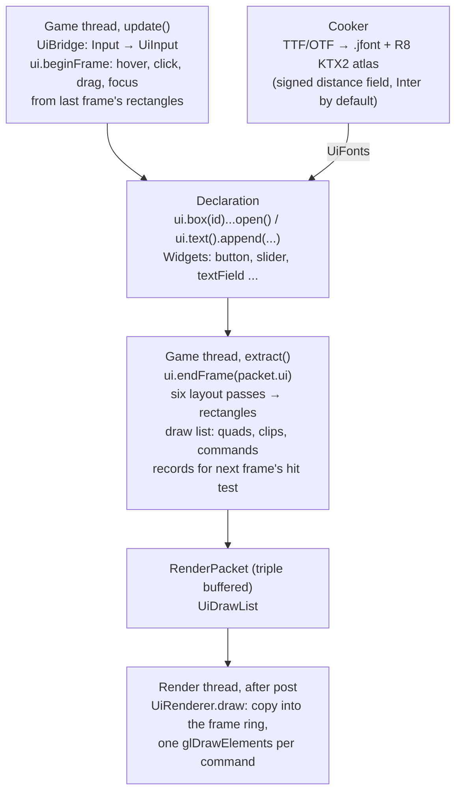
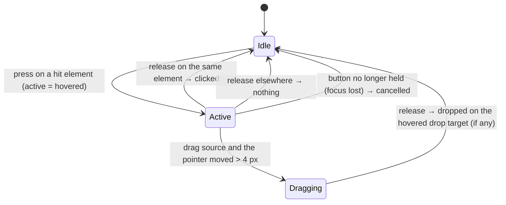

# 13. The user interface: immediate mode, flex layout and distance-field text

A CRPG shows a lot of interface: portraits with health bars, an inventory you drag things around
in, a combat log that scrolls, dialogue, tooltips, a pause menu, and later the editor's panels,
trees and property grids. Milestone M13 built all of that in pure Java on top of the renderer:
no Dear ImGui, no native toolkit, no second window system. This chapter explains how the game
declares a screen every frame and gets back a tree that is sized, positioned, hit-tested and turned
into a handful of triangles; how text is rendered sharply at any size from one small texture; and
how the whole thing stays at zero bytes per frame.

You will learn:

- what *immediate mode* means and why it fits a game whose state lives in its own data;
- how a flex-like layout computes sizes from content and available space in six passes, with
  the algorithm derived and checked against hand-computed rectangles;
- why interaction uses the previous frame's rectangles, and the state machine behind hover,
  press, click, drag and drop and keyboard focus;
- how signed-distance-field fonts are baked (an exact Euclidean distance transform, derived) and
  decoded in a fragment shader with screen-space antialiasing;
- what a UI draw list is, how one draw call renders a whole frame, and how clipping, rounded
  corners, borders and premultiplied blending work in the shader;
- how widgets are compositions of boxes plus interaction state, and how the demo builds its
  screens;
- the threads involved: the game thread builds, the render thread draws, the main thread owns
  SDL's text input and clipboard.

Where it lives:

| Area | Code |
|---|---|
| Context, layout, interaction, draw list | `modules/ui`: [`Ui`](../../modules/ui/src/main/java/dev/jeddy/ui/Ui.java), [`Box`](../../modules/ui/src/main/java/dev/jeddy/ui/Box.java), [`UiDrawList`](../../modules/ui/src/main/java/dev/jeddy/ui/UiDrawList.java), [`UiInput`](../../modules/ui/src/main/java/dev/jeddy/ui/UiInput.java) |
| Widgets | [`Widgets`](../../modules/ui/src/main/java/dev/jeddy/ui/Widgets.java), [`Theme`](../../modules/ui/src/main/java/dev/jeddy/ui/Theme.java), [`TextBuffer`](../../modules/ui/src/main/java/dev/jeddy/ui/TextBuffer.java), [`Sprite`](../../modules/ui/src/main/java/dev/jeddy/ui/Sprite.java) |
| Fonts | [`FontCooker`](../../tools/cooker/src/main/java/dev/jeddy/cooker/font/FontCooker.java), [`DistanceField`](../../tools/cooker/src/main/java/dev/jeddy/cooker/font/DistanceField.java), [`FontData`](../../modules/asset/src/main/java/dev/jeddy/asset/format/FontData.java), [`FontLoader`](../../modules/ui/src/main/java/dev/jeddy/ui/FontLoader.java) |
| Rendering | [`UiRenderer`](../../modules/render/src/main/java/dev/jeddy/render/ui/UiRenderer.java), [`RenderPacket.ui`](../../modules/render/src/main/java/dev/jeddy/render/RenderPacket.java), [`WorldRenderer`](../../modules/app/src/main/java/dev/jeddy/app/world/WorldRenderer.java) |
| App glue | [`UiBridge`](../../modules/app/src/main/java/dev/jeddy/app/ui/UiBridge.java), [`UiFonts`](../../modules/app/src/main/java/dev/jeddy/app/ui/UiFonts.java), [`Clipboard`](../../modules/window/src/main/java/dev/jeddy/window/Clipboard.java) |
| The demo's screens | [`DemoUi`](../../samples/iso-demo/src/main/java/dev/jeddy/samples/iso/DemoUi.java), [`CombatLog`](../../samples/iso-demo/src/main/java/dev/jeddy/samples/iso/CombatLog.java) |
| Tests and benchmark | [`LayoutTest`](../../modules/ui/src/test/java/dev/jeddy/ui/LayoutTest.java), [`InteractionTest`](../../modules/ui/src/test/java/dev/jeddy/ui/InteractionTest.java), [`WidgetsTest`](../../modules/ui/src/test/java/dev/jeddy/ui/WidgetsTest.java), [`DrawListTest`](../../modules/ui/src/test/java/dev/jeddy/ui/DrawListTest.java), [`UiRendererTest`](../../modules/render/src/test/java/dev/jeddy/render/ui/UiRendererTest.java), [`UiBench`](../../bench/src/main/java/dev/jeddy/bench/UiBench.java) |

The design is in [DESIGN.md](../DESIGN.md) §18 and decisions D82 (immediate mode with an
end-of-frame flex layout), D83 (signed-distance-field fonts cooked with `java.desktop`) and D84
(the draw list in the render packet, one draw per texture change). The work was milestone M13 in
[TASKS.md](../TASKS.md). It builds on the render packet and the frame ring of
[06 Renderer architecture](06-renderer-architecture.md), on fragment shaders and derivatives from
[05 OpenGL from Java](05-opengl-from-java.md), on sRGB from [08 Effects and post](08-effects-and-post.md),
and on the zero-allocation rules of [12 Fast Java](12-java-performance.md).

## The whole path at a glance



One frame of game code looks like this (from the demo's
[`DemoUi`](../../samples/iso-demo/src/main/java/dev/jeddy/samples/iso/DemoUi.java), simplified):

```java
bridge.beginFrame(dt);                                   // input → UiInput, ui.beginFrame
w.panel().width(300).open();                             // a column with padding, gap, background
    w.heading("Paused");
    if (w.primaryButton(RESUME, "Resume")) menuOpen = false;
    volume = w.slider(VOLUME, volume, 0, 1);
    vsync = w.checkbox(VSYNC, "Vertical sync", vsync);
ui.close();
...
ui.endFrame(packet.ui);                                  // in extract(): layout + draw list
```

Nothing is retained between frames except what interaction needs. That is the whole idea, and
the rest of this chapter is about making it fast, correct and pleasant to use.

## Immediate mode

### Retained versus immediate

A *retained-mode* toolkit (Swing, Qt, the browser DOM) keeps a tree of widget objects. The game
creates a `Button`, sets its label, attaches a listener, and later updates it when the hit points
change. The widgets own state, and the game's state must be *mirrored* into them. For a game that
is a liability: the hit points live in a `float[]`, the inventory in an `int[]`, and every screen
would need code that keeps two copies in sync. An inspector that shows arbitrary components (the
editor of M14) would be a synchronization problem in its own right.

In an *immediate-mode* toolkit (Dear ImGui is the well-known one) there are no widget objects.
Every frame the game runs a function that declares the interface again:

```java
if (w.button(SAVE, "Save")) save();
hp = w.slider(HP, hp, 0, 100);
```

`button` draws a button and returns whether it was clicked *this frame*; `slider` draws the
current value and returns the new one. The game's data is the only state. What the toolkit keeps
between frames is small and generic: which element is hovered, pressed or focused, scroll
offsets, open tree nodes, text carets.

The cost is that the interface is rebuilt every frame. For a few hundred to a few thousand
elements that is microseconds, as the benchmark at the end shows, and it is why the module is
built around arrays rather than objects.

### Where Jeddy differs from Dear ImGui: layout at the end of the frame

Dear ImGui lays widgets out as they are declared: a *cursor* moves down (or right after
`SameLine()`), and a widget's size is decided the moment it is declared. Simple, but the author
computes sizes by hand: "how wide should this column be so the three buttons fit?" needs the
button widths, which depend on their labels, before the buttons are declared.

Jeddy follows [Clay](https://github.com/nicbarker/clay) instead (D82): declaring builds a *tree*,
and the tree is laid out at the end of the frame by a flex-like algorithm. Sizes can depend on
content ("fit") and on the available space ("grow", "percent"), and text wraps to the width it
ends up with. The price is that during declaration nothing has a position yet. Interaction
therefore uses the rectangles computed at the end of the *previous* frame. At 60 Hz that latency
is 16 ms, which nobody notices for hovering and clicking, and it is the same trade browsers make
when they batch layout.

### The element tree is a set of arrays

A `Ui` context holds the elements of the current frame in parallel arrays sized at creation
(`UiConfig`, default 4,096 elements). From [`Ui.java`](../../modules/ui/src/main/java/dev/jeddy/ui/Ui.java):

```java
long[] ids;
int[] parent;
int[] firstChild;
int[] lastChild;
int[] nextSibling;
int[] flags;
byte[] direction;
/** Per axis (0 = x, 1 = y): size mode, mode value (fixed size, weight, fraction), bounds. */
final byte[][] mode = new byte[2][];
final float[][] value = new float[2][];
final float[][] min = new float[2][];
final float[][] max = new float[2][];
...
final float[][] size = new float[2][];
final float[][] floor = new float[2][];
final float[][] pos = new float[2][];
final float[][] content = new float[2][];
```

The per-axis arrays are the trick that keeps the layout code short: `mode[0]` is the width mode
and `mode[1]` the height mode, so the same pass runs twice with an axis parameter. Elements are
appended in declaration order, which is a *pre-order* traversal of the tree (a parent always has a
smaller index than its children). That ordering gives both traversal directions for free: a loop
from 0 to `count` visits parents before children, a loop from `count - 1` down visits children
before parents. No recursion, no stack, no objects.

Declaring an element is `newElement`, which appends and links:

```java
int e = count++;
int p = parentDepth > 0 ? parentStack[parentDepth - 1] : -1;
ids[e] = id;
parent[e] = p;
firstChild[e] = -1;
lastChild[e] = -1;
nextSibling[e] = -1;
if (p >= 0) {
    if (firstChild[p] < 0) {
        firstChild[p] = e;
    } else {
        nextSibling[lastChild[p]] = e;
    }
    lastChild[p] = e;
}
```

and then resets every property to its default. `Box` is a single reusable builder object whose
setters write into these arrays at the current index (`ui.mode[0][cur] = FIXED`), so a chain like
`ui.box(id).width(200).padding(8).background(c).open()` allocates nothing.

Text is handled the same way. `ui.text()` begins a text element whose characters are a span of
the frame's `char[]` buffer, and `append` copies characters (or formats numbers digit by digit)
into it. There is no `String` per frame, which matters: "HP 73/100" formatted with
`String.format` would allocate several objects, and a status panel does that forty times a frame.

### Ids

Elements that interact or keep state carry a 64-bit id, usually `StrId.of("save")` hashed once
into a constant (chapter 01 explains `StrId`). Inside a list every row would otherwise reuse the
same ids, so `pushId(i)` / `popId()` scope them: `resolve(id)` combines the id with the scope
stack with a mixing function, and every query (`clicked(id)`, `hovered(id)`) resolves the same
way, so a widget declared and queried in the same scope agrees with itself.

## The layout algorithm

### The sizing model

Each axis of an element is one of four modes:

| Mode | Meaning | Box call |
|---|---|---|
| `FIXED` | a size in pixels | `width(200)` |
| `FIT` | the content: children plus padding, clamped to a minimum and maximum | the default, `widthFit(min, max)` |
| `GROW` | a share of the parent's free space, by weight | `widthGrow()`, `widthGrow(2)` |
| `PERCENT` | a fraction of the parent's inner size | `widthPercent(0.25f)` |

A box lays its children out in a `ROW` or a `COLUMN`, with padding on each side, a gap between
children, and an alignment per axis (`START`, `CENTER`, `END`) for when the children do not fill
it. The axis the children are laid along is the *main* axis; the other is the *cross* axis.
Floating elements (popups, tooltips, the dragged item) leave the flow: they are sized on their own
and attached to an anchor of their parent's rectangle, or of the screen, or of another element's
rectangle from the previous frame.

This is deliberately a subset of CSS flexbox. There is no `flex-basis`, no `align-self` per
child, no reverse directions. Every feature a game screen or an inspector needed in practice is
expressible, and the algorithm stays a few hundred lines that a reader can hold in their head.

### Why six passes

Widths come first because text wrapping needs the final width before the height is known: a
paragraph's height is its line count times the line height, and its line count depends on its
width. So:

1. **Fit widths** (children before parents): fixed widths are known; a fit box is the sum (row)
   or the maximum (column) of its children plus gaps and padding; text measures its longest line.
2. **Grow and shrink widths** (parents before children): percent children take their fraction;
   free space goes to grow children; overflow is taken back from the children that can shrink.
3. **Wrap text**: with final widths, text breaks into lines.
4. **Fit heights**, 5. **grow heights**: as 1 and 2 with the axis swapped; text's height is now
   known.
6. **Positions** (parents before children): children are placed along the main axis from the
   padding edge, aligned, minus the scroll offset; floating children are attached last.

Passes 1 and 4 are one method, `fitPass(axis)`, and 2 and 5 are `growPass(axis)`.

### Pass 1: fit, and the shrink floor

The fit pass computes two numbers per element and axis: its `size` and its `floor`, the smallest
size it can be shrunk to. From `fitPass`:

```java
for (int e = count - 1; e >= 0; e--) {
    float natural;
    float floorSize;
    if ((flags[e] & F_TEXT) != 0) {
        if (a == 0) {
            measureText(e);
            natural = naturalWidth[e];
            floorSize = (flags[e] & F_WRAP) != 0 ? longestWord[e] : natural;
        } else {
            natural = lineCount[e] * lineHeight(font[e], fontSize[e]);
            floorSize = natural;
        }
    } else {
        boolean main = direction[e] == a;
        float sum = 0, big = 0, floorSum = 0, floorBig = 0;
        int n = 0;
        for (int c = firstChild[e]; c >= 0; c = nextSibling[c]) {
            if ((flags[c] & F_FLOATING) != 0) continue;
            float s = sz[c];
            float f = fl[c];
            if (main) { sum += s; floorSum += f; n++; }
            else { big = Math.max(big, s); floorBig = Math.max(floorBig, f); }
        }
        float gaps = n > 1 ? gap[e] * (n - 1) : 0;
        float padding = p0[e] + p1[e];
        natural = (main ? sum + gaps : big) + padding;
        floorSize = (main ? floorSum + gaps : floorBig) + padding;
        if (scrollable) floorSize = padding;
    }
    switch (md[e]) {
        case FIXED -> { sz[e] = value[a][e]; fl[e] = sz[e]; }
        case FIT -> { sz[e] = Math.clamp(natural, mn[e], mx[e]); fl[e] = Math.min(Math.max(floorSize, mn[e]), sz[e]); }
        case GROW -> { fl[e] = Math.min(Math.max(floorSize, mn[e]), mx[e]); sz[e] = fl[e]; }
        default -> { fl[e] = Math.max(floorSize, mn[e]); sz[e] = fl[e]; }   // PERCENT
    }
}
```

The floor is what makes overflow behave. Wrapping text can shrink down to its *longest word*
(it will wrap the rest); unwrapped text cannot shrink at all; a fit box can shrink as far as its
children's floors allow; a scroll box's content may be any size, so its floor is just its padding;
a grow box starts at its floor and is given more in the next pass. This is the same bottom-up
"minimum dimensions" idea Clay uses.

A worked example, from `LayoutTest.rootIsTheScreenAndFitBoxesWrapTheirChildren`: a row with
padding 10 and gap 5 holding a 20×10 and a 30×10 box. Pass 1 visits the children (fixed: sizes
20 and 30), then the row: `natural = 20 + 5 + 30 + 20 = 75` wide and `10 + 10 + 10 = 30` tall.
The test asserts exactly those rectangles.

### Pass 2: distributing space, smallest first

With the parent's width final, `growPass` sets the children. Percent children take their
fraction of the parent's *inner* width (width minus padding). On the cross axis a grow child
simply fills the inner size. On the main axis the remaining space after the children's current
sizes and the gaps goes to the grow children.

How should two grow children share 200 px? Proportionally to their weights, obviously, but from
what starting point? CSS flexbox adds the share to each child's *basis* (by default its content
size), so two equal-weight buttons with labels "OK" and "Cancel" end up with different widths.
That is rarely what a game screen wants. Jeddy follows Clay: raise the **smallest** children
first until they catch up with the next larger one, then raise that group, and so on, so
equal-weight children converge to equal sizes whenever there is room. With weights, "smallest"
means the smallest `size / weight`. From `distribute`:

```java
for (int guard = 0; guard < 1024 && remaining > EPS; guard++) {
    float r0 = INF;   // smallest size/weight among the candidates
    float r1 = INF;   // the next one up
    float w0 = 0;     // total weight of the children at r0
    for (int c = firstChild[e]; c >= 0; c = nextSibling[c]) {
        if ((flags[c] & F_FLOATING) != 0 || md[c] != GROW || sz[c] >= mx[c] - EPS) continue;
        float w = weight(wt[c]);
        float r = sz[c] / w;
        if (r < r0 - EPS) { r1 = r0; r0 = r; w0 = w; }
        else if (r <= r0 + EPS) { w0 += w; }
        else if (r < r1) { r1 = r; }
    }
    if (w0 == 0) return;
    float target;
    if (r1 == INF || (r1 - r0) * w0 > remaining) {
        target = r0 + remaining / w0;   // not enough to reach the next group: share what is left
    } else {
        target = r1;                     // lift this group up to the next one
    }
    for (each child c at r0) {
        float ns = Math.min(target * w, mx[c]);
        remaining -= ns - sz[c];
        sz[c] = ns;
    }
}
```

Each iteration either spends all the remaining space, merges the smallest group into the next
one (the number of distinct ratios drops), or caps a child at its maximum (it leaves the
candidate set). So the loop ends after at most a few iterations per distinct size; the `guard`
is a belt and braces.

Numbers, from `LayoutTest.growIsCappedByMaximumsAndStartsFromItsContent`: a 300 px row with two
grow boxes whose contents are 80 and 20 px wide. Pass 1 gives them floors and sizes 80 and 20;
remaining is 200. Iteration 1: `r0 = 20`, `r1 = 80`, lifting the small one to 80 costs 60 ≤ 200,
so it becomes 80 and 140 remain. Iteration 2: both at 80, no `r1`, so each gets 70: **150 and
150**. In a 110 px row only 10 remain, so the small one goes to 30 and the big one stays at 80.
The test checks all three rectangles.

### Shrinking, largest first

When the children overflow (and the parent does not scroll on that axis), `shrink` takes the
overflow back from the **largest** shrinkable children first, lowering the biggest group to the
next one down, each child stopping at its floor. It mirrors `distribute` with the comparisons
flipped. In `LayoutTest.textMeasuresWrapsAndShrinksToItsLongestWord`, a 100 px row holds the
wrapping text "aaaa bbbb" (45 px at 5 px per character, floor 20 = the longest word) and an 80 px
fixed box: the overflow of 25 comes out of the text, which lands exactly at its floor, 20 px, and
wraps onto two lines in pass 3. Without `wrap()` the same text cannot shrink and the row overflows
by 25 px instead, which the test also checks.

### Pass 3: wrapping

`measureText` (run in pass 1) already stored, per character, its glyph index and its advance in
pixels, so wrapping is a scan, not a second measurement:

```java
while (j < to) {
    int g = glyphs[j];
    if (g == -1) { addLine(i, j, w); i = j + 1; broke = true; break; }   // '\n'
    if (g == -2) { j++; continue; }                                       // low surrogate
    char c = chars[j];
    if (c == ' ' || c == '\t') { lastBreak = j; widthAtBreak = w; }
    float adv = advances[j];
    if (wrap && w + adv > maxWidth + EPS && j > i) {
        if (lastBreak >= 0) { addLine(i, lastBreak, widthAtBreak); i = lastBreak + 1; }
        else { addLine(i, j, w); i = j; }                                 // a word longer than the line
        broke = true;
        break;
    }
    w += adv;
    j++;
}
```

Greedy breaking at spaces, mid-word when a word is wider than the line, `\n` always breaks, a
trailing newline opens an empty line, and an empty text is still one line tall (so an empty text
field keeps its height). Lines are ranges into the character buffer plus a width; drawing uses
them to align each line (`textAlign`).

### Pass 6: positions, scrolling and floating

With sizes known, positions are a pre-order walk: a child's position is its parent's padding
edge plus an alignment offset plus the sizes and gaps of the siblings before it, minus the
parent's scroll offset. The scroll offset lives in the context's *state store* (below) keyed by
the box's id; pass 6 clamps it to `[0, content − size]` using the content size pass 2 recorded,
so a list that shrinks never shows empty space below its last row.

Floating elements are placed after their parent's other children. Nine anchors (`TOP_LEFT`,
`TOP`, ..., `BOTTOM_RIGHT`, `MIDDLE`) encode a point of a rectangle as a fraction pair, and the
rule is:

```math
\mathbf{p} = \mathbf{t}_{pos} + a_{target} \odot \mathbf{t}_{size} - a_{own} \odot \mathbf{s} + \mathbf{offset}
```

"the target's anchor point meets the element's own anchor point". A tooltip is `anchor(BOTTOM_LEFT,
TOP_LEFT)` of its target plus `offset(0, 4)`; a centered dialog is `anchor(MIDDLE, MIDDLE)` of the
screen. Floating boxes are clamped back onto the screen unless told otherwise, which is what
keeps a tooltip near the right edge readable (`LayoutTest.floatingElementsAttachToAnchorsAndStayOnScreen`).

## Interaction

### Records: the previous frame's rectangles

At the end of `endFrame`, while emitting the draw list, every element that has an id or blocks
the pointer is *recorded*: its rectangle, the clip rectangle in force where it was drawn, its
flags (hit-testable, focusable, drag source, drop target, scrollable), the id of the floating
subtree it belongs to, and for scroll boxes the geometry of their scrollbars. Records are written
in draw order, which is also z-order: a later record is on top of an earlier one.

`beginFrame` of the *next* frame hit-tests the pointer against those records:

```java
for (int i = 0; i < recCount; i++) {
    if (!contains(i, mx, my)) continue;                 // inside the rectangle and its clip
    int f = recFlags[i];
    if ((f & F_SCROLLBAR) != 0) { barRec = i; pointerOverUi = true; continue; }
    if ((f & F_HIT) != 0) {
        pointerOverUi = true;
        hovered = recId[i];                             // the last hit wins: it is drawn on top
        hoveredRec = i;
        barRec = -1;
    }
    if ((f & F_DROP_TARGET) != 0) hoveredDrop = recId[i];
    if ((f & (F_SCROLL_X | F_SCROLL_Y)) != 0) wheelRec = i;
}
```

A linear scan over a few hundred records costs a microsecond or two; a spatial structure would be
more code for nothing. The clip check matters: a row scrolled out of its list is still laid out
(at a position above the list) but its clip rectangle, the list's, does not contain the pointer,
so it is not hovered. `InteractionTest.clippedChildrenAreNotHitOutsideTheirParent` is the test.

Anything drawn blocks the pointer by default (a panel with a background, a sprite), so a click on
a panel never falls through to the world; text does not. `wantsMouse()` tells the game whether
the pointer is on the UI at all, and the demo skips world picking when it is.

### The press/release state machine



`clicked` is an *edge*: true in the frame of the release only, which is why `button` returns
`ui.clicked(id)` and nothing else. Two clicks on the same id within 0.35 s make a double click. A
press also sets keyboard focus to the element if it is focusable, or clears it (so clicking on
empty space blurs a text field), and it records which floating subtree the press landed in, which
is how a popup knows a click outside it should close it:

```java
} else if (open
        && ui.pressedThisFrame()
        && ui.pressedFloating() != ui.resolve(popupId)
        && ui.pressedId() != ui.resolve(id)) {
    open = false;
}
```

Drag and drop carries a payload declared by the source (`dragSource(kind, value)`), copied into
the drag when it starts; a drop target asks `dropped(id)` and reads `dragKind()`/`dragValue()`.
The inventory moves items between slots this way in three lines, and the dragged item is a
floating box at the pointer with a high z.

### Keyboard focus and navigation

Tab and Shift+Tab move focus along the focusable records in draw order; the arrow keys do the
same unless the focused element `captureKeys()` (text fields, sliders), Enter or Space activate
an element declared with `activateWithKeys()` (buttons report a click), Escape blurs. The
gamepad's d-pad and face buttons arrive as the same key events through `UiBridge`, and
`showFocus()` says whether to draw focus rings: it turns on when the keyboard or a gamepad is
navigating and off at the next mouse press, as browsers do with `:focus-visible`.

### Scroll boxes and their bars

The wheel scrolls the innermost scroll box under the pointer by 40 px per line. Scrollbars are
drawn by the context after the box's children, on top, and recorded with the thumb's position
and length, so a press on the thumb starts a bar drag and a press on the track pages. All of
that lives in `beginFrame`; widgets never see it.

### The state store

Some widgets need a few numbers across frames: a scroll offset, whether a tree node is open, a
text field's caret blink time, a window's position. The context keeps a small store of slots
(four floats and two ints each) in a `LongIntMap` keyed by id, returned by `state(id)`. Slots
untouched for two frames are recycled when the store is full, so a list that stops being
declared gives its slots back. It is the only "retained" data besides the records, and widgets
address it by id, never by reference, so the game can rearrange its screens freely.

## Text: signed-distance-field fonts

### Why not bitmaps

The simplest font renderer rasterizes each glyph at one size into a texture and draws quads.
Scaled up it blurs, scaled down it aliases, and a UI that needs 12, 15, 20 and 32 px text, times
display scales of 1×, 1.5× and 2×, needs a texture per size. Valve's 2007 trick is to store, not
coverage, but the *signed distance to the outline*: positive inside, negative outside, in pixels.
Bilinear interpolation of a distance field reconstructs the outline well even when magnified,
because the field is nearly linear across an edge, and one atlas serves every size (D83).

### Baking: rasterize, distance-transform, pack

The cooker does not contain a TrueType parser. The JDK's `java.desktop` module does, and the
cooker may depend on JDK modules (it is a tool, not a runtime module). `FontCooker` loads the
font with `Font.createFont` (which reads OpenType CFF files too, despite the constant's name),
derives it at the reference size (48 px em) with kerning on, and rasterizes each glyph's outline
antialiased into a grayscale image with 8 px of padding around it:

```java
g.setRenderingHint(RenderingHints.KEY_ANTIALIASING, RenderingHints.VALUE_ANTIALIAS_ON);
...
// The glyph origin (pen at the baseline) lands at (-x0, -y0) in the image.
g.fill(gv.getOutline(-x0, -y0));
```

The coverage image then goes through `DistanceField.signed`. Two things happen there.

**The exact Euclidean distance transform.** For every pixel we need the distance to the nearest
"on" pixel. Brute force is `O(n²)`; Felzenszwalb and Huttenlocher's algorithm is `O(n)` and
exact. Write the squared distance of pixel `q` as

```math
D(q) = \min_p \left( (q - p)^2 + f(p) \right)
```

where `f(p)` is 0 at source pixels and ∞ elsewhere. In one dimension each source `p` contributes
a parabola `(q − p)² + f(p)`, and `D` is their *lower envelope*. The envelope of parabolas with
equal curvature can be built in one left-to-right sweep: keep the parabolas that are currently
part of the envelope and the boundaries between them; a new parabola from `q` intersects the last
one at

```math
s = \frac{(f(q) + q^2) - (f(p) + p^2)}{2q - 2p}
```

and if `s` is left of the previous boundary, the last parabola is nowhere on the envelope and is
popped. That is `transform1d`:

```java
for (int q = 1; q < n; q++) {
    float s = intersect(f, q, v[k]);
    while (s <= z[k]) {            // the new parabola hides the last one entirely
        k--;
        s = intersect(f, q, v[k]);
    }
    k++;
    v[k] = q;                      // vertex of the k-th parabola on the envelope
    z[k] = s;                      // where it takes over
    z[k + 1] = INF;
}
```

followed by a second sweep that reads the envelope off. The two-dimensional transform is the
one-dimensional one applied to rows and then to columns, because
`min_{p} ((x − p_x)² + (y − p_y)²) = min_{p_x} ((x − p_x)² + min_{p_y} ((y − p_y)² + f))`:
the inner minimum over `p_y` is the column transform, the outer the row transform.
`FontCookerTest` checks the result on a disc, where the exact distance is known (radial error
below 0.6 px, mostly from the binary mask's pixel centers).

**Sub-pixel refinement.** A binary mask knows distances in whole pixels, so the outline would sit
at pixel centers. The antialiased coverage `c` of an edge pixel says where the outline really is:
a pixel 70% covered has the edge about 0.2 px inside its center. So

```java
if (c > 0 && c < 255) {
    sd[i] = c / 255f - 0.5f;                        // the outline runs through this pixel
} else if (c == 255) {
    sd[i] = (float) Math.sqrt(outside[i]) - 0.5f;   // inside: half a pixel before the first outside center
} else {
    sd[i] = 0.5f - (float) Math.sqrt(inside[i]);
}
```

The distance is stored in one byte as

```math
v = \frac{1}{2} + \frac{d}{2R}, \quad R = 8 \text{ px}
```

so 128 is the outline, 255 is 8 px or more inside, 0 is 8 px or more outside. The glyph
bitmaps are packed on *shelves* (rows of the atlas sorted by height, tallest first), the atlas
starts at 256² and doubles until everything fits (Inter's 354 glyphs fit in 1024²), and the
result is an R8 KTX2 texture plus a `.jfont` with the line metrics, per-glyph advances, bearings,
sizes and atlas rectangles, and the kerning pairs.

Kerning deserves a note: `Font.createGlyphVector` ignores the font's GPOS kerning table, so the
pair "AV" measured the same as "AA". `layoutGlyphVector(frc, chars, 0, 2, LAYOUT_LEFT_TO_RIGHT)`
applies it; the cooker measures every pair of ASCII letters and punctuation and keeps the 1,017
pairs that differ from zero.

Inter (SIL Open Font License) is bundled in the cooker and written as a built-in output,
`engine/fonts/inter.jfont` and `.ktx2`, of every cook, like the BRDF LUT, so every game has a
font without asking. A game adds its own fonts by dropping a `.ttf`/`.otf` into its assets.

### Decoding in the shader

A glyph is one quad whose texture coordinates cover its atlas rectangle. The fragment shader
samples the atlas (bilinear), turns the byte back into a distance, and converts it to
*screen-space* pixels:

```glsl
float s = texture(fontAtlas, vec3(uv, layer)).r;
float d = (s - 0.5) * params.x;      // params.x = 2R × size / em, computed per text element
float aa = max(fwidth(d), 1e-4);
coverage = clamp(d / aa + 0.5, 0.0, 1.0);
```

Why `params.x = 2R · size / em`: the atlas stores `(s − 0.5) · 2R` atlas pixels, and the glyph
is drawn at `size / em` of its atlas scale (15 px text from a 48 px atlas is 0.3125), so the
distance in screen pixels is the product. The game thread computes it once per text element and
writes it into every glyph vertex.

Why `fwidth`: `fwidth(d) = |∂d/∂x| + |∂d/∂y|` is how much the distance changes across one
screen pixel. For an upright edge at scale 1 it is 1, for text drawn at half size it is 2 (the
field changes twice as fast per screen pixel), and the formula `d / aa + 0.5` then maps the
pixel that straddles the outline to a coverage between 0 and 1, which is exactly the antialiasing
a rasterizer would produce. The GPU test draws a 20 px disc and reads back 0.75 at the pixel the
edge crosses a quarter of the way in (`UiRendererTest.glyphsDecodeTheDistanceFieldWithAntialiasedEdges`).

The limits are the usual ones of single-channel SDFs: sharp corners round off slightly when
magnified far beyond the atlas size (MSDF fixes that at the cost of a contour-aware encoder), and
very small text (under about 9 px) loses hinting. For a UI that reads at 12–32 px it is a good
trade (D83).

### Measuring and drawing on the game thread

`measureText` walks a text element's characters once, looking up each glyph (a direct table for
code points below 256, binary search above) and its advance, adding kerning into the previous
character's advance, and recording the longest line and the longest word. `drawText` then emits
one quad per glyph with a bitmap:

```java
float gx = pen + fd.bearingX(g) * s;
float gy = baseline - fd.bearingY(g) * s;
out.glyph(gx, gy, gw * s, gh * s, u0, v0, u0 + gw * invW, v0 + gh * invH, color, tex, pxRange, clip);
pen += adv[j];
```

The baseline of line `k` is `y + k · lineHeight + ascent`, with the metrics scaled from the em
size. Line starts and baselines are rounded to whole pixels, because a glyph straddling a pixel
boundary is blurrier than one aligned to it, while glyphs within a line keep their fractional
advances so spacing stays even.

## The draw list and the renderer

### One vertex format for everything

A frame of UI becomes a `UiDrawList`: vertices, indices, a table of clip rectangles and a list of
commands. Every vertex is ten floats (D84):

```
0 x, 1 y        window position (logical pixels, y down)
2 u, 3 v        atlas coordinates (text, images) or the position relative to the rectangle's
                center in pixels (rectangles)
4 color         0xAARRGGBB as float bits (sRGB, straight alpha)
5 misc          kind (bits 0-3) | clip index (bits 4-15) | texture layer (bits 16-31) as bits
6-9 p0..p3      RECT: half width, half height, corner radius, border width (0 = filled)
                TEXT: the screen-space distance range (pixels per unit of distance)
```

Rectangles, glyphs and images share the format and one shader; a `kind` field selects the
branch. The alternative, a vertex format and a program per kind, would mean three buffers and
batch splits whenever a label follows a panel; one 40-byte vertex costs a few unused floats per
glyph and nothing else.

Two integers travel inside floats: the color and the `misc` word, written with
`Float.intBitsToFloat`. Java never touches the bits of a `float[]` element it only copies, and the
vertex shader declares the buffer as `uint v[]` and uses `uintBitsToFloat` for the real floats,
so no NaN pattern is ever interpreted as a number on either side. (Declaring the buffer as
`float[]` and using `floatBitsToUint` in GLSL would be the risky direction: some drivers
canonicalize NaNs on float loads.)

### Commands and clipping

A command is an index range plus the font and sprite textures it needs. `UiDrawList.need`
starts a new command only when a quad needs a texture that differs from the running command's,
and a command *adopts* a texture it had no value for yet, so a frame with one font and one
sprite sheet is one command: one `glDrawElements`.

Clipping is what usually breaks batching: a scissor rectangle is GL state, so every scroll box
would split the draw. Instead, each element that clips adds a rectangle to the clip table
(intersected with the enclosing clip), and each vertex stores the index of the clip it is drawn
under. The fragment shader reads it from a storage buffer and discards pixels outside:

```glsl
vec4 c = clips[clip] * scale;                       // x, y, w, h in physical pixels
vec2 p = vec2(gl_FragCoord.x, viewport.y - gl_FragCoord.y);
if (p.x < c.x || p.y < c.y || p.x >= c.x + c.z || p.y >= c.y + c.w) discard;
```

Twelve bits of clip index allow 4,096 clip rectangles per frame; beyond that, elements fall back
to "no clip" rather than crash.

### Rounded rectangles and borders as distance fields

The same signed-distance idea renders rectangles. A rectangle vertex carries its position
relative to the rectangle's center (in `uv`) and the half size, corner radius and border width
in `params`. The distance from a point `q` to a rounded rectangle of half size `b` and radius
`r` is the classic formula:

```math
d(\mathbf{q}) = \left\| \max(|\mathbf{q}| - (\mathbf{b} - r), 0) \right\| + \min(\max(q_x', q_y'), 0) - r, \quad \mathbf{q}' = |\mathbf{q}| - (\mathbf{b} - r)
```

negative inside, in pixels. The shader converts it to coverage with the same `fwidth` trick as
text, and a border is the band `−w ≤ d ≤ 0`:

```glsl
vec2 q = abs(uv) - (params.xy - params.z);
float d = length(max(q, 0.0)) + min(max(q.x, q.y), 0.0) - params.z;
float aa = max(fwidth(d), 1e-4);
coverage = clamp(0.5 - d / aa, 0.0, 1.0);
if (params.w > 0.0) {
    coverage *= clamp(0.5 + (d + params.w) / aa, 0.0, 1.0);
}
```

So every rectangle, rounded or not, bordered or not, is a single quad with antialiased edges at
any size, and there is no corner mesh to generate on the CPU.

### Premultiplied alpha and sRGB

The UI draws onto the finished display image, after post-processing has tone-mapped and encoded
it to sRGB (chapter 08). Blending happens in sRGB space, which is what every 2D toolkit and
browser does, so the theme's hex colors look as a designer expects. The shader outputs
premultiplied color (`rgb × a`, `a`) and the blend state is `ONE, ONE_MINUS_SRC_ALPHA`
(`PipelineState.BLEND_PREMULTIPLIED`). Premultiplied blending has two properties that matter
here: a quad with coverage 0 contributes exactly nothing (no dark fringes on antialiased edges),
and texture filtering of premultiplied sprites does not bleed the color of transparent texels.

Sprites cooked as sRGB textures (the usual "color" usage) are decoded to linear by the sampler,
so `UiRenderer` re-encodes them (`encodeSrgb`) when the bound array is an sRGB format, and leaves
UNORM textures alone; `GpuFormats.isSrgb` decides per bucket.

### Vertex pulling and the frame ring

`UiRenderer.draw` copies the list's vertices, indices and clips into the UI's frame ring (the
triple-buffered persistent buffer of chapter 06), binds the vertex region as a storage buffer
and the clip region as another, binds the ring itself as the element buffer, and draws:

```java
state.bindStorage(4, ring.glName(), vAt, vBytes);
state.bindStorage(5, ring.glName(), cAt, cBytes);
...
for (int c = 0; c < n; c++) {
    if (font != UiDrawList.NO_TEXTURE) state.bindTexture(0, arrays.glName(font));
    if (sprite != UiDrawList.NO_TEXTURE) state.bindTexture(1, arrays.glName(sprite));
    glDrawElements(GL_TRIANGLES, list.commandIndexCount(c), GL_UNSIGNED_INT, iAt + (long) list.commandFirstIndex(c) * 4);
}
```

The vertex shader reads `v[gl_VertexID * 10 + k]` from the storage buffer ("vertex pulling"), so
there is no vertex attribute setup at all: the VAO only has an element buffer. Texture references
in the list are `TextureArrays` references (chapter 06): the high 16 bits select the array texture
to bind (a *bucket*: one per format and size), the low 16 bits the layer, stored per vertex.
Font atlases and sprite sheets are ordinary texture assets, so they stream, hot-reload and share
the material system's arrays.

Coordinates are *logical* pixels. The vertex shader maps them to clip space with the logical
screen size, and the clip test multiplies the clip table by the display scale to compare in
physical pixels. A UI declared at 1280×720 looks the same on a 2× display, and the SDF text is
simply sharper.

## Widgets

### A widget is a function

`Widgets` holds a `Ui` and a `Theme` and turns a composition of boxes plus the interaction state
into a familiar control. A button:

```java
public boolean button(long id, CharSequence label, boolean enabled) {
    Box b = ui.box(id)
            .height(theme.widgetHeight)
            .padding(theme.padding, 0)
            .align(Ui.CENTER, Ui.CENTER)
            .radius(theme.radius)
            .background(widgetColor(id, enabled));      // hover and press colors from last frame's state
    if (enabled) b.focusable().activateWithKeys(); else b.disabled();
    focusRing(b, id);
    b.open();
    ui.text(label).color(enabled ? theme.text : theme.textDim);
    ui.close();
    return enabled && ui.clicked(id);
}
```

There is no `Button` class, no listener, no event. A check box returns the new value; a slider
maps the active press's pointer x onto its range using its own rectangle from the previous
frame (`ui.lastRecord(id)`); a drop-down keeps "open" in a state slot and declares a floating
popup when it is; a tree node returns whether it is open and the caller declares the children
between it and `treeEnd()`.

### Text fields

The text field is the widget that needs everything: focus, keys, typed text, a caret, a
selection, the clipboard, and horizontal scrolling so the caret stays visible. The text itself
is a `TextBuffer` the game owns, a `char[]` with a caret and a selection anchor that also
implements `CharSequence`, so the field draws it directly. While focused, the widget reads this
frame's key events (arrows with Shift and Ctrl, Home, End, Backspace, Delete, Ctrl+A/C/X/V, Enter)
and typed code points from `UiInput`, edits the buffer in place, and declares its boxes:

- the field is a horizontal scroll box without scrollbars (`scroll(true, false).hideScrollbars()`),
  so the usual scroll machinery keeps the caret in view;
- the selection highlight and the caret are *parent-clipped floating* boxes (`clippedByParent()`)
  placed at the measured widths of the text before the selection and before the caret.

A press places the caret at the character boundary nearest the pointer, dragging extends the
selection, a double click selects everything, and the caret blinks on a timer kept in the state
slot and restarted by every edit. `WidgetsTest.textFieldsEditTheBufferFromKeysAndTypedText`
scripts a whole editing session.

### The demo

The iso demo's [`DemoUi`](../../samples/iso-demo/src/main/java/dev/jeddy/samples/iso/DemoUi.java)
builds everything the demo shows on screen: the status panel (what the debug overlay used to
draw), party portraits with health bars and selection by click, an inventory window with drag
and drop between 24 slots and tooltips, a combat log (a ring of fixed `char[]` lines; the game
writes "Skeleton hits Dara for 7" without a `String`), the pause menu with a volume slider,
check boxes, drop-downs for the window mode and the formation, and the loading screen.

The game and the UI meet in two places. Before the game reads the pointer, `DemoGame` calls
`demoUi.beginFrame(dt)` so that `wantsMouse()` and `wantsKeyboard()` are known, and it skips
world picking and shortcuts when the UI consumed them. At the end of `update` it hands the UI the
frame's facts (counts, flags, timings) and reads back what the player did (a clicked portrait, a
changed option). The split keeps `DemoUi` free of game logic and `DemoGame` free of layout.

## The app glue and the threads

Three threads touch the UI (DESIGN §18 "Threads"):

| Thread | Does |
|---|---|
| game | `UiBridge.beginFrame` copies `Input` into `UiInput`; declaration; `endFrame` into the packet's `UiDrawList` |
| render (main) | `UiRenderer.draw` after post-processing, before the debug overlay |
| main (SDL) | starts and stops text input, pushes and refreshes the clipboard |

`UiInput` is a plain copy of one frame of input in the UI's terms: pointer, button edges and
levels, wheel, key events as SDL scancodes, typed text, modifiers, window size and display scale.
Copying it (a few dozen ints) is what lets the `ui` module avoid a dependency on `input` and
SDL, so its tests script input by filling the struct.

Keyboard focus has a side effect SDL cares about: text events only arrive while *text input* is
started, and starting it on some platforms opens an on-screen keyboard or positions an IME
candidate window. `UiBridge` watches `wantsKeyboard()` and posts `START_TEXT_INPUT` with the
focused field's rectangle (from its record) or `STOP_TEXT_INPUT` through the main-thread command
queue of chapter 01. The clipboard works the same way in reverse: SDL's clipboard calls belong to
the main thread, so `Clipboard` mirrors the text in a `volatile String` that the event pump
refreshes on `SDL_EVENT_CLIPBOARD_UPDATE`, and a copy from a text field posts the text for the
main thread to push. Strings are allocated only for these user actions, never per frame.

Fonts are assets: `UiFonts.load("engine/fonts/inter")` loads the `.jfont` (through `FontLoader`)
and the `.ktx2` (through the texture loader, into a texture array layer), returns a font index at
once, and `update()` swaps the real metrics and atlas in when both are ready. Until then the
context's built-in *metrics-only* font (a monospace of 0.5 em advances that draws nothing) keeps
layouts stable, which is also what makes the layout tests deterministic without any font file.

## Pitfalls

**One frame of latency, everywhere.** `hovered(id)` during declaration answers about last frame's
rectangle. A widget that needs its own size (the slider thumb, the text field's visible width)
reads it with `lastRecord(id)` and must cope with `-1` on the first frame. Tests therefore run one
"warm-up" frame before asserting interaction, and so must any scripted input.

**Bindings must go through the state cache.** The first demo frames drew speckles instead of
text. `UiRenderer` kept its own "last bound font bucket" and skipped the bind when it matched, but
the scene had rebound unit 0 in between. The `StateCache` already deduplicates binds and knows what
every pass did; a second cache on top of it is wrong by construction. The fix was to delete it.

**Integers inside floats.** The draw list stores colors and the `misc` word as float bit
patterns. That is safe as long as nothing does arithmetic on them: `float[]` copies and
`MemorySegment.copy` are bitwise, and the shader reads the buffer as `uint`. Converting the other
way (`floatBitsToUint` on a float load) is not guaranteed to preserve NaN payloads on every
driver.

**Text measuring must match the text field's caret math.** `measureText` applies kerning but
`Ui.measure` (used for caret positions) does not, so the field's text is declared with
`noKerning()`; otherwise the caret drifts by a pixel per kerned pair.

**Glyph quads dominate.** A 2,000-element frame that is mostly text emits ten thousand glyph
quads, and the draw-list writes, not the layout, are the largest cost (the profile at the end).
Cache long static text in fewer elements, and keep a combat log to the lines that fit.

**Allocation lurks in the convenient methods.** `CharSequence.subSequence`, `String.substring`
and `String.valueOf` all allocate. The `Box.append` overloads for ranges, chars, ints and floats
exist so that nothing in a screen needs them; the demo's badge letters are
`append(name, 0, 1)`, not `substring(0, 1)`.

## Performance

**Allocation tests.** `DrawListTest.aFrameOfTwoThousandElementsAllocatesNothing` builds, lays
out and emits a 2,000-element frame with scrolling, hovering, pressing and dragging and asserts
zero bytes with `Allocations.assertNoAllocation` (chapter 12); `WidgetsTest.aFrameOfWidgetsAllocatesNothing`
does the same for a panel of every widget including a focused text field with a selection and an
open drop-down; `UiRendererTest.drawingAllocatesNothing` covers the GL side.

**Benchmark.** `UiBench.frame` is the same 2,002-element list (400 rows, each with a formatted
label, a wrapping text, a spacer and a drag source; about 13,000 glyph quads) with the pointer
moving over it; `UiBench.widgets` is the widget panel. On the two-core development container a
frame of `UiBench.frame` takes about 1.0 ms once warm: roughly 0.35 ms to declare and lay out
and 0.65 ms to emit, of which the 13k glyph quads are nearly all; `UiBench.widgets` takes 13 µs.
The task's 0.3 ms target is met by the declaration and layout, not by a frame with that much
text; CI's nightly JMH run records both against the baseline. The draw itself is one
`glDrawElements` per texture change and a copy of ~0.5 MB into the ring; its CPU cost is below
the resolution of the frame timer.

**The perf capture.** `PerfCapture` gained a `ui` row (the game thread's build, layout and
emission time, budget 0.5 ms) and the allocation probe a `ui` system. A 25-second headless run of
the demo measured avg 0.19 ms, p99 0.36 ms for the demo's screens and 0 B/frame in the second
half (816 B total, all in the first frames).

## Try it

- `./gradlew :ui:test` runs the layout, interaction, widget and draw-list tests in a second; they
  need no window. `./gradlew :render:test --tests '*UiRenderer*'` runs the GPU test under Xvfb
  in CI, or on your desktop as is.
- `./gradlew :iso-demo:run` and press **I** for the inventory (drag items, hover for tooltips),
  **Esc** for the pause menu (try Tab and the arrow keys, then Enter), click portraits, cast a
  fireball (**F**) and watch the combat log. `--show-ui` opens both panels at start, which is how
  the screenshots in the pull request were taken.
- `./gradlew :bench:jmh -Pjmh.includes=UiBench` measures a frame; compare `frame` with and without
  text by editing the benchmark.
- Cook a font of your own: put a `.ttf` into a game's assets with a `<name>.ttf.meta` sidecar
  next to it (`{"size": 48, "range": 8}`; the keys are in `FontImporter`) and load it with
  `UiFonts.load`.

## Exercises

1. **Justify.** Add `SPACE_BETWEEN` as a fourth main-axis alignment that spreads the free space
   into the gaps. Hint: pass 6 computes `free = inner − extent`; divide it by `n − 1` and add it
   to the gap for that parent only. Check: a row of three 20 px boxes in a 100 px parent lands at
   0, 40 and 80.
2. **Min and max for percent.** `widthPercent(0.5f).minWidth(80)` already clamps; write a layout
   test that proves it, then make `PERCENT` children count towards a `FIT` parent's size (today
   they count as 0; decide what the right answer is and document it).
3. **Word wrap with hyphens.** Allow breaking after `-` as well as spaces in `wrapPass`. Hint:
   treat the hyphen like a space for `lastBreak`, but keep it on the line (do not skip it when
   the next line starts).
4. **A color swatch widget.** A box showing a color that opens a popup with three sliders (R, G,
   B) and returns the new `0xAARRGGBB`. Hint: `beginPopup` anchored to the swatch, three
   `slider` calls, `Box.append(int)` for the hex digits (write a small hex formatter).
5. **Measure the text cost.** Replace the wrapping text in `UiBench.frame` with a fixed box of the
   same size and measure the difference; then try to make `UiDrawList.glyph` cheaper (fewer
   stores per vertex, or a specialised `glyphRun` that takes a whole line) and see how far it
   goes.
6. **An MSDF atlas.** Read the msdfgen paper and add a 3-channel atlas option to the cooker and
   a `median(r, g, b)` branch to the shader. Hint: the runtime side is ten lines; the cooker side
   needs the contour's edge colouring, which is the real work.
7. **Rich text.** Add inline color changes to text elements: a run table (start, color) per
   element, filled by `Box.color()` calls between appends. Hint: `drawText` already iterates
   characters; it needs the run index to advance with `j`.

---

[← 12 Fast Java](12-java-performance.md) · [Index](README.md)
