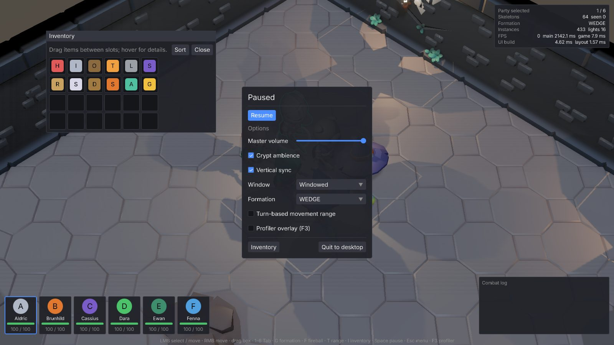
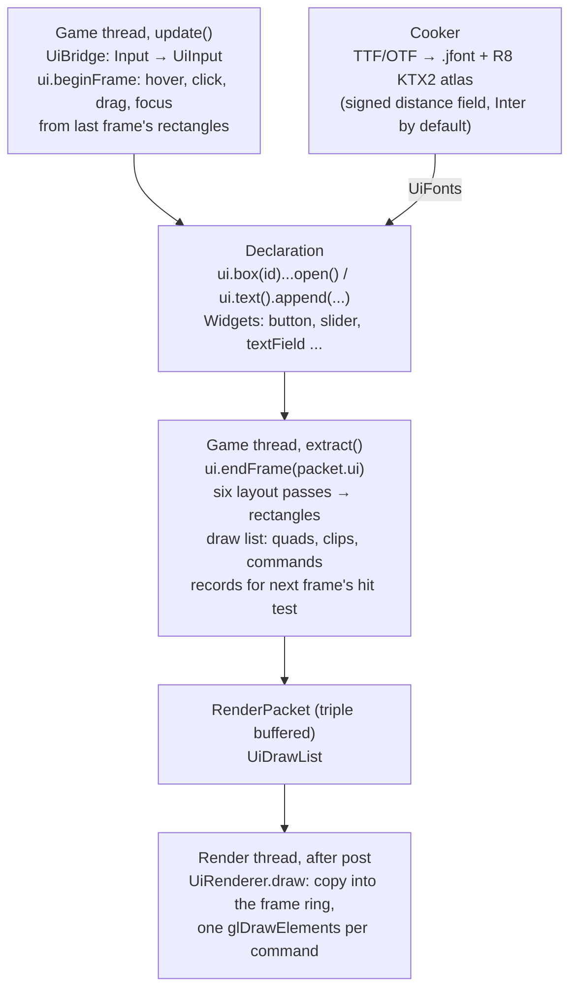
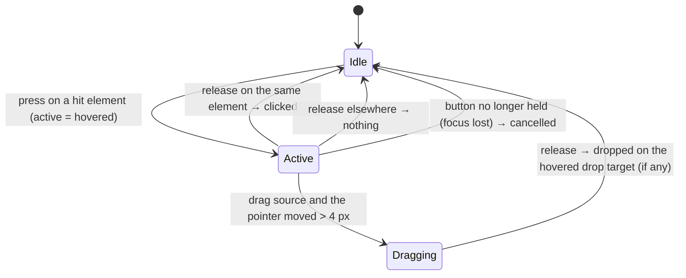

# 13 — The user interface: immediate mode, flex layout and distance-field text

*A role-playing game shows a lot of interface: portraits with health bars, an inventory you drag
things around in, a combat log that scrolls, tooltips, a pause menu, and later the editor's panels,
trees and property grids. This chapter builds all of that from empty files, in pure Java on top of
the renderer: a context the game describes its screen to every frame; a six-pass layout that sizes
boxes from their content and the space around them; hit testing, clicks, drag and drop and keyboard
focus resolved against the rectangles of the previous frame; fonts baked into signed-distance-field
atlases by an exact distance transform and decoded in a fragment shader at any size; a draw list that
becomes one draw call, with clipping, rounded corners, borders and antialiasing done by signed
distances in the shader; a widget set; and the glue to input, fonts and the clipboard across three
threads. It ends with the demo's inventory, portraits, log and menu, the tests that pin every number
down, and a frame of 2,000 elements that allocates nothing.*

**Before you start.** You need [Lesson 0](lessons/00-foundations.md): the notation (§2, in
particular sums in §2.2, intervals in §2.6 and big-O in §2.8), hexadecimal (§3), bit operations,
masks, shifts and packing (§6), how a `float` is stored and what NaN is (§7), memory and native memory
(§8), caches (§9.2–9.3), threads and `volatile` (§9.4–9.5), and what a GPU, a shader, the rasterizer,
a texture, the driver and a frame are (§10–11). From the lessons: [L01](lessons/01-buffers-in-flight.md)
builds the frame ring the renderer copies the UI into (its §8–12 are the ring; §6 explains fences);
[L03](lessons/03-data-layout.md) explains why the engine keeps data in one array per field (§4) and
handles (§6); this chapter uses both and rebuilds neither. From the chapters: [01](01-architecture.md),
on the threads and who may call what, the triple-buffered render packet and the main-thread command
queue; [04](04-cameras-and-projection.md), on the orthographic projection the UI's vertex shader is a
special case of; [05](05-opengl-from-java.md), on the pipeline stages (the rasterizer's 2 × 2 quads
and derivatives, blending, the state cache, samplers and texture formats); [06](06-renderer-architecture.md),
on the render packet, texture arrays and where in the frame the UI is drawn; [08](08-effects-and-post.md),
on sRGB and the full-screen passes that leave the display image the UI draws onto; and
[12](12-java-performance.md), on the allocation assertion and JMH. Everything else — flex layout,
distance fields, the derivative trick, premultiplied blending — is derived here from L00.

**What you will build**

| Piece | File | What it does |
|---|---|---|
| The draw list | [`UiDrawList`](../../modules/ui/src/main/java/dev/jeddy/ui/UiDrawList.java) | a frame of UI as plain arrays: 40-byte vertices, indices, a clip table and commands |
| Input, keys, capacities, sprites | [`UiInput`](../../modules/ui/src/main/java/dev/jeddy/ui/UiInput.java), [`UiKey`](../../modules/ui/src/main/java/dev/jeddy/ui/UiKey.java), [`UiConfig`](../../modules/ui/src/main/java/dev/jeddy/ui/UiConfig.java), [`Sprite`](../../modules/ui/src/main/java/dev/jeddy/ui/Sprite.java) | one frame of input the module understands without depending on SDL; the scancodes it reacts to; array sizes; a rectangle of a texture |
| The context | [`Ui`](../../modules/ui/src/main/java/dev/jeddy/ui/Ui.java), [`Box`](../../modules/ui/src/main/java/dev/jeddy/ui/Box.java) | the element tree as arrays, the builder, the six layout passes, text measurement and wrapping, emission, interaction and the state store |
| The font file | [`FontData`](../../modules/asset/src/main/java/dev/jeddy/asset/format/FontData.java), [`FontWriter`](../../modules/asset/src/main/java/dev/jeddy/asset/format/FontWriter.java), [`FontLoader`](../../modules/ui/src/main/java/dev/jeddy/ui/FontLoader.java) | the `.jfont` metrics: glyph advances, bearings, atlas rectangles, kerning pairs |
| The font cooker | [`DistanceField`](../../tools/cooker/src/main/java/dev/jeddy/cooker/font/DistanceField.java), [`FontCooker`](../../tools/cooker/src/main/java/dev/jeddy/cooker/font/FontCooker.java), [`FontImporter`](../../tools/cooker/src/main/java/dev/jeddy/cooker/font/FontImporter.java), [`DefaultFontImporter`](../../tools/cooker/src/main/java/dev/jeddy/cooker/font/DefaultFontImporter.java) | TTF or OTF → an R8 KTX2 signed-distance atlas and a `.jfont`; Inter as the built-in font |
| The renderer | [`UiRenderer`](../../modules/render/src/main/java/dev/jeddy/render/ui/UiRenderer.java) | copies the list into a frame ring and draws it with one program: vertex pulling, per-vertex clipping, rounded rectangles, SDF glyphs, sprites, premultiplied blending |
| Editable text and the theme | [`TextBuffer`](../../modules/ui/src/main/java/dev/jeddy/ui/TextBuffer.java), [`Theme`](../../modules/ui/src/main/java/dev/jeddy/ui/Theme.java) | a `char[]` with a caret and a selection; the colors and metrics of the built-in widgets |
| Widgets | [`Widgets`](../../modules/ui/src/main/java/dev/jeddy/ui/Widgets.java) | buttons, check boxes, sliders, text fields and areas, drop-downs, tabs, trees, tooltips, popups, windows, menus, number and vector fields, lists |
| The app glue | [`UiBridge`](../../modules/app/src/main/java/dev/jeddy/app/ui/UiBridge.java), [`UiFonts`](../../modules/app/src/main/java/dev/jeddy/app/ui/UiFonts.java), [`Clipboard`](../../modules/window/src/main/java/dev/jeddy/window/Clipboard.java) | `Input` → `UiInput`, SDL text input around focus, fonts as assets, the clipboard mirror |
| The demo's screens | [`DemoUi`](../../samples/iso-demo/src/main/java/dev/jeddy/samples/iso/DemoUi.java), [`CombatLog`](../../samples/iso-demo/src/main/java/dev/jeddy/samples/iso/CombatLog.java) | the status panel, portraits, inventory, combat log, pause menu, loading screen |
| Tests and benchmark | [`LayoutTest`](../../modules/ui/src/test/java/dev/jeddy/ui/LayoutTest.java), [`InteractionTest`](../../modules/ui/src/test/java/dev/jeddy/ui/InteractionTest.java), [`WidgetsTest`](../../modules/ui/src/test/java/dev/jeddy/ui/WidgetsTest.java), [`DrawListTest`](../../modules/ui/src/test/java/dev/jeddy/ui/DrawListTest.java), [`UiRendererTest`](../../modules/render/src/test/java/dev/jeddy/render/ui/UiRendererTest.java), [`FontCookerTest`](../../tools/cooker/src/test/java/dev/jeddy/cooker/font/FontCookerTest.java), [`UiBench`](../../bench/src/main/java/dev/jeddy/bench/UiBench.java) | hand-computed rectangles, scripted input sessions, pixels read back from a real context, the distance field of a disc, zero-allocation frames, a JMH frame |

Design background: [DESIGN](../DESIGN.md) §18 and decisions D82 (immediate mode with an end-of-frame
flex layout), D83 (signed-distance-field fonts cooked with `java.desktop`), D84 (the draw list in the
render packet, one draw per texture change), D85 (the clipboard mirror) and D102 (logical pixels).
The work was milestone M13 in [TASKS.md](../TASKS.md); the editor of chapter
[14](14-editor.md) and the dialogue tools of later milestones added widgets to the same module.

**Contents**

- Part A — The ideas
  1. [The problem: a game's interface, and three rules it must obey](#1-the-problem-a-games-interface-and-three-rules-it-must-obey)
  2. [Retained and immediate mode](#2-retained-and-immediate-mode)
  3. [A tree in arrays](#3-a-tree-in-arrays)
  4. [The sizing model and the six passes, derived](#4-the-sizing-model-and-the-six-passes-derived)
  5. [Interaction without objects](#5-interaction-without-objects)
  6. [Text as a signed distance field](#6-text-as-a-signed-distance-field)
  7. [Drawing the interface on the GPU](#7-drawing-the-interface-on-the-gpu)
- Part B — Building it
  8. [Step 1: the draw list](#8-step-1-the-draw-list)
  9. [Step 2: input, keys, capacities and sprites](#9-step-2-input-keys-capacities-and-sprites)
  10. [Step 3: the context's constants, arrays and constructor](#10-step-3-the-contexts-constants-arrays-and-constructor)
  11. [Step 4: declaring elements](#11-step-4-declaring-elements)
  12. [Step 5: the fit pass](#12-step-5-the-fit-pass)
  13. [Step 6: the grow pass, distribute and shrink](#13-step-6-the-grow-pass-distribute-and-shrink)
  14. [Step 7: measuring and wrapping text](#14-step-7-measuring-and-wrapping-text)
  15. [Step 8: positions and floating elements](#15-step-8-positions-and-floating-elements)
  16. [Step 9: emission: clips, records, quads, text, sprites and scrollbars](#16-step-9-emission-clips-records-quads-text-sprites-and-scrollbars)
  17. [Step 10: beginFrame, the interaction resolver](#17-step-10-beginframe-the-interaction-resolver)
  18. [Step 11: the state store and the queries](#18-step-11-the-state-store-and-the-queries)
  19. [Step 12: the font file](#19-step-12-the-font-file)
  20. [Step 13: the distance transform](#20-step-13-the-distance-transform)
  21. [Step 14: the font cooker and the importers](#21-step-14-the-font-cooker-and-the-importers)
  22. [Step 15: the renderer and its shaders](#22-step-15-the-renderer-and-its-shaders)
  23. [Step 16: TextBuffer and Theme](#23-step-16-textbuffer-and-theme)
  24. [Step 17: widgets](#24-step-17-widgets)
  25. [Step 18: the app glue](#25-step-18-the-app-glue)
- Part C — Using it and proving it
  26. [The demo's screens](#26-the-demos-screens)
  27. [One frame, across three threads](#27-one-frame-across-three-threads)
  28. [The tests, walked through](#28-the-tests-walked-through)
  29. [Things to run](#29-things-to-run)
  30. [The numbers](#30-the-numbers)
  31. [Pitfalls](#31-pitfalls)
  32. [Why it is built this way](#32-why-it-is-built-this-way)
  33. [Exercises](#33-exercises)
  34. [Glossary](#34-glossary)

---

# Part A — The ideas

## 1. The problem: a game's interface, and three rules it must obey

Open the iso demo and press **I** and **Esc**: an inventory window with 24 slots you can drag items
between, tooltips that appear when the pointer rests on a slot, four party portraits with health bars,
a combat log that scrolls to its newest line, a pause menu with a slider, check boxes and drop-downs,
a status panel of numbers that change every frame. Later chapters add the editor's docked panels,
trees, property grids and a multi-line text editor. All of it has to be drawn on top of the 3D view
and reacted to with the mouse, the keyboard and a gamepad.



The engine's rules make this harder than "use a toolkit":

1. **Zero allocation per frame** (L00 §8.2, CLAUDE.md rule 1). The interface is rebuilt every frame
   (§2 says why), so a `new Button()` or a `String.format("HP %d/%d", ...)` per widget would be
   thousands of allocations per frame. Every screen must be built out of arrays that already exist.
2. **The threads** (chapter [01](01-architecture.md), on who may call what). The game thread owns the
   game's data — hit points in a `float[]`, the inventory in an `int[]` — and the UI shows that data,
   so the UI must be *built* on the game thread. OpenGL belongs to the main thread, so the UI must be
   *drawn* there. SDL's text input and clipboard belong to the main thread too. One frame of UI
   therefore crosses three threads, and nothing may wait on anything.
3. **No new native libraries** (CLAUDE.md, "Working with the owner"). No Dear ImGui through FFM, no
   FreeType for fonts, no native toolkit. The UI is Java over the renderer, and fonts are baked by the
   cooker, which may use the JDK's own `java.desktop` rasterizer because it is a tool, not the runtime.

The design that satisfies all three is decision D82: an **immediate-mode** interface (§2) whose
elements live in parallel arrays (§3), laid out at the end of the frame by a small flex algorithm
(§4), hit-tested against the rectangles of the *previous* frame (§5), with text as signed distance
fields (§6) and a draw list that one draw call renders (§7).

## 2. Retained and immediate mode

### 2.1 Retained mode: a tree of objects that mirrors the game

A **retained-mode** toolkit (Swing, Qt, a browser's DOM) keeps a tree of widget objects between
frames. You create a `Button`, set its label, attach a click listener, and when the hit points change
you call `label.setText(...)`. The widgets *own* state (the label's text, the slider's value, which
node is expanded), and the game's own state must be **mirrored** into them: every number the screen
shows exists twice, once in the game's arrays and once in a widget, with code that keeps the two
copies equal.

For a game that is a liability. The hit points live in a `float[]` that the rules change on the game
thread; the inventory is an `int[]` of item ids. Every screen would need "update the widgets from the
data" code, and it would run every frame anyway, because the data changes every frame. The editor of
chapter [14](14-editor.md) is worse: an inspector that shows the fields of *any* component would need
a widget per field, created and destroyed as the selection changes — a synchronization problem in its
own right.

### 2.2 Immediate mode: the game describes the screen, every frame

In an **immediate-mode** toolkit there are no widget objects. Every frame, the game runs a function
that *declares* the whole interface again, and each call both draws something and reports what the
user did to it:

```java
if (w.button(SAVE, "Save")) save();
hp = w.slider(HP, hp, 0, 100);
```

`button` draws a button and returns whether it was clicked *this frame*; `slider` draws the current
value and returns the new one. The game's data is the only state. What the toolkit keeps between
frames is small and generic, and has nothing to do with any particular screen: which element is
hovered, pressed or focused; scroll offsets; which tree nodes are open; where a text caret is.

The idea is Dear ImGui's (the well-known C++ library), and it fits a game exactly: the data is already
there, in the game's own arrays, and the screen is a *function* of it. The cost is that the interface
is rebuilt every frame. §30 shows that for a few hundred to a few thousand elements that is a fraction
of a millisecond — provided nothing allocates, which is why the whole module is arrays rather than
objects (§3).

### 2.3 Where Jeddy differs from Dear ImGui: layout at the end of the frame

Dear ImGui lays widgets out *as they are declared*: a cursor moves down the window (or right after
`SameLine()`), and a widget's size and position are decided the moment its function is called. That is
simple and fast, but it has a consequence: anything whose size depends on what comes *later* must be
computed by hand. "How wide should this column be so that the three buttons fit?" needs the buttons'
widths, which depend on their labels, before the column is declared. Authors end up measuring text
and doing arithmetic in every screen.

Jeddy follows [Clay](https://github.com/nicbarker/clay) instead. Declaring an element does not place
it; it appends it to a **tree**, and the tree is laid out at the *end* of the frame by a flex-like
algorithm (§4). Then sizes can depend on content ("as wide as my children") and on the available space
("a third of what is left"), text can wrap to the width an element *ends up with*, and a tooltip can
hang under a button whose position the author never computed. Decision D82 records the choice and the
two alternatives rejected: a retained tree (§2.1), and Dear ImGui itself through its C binding and FFM
(a native library on the hot path with upcalls into Java for every callback, and two UI code paths,
one of which could not be skinned for the game).

### 2.4 The price: one frame of latency

If nothing has a position until the end of the frame, how can `button` know, *during* declaration,
whether it was clicked? It cannot know where it is *this* frame. It knows where it was *last* frame.
The context records every interactive element's rectangle while it emits the draw list, and the next
frame's `beginFrame` hit-tests the pointer against those records (§5). Every query — `hovered(id)`,
`clicked(id)`, `dropped(id)` — answers about the element with that id *as it was drawn last frame*.

At 60 frames per second that is 16.7 ms of latency between a layout change and the first click that
sees it (L00 §11). Nobody notices it for hovering and clicking; it is the same trade browsers make when
they batch layout and hit-test against the last layout. What it does require is discipline, which §31
collects: a widget that needs its own size reads it from the previous frame's record and must cope
with "not drawn yet" on its first frame, and tests always run one warm-up frame before asserting.

### 2.5 The whole path at a glance



One frame of game code looks like this (from the demo's
[`DemoUi`](../../samples/iso-demo/src/main/java/dev/jeddy/samples/iso/DemoUi.java), simplified):

```java
bridge.beginFrame(dt);                                   // input → UiInput, ui.beginFrame
w.panel().width(300).open();                             // a column with padding, gap, background
    w.heading("Paused");
    if (w.primaryButton(RESUME, "Resume")) menuOpen = false;
    volume = w.slider(VOLUME, volume, 0, 1);
    vsync = w.checkbox(VSYNC, "Vertical sync", vsync);
ui.close();
...
ui.endFrame(packet.ui);                                  // in extract(): layout + draw list
```

Nothing is retained between frames except what interaction needs. The rest of this chapter is about
making that fast, correct and pleasant to use.

## 3. A tree in arrays

### 3.1 Pre-order in an array

A tree of elements is the obvious thing to represent with objects: `class Element { List<Element>
children; ... }`. Rule 1 forbids it, and L03 §4 explains why it would also be slow: a layout pass that
follows a reference per child misses the cache at every step. The context keeps the elements of the
current frame in **parallel arrays** instead — one array per field, indexed by the element's number —
and the tree structure in four more `int` arrays:

```
parent[e]       the element e was declared inside, or -1 for the screen root
firstChild[e]   its first child, or -1
lastChild[e]    its last child (so appending a child is O(1))
nextSibling[e]  the child declared after it under the same parent, or -1
```

Elements are numbered in **declaration order**. Because a box is opened before its children are
declared and closed after them, declaration order is a **pre-order traversal** of the tree: a parent
always has a smaller number than any of its descendants, and a subtree is a contiguous range of
numbers. Draw the demo's pause menu as a tree and number it:

```
0 screen
└─1 pause panel
   ├─2 "Paused"
   ├─3 separator
   ├─4 Resume button
   │  └─5 "Resume"
   ├─6 row
   │  ├─7 "Master volume"
   │  └─8 slider
   │     ├─9 track
   │     │  └─10 fill
   │     └─11 thumb (floating)
   └─12 ...
```

That numbering gives both directions of traversal for free, without a stack and without recursion:

- a loop `for (e = 0; e < count; e++)` visits every parent **before** its children (top-down);
- a loop `for (e = count - 1; e >= 0; e--)` visits every child **before** its parent (bottom-up).

The layout passes of §4 are exactly these two loops, run over the arrays. A pass that needs "the
children of `e`" walks `firstChild[e]` and then `nextSibling` — a short chain, in a loop that touches
each element once overall.

### 3.2 One array per axis

Most of what the layout computes is the same for width and for height: a size mode, a fixed value or
a weight, a minimum, a maximum, padding on each side, an alignment, and the computed size, floor,
position and content extent. If each of those were two fields (`widthMode`, `heightMode`, …), every
layout method would exist twice, once per axis, or take a dozen `if (axis == 0)` branches. The context
keeps them as **arrays of two arrays** instead:

```java
    final byte[][] mode = new byte[2][];

    final float[][] value = new float[2][];
    ...
    final float[][] size = new float[2][];
```

`mode[0][e]` is the width mode of element `e` and `mode[1][e]` its height mode. A pass takes an axis `a`, does `float[] sz = size[a];` once at the top, and then runs the same code
for either axis. The six passes of §4 are three methods, each called twice. The direction of a box's
children is a number too, `ROW = 0` or `COLUMN = 1`, so "is `a` the main axis of `e`?" is the
comparison `direction[e] == a`.

### 3.3 Ids, scopes and mixing

Elements that interact or keep state are named by a 64-bit **id**. The usual id is `StrId.of("save")`,
the FNV-1a hash of a string (chapter [10](10-assets.md), on asset ids, explains `StrId`), computed
once into a `static final long` so that no string is hashed per frame. Anonymous elements (a spacer,
a background box) have id 0 and cannot be queried.

Inside a list every row would reuse the same constants — `SLOT` for each of the inventory's 24 slots —
and the queries would not know which slot was clicked. So the context has an **id scope stack**:
`pushId(i)` makes every id declared until `popId()` distinct from the same id in another scope, and
`resolve(id)` is what both declaration and every query apply, so a widget declared and queried in the
same scope agrees with itself. Resolution combines the scope with the id through a **mixing
function**:

```java
public static long combine(long scope, long id) {
    long h = scope ^ (id + 0x9E3779B97F4A7C15L + (scope << 6) + (scope >>> 2));
    h ^= h >>> 32;
    h *= 0xBF58476D1CE4E5B9L;
    h ^= h >>> 29;
    return h == NONE ? 1 : h;
}
```

Why this shape and these constants:

- The first line is the classic `hash_combine` of the Boost library: XOR the previous value with the
  new one plus a constant plus two shifted copies of the previous value. `0x9E3779B97F4A7C15` is
  $2^{64} / \varphi$, $\varphi$ the golden ratio — an irrational multiple that spreads consecutive
  inputs evenly, the same constant SplitMix64 steps by (L02 builds that generator).
- The next three lines are a **finalizer**, a shortened form of SplitMix64's (one of its two
  multiply steps, with its own shifts): shift-XOR, multiply by an odd constant, shift-XOR. A multiplication only moves information *upwards* through
  the bits; the shift-XORs bring the high bits back down, so that scopes that differ in one bit give
  ids that differ in about half of theirs. Without the finalizer, `pushId(0)` and `pushId(1)` would
  produce ids that differ in a few low bits, and the hash map that stores records (§5.1) would put them
  in neighbouring slots.
- `h == NONE ? 1 : h`: 0 is reserved for "no id", so a combination that happens to produce 0 is nudged.
  The 0 test is on the mixed value, after the multiply, so the nudge is practically never taken.

Numbers (computed with the formula above): `pushId(0)` pushes the scope `combine(0, 0 + 0x100000001)`
= `0xC703C1F39E85FAE1`, `pushId(1)` pushes `0x865C0966F1609013`, and the id 7 resolves to
`0x119128CB887D8600` in the first and `0x957486F040A65CAD` in the second: unrelated numbers from
scopes one apart. (`pushId(int)` adds `0x100000001L` to the index before combining; the effect is
that `pushId(3)` and `pushId(3L)` open different scopes.) The test
`LayoutTest.idScopesMakeListItemsDistinct` checks that 7 resolves to four different values in the
scopes "0", "1", "1 inside 1" and none.

## 4. The sizing model and the six passes, derived

### 4.1 Four size modes

Each axis of an element — its width and its height, separately — is in one of four **modes**:

| Mode | Meaning | `Box` call |
|---|---|---|
| `FIXED` | a size in pixels, given by the author | `width(200)`, `height(28)`, `size(w, h)` |
| `FIT` | the size of the content: the children plus padding, or the text, clamped to a minimum and a maximum | the default; `widthFit(min, max)`, `minWidth(..)`, `maxWidth(..)` |
| `GROW` | a share of the parent's *free* space, by weight | `widthGrow()`, `widthGrow(2)`, `grow()` |
| `PERCENT` | a fraction of the parent's *inner* size | `widthPercent(0.25f)` |

The mode is a `byte` in `mode[a][e]`, and the number that goes with it (the fixed size, the grow
weight, the fraction) is `value[a][e]`. `FIT` and `GROW` also honour `min[a][e]` and `max[a][e]`,
which default to 0 and `Float.MAX_VALUE`.

This is deliberately a **subset of CSS flexbox**: no `flex-basis`, no per-child `align-self`, no
reversed directions, no `flex-wrap`. Every screen the game and the editor needed is expressible, and
the algorithm stays a few hundred lines a reader can hold in their head. The one thing CSS would do
differently — how grow distributes space — is §4.6, with the reason.

### 4.2 Rows, columns, padding, gaps and alignment

A box lays its children out either side by side (`ROW`) or stacked (`COLUMN`). The axis the children
are laid *along* is the **main axis**; the other is the **cross axis**. A row's main axis is x
(`direction[e] == 0`), a column's is y. The box may have **padding** on each side (`pad0[a][e]` before
the content — left or top — and `pad1[a][e]` after it), a **gap** between consecutive children along
the main axis, and an **alignment** per axis (`START`, `CENTER`, `END`) that says where the children go
when they do not fill the box.

Two derived quantities appear in every pass. The **inner size** of a box along an axis is what is
left for children after the padding:

$$\text{inner}_a(e) = \text{size}_a(e) - \text{pad0}_a(e) - \text{pad1}_a(e).$$

The **extent** of $n$ children along the main axis is their sizes plus the $n - 1$ gaps between them:

$$\text{extent}(e) = \sum_{c} \text{size}(c) + (n - 1)\,\text{gap}(e) \quad (n \ge 1;\ 0 \text{ gaps when } n \le 1).$$

Floating elements (§4.11) take part in none of this: they are skipped by every sum.

### 4.3 Why widths before heights, and why six passes

A paragraph's height is its number of lines times the line height, and its number of lines depends
on its **width**. So heights cannot be computed until widths are final, and widths cannot be final
until the parent has distributed its space, which needs the children's content widths. The order is
forced:

1. **Fit widths** (children before parents): fixed widths are known; a `FIT` box is the sum (row) or
   the maximum (column) of its children plus gaps and padding; text measures its longest line.
2. **Grow and shrink widths** (parents before children): `PERCENT` children take their fraction; free
   space goes to `GROW` children; overflow is taken back from the children that can shrink.
3. **Wrap text**: with final widths, every text element breaks into lines.
4. **Fit heights** and 5. **grow heights**: as 1 and 2 with the axis swapped. A text element's height
   is now its line count times the line height.
6. **Positions** (parents before children): children are placed along the main axis from the padding
   edge, aligned, minus the scroll offset; floating elements are attached to their anchors last.

Passes 1 and 4 are one method, `fitPass(a)`, and 2 and 5 are one method, `growPass(a)`; the per-axis
arrays of §3.2 are what make that possible. Pass 3 is `wrapPass()` and 6 is `positionPass()`. The
two "fit" passes run the bottom-up loop of §3.1; the "grow" and "position" passes the top-down one.

### 4.4 Fit, derived

Take a `FIT` box $e$ and an axis $a$. Call $a$ the main axis when $\text{direction}(e) = a$. Its
**natural size** is what its content needs:

$$\text{natural}_a(e) = \begin{cases}
\text{pad0} + \text{pad1} + \sum_c \text{size}_a(c) + (n-1)\,\text{gap} & a \text{ is the main axis} \\
\text{pad0} + \text{pad1} + \max_c \text{size}_a(c) & a \text{ is the cross axis}
\end{cases}$$

and its size is the natural size clamped: $\text{size}_a(e) = \operatorname{clamp}(\text{natural},
\min, \max)$. For a text element the natural width is the width of its longest line (§6.9 defines a
glyph's advance) and the natural height is $\text{lines} \times \text{lineHeight}$. A `FIXED` element's
size is its value, whatever its content.

The children's sizes must be known first, which is why the loop runs backwards. Worked example, the
test `LayoutTest.rootIsTheScreenAndFitBoxesWrapTheirChildren`: a row with padding 10 and gap 5
holding a 20 × 10 box and a 30 × 10 box, on an 800 × 600 screen.

```
pass 1, e = 3 (the 30×10 box): FIXED → width 30
pass 1, e = 2 (the 20×10 box): FIXED → width 20
pass 1, e = 1 (the row):      main axis x, n = 2: natural = 10 + 20 + 5 + 30 + 10 = 75 → width 75
pass 1, e = 0 (the screen):   FIXED → width 800
pass 4 (heights), e = 1:      cross axis y: natural = 10 + max(10, 10) + 10 = 30 → height 30
```

The test asserts the row is 75 × 30 and its content width is 75. In
`LayoutTest.columnsStackAndFitTheWidestChild` the same shape as a column with padding 4 and gap 2
gives width $4 + \max(20, 50) + 4 = 58$ and height $4 + 10 + 2 + 10 + 4 = 30$.

### 4.5 Floors: the smallest size an element can shrink to

When a row's children do not fit, something has to give. Not everything can: a fixed box cannot
shrink, a line of unwrapped text cannot shrink below its line, but wrapping text *can* shrink — down
to its **longest word**, because it will wrap the rest onto new lines. So the fit pass computes a
second number per element and axis, its **floor**: the smallest size it may be shrunk to in pass 2.

| Element | Floor |
|---|---|
| fixed | its size (it never shrinks) |
| wrapping text (width) | its longest word; (height) its line count × line height |
| unwrapped text | its natural size |
| a fit or grow box | the sum (main) or max (cross) of its **children's floors**, plus gaps and padding, clamped to its minimum — and not above its size |
| a scroll box, along its scroll axis | its padding only: its content may be any size, the box clips it |
| a `GROW` box | its floor **is** its starting size: it begins at its content and is given more in pass 2 |
| a `PERCENT` box | its floor, as a lower bound for pass 2's clamp |

This is the same bottom-up "minimum dimensions" idea Clay uses, and it is what makes overflow behave
instead of exploding: a panel that is too narrow squeezes its paragraphs first, then its fit boxes,
never its fixed icons. §12 shows the exact code.

### 4.6 Grow: smallest-first, derived

With the parent's size final (pass 2 runs top-down, so the parent was handled before its children),
the free space along the main axis is

$$\text{remaining} = \text{inner} - \sum_c \text{size}(c) - (n - 1)\,\text{gap},$$

where the children's sizes are their pass-1 sizes (a `GROW` child's content). How should two `GROW`
children share 200 px?

**What CSS does.** Flexbox adds each child's share of the free space to its **basis** (by default its
content size): $\text{size}(c) = \text{basis}(c) + w_c \cdot \text{remaining} / \sum w$. Two
equal-weight buttons labelled "OK" and "Cancel" therefore end up with *different* widths — each keeps
its label's width and gets the same extra amount. In a game screen that is rarely what the author
wants; "two equal buttons" is.

**What Jeddy (and Clay) does.** Raise the **smallest** children first until they catch up with the
next larger one, then raise that group together, and so on; when the space runs out, share what is
left among the current smallest group. Equal-weight children converge to equal sizes whenever there
is room, and when there is not, the small ones catch up as far as they can. With weights, "smallest"
means the smallest **size per unit of weight**, $r_c = \text{size}(c) / w_c$, and "raising to a
target" sets $\text{size}(c) = \text{target} \cdot w_c$. Each round:

1. find $r_0 = \min_c r_c$ among the candidates (grow children not yet at their maximum), the total
   weight $w_0$ of the children at $r_0$, and the next larger ratio $r_1$;
2. lifting the $r_0$ group up to $r_1$ costs $(r_1 - r_0)\,w_0$ pixels. If that is affordable, set
   the group's target to $r_1$ (they merge with the next group); otherwise the target is as far as
   the remaining space goes, $r_0 + \text{remaining} / w_0$, and this is the last round;
3. set each child of the group to $\min(\text{target} \cdot w_c, \max_c)$ and subtract what it grew
   from the remaining space.

A child that hits its maximum leaves the candidate set, so each round either spends all the remaining
space (the loop ends), merges two groups (the number of distinct ratios drops by one) or caps a child.
The loop therefore ends after at most a few rounds per distinct ratio; the code's guard of 1024 rounds
is belt and braces.

Worked example, `LayoutTest.growIsCappedByMaximumsAndStartsFromItsContent`: a 300 px row holds two
grow boxes whose contents are 80 and 20 px wide (weights 1). Pass 1 gives them sizes and floors 80 and
20; $\text{remaining} = 300 - 100 = 200$.

```
round 1: r0 = 20 (w0 = 1), r1 = 80. Lifting costs (80 − 20) × 1 = 60 ≤ 200 → target 80.
         small: 20 → 80, remaining 200 − 60 = 140
round 2: both at r = 80 (w0 = 2), no r1 → target = 80 + 140 / 2 = 150.
         both → 150, remaining 0.                                      result: 150 and 150
```

In a 110 px row only 10 px remain: round 1 cannot afford 60, so target $= 20 + 10 / 1 = 30$: the small
box becomes 30 and the big one stays 80. With weights 1 and 2 and no content, both start at ratio 0,
$w_0 = 3$, target $= 300 / 3 = 100$: sizes $100$ and $200$
(`growSharesTheFreeSpaceEquallyThenByWeight`). With a maximum of 50 on one of two empty grow boxes in
300 px: round 1 targets 150 for both, the capped one stops at 50 and 100 px remain; round 2 has one
candidate at ratio 150, target $150 + 100 = 250$: sizes 50 and 250. The test checks all of these.

On the **cross** axis there is no sharing: a grow child simply fills the parent's inner size (a
`widthGrow()` box in a column spans the column), and a child that is wider than the column and is
not fixed is pulled back to the inner size (but not below its floor) unless the column scrolls. A
`PERCENT` child takes `fraction × inner`, clamped, on either axis.

### 4.7 Shrink: largest-first

When $\text{remaining} < 0$ the children overflow. Unless the parent scrolls along this axis (then
the overflow is what scrolling is for), the **shrink** step takes the overflow back from the children
that can shrink — not fixed, and above their floor — **largest first**: lower the largest group to the
next size down, each child stopping at its floor, and repeat. It is `distribute` with every comparison
flipped and no weights. Lowering the biggest first means a panel with a long paragraph and a short
label squeezes the paragraph, which can wrap, before it touches the label.

Worked example, `LayoutTest.textMeasuresWrapsAndShrinksToItsLongestWord`: a 100 px row holds the
wrapping text `"aaaa bbbb"` (45 px with the test font's 5 px per character: 9 characters including the
space; floor 20, the longest word) and an 80 px fixed box. Overflow is $45 + 80 - 100 = 25$:

```
round 1: candidates: the text (45, floor 20); s0 = 45, no s1 → target = 45 − 25 / 1 = 20
         text: 45 → max(20, floor 20) = 20, overflow 0
```

The text lands exactly on its floor and wraps onto two lines in pass 3 (height 24). Without `wrap()`
the same text's floor is its full line, nothing can shrink, and the row simply overflows by 25 px; the
test checks the text stays 45 wide. Three shrinkable children of 100, 60 and 40 px with floors 30 that
overflow by 90 would go: lower 100 to 60 (overflow 50), lower both 60s to 40 (overflow 10), then all
three to $40 - 10/3 = 36.67$ — equalization in reverse (computed with §13's code).

### 4.8 Percent

`widthPercent(f)` makes a child $f \times \text{inner}$ of its parent, clamped to its minimum and
maximum, in pass 2 (top-down, so the parent's inner size is final). In
`LayoutTest.percentIsOfTheParentsInnerSize` a 220 × 100 box with padding 10 gives a
`widthPercent(0.25f).heightPercent(0.5f)` child $0.25 \times 200 = 50$ by $0.5 \times 80 = 40$, at
(10, 10). A percent child counts as its pass-1 size — its floor, usually 0 — in a `FIT` parent's natural
size; exercise 2 asks what the right answer should be.

### 4.9 Positions and alignment

Pass 6 is a top-down loop. For a parent $e$ on each axis $a$: the children start at the padding edge,
$\text{start} = \text{pos}_a(e) + \text{pad0}_a(e) - \text{scroll}_a(e)$, and along the **main** axis
they are placed one after another:

$$\text{pos}(c_k) = \text{start} + \text{alignOffset}(\text{inner} - \text{extent}) + \sum_{j<k}\bigl(\text{size}(c_j) + \text{gap}\bigr),$$

where $\text{alignOffset}(\text{free}) = 0$ for `START`, $\text{free}/2$ for `CENTER`, $\text{free}$
for `END`, and 0 whenever the free space is negative (an overflowing row is never shifted left to
"center" it). On the **cross** axis each child is aligned on its own: $\text{pos}(c) = \text{start} +
\text{alignOffset}(\text{inner} - \text{size}(c))$.

Numbers: `LayoutTest.mainAxisAlignmentPlacesTheChildrenBlock` puts two 20 px boxes with gap 10 in a
100 px row aligned `END`: extent 50, free 50, so they land at 50 and 80.
`crossAxisGrowFillsAndCrossAxisAlignmentOffsets` puts a grow box and a 20 px box in a 100 × 100 column
aligned `(CENTER, END)`: the grow box fills the width (100), the 20 px box is centered at $x = 40$, and
the two, 20 px tall together, sit at the bottom: $y = 80$ and $y = 90$.

### 4.10 Scrolling

A scroll box's children are laid out as if the box were tall enough, and the **scroll offset** shifts
them up. The offset is state that survives frames (the user scrolled last week), so it lives in the
context's **state store** (§5.6) under the box's id, and pass 6 reads it, **clamps** it and writes it
back:

$$\text{scroll} \leftarrow \operatorname{clamp}(\text{scroll},\ 0,\ \max(0, \text{content} - \text{size})),$$

where $\text{content}$ is the extent plus padding that pass 2 recorded. Clamping at layout time means
a list that shrinks never shows empty space below its last row, and the demo can ask for
`setScroll(LOG, 1, Float.MAX_VALUE)` to mean "the bottom". `LayoutTest.scrollBoxesKeepTheirContentAndClampTheOffset`:
a 100 × 50 scroll box holding a 50 × 200 child, asked to scroll by 1000, ends at offset 150 with the
child at $y = -150$, and the child keeps its 200 px (a scroll box never shrinks its children along the
scroll axis).

### 4.11 Floating elements and anchors, derived

Popups, tooltips, the dragged inventory item and the text field's caret must leave the flow: they are
sized on their own and *attached* to a point. A **floating** element has a **target** rectangle
$(\mathbf{t}_{pos}, \mathbf{t}_{size})$ — its parent's rectangle, the screen, or the previous frame's
rectangle of another element by id — and two **anchors**: a point of the target and a point of
itself. Nine named anchors (`TOP_LEFT`, `TOP`, `TOP_RIGHT`, `LEFT`, `MIDDLE`, `RIGHT`, `BOTTOM_LEFT`,
`BOTTOM`, `BOTTOM_RIGHT`) encode a point of a rectangle as a pair of fractions $(f_x, f_y) \in \{0,
\tfrac12, 1\}^2$: the anchor point is $\mathbf{t}_{pos} + \mathbf{f} \odot \mathbf{t}_{size}$ ($\odot$
multiplies component by component). The rule is "the target's anchor point meets the element's own
anchor point", plus an offset:

$$\mathbf{p} = \mathbf{t}_{pos} + \mathbf{f}_{target} \odot \mathbf{t}_{size} - \mathbf{f}_{own} \odot \mathbf{s} + \mathbf{offset},$$

where $\mathbf{s}$ is the element's own size. Derivation: the element's own anchor point is
$\mathbf{p} + \mathbf{f}_{own} \odot \mathbf{s}$; setting it equal to the target's anchor point plus
the offset and solving for $\mathbf{p}$ gives the line above.

Worked example, `LayoutTest.floatingElementsAttachToAnchorsAndStayOnScreen`, on a 300 × 200 screen
with a 100 × 50 panel at the origin:

- a 40 × 20 tooltip with `anchor(BOTTOM_RIGHT, TOP_LEFT)` and `offset(5, 5)`:
  $\mathbf{p} = (0, 0) + (1, 1) \odot (100, 50) - (0, 0) \odot (40, 20) + (5, 5) = (105, 55)$;
- a 60 × 60 popup with `anchor(BOTTOM_LEFT, TOP_LEFT)`: $(0, 0) + (0, 1) \odot (100, 50) = (0, 50)$,
  hanging under the panel;
- a 20 × 20 box floating on the screen with `anchor(MIDDLE, MIDDLE)`:
  $(\tfrac12, \tfrac12) \odot (300, 200) - (\tfrac12, \tfrac12) \odot (20, 20) = (150 - 10, 100 - 10)
  = (140, 90)$.

Floating elements are **clamped onto the screen** unless told otherwise (`unclamped()`): $x \leftarrow
\operatorname{clamp}(x, 0, \text{width} - s_x)$. A tooltip attached to the bottom-right corner of a
panel that spans the whole 300 px width would start at $x = 300$; clamping slides it back to $300 - 40
= 260$, which is what keeps tooltips near the right edge readable. The test asserts (260, 50). A
floating child takes no part in its parent's fit size (the panel stays 100 × 50 with the tooltip
hanging off it) and is drawn after the whole main tree, in order of its `z`, so it is on top (§5.1).

## 5. Interaction without objects

### 5.1 Records: the previous frame's rectangles, in draw order

While `endFrame` emits the draw list, it **records** every element that has an id or that blocks the
pointer: its rectangle, the clip rectangle in force where it was drawn (§7.5), its flags (hit-testable,
focusable, disabled, drag source, drop target, scrollable), the id of the floating subtree it belongs
to, its drag payload, and, for a scroll box's bars, the thumb's geometry. The records are written in
**draw order**. Draw order is also **z-order**: a later quad is painted over an earlier one, so a
later record is *on top of* an earlier one. The main tree comes first (parents before children, so a
child is on top of its parent's background), then every floating subtree sorted by `z`.

The next `beginFrame` hit-tests the pointer against those records with one linear scan, keeping the
**last** hit, which is the topmost element:

```
for each record i in draw order:
    if the pointer is inside rect(i) and inside clip(i):
        scrollbar?      → remember it as the bar under the pointer
        hit-testable?   → hovered = id(i)            (overwrites an earlier, lower hit)
        drop target?    → hoveredDrop = id(i)
        scroll box?     → wheelRec = i               (the innermost scroll box wins)
```

A few hundred records cost a microsecond or two to scan; a spatial structure (a grid, a tree of
rectangles) would be more code for nothing at this size. The **clip test** matters: a row scrolled out
of its list is still laid out (at a position above the list) and still drawn (the shader clips it),
but its record's clip rectangle — the list's — does not contain the pointer, so it is not hovered.
`InteractionTest.clippedChildrenAreNotHitOutsideTheirParent` is the test. "The innermost scroll box
wins" falls out of the order too: parents are recorded before children, so the last scroll box
containing the pointer is the deepest.

What blocks the pointer: **anything drawn** (a box with a background or a sprite) unless it says
`noHit()`, and anything declared `hit()` or with an interaction flag. Text never does. So a click on a
panel never falls through to the world behind it, and `wantsMouse()` — "is the pointer over the UI,
or is a press or drag in progress?" — is what the demo checks before picking in the world.

### 5.2 The pointer state machine



The states are a handful of fields in the context: `hovered` (this frame's hit), `active` (the element
a button went down on, kept while the button is held even if the pointer leaves it), `clicked` (set in
the frame of the release only), `dragging` with the drag's `dragSource`, `dragKindNow` and
`dragValueNow`, and `dropTarget`/`dropped` in the frame of a drop. Four rules:

1. **A click is an edge.** `clicked(id)` is true in exactly one frame: the one in which the button was
   released while `active == hovered`. A button widget returns `ui.clicked(id)` and nothing else; a
   frame later it is false again (`InteractionTest.hoverAndClickUseLastFramesRectangles`).
2. **A press decides focus.** Pressing a focusable element focuses it; pressing anything else — empty
   space, a non-focusable box — clears focus, which is how clicking outside a text field blurs it. The
   press also records which **floating subtree** it landed in (`pressedFloating()`), which is how a
   popup learns that a press outside it should close it (§24.6).
3. **A drag starts after a threshold.** A press on a drag source does not start a drag; the pointer
   must move more than `DRAG_THRESHOLD` = 4 px in x or y while the button is held. Below that it is a
   click in the making. When the drag starts, the source's payload — an `int` kind and an `int` value,
   declared with `dragSource(kind, value)` — is copied into the context, and the release reports
   `dropped(id)` on the topmost drop target under the pointer, if any
   (`InteractionTest.dragAndDropCarriesAPayload`).
4. **A missed release cancels.** If the button is no longer held and no release event arrived (the
   window lost focus while the mouse was down), the active state is dropped without a click.

### 5.3 Double clicks and hover time

Two clicks on the same id within `DOUBLE_CLICK_TIME` = 0.35 s make `clickCount` 2, and
`doubleClicked(id)` is true in the second click's frame (`InteractionTest.doubleClickCountsCloseClicks`,
which also checks that a click a full second later counts as a first click again). `hoverTime()`
accumulates the frames' `dt` while the hovered id stays the same and resets when it changes; the
tooltip widget shows itself once it exceeds the theme's delay (0.5 s).

### 5.4 Keyboard focus and navigation

**Focus** is one id, `focused`, set by a press (rule 2) or by the keyboard:

- **Tab** moves focus to the next focusable, enabled record in draw order, **Shift+Tab** to the
  previous, wrapping around; it works whether or not something is focused.
- While something is focused, the **arrow keys** do the same (Down/Right forward, Up/Left back) unless
  the focused element declared `captureKeys()` — a slider or a text field wants the arrows for itself.
- **Enter** or **Space** on an element declared `activateWithKeys()` reports a click (`clicked` is set
  to the focused id), so a button activates from the keyboard; key repeats are ignored so holding
  Enter does not fire every frame.
- **Escape** blurs.

`showFocus()` says whether widgets should draw their focus ring: it turns on when Tab or the arrows
move focus, or when the input says a gamepad is navigating, and off at the next mouse press — the same
behaviour as a browser's `:focus-visible`, so a mouse user never sees rings. The gamepad's d-pad and
face buttons arrive as the same key events (`UiBridge` maps them, §25.1), so a controller navigates a
menu without any widget knowing. `InteractionTest.focusMovesWithTabAndArrowsAndActivatesWithEnter`
walks through all of it.

### 5.5 Scrollbars

The wheel scrolls the innermost scroll box under the pointer by `WHEEL_LINE` = 40 px per line (a
vertical wheel over a horizontal-only box scrolls it sideways). Scrollbars are drawn by the context
after a box's children, on top, and **recorded** with the thumb's start and length, the maximum scroll
and the page size, so that `beginFrame` can turn a press on the thumb into a **bar drag** (the thumb
follows the pointer, with the grab offset remembered so it does not jump) and a press on the track
into a **page** up or down. All of that lives in the resolver (§17); widgets never see it.
`InteractionTest.theWheelScrollsTheBoxUnderThePointer` scripts the wheel, a page click and a thumb drag
and checks the offsets to the pixel (§28.2 traces the numbers).

### 5.6 The state store

Some widgets need a few numbers across frames: a scroll offset, whether a tree node is open, a text
field's caret blink time, a window's position and z. The context keeps a small **state store**: slots
of four floats and two ints, found by id through a `LongIntMap` (the engine's open-addressing
long→int map without boxing, chapter [12](12-java-performance.md), on primitive collections). `state(id)`
returns the slot, creating it, and stamps it with the frame number. When the store is full, a slot
untouched for two frames is **recycled**, so a list that stops being declared gives its slots back
(`InteractionTest.stateSlotsPersistAndAreRecycled`). It is the only retained data besides the records,
and widgets address it by id, never by reference, so the game can rearrange its screens freely.

## 6. Text as a signed distance field

### 6.1 Why not bitmaps

The simplest font renderer rasterizes each glyph once, at one size, into a texture, and draws a
textured quad per character. It is sharp at that one size and bad at every other: scaled up, the
texture's filtering blurs the edges; scaled down, strokes alias into noise. A game UI uses 12, 15, 20
and 32 px text, times display scales of 1 ×, 1.5 × and 2 × (§7.10), so a bitmap font would need a
texture per size per scale, and the cooker would have to know every size a screen will ever use.

### 6.2 What a signed distance field is

Instead of storing *coverage* (how much of the texel the glyph covers), store the **signed distance to
the outline**: for every texel, how far its center is from the nearest point of the glyph's edge, in
pixels, **positive inside** the glyph and negative outside. Sample that field at the pixel you want to
shade and ask "is this pixel inside?" — distance ≥ 0 — and you have the glyph at *any* size, because
"inside" is a property of the shape, not of the texture's resolution.

Why it survives scaling when a bitmap does not: a distance field is **nearly linear** across an edge
(the distance changes by one per pixel in a straight line away from the edge), and the texture unit's
**bilinear** filtering (chapter [05](05-opengl-from-java.md), on filtering) reconstructs linear
functions exactly. A bitmap of coverage is a step at the edge; filtering a step gives a blur. So a
magnified distance field reconstructs the edge where it really is, to a fraction of a texel. The idea
is Valve's (2007, for Team Fortress 2's decals and text), and one 1024 × 1024 atlas rasterized at a 48 px
em serves every size the UI draws (D83).

### 6.3 The exact Euclidean distance transform, derived

The cooker rasterizes each glyph into a mask of "on" pixels and needs, for every pixel, the distance
to the nearest on pixel. Brute force compares every pixel with every on pixel: $O(n^2)$ for $n$
pixels, which for a 60 × 60 glyph is 13 million comparisons per glyph. Felzenszwalb and Huttenlocher's
algorithm (a 2004 technical report, published in 2012) is $O(n)$ and **exact**, and it is short
enough to derive here.

**The squared distance as a minimum of parabolas.** Work with *squared* distances (the square root
comes at the end). Define $f(p) = 0$ at on pixels and $f(p) = \infty$ elsewhere. Then the squared
distance of pixel $q$ to the nearest on pixel is

$$D(q) = \min_p \Bigl( \lVert q - p \rVert^2 + f(p) \Bigr),$$

because the $\infty$ terms never win and the others are plain squared distances. In **one
dimension** (a row of pixels, $p$ and $q$ integers), each $p$ contributes the parabola
$g_p(q) = (q - p)^2 + f(p)$ — a parabola of curvature 1 with its vertex at $(p, f(p))$ — and $D$ is
the **lower envelope** of all of them: at every $q$, the lowest parabola.

**The envelope in one sweep.** Two parabolas of the same curvature cross at most *once*, and the one
with the larger vertex position is lower to the right of the crossing. Where do $g_p$ and $g_q$ cross
($p < q$)? Set them equal and solve:

$$(s - p)^2 + f(p) = (s - q)^2 + f(q) \;\Rightarrow\; s^2 - 2ps + p^2 + f(p) = s^2 - 2qs + q^2 + f(q)$$

the $s^2$ cancel, and gathering $s$ gives

$$s = \frac{\bigl(f(q) + q^2\bigr) - \bigl(f(p) + p^2\bigr)}{2q - 2p}.$$

That is the `intersect` function of the code. Now sweep $q$ from left to right keeping the parabolas
that are currently part of the envelope, as a stack $v[0..k]$ of vertex positions with the boundaries
$z[0..k+1]$ between them ($z[0] = -\infty$, $z[k+1] = +\infty$). When a new parabola from $q$ arrives:

1. compute its crossing $s$ with the last parabola on the stack, $v[k]$;
2. if $s \le z[k]$ — the crossing is left of where the last parabola *took over* — then the last
   parabola is lower than the new one nowhere on its own range, so it is nowhere on the envelope: pop
   it and go back to 1 with the new last parabola;
3. push $q$ with boundary $z[k+1] = s$.

Each parabola is pushed once and popped at most once, so the sweep is $O(n)$. A second sweep reads the
envelope off: walk $q$ from left to right, advance the stack index while $z[k+1] < q$, and set
$D(q) = (q - v[k])^2 + f(v[k])$.

Worked example (traced through the repository's `transform1d`, whose "infinity" is the finite
float $10^{20}$; a crossing between two infinite parabolas is special-cased to "never", $+\infty$):
the row $f = [\infty, \infty, 0, \infty, \infty, \infty, 0, \infty]$, on pixels at 2 and 6.

```
start:  stack [0] (the parabola from pixel 0, height ∞), z = [−∞, ∞]
q = 1:  ∞ against ∞ → s = ∞ → push:  stack [0, 1], z = [−∞, ∞, ∞]
q = 2:  s against 1 = (4 − (10²⁰ + 1)) / 2 ≈ −5·10¹⁹ ≤ z[1] = ∞ → pop 1
        s against 0 = (4 − 10²⁰) / 4 ≈ −2.5·10¹⁹ > z[0] = −∞ → push:  stack [0, 2], z = [−∞, −2.5·10¹⁹, ∞]
        (parabola 0 stays at the bottom as a sentinel; it "takes over" only left of −2.5·10¹⁹,
        which is nowhere in the row)
q = 3:  s against 2 = ((10²⁰ + 9) − 4) / 2 ≈ 5·10¹⁹ → push (it takes over far past the right end)
q = 4, 5: ∞ against ∞ → ∞ → pushed, hidden the same way
q = 6:  against 5, 4, 3 the crossings are ≈ −5·10¹⁹, −2.5·10¹⁹, −1.7·10¹⁹, each ≤ the boundary
        above it → pop all three; against 2: s = (36 − 4) / (12 − 4) = 32 / 8 = 4 > −2.5·10¹⁹ → push:
        stack [0, 2, 6], z = [−∞, −2.5·10¹⁹, 4, ∞]
q = 7:  ∞ against 0 → ≈ 5·10¹⁹ → pushed, hidden
read off: q = 0..4 lie at or left of z = 4 and use vertex 2: 4, 1, 0, 1, 4;  q = 5..7 use vertex 6: 1, 0, 1
```

$D = [4, 1, 0, 1, 4, 1, 0, 1]$: the squared distances to the nearest of pixels 2 and 6. The boundary 4
is exactly halfway between the two sources, where both parabolas give 4.

**Two dimensions are two one-dimensional passes.** The squared distance splits by axis,
$\lVert q - p \rVert^2 = (q_x - p_x)^2 + (q_y - p_y)^2$, so

$$D(q) = \min_{p_x} \Bigl( (q_x - p_x)^2 + \underbrace{\min_{p_y} \bigl( (q_y - p_y)^2 + f(p_x, p_y) \bigr)}_{\text{the column transform at } (p_x, q_y)} \Bigr):$$

first transform every **column** (the inner minimum, over $p_y$, for every $p_x$), then transform every
**row** of the result (the outer minimum, over $p_x$). The code does rows then columns; the order does
not matter because addition commutes. On a 5 × 5 grid with one on pixel in the middle the result is
the squared Euclidean distance exactly:

```
 8  5  4  5  8
 5  2  1  2  5
 4  1  0  1  4
 5  2  1  2  5
 8  5  4  5  8
```

(the corner is $2^2 + 2^2 = 8$, the diagonal neighbour $1 + 1 = 2$). Run twice — on the mask and on
its inverse — the transform gives every pixel's squared distance to the glyph and to the background.

### 6.4 From coverage to a sub-pixel distance

A binary mask knows distances in whole pixels: every outline would sit exactly on pixel centers, and
a magnified glyph would show the rasterizer's staircase. The **antialiased** coverage $c \in [0, 1]$
of an edge pixel says where the outline really is: a pixel 70 % covered has the edge about 0.2 px
*inside* its center ($c - 0.5$), one 30 % covered has it 0.2 px outside. So the signed distance is
assembled from three cases:

$$d = \begin{cases}
c - \tfrac12 & 0 < c < 1 \quad\text{(the outline runs through this pixel)} \\
\sqrt{D_{\text{out}}} - \tfrac12 & c = 1 \quad\text{(inside: the nearest outside center, less half a pixel to its edge)} \\
\tfrac12 - \sqrt{D_{\text{in}}} & c = 0 \quad\text{(outside: minus the distance to the nearest inside center, plus half a pixel)}
\end{cases}$$

where the mask for the transforms is $c \ge 0.5$. The $\pm\tfrac12$ puts the outline halfway between
an inside center and an outside center, which is where a binary edge sits on average. Worked, with a
9 × 9 mask holding a 3 × 3 fully covered block and one 70 % pixel just left of it (computed with
`DistanceField.signed`): the 70 % pixel gets $179/255 - 0.5 = 0.202$; the block's center gets
$2 - 0.5 = 1.5$ (the nearest outside center is 2 px away); the pixel two to the right of the block
gets $0.5 - 2 = -1.5$. The approximation is visible too: the 70 % pixel counts as "on" in the binary
mask, so its inside neighbour's nearest outside pixel is diagonal, $\sqrt 2 - 0.5 = 0.914$ instead of
the 1.2 px a true edge would give. `FontCookerTest.distanceFieldOfADiscIsRadial` bounds this: on a
disc of radius 20 with an exact antialiased edge, the field is within **0.6 px** of the true radial
distance everywhere within 12 px of the edge. Half a pixel of that is the pixel-center effect; the
rest is the binary mask at the edge.

### 6.5 One byte per texel: the range

The field is stored in an **R8** texture — one unsigned byte per texel, read back by the sampler as
$s \in [0, 1]$ — as

$$v = \tfrac12 + \frac{d}{2R}, \qquad R = 8 \text{ px},$$

clamped to $[0, 1]$ and rounded to 0..255. So the outline is 128 (`encode(0, 8) = 128`), 8 px inside
or more is 255, 8 px outside or more is 0, and one pixel of distance is $255 / 16 = 15.9$ codes
(`encode(1, 8) = 143`, `encode(−1, 8) = 112`). The **range** $R$ decides two things: how far the field
is meaningful (an effect like an outline or a glow could reach 8 px), and the precision near the edge
— each code is $16 / 255 = 0.063$ px, far below anything visible. The glyph's bitmap is rasterized
with $R$ pixels of margin on each side so the field has room to fall to 0 before the atlas rectangle
ends; otherwise neighbouring glyphs' fields would bleed into each other through bilinear filtering.

### 6.6 Decoding at any size: the screen-space distance

A glyph rasterized at the em size $E$ (48 px) is drawn at the text size $S$, so its quad is scaled by
$k = S / E$ — 15 px text from a 48 px atlas is $k = 0.3125$. Reading the atlas back:

$$d_{\text{atlas}} = (s - \tfrac12)\,2R \quad \text{(texels of the atlas)}, \qquad
d_{\text{screen}} = d_{\text{atlas}} \cdot k = (s - \tfrac12)\,\underbrace{2R\,\frac{S}{E}}_{\text{pxRange}}.$$

The factor $\text{pxRange} = 2RS/E$ is a property of the text element, not of the glyph, so the game
thread computes it once per text element and writes it into every glyph vertex (§8.3); the fragment
shader's `float d = (s - 0.5) * params.x;` is the line above. For 15 px Inter, $\text{pxRange} = 2
\cdot 8 \cdot 15 / 48 = 5$: a texel value of 128 is the edge, 255 is 2.5 px inside.

### 6.7 Antialiasing with derivatives: `fwidth` and the 2 × 2 quad

$d_{\text{screen}}$ is how far this pixel's center is from the outline, in screen pixels. A pixel
exactly on the outline should be half covered; one half a pixel inside, fully covered; one half a pixel
outside, empty. That is a linear ramp one pixel wide:

$$\text{coverage} = \operatorname{clamp}\Bigl(\frac{d}{\text{aa}} + \tfrac12,\ 0,\ 1\Bigr),$$

where $\text{aa}$ is how much $d$ changes across one screen pixel. For an upright edge drawn at scale
1 that is exactly 1. But text is drawn at every scale, and the edge may be diagonal, so the shader
asks the hardware:

```glsl
float aa = max(fwidth(d), 1e-4);
```

**What `fwidth` is.** Chapter [05](05-opengl-from-java.md), on the fragment shader, explained that the
rasterizer shades pixels in **2 × 2 quads**, and that inside a quad the GPU can subtract the value
computed for one pixel from the value computed for its neighbour: `dFdx(v)` is the difference between
the right and left pixels of the quad, `dFdy(v)` between the bottom and top ones, and
`fwidth(v) = abs(dFdx(v)) + abs(dFdy(v))`. For $v = d$ that is $|\partial d / \partial x| +
|\partial d / \partial y|$ in screen pixels: the change of the distance per pixel.

**What the hardware does.** The four lanes of a quad run the shader in lockstep; the derivative
instructions are a lane shuffle plus a subtraction. GLSL leaves `dFdx` free to be *coarse* (one value
per quad per axis) or *fine* (one per pair of pixels), and GPUs differ; `dFdxCoarse` and `dFdxFine`
pin it down when it matters. To make that possible every pixel of a quad runs the shader even if the
triangle does not cover it; those **helper invocations** compute $d$ for their neighbours' sake and
write nothing. The cost is nothing extra for a glyph quad, which covers whole quads of pixels except
along its edge.

**What it evaluates to.** The distance field has unit gradient, $\lVert \nabla d_{\text{atlas}}
\rVert = 1$ per atlas texel, so after scaling by $k$ the screen gradient has magnitude 1 per screen
pixel regardless of the text size: $|\partial d/\partial x| + |\partial d/\partial y|$ is 1 for a
horizontal or vertical edge and $\sqrt 2 \approx 1.41$ for a 45° one (`fwidth` is the $L^1$ norm of the
gradient, an overestimate of its length on diagonals, so diagonal edges are antialiased a little
softer; the error is at most 41 % of one pixel of blur). On a 2 × display (§7.10) the shader runs per
physical pixel, $d$ changes by 0.5 logical px per physical pixel, `fwidth` is 0.5, and the ramp is one
*physical* pixel wide: the text is simply sharper. The `max(…, 1e-4)` guards the division when the
derivative is 0 (a flat region inside the quad).

**Worked, from the GPU test.** `UiRendererTest.glyphsDecodeTheDistanceFieldWithAntialiasedEdges`
draws a glyph whose atlas is a disc of radius 20 texels at an em of 64 with $R = 8$, at size 60: $k =
60/64 = 0.9375$, $\text{pxRange} = 2 \cdot 8 \cdot 0.9375 = 15$, radius $18.75$ px around the point
(46, 46) — a pixel *corner*, not a center: the atlas's center is the texel corner (32, 32), which
lands at $32 \times 0.9375 + 16 = 46$ (16 is the box's padding). The test's comment simplifies to
the axis: the right edge at $x = 46 + 18.75 = 64.75$ and pixel 64's center at 64.5, 0.25 px inside, so
$d = 0.25$, `fwidth` is 1, and the coverage is $0.25 / 1 + 0.5 = 0.75$. Exactly, the pixel's center
is (64.5, 46.5), 18.507 px from (46, 46), so $d = 0.243$ and the coverage 0.743. The test reads the
pixel back and accepts $0.5 < \text{value} < 0.95$: bilinear filtering of the 1-byte field and the
quad-based derivative are not exactly the analytic answer, and the test runs on llvmpipe in CI. Pixel
58 (its center 6.24 px inside) reads 1 and pixel 70 (5.76 px outside) reads 0, within 5 %.

**What can go wrong.** Derivatives are only defined while control flow is *uniform* across the quad.
The UI's fragment shader `discard`s pixels outside their clip rectangle *before* computing
`fwidth(d)` (§22.4); GLSL 4.60 §6.4 says that after a `discard` taken by some fragments of a primitive
and not others, subsequent derivatives are undefined. In practice GPUs keep a discarded fragment
running as a helper invocation, so its neighbours' derivatives are right, and the test's clipped
rectangle reads back correctly — but a shader that wanted the specification's guarantee would compute
`aa` before the clip test (exercise 10). The other limit is minification: below about 9 px the ramp is
wider than the strokes, and SDF text loses the hinting a bitmap font would have.

### 6.8 Limits, and why not MSDF

A single-channel distance field cannot represent a **sharp corner** exactly: near a corner the
distance to the outline is the distance to the nearer of two edges, which the bilinear reconstruction
rounds off. At the sizes a UI reads at, 12–32 px from a 48 px atlas, the rounding is a fraction of a
pixel and invisible; magnified far beyond the atlas size it shows. Chlumský's **multi-channel** SDF
(msdfgen, 2015) stores three fields in RGB, each the distance to one colour-tagged set of edges, and
takes their median in the shader, which keeps corners sharp. D83 rejected it for now: the runtime side
is ten lines, but the cooker side needs the contour-walking, edge-colouring algorithm, a port of real
size, for a benefit that does not show at UI sizes. Exercise 6 is that port. Also rejected: bitmap
atlases per size (§6.1) and rasterizing at run time (a TrueType parser and rasterizer in the runtime,
against rule 3 of §1).

### 6.9 Font metrics: em, baseline, advances, bearings and kerning

A font describes glyphs in a coordinate system of its own, the **em**: historically the width of the
letter M, now simply the unit square that the size scales. The cooker rasterizes everything at an em of
$E = 48$ px, and every length in the `.jfont` is in pixels at that size; drawing at size $S$ scales
them by $k = S/E$. The numbers, for Inter (cooked locally with the repository's defaults):

| Metric | Meaning | Inter at 48 px |
|---|---|---|
| ascent | how far the tallest glyphs reach **above** the baseline | 46.5 |
| descent | how far descenders (g, p) reach **below** it (a positive number) | 11.578 |
| line height | the distance between the baselines of consecutive lines | 58.078 |
| advance | how far the pen moves after a glyph | `A` 33.117, `l` 11.625, space 13.5 |
| bearing x | from the pen to the quad's left edge (negative: the quad starts before the pen, because of the field's margin) | `A` −7 |
| bearing y | from the baseline **up** to the quad's top edge | `A` 43 |
| width, height | the quad (the glyph plus 8 px of margin on each side) | `A` 47 × 51 |
| atlas x, y | the quad's texels in the atlas | `A` (486, 537) of 1024 × 1024 |

The **baseline** is the line the letters sit on. A line of text of height $h$ at $y$ has its baseline
at $y + \text{ascent} \cdot k$, and line $l$'s baseline is $\text{lineHeight} \cdot k$ lower per line.
A glyph $g$ drawn with the pen at $x$ is the quad

$$\text{left} = x + \text{bearingX}(g)\,k, \qquad \text{top} = \text{baseline} - \text{bearingY}(g)\,k, \qquad \text{size} = (\text{width}(g)\,k,\ \text{height}(g)\,k),$$

and then the pen advances by $\text{advance}(g)\,k$. For 15 px Inter, "A" is a $14.7 \times 15.9$ px
quad whose top is $43 \cdot 0.3125 = 13.4$ px above the baseline and whose left edge is 2.2 px before
the pen; the pen then moves 10.35 px.

**Kerning** adjusts the advance for particular pairs: "AV" looks too loose with the plain advances
because the diagonals leave a gap, so the font's `GPOS` table says "after A, before V, −3.281 px" (at 48
px; −1.03 px at 15 px). The `.jfont` stores the 1,017 pairs of Inter that differ from zero (for ASCII
letters and punctuation), and `measureText` adds the adjustment into the *previous* character's
advance (§14.1). One subtlety the cooker had to learn: `Font.createGlyphVector` ignores the kerning
table, so "AV" measured the same as "AA"; `layoutGlyphVector` applies it (§21.3).

## 7. Drawing the interface on the GPU

### 7.1 A frame of UI is a list of quads

Everything the UI draws is an axis-aligned rectangle: a panel background, a border, a glyph, a sprite,
a scrollbar thumb. A rectangle is two triangles sharing a diagonal — four **vertices** and six
**indices** (0 1 2, 0 2 3) — and the whole frame is one array of vertices, one array of indices, and
a few **commands** saying which index ranges need which textures. The renderer uploads the arrays and
issues one indexed draw per command (chapter [05](05-opengl-from-java.md), on indexed drawing, and
[06](06-renderer-architecture.md), on why fewer draws matter).

Every vertex has the same ten floats, **40 bytes** (D84):

```
0 x, 1 y        window position (logical pixels, y down)
2 u, 3 v        atlas coordinates (text, images) or the position relative to the rectangle's
                center in pixels (rectangles)
4 color         0xAARRGGBB as float bits (sRGB, straight alpha)
5 misc          kind (bits 0-3) | clip index (bits 4-15) | texture layer (bits 16-31) as bits
6-9 p0..p3      RECT: half width, half height, corner radius, border width (0 = filled)
                TEXT: the screen-space distance range (pixels per unit of distance)
```

Rectangles, glyphs and images share the format and **one shader program**; a `kind` field in `misc`
selects the branch (§22.4). The alternative — a vertex format and a program per kind — would mean
three buffers and a draw split every time a label follows a panel, which in a UI is every few quads.
The price of the shared format is a few unused floats per glyph (`p1..p3`): for the 12,250 glyph
quads of `UiBench.frame`'s text-heavy list (§30), $12{,}250 \times 4 \times 12 = 588$ KB of zeros per
frame, cheap against a draw per element kind.

### 7.2 Integers inside floats

Two of the ten floats are not numbers: the color and the `misc` word are 32-bit integers stored as
**float bit patterns** with `Float.intBitsToFloat`, so the vertex array can be one `float[]`. Read as
a float (L00 §7.2), a pattern's exponent is bits 30..23. In a color `0xAARRGGBB` those are the low
seven bits of the alpha byte and the top bit of the red byte, so what an opaque color "is" as a float
depends on its red channel (each value below computed from the bits):

- **red below `0x80`**: the exponent is `1111 1110` = 254, an ordinary, huge negative number.
  `0xFF4C8DFF` (the theme's accent) is $-2.72 \times 10^{38}$, `0xFF34373F` (a widget) $-2.40 \times
  10^{38}$, `0xFF00FF00` (the green `DrawListTest` round-trips) $-1.71 \times 10^{38}$; the panel's
  `0xF0202228` has alpha `0xF0` and is $-1.98 \times 10^{29}$;
- **red `0x80` or more**: the exponent is all ones and the pattern is a **NaN** (L00 §7.3) — or an
  infinity in the one case `0xFF800000`. White `0xFFFFFFFF`, the theme's text `0xFFE6E6E6` and its
  focus colour `0xFFFFC14C` are NaNs whose bit 22 (the top bit of the fraction, the red byte's bit 6)
  is set: **quiet** NaNs. The dim text `0xFF8C8C8C` has that bit clear: a **signalling** NaN.

The `misc` word is different again: its exponent bits are bits 7..14 of the texture layer, so for every
layer below 128 the exponent is 0 and the word is a **subnormal** float (`0x00030001` is
$2.76 \times 10^{-40}$) — the kind of value many GPUs and CPU modes flush to zero.

Neither a NaN nor a subnormal can survive arithmetic, so the rule is: **nothing may do arithmetic on
those lanes, and nothing may load them as floats where the bits could be changed**. The Java side only
moves them: `float[]` stores and loads, `System.arraycopy` and `MemorySegment.copy` are bitwise. One
caveat comes from the JDK itself: `Float.intBitsToFloat`'s Javadoc warns that it "may not be able to
return a `float` NaN with exactly same bit pattern as the `int` argument", because on some processors
merely copying a signalling NaN quiets it. The engine relies on HotSpot's x86-64 intrinsics, which move
the bits through SSE registers without touching them; a loop of two million round trips of
`0xFF8C8C8C` and the other patterns above through a `float[]` gave zero mismatches on this machine.
On the GPU side the vertex shader declares the buffer as `uint v[]` and reconverts the *real* floats
with `uintBitsToFloat`, so no float load of a color or a `misc` word ever happens. (The risky direction
would be a `float` buffer and `floatBitsToUint` in GLSL: a driver may canonicalize NaNs and flush
subnormals on float loads.) Reading the bits back in Java must use `Float.floatToRawIntBits`;
`floatToIntBits` would collapse every NaN to `0x7FC00000`. `DrawListTest` reads its colors back that
way, though the green it checks is finite; the NaN cases are exercised by `UiRendererTest`, whose red
rectangle `0xFFFF0000` and white glyphs are NaN patterns that it reads back from the framebuffer as
the right colors.

### 7.3 Rounded rectangles as signed distances, derived

Corners could be built from triangles — a fan of a dozen vertices per corner — but every rounded panel
would then cost 50 vertices and still alias. The UI uses the same signed-distance idea as text: a
rectangle is *one* quad, and its fragment shader computes the exact distance from the pixel to the
rounded rectangle's edge and antialiases it with `fwidth` (§6.7).

Put the rectangle's center at the origin, with half size $\mathbf{b} = (b_x, b_y)$ and corner radius
$r$. The classic formula (Quilez's) is

$$d(\mathbf{q}) = \bigl\lVert \max(\mathbf{q}', \mathbf{0}) \bigr\rVert + \min\bigl(\max(q'_x, q'_y), 0\bigr) - r, \qquad \mathbf{q}' = |\mathbf{q}| - (\mathbf{b} - r),$$

negative inside, in pixels. Derive it in three steps.

1. **A rounded rectangle is a plain rectangle grown by $r$.** Take the smaller rectangle of half size
   $\mathbf{b} - r$ and the set of all points within distance $r$ of it: that set is the rounded
   rectangle of half size $\mathbf{b}$ with corners of radius $r$ (the growth rounds the corners
   exactly). So $d_{\text{rounded}}(\mathbf{q}) = d_{\text{small}}(\mathbf{q}) - r$: being $r$ inside
   the grown shape is being on the small one's edge. Hence the trailing $- r$.
2. **The distance to a rectangle, by symmetry.** The small rectangle is symmetric in both axes, so
   the distance from $\mathbf{q}$ equals the distance from $|\mathbf{q}|$ (fold into the first
   quadrant). Shift the origin to the small rectangle's top-right corner: $\mathbf{q}' = |\mathbf{q}|
   - (\mathbf{b} - r)$. Now $q'_x > 0$ means "to the right of the right edge", $q'_y > 0$ "above the
   top edge".
3. **Outside and inside.** Outside the corner, the nearest point of the rectangle is the corner
   itself, and the distance is $\lVert \mathbf{q}' \rVert$. Outside one edge only (say $q'_x > 0$,
   $q'_y \le 0$), the nearest point is on that edge and the distance is $q'_x$ — which is
   $\lVert \max(\mathbf{q}', 0) \rVert$ again, because $\max$ zeroes the negative component. Inside
   (both negative), $\max(\mathbf{q}', 0) = \mathbf{0}$, and the distance to the nearest edge is the
   less negative of $q'_x, q'_y$ — that is $\max(q'_x, q'_y)$, negative — which the term $\min(\max(q'_x,
   q'_y), 0)$ supplies, while being 0 whenever we are outside so it does not disturb step 3's first
   case.

Worked, for a 32 × 16 rectangle ($\mathbf{b} = (16, 8)$) with $r = 4$ (computed from the formula):

| $\mathbf{q}$ (from the center) | $\mathbf{q}'$ | $d$ | where |
|---|---|---|---|
| (0, 0) | (−12, −4) | $0 + (−4) − 4 = −8$ | the center: 8 px inside, the half height |
| (15, 0) | (3, −4) | $3 + 0 − 4 = −1$ | 1 px inside the right edge |
| (16, 0) | (4, −4) | $4 − 4 = 0$ | on the right edge |
| (12, 4) | (0, 0) | $0 + 0 − 4 = −4$ | the corner circle's center |
| (16, 8) | (4, 4) | $\sqrt{32} − 4 = 1.66$ | the quad's corner: cut off, outside the rounding |
| (14, 8) | (2, 4) | $\sqrt{20} − 4 = 0.47$ | just outside the arc |

The shader's coverage is $\operatorname{clamp}(\tfrac12 - d/\text{aa}, 0, 1)$ — the mirror of the
glyph formula, because here $d < 0$ is inside: at $d = -0.5$ a pixel is fully covered, at $d = +0.5$
empty, on the edge half. The test `UiRendererTest.rectanglesCornersBordersAndClipsLandWhereTheListSaysInOneDraw`
draws a 32 × 32 red square at (16, 16) with radius 8 and reads pixel (17, 17), one pixel in from its
corner: the pixel's center (17.5, 17.5) is (−14.5, −14.5) from the square's center (32, 32), so
$\mathbf{q}' = (14.5 - 8, 14.5 - 8) = (6.5, 6.5)$ and $d = \sqrt{2 \cdot 6.5^2} - 8 = 1.19$ px
outside: red 0 within 0.15.

### 7.4 Borders as a band

A border $w$ pixels wide inside the edge is the set of points with $-w \le d \le 0$. Multiply the
coverage by a second ramp that fades in at $d = -w$:

$$\text{coverage}_{\text{border}} = \operatorname{clamp}\bigl(\tfrac12 - \tfrac{d}{\text{aa}}, 0, 1\bigr) \cdot \operatorname{clamp}\bigl(\tfrac12 + \tfrac{d + w}{\text{aa}}, 0, 1\bigr).$$

At $d = -w$ the second factor is $\tfrac12$ (the inner edge, half covered); at $d = -w - 0.5$ it is 0
(the hole). So a bordered box is **two quads**: the filled background and the ring, each a single
quad with antialiased inner and outer edges; the test's "blue ring 4 px wide" reads 1 at 2 px in and
0 at the center.

### 7.5 Clipping in the fragment shader, not with scissors

A scroll box must cut its children at its edges. OpenGL's tool for that is the **scissor rectangle**,
but it is pipeline state: every scroll box, nested list and text field would need its own scissor
and therefore its own draw, and a frame with twenty clipped regions becomes twenty draws with state
changes between them — exactly what D84 set out to avoid.

Instead the draw list carries a **clip table**: each element that clips adds its rectangle
(intersected with the enclosing clip, so nesting works) and every vertex stores the **index** of the
clip it is drawn under, in 12 bits of `misc` (4,096 clips per frame; beyond that `addClip` returns 0
and the children fall back to their enclosing clip). The fragment shader reads the rectangle from a
storage buffer and `discard`s pixels outside it:

```glsl
    // Clip: the vertex's rectangle, in physical pixels with y down.
    vec4 c = clips[clip] * scale;
    vec2 p = vec2(gl_FragCoord.x, viewport.y - gl_FragCoord.y);
    if (p.x < c.x || p.y < c.y || p.x >= c.x + c.z || p.y >= c.y + c.w) {
        discard;
    }
```

`gl_FragCoord` is the pixel's position in the framebuffer with y **up**, so it is flipped with the
viewport height; the clip table is in logical pixels, so it is scaled (§7.10). A discard costs the
fragment's rasterization and the first lines of the shader; it costs no draw, no state change, and the
test with a 48 × 48 green quad clipped to 24 × 24 reads green inside and black outside in the same
single draw as everything else.

### 7.6 Vertex pulling

The usual way to feed a vertex shader is a **vertex array** that describes attributes — "position is
two floats at offset 0 of a 40-byte stride" — which the vertex-fetch stage reads before the shader
runs (chapter [05](05-opengl-from-java.md), on vertex fetch). The UI uses none of that. Its vertex
array has **only an element buffer** (the frame ring itself); the vertex shader reads its own vertex
from a storage buffer by number:

```glsl
layout(std430, binding = 4) readonly buffer Verts { uint v[]; };
...
uint o = uint(gl_VertexID) * 10u;
vec2 p = vec2(uintBitsToFloat(v[o]), uintBitsToFloat(v[o + 1u]));
```

`gl_VertexID` is the index the element buffer supplied for this invocation (chapter 05 again), so
`v[gl_VertexID * 10 .. + 9]` are its ten words. This is **vertex pulling**, the same idea as the
instance records of chapter [06](06-renderer-architecture.md), on pulling records: no attribute
setup, no format to keep in sync with the Java side, and two of the ten words can be reinterpreted
as integers without GL knowing (§7.2). On the hardware a storage-buffer read is a plain cached memory
load; the vertex-fetch unit would have done the same work with a fixed function. Ten words per vertex
is 40 bytes, one 64-byte cache line per one and a half vertices, read in order.

### 7.7 From logical pixels to clip space: an orthographic map

The list's positions are in **logical pixels**, y down, from the top-left corner. The vertex shader
must produce **clip coordinates**: $x$ and $y$ in $[-1, 1]$ with $y$ up (chapter
[04](04-cameras-and-projection.md), on clip space). With the logical screen size $(W, H)$:

$$x_c = \frac{2x}{W} - 1, \qquad y_c = 1 - \frac{2y}{H}, \qquad z_c = 0, \qquad w_c = 1.$$

Check: $(0, 0)$ maps to $(-1, 1)$, the top-left of clip space; $(W, H)$ to $(1, -1)$; $(W/2, H/2)$ to
$(0, 0)$; and $(100, 50)$ on a 1280 × 720 screen to $(-0.844, 0.861)$. This is chapter 04's
**orthographic projection** with $l = 0$, $r = W$, $b = H$, $t = 0$ (the top and bottom swapped so
that y points down) and no depth: $2/(r - l) = 2/W$ and $2/(t - b) = -2/H$ — written out as two
multiply-adds instead of a matrix, because a matrix would be sixteen floats to upload for two
numbers. $z_c = 0$ puts every UI pixel at the same depth; the pipeline state turns the depth test off
anyway. The shader's line is

```glsl
gl_Position = vec4(p.x / screen.x * 2.0 - 1.0, 1.0 - p.y / screen.y * 2.0, 0.0, 1.0);
```

### 7.8 Premultiplied blending, derived

Chapter [05](05-opengl-from-java.md), on blending, gave the blend equation and listed the engine's
modes; here is why the UI chose **premultiplied** alpha. A translucent panel over the scene should
look like a sheet of coloured glass with opacity $\alpha$: the result is $\alpha$ of the panel's
colour and $1 - \alpha$ of what was behind it,

$$\mathbf{c}_{\text{out}} = \alpha\,\mathbf{c}_s + (1 - \alpha)\,\mathbf{c}_d \qquad \text{(the "over" operator)}.$$

With **straight** alpha the shader outputs $(\mathbf{c}_s, \alpha)$ and the blend factors are
`SRC_ALPHA, ONE_MINUS_SRC_ALPHA`. With **premultiplied** alpha the shader outputs
$(\alpha\,\mathbf{c}_s, \alpha)$ — the colour already multiplied by its alpha — and the factors are
`ONE, ONE_MINUS_SRC_ALPHA`, which gives the same $\mathbf{c}_{\text{out}}$. The UI shader's last two
lines are that multiplication:

```glsl
float a = col.a * coverage;
outColor = vec4(col.rgb * a, a);
```

For the colour channels of the UI's own output the two give the same pixels. What decides for
premultiplied is the rest:

1. **Coverage and alpha are one number.** The antialiasing of §6.7 and §7.3 produces a *coverage*
   per pixel, and the pixel's effective opacity is the colour's alpha times the coverage. The shader
   multiplies once and outputs a premultiplied colour whose **alpha channel** is also right: with
   `ONE, ONE_MINUS_SRC_ALPHA` the destination alpha becomes $\alpha + (1 - \alpha)\,\alpha_d$, the
   alpha of "over", where straight `SRC_ALPHA` factors would write $\alpha \cdot \alpha + (1 -
   \alpha)\,\alpha_d$. The window's framebuffer has no alpha (D23), so today that matters only if the
   UI is ever drawn into a texture that is composited later.
2. **Layers compose.** The premultiplied "over" of two layers is itself a premultiplied colour, so
   layers can be combined first and blended once; chapter [08](08-effects-and-post.md), on the outline
   overlay and the particles, uses the same property.
3. **One blend state.** The particles and the outline overlay already blend with
   `BLEND_PREMULTIPLIED`; the UI shares it.

What the UI's premultiplication does **not** buy is freedom from the filtering "halo" — the dark
fringe around a sprite whose transparent texels hold a meaningless black colour. That is a property of
how a texture is *stored*: filtering averages the stored texels, and only premultiplied storage makes
a transparent texel contribute nothing to the average. The UI samples sprites stored with straight
alpha and premultiplies *after* the filter, so a sprite with black transparent texels still shows the
fringe at its edges (exercise 12 computes it); the cure is in the cooker, not in the blend state. Text
and rectangles are unaffected: their colour is constant over the quad and only the coverage varies.

Worked, from `UiRendererTest.premultipliedBlendingLightensByAlpha`: a white rectangle with alpha
`0x80` over black. $\alpha = 128 / 255 = 0.502$; the shader outputs $(0.502, 0.502, 0.502, 0.502)$;
the ROP computes $0.502 \cdot 1 + 0 \cdot (1 - 0.502) = 0.502$ per channel, which quantizes to 128: the
test reads 0.5 within 0.03.

### 7.9 sRGB, and the image the UI draws onto

The UI draws onto the **finished display image**: after the post chain of chapter
[08](08-effects-and-post.md) has tone-mapped the HDR scene and encoded it to sRGB into the window's
8-bit framebuffer, and before the debug overlay. The theme's colours are sRGB hex values as a designer
would type them (`0xFF4C8DFF`), and blending happens in **sRGB space** — as every 2D toolkit and
browser does — so a 50 % panel looks 50 % to the eye. (Blending in linear light would be more
physically right and would look different from every other UI the user has seen; the UI is a picture
*on* the display, not a surface in the scene.)

One conversion remains. Sprites cooked as colour textures are stored sRGB-encoded (`GL_SRGB8_ALPHA8`,
or the sRGB BC7 formats), and the texture unit **decodes** them to linear light before filtering
(chapter 08, on where decoding happens). To blend them in the same space as everything else, the
fragment shader **re-encodes** the sample with the sRGB curve (`encodeSrgb`, the formula chapter 08
derives) — but only when the bound array is an sRGB format, which `GpuFormats.isSrgb` decides per
bucket and the renderer passes as a uniform. A font atlas is `R8` (plain UNORM) and never touched.

### 7.10 Logical and physical pixels (D102)

On a 4K monitor at 200 % scaling a 15 px label would be unreadable. The UI therefore lays out in
**logical pixels** — the drawable's pixels divided by the display scale — and the renderer maps them
onto the viewport: the vertex shader's `screen` uniform is the logical size ($\text{pixels} /
\text{scale}$) and the fragment shader multiplies the clip table by the scale to compare in physical
pixels. A UI declared at 1280 × 720 logical pixels looks the same on a 2560 × 1440 drawable at 2 ×, and
the distance-field text is simply sharper (§6.7).

The subtlety is on the **input** side, and it cost a wrong first run on a 150 % Windows desktop (the
HUD was drawn 1.5 × too far out, every edge-anchored panel off screen). SDL reports the window size and
the mouse in *window coordinates*, which are already logical on macOS (points) but **physical** on
Windows and X11, where the display scale is the DPI setting. `Input.uiScale()` is the one conversion:

$$\text{uiScale} = \frac{\text{pixelWidth}}{\text{windowWidth} \cdot \text{displayScale}}
\qquad\text{(1 on a Mac, } 1/1.5 \text{ on a 150 % Windows desktop)},$$

and `UiBridge.copy` applies it to the pointer and the window size before the UI sees them (§25.1).
Check that the two sides agree: the UI's width is $\text{windowWidth} \cdot \text{uiScale} =
\text{pixelWidth} / \text{displayScale}$, which is exactly the `screen` uniform the renderer computes
from the viewport. D102 records the alternatives rejected: laying out in physical pixels (text shrinks
on dense displays, which is what the scale exists to prevent) and treating window coordinates as
logical (right only on macOS).

### 7.11 Texture references: arrays, buckets and layers

The UI's textures are the renderer's **texture arrays** (chapter [06](06-renderer-architecture.md),
on texture arrays): one GL array texture, a **bucket**, per (format, size, levels), with each loaded
image a **layer** of it. A reference is one `int`: the bucket in the high 16 bits, the layer in the low
16 (`TextureArrays.bucket(ref) = ref >>> 16`, `layer(ref) = ref & 0xFFFF`). The `ui` module never
learns what a reference means; `UiDrawList` splits it into a **texture** (the bucket, which starts a
new command when it changes, because a different array must be bound) and a **layer** (stored per
vertex in the high 16 bits of `misc`, read by the shader as the third texture coordinate of a
`sampler2DArray`). So a font atlas and a sprite sheet that happen to share a bucket — same format,
same size — never split a command at all, and an atlas that streams in later or is hot-reloaded is
just a layer that changes.

### 7.12 One draw: what the driver and the GPU do

Follow one command through the machine — the frame of `UiBench.frame` (§30), a 2,002-element list
whose 13,053 quads are 12,250 glyphs and 803 rectangles (chapter [05](05-opengl-from-java.md) names
the stages):

1. **The copy.** The main thread copies the list's vertices, indices and clips into this frame's
   region of the UI's frame ring — write-combined, persistently mapped memory (L01 §3). 13,053 quads
   are $52{,}212 \times 40 = 2.09$ MB of vertices and $78{,}318 \times 4 = 0.31$ MB of indices (counted
   with §30's harness): sequential writes, the shape that memory likes. The region is safe to write
   because the ring waited on the fence of the frame that used it three frames ago (L01 §10).
2. **The binds.** The state cache binds the ring's vertex range to storage binding 4 and the clip
   range to binding 5 (`glBindBufferRange`, offsets 256-aligned as the driver's
   `GL_SHADER_STORAGE_BUFFER_OFFSET_ALIGNMENT` demands, L01 §9.3), the ring as the element buffer
   through the vertex array, the font and sprite array textures to units 0 and 1, and the premultiplied
   blend state. Each bind is a driver call that records state; the cache skips the ones that would not
   change anything (chapter 05, on the state cache).
3. **The draw.** `glDrawElements(GL_TRIANGLES, 78318, GL_UNSIGNED_INT, offset)` records one draw
   packet. The driver validates (the program's bindings exist, the element buffer is bound) and
   returns in well under a microsecond; the GPU has done nothing yet (L00 §10.5).
4. **The command processor** reads the packet, and **vertex fetch** reads 78,318 indices from the
   ring. There are no attributes, so each index goes straight to a vertex-shader invocation as
   `gl_VertexID`.
5. **The vertex shader** runs 52,212 times (the GPU caches recent vertices by index, so each of the
   four corners is shaded once although two triangles reference it): ten storage-buffer loads, the
   unpacking of §22.2, and the map of §7.7.
6. **The rasterizer** turns each quad's two triangles into fragments, in 2 × 2 quads; a 10 × 12 px
   glyph is about 30 quads of pixels, of which the ones along the edges are partly helper invocations.
   The interpolated `uv` and the flat `misc` and `params` arrive at the fragment stage.
7. **The fragment shader** runs once per covered pixel: the clip test, then either the rounded-box
   distance, a bilinear read of the R8 atlas through the texture unit (a cached fetch of four texels
   and two lerps), or a sprite sample; then the derivative, the coverage ramp and the premultiply.
8. **The ROPs** blend each surviving fragment over the window's pixel: a read of the destination, the
   multiply-add of §7.8, a write. Blending makes every UI pixel a read-modify-write of the
   framebuffer; a full-screen panel costs the bandwidth of the screen twice.
9. **The fence.** `uiRing.endFrame()` places a fence after the draw, so three frames later the ring
   knows the region is free again.

What can go wrong: a region too small for the frame (`allocate` returns −1 and the UI is skipped for
one frame rather than stalling or throwing; the default region is 4 MiB, room for about 22,795 quads
of 184 bytes each); more than 4,095 clip rectangles in a frame (`addClip` then returns 0 and those
children draw under their enclosing clip, so nothing wraps into the neighbouring bit fields; the
16-bit layer field is never the limit: `TextureArrays` caps a bucket at the driver's maximum number
of layers, which GL requires to be at least 2,048 and which stays far below 65,536); a
bind made outside the state cache (the first
demo frames drew speckles for exactly this reason, §31); and the derivative-after-discard subtlety of
§6.7.

# Part B — Building it

The order below is the order a reader would write the code: the output format first, because
everything else exists to fill it; then the input the context reads; then the context itself in the
order of a frame (declare, lay out, emit, resolve); then the fonts the text needs, the renderer that
draws the list, the widgets on top, and the glue to the application. Every excerpt is the
repository's code; long methods are shown in stages and say so, and an excerpt with a `...` line is
condensed: the lines left out are the file's (more constants of the same shape, more fields, the
mirror image of a case already shown) and add nothing the text does not say. One more liberty is
taken without a marker: the one-line Javadoc comment above a method is sometimes left out when the
prose next to the excerpt says the same thing. Every line that is shown is the file's.

## 8. Step 1: the draw list

### 8.1 What the renderer needs

Start with `UiDrawList.java` in `dev.jeddy.ui`. It must hold one frame of §7.1 — vertices, indices, a
clip table, commands — as plain arrays the renderer can copy into GPU memory with one
`MemorySegment.copy` each, and it must never allocate once it has grown to a frame's size. It is
written by the game thread inside `Ui.endFrame` and read by the render thread while the packet that
holds it is being drawn; the triple buffer of chapter [01](01-architecture.md) guarantees the two
never touch the same list at once.

```java
public final class UiDrawList {
    /** Floats per vertex. */
    public static final int VERTEX_FLOATS = 10;

    /** Vertex kind: a filled or bordered rounded rectangle. */
    public static final int KIND_RECT = 0;

    /** Vertex kind: a signed-distance-field glyph. */
    public static final int KIND_TEXT = 1;

    /** Vertex kind: a textured quad. */
    public static final int KIND_IMAGE = 2;

    /** The texture reference of an untextured quad. */
    public static final int NO_TEXTURE = -1;

    /** Ints per command: first index, index count, font texture, sprite texture. */
    public static final int COMMAND_INTS = 4;

    /** Vertices, {@link #VERTEX_FLOATS} per vertex. */
    public float[] vertices;

    /** Indices into {@link #vertices}. */
    public int[] indices;

    /** Clip rectangles: x, y, width, height per entry; entry 0 is "no clip". */
    public float[] clips;

    /** Commands, {@link #COMMAND_INTS} ints each. */
    public int[] commands;

    private int vertexCount;
    private int indexCount;
    private int clipCount;
    private int commandCount;
```

- The four arrays are **public** so the renderer can hand them to `MemorySegment.copy` directly; the
  counts are private and read through accessors, so nobody can set a count past what was written.
- A **command** is four ints: the first index, the index count, and the two texture buckets it needs
  (font and sprite), `NO_TEXTURE` when it needs none. The index range is what one `glDrawElements`
  draws.
- **Clip 0** is "no clip" — a rectangle from the origin to `Float.MAX_VALUE` — so a vertex with clip
  index 0 is never discarded and the table is never empty.

```java
    /** Creates a list with room for {@code quads} quads, {@code clips} clip rectangles. */
    public UiDrawList(int quads, int clips) {
        vertices = new float[Math.max(4, quads) * 4 * VERTEX_FLOATS];
        indices = new int[Math.max(4, quads) * 6];
        this.clips = new float[Math.max(1, clips) * 4];
        commands = new int[16 * COMMAND_INTS];
        reset();
    }

    /** Empties the list. */
    public void reset() {
        vertexCount = 0;
        indexCount = 0;
        clipCount = 1;
        clips[0] = 0;
        clips[1] = 0;
        clips[2] = Float.MAX_VALUE;
        clips[3] = Float.MAX_VALUE;
        commandCount = 0;
    }
```

A quad is 4 vertices and 6 indices, so the constructor sizes the arrays from a quad count. The render
packet creates its list with `new UiDrawList(1024, 64)` and the arrays double when a frame needs more
(a cold path: after the first busy frame they never grow again). `reset` rewinds the counts and
rewrites clip 0; it does not touch the arrays, which is what makes the list reusable with no
allocation.

### 8.2 Adding a quad: reserve, then four vertices

Every kind of quad goes through two private helpers. `reserve` claims four vertices and writes the
six indices of the two triangles; `vertex` writes one vertex's ten floats.

```java
    private int reserve() {
        if ((vertexCount + 4) * VERTEX_FLOATS > vertices.length) {
            vertices = Arrays.copyOf(vertices, vertices.length * 2);
        }
        if (indexCount + 6 > indices.length) {
            indices = Arrays.copyOf(indices, indices.length * 2);
        }
        int v = vertexCount;
        vertexCount += 4;
        int i = indexCount;
        indices[i] = v;
        indices[i + 1] = v + 1;
        indices[i + 2] = v + 2;
        indices[i + 3] = v;
        indices[i + 4] = v + 2;
        indices[i + 5] = v + 3;
        indexCount += 6;
        commands[(commandCount - 1) * COMMAND_INTS + 1] += 6;
        return v;
    }
```

The corners are numbered 0 top-left, 1 top-right, 2 bottom-right, 3 bottom-left (the callers write
them in that order), so the triangles `0 1 2` and `0 2 3` share the diagonal from 0 to 2. Both wind
the same way; the renderer turns face culling off anyway (§22.2). The last line adds the six indices
to the **running command's** count — `reserve` is only ever called after `need` has made sure a
command exists.

```java
    private void vertex(
            int v,
            float x,
            float y,
            float u,
            float vv,
            int color,
            int misc,
            float p0,
            float p1,
            float p2,
            float p3) {
        int o = v * VERTEX_FLOATS;
        float[] a = vertices;
        a[o] = x;
        a[o + 1] = y;
        a[o + 2] = u;
        a[o + 3] = vv;
        a[o + 4] = Float.intBitsToFloat(color);
        a[o + 5] = Float.intBitsToFloat(misc);
        a[o + 6] = p0;
        a[o + 7] = p1;
        a[o + 8] = p2;
        a[o + 9] = p3;
    }
```

Ten stores at `v * 10`; the two integers go in as bit patterns (§7.2). `float[] a = vertices` reads
the field once into a local, so the ten stores index one array reference the JIT can keep in a
register. This method
is the hottest code in the module: a text-heavy frame calls it 50,000 times, and §30 shows it is
where the time goes.

### 8.3 The three kinds

```java
    public void rect(
            float x, float y, float w, float h, float radius, float border, int color, int clip) {
        if (w <= 0 || h <= 0 || (color >>> 24) == 0) {
            return;
        }
        need(NO_TEXTURE, NO_TEXTURE);
        float hw = w * 0.5f;
        float hh = h * 0.5f;
        int misc = KIND_RECT | clip << 4;
        int v = reserve();
        vertex(v, x, y, -hw, -hh, color, misc, hw, hh, radius, border);
        vertex(v + 1, x + w, y, hw, -hh, color, misc, hw, hh, radius, border);
        vertex(v + 2, x + w, y + h, hw, hh, color, misc, hw, hh, radius, border);
        vertex(v + 3, x, y + h, -hw, hh, color, misc, hw, hh, radius, border);
    }
```

- **Nothing to draw, nothing drawn**: an empty rectangle or a colour with alpha 0 (`color >>> 24` is
  the alpha byte, L00 §6.4) returns before touching a command. That is why `background(0)` means "no
  background" everywhere.
- **The `uv` of a rectangle is the corner's position relative to the center**, $(\pm hw, \pm hh)$ in
  pixels. The rasterizer interpolates it, so every fragment receives its own offset from the center:
  the $\mathbf{q}$ of §7.3. `p0..p3` carry the half size, radius and border width, the same on all
  four vertices (`flat` in the shader).
- `misc` packs the kind in bits 0–3 and the clip index in bits 4–15 (L00 §6.4). A rectangle has no
  texture, so the layer field stays 0.

```java
    public void glyph(
            float x,
            float y,
            float w,
            float h,
            float u0,
            float v0,
            float u1,
            float v1,
            int color,
            int texture,
            float pxRange,
            int clip) {
        need(texture >>> 16, NO_TEXTURE);
        int misc = KIND_TEXT | clip << 4 | (texture & 0xFFFF) << 16;
        int v = reserve();
        vertex(v, x, y, u0, v0, color, misc, pxRange, 0, 0, 0);
        vertex(v + 1, x + w, y, u1, v0, color, misc, pxRange, 0, 0, 0);
        vertex(v + 2, x + w, y + h, u1, v1, color, misc, pxRange, 0, 0, 0);
        vertex(v + 3, x, y + h, u0, v1, color, misc, pxRange, 0, 0, 0);
    }
```

A glyph's `uv` is its atlas rectangle in normalized texture coordinates, `p0` is the screen-space
distance range of §6.6, and the texture reference is split as §7.11 said: the bucket `texture >>> 16`
goes to the command (`need`), the layer `texture & 0xFFFF` into bits 16–31 of `misc`. A glyph is
never skipped for an empty size: the caller already skips blank glyphs.

```java
    public void image(
            float x,
            float y,
            float w,
            float h,
            float u0,
            float v0,
            float u1,
            float v1,
            int color,
            int texture,
            int clip) {
        if (w <= 0 || h <= 0 || (color >>> 24) == 0) {
            return;
        }
        need(NO_TEXTURE, texture >>> 16);
        int misc = KIND_IMAGE | clip << 4 | (texture & 0xFFFF) << 16;
        int v = reserve();
        vertex(v, x, y, u0, v0, color, misc, 0, 0, 0, 0);
        vertex(v + 1, x + w, y, u1, v0, color, misc, 0, 0, 0, 0);
        vertex(v + 2, x + w, y + h, u1, v1, color, misc, 0, 0, 0, 0);
        vertex(v + 3, x, y + h, u0, v1, color, misc, 0, 0, 0, 0);
    }
```

An image is a glyph on the other texture unit with a tint instead of a text colour.

### 8.4 Commands that adopt textures

The point of a command is that one draw can only have one font array and one sprite array bound.
`need` keeps the number of commands minimal:

```java
    private void need(int font, int sprite) {
        if (commandCount > 0) {
            int o = (commandCount - 1) * COMMAND_INTS;
            boolean fontOk =
                    font == NO_TEXTURE || commands[o + 2] == NO_TEXTURE || commands[o + 2] == font;
            boolean spriteOk =
                    sprite == NO_TEXTURE
                            || commands[o + 3] == NO_TEXTURE
                            || commands[o + 3] == sprite;
            if (fontOk && spriteOk) {
                if (font != NO_TEXTURE) {
                    commands[o + 2] = font;
                }
                if (sprite != NO_TEXTURE) {
                    commands[o + 3] = sprite;
                }
                return;
            }
        }
        if (commandCount * COMMAND_INTS == commands.length) {
            commands = Arrays.copyOf(commands, commands.length * 2);
        }
        int o = commandCount++ * COMMAND_INTS;
        commands[o] = indexCount;
        commands[o + 1] = 0;
        commands[o + 2] = font;
        commands[o + 3] = sprite;
    }
```

A quad is compatible with the running command when, for each of the two units, it needs no texture,
or the command has no texture there yet, or they agree. When compatible, the command **adopts** the
texture it lacked. So a panel (no textures), then a label (font A), then an icon (sprite S), then
more labels, is **one** command with font A and sprite S — one draw for the whole frame. A new
command starts only when a quad needs font B while the command already has A, or sprite T against S.
`DrawListTest.rectanglesBordersAndSpritesBecomeQuadsInOneCommand` builds a rectangle, a border and a
sprite and asserts one command of 18 indices whose sprite texture is the one it adopted.

### 8.5 The clip table and the accessors

```java
    /** Adds a clip rectangle and returns its index (fits 12 bits; beyond that, clip 0). */
    public int addClip(float x, float y, float w, float h) {
        if (clipCount >= 4096) {
            return 0;
        }
        if (clipCount * 4 == clips.length) {
            clips = Arrays.copyOf(clips, clips.length * 2);
        }
        int c = clipCount++;
        clips[c * 4] = x;
        clips[c * 4 + 1] = y;
        clips[c * 4 + 2] = w;
        clips[c * 4 + 3] = h;
        return c;
    }
```

Four floats per clip, 16 bytes, which is also the stride of a `vec4` in a `std430` storage buffer, so
the renderer copies the array as it is. The 12-bit limit returns 0 rather than overflowing into the
layer bits. The accessors are one-liners: `vertexCount()`, `indexCount()`, `clipCount()`,
`commandCount()`, `quadCount()` (= `vertexCount / 4`), and `commandFirstIndex(c)`,
`commandIndexCount(c)`, `commandFontTexture(c)`, `commandSpriteTexture(c)`, which read the four ints
of command `c`.

## 9. Step 2: input, keys, capacities and sprites

### 9.1 `UiInput`: one frame of input the module understands

The `ui` module must not depend on `input` or on SDL: its tests script input by filling a struct, and
the module stays usable from anywhere. `UiInput` is that struct — a plain copy of what one frame of
interaction needs, in the UI's own terms (logical pixels, y down):

```java
public final class UiInput {
    /** Mouse button bit: left. */
    public static final int LEFT = 1;

    /** Mouse button bit: middle. */
    public static final int MIDDLE = 2;

    /** Mouse button bit: right. */
    public static final int RIGHT = 4;

    /** Pointer position. */
    public float mouseX;

    /** Pointer position. */
    public float mouseY;

    /** Buttons held this frame ({@code LEFT | MIDDLE | RIGHT} bits). */
    public int buttonsDown;

    /** Buttons pressed this frame (edges). */
    public int buttonsPressed;

    /** Buttons released this frame (edges). */
    public int buttonsReleased;

    /** Wheel motion this frame, in lines (positive away from the user). */
    public float wheelX;

    /** Wheel motion this frame, in lines (positive away from the user). */
    public float wheelY;

    /** Whether the pointer is inside the window. */
    public boolean mouseInWindow = true;

    /** Modifier bits ({@link UiKey#MOD_SHIFT} and friends) held at the end of the frame. */
    public int modifiers;

    /** Window width in logical pixels. */
    public float width;

    /** Window height in logical pixels. */
    public float height;

    /** Physical pixels per logical pixel. */
    public float displayScale = 1;

    /** Seconds since the previous frame. */
    public float dt;

    /** Whether the game wants the UI to show keyboard focus (a gamepad or Tab was used). */
    public boolean navigation;

    // Key events: scancode, modifiers, flags (bit 0 down, bit 1 repeat).
    private int[] keys = new int[3 * 64];
    private int keyCount;
    private int[] text = new int[64];
    private int textCount;
```

Buttons come as three bit sets: the **level** (`buttonsDown`, held right now) and two **edges**
(pressed and released this frame). The resolver needs all three — an edge to start or end a press, the
level to notice a release the window never delivered. Key events are three ints each in one flat
array (scancode, modifiers, flags), typed characters are code points; both are appended with `key`
and `text` and cleared by `clearEvents`, which keeps the levels:

```java
    /** Clears the per-frame edges and events; levels (position, buttons held) stay. */
    public void clearEvents() {
        buttonsPressed = 0;
        buttonsReleased = 0;
        wheelX = 0;
        wheelY = 0;
        keyCount = 0;
        textCount = 0;
    }
```

`pressed(scancode)` scans the events for a press of one key (a slider asks for the arrows this way),
and `click(x, y)` is a test helper that moves the pointer and sets both edges at once — a press and a
release in the same frame, which the resolver accepts as a click.

### 9.2 `UiKey`: the scancodes the UI reacts to

```java
public final class UiKey {
    /** {@code A}, for select-all with Ctrl. */
    public static final int A = 4;
    ...
    /** Enter. */
    public static final int RETURN = 40;

    /** Escape. */
    public static final int ESCAPE = 41;

    /** Backspace. */
    public static final int BACKSPACE = 42;

    /** Tab. */
    public static final int TAB = 43;
    ...
    /** Modifier bit: shift. */
    public static final int MOD_SHIFT = 1;

    /** Modifier bit: control. */
    public static final int MOD_CTRL = 2;
```

These are SDL's **scancodes** — the physical key's number, independent of the keyboard layout (`A` is
4, Enter 40, the arrows 79–82) — copied as the same numbers from `dev.jeddy.input.Scancode`, so the
adapter in `app` passes them through unchanged and the module needs no dependency. A text field also
sees every *other* scancode in the events; it ignores what it does not know.

### 9.3 `UiConfig`: everything sized up front

```java
public record UiConfig(int maxElements, int maxChars, int maxLines, int maxStates, int maxFonts) {
    /** 4,096 elements, 64 Ki chars, 8,192 lines, 1,024 states, 8 fonts. */
    public static final UiConfig DEFAULT = new UiConfig(4096, 65536, 8192, 1024, 8);
```

Every array of the context is allocated from these at construction. A frame that exceeds one grows
the array once (doubling, a cold path that `LayoutTest.capacityGrowsOnTheColdPath` exercises with a
16-element context that declares 100 paragraphs); the game sizes the config so it never happens in
play.

### 9.4 `Sprite`: a rectangle of a texture

```java
public record Sprite(
        int texture,
        float u0,
        float v0,
        float u1,
        float v1,
        int pixelWidth,
        int pixelHeight,
        float insetLeft,
        float insetTop,
        float insetRight,
        float insetBottom) {
```

A sprite names a texture reference (§7.11), its rectangle in normalized coordinates, its size in
texels, and optional **nine-slice** insets: the border widths that keep their size when the sprite is
stretched, so a rounded-frame image stretched over a window keeps its corners crisp (§16.5 shows the
nine quads). `Sprite.whole(texture, w, h)` and `Sprite.region(texture, w, h, x, y, rw, rh)` build the
common cases; `nineSlice(inset)` returns a copy with insets. Sprites are records created once when a
skin loads; boxes refer to them by reference, so declaring a sprite box allocates nothing.

## 10. Step 3: the context's constants, arrays and constructor

### 10.1 The public constants

`Ui.java` begins with the numbers the `Box` builder and the game use: the four modes, the two
directions, the three alignments and the nine anchors.

```java
public final class Ui {
    /** Size mode: a fixed size in pixels. */
    public static final int FIXED = 0;

    /** Size mode: the size of the content, clamped to a minimum and a maximum. */
    public static final int FIT = 1;

    /** Size mode: a share of the parent's remaining space, by weight. */
    public static final int GROW = 2;

    /** Size mode: a fraction of the parent's inner size. */
    public static final int PERCENT = 3;

    /** Layout direction: children side by side. */
    public static final int ROW = 0;

    /** Layout direction: children stacked. */
    public static final int COLUMN = 1;

    /** Alignment: at the start (left or top). */
    public static final int START = 0;

    /** Alignment: centered. */
    public static final int CENTER = 1;

    /** Alignment: at the end (right or bottom). */
    public static final int END = 2;

    /** Anchor: top left corner. */
    public static final int TOP_LEFT = START | START << 2;

    /** Anchor: middle of the top edge. */
    public static final int TOP = CENTER | START << 2;
    ...
    /** Anchor: bottom right corner. */
    public static final int BOTTOM_RIGHT = END | END << 2;
```

An anchor packs its x alignment in bits 0–1 and its y alignment in bits 2–3 (L00 §6.4): `TOP_LEFT` is
`0 | 0 << 2 = 0`, `MIDDLE` is `1 | 1 << 2 = 5`, `BOTTOM_RIGHT` is `2 | 2 << 2 = 10`. §15.2 unpacks
them with `& 3` and `>> 2 & 3` to the fractions of §4.11. `ROW = 0` and `COLUMN = 1` are the axis
numbers, so `direction[e] == a` asks "is `a` the main axis?".

### 10.2 The flags

```java
    static final int F_TEXT = 1;
    static final int F_CLIP = 1 << 1;
    static final int F_SCROLL_X = 1 << 2;
    static final int F_SCROLL_Y = 1 << 3;
    static final int F_FLOATING = 1 << 4;
    static final int F_HIT = 1 << 5;
    static final int F_FOCUSABLE = 1 << 6;
    static final int F_DRAG_SOURCE = 1 << 7;
    static final int F_DROP_TARGET = 1 << 8;
    static final int F_CAPTURE_KEYS = 1 << 9;
    static final int F_ACTIVATE = 1 << 10;
    static final int F_WRAP = 1 << 11;
    static final int F_CLAMP_SCREEN = 1 << 12;
    static final int F_DISABLED = 1 << 13;
    static final int F_NO_KERNING = 1 << 14;
    static final int F_SCROLLBAR = 1 << 15; // records only: a scrollbar track of a scroll box
    static final int F_OPENED = 1 << 16;
    static final int F_NO_HIT = 1 << 17; // explicitly transparent to the pointer
    static final int F_NO_BARS = 1 << 18; // a scroll box without visible scrollbars
    static final int F_FLOAT_CLIP = 1 << 19; // a floating element clipped like its siblings
```

Twenty one-bit flags in one `int` per element (L00 §6.2), package-private because only `Box` sets
them and only `Ui` reads them; the game uses the builder's named methods. The same word is copied into
the records, where the resolver tests `F_HIT`, `F_FOCUSABLE`, `F_DISABLED`, `F_DRAG_SOURCE`,
`F_DROP_TARGET`, `F_SCROLL_*` and `F_SCROLLBAR` (§17). Three constants set the interaction's feel:

```java
    /** Pixels the pointer must travel while pressed before a drag source starts a drag. */
    public static final float DRAG_THRESHOLD = 4;

    /** Pixels scrolled per wheel line. */
    public static final float WHEEL_LINE = 40;

    /** Seconds between two clicks for a double click. */
    public static final float DOUBLE_CLICK_TIME = 0.35f;

    private static final float EPS = 1e-3f;
    private static final float INF = Float.MAX_VALUE;
    private static final long NONE = 0;
```

`EPS` is the tolerance every size comparison in the layout uses — a thousandth of a pixel, so float
rounding in a sum of sizes never makes "equal" sizes look different — and `INF` is the default
maximum.

### 10.3 The element arrays

The fields of §3 and §3.2, in the order the file has them (the comments are the file's):

```java
    int capacity;
    int count;
    long[] ids;
    int[] parent;
    int[] firstChild;
    int[] lastChild;
    int[] nextSibling;
    int[] flags;
    byte[] direction;

    /** Per axis (0 = x, 1 = y): size mode, mode value (fixed size, weight, fraction), bounds. */
    final byte[][] mode = new byte[2][];

    final float[][] value = new float[2][];
    final float[][] min = new float[2][];
    final float[][] max = new float[2][];

    /** Per axis: padding before (left/top) and after (right/bottom), alignment of children. */
    final float[][] pad0 = new float[2][];

    final float[][] pad1 = new float[2][];
    final byte[][] align = new byte[2][];

    /** Per axis: computed size, shrink floor, position, content extent (with padding). */
    final float[][] size = new float[2][];

    final float[][] floor = new float[2][];
    final float[][] pos = new float[2][];
    final float[][] content = new float[2][];
    float[] gap;
    int[] background;
    int[] borderColor;
    float[] borderWidth;
    float[] radius;
    Sprite[] sprite;
    int[] tint;
    int[] anchor; // target anchor in bits 0-3, own anchor in bits 4-7
    int[] floatTarget;
    long[] floatId;
    float[] offsetX;
    float[] offsetY;
    int[] z;
    int[] dragKind;
    int[] dragValue;
    int[] stateSlot;
    int[] floatClip; // F_FLOAT_CLIP: the clip index in force where the element was declared
    float[] floatClipRect; // and its rectangle, 4 per element
    // Text
    int[] textStart;
    int[] textLength;
    int[] font;
    float[] fontSize;
    int[] textColor;
    byte[] textAlign;
    int[] lineStart;
    int[] lineCount;
    float[] naturalWidth;
    float[] longestWord;
```

Forty-odd arrays, all indexed by the element number. `Sprite[] sprite` is the one array of object
references: a sprite is a record the skin created once, and declaring it stores the reference. Text
elements own a span of a shared character buffer, `textStart`/`textLength`, and after wrapping a span
of a shared line table, `lineStart`/`lineCount`:

```java
    char[] chars;
    float[] advances;
    int[] glyphs; // glyph index, -1 newline, -2 low surrogate of a pair
    int charCount;
    int[] lineFrom;
    int[] lineTo;
    float[] lineWidth;
    int lines;
```

`chars` is the frame's text, all of it, in declaration order; `advances` and `glyphs` are per
character, filled by measurement (§14.1), so wrapping and drawing never look a glyph up twice. A line
is a range `[lineFrom, lineTo)` of characters and its width.

### 10.4 The rest of the state

The remaining fields, condensed to their roles (the file lists them all):

- **Fonts:** `fontData[]` and `fontTexture[]` by font index, `fontCount`, the public defaults for new
  text (`defaultFont`, `defaultFontSize = 15`, `defaultTextColor = 0xFFE6E6E6`) and the scrollbar's
  width and colours.
- **Declaration:** the single reusable `Box box`, the `parentStack` with `parentDepth` (which element
  is open), the `idStack` with `idDepth` (§3.3), and `lastText`, the text element that `append` may
  still extend.
- **Records:** two sets (§5.1) — the one being hit-tested (`recId`, `recFloat`, `recRect` with 8
  floats per record, `recFlags`, `recI0`, `recI1`, `recF` with 4 floats, and `recIndex`, a
  `LongIntMap` from id to record) and the one being written this frame (`nextRec…`). `emit` swaps
  them (§16.1).
- **State store:** `stateIndex` (id → slot), `stateId`, `stateF` (4 per slot), `stateI` (2 per slot),
  `stateFrame`, `stateCount` (§18.1).
- **Interaction:** the current `UiInput`, the frame counter and the accumulated time, the screen
  size, and the state machine's fields of §5.2: `hovered`, `hoveredDrop`, `active` with its button,
  flags, kind, value and floating subtree, the press position, `pressed`/`pressedId`/`pressedFloat`,
  `clicked`, `clickButton`, `clickCount`, `lastClickId`, `lastClickTime`, `focused`, `showFocus`,
  `dragging`, `dragSource`, `dragKindNow`, `dragValueNow`, `dropTarget`, `dropped`, the bar drag
  (`barDrag`, `barAxis`, `barGrab`), `hoverTime`, `hoverPrev`.
- **Scratch for emission:** the explicit stack of §16.2 (`stackEl`, `stackChild`, `stackClip`,
  `stackRect`), the list of floating roots `floats`, and `rectOut`, a 4-float scratch for `rect()`.

Every one of these is allocated in the constructor and never again on the frame path.

### 10.5 The constructor and the metrics-only font

```java
    public Ui(UiConfig config) {
        allocateElements(config.maxElements());
        chars = new char[config.maxChars()];
        advances = new float[config.maxChars()];
        glyphs = new int[config.maxChars()];
        lineFrom = new int[config.maxLines()];
        lineTo = new int[config.maxLines()];
        lineWidth = new float[config.maxLines()];
        fontData = new FontData[config.maxFonts() + 1];
        fontTexture = new int[config.maxFonts() + 1];
        allocateRecords(config.maxElements() + 64);
        recIndex = new LongIntMap(config.maxElements() + 64, -1);
        nextRecIndex = new LongIntMap(config.maxElements() + 64, -1);
        stateIndex = new LongIntMap(config.maxStates(), -1);
        stateId = new long[config.maxStates()];
        stateF = new float[config.maxStates() * 4];
        stateI = new int[config.maxStates() * 2];
        stateFrame = new int[config.maxStates()];
        fontData[0] = metricsFont();
        fontTexture[0] = UiDrawList.NO_TEXTURE;
        fontCount = 1;
        width = 0;
        height = 0;
        beginFrame(input);
    }
```

`allocateElements(n)` creates every element array at size `n` (and `growElements` doubles them all
with `Arrays.copyOf` when a frame overflows); `allocateRecords` creates both record sets with 64 extra
entries for scrollbar records. The `+ 1` on the font arrays is for **font 0**, a font that exists
before any file is loaded:

```java
    private static FontData metricsFont() {
        FontWriter w = new FontWriter().metrics(100, 80, 20, 120, 8).atlas(1, 1);
        for (int cp = 0x20; cp < 0x7F; cp++) {
            w.glyph(cp, 50, 0, 0, 0, 0, 0, 0);
        }
        w.glyph(0xFFFD, 50, 0, 0, 0, 0, 0, 0);
        try {
            return FontData.read(MemorySegment.ofArray(w.toBytes()));
        } catch (java.io.IOException e) {
            throw new IllegalStateException(e);
        }
    }
```

A **metrics-only** font: an em of 100 with an ascent of 80, a descent of 20 and a line height of 120,
every ASCII character an advance of 50 (half an em) and a 0 × 0 bitmap, built in memory through the
same `FontWriter` the cooker uses (§19.2). It draws nothing — `drawText` returns when the atlas is
`NO_TEXTURE` — but it *measures*, so a layout is stable before the real font arrives (§25.2 swaps it
in) and, just as important, the tests are deterministic without any font file: at size 10 every
character is 5 px wide and a line is 12 px tall, which is where the numbers of `LayoutTest` come from.
The constructor ends by beginning an empty frame so that the context is always inside one.

## 11. Step 4: declaring elements

### 11.1 `beginFrame`: the screen root

A frame begins by forgetting the previous tree and declaring the root, the screen:

```java
    public void beginFrame(UiInput in) {
        input = in;
        frame++;
        time += in.dt;
        width = in.width;
        height = in.height;

        // The screen root.
        count = 0;
        charCount = 0;
        lines = 0;
        parentDepth = 0;
        idDepth = 0;
        lastText = -1;
        int r = newElement(NONE);
        parent[r] = -1;
        mode[0][r] = (byte) FIXED;
        mode[1][r] = (byte) FIXED;
        value[0][r] = width;
        value[1][r] = height;
        direction[r] = (byte) ROW;
        parentStack[0] = r;
        parentDepth = 1;

        resolveInteraction(in);
    }
```

The root is element 0, fixed to the window's logical size, a row, and the bottom of the parent stack;
everything the game declares becomes its descendant. `resolveInteraction` (§17) then turns the input
and last frame's records into this frame's hover, clicks, focus and scrolling — *before* the game
declares anything, so that `button` can ask `clicked(id)` while declaring.

### 11.2 `newElement`: append and link

```java
    int newElement(long id) {
        if (count == capacity) {
            growElements();
        }
        int e = count++;
        int p = parentDepth > 0 ? parentStack[parentDepth - 1] : -1;
        ids[e] = id;
        parent[e] = p;
        firstChild[e] = -1;
        lastChild[e] = -1;
        nextSibling[e] = -1;
        if (p >= 0) {
            if (firstChild[p] < 0) {
                firstChild[p] = e;
            } else {
                nextSibling[lastChild[p]] = e;
            }
            lastChild[p] = e;
        }
        flags[e] = 0;
        direction[e] = (byte) ROW;
        for (int a = 0; a < 2; a++) {
            mode[a][e] = (byte) FIT;
            value[a][e] = 0;
            min[a][e] = 0;
            max[a][e] = INF;
            pad0[a][e] = 0;
            pad1[a][e] = 0;
            align[a][e] = (byte) START;
        }
        gap[e] = 0;
        background[e] = 0;
        borderColor[e] = 0;
        borderWidth[e] = 0;
        radius[e] = 0;
        sprite[e] = null;
        tint[e] = 0xFFFFFFFF;
        anchor[e] = TOP_LEFT | TOP_LEFT << 4;
        floatTarget[e] = TARGET_PARENT;
        offsetX[e] = 0;
        offsetY[e] = 0;
        z[e] = 0;
        dragKind[e] = 0;
        dragValue[e] = 0;
        stateSlot[e] = -1;
        textLength[e] = 0;
        lineCount[e] = 0;
        return e;
    }
```

The new element is the next number (`count++`), its parent is the top of the parent stack, and the
linking is the classic append to a singly linked list of children with a tail pointer: the first child
is stored in the parent, every later child in the previous child's `nextSibling`, and `lastChild`
makes the append $O(1)$. Then **every property is reset to its default** — fit on both axes, a row,
no padding, no background, white tint, anchored top-left to its parent — because the arrays still hold
last frame's values at this index and nothing may leak from one frame's element 37 to the next. The
reset is a few dozen stores per element; §30 shows it is a small part of the frame.

### 11.3 `box` and `text`: the one builder

```java
    public Box box(long id) {
        int e = newElement(resolve(id));
        lastText = -1;
        box.cur = e;
        return box;
    }

    public Box text(long id) {
        int e = newElement(resolve(id));
        flags[e] = F_TEXT;
        textStart[e] = charCount;
        textLength[e] = 0;
        font[e] = defaultFont;
        fontSize[e] = defaultFontSize;
        textColor[e] = defaultTextColor;
        textAlign[e] = (byte) START;
        lastText = e;
        box.cur = e;
        return box;
    }
```

Both return the **same** `Box` object with its `cur` pointed at the new element: a chain like
`ui.box(id).width(200).padding(8).background(c).open()` is a sequence of calls on one long-lived
object that writes into the arrays at `cur`, and it allocates nothing. A text element starts a span at
the current end of the character buffer and becomes `lastText`, the only element `append` may extend;
beginning any other element ends it (`lastText = -1`), so a text's characters are always contiguous.
`box()` and `text()` without an id are the anonymous versions; `text(CharSequence)` appends at once.

### 11.4 `open`, `close` and the parent stack

```java
    void openElement(int e) {
        if ((flags[e] & F_TEXT) != 0) {
            throw new IllegalStateException("text elements have no children");
        }
        if (parentDepth == parentStack.length) {
            parentStack = Arrays.copyOf(parentStack, parentDepth * 2);
        }
        flags[e] |= F_OPENED;
        parentStack[parentDepth++] = e;
        lastText = -1;
    }

    public void close() {
        if (parentDepth <= 1) {
            throw new IllegalStateException("close() without an open box");
        }
        parentDepth--;
        lastText = -1;
    }
```

`Box.open()` pushes its element; `close()` pops. The root at depth 0 can never be popped, so a stray
`close()` throws instead of corrupting the tree, and `endFrame` throws if a box is still open
(`LayoutTest.unbalancedDeclarationsAreErrors` checks five errors: an open box at `endFrame`, a
`close` too many, `open` on a text, an id scope still open at `endFrame`, and `popId` without
`pushId`). A leaf is simply an element that was never
opened.

### 11.5 Appending text without strings

```java
    void appendChars(int e, CharSequence s, int from, int to) {
        if (e != lastText) {
            throw new IllegalStateException("append() after another element was begun");
        }
        int n = to - from;
        if (n <= 0) {
            return;
        }
        if (charCount + n > chars.length) {
            growChars(charCount + n);
        }
        char[] c = chars;
        int o = charCount;
        if (s instanceof String str) {
            str.getChars(from, to, c, o);
        } else {
            for (int i = from; i < to; i++) {
                c[o + i - from] = s.charAt(i);
            }
        }
        charCount += n;
        textLength[e] += n;
    }
```

Characters are **copied** into the frame's buffer: a `String` through `getChars` (an intrinsic copy),
any other `CharSequence` (a `TextBuffer`, a `StringBuilder`) character by character, and a `char[]`
range through `System.arraycopy` in the sibling overload. Nothing is kept by reference, so the game
may reuse its own buffers the moment `append` returns. The numeric overloads in `Box` format digits
straight into the buffer:

```java
    /** Appends a long in decimal, without allocating. */
    public Box append(long v) {
        if (v < 0) {
            if (v == Long.MIN_VALUE) {
                return append("-9223372036854775808");
            }
            ui.appendChar(cur, '-');
            v = -v;
        }
        long p = 1;
        while (v / p >= 10) {
            p *= 10;
        }
        while (p > 0) {
            ui.appendChar(cur, (char) ('0' + v / p % 10));
            p /= 10;
        }
        return this;
    }
```

Find the largest power of ten not above `v` (for 7,340 that is 1,000), then emit `v / p % 10` for
each power down to 1: 7, 3, 4, 0. `Long.MIN_VALUE` is special-cased because `-v` would overflow back
to itself (L00 §5.2). The float version rounds to a fixed number of decimals:

```java
    public Box append(float v, int decimals) {
        if (Float.isNaN(v)) {
            return append("NaN");
        }
        if (Float.isInfinite(v)) {
            return append(v > 0 ? "Inf" : "-Inf");
        }
        if (v < 0 || (v == 0 && 1 / v < 0)) {
            ui.appendChar(cur, '-');
            v = -v;
        }
        long scale = 1;
        for (int i = 0; i < decimals; i++) {
            scale *= 10;
        }
        long r = Math.round((double) v * scale);
        append(r / scale);
        if (decimals > 0) {
            ui.appendChar(cur, '.');
            long frac = r % scale;
            for (long p = scale / 10; p > 0; p /= 10) {
                ui.appendChar(cur, (char) ('0' + frac / p % 10));
            }
        }
        return this;
    }
```

`append(3.14159f, 2)`: scale 100, $r = \text{round}(314.159) = 314$, integer part 3, fraction 14 →
"3.14". `append(-0.004f, 2)`: the sign is printed first (the test `v < 0`), then $r = \text{round}(0.4)
= 0$ → "-0.00" — the sign of a value that rounds to zero is kept, as `String.format` would. The test
`1 / v < 0` catches negative zero, whose `v < 0` is false (L00 §7.2: the sign bit is separate from the
magnitude). The multiplication is done in `double` so that `v * scale` does not lose digits for large
`v`. `LayoutTest.numbersFormatWithoutStrings` checks `"-12 3.14 1 7 -0.00"`; "HP 73/100" formatted
this way costs a few `char` stores, where `String.format` would allocate a formatter, a builder and a
string.

### 11.6 The builder's setters

`Box` is nearly all one-line setters that write into the arrays at `cur`. Three deserve a look:

```java
    /** Padding per side. */
    public Box padding(float left, float top, float right, float bottom) {
        ui.pad0[0][cur] = left;
        ui.pad1[0][cur] = right;
        ui.pad0[1][cur] = top;
        ui.pad1[1][cur] = bottom;
        return this;
    }

    /** Which point of the target meets which point of this box ({@link Ui#TOP_LEFT} ...). */
    public Box anchor(int target, int own) {
        ui.anchor[cur] = target & 0xF | (own & 0xF) << 4;
        return this;
    }

    /** The box lets the pointer through even though it draws something. */
    public Box noHit() {
        ui.flags[cur] |= Ui.F_NO_HIT;
        ui.flags[cur] &= ~Ui.F_HIT;
        return this;
    }
```

`padding` shows the per-axis arrays once more: "left" is the x axis's `pad0`, "top" the y axis's.
`anchor` packs two 4-bit anchors into one int (L00 §6.4) for §15.2 to unpack. `noHit` both sets the
"transparent" flag and clears `F_HIT`, so that a box declared `hit()` and then `noHit()` ends up
transparent. The interaction setters compose flags: `focusable()` sets `F_HIT | F_FOCUSABLE`,
`dragSource(kind, value)` sets `F_HIT | F_DRAG_SOURCE` and stores the payload, `scroll(x, y)` sets
`F_CLIP` plus the scroll flags, `floating()` sets `F_FLOATING | F_CLAMP_SCREEN` and targets the parent,
`floatingOn(id)` targets the previous frame's rectangle of `id` (resolved in the current scope) and
`floatingAt(x, y)` is the screen anchored top-left with an offset.

### 11.7 Ids and scopes in code

```java
    public void pushId(long scope) {
        if (idDepth == idStack.length) {
            idStack = Arrays.copyOf(idStack, idDepth * 2);
        }
        idStack[idDepth] = combine(idDepth == 0 ? 0 : idStack[idDepth - 1], scope);
        idDepth++;
    }

    public long resolve(long id) {
        if (id == NONE || idDepth == 0) {
            return id;
        }
        return combine(idStack[idDepth - 1], id);
    }
```

A scope is the combination of the enclosing scope with the pushed value, so nested lists nest
scopes; the stack top is the current scope; `resolve` combines it with an id — and leaves 0 (no id)
and any id outside a scope alone, so a widget outside a list keeps its plain constant. `id(name)`
resolves `StrId.of(name)` for callers that need an id for a name they compute (cold path: it hashes a
string).

## 12. Step 5: the fit pass

### 12.1 `endFrame`: the six passes in order

```java
    public void endFrame(UiDrawList out) {
        if (parentDepth != 1) {
            throw new IllegalStateException(
                    "endFrame() with " + (parentDepth - 1) + " open box(es)");
        }
        if (idDepth != 0) {
            throw new IllegalStateException("endFrame() with " + idDepth + " id scope(s) open");
        }
        bindState();
        fitPass(0);
        growPass(0);
        wrapPass();
        fitPass(1);
        growPass(1);
        positionPass();
        emit(out);
    }
```

The two checks make unbalanced declarations loud (the string concatenation is on the error path
only). `bindState` gives every scroll box with an id its state slot, so the position pass can read
the scroll offset by index instead of a map lookup per frame:

```java
    private void bindState() {
        for (int e = 0; e < count; e++) {
            if ((flags[e] & (F_SCROLL_X | F_SCROLL_Y)) != 0 && ids[e] != NONE) {
                stateSlot[e] = state(ids[e]);
            }
        }
    }
```

Then the passes of §4.3. `layoutOnly()` is the same without `emit`, for tests that assert rectangles.

### 12.2 `fitPass`

The whole method, in two stages. First the loop and the text case:

```java
    /** Pass 1 and 4: sizes that depend on content, children before parents. */
    private void fitPass(int a) {
        byte[] md = mode[a];
        float[] sz = size[a];
        float[] fl = floor[a];
        float[] mn = min[a];
        float[] mx = max[a];
        float[] p0 = pad0[a];
        float[] p1 = pad1[a];
        for (int e = count - 1; e >= 0; e--) {
            float natural;
            float floorSize;
            if ((flags[e] & F_TEXT) != 0) {
                if (a == 0) {
                    measureText(e);
                    natural = naturalWidth[e];
                    floorSize = (flags[e] & F_WRAP) != 0 ? longestWord[e] : natural;
                } else {
                    natural = lineCount[e] * lineHeight(font[e], fontSize[e]);
                    floorSize = natural;
                }
            } else {
```

- The seven array loads at the top select this axis's arrays once (§3.2); inside the loop every
  access is `sz[e]`, a plain indexed load.
- `for (int e = count - 1; e >= 0; e--)`: **children before parents** (§3.1), because a parent's
  natural size needs its children's sizes.
- A text element on the **x** axis is measured here (`measureText`, §14.1, fills its advances and the
  two numbers used next); its natural width is its longest line and its floor the longest word if it
  wraps, else the whole line. On the **y** axis the line count is known (pass 3 ran) and the height is
  lines × line height, with `lineHeight(font, size) = fontLineHeight · size / em` (§6.9).

Then the box case and the mode switch:

```java
                boolean main = direction[e] == a;
                float sum = 0;
                float big = 0;
                float floorSum = 0;
                float floorBig = 0;
                int n = 0;
                for (int c = firstChild[e]; c >= 0; c = nextSibling[c]) {
                    if ((flags[c] & F_FLOATING) != 0) {
                        continue;
                    }
                    float s = sz[c];
                    float f = fl[c];
                    if (main) {
                        sum += s;
                        floorSum += f;
                        n++;
                    } else {
                        big = Math.max(big, s);
                        floorBig = Math.max(floorBig, f);
                    }
                }
                float gaps = n > 1 ? gap[e] * (n - 1) : 0;
                float padding = p0[e] + p1[e];
                natural = (main ? sum + gaps : big) + padding;
                floorSize = (main ? floorSum + gaps : floorBig) + padding;
                boolean scrollable = (flags[e] & (a == 0 ? F_SCROLL_X : F_SCROLL_Y)) != 0;
                if (scrollable) {
                    floorSize = padding;
                }
            }
            switch (md[e]) {
                case FIXED -> {
                    sz[e] = value[a][e];
                    fl[e] = sz[e];
                }
                case FIT -> {
                    sz[e] = Math.clamp(natural, mn[e], mx[e]);
                    fl[e] = Math.min(Math.max(floorSize, mn[e]), sz[e]);
                }
                case GROW -> {
                    fl[e] = Math.min(Math.max(floorSize, mn[e]), mx[e]);
                    sz[e] = fl[e];
                }
                default -> { // PERCENT
                    fl[e] = Math.max(floorSize, mn[e]);
                    sz[e] = fl[e];
                }
            }
        }
    }
```

- The child walk accumulates the sum **and** the maximum, and the same for floors, in one pass, and
  picks the pair that applies: the sum along the main axis, the maximum across it (§4.4). Floating
  children are skipped (§4.11). `n` counts the children for the gaps.
- A scroll box's floor is its padding: its content may be any size (§4.5).
- The switch is §4.4 and §4.5 as code. For `FIT`, the floor is clamped by the minimum from below and by
  the *size* from above (a floor larger than the size would be contradictory). For `GROW`, the floor
  is clamped to the maximum too, and the size *starts at* the floor; pass 2 raises it. `PERCENT` is the
  same without the maximum (pass 2 sets the size anyway).

Trace `LayoutTest.rootIsTheScreenAndFitBoxesWrapTheirChildren` on axis 0 (§4.4 did the arithmetic):
elements 3 and 2 are `FIXED`, sizes 30 and 20; element 1 (the row) walks its two children, `sum = 50`,
`n = 2`, `gaps = 5`, `padding = 20`, `natural = 75`, `FIT` → 75; element 0, the screen root, is `FIXED`
at the window's width, 800.

## 13. Step 6: the grow pass, distribute and shrink

### 13.1 `growPass`

```java
    /** Pass 2 and 5: distribute the parent's space, parents before children. */
    private void growPass(int a) {
        byte[] md = mode[a];
        float[] sz = size[a];
        float[] fl = floor[a];
        float[] mn = min[a];
        float[] mx = max[a];
        float[] p0 = pad0[a];
        float[] p1 = pad1[a];
        float[] ct = content[a];
        int scrollFlag = a == 0 ? F_SCROLL_X : F_SCROLL_Y;
        for (int e = 0; e < count; e++) {
            if (firstChild[e] < 0) {
                ct[e] = sz[e];
                continue;
            }
            float inner = sz[e] - p0[e] - p1[e];
            boolean main = direction[e] == a;
            boolean scrollable = (flags[e] & scrollFlag) != 0;
            float sum = 0;
            float big = 0;
            int n = 0;
            for (int c = firstChild[e]; c >= 0; c = nextSibling[c]) {
                boolean floating = (flags[c] & F_FLOATING) != 0;
                if (md[c] == PERCENT) {
                    sz[c] = Math.clamp(value[a][c] * inner, mn[c], mx[c]);
                } else if (md[c] == GROW && (!main || floating)) {
                    sz[c] = Math.clamp(Math.max(inner, fl[c]), mn[c], mx[c]);
                }
                if (floating) {
                    continue;
                }
                if (main) {
                    sum += sz[c];
                    n++;
                } else {
                    if (sz[c] > inner && !scrollable && md[c] != FIXED) {
                        sz[c] = Math.max(inner, fl[c]);
                    }
                    big = Math.max(big, sz[c]);
                }
            }
```

- **Parents before children** (`e` ascending): the parent's size is final before its children are
  sized from it.
- A leaf's content extent is its own size (used by the records and by scroll clamping).
- `inner` is §4.2's inner size. The first child walk sizes the children that depend only on the
  parent: a **percent** child on any axis; a **grow** child on the *cross* axis (fills the inner size,
  not below its floor), and a floating grow child on either axis (it is not in the flow, so there is
  nothing to share with). Floating children then leave the loop.
- Along the main axis the walk only sums the sizes. Across it, a child wider than the inner size is
  pulled back to it (not below its floor) unless it is fixed or the parent scrolls, and the largest
  child is tracked.

```java
            if (main) {
                float gaps = n > 1 ? gap[e] * (n - 1) : 0;
                float remaining = inner - sum - gaps;
                if (remaining > EPS) {
                    distribute(e, a, remaining);
                } else if (remaining < -EPS && !scrollable) {
                    shrink(e, a, -remaining);
                }
                sum = 0;
                for (int c = firstChild[e]; c >= 0; c = nextSibling[c]) {
                    if ((flags[c] & F_FLOATING) == 0) {
                        sum += sz[c];
                    }
                }
                ct[e] = sum + gaps + p0[e] + p1[e];
            } else {
                ct[e] = big + p0[e] + p1[e];
            }
        }
    }
```

`remaining` is §4.6's free space. Positive: distribute it; negative and the parent does not scroll on
this axis: shrink. (`EPS` keeps a remainder of a thousandth of a pixel from running either loop.)
Then the **content extent** is recomputed from the final sizes and stored: it is what the position
pass clamps the scroll offset against (§4.10) and what the scrollbars draw.

### 13.2 `distribute`: smallest-first

```java
    private void distribute(int e, int a, float remaining) {
        byte[] md = mode[a];
        float[] sz = size[a];
        float[] mx = max[a];
        float[] wt = value[a];
        for (int guard = 0; guard < 1024 && remaining > EPS; guard++) {
            float r0 = INF;
            float r1 = INF;
            float w0 = 0;
            for (int c = firstChild[e]; c >= 0; c = nextSibling[c]) {
                if ((flags[c] & F_FLOATING) != 0 || md[c] != GROW || sz[c] >= mx[c] - EPS) {
                    continue;
                }
                float w = weight(wt[c]);
                float r = sz[c] / w;
                if (r < r0 - EPS) {
                    r1 = r0;
                    r0 = r;
                    w0 = w;
                } else if (r <= r0 + EPS) {
                    w0 += w;
                } else if (r < r1) {
                    r1 = r;
                }
            }
            if (w0 == 0) {
                return;
            }
            float target;
            if (r1 == INF || (r1 - r0) * w0 > remaining) {
                target = r0 + remaining / w0;
            } else {
                target = r1;
            }
            for (int c = firstChild[e]; c >= 0; c = nextSibling[c]) {
                if ((flags[c] & F_FLOATING) != 0 || md[c] != GROW || sz[c] >= mx[c] - EPS) {
                    continue;
                }
                float w = weight(wt[c]);
                if (sz[c] / w <= r0 + EPS) {
                    float ns = Math.min(target * w, mx[c]);
                    remaining -= ns - sz[c];
                    sz[c] = ns;
                }
            }
        }
    }

    private static float weight(float w) {
        return w > 0 ? w : 1;
    }
```

Each round is §4.6's three steps:

1. The first child walk finds the smallest ratio `r0` and the total weight `w0` of the children at
   it, and the next ratio `r1`. A new minimum demotes the old `r0` to `r1`; a tie (within `EPS`) adds
   its weight to `w0`; anything in between becomes the candidate `r1`. Children at their maximum (within
   `EPS`) are not candidates; `weight` turns a 0 weight into 1 so `widthGrow()` with the default value
   works.
2. If there is no next group, or lifting the group to it costs more than what is left, the target
   spends everything: `r0 + remaining / w0`. Otherwise the target is `r1` and the groups merge.
3. The second walk raises exactly the children at `r0` to `target * w`, capped at their maximum, and
   charges the growth to `remaining`.

`w0 == 0` means no candidate is left (everything capped): return with space unspent, which is correct —
nothing could take it. The `guard` bounds the loop in case floating-point ties never settle; in
practice it ends in two or three rounds (§4.6's traces).

### 13.3 `shrink`: largest-first

```java
    private void shrink(int e, int a, float overflow) {
        byte[] md = mode[a];
        float[] sz = size[a];
        float[] fl = floor[a];
        for (int guard = 0; guard < 1024 && overflow > EPS; guard++) {
            float s0 = -INF;
            float s1 = -INF;
            int n0 = 0;
            for (int c = firstChild[e]; c >= 0; c = nextSibling[c]) {
                if ((flags[c] & F_FLOATING) != 0 || md[c] == FIXED || sz[c] <= fl[c] + EPS) {
                    continue;
                }
                float s = sz[c];
                if (s > s0 + EPS) {
                    s1 = s0;
                    s0 = s;
                    n0 = 1;
                } else if (s >= s0 - EPS) {
                    n0++;
                } else if (s > s1) {
                    s1 = s;
                }
            }
            if (n0 == 0) {
                return;
            }
            float target = s0 - overflow / n0;
            if (s1 > target) {
                target = s1;
            }
            for (int c = firstChild[e]; c >= 0; c = nextSibling[c]) {
                if ((flags[c] & F_FLOATING) != 0 || md[c] == FIXED || sz[c] <= fl[c] + EPS) {
                    continue;
                }
                if (sz[c] >= s0 - EPS) {
                    float ns = Math.max(target, fl[c]);
                    overflow -= sz[c] - ns;
                    sz[c] = ns;
                }
            }
        }
    }
```

The mirror image: the candidates are the children that can still shrink (not fixed, above their
floor), `s0` is the **largest** size and `n0` how many share it, `s1` the next size down. The target
lowers the group by its share of the overflow, but not below `s1` (then the groups merge and the next
round continues), and each child stops at its floor; what a child could not give stays in `overflow`
for the next round. When nothing can shrink any more (`n0 == 0`) the parent overflows, which is the
right outcome for a row of fixed boxes that does not fit: the author asked for it. §4.7 traced the
test's numbers.

## 14. Step 7: measuring and wrapping text

### 14.1 `measureText`: one pass over the characters

Called by the x-axis fit pass for every text element, `measureText` looks every character's glyph up
once and records, per character, its glyph index and its advance in pixels, so that wrapping (pass 3)
and drawing (§16.4) are scans over two arrays. It also finds the two numbers pass 1 needs: the
longest line and the longest word.

```java
    private void measureText(int e) {
        FontData fd = fontData[font[e]];
        float s = fontSize[e] / fd.emSize();
        boolean kern = fd.kerningCount() > 0 && (flags[e] & F_NO_KERNING) == 0;
        int from = textStart[e];
        int to = from + textLength[e];
        float lineW = 0;
        float maxW = 0;
        float word = 0;
        float maxWord = 0;
        int prevCp = -1;
        int prevIndex = -1;
        for (int i = from; i < to; i++) {
            char c = chars[i];
            int cp = c;
            boolean pair = false;
            if (Character.isHighSurrogate(c)
                    && i + 1 < to
                    && Character.isLowSurrogate(chars[i + 1])) {
                cp = Character.toCodePoint(c, chars[i + 1]);
                pair = true;
            }
```

- `s` is the scale $k = S/E$ of §6.9, computed once per element.
- Java strings are **UTF-16**: a character outside the Basic Multilingual Plane (an emoji, some CJK)
  is two `char`s, a **surrogate pair** (L04 covers the encoding). The loop reassembles the code point
  so the font is asked for the right glyph, and marks the second `char` so later passes skip it.

```java
            if (cp == '\n') {
                glyphs[i] = -1;
                advances[i] = 0;
                maxW = Math.max(maxW, lineW);
                maxWord = Math.max(maxWord, word);
                lineW = 0;
                word = 0;
                prevCp = -1;
            } else {
                boolean space = cp == ' ' || cp == '\t';
                int g = fd.glyphOrFallback(space ? ' ' : cp);
                float adv = fd.advance(g) * s;
                if (kern && prevCp >= 0 && !space) {
                    float k = fd.kerning(prevCp, cp) * s;
                    if (k != 0) {
                        advances[prevIndex] += k;
                        lineW += k;
                        word += k;
                    }
                }
                glyphs[i] = g;
                advances[i] = adv;
                lineW += adv;
                if (space) {
                    maxWord = Math.max(maxWord, word);
                    word = 0;
                    prevCp = -1;
                } else {
                    word += adv;
                    prevCp = cp;
                    prevIndex = i;
                }
            }
            if (pair) {
                i++;
                glyphs[i] = -2;
                advances[i] = 0;
            }
        }
        maxW = Math.max(maxW, lineW);
        maxWord = Math.max(maxWord, word);
        naturalWidth[e] = maxW;
        longestWord[e] = maxWord;
    }
```

- A newline is glyph −1 with no advance; it ends the running line and word.
- `glyphOrFallback` returns the glyph, or the font's fallback (`?`, else U+FFFD, else glyph 0) for a
  character the font lacks, so a missing glyph never breaks the layout. A tab is measured as a space.
- **Kerning** is added into the *previous* character's advance (§6.9), so the pen moves by `advance +
  kerning` after the first letter of a pair. `prevCp` resets at spaces and newlines: no kerning across
  a word boundary. A text can opt out (`noKerning()`): the text field does, so that its caret math,
  which uses the plain advances (§24.4), agrees with the drawn glyphs.
- The low surrogate gets glyph −2 and advance 0, and `i++` skips it.
- The running line width and word width update their maxima at every break and once at the end.

`measure(font, size, s)` and its range overload are the public, kerning-free version of the same
walk for callers that need a width without an element — the text field's caret position.

### 14.2 `wrapPass`: greedy line breaking

```java
    /** Pass 3: break text into lines within the final widths. */
    private void wrapPass() {
        lines = 0;
        for (int e = 0; e < count; e++) {
            if ((flags[e] & F_TEXT) == 0) {
                continue;
            }
            boolean wrap = (flags[e] & F_WRAP) != 0;
            float maxWidth = size[0][e];
            int from = textStart[e];
            int to = from + textLength[e];
            lineStart[e] = lines;
            int i = from;
            while (i < to) {
                float w = 0;
                int lastBreak = -1;
                float widthAtBreak = 0;
                int j = i;
                boolean broke = false;
                while (j < to) {
                    int g = glyphs[j];
                    if (g == -1) {
                        addLine(i, j, w);
                        i = j + 1;
                        broke = true;
                        break;
                    }
                    if (g == -2) {
                        j++;
                        continue;
                    }
                    char c = chars[j];
                    if (c == ' ' || c == '\t') {
                        lastBreak = j;
                        widthAtBreak = w;
                    }
                    float adv = advances[j];
                    if (wrap && w + adv > maxWidth + EPS && j > i) {
                        if (lastBreak >= 0) {
                            addLine(i, lastBreak, widthAtBreak);
                            i = lastBreak + 1;
                        } else {
                            addLine(i, j, w);
                            i = j;
                        }
                        broke = true;
                        break;
                    }
                    w += adv;
                    j++;
                }
                if (!broke) {
                    addLine(i, to, w);
                    i = to;
                }
            }
            if (lines == lineStart[e] || (to > from && glyphs[to - 1] == -1)) {
                addLine(to, to, 0); // an empty text, or one ending in a newline, still has a line
            }
            lineCount[e] = lines - lineStart[e];
        }
    }
```

The inner loop grows a line one character at a time (`w` is its width so far) and remembers the last
space (`lastBreak`) and the width there. When the next character would not fit (`w + adv > maxWidth`,
with `EPS` so a line that fits to a thousandth of a pixel is not broken):

- break at the last space if there was one — the line is `[i, lastBreak)` with `widthAtBreak`, and the
  next line starts *after* the space, so the space is neither drawn nor counted;
- otherwise the word is wider than the line: break mid-word, before this character.

`j > i` guarantees progress: a line always takes at least one character, or an element 0 px wide
would loop forever. A newline (`-1`) always breaks; a low surrogate (`-2`) is skipped so a pair is
never split. After the loop, the two special cases of the comment: an empty text still occupies one
line (so an empty text field keeps its height), and a text ending in `\n` has an empty last line.

`addLine` appends `(from, to, width)` to the shared line table, growing it on the cold path. Numbers
from `LayoutTest.wrappingBreaksAtSpacesAndInsideLongWords`, with 5 px characters: `"the quick brown
fox"` in 50 px is "the quick" (45 px) and "brown fox" (45 px), 2 lines, 24 px tall;
`"abcdefghijkl"` in 25 px breaks every 5 characters into 3 lines, 36 px; `"one\ntwo\n"` is 3 lines
(the third empty) and 15 px wide; `""` is 1 line, 12 px tall.

## 15. Step 8: positions and floating elements

### 15.1 `positionPass`

```java
    /** Pass 6: positions, parents before children; floating children attach to their target. */
    private void positionPass() {
        pos[0][0] = 0;
        pos[1][0] = 0;
        for (int e = 0; e < count; e++) {
            if (firstChild[e] < 0) {
                continue;
            }
            for (int a = 0; a < 2; a++) {
                float[] ps = pos[a];
                float[] sz = size[a];
                float inner = sz[e] - pad0[a][e] - pad1[a][e];
                float scroll = 0;
                int slot = stateSlot[e];
                if (slot >= 0 && (flags[e] & (a == 0 ? F_SCROLL_X : F_SCROLL_Y)) != 0) {
                    float maxScroll = Math.max(0, content[a][e] - sz[e]);
                    scroll = Math.clamp(stateF[slot * 4 + a], 0, maxScroll);
                    stateF[slot * 4 + a] = scroll;
                }
                float start = ps[e] + pad0[a][e] - scroll;
                if (direction[e] == a) {
                    float extent = content[a][e] - pad0[a][e] - pad1[a][e];
                    float cursor = start + alignOffset(align[a][e], inner - extent);
                    for (int c = firstChild[e]; c >= 0; c = nextSibling[c]) {
                        if ((flags[c] & F_FLOATING) != 0) {
                            continue;
                        }
                        ps[c] = cursor;
                        cursor += sz[c] + gap[e];
                    }
                } else {
                    for (int c = firstChild[e]; c >= 0; c = nextSibling[c]) {
                        if ((flags[c] & F_FLOATING) != 0) {
                            continue;
                        }
                        ps[c] = start + alignOffset(align[a][e], inner - sz[c]);
                    }
                }
            }
            for (int c = firstChild[e]; c >= 0; c = nextSibling[c]) {
                if ((flags[c] & F_FLOATING) != 0) {
                    placeFloating(c, e);
                }
            }
        }
    }

    private static float alignOffset(int alignment, float free) {
        if (free <= 0) {
            return 0;
        }
        return alignment == CENTER ? free * 0.5f : alignment == END ? free : 0;
    }
```

- The root is at the origin; every other position is set by its parent, top-down, so a child's
  position is known before it places its own children.
- The scroll offset is read from the state slot that `bindState` assigned, **clamped** to
  `[0, content − size]` and **written back** (§4.10). The state slot's floats 0 and 1 are the x and y
  offsets — the convention every scroll-related method shares.
- `start` is the padding edge minus the scroll. Along the main axis a cursor walks the children
  (§4.9's sum), beginning at the alignment offset of the free space `inner − extent`, where `extent`
  is the content without its padding. Across it each child is aligned on its own. `alignOffset`
  returns 0 for negative free space, so overflow never shifts children backwards.
- Floating children are placed **last**, after their siblings, because `placeFloating` may read the
  parent's final rectangle — and they were skipped in both loops above.

### 15.2 `placeFloating`

```java
    private void placeFloating(int c, int p) {
        float tx;
        float ty;
        float tw;
        float th;
        int target = floatTarget[c];
        if (target == TARGET_SCREEN) {
            tx = 0;
            ty = 0;
            tw = width;
            th = height;
        } else if (target == TARGET_ID) {
            int r = recIndex.get(floatId[c]);
            if (r >= 0) {
                tx = recRect[r * 8];
                ty = recRect[r * 8 + 1];
                tw = recRect[r * 8 + 2];
                th = recRect[r * 8 + 3];
            } else {
                tx = 0;
                ty = 0;
                tw = width;
                th = height;
            }
        } else {
            tx = pos[0][p];
            ty = pos[1][p];
            tw = size[0][p];
            th = size[1][p];
        }
        int an = anchor[c];
        float x =
                tx
                        + anchorFraction(an & 3) * tw
                        - anchorFraction(an >> 4 & 3) * size[0][c]
                        + offsetX[c];
        float y =
                ty
                        + anchorFraction(an >> 2 & 3) * th
                        - anchorFraction(an >> 6 & 3) * size[1][c]
                        + offsetY[c];
        if ((flags[c] & F_CLAMP_SCREEN) != 0) {
            x = Math.clamp(x, 0, Math.max(0, width - size[0][c]));
            y = Math.clamp(y, 0, Math.max(0, height - size[1][c]));
        }
        pos[0][c] = x;
        pos[1][c] = y;
    }

    private static float anchorFraction(int a) {
        return a == CENTER ? 0.5f : a == END ? 1 : 0;
    }
```

The target rectangle is the screen, the parent's rectangle (just placed), or the **previous frame's**
record of another element (`floatingOn(id)`; a drop-down's popup hangs under the drop-down's last
rectangle, a tooltip under its target's) — with the screen as a fallback when that element was not
drawn last frame, so a popup opened in the same frame as its anchor does not land at a garbage
position. Then the formula of §4.11 component by component: `an & 3` is the target anchor's x
fraction, `an >> 2 & 3` its y, `an >> 4 & 3` and `an >> 6 & 3` the element's own (§11.6 packed them as
`target | own << 4`, each 2 + 2 bits). `Math.max(0, width − size)` keeps the clamp sane when a floating
element is larger than the screen.

## 16. Step 9: emission: clips, records, quads, text, sprites and scrollbars

### 16.1 `emit`: the main tree, then the floating subtrees by z, then the swap

The method, with the swap of six of the eight record arrays condensed to a comment:

```java
    private void emit(UiDrawList out) {
        out.reset();
        nextRecCount = 0;
        nextRecIndex.clear();
        floatCount = 0;
        emitSubtree(out, 0, NONE);
        // Floating subtrees after everything else, lowest z first (declaration order on ties).
        for (int i = 1; i < floatCount; i++) {
            int v = floats[i];
            int j = i - 1;
            while (j >= 0 && z[floats[j]] > z[v]) {
                floats[j + 1] = floats[j];
                j--;
            }
            floats[j + 1] = v;
        }
        for (int i = 0; i < floatCount; i++) {
            int e = floats[i];
            emitSubtree(out, e, ids[e] != NONE ? ids[e] : combine(0xF10A7L, e));
        }
        // Swap the record sets: what was emitted becomes what the next frame hit-tests.
        long[] tl = recId;
        recId = nextRecId;
        nextRecId = tl;
        ...                                   // the same for recFloat, recRect, recFlags, recI0, recI1, recF
        recCount = nextRecCount;
        LongIntMap tm = recIndex;
        recIndex = nextRecIndex;
        nextRecIndex = tm;
    }
```

- The main tree is emitted from the root; every floating element it meets is **not** descended into
  but appended to `floats`. Then `floats` is sorted by `z` with an **insertion sort** — stable, so
  equal z keep declaration order, and the list is a dozen entries at most (tooltips, popups, windows),
  where insertion sort beats anything with setup cost. Each floating subtree is then emitted with its
  **floating root id** — its own id, or a made-up one for anonymous floating boxes — which every record
  inside it carries, so the resolver can say "the press landed in popup P" (§5.2).
- The **swap**: the records written this frame become the records the next `beginFrame` hit-tests,
  and the old set becomes next frame's scratch. Swapping references is what makes "write the next set
  while the current one is still consulted" free of copies; `placeFloating` above read `recIndex`
  (last frame's) while `emit` writes `nextRecIndex`.

### 16.2 `emitSubtree`: a tree walk with an explicit stack

Emission must visit each element, draw it, then its children, then (for a scroll box) its bars on
top: a pre-order walk with a post-visit. Recursion would be natural and is the one thing a hot path
must not do unboundedly (a deep tree could overflow the Java stack, and each call frame costs). The
walk uses an explicit stack of four parallel arrays: the element, which child comes next, the clip
in force, and the clip rectangle.

```java
    private void emitSubtree(UiDrawList out, int root, long floatRoot) {
        int sp = 0;
        stackEl[0] = root;
        stackChild[0] = -2;
        if ((flags[root] & F_FLOAT_CLIP) != 0) {
            stackClip[0] = floatClip[root];
            stackRect[0] = floatClipRect[root * 4];
            stackRect[1] = floatClipRect[root * 4 + 1];
            stackRect[2] = floatClipRect[root * 4 + 2];
            stackRect[3] = floatClipRect[root * 4 + 3];
        } else {
            stackClip[0] = 0;
            stackRect[0] = 0;
            stackRect[1] = 0;
            stackRect[2] = width;
            stackRect[3] = height;
        }
```

A subtree starts with no clip (clip 0, the screen rectangle for the records) — except a floating
element declared `clippedByParent()`, which starts with the clip that was in force where it was
*declared* (a text field's caret must be cut by the field's edges although it floats). `stackChild =
-2` marks "not visited yet".

```java
        while (sp >= 0) {
            int e = stackEl[sp];
            if (stackChild[sp] == -2) {
                // First visit: background, border, sprite, text; then push a clip for children.
                int clip = stackClip[sp];
                float x = pos[0][e];
                float y = pos[1][e];
                float w = size[0][e];
                float h = size[1][e];
                if (background[e] != 0 && sprite[e] == null) {
                    out.rect(x, y, w, h, radius[e], 0, background[e], clip);
                }
                if (sprite[e] != null) {
                    drawSprite(out, e, x, y, w, h, clip);
                }
                if (borderWidth[e] > 0 && borderColor[e] != 0) {
                    out.rect(x, y, w, h, radius[e], borderWidth[e], borderColor[e], clip);
                }
                if ((flags[e] & F_TEXT) != 0) {
                    drawText(out, e, x, y, w, h, clip);
                }
```

The first visit draws the element in paint order: background (a filled rounded rectangle, unless a
sprite replaces it), sprite, border (a ring over both), text. Then the record:

```java
                int f = flags[e] & ~F_SCROLLBAR;
                if ((f & F_NO_HIT) == 0 && (background[e] != 0 || sprite[e] != null)) {
                    f |= F_HIT; // anything drawn blocks the pointer unless told otherwise
                }
                if (ids[e] != NONE || (f & F_HIT) != 0) {
                    record(
                            ids[e],
                            floatRoot,
                            x,
                            y,
                            w,
                            h,
                            stackRect[sp * 4],
                            stackRect[sp * 4 + 1],
                            stackRect[sp * 4 + 2],
                            stackRect[sp * 4 + 3],
                            f,
                            dragKind[e],
                            dragValue[e],
                            content[0][e] - w,
                            content[1][e] - h,
                            0,
                            0);
                }
```

§5.1's rule in code: a background or a sprite makes the element hit-testable unless it said `noHit`;
an element is recorded if it has an id or blocks the pointer. The record carries the clip rectangle in
force (for the pointer test), the drag payload, and the content overflow (recorded; today only the
scrollbar records' floats are read back).

```java
                stackChild[sp] = firstChild[e];
                if ((flags[e] & F_CLIP) != 0 && firstChild[e] >= 0) {
                    // Children are clipped to the intersection with the enclosing clip.
                    float cx = Math.max(x, stackRect[sp * 4]);
                    float cy = Math.max(y, stackRect[sp * 4 + 1]);
                    float cr = Math.min(x + w, stackRect[sp * 4] + stackRect[sp * 4 + 2]);
                    float cb = Math.min(y + h, stackRect[sp * 4 + 1] + stackRect[sp * 4 + 3]);
                    float cw = Math.max(0, cr - cx);
                    float ch = Math.max(0, cb - cy);
                    int ci = out.addClip(cx, cy, cw, ch);
                    stackClip[sp] = ci << 16 | clip; // own clip high, enclosing clip low
                    stackRect[sp * 4] = cx;
                    stackRect[sp * 4 + 1] = cy;
                    stackRect[sp * 4 + 2] = cw;
                    stackRect[sp * 4 + 3] = ch;
                }
            }
```

A clipping box with children adds a clip rectangle: the **intersection** of its own rectangle with
the enclosing clip (left and top are the larger, right and bottom the smaller, width and height never
negative), so a 300 × 300 box inside a 100 × 50 clip clips to 100 × 50
(`DrawListTest.clipsAreIndexedPerVertexAndIntersectWithEnclosingClips`). The stack entry's clip word
now holds **two** indices: the box's own clip in the high 16 bits, the clip it was drawn under in the
low 16. The box itself was drawn under the enclosing clip; its children will use its own; its
scrollbars, drawn last, use the enclosing one again.

```java
            int c = stackChild[sp];
            if (c >= 0) {
                stackChild[sp] = nextSibling[c];
                if ((flags[c] & F_FLOATING) != 0) {
                    if (floatCount == floats.length) {
                        floats = Arrays.copyOf(floats, floatCount * 2);
                    }
                    floats[floatCount++] = c;
                    int pc = stackClip[sp];
                    floatClip[c] = pc >>> 16 != 0 ? pc >>> 16 : pc & 0xFFFF;
                    floatClipRect[c * 4] = stackRect[sp * 4];
                    floatClipRect[c * 4 + 1] = stackRect[sp * 4 + 1];
                    floatClipRect[c * 4 + 2] = stackRect[sp * 4 + 2];
                    floatClipRect[c * 4 + 3] = stackRect[sp * 4 + 3];
                    continue;
                }
                sp++;
                if (sp == stackEl.length) {
                    stackEl = Arrays.copyOf(stackEl, sp * 2);
                    stackChild = Arrays.copyOf(stackChild, sp * 2);
                    stackClip = Arrays.copyOf(stackClip, sp * 2);
                    stackRect = Arrays.copyOf(stackRect, sp * 8);
                }
                stackEl[sp] = c;
                stackChild[sp] = -2;
                int parentClip = stackClip[sp - 1];
                stackClip[sp] = parentClip >>> 16 != 0 ? parentClip >>> 16 : parentClip & 0xFFFF;
                stackRect[sp * 4] = stackRect[(sp - 1) * 4];
                stackRect[sp * 4 + 1] = stackRect[(sp - 1) * 4 + 1];
                stackRect[sp * 4 + 2] = stackRect[(sp - 1) * 4 + 2];
                stackRect[sp * 4 + 3] = stackRect[(sp - 1) * 4 + 3];
            } else {
```

Each later visit takes the next child. A **floating** child is not descended into: it goes onto the
`floats` list with the clip in force at its declaration (for `clippedByParent`), and the walk moves
on. A normal child is pushed with the clip it must draw under: the parent's **own** clip if it has one
(high half non-zero), else the clip the parent was drawn under — the expression `pc >>> 16 != 0 ? pc
>>> 16 : pc & 0xFFFF` appears twice for the two cases. If `addClip` had returned 0 (the 4,096 limit),
the high half is 0 and the children fall back to the enclosing clip.

```java
                // All children done: scrollbars on top, with the enclosing clip.
                if ((flags[e] & (F_SCROLL_X | F_SCROLL_Y)) != 0
                        && (flags[e] & F_NO_BARS) == 0
                        && ids[e] != NONE) {
                    int enclosing = stackClip[sp] & 0xFFFF;
                    int o = sp * 4;
                    float ex = stackRect[o];
                    float ey = stackRect[o + 1];
                    float ew = stackRect[o + 2];
                    float eh = stackRect[o + 3];
                    if (sp > 0) {
                        ex = stackRect[o - 4];
                        ey = stackRect[o - 3];
                        ew = stackRect[o - 2];
                        eh = stackRect[o - 1];
                    }
                    drawScrollbars(out, e, floatRoot, enclosing, ex, ey, ew, eh);
                }
                sp--;
            }
        }
    }
```

The post-visit: when a scroll box's children are all emitted, its bars are drawn over them, under the
*enclosing* clip (and recorded with the enclosing clip rectangle, taken from the stack entry below),
then the element is popped. A text field hides its bars (`F_NO_BARS`); an anonymous scroll box has no
state to scroll with, so it gets none.

### 16.3 `drawScrollbars` and `record`

`drawScrollbars(out, e, floatRoot, clip, cx, cy, cw, ch)` receives the scroll box `e`, its floating
root, the enclosing clip index and the enclosing clip rectangle. Its body begins with six locals:
`x`, `y`, `w`, `h`, the box's laid-out rectangle; `bw`, the context's `scrollbarWidth` (10 px by
default, copied from the theme); and `slot`, the box's state slot. The excerpt is the body up to the
end of the vertical bar (the horizontal bar, which follows, mirrors it with the axes swapped); after it
comes `record`, with its seventeen-parameter signature and the middle stores condensed:

```java
        float x = pos[0][e];
        float y = pos[1][e];
        float w = size[0][e];
        float h = size[1][e];
        float bw = scrollbarWidth;
        int slot = stateSlot[e];
        boolean vert = (flags[e] & F_SCROLL_Y) != 0 && content[1][e] > h + EPS;
        boolean horz = (flags[e] & F_SCROLL_X) != 0 && content[0][e] > w + EPS;
        if (vert) {
            float trackLen = h - (horz ? bw : 0);
            float maxScroll = content[1][e] - h;
            float thumbLen = Math.max(16, trackLen * h / content[1][e]);
            thumbLen = Math.min(thumbLen, trackLen);
            float scroll = slot >= 0 ? stateF[slot * 4 + 1] : 0;
            float thumbStart = y + (trackLen - thumbLen) * (maxScroll > 0 ? scroll / maxScroll : 0);
            out.rect(x + w - bw, y, bw, trackLen, bw * 0.5f, 0, scrollTrackColor, clip);
            out.rect(
                    x + w - bw + 2,
                    thumbStart,
                    bw - 4,
                    thumbLen,
                    (bw - 4) * 0.5f,
                    0,
                    scrollThumbColor,
                    clip);
            record(
                    ids[e],
                    floatRoot,
                    x + w - bw,
                    y,
                    bw,
                    trackLen,
                    cx,
                    cy,
                    cw,
                    ch,
                    F_SCROLLBAR,
                    1,
                    0,
                    thumbStart,
                    thumbLen,
                    maxScroll,
                    h);
        }
```

A bar exists only when the content overflows. Its geometry is the usual proportion: the thumb is the
track times the visible fraction $h / \text{content}$, at least 16 px so it can be grabbed, and its
start is the track's free length times the scroll fraction $\text{scroll} / \text{maxScroll}$. Two
rounded rectangles draw it (track and thumb, with pill-shaped corners of half the width), and a record
of kind `F_SCROLLBAR` stores the track rectangle, the axis in `i0`, and the thumb's start and length,
the maximum scroll and the page size (the box's height) in the four floats — everything §17.4 needs to
turn a press into a page or a drag. The horizontal bar is the same with the axes swapped.

```java
    private void record(long id, long floatRoot, float x, float y, float w, float h,
            float cx, float cy, float cw, float ch, int f, int i0, int i1,
            float f0, float f1, float f2, float f3) {           // condensed signature
        if (nextRecCount == recCapacity) {
            growRecords();
        }
        int r = nextRecCount++;
        nextRecId[r] = id;
        nextRecFloat[r] = floatRoot;
        int o = r * 8;
        nextRecRect[o] = x;
        ...                                                     // y, w, h, cx, cy, cw, ch
        nextRecFlags[r] = f;
        nextRecI0[r] = i0;
        nextRecI1[r] = i1;
        nextRecF[r * 4] = f0;
        ...                                                     // f1, f2, f3
        if (id != NONE && (f & F_SCROLLBAR) == 0) {
            nextRecIndex.put(id, r);
        }
    }
```

Seventeen stores into the "next" set. The id → record map skips scrollbar records (they share their
box's id; `lastRecord(id)` must find the box). A later record with the same id overwrites the map
entry, so an id declared twice resolves to its last drawing.

### 16.4 `drawText`: one quad per glyph with a bitmap

```java
    private void drawText(UiDrawList out, int e, float x, float y, float w, float h, int clip) {
        int f = font[e];
        int tex = fontTexture[f];
        if (tex == UiDrawList.NO_TEXTURE || textLength[e] == 0) {
            return;
        }
        FontData fd = fontData[f];
        float s = fontSize[e] / fd.emSize();
        float lh = fd.lineHeight() * s;
        float ascent = fd.ascent() * s;
        float pxRange = 2 * fd.sdfRange() * s;
        int color = textColor[e];
        int n = lineCount[e];
        float y0 = y + alignOffset(align[1][e], h - n * lh);
        float invW = 1f / fd.atlasWidth();
        float invH = 1f / fd.atlasHeight();
        int al = textAlign[e];
        int[] gl = glyphs;
        float[] adv = advances;
        for (int l = 0; l < n; l++) {
            int line = lineStart[e] + l;
            float pen = Math.round(x + alignOffset(al, w - lineWidth[line]));
            float baseline = Math.round(y0 + l * lh + ascent);
            int end = lineTo[line];
            for (int j = lineFrom[line]; j < end; j++) {
                int g = gl[j];
                if (g < 0) {
                    continue;
                }
                int gw = fd.width(g);
                int gh = fd.height(g);
                if (gw > 0 && gh > 0) {
                    float gx = pen + fd.bearingX(g) * s;
                    float gy = baseline - fd.bearingY(g) * s;
                    float u0 = fd.atlasX(g) * invW;
                    float v0 = fd.atlasY(g) * invH;
                    out.glyph(
                            gx,
                            gy,
                            gw * s,
                            gh * s,
                            u0,
                            v0,
                            u0 + gw * invW,
                            v0 + gh * invH,
                            color,
                            tex,
                            pxRange,
                            clip);
                }
                pen += adv[j];
            }
        }
    }
```

- **No atlas, no quads**: a font still loading draws nothing but has already measured (§10.5), so the
  layout does not jump when the atlas arrives (`DrawListTest.textWithoutAnAtlasMeasuresButDrawsNothing`).
- The per-element constants of §6.6 and §6.9: the scale `s`, the line height and ascent at this size,
  `pxRange = 2 R s`, and the reciprocals of the atlas size so each glyph's texel rectangle becomes
  normalized coordinates with two multiplies instead of two divides.
- `y0` applies the **vertical** alignment of the lines inside the element (a button centers its label
  this way: `align(CENTER, CENTER)` on the button box centers the text element; this line centers the
  lines inside the text element when it is taller than its lines).
- Per line: the pen starts at the **horizontal** alignment offset (`textAlign`), and the baseline is
  `y0 + l · lineHeight + ascent`. Both are **rounded to whole pixels**: a glyph whose edge straddles a
  pixel boundary is blurrier than one aligned to it, and rounding the line's origin keeps a whole line
  consistent, while glyphs *within* the line keep their fractional advances so letter spacing stays
  even. (The `Math.round` returns an `int`, widened back to `float`.)
- Per glyph: newlines and low surrogates (`g < 0`) are skipped; a blank glyph (a space, width 0) only
  advances the pen; otherwise the quad of §6.9 is emitted and the pen moves by the measured advance,
  kerning included.

Numbers from `DrawListTest.glyphsAreQuadsAtTheirBearingsWithTheScreenSpaceRange`, with a test font of
em 40, ascent 32, range 4, whose `a` is a 20 × 30 bitmap at atlas (4, 6) with advance 24 and bearings
(2, 28): `"a a"` at size 20 inside padding 10 has $s = 0.5$, pen at 10, baseline $10 + 32 \cdot 0.5 =
26$; the first quad is at $(10 + 2 \cdot 0.5,\ 26 - 28 \cdot 0.5) = (11, 12)$, $10 \times 15$ px, with
$u_0 = 4/64$, $v_0 = 6/64$ and `pxRange` $= 2 \cdot 4 \cdot 0.5 = 4$; the space (advance 10, no bitmap)
is skipped and the second `a` starts at $11 + (24 + 10) \cdot 0.5 = 28$. Two quads, one command.

### 16.5 `drawSprite` and nine slices

```java
    private void drawSprite(UiDrawList out, int e, float x, float y, float w, float h, int clip) {
        Sprite s = sprite[e];
        int color = tint[e];
        if (!s.isNineSlice()) {
            out.image(x, y, w, h, s.u0(), s.v0(), s.u1(), s.v1(), color, s.texture(), clip);
            return;
        }
        // Nine slices: corners keep their size, edges stretch along one axis, the center both.
        float l = Math.min(s.insetLeft(), w * 0.5f);
        float r = Math.min(s.insetRight(), w * 0.5f);
        float t = Math.min(s.insetTop(), h * 0.5f);
        float b = Math.min(s.insetBottom(), h * 0.5f);
        float du = (s.u1() - s.u0()) / s.pixelWidth();
        float dv = (s.v1() - s.v0()) / s.pixelHeight();
        float ul = s.u0() + s.insetLeft() * du;
        float ur = s.u1() - s.insetRight() * du;
        float vt = s.v0() + s.insetTop() * dv;
        float vb = s.v1() - s.insetBottom() * dv;
        float xm = x + l;
        float wm = w - l - r;
        float ym = y + t;
        float hm = h - t - b;
        int tex = s.texture();
        out.image(x, y, l, t, s.u0(), s.v0(), ul, vt, color, tex, clip);
        out.image(xm, y, wm, t, ul, s.v0(), ur, vt, color, tex, clip);
        out.image(x + w - r, y, r, t, ur, s.v0(), s.u1(), vt, color, tex, clip);
        out.image(x, ym, l, hm, s.u0(), vt, ul, vb, color, tex, clip);
        out.image(xm, ym, wm, hm, ul, vt, ur, vb, color, tex, clip);
        out.image(x + w - r, ym, r, hm, ur, vt, s.u1(), vb, color, tex, clip);
        out.image(x, y + h - b, l, b, s.u0(), vb, ul, s.v1(), color, tex, clip);
        out.image(xm, y + h - b, wm, b, ul, vb, ur, s.v1(), color, tex, clip);
        out.image(x + w - r, y + h - b, r, b, ur, vb, s.u1(), s.v1(), color, tex, clip);
    }
```

A plain sprite is one `image`. A **nine-slice** cuts both the box and the texture into a 3 × 3 grid:
the insets in pixels become texture-coordinate offsets through `du`, `dv` (texture units per texel),
and the nine quads map corner to corner, edge to edge, center to center. Corners keep their pixel
size, edges stretch along one axis, the center along both — so a 32 × 32 frame texture with 8 px
insets stretched to 100 × 60 keeps 8 × 8 corners and stretches the 16 px of middle to 84 × 44
(`DrawListTest.nineSliceSpritesEmitNineQuadsWithFixedCorners`). The `Math.min(inset, w / 2)` keeps the
slices from crossing when the box is smaller than two insets.

## 17. Step 10: beginFrame, the interaction resolver

`resolveInteraction` is the state machine of §5 as one method, run by `beginFrame` after the root is
declared and before the game declares anything. It is shown in its four numbered stages.

### 17.1 Stage 1: the hit test

```java
    private void resolveInteraction(UiInput in) {
        float mx = in.mouseX;
        float my = in.mouseY;
        clicked = NONE;
        dropped = false;
        dropTarget = NONE;
        pressed = false;
        pressedId = NONE;
        pressedFloat = NONE;

        // 1. Hit test the pointer against last frame's records, in draw order: the last hit wins.
        pointerOverUi = false;
        hovered = NONE;
        hoveredDrop = NONE;
        int hoveredRec = -1;
        int barRec = -1;
        int wheelRec = -1;
        long hoveredFloat = NONE;
        int hoveredFlags = 0;
        if (in.mouseInWindow) {
            for (int i = 0; i < recCount; i++) {
                if (!contains(i, mx, my)) {
                    continue;
                }
                int f = recFlags[i];
                if ((f & F_SCROLLBAR) != 0) {
                    barRec = i;
                    pointerOverUi = true;
                    continue;
                }
                if ((f & F_HIT) != 0) {
                    pointerOverUi = true;
                    hovered = recId[i];
                    hoveredRec = i;
                    hoveredFloat = recFloat[i];
                    hoveredFlags = f;
                    barRec = -1;
                }
                if ((f & F_DROP_TARGET) != 0) {
                    hoveredDrop = recId[i];
                }
                if ((f & (F_SCROLL_X | F_SCROLL_Y)) != 0) {
                    wheelRec = i;
                }
            }
        }
        if (barRec >= 0) {
            hovered = NONE;
            hoveredRec = -1;
        }
        if (hovered != hoverPrev) {
            hoverTime = 0;
            hoverPrev = hovered;
        } else {
            hoverTime += in.dt;
        }
```

The per-frame edges (`clicked`, `dropped`, `pressed…`) are cleared first; they are true for one frame
only. Then the scan of §5.1. `contains` tests the pointer against the record's rectangle **and** its
clip rectangle:

```java
    private boolean contains(int rec, float x, float y) {
        float[] r = recRect;
        int o = rec * 8;
        return x >= r[o]
                && y >= r[o + 1]
                && x < r[o] + r[o + 2]
                && y < r[o + 1] + r[o + 3]
                && x >= r[o + 4]
                && y >= r[o + 5]
                && x < r[o + 4] + r[o + 6]
                && y < r[o + 5] + r[o + 7];
    }
```

Half-open intervals, `[x, x + w)`, so two boxes sharing an edge never both contain a pointer on it. A
scrollbar record seen *after* the element it belongs to (bars are drawn last) takes precedence over
the hover but does not become "hovered" itself: `barRec` is remembered for stage 2 and `hovered`
cleared, so a widget under a bar does not light up. Hover time accumulates while the id stays the
same (§5.3). With the pointer outside the window nothing is hit.

### 17.2 Stage 2: buttons, presses, drags and clicks

```java
        // 2. Buttons.
        int pressedButtons = in.buttonsPressed;
        if (pressedButtons != 0) {
            pressed = true;
            pressedId = hovered;
            pressedFloat = hoveredFloat;
            if (barRec >= 0) {
                pressedFloat = recFloat[barRec];
            }
            showFocus = false;
            if ((pressedButtons & UiInput.LEFT) != 0 && barRec >= 0) {
                pressScrollbar(barRec, mx, my);
            } else if (hoveredRec >= 0 && (hoveredFlags & F_DISABLED) == 0) {
                active = hovered;
                activeButton =
                        (pressedButtons & UiInput.LEFT) != 0
                                ? UiInput.LEFT
                                : (pressedButtons & UiInput.RIGHT) != 0
                                        ? UiInput.RIGHT
                                        : UiInput.MIDDLE;
                activeFlags = hoveredFlags;
                activeKind = recI0[hoveredRec];
                activeValue = recI1[hoveredRec];
                activeFloat = hoveredFloat;
                pressX = mx;
                pressY = my;
                focused = (hoveredFlags & F_FOCUSABLE) != 0 ? hovered : NONE;
            } else {
                active = NONE;
                focused = NONE;
            }
        }
```

A press this frame: remember *what* was pressed (the id, or 0 for empty space) and *which floating
subtree* it landed in (a scrollbar's own subtree if it was a bar), and hide the focus ring (a mouse
user). A left press on a bar goes to the scrollbar logic (§17.4). A press on a hit-testable, enabled
element makes it **active**, with the button that did it (left wins over right over middle when
several arrive in one frame), its flags, its drag payload (`i0`, `i1` of the record), its floating
subtree and the press position for the drag threshold — and sets or clears **focus** (§5.2, rule 2).
A press on a disabled element or on nothing clears both.

```java
        if (barDrag != NONE) {
            if ((in.buttonsDown & UiInput.LEFT) == 0 && (in.buttonsReleased & UiInput.LEFT) == 0) {
                barDrag = NONE;
            } else {
                dragScrollbar(mx, my);
                if ((in.buttonsReleased & UiInput.LEFT) != 0) {
                    barDrag = NONE;
                }
            }
        }
        if (active != NONE) {
            if (!dragging
                    && activeButton == UiInput.LEFT
                    && (activeFlags & F_DRAG_SOURCE) != 0
                    && (Math.abs(mx - pressX) > DRAG_THRESHOLD
                            || Math.abs(my - pressY) > DRAG_THRESHOLD)) {
                dragging = true;
                dragSource = active;
                dragKindNow = activeKind;
                dragValueNow = activeValue;
            }
            if ((in.buttonsReleased & activeButton) != 0) {
                if (dragging) {
                    dropTarget = hoveredDrop;
                    dropped = dropTarget != NONE;
                    dragging = false;
                } else if (hovered == active) {
                    clicked = active;
                    clickButton = activeButton;
                    if (clicked == lastClickId && time - lastClickTime <= DOUBLE_CLICK_TIME) {
                        clickCount++;
                    } else {
                        clickCount = 1;
                    }
                    lastClickId = clicked;
                    lastClickTime = time;
                }
                active = NONE;
            } else if ((in.buttonsDown & activeButton) == 0) {
                // A release the input missed (window focus lost): cancel.
                active = NONE;
                dragging = false;
            }
        }
```

A bar drag follows the pointer while the left button is held and ends at its release, or at once if
the button is silently up. An active element: the drag starts when a left press on a drag source has
travelled more than the threshold on either axis (the **Chebyshev** distance, cheaper than a square
root and indistinguishable at 4 px); on the active button's release, a drag drops on the hovered drop
target (or nowhere) and a non-drag becomes a **click** if the pointer is still on the element — with
the double-click count — and the active state ends; a release the input never delivered cancels.
`InteractionTest.dragAndDropCarriesAPayload` scripts a press, a 2 px move (no drag), a 15 px move
(drag with kind 7 and value 99), a hover over a drop target 200 px away, and the release.

### 17.3 Stages 3 and 4: the wheel and the keyboard

```java
        // 3. Wheel.
        if (wheelRec >= 0 && (in.wheelX != 0 || in.wheelY != 0)) {
            int slot = state(recId[wheelRec]);
            int f = recFlags[wheelRec];
            float wx = in.wheelX;
            float wy = in.wheelY;
            if ((f & F_SCROLL_Y) == 0 && (f & F_SCROLL_X) != 0 && wx == 0) {
                wx = wy; // a vertical wheel scrolls a horizontal-only box
                wy = 0;
            }
            if ((f & F_SCROLL_X) != 0) {
                stateF[slot * 4] -= wx * WHEEL_LINE;
            }
            if ((f & F_SCROLL_Y) != 0) {
                stateF[slot * 4 + 1] -= wy * WHEEL_LINE;
            }
        }
```

The innermost scroll box under the pointer (the last scrollable record that contained it) gets its
offset moved by 40 px per wheel line, through the state slot of its id. The sign: SDL reports a wheel
pushed *away* as positive, which should scroll *up* (a smaller offset), hence the subtraction. The
offset may now be out of range; pass 6 clamps it (§15.1).

```java
        // 4. Keyboard focus navigation.
        int n = in.keyCount();
        for (int i = 0; i < n; i++) {
            if (!in.keyDown(i)) {
                continue;
            }
            int key = in.keyScancode(i);
            int mods = in.keyModifiers(i);
            if (key == UiKey.TAB) {
                moveFocus((mods & UiKey.MOD_SHIFT) != 0 ? -1 : 1);
                showFocus = true;
            } else if (focused != NONE) {
                int fr = recIndex.get(focused);
                int ff = fr >= 0 ? recFlags[fr] : 0;
                if (key == UiKey.ESCAPE) {
                    focused = NONE;
                } else if ((ff & F_CAPTURE_KEYS) == 0) {
                    if (key == UiKey.DOWN || key == UiKey.RIGHT) {
                        moveFocus(1);
                        showFocus = true;
                    } else if (key == UiKey.UP || key == UiKey.LEFT) {
                        moveFocus(-1);
                        showFocus = true;
                    } else if ((key == UiKey.RETURN || key == UiKey.SPACE)
                            && (ff & F_ACTIVATE) != 0
                            && !in.keyRepeat(i)) {
                        clicked = focused;
                        clickButton = UiInput.LEFT;
                        clickCount = 1;
                    }
                }
            }
        }
        if (in.navigation) {
            showFocus = true;
        }
    }
```

§5.4 as code. Only key-down events count; Tab works always; the rest needs a focused element whose
flags are read from its last record (a focused element that was not drawn last frame has no flags and
captures nothing). Enter and Space produce a synthetic left click on the focused element, once per
press. `moveFocus` walks the records circularly from the focused one:

```java
    private void moveFocus(int dir) {
        int n = recCount;
        if (n == 0) {
            return;
        }
        int i = focused == NONE ? -1 : recIndex.get(focused);
        for (int k = 0; k < n; k++) {
            i = dir > 0 ? (i + 1) % n : (i <= 0 ? n - 1 : i - 1);
            if ((recFlags[i] & F_FOCUSABLE) != 0 && (recFlags[i] & F_DISABLED) == 0) {
                focused = recId[i];
                return;
            }
        }
    }
```

Starting from −1 when nothing is focused, so the first Tab lands on the first focusable record. The
loop stops after `n` steps if nothing is focusable. Records are in draw order, so Tab follows the
visual order of the screen, floating panels last.

### 17.4 Scrollbar presses and drags

```java
    private void pressScrollbar(int rec, float mx, float my) {
        int axis = recI0[rec];
        float m = axis == 0 ? mx : my;
        float thumbStart = recF[rec * 4];
        float thumbLen = recF[rec * 4 + 1];
        long id = recId[rec];
        int slot = state(id);
        if (m >= thumbStart && m < thumbStart + thumbLen) {
            barDrag = id;
            barAxis = axis;
            barGrab = m - thumbStart;
        } else {
            float page = recF[rec * 4 + 3];
            stateF[slot * 4 + axis] += m < thumbStart ? -page : page;
        }
    }

    private void dragScrollbar(float mx, float my) {
        for (int i = 0; i < recCount; i++) {
            if ((recFlags[i] & F_SCROLLBAR) != 0 && recId[i] == barDrag && recI0[i] == barAxis) {
                float m = barAxis == 0 ? mx : my;
                float trackStart = recRect[i * 8 + barAxis];
                float trackLen = recRect[i * 8 + 2 + barAxis];
                float thumbLen = recF[i * 4 + 1];
                float maxScroll = recF[i * 4 + 2];
                float room = trackLen - thumbLen;
                float t = room > 0 ? (m - barGrab - trackStart) / room : 0;
                int slot = state(barDrag);
                stateF[slot * 4 + barAxis] = Math.clamp(t, 0, 1) * maxScroll;
                return;
            }
        }
    }
```

A press on the thumb starts a drag and remembers where on the thumb it grabbed (`barGrab`), so the
thumb does not jump to put its start under the pointer; a press on the track pages by the box's
visible size, up or down depending on the side. A drag inverts §16.3's thumb formula: the thumb's start
should be at `m − barGrab`, so the scroll fraction is `(m − barGrab − trackStart) / (trackLen −
thumbLen)`, clamped and scaled to `maxScroll`. The bar's record is found by id and axis each frame
(the records were rebuilt since the press). §28.2 traces the test's numbers to the pixel.

## 18. Step 11: the state store and the queries

### 18.1 Slots by id

```java
    public int state(long id) {
        id = resolve(id);
        int slot = stateIndex.get(id);
        if (slot < 0) {
            slot = allocateState(id);
        }
        stateFrame[slot] = frame;
        return slot;
    }

    private int allocateState(long id) {
        int slot;
        if (stateCount < stateId.length) {
            slot = stateCount++;
        } else {
            slot = -1;
            for (int i = 0; i < stateCount; i++) {
                if (stateFrame[i] < frame - 1) {
                    slot = i;
                    break;
                }
            }
            if (slot < 0) {
                int n = stateCount * 2;
                stateId = Arrays.copyOf(stateId, n);
                stateF = Arrays.copyOf(stateF, n * 4);
                stateI = Arrays.copyOf(stateI, n * 2);
                stateFrame = Arrays.copyOf(stateFrame, n);
                slot = stateCount++;
            } else {
                stateIndex.remove(stateId[slot]);
            }
        }
        stateId[slot] = id;
        stateIndex.put(id, slot);
        stateF[slot * 4] = 0;
        stateF[slot * 4 + 1] = 0;
        stateF[slot * 4 + 2] = 0;
        stateF[slot * 4 + 3] = 0;
        stateI[slot * 2] = 0;
        stateI[slot * 2 + 1] = 0;
        return slot;
    }
```

`state(id)` is a map lookup plus a frame stamp; every use of a slot this frame keeps it alive.
Allocation takes a fresh slot while there are any, then **recycles** the first slot whose stamp is
older than the previous frame (`stateFrame[i] < frame − 1`: unused for two frames), removing its old
id from the map; only when every slot is in use does the store grow. A recycled slot is zeroed, so a
widget that comes back after a while starts from defaults rather than inheriting a stranger's numbers.
The accessors `stateF(slot, k)`, `setStateF`, `stateI`, `setStateI` read and write the four floats and
two ints; `scroll(id, axis)` and `setScroll` are the named case for floats 0 and 1, and `hasState(id)`
asks without creating.

### 18.2 The queries

The queries are one-liners over the fields that stage 2 set, each resolving its argument in the
current scope:

```java
    public boolean hovered(long id) {
        return hovered != NONE && hovered == resolve(id);
    }

    public boolean wantsMouse() {
        return pointerOverUi || active != NONE || dragging || barDrag != NONE;
    }

    public boolean wantsKeyboard() {
        return focused != NONE;
    }

    public boolean active(long id) {
        return active != NONE && active == resolve(id);
    }

    public boolean clicked(long id) {
        return clicked != NONE && clicked == resolve(id) && clickButton == UiInput.LEFT;
    }

    public boolean doubleClicked(long id) {
        return clicked(id) && clickCount == 2;
    }

    public boolean dropped(long id) {
        return dropped && dropTarget == resolve(id);
    }
```

`wantsMouse()` is true not only while the pointer is over the UI but while a press or drag that began
on the UI continues — a slider dragged past its own edge must keep the pointer. `rightClicked`,
`pressedThisFrame`, `pressedId`, `pressedFloating`, `focused(id)`, `focus(id)` (programmatic focus),
`showFocus`, `hoverTime`, `dragging`, `dragSource`, `dragKind`, `dragValue` and `dropHover(id)`
("a drag is over this drop target") complete the set. For a widget that needs its own geometry,
`lastRecord(id)` returns last frame's record index or −1, and `recordX/Y/Width/Height(r)` read it —
the one-frame-latency rule of §2.4 made explicit in the API.

## 19. Step 12: the font file

### 19.1 `FontData`: the `.jfont` layout

The metrics of §6.9 travel in a small binary file next to the atlas, in the `asset` module so that
both the cooker (writing) and the runtime (reading) share one definition. The layout, little-endian
(L04 explains byte order and why a binary format has a header, magic and version):

```
0   u32 magic "JFNT"      4  u16 version   6  u16 flags
8   f32 emSize            12 f32 ascent    16 f32 descent   20 f32 lineHeight
24  f32 sdfRange          28 u32 atlasWidth  32 u32 atlasHeight
36  u32 glyphCount        40 u32 kerningCount  44 u32 glyphsOffset  48 u32 kerningOffset
glyph:   u32 codePoint, f32 advance, f32 bearingX, f32 bearingY, u16 width, u16 height,
         u16 atlasX, u16 atlasY
kerning: u32 left, u32 right, f32 adjust
```

A 64-byte header, then 24-byte glyph records **sorted by code point**, then 12-byte kerning records
sorted by (left, right). Inter's file is 20,764 bytes: $64 + 354 \times 24 + 1{,}017 \times 12$.

```java
public final class FontData {
    /** File magic, {@code "JFNT"}. */
    public static final int MAGIC = 0x544E464A;

    /** The format version this code reads and writes. */
    public static final int VERSION = 1;

    /** Bytes per glyph record. */
    public static final int GLYPH_BYTES = 24;

    /** Bytes per kerning record. */
    public static final int KERNING_BYTES = 12;

    /** Header size. */
    public static final int HEADER_BYTES = 64;

    private static final int DIRECT = 256;

    private final float emSize;
    private final float ascent;
    private final float descent;
    private final float lineHeight;
    private final float sdfRange;
    private final int atlasWidth;
    private final int atlasHeight;
    private final int[] codePoints;
    private final float[] advance;
    private final float[] bearingX;
    private final float[] bearingY;
    private final short[] width;
    private final short[] height;
    private final short[] atlasX;
    private final short[] atlasY;
    private final long[] kerningKeys;
    private final float[] kerningValues;
    private final int[] direct = new int[DIRECT];
    private final int fallback;
```

The magic `0x544E464A` is the bytes `J F N T` read as a little-endian `int` (`0x4A` = 'J' in the
lowest byte). The glyph table is stored as parallel arrays — the SoA layout again, so `advance(g)` is
one array load — plus two accelerators built in the constructor:

```java
        Arrays.fill(direct, -1);
        for (int i = 0; i < codePoints.length; i++) {
            if (codePoints[i] >= 0 && codePoints[i] < DIRECT) {
                direct[codePoints[i]] = i;
            }
        }
        int f = glyphIndex('?');
        if (f < 0) {
            f = glyphIndex(0xFFFD);
        }
        fallback = f < 0 ? (codePoints.length > 0 ? 0 : -1) : f;
```

- **`direct`**: a 256-entry table from code point to glyph index for Latin-1, so `glyphIndex('a')` is
  one array load. Anything above 255 goes through a binary search over the sorted code points (L00
  §2.8: about 9 steps for 354 glyphs).
- **`fallback`**: the glyph drawn for characters the font lacks — `?`, else the Unicode replacement
  character U+FFFD, else glyph 0. `glyphOrFallback` is what `measureText` calls, so no text ever has
  a missing glyph.

```java
    public float kerning(int left, int right) {
        if (kerningKeys.length == 0) {
            return 0;
        }
        long key = kerningKey(left, right);
        int lo = 0;
        int hi = kerningKeys.length - 1;
        while (lo <= hi) {
            int mid = (lo + hi) >>> 1;
            long k = kerningKeys[mid];
            if (k < key) {
                lo = mid + 1;
            } else if (k > key) {
                hi = mid - 1;
            } else {
                return kerningValues[mid];
            }
        }
        return 0;
    }

    static long kerningKey(int left, int right) {
        return (long) left << 32 | Integer.toUnsignedLong(right);
    }
```

A kerning pair is one `long` key, the left code point in the high 32 bits and the right in the low
(L00 §6.4; `toUnsignedLong` keeps a right code point with its top bit set from sign-extending over the
left half), binary-searched in the sorted key array: 10 steps for 1,017 pairs, no allocation, called
once per character pair in `measureText`. `(lo + hi) >>> 1` is the overflow-safe midpoint.

`read(MemorySegment)` parses the file with the checks a hostile file needs (L04's lesson): the size
against the header, the magic, the version, the counts and offsets against the file's length through
`Bytes.checkRange`, and the sort order of both tables (an unsorted table would make the binary
searches wrong, so it is an error, not a repair). `FontDataTest` round-trips a font through the
writer and the reader, checks the fallback, rejects bad files and proves the lookups allocate nothing.

### 19.2 `FontWriter`

The writer is the cold-path twin: a builder that collects metrics, glyphs and kerning pairs in lists
and serializes them with a `ByteBuffer` in little-endian order.

```java
    public byte[] toBytes() {
        glyphs.sort((a, b) -> Integer.compare(a.codePoint, b.codePoint));
        kerning.sort(
                (a, b) ->
                        Long.compare(
                                FontData.kerningKey(a.left, a.right),
                                FontData.kerningKey(b.left, b.right)));
        for (int i = 1; i < glyphs.size(); i++) {
            if (glyphs.get(i).codePoint == glyphs.get(i - 1).codePoint) {
                throw new IllegalStateException("duplicate glyph " + glyphs.get(i).codePoint);
            }
        }
        ...
        int glyphsOffset = FontData.HEADER_BYTES;
        int kerningOffset = glyphsOffset + glyphs.size() * FontData.GLYPH_BYTES;
        int total = kerningOffset + kerning.size() * FontData.KERNING_BYTES;
        ByteBuffer b = ByteBuffer.allocate(total).order(ByteOrder.LITTLE_ENDIAN);
        b.putInt(0, FontData.MAGIC);
        b.putShort(4, (short) FontData.VERSION);
        ...
```

It sorts both tables (the reader insists), rejects duplicates, drops kerning pairs of 0
(`kerning(left, right, adjust)` ignores them), range-checks the `u16` fields, and writes every field at
its documented offset. The context's metrics-only font (§10.5), the tests' synthetic fonts and the
cooker all go through it, which is how `FontData.read` is exercised by every test that lays text out.

### 19.3 `FontLoader`

```java
public final class FontLoader implements AssetLoader<FontData> {
    @Override
    public FontData decode(long id, MemorySegment data, DecodeContext context) throws Exception {
        return FontData.read(data);
    }
}
```

The `.jfont` half of a font is an asset like any other (chapter [10](10-assets.md), on asset loaders):
the asset manager reads the bytes on a worker thread and calls `decode`, and `FontData.read` copies
everything it keeps, so the loaded value is immutable and the file's memory can go. The atlas half is
a texture asset, loaded by the texture loader into a texture-array layer; §25.2 joins the two.

## 20. Step 13: the distance transform

`DistanceField.java` in the cooker's `font` package is §6.3 and §6.4 as code: a `transform1d`, a
separable `transform`, and `signed` on top. It is stateless (`private DistanceField() {}`) and runs
on any cooker thread.

### 20.1 `transform1d`

```java
    private static final float INF = 1e20f;

    static void transform1d(float[] f, int n, float[] d, int[] v, float[] z) {
        int k = 0;
        v[0] = 0;
        z[0] = -INF;
        z[1] = INF;
        for (int q = 1; q < n; q++) {
            // Intersection of the parabola from q with the one from v[k].
            float s = intersect(f, q, v[k]);
            while (s <= z[k]) {
                k--;
                s = intersect(f, q, v[k]);
            }
            k++;
            v[k] = q;
            z[k] = s;
            z[k + 1] = INF;
        }
        k = 0;
        for (int q = 0; q < n; q++) {
            while (z[k + 1] < q) {
                k++;
            }
            float dq = q - v[k];
            d[q] = dq * dq + f[v[k]];
        }
    }

    private static float intersect(float[] f, int q, int p) {
        // ((f[q] + q²) - (f[p] + p²)) / (2q - 2p); INF - INF would be NaN, so treat it as +INF.
        float fq = f[q];
        float fp = f[p];
        if (fq >= INF && fp >= INF) {
            return INF;
        }
        return ((fq + (float) q * q) - (fp + (float) p * p)) / (2f * q - 2f * p);
    }
```

- `v[k]` is the vertex (pixel position) of the $k$-th parabola on the envelope and `z[k]` the position
  where it takes over from the one before; `z[0] = -\infty` so parabola 0 is never popped.
- The first loop is the push-and-pop sweep of §6.3; the second reads the envelope off. The `while`
  in the second loop advances at most $k$ times in total, so both loops are linear.
- "Infinity" is the float $10^{20}$, large enough that any finite distance wins and small enough that
  $\infty + q^2$ does not overflow; `intersect` special-cases two infinities, whose difference would be
  the NaN of L00 §7.3 and poison every comparison. `(float) q * q` keeps the square in float; for a
  row of a few hundred pixels an `int` square would also fit, but the cast documents the intent.
- The scratch arrays `f`, `d`, `v`, `z` are passed in by `transform`, allocated once per transform
  rather than per row.

### 20.2 `transform`: rows, then columns

```java
    static void transform(float[] grid, int width, int height) {
        int n = Math.max(width, height);
        float[] f = new float[n];
        float[] d = new float[n];
        int[] v = new int[n];
        float[] z = new float[n + 1];
        // Rows.
        for (int y = 0; y < height; y++) {
            int o = y * width;
            System.arraycopy(grid, o, f, 0, width);
            transform1d(f, width, d, v, z);
            System.arraycopy(d, 0, grid, o, width);
        }
        // Columns.
        for (int x = 0; x < width; x++) {
            for (int y = 0; y < height; y++) {
                f[y] = grid[y * width + x];
            }
            transform1d(f, height, d, v, z);
            for (int y = 0; y < height; y++) {
                grid[y * width + x] = d[y];
            }
        }
    }
```

In place: each row is copied out, transformed and copied back (a row is contiguous, so `arraycopy`),
then each column (strided, so a loop). The grid holds 0 at sources and `INF` elsewhere on entry and
squared distances on exit — the separability of §6.3. This is a cooker-side method and allocates its
four scratch arrays per call; the cooker is not a hot path.

### 20.3 `signed` and `encode`

```java
    public static float[] signed(byte[] coverage, int width, int height) {
        float[] inside = new float[width * height]; // squared distance to the nearest inside pixel
        float[] outside = new float[width * height]; // to the nearest outside pixel
        for (int i = 0; i < inside.length; i++) {
            boolean on = (coverage[i] & 0xFF) >= 128;
            inside[i] = on ? 0 : INF;
            outside[i] = on ? INF : 0;
        }
        transform(inside, width, height);
        transform(outside, width, height);
        float[] sd = new float[width * height];
        for (int i = 0; i < sd.length; i++) {
            int c = coverage[i] & 0xFF;
            if (c > 0 && c < 255) {
                // Partially covered: the outline runs through this pixel.
                sd[i] = c / 255f - 0.5f;
            } else if (c == 255) {
                // Inside: the nearest outside pixel's center is sqrt(outside) away, and the
                // outline sits half a pixel before it.
                sd[i] = (float) Math.sqrt(outside[i]) - 0.5f;
            } else {
                sd[i] = 0.5f - (float) Math.sqrt(inside[i]);
            }
        }
        return sd;
    }

    public static byte encode(float distance, float range) {
        float v = 0.5f + distance / (2 * range);
        int b = Math.round(Math.clamp(v, 0f, 1f) * 255f);
        return (byte) b;
    }
```

Two masks — `inside` has sources at on pixels, `outside` at off pixels — so after the transforms
`inside[i]` is the squared distance *to the glyph* and `outside[i]` the squared distance *to the
background*. The three cases are §6.4's formula; `coverage[i] & 0xFF` is the signed-byte trap of L00
§5.4. `encode` is §6.5: the atlas byte. `FontCookerTest.distanceFieldOfADiscIsRadial` checks the whole
chain on a disc (error < 0.6 px near the edge, the center positive and the corner negative) and the
three anchor values of `encode`: 0 → 128, far inside → 255, far outside → 0.

## 21. Step 14: the font cooker and the importers

### 21.1 Loading the font with `java.desktop`

The cooker does not contain a TrueType parser. The JDK's `java.desktop` module does — `java.awt.Font`
reads TrueType and OpenType files, including CFF outlines, under the single constant
`Font.TRUETYPE_FONT` — and the cooker is a tool, so it may depend on JDK modules the runtime never
loads (rule 3 of §1). `FontCooker.cook`:

```java
    public static Cooked cook(byte[] fontBytes, Options options) throws IOException {
        Font base;
        try {
            base = Font.createFont(Font.TRUETYPE_FONT, new ByteArrayInputStream(fontBytes));
        } catch (FontFormatException e) {
            throw new IOException("not a TrueType or OpenType font: " + e.getMessage(), e);
        }
        Map<TextAttribute, Object> attributes = new LinkedHashMap<>();
        attributes.put(TextAttribute.SIZE, (float) options.emSize);
        attributes.put(TextAttribute.KERNING, TextAttribute.KERNING_ON);
        Font font = base.deriveFont(attributes);
        FontRenderContext frc = new FontRenderContext(null, true, true);
        LineMetrics lm = font.getLineMetrics("Ag", frc);
```

The font is derived at the em size (48 px by default) with kerning on, and a `FontRenderContext` with
antialiasing and fractional metrics asks AWT for sub-pixel positions. `getLineMetrics("Ag", …)` gives
the ascent, descent and line height (the string only picks the metrics' source; they are the font's).
Then every requested code point is rasterized:

```java
        List<Raster> rasters = new ArrayList<>();
        int missing = 0;
        for (int[] r : options.ranges) {
            for (int cp = r[0]; cp <= r[1]; cp++) {
                if (!font.canDisplay(cp)) {
                    missing++;
                    continue;
                }
                rasters.add(raster(font, frc, cp, options.range));
            }
        }
```

The default ranges cover ASCII, Latin-1, Latin Extended-A, general punctuation (dashes, quotes, the
ellipsis), the euro sign, the arrows, the triangles, circles and check mark the widgets draw, and
U+FFFD; Inter has all but two of them (`missing = 2` in the cook's statistics).

### 21.2 `raster`: one glyph to a distance field

```java
    private static Raster raster(Font font, FontRenderContext frc, int cp, int pad) {
        String s = new String(Character.toChars(cp));
        GlyphVector gv = font.createGlyphVector(frc, s);
        float advance = gv.getGlyphMetrics(0).getAdvance();
        Rectangle2D bounds = gv.getVisualBounds();
        if (bounds.isEmpty()) {
            return new Raster(cp, advance, 0, 0, 0, 0, new byte[0]);
        }
        // Integer box around the outline, plus the padding the distance field needs.
        int x0 = (int) Math.floor(bounds.getX()) - pad;
        int y0 = (int) Math.floor(bounds.getY()) - pad;
        int x1 = (int) Math.ceil(bounds.getMaxX()) + pad;
        int y1 = (int) Math.ceil(bounds.getMaxY()) + pad;
        int w = x1 - x0;
        int h = y1 - y0;
        BufferedImage img = new BufferedImage(w, h, BufferedImage.TYPE_BYTE_GRAY);
        Graphics2D g = img.createGraphics();
        try {
            g.setColor(Color.BLACK);
            g.fillRect(0, 0, w, h);
            g.setRenderingHint(RenderingHints.KEY_ANTIALIASING, RenderingHints.VALUE_ANTIALIAS_ON);
            g.setRenderingHint(
                    RenderingHints.KEY_TEXT_ANTIALIASING, RenderingHints.VALUE_TEXT_ANTIALIAS_ON);
            g.setRenderingHint(
                    RenderingHints.KEY_FRACTIONALMETRICS,
                    RenderingHints.VALUE_FRACTIONALMETRICS_ON);
            g.setRenderingHint(RenderingHints.KEY_RENDERING, RenderingHints.VALUE_RENDER_QUALITY);
            g.setColor(Color.WHITE);
            // The glyph origin (pen at the baseline) lands at (-x0, -y0) in the image.
            g.fill(gv.getOutline(-x0, -y0));
        } finally {
            g.dispose();
        }
        byte[] coverage = ((DataBufferByte) img.getRaster().getDataBuffer()).getData();
        float[] sd = DistanceField.signed(coverage, w, h);
        byte[] encoded = new byte[w * h];
        for (int i = 0; i < encoded.length; i++) {
            encoded[i] = DistanceField.encode(sd[i], pad);
        }
        // bearingY is measured upward from the baseline to the quad's top: the top row is y0
        // below the baseline in image coordinates (y down), so the bearing is -y0.
        return new Raster(cp, advance, x0, -y0, w, h, encoded);
    }
```

- A blank glyph (the space) has an advance and no bitmap.
- The **visual bounds** are the outline's box relative to the pen at the baseline, in AWT's y-down
  coordinates; the image is that box rounded outwards plus `pad` = $R$ = 8 px on every side (§6.5),
  so the field has room to reach 0.
- The outline is **filled** (not drawn as text) into an 8-bit grey image with antialiasing on, shifted
  by $(-x_0, -y_0)$ so the pen's origin lands where the box says. The grey bytes *are* the coverage
  $c \cdot 255$ that §6.4 needs, taken straight from the image's data buffer.
- The field is computed and encoded with the padding as the range, and the glyph's bearings fall out
  of the box: `bearingX = x0` (negative: the quad starts 8 px before the outline's left) and
  `bearingY = −y0` (the top of the quad is $-y_0$ above the baseline). Check with Inter's `A`: bearings
  (−7, 43) and a 47 × 51 quad — the outline box is 31 px wide and 35 px tall, plus 16 of margin each way,
  and its top is at 35 px above the baseline plus 8 of margin.

### 21.3 Packing, writing, kerning

```java
        // Shelf packing, tallest first, into the smallest power-of-two atlas that fits.
        List<Raster> order = new ArrayList<>(rasters);
        order.sort(
                Comparator.comparingInt((Raster g) -> -g.height).thenComparingInt(g -> -g.width));
        int atlasW = 256;
        int atlasH = 256;
        int[] placement;
        while (true) {
            placement = pack(order, atlasW, atlasH);
            if (placement != null) {
                break;
            }
            if (atlasW <= atlasH) {
                atlasW *= 2;
            } else {
                atlasH *= 2;
            }
            if (atlasW > 8192) {
                throw new IOException("glyphs do not fit a 8192² atlas");
            }
        }
```

**Shelf packing**: glyphs sorted tallest first are laid left to right on a shelf; when a glyph does
not fit the row, a new shelf starts below the tallest glyph of the previous one. Sorting by height
first makes each shelf's glyphs nearly equal in height, so little is wasted above the short ones. The
atlas starts at 256² and doubles (width, then height, alternately) until everything fits; Inter's 354
glyphs land in 1024 × 1024, 69 % of it covered by glyph rectangles (margins included; counted from
the cooked file). Then the atlas bytes and the `.jfont` are assembled:

```java
        byte[] atlas = new byte[atlasW * atlasH];
        FontWriter writer =
                new FontWriter()
                        .metrics(
                                options.emSize,
                                lm.getAscent(),
                                lm.getDescent(),
                                lm.getHeight(),
                                options.range)
                        .atlas(atlasW, atlasH);
        for (int i = 0; i < order.size(); i++) {
            Raster g = order.get(i);
            int ax = placement[i * 2];
            int ay = placement[i * 2 + 1];
            for (int y = 0; y < g.height; y++) {
                System.arraycopy(g.sdf, y * g.width, atlas, (ay + y) * atlasW + ax, g.width);
            }
            writer.glyph(g.codePoint, g.advance, g.bearingX, g.bearingY, g.width, g.height, ax, ay);
        }
        int pairs = 0;
        if (options.kerning) {
            pairs = kerning(font, frc, rasters, writer);
        }
        byte[] ktx =
                KtxEncoder.encodeRaw(
                        Ktx2.VK_FORMAT_R8_UNORM,
                        atlasW,
                        atlasH,
                        1,
                        new byte[][][] {{atlas}},
                        Map.of(),
                        options.zstdLevel);
```

Each glyph's rows are copied into the atlas at its placement, and the atlas becomes a **KTX2** file
(chapter [10](10-assets.md), on the KTX2 container) with one level of `VK_FORMAT_R8_UNORM`,
zstd-compressed at level 10: the 1 MB atlas becomes 93,838 bytes on disk, because most of it is the
flat 0 of the background. The runtime decodes it into a `GL_R8` array layer.

```java
    private static int kerning(
            Font font, FontRenderContext frc, List<Raster> rasters, FontWriter writer) {
        ...
        char[] two = new char[2];
        for (int i = 0; i < n; i++) {
            two[0] = (char) cps[i];
            for (int j = 0; j < n; j++) {
                two[1] = (char) cps[j];
                // layoutGlyphVector applies the font's GPOS kerning; createGlyphVector does not.
                GlyphVector gv = font.layoutGlyphVector(frc, two, 0, 2, Font.LAYOUT_LEFT_TO_RIGHT);
                if (gv.getNumGlyphs() != 2) {
                    continue; // a ligature swallowed the pair
                }
                float second = (float) gv.getGlyphPosition(1).getX();
                float adjust = second - advances[i];
                if (Math.abs(adjust) > 0.01f) {
                    writer.kerning(cps[i], cps[j], adjust);
                    pairs++;
                }
            }
        }
        return pairs;
    }
```

AWT exposes no kerning table, so the cooker *measures* it: lay out every pair of ASCII letters and
punctuation (94² = 8,836 pairs) with kerning on and compare where the second glyph landed with the
first glyph's plain advance; the difference is the pair's adjustment. `createGlyphVector` skips the
`GPOS` table — the discovery noted in §6.9 — and `layoutGlyphVector` applies it. A pair that the
font turns into a ligature (one glyph for "fi") is skipped. Inter yields 1,017 non-zero pairs; "AV"
is −3.281 px at 48 px, and `FontCookerTest.cooksInterWithMetricsKerningAndAnAtlas` asserts it is below
−1 and that "HH" is 0. Cooking Inter takes about 0.9 s on the two-core container (TASKS M13-02 recorded
1.4 s), nearly all of it in the 8,836 layouts and the 354 distance transforms.

### 21.4 The importers

`FontImporter` accepts `.ttf` and `.otf` files in a game's assets, reads the options from the
`<file>.meta` sidecar (`size`, `range`, `ranges` as `[from, to]` pairs, `kerning`), cooks, and writes
`<name>.jfont` and `<name>.ktx2` next to each other, warning when requested code points are missing.
`DefaultFontImporter` has no source file: it is a **built-in output** that every cook writes, like the
BRDF lookup table (chapter [10](10-assets.md), on built-in importers) — Inter Regular (SIL Open Font License,
the license text beside it in the cooker's resources) cooked with the defaults to
`engine/fonts/inter.jfont` and `engine/fonts/inter.ktx2`, so every game has text before it ships a
font of its own (D83). `FontCookerTest.theBuiltInFontIsPartOfEveryCook` runs a whole cook over an empty
asset directory and checks that both files exist and that `é` is in the font.

## 22. Step 15: the renderer and its shaders

`UiRenderer.java` lives in `render`, not in `ui`: the `ui` module has no GL (it runs in plain unit
tests), and the renderer is the one class that knows what a texture reference means. It owns one
program, one vertex array and two samplers, and its `draw` is the frame's one UI method on the GL
thread.

### 22.1 The constructor

```java
public final class UiRenderer implements AutoCloseable {
    private static final int VERTEX_BYTES = UiDrawList.VERTEX_FLOATS * 4;
    private static final int LOC_SCREEN = 0;
    private static final int LOC_VIEWPORT = 1;
    private static final int LOC_SCALE = 2;
    private static final int LOC_SPRITE_SRGB = 3;
    ...
    private final GpuDevice device;
    private final int program;
    private final int vao;
    private final int fontSampler;
    private final int spriteSampler;
    private final Arena arena = Arena.ofConfined();
    private long lastDraws;
    private long lastQuads;

    /** Creates the renderer; {@code ring} must be the one passed to {@link #draw} (its buffer). */
    public UiRenderer(GpuDevice device, FrameRing ring) {
        this.device = device;
        program = GLShaders.program(VS, FS);
        MemorySegment id = arena.allocate(4);
        glCreateVertexArrays(1, id);
        vao = id.get(ValueLayout.JAVA_INT, 0);
        glVertexArrayElementBuffer(vao, ring.glName());
        fontSampler = device.samplers().get(SamplerDesc.LINEAR_CLAMP);
        spriteSampler =
                device.samplers()
                        .get(
                                SamplerDesc.of(
                                        SamplerDesc.LINEAR,
                                        SamplerDesc.LINEAR,
                                        SamplerDesc.MIP_LINEAR,
                                        SamplerDesc.CLAMP));
    }
```

- The two shaders are compiled and linked once (`GLShaders.program`, chapter
  [05](05-opengl-from-java.md), on compiling programs); the uniform locations are fixed in the GLSL
  with `layout(location = …)`, so no lookup by name.
- The **vertex array** is created empty and given exactly one thing: the frame ring as its element
  buffer (`glVertexArrayElementBuffer`, direct state access). No attributes — §7.6. The ring's GL name
  never changes, so this binding is made once for the renderer's life.
- Two **samplers**: the font atlas is sampled bilinearly with clamping and no mipmaps (it has one
  level; §6.2 explained why bilinear is the right filter for a distance field); sprites get trilinear
  filtering and clamping, so a sprite drawn smaller than its texels uses its mip chain.
- The confined arena provides the 4-byte out-parameter for `glCreateVertexArrays` and is closed with
  the renderer.

### 22.2 `draw`

```java
    public void draw(
            StateCache state,
            FrameRing ring,
            UiDrawList list,
            TextureArrays arrays,
            int viewportWidth,
            int viewportHeight,
            float displayScale) {
        lastDraws = 0;
        lastQuads = list.quadCount();
        if (list.indexCount() == 0 || viewportWidth <= 0 || viewportHeight <= 0) {
            return;
        }
        long vBytes = (long) list.vertexCount() * VERTEX_BYTES;
        long iBytes = (long) list.indexCount() * 4;
        long cBytes = (long) list.clipCount() * 16;
        long vAt = ring.allocate(vBytes, 256);
        long iAt = ring.allocate(iBytes, 256);
        long cAt = ring.allocate(cBytes, 256);
        if (vAt < 0 || iAt < 0 || cAt < 0) {
            return; // the ring is full this frame: skip the UI rather than stall
        }
        MemorySegment mem = ring.memory();
        MemorySegment.copy(
                list.vertices,
                0,
                mem,
                ValueLayout.JAVA_FLOAT_UNALIGNED,
                vAt,
                list.vertexCount() * UiDrawList.VERTEX_FLOATS);
        MemorySegment.copy(
                list.indices, 0, mem, ValueLayout.JAVA_INT_UNALIGNED, iAt, list.indexCount());
        MemorySegment.copy(
                list.clips, 0, mem, ValueLayout.JAVA_FLOAT_UNALIGNED, cAt, list.clipCount() * 4);
```

- Three allocations from this frame's ring region (L01 §11), each at **256-byte alignment**: the
  vertex and clip ranges become storage-buffer bindings, whose offsets must be multiples of the
  driver's alignment (L01 §9.3), and 256 satisfies every driver. The `(long)` casts come before the
  multiplications (L00 §4.3).
- A full region returns −1 and the UI is **skipped for the frame** — one frame without interface is
  better than a stall or an exception in the middle of drawing (L01 §8.4 makes the same choice).
- Three `MemorySegment.copy` calls move the Java arrays into the mapping: sequential writes, which
  write-combined memory likes (L01 §3.3). The `_UNALIGNED` layouts skip the alignment check a
  `JAVA_FLOAT` layout would make against the segment's declared alignment; the offsets are 256-aligned
  anyway. The float copy carries the NaN and subnormal patterns of §7.2 untouched: a copy is a copy.

```java
        state.apply(
                PipelineState.withBlend(
                        PipelineState.FULLSCREEN, PipelineState.BLEND_PREMULTIPLIED));
        state.useProgram(program);
        state.bindVertexArray(vao);
        state.bindStorage(4, ring.glName(), vAt, vBytes);
        state.bindStorage(5, ring.glName(), cAt, cBytes);
        glProgramUniform2f(
                program, LOC_SCREEN, viewportWidth / displayScale, viewportHeight / displayScale);
        glProgramUniform2f(program, LOC_VIEWPORT, viewportWidth, viewportHeight);
        glProgramUniform1f(program, LOC_SCALE, displayScale);
        // Bindings go through the state cache, which knows what the scene left on the units;
        // a private "last bound" would miss that (the first demo frames drew speckles).
        state.bindSampler(0, fontSampler);
        state.bindSampler(1, spriteSampler);
```

- The pipeline state is `FULLSCREEN` (no depth test, no depth write, no culling, all colour channels)
  with the premultiplied blend of §7.8 (`glBlendFunc(GL_ONE, GL_ONE_MINUS_SRC_ALPHA)`, chapter 05, on
  the state cache's `apply`).
- The ring's two ranges become storage bindings 4 and 5, the numbers the shaders declare.
- The three uniforms of §7.7 and §7.10: the logical screen size, the physical viewport size (for the
  `gl_FragCoord` flip) and the scale. `glProgramUniform*` sets them on the program directly, without
  binding it first (direct state access).
- The samplers go through the **state cache**, like every bind. The comment records a bug: an early
  version kept its own "last bound font bucket" and skipped the bind when it matched, but the scene's
  passes had rebound unit 0 in between, so the glyphs sampled whatever texture the scene had left
  there — speckles instead of text. The cache
  already deduplicates binds and knows what every pass did; a second cache on top of it is wrong by
  construction (§31).

```java
        int n = list.commandCount();
        int spriteSrgb = -1;
        for (int c = 0; c < n; c++) {
            int font = list.commandFontTexture(c);
            if (font != UiDrawList.NO_TEXTURE) {
                state.bindTexture(0, arrays.glName(font));
            }
            int sprite = list.commandSpriteTexture(c);
            if (sprite != UiDrawList.NO_TEXTURE) {
                state.bindTexture(1, arrays.glName(sprite));
                int srgb = GpuFormats.isSrgb(arrays.internalFormat(sprite)) ? 1 : 0;
                if (srgb != spriteSrgb) {
                    glProgramUniform1i(program, LOC_SPRITE_SRGB, srgb);
                    spriteSrgb = srgb;
                }
            }
            glDrawElements(
                    GL_TRIANGLES,
                    list.commandIndexCount(c),
                    GL_UNSIGNED_INT,
                    iAt + (long) list.commandFirstIndex(c) * 4);
            lastDraws++;
        }
    }
```

Per command: bind the font bucket's array texture to unit 0 and the sprite bucket's to unit 1 (only
when the command names one; the cache skips rebinds of the same name), set the sRGB flag when the
sprite bucket's format changes it (§7.9), and draw the command's index range. The last argument of
`glDrawElements` is a **byte offset into the bound element buffer** — the ring — so it is the command's
first index times 4 plus where the indices were copied; the generated binding's `long` overload (D29)
takes it without creating a segment. `lastDraws` and `lastQuads` are what the tests and the perf
overlay read.

### 22.3 The vertex shader

```glsl
#version 460 core
// One UI vertex: x, y, u, v, color bits, misc bits, p0, p1, p2, p3 (UiDrawList).
layout(std430, binding = 4) readonly buffer Verts { uint v[]; };
layout(location = 0) uniform vec2 screen; // logical pixels
layout(location = 0) out vec2 uv;
layout(location = 1) out vec4 color;
layout(location = 2) flat out uint misc;
layout(location = 3) flat out vec4 params;
void main() {
    uint o = uint(gl_VertexID) * 10u;
    vec2 p = vec2(uintBitsToFloat(v[o]), uintBitsToFloat(v[o + 1u]));
    uv = vec2(uintBitsToFloat(v[o + 2u]), uintBitsToFloat(v[o + 3u]));
    vec4 bgra = unpackUnorm4x8(v[o + 4u]);
    color = vec4(bgra.z, bgra.y, bgra.x, bgra.w);
    misc = v[o + 5u];
    params = vec4(uintBitsToFloat(v[o + 6u]), uintBitsToFloat(v[o + 7u]),
                  uintBitsToFloat(v[o + 8u]), uintBitsToFloat(v[o + 9u]));
    gl_Position = vec4(p.x / screen.x * 2.0 - 1.0, 1.0 - p.y / screen.y * 2.0, 0.0, 1.0);
}
```

- The buffer is an array of `uint` (§7.2), and `gl_VertexID * 10` is this vertex's first word. In
  `std430` a `uint[]` is tightly packed, 4 bytes per element, so word `o + k` is byte `4(o + k)` of the
  binding — exactly where `UiDrawList.vertex` put it.
- **`unpackUnorm4x8`** turns a 32-bit word into four normalized floats, the *lowest* byte first: for
  `0xAARRGGBB` that is $(B, G, R, A) / 255$, so the swizzle `bgra.z, bgra.y, bgra.x, bgra.w` reorders
  it to $(R, G, B, A)$. One instruction instead of four shifts, masks and divides.
- `misc` and `params` are **`flat`**: the same for every fragment of the triangle (the rasterizer must
  not interpolate a bit field; a `flat` output takes the value of the triangle's *provoking vertex*,
  the first or the last vertex depending on GL's convention, and which one does not matter here
  because all four vertices of a quad carry the same values). `uv` and `color` are interpolated — the rectangle's offset
  from its center varies across the quad, and so would a colour gradient if one were ever written.
- The last line is §7.7's map.

### 22.4 The fragment shader

```glsl
#version 460 core
layout(std430, binding = 5) readonly buffer Clips { vec4 clips[]; }; // x, y, w, h
layout(binding = 0) uniform sampler2DArray fontAtlas;
layout(binding = 1) uniform sampler2DArray sprites;
layout(location = 1) uniform vec2 viewport;   // physical pixels
layout(location = 2) uniform float scale;     // physical per logical pixel
layout(location = 3) uniform int spriteSrgb;  // 1: the sprite array is sRGB-encoded
layout(location = 0) in vec2 uv;
layout(location = 1) in vec4 color;
layout(location = 2) flat in uint misc;
layout(location = 3) flat in vec4 params;
layout(location = 0) out vec4 outColor;

vec3 encodeSrgb(vec3 c) {
    vec3 lo = c * 12.92;
    vec3 hi = 1.055 * pow(max(c, vec3(0.0)), vec3(1.0 / 2.4)) - 0.055;
    return mix(lo, hi, step(vec3(0.0031308), c));
}
```

The clip table is a `vec4[]` in `std430` — 16 bytes per entry, matching the Java array's four floats
per clip — and the two texture units are **array samplers**, so a layer is the third coordinate.
`encodeSrgb` is the sRGB transfer function chapter [08](08-effects-and-post.md) derives, written
branch-free: both branches are computed and `mix` with a `step` selects per component (a real branch
would also work here; on a GPU a select of two already-computed values is cheaper than a divergent
branch, because lanes that run in lockstep must execute both sides of a branch they disagree on —
chapter [05](05-opengl-from-java.md), on the fragment shader and how the hardware runs it).

```glsl
void main() {
    uint kind = misc & 0xFu;
    uint clip = (misc >> 4) & 0xFFFu;
    float layer = float(misc >> 16);
    // Clip: the vertex's rectangle, in physical pixels with y down.
    vec4 c = clips[clip] * scale;
    vec2 p = vec2(gl_FragCoord.x, viewport.y - gl_FragCoord.y);
    if (p.x < c.x || p.y < c.y || p.x >= c.x + c.z || p.y >= c.y + c.w) {
        discard;
    }
```

Unpack the three fields of `misc` (the same masks as the Java side; `misc >> 16` on a `uint` fills with
zeros), fetch the clip rectangle and scale it to physical pixels, flip `gl_FragCoord` to y-down (its
`.xy` is the pixel's center, so the comparisons are against half-pixel positions), and `discard`
outside (§7.5).

```glsl
    vec4 col = color;
    float coverage = 1.0;
    if (kind == 0u) {
        // Rounded rectangle: uv is the position relative to the center, params its
        // half size, corner radius and border width. d < 0 inside.
        vec2 q = abs(uv) - (params.xy - params.z);
        float d = length(max(q, 0.0)) + min(max(q.x, q.y), 0.0) - params.z;
        float aa = max(fwidth(d), 1e-4);
        coverage = clamp(0.5 - d / aa, 0.0, 1.0);
        if (params.w > 0.0) {
            coverage *= clamp(0.5 + (d + params.w) / aa, 0.0, 1.0);
        }
    } else if (kind == 1u) {
        // Glyph: the atlas holds 0.5 + d / (2R); params.x = 2R * size / em turns it
        // into a logical-pixel distance, positive inside the outline.
        float s = texture(fontAtlas, vec3(uv, layer)).r;
        float d = (s - 0.5) * params.x;
        float aa = max(fwidth(d), 1e-4);
        coverage = clamp(d / aa + 0.5, 0.0, 1.0);
    } else {
        vec4 t = texture(sprites, vec3(uv, layer));
        col.rgb *= spriteSrgb != 0 ? encodeSrgb(t.rgb) : t.rgb;
        col.a *= t.a;
    }
    float a = col.a * coverage;
    outColor = vec4(col.rgb * a, a);
}
```

- **Kind 0, rectangles**: §7.3's formula line for line (`params.xy` is $\mathbf{b}$, `params.z` is
  $r$), the coverage ramp, and §7.4's border band when `params.w` (the border width) is positive.
- **Kind 1, glyphs**: one bilinear sample of the red channel of the atlas layer, §6.6's decode, §6.7's
  ramp. `fwidth` here is a derivative of a value that *depends on a texture read*, which is fine:
  derivatives are differences between the quad's lanes, whatever computed the values.
- **Kind 2, sprites**: a trilinear sample, re-encoded to sRGB when the bucket is sRGB, multiplied into
  the tint and the alpha.
- The branch on `kind` is **uniform across a quad** — `misc` is flat and a quad's two triangles carry
  the same kind — so the derivative calls inside the branches are safe in the sense that matters: all
  four lanes take the same path (the `discard` above is the one exception, §6.7). Across a **wave**
  — the group of 32 or 64 lanes (eight or sixteen quads) that a shader core executes in lockstep, one
  instruction for all of them (chapter 05, on the fragment shader) — the kinds may mix (a glyph next to a panel), and the hardware then runs both branches
  with lanes masked, which is cheap for branches this short.
- The last two lines premultiply (§7.8).

### 22.5 What the GPU does with it, and what can go wrong

Per command the GPU runs the pipeline of §7.12. Three things are worth knowing when something looks
wrong:

- **Texture reads and derivatives.** `texture(fontAtlas, …)` with a `LINEAR` sampler and one mip
  level never needs derivatives; `texture(sprites, …)` with `MIP_LINEAR` does, to choose the level — it
  takes them from the `uv` differences across the quad, which are well defined inside a sprite quad.
- **Discard and early tests.** With the depth test off there is no early-z to lose, so the `discard`
  costs nothing beyond the clipped fragments' own work.
- **Blending order.** The ROPs blend fragments of one pixel in primitive order (chapter 05, on
  blending), so a label drawn after its panel always lands on top, whatever the shader cores'
  scheduling.

`close` deletes the program and the vertex array and closes the arena; the samplers belong to the
device's sampler cache.

## 23. Step 16: TextBuffer and Theme

### 23.1 `TextBuffer`: a `char[]` with a caret and a selection

A text field edits text the *game* owns: a save name, a console line, a dialogue script. Keeping it in
a `String` would allocate on every keystroke. `TextBuffer` is a growable `char[]` with the two numbers
an editor needs — the **caret** (where typing goes) and the selection **anchor** (where the selection
started; equal to the caret when nothing is selected) — and it implements `CharSequence`, so the text
field appends it to a text element directly (§11.5 copies it character by character).

```java
public final class TextBuffer implements CharSequence {
    private char[] chars;
    private int length;
    private int caret;
    private int anchor; // selection anchor; == caret when nothing is selected
    private int version;

    /** Creates an empty buffer with room for {@code capacity} chars. */
    public TextBuffer(int capacity) {
        chars = new char[Math.max(16, capacity)];
    }
```

`version` increments on every edit, which is how `textField` reports "changed this frame" without
comparing strings (`text.version() != before`). The selection is the range between the anchor and the
caret in either order:

```java
    /** Returns the selection start (the lower of caret and anchor). */
    public int selectionStart() {
        return Math.min(caret, anchor);
    }

    /** Returns the selection end (the higher of caret and anchor). */
    public int selectionEnd() {
        return Math.max(caret, anchor);
    }

    /** Returns whether a range is selected. */
    public boolean hasSelection() {
        return caret != anchor;
    }
    ...
    /** Moves the caret, extending the selection if {@code select}, else collapsing it. */
    public void moveTo(int index, boolean select) {
        caret = Math.clamp(index, 0, length);
        if (!select) {
            anchor = caret;
        }
    }
```

"Shift+arrow extends the selection" is `moveTo(…, true)`: the caret moves and the anchor stays. The
relative `move(delta, select)` steps by characters and treats a surrogate pair as one step, so the
caret never lands between the two halves of an emoji:

```java
    public void move(int delta, boolean select) {
        int i = caret;
        if (delta < 0) {
            for (int k = 0; k < -delta && i > 0; k++) {
                i--;
                if (i > 0
                        && Character.isLowSurrogate(chars[i])
                        && Character.isHighSurrogate(chars[i - 1])) {
                    i--;
                }
            }
        } else {
            for (int k = 0; k < delta && i < length; k++) {
                i++;
                if (i < length
                        && Character.isLowSurrogate(chars[i])
                        && Character.isHighSurrogate(chars[i - 1])) {
                    i++;
                }
            }
        }
        moveTo(i, select);
    }
```

Editing is **insert at the caret, replacing the selection**, with an `arraycopy` to open the gap:

```java
    public void insert(int codePoint) {
        deleteSelection();
        int n = Character.charCount(codePoint);
        ensure(length + n);
        System.arraycopy(chars, caret, chars, caret + n, length - caret);
        Character.toChars(codePoint, chars, caret);
        length += n;
        caret += n;
        anchor = caret;
        version++;
    }

    public boolean deleteBackward() {
        if (hasSelection()) {
            deleteSelection();
            return true;
        }
        if (caret == 0) {
            return false;
        }
        int from = caret;
        move(-1, false);
        remove(caret, from);
        return true;
    }

    private void remove(int from, int to) {
        System.arraycopy(chars, to, chars, from, length - to);
        length -= to - from;
        caret = Math.min(caret, length);
        anchor = caret;
        version++;
    }
```

`Character.toChars(cp, chars, caret)` writes one or two `char`s in place; `deleteBackward` uses
`move(-1)` so Backspace removes a whole pair. `insert(CharSequence)` (paste) and `deleteForward`
follow the same shape, `selection(StringBuilder)` copies the selection out for the clipboard (a user
action, allowed to allocate), and `subSequence`/`toString` make a `String` for the cold paths that
want one (the demo's save name). The line methods at the end of the class — `lineStart`, `lineEnd`,
`lineOf`, `lineCount`, `indexOfLine` — scan for `\n` and serve the multi-line text area (§24.5); they
are linear in the text, which for a dialogue script of a few kilobytes is microseconds.

### 23.2 `Theme`

```java
public final class Theme {
    /** Text color. */
    public int text = 0xFFE6E6E6;

    /** Dimmed text (hints, disabled). */
    public int textDim = 0xFF8C8C8C;

    /** Panel background. */
    public int panel = 0xF0202228;
    ...
    /** Accent (checks, slider fills, selection). */
    public int accent = 0xFF4C8DFF;
    ...
    /** Keyboard focus ring. */
    public int focus = 0xFFFFC14C;
    ...
    /** Default font size in pixels. */
    public float fontSize = 15;
    ...
    /** Padding inside widgets. */
    public float padding = 8;

    /** Gap between elements in rows and columns. */
    public float gap = 6;

    /** Corner radius of widgets. */
    public float radius = 4;

    /** Height of buttons and fields. */
    public float widgetHeight = 28;
    ...
    /** Seconds before a tooltip appears. */
    public float tooltipDelay = 0.5f;
```

Plain public fields — colours as `0xAARRGGBB` in sRGB (§7.9), metrics in logical pixels — that the
widgets read every frame. A game changes them directly or starts from `Theme.dark()`; a skinned game
UI puts sprites on its own boxes and keeps the theme for text and metrics. `Widgets.applyTheme`
copies the text defaults and the scrollbar colours into the context, which has its own fields for
them because the context draws scrollbars itself (§16.3).

## 24. Step 17: widgets

### 24.1 A widget is a function

`Widgets` holds a `Ui` and a `Theme` and turns compositions of boxes plus the context's interaction
state into familiar controls. There is no `Button` class, no listener, no event: a widget is a
**method** that declares its boxes for this frame and returns what happened or the new value.

```java
public final class Widgets {
    /** Where text fields copy to and paste from. */
    public interface Clipboard {
        /** Replaces the clipboard text. */
        void set(CharSequence text);

        /** Returns the clipboard text (empty when there is none). */
        CharSequence get();
    }

    /** The context the widgets declare into. */
    public final Ui ui;

    /** The colors and metrics. */
    public final Theme theme;

    /** The clipboard; the default keeps text inside the process until the app wires SDL's. */
    public Clipboard clipboard =
            new Clipboard() {
                private final StringBuilder text = new StringBuilder();
                ...
            };

    private static final String CHECK = "✓";
    private static final String TRIANGLE_RIGHT = "▶";
    private static final String TRIANGLE_DOWN = "▼";
    private static final long BAR = 0xBA7L;
    private static final long POPUP = 0x9099L;
    private static final long OPTION = 0x0971L;
    private static final long TAB = 0x7AB1L;
    ...
    private final TextBuffer numberEdit = new TextBuffer(32);
    private int lastFrame = -1;
    private float prevMouseX;
    private float prevMouseY;
    private float mouseDX;
    private float mouseDY;
    private long submitted;
    private int frontZ = 1;
    private final StringBuilder scratch = new StringBuilder();
```

- The `Clipboard` interface keeps the module free of SDL: the default is an in-process string, and
  `UiBridge.clipboard()` (§25.1) replaces it with the system one.
- The small `long` constants (`BAR`, `POPUP`, …) are **sub-ids**: a window's title bar is
  `Ui.combine(id, BAR)`, a drop-down's popup `Ui.combine(id, POPUP)`, so a composite widget's parts
  get ids derived from the one id the caller passed, with no string hashing.
- `sync()` runs once per frame (it compares the context's frame counter) to compute the pointer's
  delta for dragging widgets and to clear the per-frame `submitted`.

```java
    private void sync() {
        int f = ui.frame();
        if (f != lastFrame) {
            UiInput in = ui.input();
            mouseDX = lastFrame < 0 ? 0 : in.mouseX - prevMouseX;
            mouseDY = lastFrame < 0 ? 0 : in.mouseY - prevMouseY;
            prevMouseX = in.mouseX;
            prevMouseY = in.mouseY;
            lastFrame = f;
            submitted = 0;
        }
    }
```

### 24.2 Containers

```java
    /** A panel with an id (needed when it scrolls). Open it. */
    public Box panel(long id) {
        return ui.box(id)
                .column()
                .padding(theme.padding)
                .gap(theme.gap)
                .background(theme.panel)
                .border(theme.panelBorder, 1)
                .radius(theme.radius);
    }

    /** A row with the theme's gap, children centered vertically. Open it. */
    public Box row() {
        return ui.box().row().gap(theme.gap).align(Ui.START, Ui.CENTER);
    }

    /** A vertical scroll box with an id (the offset lives in the context's state). Open it. */
    public Box scrollColumn(long id) {
        return ui.box(id).column().gap(theme.gap).scroll(false, true);
    }

    /** A box that takes the free space of its parent (pushes what follows to the end). */
    public void spacer() {
        ui.box().grow();
    }

    /** A one-pixel line across the parent. */
    public void separator() {
        ui.box().widthGrow().height(1).background(theme.separator).noHit();
    }
```

A container returns the configured `Box` and the caller sizes and opens it; leaf widgets open and
close their own boxes. `spacer` is the flex idiom for "push the rest to the end": a grow box with no
content takes all the free space (§4.6). `separator` is a 1-pixel grow box that must not block the
pointer.

### 24.3 Buttons, check boxes and radios

```java
    public boolean button(long id, CharSequence label, boolean enabled) {
        Box b =
                ui.box(id)
                        .height(theme.widgetHeight)
                        .padding(theme.padding, 0)
                        .align(Ui.CENTER, Ui.CENTER)
                        .radius(theme.radius)
                        .background(widgetColor(id, enabled));
        if (enabled) {
            b.focusable().activateWithKeys();
        } else {
            b.disabled();
        }
        focusRing(b, id);
        b.open();
        ui.text(label).color(enabled ? theme.text : theme.textDim);
        ui.close();
        return enabled && ui.clicked(id);
    }

    private int widgetColor(long id, boolean enabled) {
        if (!enabled) {
            return theme.widget;
        }
        return ui.active(id)
                ? theme.widgetActive
                : ui.hovered(id) ? theme.widgetHover : theme.widget;
    }

    private void focusRing(Box b, long id) {
        if (ui.showFocus() && ui.focused(id)) {
            b.border(theme.focus, 1);
        }
    }
```

A button is a box of the theme's height whose width **fits** its label plus padding, with its text
centered on both axes; its background comes from last frame's hover and press state; it is focusable
and activates with Enter or Space, or `disabled()` (blocks the pointer, reacts to nothing); it gets a
focus ring when the keyboard is navigating; and it returns the click edge. `primaryButton` is the
accent-coloured variant, `iconButton` a square one with a sprite.

```java
    public boolean checkbox(long id, CharSequence label, boolean checked) {
        if (ui.clicked(id)) {
            checked = !checked;
        }
        Box b =
                ui.box(id)
                        .row()
                        .gap(theme.gap)
                        .height(theme.widgetHeight)
                        .align(Ui.START, Ui.CENTER)
                        .hit()
                        .focusable()
                        .activateWithKeys();
        b.open();
        Box mark =
                ui.box()
                        .size(16, 16)
                        .radius(3)
                        .align(Ui.CENTER, Ui.CENTER)
                        .background(checked ? theme.accent : theme.inset)
                        .border(
                                ui.showFocus() && ui.focused(id)
                                        ? theme.focus
                                        : ui.hovered(id) ? theme.accentHover : theme.panelBorder,
                                1)
                        .noHit();
        if (checked) {
            mark.open();
            ui.text(CHECK).fontSize(theme.fontSizeSmall).color(0xFFFFFFFF);
            ui.close();
        }
        ui.text(label);
        ui.close();
        return checked;
    }
```

The check box shows the **immediate-mode contract** at its clearest: it takes the value, toggles it
if it was clicked (the click is last frame's press and this frame's release on *this* id), declares
itself in the new state, and returns the new value — the game writes `checked = w.checkbox(ID,
"Mute", checked)` and owns the boolean. The whole row is the hit target (`hit()` on a box with no
background), the 16 × 16 mark inside it is `noHit` so the row's record stays on top, and the check
mark is a glyph of the font (`✓`, U+2713, one of the code points the cooker always includes). `radio`
is the same with a circle (radius 8 on a 16 px box) and a dot, returning whether it was selected this
frame.

### 24.4 Values: the slider and the drag value

```java
    public float slider(long id, float value, float min, float max) {
        float range = max - min;
        if (ui.active(id)) {
            int r = ui.lastRecord(id);
            if (r >= 0) {
                float x0 = ui.recordX(r) + 7;
                float w = ui.recordWidth(r) - 14;
                float t = w > 0 ? (ui.input().mouseX - x0) / w : 0;
                value = min + Math.clamp(t, 0, 1) * range;
            }
        }
        if (ui.focused(id)) {
            UiInput in = ui.input();
            float step = range / 100;
            if (in.pressed(UiKey.LEFT) || in.pressed(UiKey.DOWN)) {
                value -= step;
            }
            if (in.pressed(UiKey.RIGHT) || in.pressed(UiKey.UP)) {
                value += step;
            }
        }
        value = Math.clamp(value, Math.min(min, max), Math.max(min, max));
        float t = range != 0 ? (value - min) / range : 0;
        Box b =
                ui.box(id)
                        .widthGrow()
                        .height(theme.widgetHeight)
                        .align(Ui.START, Ui.CENTER)
                        .hit()
                        .focusable()
                        .captureKeys();
        b.open();
        ui.box().widthGrow().height(4).radius(2).background(theme.inset).noHit().open();
        ui.box().widthPercent(t).heightGrow().radius(2).background(theme.accent).noHit();
        ui.close();
        int r = ui.lastRecord(id);
        float travel = r >= 0 ? ui.recordWidth(r) - 14 : 0;
        ui.box()
                .size(14, 14)
                .radius(7)
                .floating()
                .clippedByParent()
                .anchor(Ui.LEFT, Ui.LEFT)
                .offset(t * travel, 0)
                .background(ui.active(id) || ui.hovered(id) ? theme.accentHover : theme.accent)
                .border(ui.showFocus() && ui.focused(id) ? theme.focus : 0, 1)
                .noHit();
        ui.close();
        return value;
    }
```

The slider is where the one-frame rule (§2.4) shows in code. While the slider is **active** (a button
went down on it and is still held, even with the pointer off it), the value follows the pointer: the
widget needs its own track geometry, which it reads from **last frame's record** — the thumb is 14 px
wide, so the usable travel is the record's width minus 14, starting 7 px in — and maps the pointer's
x to $t \in [0, 1]$, then to the range. On the first frame there is no record (`r < 0`) and the value
stays. Arrow keys step by a hundredth of the range while focused (the slider `captureKeys()`, so the
arrows do not move focus away, §5.4). Then the boxes: a grow box of the theme's height; a 4 px track
with a **percent** child as the fill (`widthPercent(t)`, §4.8); and the thumb, a 14 px disc floating
on the slider's left edge, offset by `t × travel`, clipped like its siblings (`clippedByParent`, so a
slider inside a scroll box does not leak its thumb). The thumb is `noHit` so the whole slider is the
target: pressing anywhere on the track jumps the value there.

`WidgetsTest.slidersFollowTheDragAndTheArrowKeys` checks the arithmetic in a 300 px panel with
padding 8: the slider's record is 284 wide at $x = 8$, so $x_0 = 15$ and $w = 270$; a press at $x = 20$
gives $t = 5/270$, moving to 150 gives $135/270$, and one Right key adds 0.01.

```java
    public float dragValue(long id, float value, float step, float min, float max, int decimals) {
        sync();
        if (ui.active(id)) {
            value += mouseDX * step;
        }
        ...
        ui.text().append(value, decimals);
        ui.close();
        return value;
    }
```

A **drag value** changes by `step` per pixel of horizontal drag (the delta from `sync()`), clamped,
and shows itself with `append(value, decimals)` — no string. `dragInt` keeps a fractional accumulator
in a state slot so that slow drags still move by whole steps. `progress(fraction, color, height)` is
two boxes: an inset track and a percent-wide fill, the health bars of the portraits.

### 24.5 Text fields

The text field needs everything: focus, keys, typed text, a caret, a selection, the clipboard, and
horizontal scrolling so the caret stays visible. It is the longest widget, shown in its three parts.

**Part 1: the mouse.**

```java
    public boolean textField(long id, TextBuffer text, CharSequence placeholder) {
        sync();
        boolean focused = ui.focused(id);
        int before = text.version();
        int font = ui.defaultFont;
        float size = theme.fontSize;
        float lineHeight = ui.lineHeight(font, size);
        float pad = theme.padding;
        int slot = ui.state(id);
        int rec = ui.lastRecord(id);
        float scrollX = ui.scroll(id, 0);

        // Mouse: a press places the caret, dragging extends the selection, double click selects.
        if (rec >= 0
                && (ui.active(id) || (ui.pressedThisFrame() && ui.pressedId() == ui.resolve(id)))) {
            float textX = ui.recordX(rec) + pad - scrollX;
            int at = indexAt(font, size, text, ui.input().mouseX - textX);
            boolean shift = (ui.input().modifiers & UiKey.MOD_SHIFT) != 0;
            if (ui.pressedThisFrame() && ui.pressedId() == ui.resolve(id)) {
                text.moveTo(at, shift);
                ui.setStateF(slot, 2, ui.time()); // restart the blink
            } else {
                text.moveTo(at, true);
            }
            if (ui.doubleClicked(id)) {
                text.selectAll();
            }
        }
```

The text starts `pad` inside the field's record, minus the scroll offset; `indexAt` walks the glyph
advances from there and returns the character boundary nearest the pointer (the index whose
character's midpoint the pointer is left of):

```java
    private int indexAt(int font, float size, CharSequence s, float x) {
        FontData fd = ui.font(font);
        float scale = size / fd.emSize();
        float pen = 0;
        int n = s.length();
        for (int i = 0; i < n; i++) {
            char c = s.charAt(i);
            int cp = c;
            int len = 1;
            if (Character.isHighSurrogate(c)
                    && i + 1 < n
                    && Character.isLowSurrogate(s.charAt(i + 1))) {
                cp = Character.toCodePoint(c, s.charAt(i + 1));
                len = 2;
            }
            float adv = fd.advance(fd.glyphOrFallback(cp)) * scale;
            if (x < pen + adv * 0.5f) {
                return i;
            }
            pen += adv;
            i += len - 1;
        }
        return n;
    }
```

A press places the caret (Shift extends the selection) and restarts the caret blink; while the press
is held (`active`), dragging extends the selection to the pointer; a double click selects all. In
`WidgetsTest.textFieldsEditTheBufferFromKeysAndTypedText`, with 5 px characters and the text starting
at $x = 16$, a click 12 px in lands between the second and third characters: 12 is past $5 + 2.5$ but
not past $10 + 2.5$, so the caret goes to 2.

**Part 2: keys and typed text**, only while focused:

```java
        if (focused) {
            UiInput in = ui.input();
            int n = in.keyCount();
            for (int i = 0; i < n; i++) {
                if (!in.keyDown(i)) {
                    continue;
                }
                int key = in.keyScancode(i);
                int mods = in.keyModifiers(i);
                boolean shift = (mods & UiKey.MOD_SHIFT) != 0;
                boolean ctrl = (mods & (UiKey.MOD_CTRL | UiKey.MOD_GUI)) != 0;
                switch (key) {
                    case UiKey.LEFT -> {
                        if (text.hasSelection() && !shift) {
                            text.moveTo(text.selectionStart(), false);
                        } else {
                            text.move(ctrl ? -wordLength(text, -1) : -1, shift);
                        }
                    }
                    case UiKey.RIGHT -> {
                        if (text.hasSelection() && !shift) {
                            text.moveTo(text.selectionEnd(), false);
                        } else {
                            text.move(ctrl ? wordLength(text, 1) : 1, shift);
                        }
                    }
                    case UiKey.HOME -> text.moveTo(0, shift);
                    case UiKey.END -> text.moveTo(text.length(), shift);
                    case UiKey.BACKSPACE -> text.deleteBackward();
                    case UiKey.DELETE -> text.deleteForward();
                    case UiKey.RETURN -> submitted = ui.resolve(id);
                    case UiKey.A -> {
                        if (ctrl) {
                            text.selectAll();
                        }
                    }
                    case UiKey.C, UiKey.X -> {
                        if (ctrl && text.hasSelection()) {
                            scratch.setLength(0);
                            text.selection(scratch);
                            clipboard.set(scratch);
                            if (key == UiKey.X) {
                                text.deleteSelection();
                            }
                        }
                    }
                    case UiKey.V -> {
                        if (ctrl) {
                            text.insert(clipboard.get());
                        }
                    }
                    default -> {}
                }
                ui.setStateF(slot, 2, ui.time());
            }
            int t = in.textCount();
            for (int i = 0; i < t; i++) {
                int cp = in.textCodePoint(i);
                if (cp >= 0x20 && cp != 0x7F) {
                    text.insert(cp);
                }
            }
            if (t > 0) {
                ui.setStateF(slot, 2, ui.time());
            }
        }
```

The editor's keys as everyone expects them: Left/Right collapse a selection to its edge or move by one
character (by a word with Ctrl, through `wordLength`, which counts to the next space); Home and End;
Backspace and Delete; Enter sets `submitted` for the frame; Ctrl+A/C/X/V through the clipboard
interface (Ctrl or the GUI key, for macOS). Typed code points are inserted except control characters.
Every edit restarts the blink timer (state float 2). The keys arrive as *scancodes*, so Ctrl+C is
"the key at the C position" on any layout — what a game wants for shortcuts and acceptable for an
editor.

**Part 3: the boxes.**

```java
        // Boxes: the field scrolls horizontally (no bars) so long text follows the caret.
        Box field =
                ui.box(id)
                        .widthGrow()
                        .height(theme.widgetHeight)
                        .padding(pad, 0)
                        .align(Ui.START, Ui.CENTER)
                        .background(theme.inset)
                        .border(focused ? theme.accent : theme.panelBorder, 1)
                        .radius(theme.radius)
                        .hit()
                        .focusable()
                        .captureKeys()
                        .scroll(true, false)
                        .hideScrollbars();
        field.open();
        if (text.length() == 0 && placeholder != null && !focused) {
            ui.text(placeholder).color(theme.textDim).noKerning();
        } else {
            ui.text(text).noKerning();
        }
        if (focused) {
            float caretX = ui.measure(font, size, text, 0, text.caret());
            float top = (theme.widgetHeight - lineHeight) * 0.5f;
            if (text.hasSelection()) {
                float sx = ui.measure(font, size, text, 0, text.selectionStart());
                float ex = ui.measure(font, size, text, 0, text.selectionEnd());
                ui.box()
                        .floating()
                        .clippedByParent()
                        .unclamped()
                        .anchor(Ui.TOP_LEFT, Ui.TOP_LEFT)
                        .offset(pad + sx - scrollX, top)
                        .size(ex - sx, lineHeight)
                        .background(theme.selection)
                        .noHit();
            }
            float blink = ui.time() - ui.stateF(slot, 2);
            if (blink % 1 < 0.5f) {
                ui.box()
                        .floating()
                        .clippedByParent()
                        .unclamped()
                        .anchor(Ui.TOP_LEFT, Ui.TOP_LEFT)
                        .offset(pad + caretX - scrollX, top)
                        .size(1, lineHeight)
                        .background(theme.text)
                        .noHit();
            }
            // Keep the caret inside the visible span (the layout clamps the offset).
            if (rec >= 0) {
                float inner = ui.recordWidth(rec) - 2 * pad;
                if (caretX - scrollX > inner) {
                    ui.setScroll(id, 0, caretX - inner);
                } else if (caretX < scrollX) {
                    ui.setScroll(id, 0, caretX);
                }
            }
        }
        ui.close();
        return text.version() != before;
    }
```

- The field is a **horizontal scroll box without bars** (`scroll(true, false).hideScrollbars()`), so
  the general scroll machinery — the offset in the state store, the clamp in pass 6, the clip in
  emission — keeps long text in view, and the widget only has to *set* the offset when the caret
  leaves the visible span (the last block).
- The text is declared `noKerning()` so that `measure` (which never kerns) and the drawn glyphs agree;
  otherwise the caret would drift by a pixel per kerned pair (§31).
- The **selection highlight** and the **caret** are floating boxes, `clippedByParent` (cut by the
  field's edges, not escaping like a popup) and `unclamped` (they may sit partly off screen when the
  field does), placed at the measured widths of the text before them. The caret is 1 px wide, visible
  for half of every second since the last edit (`blink % 1 < 0.5`).
- Under a placeholder (empty, unfocused), the dimmed hint is drawn instead of the text.
- The return value is the version comparison; `submitted(id)` reports Enter.

`textArea` (M17's multi-line editor for the dialogue tool) is the same design over two axes: a
scroll box on both axes holding a row of a line-number gutter and the body, each one text element;
Up/Down and Page keys that keep a preferred column in a state float; selection highlights per line;
and the caret kept visible on both axes. `TextAreaTest` scripts it.

### 24.6 Drop-downs, tabs and trees

```java
    public int dropdown(long id, int selected, CharSequence[] options) {
        int slot = ui.state(id);
        boolean open = ui.stateI(slot, 0) != 0;
        long popupId = Ui.combine(id, POPUP);
        if (ui.clicked(id)) {
            open = !open;
        } else if (open
                && ui.pressedThisFrame()
                && ui.pressedFloating() != ui.resolve(popupId)
                && ui.pressedId() != ui.resolve(id)) {
            open = false;
        }
        ...                                            // the button: the selected text, a spacer, ▼
        if (open) {
            int rec = ui.lastRecord(id);
            ui.box(popupId)
                    .floatingOn(id)
                    .anchor(Ui.BOTTOM_LEFT, Ui.TOP_LEFT)
                    .offset(0, 2)
                    .z(100)
                    .column()
                    .minWidth(rec >= 0 ? ui.recordWidth(rec) : 0)
                    .padding(2)
                    .background(theme.panel)
                    .border(theme.panelBorder, 1)
                    .radius(theme.radius)
                    .open();
            for (int i = 0; i < options.length; i++) {
                ui.pushId(i);
                boolean hover = ui.hovered(OPTION);
                ui.box(OPTION)
                        .widthGrow()
                        .height(theme.widgetHeight)
                        .padding(theme.padding, 0)
                        .align(Ui.START, Ui.CENTER)
                        .radius(theme.radius)
                        .background(
                                hover
                                        ? theme.widgetHover
                                        : i == selected ? theme.widget : theme.panel)
                        .hit()
                        .open();
                ui.text(options[i]);
                ui.close();
                if (ui.clicked(OPTION)) {
                    selected = i;
                    open = false;
                }
                ui.popId();
            }
            ui.close();
        }
        ui.setStateI(slot, 0, open ? 1 : 0);
        return selected;
    }
```

"Open" lives in a state slot. The popup **closes on a press outside it**: a press this frame whose
floating subtree is not the popup's and whose target is not the button (which toggles instead). That
is §5.2's `pressedFloating()` at work, and it is why every record carries its floating root. The popup
hangs 2 px under the button's last rectangle (`floatingOn(id)`), at least as wide as it, with z 100
over the panels; the options are rows in an id scope, each a hit box, and a click chooses and closes.
`WidgetsTest.dropdownsOpenChooseAndCloseOnPressesOutside` clicks the button, clicks the second option
at $y = 176 + 28 + 14$ (the popup starts at 174, 2 px under the button's bottom at 172, and its rows
at 176, after 2 px of padding; §28.3 traces it), and then opens again and
presses on empty space.

`tabs` is a row of hit boxes with the selected one marked by an accent underline, returning the
selected index. `treeNode` keeps "open" and "initialized" in a slot's two ints (so `defaultOpen`
applies once), draws a ▼ or ▶ triangle and the label, and when open *leaves a column open* that the
caller fills with children and closes with `treeEnd()`; `treeLeaf` is a selectable row with an
indent. `WidgetsTest.treeNodesToggleAndTabsSelect` counts elements to prove the leaf appears and
disappears.

### 24.7 Tooltips, popups, windows and menus

```java
    public void tooltip(long target, CharSequence text) {
        if (!ui.hovered(target) || ui.hoverTime() < theme.tooltipDelay || ui.dragging()) {
            return;
        }
        ui.box()
                .floatingOn(target)
                .anchor(Ui.BOTTOM_LEFT, Ui.TOP_LEFT)
                .offset(0, 4)
                .z(1000)
                .padding(theme.padding, 4)
                .background(theme.tooltip)
                .border(theme.panelBorder, 1)
                .radius(theme.radius)
                .maxWidth(320)
                .noHit()
                .open();
        ui.text(text).wrap().fontSize(theme.fontSizeSmall);
        ui.close();
    }
```

A tooltip is declared *after* its target, anywhere in the frame: once the pointer has rested on the
target for the delay (and no drag is in progress), a floating box hangs 4 px under the target's last
rectangle with z 1000 (above popups), `noHit` so it never steals the hover that keeps it alive, with
wrapping text at most 320 px wide. `WidgetsTest.tooltipsAppearAfterTheDelay` checks the element count
before and after a second of hovering.

```java
    public boolean beginPopup(long id, long anchor, int targetAnchor, int ownAnchor) {
        int slot = ui.state(id);
        if (ui.stateI(slot, 0) == 0) {
            return false;
        }
        if (ui.pressedThisFrame()
                && ui.pressedFloating() != ui.resolve(id)
                && ui.pressedId() != ui.resolve(anchor)) {
            ui.setStateI(slot, 0, 0);
            return false;
        }
        ui.box(id)
                .floatingOn(anchor)
                .anchor(targetAnchor, ownAnchor)
                .offset(0, 2)
                .z(100)
                .column()
                .gap(2)
                .padding(theme.padding * 0.5f)
                .background(theme.panel)
                .border(theme.panelBorder, 1)
                .radius(theme.radius)
                .hit()
                .open();
        return true;
    }
```

The generic popup: `openPopup(id)` sets its state, `beginPopup` declares it while open (with the same
press-outside rule as the drop-down) and returns whether the caller should declare its contents and
`endPopup()`. `menuItem(popup, id, label)` is a hit row that closes the popup when clicked.

```java
    public void beginWindow(long id, CharSequence title, float x, float y, float w, float h) {
        sync();
        int slot = ui.state(id);
        if (ui.stateI(slot, 1) == 0) {
            ui.setStateI(slot, 1, 1);
            ui.setStateF(slot, 0, x);
            ui.setStateF(slot, 1, y);
            ui.setStateI(slot, 0, ++frontZ);
        }
        long bar = Ui.combine(id, BAR);
        float fx = ui.stateF(slot, 0);
        float fy = ui.stateF(slot, 1);
        if (ui.active(bar)) {
            fx += mouseDX;
            fy += mouseDY;
            ui.setStateF(slot, 0, fx);
            ui.setStateF(slot, 1, fy);
        }
        if (ui.pressedThisFrame() && ui.pressedFloating() == ui.resolve(id)) {
            ui.setStateI(slot, 0, ++frontZ);
        }
        Box win =
                ui.box(id)
                        .floatingOnScreen()
                        .anchor(Ui.TOP_LEFT, Ui.TOP_LEFT)
                        .offset(fx, fy)
                        .z(ui.stateI(slot, 0))
                        .column()
                        .background(theme.panel)
                        .border(theme.panelBorder, 1)
                        .radius(theme.radius)
                        .clip()
                        .hit();
        if (w > 0) {
            win.width(w);
        }
        if (h > 0) {
            win.height(h);
        }
        win.open();
        ui.box(bar)
                .widthGrow()
                .height(theme.widgetHeight)
                .padding(theme.padding, 0)
                .align(Ui.START, Ui.CENTER)
                .background(ui.active(bar) ? theme.widgetActive : theme.widget)
                .hit()
                .open();
        ui.text(title);
        ui.close();
        ui.box().column().widthGrow().heightGrow().padding(theme.padding).gap(theme.gap).open();
    }
```

A **movable window** is a floating panel on the screen whose position lives in a state slot (floats 0
and 1, set from the arguments on the first frame — the "initialized" int 1 — and moved by the
pointer's delta while its title bar is active) and whose z is a counter that increases every time a
press lands inside it (`frontZ`), so the last window pressed is on top. The title bar is a sub-id
(`BAR`); a size of 0 means "fit the content". The caller declares the contents into the inner column
and calls `endWindow()` (two closes). `WidgetsTest.windowsDragByTheirTitleBarAndPopupsCloseOutside`
drags a window by 30 × 20 px and checks its record moved from (100, 100) to (130, 120).

**Menus** (added for the editor): `beginMenuBar`/`endMenuBar` is a row; `menu(id, label)` is a button
whose popup opens on click and *switches* to a neighbour when the pointer moves onto another menu
button while one is open (the `openMenu` field remembers which), returning whether to declare its
items; `menuItem` with a shortcut hint and `menuCheck` close the open menu when chosen.
`EditorWidgetsTest.menusOpenOnClickSwitchOnHoverAndCloseOnChoice` scripts it.

### 24.8 The editor's widgets

Chapter [14](14-editor.md)'s panels needed a few more, all built the same way and tested in
`EditorWidgetsTest`: a `splitter` (a thin hit strip returning this frame's drag delta along its
axis); `numberField` (drags like `dragValue`, and on a double click becomes a `textField` over a
private `TextBuffer` — Enter or a click elsewhere commits the parsed value, Escape cancels);
`vectorField` and `colorField` (three or four number fields in a row, editing a `float[]` in place and
returning a mask of the changed components; the colour swatch converts linear to sRGB with the
formula of chapter 08, since the swatch is drawn in the UI's sRGB space); `listBox` and
`selectableRow`; and `beginProperty`/`endProperty`, a label of the theme's label width followed by
whatever value widgets the caller declares. Two static helpers back them without allocating:
`appendFloat(TextBuffer, v, decimals)` (the same digit loop as `Box.append`) and `parseFloat(CharSequence)`,
a hand-written decimal parser that accepts `-12.5`, `.75` and `3e2` and returns NaN for anything
else, so a typo in a field leaves the value alone. `EditorWidgetsTest.floatFormattingAndParsingRoundTrip`
checks both.

## 25. Step 18: the app glue

Three small classes connect the module to the application, and between them they are the whole
thread story of §1's rule 2: `UiBridge` and `UiFonts` on the game thread, `Clipboard` across the game
and main threads.

### 25.1 `UiBridge`: `Input` → `UiInput`, and SDL text input around focus

```java
    /** Copies this frame's input, begins the UI frame and updates the text-input request. */
    public void beginFrame(float dt) {
        copy(ctx.input(), in, dt);
        ui.beginFrame(in);
        boolean want = ui.wantsKeyboard();
        if (want) {
            // The focused field's rectangle, back in window coordinates for SDL's text-input area
            // (the IME candidate window goes next to it).
            float k = 1 / ctx.input().uiScale();
            int r = ui.lastRecord(ui.focusedId());
            int x = r >= 0 ? (int) (ui.recordX(r) * k) : 0;
            int y = r >= 0 ? (int) (ui.recordY(r) * k) : 0;
            int w = r >= 0 ? (int) (ui.recordWidth(r) * k) : 0;
            int h = r >= 0 ? (int) (ui.recordHeight(r) * k) : 0;
            if (!textInput || x != fieldX || y != fieldY || w != fieldW || h != fieldH) {
                fieldX = x;
                fieldY = y;
                fieldW = w;
                fieldH = h;
                WindowCommands.postStartTextInput(ctx.mainThread(), x, y, w, h, 0);
            }
        } else if (textInput) {
            WindowCommands.postStopTextInput(ctx.mainThread());
            fieldX = -1;
        }
        if (want != textInput) {
            textInput = want;
            ctx.input().setTextInputRequested(want);
        }
    }
```

Keyboard focus has a side effect SDL cares about. Text events (`SDL_EVENT_TEXT_INPUT`, the typed
characters with the layout and dead keys applied) only arrive while **text input is started**, and
starting it on some platforms shows an on-screen keyboard or positions an input-method (IME)
candidate window — things that must not happen while the player presses WASD. So the bridge watches
`wantsKeyboard()` after `beginFrame` and posts `START_TEXT_INPUT` with the focused field's rectangle,
converted back to window coordinates with the inverse of `uiScale` (§7.10), or `STOP_TEXT_INPUT`, to
the main thread through the **command queue** of chapter [01](01-architecture.md): six ints per
record, drained by the main thread between frames, which then calls `SDL_SetTextInputArea` and
`SDL_StartTextInput` (`Window.startTextInput`, asserting it is on the main thread). The rectangle is
re-posted only when it changes, so a focused field costs nothing per frame.

```java
    public static void copy(Input src, UiInput dst, float dt) {
        float k = src.uiScale();
        dst.clearEvents();
        dst.mouseX = src.mouseX() * k;
        dst.mouseY = src.mouseY() * k;
        dst.mouseInWindow = src.isMouseInWindow() && src.isFocused();
        dst.buttonsDown = buttons(src, 0);
        dst.buttonsPressed = buttons(src, 1);
        dst.buttonsReleased = buttons(src, 2);
        dst.wheelX = src.wheelX();
        dst.wheelY = src.wheelY();
        dst.modifiers = src.modifiers(); // the same bit values as UiKey.MOD_*
        dst.width = src.windowWidth() * k;
        dst.height = src.windowHeight() * k;
        dst.displayScale = src.displayScale();
        dst.dt = dt;
        dst.navigation = src.lastDevice() == Input.DEVICE_GAMEPAD;
        int keys = src.keyEventCount();
        for (int i = 0; i < keys; i++) {
            dst.key(
                    src.keyEventScancode(i),
                    src.keyEventModifiers(i),
                    src.keyEventDown(i),
                    src.keyEventRepeat(i));
        }
        int text = src.textLength();
        for (int i = 0; i < text; i++) {
            dst.text(src.textCodePoint(i));
        }
        // Gamepad navigation: the d-pad moves focus like the arrows, South activates, East
        // escapes (DESIGN §18 "Interaction").
        if (src.lastDevice() == Input.DEVICE_GAMEPAD) {
            int pad = src.lastPad();
            if (pad >= 0 && src.isPadConnected(pad)) {
                padKey(src, dst, pad, GamepadButton.DPAD_UP, UiKey.UP);
                padKey(src, dst, pad, GamepadButton.DPAD_DOWN, UiKey.DOWN);
                padKey(src, dst, pad, GamepadButton.DPAD_LEFT, UiKey.LEFT);
                padKey(src, dst, pad, GamepadButton.DPAD_RIGHT, UiKey.RIGHT);
                padKey(src, dst, pad, GamepadButton.SOUTH, UiKey.RETURN);
                padKey(src, dst, pad, GamepadButton.EAST, UiKey.ESCAPE);
            }
        }
    }
```

`copy` is the one place window coordinates become logical pixels (D102, §7.10): the pointer and the
window size are multiplied by `uiScale`, and the same factor's inverse goes back out above. A pointer
outside the window *or* in an unfocused window counts as absent, so nothing is hovered while another
application is in front. Key events and typed code points are copied through (a few dozen ints),
which is what lets the `ui` module avoid any dependency on `input` and SDL. The **gamepad** block is
the whole of controller navigation: a d-pad press becomes an arrow key event, South (the "A" button)
becomes Enter, East becomes Escape, and `navigation` tells the context to show focus rings while the
last device used was a pad. No widget knows a gamepad exists.

`clipboard()` returns a `Widgets.Clipboard` over the window's clipboard mirror (§25.3): `set` posts
the string to the main thread, `get` reads the mirror.

### 25.2 `UiFonts`: fonts as assets

```java
    public int load(String base) {
        int index = ui.addFont(ui.font(0), UiDrawList.NO_TEXTURE);
        ...
        fontHandle[pending] = fonts.load(base + ".jfont", -10);
        atlasHandle[pending] = textures.load(base + ".ktx2", -10);
        fontIndex[pending] = index;
        names[pending] = base;
        pending++;
        return index;
    }

    /** Installs the fonts whose files finished loading. Call once per frame; allocates nothing. */
    public void update() {
        for (int i = 0; i < pending; i++) {
            int f = fontHandle[i];
            int a = atlasHandle[i];
            boolean failed = fonts.error(f) != null || textures.error(a) != null;
            if (failed) {
                Throwable e = fonts.error(f) != null ? fonts.error(f) : textures.error(a);
                LOG.warn("font " + names[i] + " failed to load: " + e);
            } else if (!fonts.isReady(f) || !textures.isReady(a)) {
                continue;
            } else {
                ui.setFont(fontIndex[i], fonts.get(f), textures.get(a).arrayRef);
            }
            pending--;
            fontHandle[i] = fontHandle[pending];
            atlasHandle[i] = atlasHandle[pending];
            fontIndex[i] = fontIndex[pending];
            names[i] = names[pending];
            i--;
        }
    }
```

`load("engine/fonts/inter")` registers a font **at once** — backed by the metrics-only font 0, so
text lays out from the first frame — and requests the two halves from the asset manager (chapter
[10](10-assets.md), on loading and priorities; lower numbers are more urgent, so −10 puts the fonts
ahead of the level's textures). `update`, once per frame on the game thread, swaps the real metrics and the atlas
in when **both** are ready (`ui.setFont`); the atlas is a texture asset whose `arrayRef` is the
texture-array reference of §7.11. Until then the text measures with font 0 and draws nothing; the
first frame after, it draws. A font that fails to load is logged and dropped, and the placeholder
keeps the layout intact. The pending list is compacted by swapping the last entry in (`i--` revisits
the slot), so finished entries cost nothing.

### 25.3 `Clipboard`: a mirror across threads (D85)

SDL's clipboard calls belong to the main thread, and copying from a text field happens on the game
thread. Sending strings through the command queue is out (it carries six ints per record, D85), and
polling `SDL_GetClipboardText` every frame on the main thread would allocate a string per frame for
a value that rarely changes. The window keeps a **mirror**:

```java
public final class Clipboard {
    private volatile String text = "";
    private volatile String pending = "";

    /** Returns the clipboard text as last observed (empty when there is none). */
    public String text() {
        return text;
    }

    /** Asks the main thread to put {@code s} on the clipboard; the mirror updates when it has. */
    public boolean request(MainThreadQueue queue, String s) {
        pending = s;
        return WindowCommands.postSetClipboard(queue);
    }

    /** Main thread: pushes the requested text to the OS clipboard. */
    public void push() {
        SdlThread.assertMainThread("SDL_SetClipboardText");
        String s = pending;
        try (Arena arena = Arena.ofConfined()) {
            SDL_SetClipboardText(arena.allocateFrom(s, StandardCharsets.UTF_8));
        }
        text = s;
    }

    /** Main thread: re-reads the OS clipboard into the mirror. */
    public void refresh() {
        SdlThread.assertMainThread("SDL_GetClipboardText");
        MemorySegment p = SDL_GetClipboardText();
        String s = CStrings.read(p);
        if (p != null && !p.equals(MemorySegment.NULL)) {
            SDL_free(p);
        }
        text = s == null ? "" : s;
    }
}
```

- **Reading** (Ctrl+V): the game thread reads `text()`, a `volatile String` (L00 §9.5: a volatile
  read sees the last volatile write from any thread, and a `String` is immutable, so the reference is
  the whole handoff). The main thread's event pump refreshes it whenever SDL reports
  `SDL_EVENT_CLIPBOARD_UPDATE` — the user copied something anywhere on the desktop — so the mirror is
  current without polling.
- **Writing** (Ctrl+C): the game thread stores the string in `pending` (volatile) and posts
  `SET_CLIPBOARD`, an int command; the main thread's `push` reads `pending`, hands it to SDL as a UTF-8
  C string from a confined arena (freed when the block ends; L00 §12) and updates the mirror.
- Strings are allocated only for these user actions, never per frame. The two `assertMainThread`
  calls make a wrong-thread call fail loudly instead of corrupting SDL's state.

# Part C — Using it and proving it

## 26. The demo's screens

### 26.1 `DemoUi`

The iso demo's [`DemoUi`](../../samples/iso-demo/src/main/java/dev/jeddy/samples/iso/DemoUi.java)
builds everything the demo shows: the status panel (what the debug overlay used to draw), the
centre messages, the party portraits with health bars, the combat log, the turn panel of the
rules chapter, the inventory window, the pause menu with its options and saves, the loading screen
and the help line. `DemoGame` fills its public fields before `declare` and reads back what the player
did from the same fields, which keeps `DemoUi` free of game logic and `DemoGame` free of layout. The
ids are `StrId` constants computed once:

```java
    private static final long STATUS = StrId.of("status");
    private static final long PORTRAIT = StrId.of("portrait");
    private static final long INVENTORY = StrId.of("inventory");
    private static final long SLOT = StrId.of("slot");
    ...
    final Ui ui = new Ui();
    final Theme theme = Theme.dark();
    final Widgets w;
    final UiBridge bridge;
    final UiFonts fonts;
    final CombatLog log = new CombatLog(64, 96);
```

The frame is three calls from the game: `beginFrame(dt)` (fonts' `update`, the bridge, the per-frame
flags), `declare(party)` and, in `extract`, `extract(packet)`:

```java
    void declare(Party party) {
        buildStart = System.nanoTime();
        if (loading) {
            loadingScreen();
            buildNanos = beginNanos + System.nanoTime() - buildStart;
            return;
        }
        if (!editorOpen) { // the editor's panels take the screen edges
            statusPanel();
            messages();
            portraits(party);
            combatLog();
            if (combat != null && turnBased && combat.active()) {
                turnPanel();
            }
        }
        if (inventoryOpen) {
            inventory();
        }
        if (menuOpen) {
            pauseMenu();
        }
        ...
    }

    /** Lays the frame out into the packet. */
    void extract(RenderPacket p) {
        long t0 = System.nanoTime();
        ui.endFrame(p.ui);
        layoutNanos = System.nanoTime() - t0;
    }
```

Each screen is a floating panel anchored to a screen edge. The **status panel** is a column of
label/value rows, each value appended digit by digit:

```java
        value("FPS")
                .append(mainMs > 0 ? (int) Math.round(1000 / mainMs) : 0)
                .append("  main ")
                .append((float) mainMs, 1)
                .append(" ms  game ")
                .append((float) gameMs, 1)
                .append(" ms");
        ui.close();
```

The **portraits** are a row of columns in id scopes (`pushId(i)`), each a `PORTRAIT` hit
box whose border shows the selection and whose click sets `clickedMember`, with a coloured disc, the
name, a `progress` health bar coloured by the fraction, "cur / max", conditions, and a tooltip. The
**combat log** is a scroll column of rows (a right-aligned time stamp 36 px wide and a wrapping
message), scrolled to the bottom whenever the log's version changes:

```java
        boolean scrollDown = log.version() != logVersion;
        logVersion = log.version();
        if (scrollDown) {
            ui.setScroll(LOG, 1, Float.MAX_VALUE);
        }
        ...
        for (int i = 0; i < n; i++) {
            ui.box().row().gap(6).widthGrow().open();
            w.small("")
                    .append((int) log.time(i))
                    .append('s')
                    .color(theme.textDim)
                    .width(36)
                    .textAlign(Ui.END);
            w.small("").append(log.chars(i), 0, log.length(i)).wrap().widthGrow();
            ui.close();
        }
```

`Float.MAX_VALUE` as a scroll offset means "the bottom": pass 6 clamps it to `content − size`
(§4.10). The messages come from `CombatLog`, a ring of fixed `char[]` lines the game writes in place
(`log.start().add("Skeleton hits ").add(name).add(" for ").add(7).end()`), so a message costs no
allocation and `append(char[], from, to)` copies it into the frame.

The **inventory** is a window with 24 slots in a 4 × 6 grid, each in an id scope:

```java
    private void slot(int s) {
        int item = slots[s];
        boolean over = ui.dropHover(SLOT);
        boolean draggingThis = ui.dragging() && ui.dragKind() == DRAG_ITEM && ui.dragValue() == s;
        Box b =
                ui.box(SLOT)
                        .size(SLOT_SIZE, SLOT_SIZE)
                        .radius(theme.radius)
                        .align(Ui.CENTER, Ui.CENTER)
                        .background(over ? theme.widgetHover : theme.inset)
                        .border(over ? theme.accent : theme.panelBorder, 1)
                        .dropTarget();
        if (item >= 0) {
            b.dragSource(DRAG_ITEM, s);
        }
        b.open();
        if (item >= 0 && !draggingThis) {
            badge(item, 32);
        }
        ui.close();
        if (item >= 0 && !ui.dragging()) {
            tooltip(item);
        }
        if (ui.dropped(SLOT) && ui.dragKind() == DRAG_ITEM) {
            int from = ui.dragValue();
            int moved = slots[from];
            slots[from] = slots[s];
            slots[s] = moved;
        }
        if (draggingThis) {
            // The dragged item follows the pointer, on top of everything.
            ui.box()
                    .floatingAt(ui.input().mouseX - 16, ui.input().mouseY - 16)
                    .z(2000)
                    .noHit()
                    .open();
            badge(item, 32);
            ui.close();
        }
    }
```

Every slot is a drop target; a slot with an item is also a drag source with the slot index as its
payload. The three lines after `tooltip` are the whole of drag and drop: when a drop lands here, swap
the two slots. The dragged item is drawn as a floating badge at the pointer with z 2000, `noHit` so it
never hides the slot under it from the hit test. The badge's letter is `append(ITEM_NAMES[item], 0, 1)`
— a range of the name, not `substring(0, 1)`, which would allocate (§31).

The **pause menu** is a centered floating panel: a primary Resume button, a slider for the master
volume, check boxes for the ambience, vertical sync (posting a window command), the turn-based range
and the profiler, drop-downs for the window mode and the formation, the saves section with a text
field for the save name (a `TextBuffer` the demo owns), and Inventory and Quit buttons. Each widget's
return value is compared with the field and a `…Changed` flag set, which `DemoGame` consumes.

### 26.2 Where the game and the UI meet

`DemoGame.update` calls `demoUi.beginFrame(dt)` first, so that `wantsMouse()` and `wantsKeyboard()`
are known before the game reads the pointer:

```java
        // The UI consumed the pointer (a panel is under it) or the keyboard (a field has focus).
        boolean uiMouse = demoUi.ui.wantsMouse();
        boolean uiKeys = demoUi.ui.wantsKeyboard() || demoUi.menuOpen;
```

World picking, box selection and keyboard shortcuts are skipped when the UI consumed them. At the end
of `update` the game hands the UI the frame's facts and calls `declare`; in `extract` it calls
`demoUi.extract(p)` and records `buildNanos + layoutNanos` for the perf capture's `ui` row. `--show-ui`
starts the demo with the inventory and the menu open, which is how the screenshots were taken.

## 27. One frame, across three threads

```
game thread (update, once per frame)            main thread (render, every frame)
────────────────────────────────────            ────────────────────────────────
UiBridge.beginFrame(dt)                         event pump: SDL events → Input;
  Input → UiInput (uiScale applied)               SDL_EVENT_CLIPBOARD_UPDATE → Clipboard.refresh
  Ui.beginFrame: hit test last frame's records,   drain the command queue:
    presses, drags, focus, wheel, keys              START/STOP_TEXT_INPUT → SDL_StartTextInput
  wantsKeyboard → post START/STOP_TEXT_INPUT        SET_CLIPBOARD → Clipboard.push
DemoUi.declare: boxes and widgets
  (queries answer about last frame)
game thread (extract)
Ui.endFrame(packet.ui): six passes, emit,
  records for the next frame
publish the packet (triple buffer)  ──────────▶ acquire the newest packet
                                                SceneRenderer.render: the 3D frame, post to window
                                                uiRing.beginFrame (fence of frame N−3)
                                                UiRenderer.draw(packet.ui): copy, bind, draw
                                                uiRing.endFrame (fence)
                                                debug lines, HUD overlay; swap
```

The UI runs in `Game.update`, which the game thread calls **once per frame**, after however many
fixed 30 Hz `fixedUpdate` ticks the frame needed (`Game`'s Javadoc: "camera, animation sampling, UI"),
and in `Game.extract`, called last in the frame; `DemoGame` calls `demoUi.beginFrame` and `declare`
from `update` and `extract(p)` from `extract`. So the interface is rebuilt at the frame rate, not the
tick rate, and a click is seen in the next frame, not the next tick.

The rules of chapter [01](01-architecture.md), on who may call what, applied: the game thread owns
the `Ui` (declaration, layout, interaction) and the `Widgets`; the main thread owns `UiRenderer` and
every GL call; SDL's text input and clipboard calls are main-thread and reached through the command
queue and the mirror. The `UiDrawList` crosses from the game thread to the main thread *inside the
render packet*, so the packet's triple buffer is the only synchronization (D84): the game thread never
waits for the renderer and the renderer never waits for the game. The one piece of state that flows
backwards — the clipboard text — is a `volatile String`. Nothing in this picture allocates per frame
except a clipboard action.

## 28. The tests, walked through

The `ui` module's tests need no window, no font file and no GL: the metrics-only font (§10.5) makes
every number predictable, and `UiInput` is filled by hand. They run in about two seconds
(`./gradlew :ui:test`: 51 tests in six classes, the two allocation tests taking most of the time).

### 28.1 `LayoutTest`: hand-computed rectangles

Fifteen cases, each a small tree, `layoutOnly()`, and `assertRect(ui, e, x, y, w, h)` on the
element indices the builder returned. §4 traced the arithmetic of ten of them; the other five are
`wrappingBreaksAtSpacesAndInsideLongWords` (§14.2), `numbersFormatWithoutStrings` (§11.5),
`unbalancedDeclarationsAreErrors` (§11.4), `idScopesMakeListItemsDistinct` (§3.3) and
`capacityGrowsOnTheColdPath`: a context of 16 elements and 256 characters that declares 100 wrapping
paragraphs of 66 characters ends with 102 elements, having grown its arrays on the way. Read the test
file as the specification of the six passes: every rule of §4 has a case that would fail if it
changed.

### 28.2 `InteractionTest`: scripted input, to the pixel

Ten cases. Six of them share one frame shape — two 100 × 30 buttons at (10, 10) and (10, 60) and a
100 × 50 scroll list at (10, 110) holding an 80 × 300 child — with `frame()` declaring it, ending the
frame and clearing the input's events; the other four declare their own small trees (overlapping
floating boxes, a clipped child, a drag source and a drop target, a popup). The first case shows the one-frame rule directly: the first frame
records nothing, so `hovered(A)` is false; the second frame hovers A. The scroll case is worth
following with §16.3's and §17.4's formulas, because every number is derived:

- The list's content is 300 px in 50, so `maxScroll = 250`. A wheel of −1 line adds 40
  (`stateF −= −1 × 40`); −10 would add 400, clamped to 250; +20 subtracts 800, clamped to 0.
- The vertical bar: `trackLen = 50`, `thumbLen = max(16, 50 × 50 / 300 = 8.3) = 16`, so the thumb
  can travel $50 - 16 = 34$ px. At scroll 0 the thumb spans $y \in [110, 126)$ in the track at
  $x \in [100, 110)$. A click at (105, 155) is on the track below the thumb: a page of 50 →
  scroll 50.
- Now the thumb starts at $110 + 34 \times 50 / 250 = 116.8$. A press at $y = 118$ grabs it with
  `barGrab = 1.2`; moving to $y = 135$ gives $t = (135 - 1.2 - 110) / 34 = 0.7$ and scroll
  $0.7 \times 250 = 175$ — the test's "17 px further along the 34 px the thumb can travel: +0.5 of
  250".

`theTopmostElementUnderThePointerWins` declares a 100 × 100 box A, a floating B over it and a
floating C on the screen at (90, 90): at (50, 50) B is hovered (floating subtrees come after the main
tree), at (95, 95) C (declared later, equal z, so emitted later). `popupsLearnWhereAPressLanded`
checks `pressedFloating()` and `pressedId()` for a press inside a popup, on the anchor and on empty
space. `stateSlotsPersistAndAreRecycled` is §18.1 with a 16-slot store.

### 28.3 `WidgetsTest`: a panel of one of everything

A 300 px panel at the top-left with padding 8 and gap 6 holds a button, a check box, a slider, a text
field, a drop-down, a tree, tabs and a drag value, 28 px tall each, so their y ranges are 8–36,
42–70, 76–104, 110–138, 144–172, 178–202 (the tree node is 24 tall) and so on; the test's comments
carry the arithmetic, and the click positions are chosen from it. The sessions: clicks count and
check boxes toggle; the slider follows a drag and the arrows (§24.4); the text field edits from keys
and typed text — a whole session of typing, Shift-selection, Backspace, Home, Delete, Ctrl+A/C/V,
Enter, a click inside the text and Ctrl+Right, Escape (§24.5); the drop-down opens, chooses at
$y = 176 + 28 + 14$ (the popup starts 2 px under the button's bottom at 172 plus 2 px of padding, and
the second row is 28 px further), and closes on a press outside; the tree toggles and the tabs
select; the drag value follows a horizontal drag at 0.5 per pixel and clamps at 100; the window drags
by its title bar and its menu popup closes outside; tooltips appear after the delay.

### 28.4 `DrawListTest`: quads, commands, clips, glyphs

Six cases on the emitted list, reading vertices and `misc` words back with
`Float.floatToRawIntBits` (§7.2): one command for a rectangle, a border and a sprite, with the kinds
and the layer in the right bits and the border's radius and width in `p2`, `p3`; clip indices per
vertex and the intersection of nested clips; nine quads for a nine-slice with the corner at (8, 8) and
the center from (8, 8) to (92, 52); glyph quads at their bearings with `pxRange` 4 (§16.4's numbers);
text without an atlas measuring but drawing nothing. And the frame-sized case, §28.6.

### 28.5 `UiRendererTest`: pixels read back from a real context

Tagged `gpu` (`./gradlew :render:test "-Pjeddy.gpuTests=true"`, or under Xvfb with llvmpipe as CI
does; [running.md](../running.md)). It draws into a 128 × 128 window framebuffer, reads the pixels back
with `glReadPixels`, and asserts channel values: a red rounded square (inside 1, the cut corner 0,
outside 0), a clipped green square, a blue ring (1 at 2 px in, 0 at the center), all in **one draw**
(`renderer.lastDraws() == 1`); a half-alpha white rectangle over black reading 0.5 (§7.8); the SDF disc
of §6.7 with its antialiased edge; a 4 × 4 sprite whose layer is sampled (left half green, right half
blue) and a nine-slice of it with 1-texel insets that keeps its corner columns; the display scale 2
mapping logical (8, 8, 16, 16) to physical 16–48 and scaling a clip; and `drawingAllocatesNothing` over
60 quads.

### 28.6 The allocation tests

Three tests prove rule 1 with `Allocations.assertNoAllocation` (chapter
[12](12-java-performance.md), on the allocation assertion: it runs the body in rounds and reads the
thread's allocation counter):

- `DrawListTest.aFrameOfTwoThousandElementsAllocatesNothing`: a 400-row scrolling list — each row a
  focusable box with a formatted label, a wrapping text, a spacer and a drag source, plus a tooltip
  on the hovered row — with the pointer moving, presses, releases and wheel events scripted from the
  frame counter: at least 2,000 elements (2,004 while a row shows its tooltip) and about 2,000 quads,
  of which only about 1,200 are glyphs, because the test's font has a bitmap for `a` alone (counted
  with a harness replicating the test). After 20 warm-up frames, `assertNoAllocation` runs rounds of
  200 warm-up calls and 200 measured calls, returns at the first round that allocates nothing, and
  fails if none of 20 rounds does.
- `WidgetsTest.aFrameOfWidgetsAllocatesNothing`: a window and a panel of every widget, with the text
  field focused and holding a selection (the drop-down is declared but, despite the test's comment,
  never opened), while the script types, deletes, presses and hovers.
- `UiRendererTest.drawingAllocatesNothing`: the GL side, including the `MemorySegment.copy` calls
  and the binds.

What makes them pass is everything Part B avoided: no `String` per frame (`append`), no object per
element (the arrays), no iterator (`for` over `firstChild`/`nextSibling`), no lambda capturing
anything on the frame path, no boxing in the maps (`LongIntMap`).

### 28.7 `FontCookerTest` and `FontDataTest`

The cooker's three cases (§20.3, §21.3, §21.4) and the format's four (round trip, fallback, bad files,
no allocation in lookups).

## 29. Things to run

- `./gradlew :ui:test` runs the layout, interaction, widget, draw-list, editor-widget and text-area
  tests in about two seconds; they need no window.
- `./gradlew :render:test "-Pjeddy.gpuTests=true"` adds the GPU tests, `UiRendererTest` among them;
  on a machine without a display, `xvfb-run -a -s "-screen 0 1920x1080x24" ./gradlew test
  "-Pjeddy.gpuTests=only"` as CI does.
- `./gradlew :cooker:test --tests '*FontCooker*'` cooks Inter (about a second) and checks the field,
  the metrics and the kerning.
- `./gradlew :iso-demo:run`, then press **I** for the inventory (drag items between slots, hover for
  tooltips), **Esc** for the pause menu (try Tab and the arrow keys, then Enter; type a save name),
  click the portraits, cast a fireball (**F**) and watch the combat log scroll. `--show-ui` opens both
  panels at start. The status panel's "UI build … layout …" line is `buildNanos` and `layoutNanos` of
  §26.1, live.
- `./gradlew :bench:jmh -Pjmh.includes=UiBench` measures a frame of the 2,002-element list and of the
  widget panel (§30).
- Cook a font of your own: put a `.ttf` or `.otf` into a game's assets with a `<name>.ttf.meta`
  sidecar next to it (`{"size": 48, "range": 8}`; the keys are in `FontImporter`) and load it with
  `UiFonts.load("fonts/<name>")`.
- Run the demo with `-Djeddy.gl.debug=true` (see [running.md](../running.md)) if the UI ever draws
  wrong on a new GPU: a wrong binding or format shows up as a driver message.

## 30. The numbers

**The budgets** (TASKS M13-07): declaring, laying out and emitting 2,000 elements in ≤ 0.3 ms on
the game thread, drawing in ≤ 0.3 ms of main-thread CPU, 0 B per frame after the first.

**Measured by the milestone** (DESIGN §18, TASKS M13-07; JMH on the two-vCPU development container):
`UiBench.frame`, the 2,002-element list (13,053 quads, 12,250 of them glyphs, because the
benchmark's synthetic font has a 28 × 40 bitmap for every ASCII character; DESIGN rounds this to
"about 13,000 glyph quads"), ≈ 1.0 ms per frame once warm,
of which declaration and layout ≈ 0.35 ms and glyph-quad emission the rest; `UiBench.widgets`, the
panel of every widget (about 60 elements), 13 µs. The demo's screens in the perf capture: 0.19 ms
average, 0.36 ms p99 in the `ui` row (budget 0.5 ms), 0 B/frame. (The M13 capture as the previous
version of this chapter quoted it was a 25-second headless run with 0 B/frame in its second half and
816 B in total, all in the first frames; those two details are recorded nowhere else.) So the 0.3 ms target is met by the declaration and the
layout, not by a frame with that much text: a text-heavy frame is bound by the draw-list writes.

**Measured for this chapter** (a plain loop reproducing `UiBench.frame`'s declaration, 2,000 frames
per round after warm-up, on the same kind of two-core container; not JMH, so treat the split as
indicative): 0.55–0.65 ms per frame, of which `beginFrame` plus declaration ≈ 0.09–0.10 ms,
`layoutOnly` (the six passes) ≈ 0.16–0.18 ms, and emission (`endFrame` minus the layout) ≈ 0.33 ms;
13,053 quads, 52,212 vertices, 2.09 MB of vertex data and 0.31 MB of indices per frame. Emission is
50,000 calls of `vertex` writing 2 MB: about 6 ns per vertex, which is memory bandwidth, not
arithmetic. Exercise 5 is about shrinking it.

**The draw**: one `glDrawElements` per texture change — one for a frame with one font and one
sprite sheet — and the copy of the list into the ring; its CPU cost is below the resolution of the
frame timer. The 2,002-element frame's 2.4 MB ($13{,}053 \times 184$ bytes) fits the UI ring's 4 MiB
region, which holds about 22,795 quads (§7.12).

**The cooker**: Inter, 354 glyphs, 1,017 kerning pairs, a 1024 × 1024 atlas (93,838 bytes as
zstd-compressed KTX2, 20,764 bytes of `.jfont`), in 0.9 s here (1.4 s in TASKS M13-02).

## 31. Pitfalls

**One frame of latency, everywhere.** `hovered(id)` during declaration answers about last frame's
rectangle. A widget that needs its own size (the slider thumb, the text field's visible width) reads
it with `lastRecord(id)` and must cope with −1 on the first frame. Tests therefore run one warm-up
frame before asserting interaction, and so must any scripted input.

**Bindings must go through the state cache.** The first demo frames drew speckles instead of text.
`UiRenderer` kept its own "last bound font bucket" and skipped the bind when it matched, but the scene
had rebound unit 0 in between. The `StateCache` already deduplicates binds and knows what every pass
did; a second cache on top of it is wrong by construction. The fix was to delete it (§22.2).

**Integers inside floats.** The draw list stores colours and the `misc` word as float bit patterns:
every opaque colour with a red byte of `0x80` or more is a NaN (white and the theme's text among
them, `0xFF8C8C8C` a signalling one), and most `misc` words are subnormals. That is safe as long as
nothing does arithmetic on them: `float[]` copies and `MemorySegment.copy` are bitwise, HotSpot's
x86-64 `intBitsToFloat` keeps the bits (its Javadoc does not promise it on every processor), the
shader reads the buffer as `uint`, and reading them back in Java takes `floatToRawIntBits`. Converting
the other way (`floatBitsToUint` on a float load) is not guaranteed to preserve NaN payloads or
subnormals on every driver (§7.2).

**Text measuring must match the text field's caret math.** `measureText` applies kerning but
`Ui.measure` (used for caret positions) does not, so the field's text is declared with `noKerning()`;
otherwise the caret drifts by a pixel per kerned pair.

**Glyph quads dominate.** `UiBench.frame`, 2,002 elements that are mostly text, emits 12,250 glyph
quads, and the draw-list writes, not the layout, are the largest cost (§30). Cache long static text in
fewer elements, and keep a combat log to the lines that fit.

**Allocation lurks in the convenient methods.** `CharSequence.subSequence`, `String.substring` and
`String.valueOf` all allocate. The `Box.append` overloads for ranges, chars, ints and floats exist so
that nothing in a screen needs them; the demo's badge letters are `append(name, 0, 1)`, not
`substring(0, 1)`.

**Window coordinates are not logical pixels.** On Windows and X11 at 150 % the pointer and the
window size arrive in physical pixels; `uiScale` converts them, once, in `UiBridge.copy`. A UI laid
out from raw window coordinates is drawn 1.5 × too far out and loses every edge-anchored panel
(D102, §7.10).

**The ring can be too small for one frame.** A frame larger than the UI ring's region (4 MiB by
default, about 22,000 quads) is skipped, not drawn partially; a game with a huge text screen raises
`WorldRenderer.Config.uiRing`.

**Derivatives after `discard`.** The specification leaves `fwidth` undefined for a quad in which some
fragments were discarded by the clip test; implementations keep the discarded lanes as helpers, and
the clipped rectangle test passes everywhere so far (§6.7). Computing the derivative before the test
would make it certain (exercise 10).

## 32. Why it is built this way

| Choice | Alternatives rejected | Why | Decision |
|---|---|---|---|
| Immediate mode: the game declares the screen every frame | a retained widget tree | the game's data is the state; a retained tree needs data binding and makes an inspector of arbitrary components a synchronization problem | D82 |
| Pure Java over `render` | Dear ImGui through cimgui and FFM | a native library plus upcalls on the hot path, and two UI code paths, one of which could not be skinned for the game; no new natives (CLAUDE.md) | D82 |
| An end-of-frame flex layout with fit, grow, percent and wrap | Dear ImGui's single-pass cursor layout | authors compute sizes by hand; text cannot wrap to the width it ends up with | D82 |
| Hit testing against the previous frame's rectangles | laying out twice, or during declaration | one frame of latency is invisible; the alternatives cost a second layout or give up end-of-frame sizing | D82 |
| Elements as SoA arrays in pre-order | objects per element | zero allocation, cache-friendly passes, two traversal orders for free | D82, L03 §4 |
| Grow distributes smallest-first | CSS's basis + share | equal-weight children should end up equal; the author's intent in a game screen | §4.6 |
| SDF fonts cooked with `java.desktop`, one atlas per font | bitmap atlases per size; MSDF; runtime rasterization | one atlas serves every size and DPI; MSDF needs a contour-colouring port for a benefit invisible at UI sizes; a runtime rasterizer is a new parser in the runtime | D83 |
| An exact distance transform refined by coverage | brute force; a binary field | $O(n)$ and exact; coverage puts the outline at sub-pixel positions | D83 |
| The draw list built on the game thread into the render packet | building the UI on the main thread | the game owns the state the UI shows; the main thread must never wait on it | D84 |
| One 40-byte vertex, one program, a kind field | a vertex format and program per kind | one buffer and no batch split when a label follows a panel | D84 |
| Clipping by a per-vertex clip index in the fragment shader | scissor rectangles | a draw per clip region and GL state churn | D84 |
| Vertex pulling from a storage buffer | vertex attributes | no attribute setup, integers reinterpreted freely, one less thing to keep in sync | D84 |
| Premultiplied blending in sRGB space | straight alpha; linear-light blending | coverage and alpha in one multiply with a correct "over" alpha, layers that compose, the blend state the particles already use; colours as a designer types them | §7.8–7.9 |
| Logical pixels, with `uiScale` as the one conversion | physical pixels; window coordinates as logical | text must not shrink on dense displays; window coordinates are logical only on macOS | D102 |
| A clipboard mirror in a `volatile String` | strings through the int command queue; polling SDL per frame | the queue carries ints; polling allocates per frame for a value that rarely changes | D85 |

## 33. Exercises

Each has a hint and a full solution; try before you open them. Where a test checks the result, it is
named.

**1. Justify.** Add `SPACE_BETWEEN` as a fourth main-axis alignment that spreads the free space into
the gaps. Check: a row of three 20 px boxes in a 100 px parent lands at 0, 40 and 80.

<details><summary>Hint</summary>Pass 6 computes the free space as <code>inner − extent</code>; divide it by
<code>n − 1</code> and add it to the gap for that parent only. You need the number of non-floating
children, which the position pass does not count today.</details>
<details><summary>Solution</summary>

Add the constant to `Ui` (`alignOffset` must still return 0 for it, so that the block starts at the
padding edge):

```java
/** Alignment (main axis only): the free space goes between the children. */
public static final int SPACE_BETWEEN = 3;
```

In `positionPass`, in the main-axis branch, count the children first and widen the gap:

```java
if (direction[e] == a) {
    float extent = content[a][e] - pad0[a][e] - pad1[a][e];
    float g = gap[e];
    if (align[a][e] == SPACE_BETWEEN) {
        int n = 0;
        for (int c = firstChild[e]; c >= 0; c = nextSibling[c]) {
            if ((flags[c] & F_FLOATING) == 0) {
                n++;
            }
        }
        if (n > 1 && inner > extent) {
            g += (inner - extent) / (n - 1);
        }
    }
    float cursor = start + alignOffset(align[a][e], inner - extent);
    for (int c = firstChild[e]; c >= 0; c = nextSibling[c]) {
        if ((flags[c] & F_FLOATING) != 0) {
            continue;
        }
        ps[c] = cursor;
        cursor += sz[c] + g;
    }
}
```

With three 20 px boxes and no gap in 100 px: extent 60, free 40, two gaps of 20, positions 0, 40, 80.
Add the case to `LayoutTest` next to `mainAxisAlignmentPlacesTheChildrenBlock`. (`alignOffset`
returns 0 for any value other than `CENTER` and `END`, so `SPACE_BETWEEN` needs no change there, and
on the cross axis it behaves like `START`.)
</details>

**2. Min and max for percent.** `widthPercent(0.5f).minWidth(80)` already clamps; write a layout test
that proves it, then make `PERCENT` children count towards a `FIT` parent's size (today they count as
their floor, usually 0; decide what the right answer is and document it).

<details><summary>Hint</summary>The clamp is in <code>growPass</code>'s first child walk. For the second
part, think about what "50 % of a parent whose width is the sum of its children" means: it is
circular. CSS treats a percentage of an indefinite size as <code>auto</code>.</details>
<details><summary>Solution</summary>

The test: in a 100 px row a `widthPercent(0.5f).minWidth(80)` child is 80 wide (`clamp(50, 80, ∞)`),
and in another 100 px row a `widthPercent(0.5f).maxWidth(30)` child is 30. They need **separate**
rows: in one row the two would need $80 + 30 = 110$ px, and pass 2's shrink would take the overflow of
10 from the second child, whose floor is 0, leaving it at 20 — a correct layout, but not what this
test is about.

```java
@Test
void percentIsClampedByMinAndMax() {
    Ui ui = ui(300, 100);
    ui.box().width(100).height(10).open();
    int wide = ui.box().widthPercent(0.5f).minWidth(80).height(10).index();
    ui.close();
    ui.box().width(100).height(10).open();
    int narrow = ui.box().widthPercent(0.5f).maxWidth(30).height(10).index();
    ui.close();
    ui.layoutOnly();
    assertEquals(80, ui.w(wide), EPS);
    assertEquals(30, ui.w(narrow), EPS);
}
```

(Run against the current code with a scratch harness, the two widths print `80.0 30.0`.)

For the second part, the circularity means there is no exact answer; the defensible rule is CSS's: a
percentage of a `FIT` parent resolves against the parent's *content*, which here means the child
behaves as `FIT` in pass 1 (its own content) and takes its percentage of the *final* parent size in
pass 2 only when the parent is not `FIT` on that axis. In `fitPass`'s `default` (PERCENT) case:

```java
default -> { // PERCENT
    int p = parent[e];
    boolean parentFits = p >= 0 && mode[a][p] == FIT;
    fl[e] = Math.max(floorSize, mn[e]);
    sz[e] = parentFits ? Math.clamp(natural, mn[e], mx[e]) : fl[e];
}
```

and in `growPass`, skip the percent assignment when the parent fits on that axis
(`if (md[c] == PERCENT && md[e] != FIT)`). Document it in `Box.widthPercent`'s Javadoc: "inside a
fit parent, the box fits its own content". The slider's fill (`widthPercent(t)` inside a grow track)
and the progress bar are unaffected because their parents grow.
</details>

**3. Word wrap with hyphens.** Allow breaking after `-` as well as at spaces in `wrapPass`.

<details><summary>Hint</summary>Treat the hyphen like a space for <code>lastBreak</code>, but keep it on
the line: the line ends <em>after</em> it and its width includes it, and the next line starts right
after it too (nothing is skipped).</details>
<details><summary>Solution</summary>

Remember whether the break character stays on the line:

```java
int lastBreak = -1;
float widthAtBreak = 0;
boolean breakKeeps = false;      // the break char stays on the line (a hyphen)
...
char c = chars[j];
if (c == ' ' || c == '\t') {
    lastBreak = j;
    widthAtBreak = w;
    breakKeeps = false;
} else if (c == '-') {
    lastBreak = j;
    widthAtBreak = w + advances[j]; // the hyphen is part of the line
    breakKeeps = true;
}
float adv = advances[j];
if (wrap && w + adv > maxWidth + EPS && j > i) {
    if (lastBreak >= 0) {
        addLine(i, breakKeeps ? lastBreak + 1 : lastBreak, widthAtBreak);
        i = lastBreak + 1;
    } else {
        addLine(i, j, w);
        i = j;
    }
    broke = true;
    break;
}
```

One subtlety: a hyphen is also a word *character* for `measureText`'s longest-word floor, so a text
of `"well-known"` still has a floor of the whole word; extend `measureText` to end a word at `-` too
if you want the floor to shrink. Test: `"well-known word"` with 5 px characters in 45 px breaks after
the hyphen into `"well-"` (25 px) and `"known word"` (50 px, which then breaks again at the space).
</details>

**4. A colour swatch widget.** A box showing a colour that opens a popup with three sliders (R, G, B)
and returns the new `0xAARRGGBB`.

<details><summary>Hint</summary><code>beginPopup</code> anchored to the swatch, three <code>slider</code>
calls in id scopes, and <code>Box.append(int)</code> is decimal — write a small hex formatter with
<code>appendChar</code> through a text's <code>append(char)</code>.</details>
<details><summary>Solution</summary>

```java
private static final long SWATCH_POPUP = 0x5A7C9L;
private static final long CHANNEL = 0xC4A1L;

/** A colour swatch; click opens three channel sliders. Returns the colour after this frame. */
public int colorSwatch(long id, int argb) {
    long popup = Ui.combine(id, SWATCH_POPUP);
    if (ui.clicked(id)) {
        openPopup(popup);
    }
    ui.box(id)
            .size(theme.widgetHeight, theme.widgetHeight)
            .radius(theme.radius)
            .background(argb)
            .border(ui.hovered(id) ? theme.accentHover : theme.panelBorder, 1)
            .hit();
    if (beginPopup(popup, id, Ui.BOTTOM_LEFT, Ui.TOP_LEFT)) {
        ui.box().width(220).column().gap(theme.gap).open();
        int a = argb >>> 24;
        int[] c = {argb >>> 16 & 0xFF, argb >>> 8 & 0xFF, argb & 0xFF};
        for (int k = 0; k < 3; k++) {
            ui.pushId(k);
            c[k] = Math.round(slider(CHANNEL, c[k], 0, 255));
            ui.popId();
        }
        argb = a << 24 | c[0] << 16 | c[1] << 8 | c[2];
        Box hex = ui.text().append('#');
        for (int shift = 28; shift >= 0; shift -= 4) {
            hex.append(Character.forDigit(argb >>> shift & 0xF, 16));
        }
        ui.close();
        endPopup();
    }
    return argb;
}
```

`Character.forDigit(d, 16)` returns the lower-case hex digit without allocating. The `int[] c` here
allocates per frame while the popup is open; to keep the widget allocation-free, make it a field of
`Widgets` (as `numberEdit` is). The popup closes on a press outside, as every popup does.
</details>

**5. Measure the text cost.** Replace the wrapping text in `UiBench.frame` with a fixed box of the
same size and measure the difference; then try to make `UiDrawList.glyph` cheaper (fewer stores per
vertex, or a specialised `glyphRun` that takes a whole line) and see how far it goes.

<details><summary>Hint</summary>Count what goes away: the wrapping text is 19 characters per row, 400
rows. §30's harness counted 13,050 characters in the frame, 7,600 of them that text.</details>
<details><summary>Solution</summary>

Replacing `ui.text().append("aaa bbb ccc ddd eee").wrap().widthFit(0, 60)` with
`ui.box().size(60, 16)` removes 7,600 of the 13,050 characters (58 % of the characters) and all 400
wraps. In quads: the frame draws 12,250 glyph quads (every character but the 800 spaces at which the
wrapped text breaks its lines, all of them in that text), so the wrapped text is $7{,}600 - 800 =
6{,}800$ of them, about 56 %, and the frame goes from 13,053 quads to 6,253 (plus the 400 new boxes,
which draw nothing without a background). *Prediction* (this chapter did not run JMH): emission
drops from ≈ 0.33 ms to about $0.33 \times 6{,}253 / 13{,}053 \approx 0.16$ ms in the harness of §30, and the layout loses its wrap work, so the frame should land near
0.35–0.4 ms. Measure with `./gradlew :bench:jmh -Pjmh.includes=UiBench.frame` before and after.

Making glyphs cheaper: the four vertices of a glyph quad carry the same colour, `misc` and `pxRange`
four times and differ only in `x`, `y`, `u`, `v`. A `glyphRun` could write one **16-float record per
glyph** (x, y, w, h, u0, v0, u1, v1, colour, misc, pxRange, plus padding) into a separate storage
buffer and have the vertex shader expand it: with `gl_VertexID / 4` as the glyph and `gl_VertexID & 3`
as the corner, `x = rec.x + (corner == 1 || corner == 2 ? rec.w : 0)` and so on. That is 64 bytes per
glyph instead of 160 (2.5 × less written and read), and no index buffer if drawn with
`glDrawArrays(GL_TRIANGLES, 0, 6 * glyphs)` and a corner table of six entries. The price is a second
vertex path (two kinds of draw in `UiRenderer`) and a command split between glyph runs and other
quads; measure before deciding whether a 2.5 × smaller write is worth it.
</details>

**6. An MSDF atlas.** Read the msdfgen paper (Chlumský, 2015) and add a 3-channel atlas option to the
cooker and a `median(r, g, b)` branch to the shader.

<details><summary>Hint</summary>The runtime side is ten lines; the cooker side needs the contour's edge
colouring, which is the real work.</details>
<details><summary>Solution</summary>

Runtime: cook the atlas as `VK_FORMAT_R8G8B8A8_UNORM`. GL does have a standard 3-channel `GL_RGB8`,
but the engine's KTX2 path has no mapping for `VK_FORMAT_R8G8B8_UNORM` (`GpuFormats` maps R8, RG8 and
RGBA8 among the 8-bit formats), a 3-byte texel is not 4-byte aligned, so uploads of rows whose width
is not a multiple of 4 need `GL_UNPACK_ALIGNMENT` changed, and GPUs generally have no 3-byte texel
layout, so drivers expand RGB8 to 4 bytes per texel on upload anyway. The fourth byte costs a third
more on disk before zstd and is free to use (a true single-channel distance for effects, as msdfgen's
"MTSDF" does). Then add a `FontData` flag bit for "multi-channel", and in the fragment shader's glyph branch:

```glsl
vec3 m = texture(fontAtlas, vec3(uv, layer)).rgb;
float s = max(min(m.r, m.g), min(max(m.r, m.g), m.b));   // the median of three
float d = (s - 0.5) * params.x;
```

(the median is `max(min(a, b), min(max(a, b), c))`: three comparisons, no branch). Cooker: walk each
glyph's outline from `GlyphVector.getOutline` as a `PathIterator` into edge segments (lines, quadratic
and cubic curves), split them at corners (where the tangent turns by more than a threshold), assign
each edge one of three colours so that no two consecutive edges at a corner share a colour (the
paper's edge-colouring rule), and compute, per texel and per colour, the signed distance to the
nearest edge of that colour — a brute-force $O(\text{texels} \times \text{edges})$ loop is fine for a
cooker. The three fields reconstruct the corner exactly where the median switches from one channel
to another. Expect two to three hundred lines; the existing `DistanceField` stays as the
single-channel path.
</details>

**7. Rich text.** Add inline colour changes to text elements: a run table (start, colour) per element,
filled by `Box.color()` calls between appends.

<details><summary>Hint</summary><code>drawText</code> already iterates characters; it needs the run index to
advance with <code>j</code>.</details>
<details><summary>Solution</summary>

Give the context two more frame arrays, `runStart[]` (a character index) and `runColor[]`, and per
element `runFirst[e]`, `runCount[e]`. In `Box.color(int)`, when the element already has characters
(`textLength[cur] > 0`), append a run at `charCount` instead of overwriting `textColor` (the first
colour stays in `textColor`). In `drawText`, keep a run cursor:

```java
int run = runFirst[e];
int runEnd = run + runCount[e];
int nextRun = run < runEnd ? runStart[run] : Integer.MAX_VALUE;
...
for (int j = lineFrom[line]; j < end; j++) {
    while (j >= nextRun) {
        color = runColor[run++];
        nextRun = run < runEnd ? runStart[run] : Integer.MAX_VALUE;
    }
    ...
}
```

Runs start at character indices, so wrapping needs no change, and the `misc`/colour of each glyph
quad already comes from the per-glyph call. A combat log can then write `"Skeleton hits "` in dim
text and `"Dara"` in the party's colour in one element. Measure with `UiBench.frame`: the extra `while`
per glyph should be lost in the noise.
</details>

**8. Distribute by hand.** A 400 px row with no gap holds three grow boxes: A with 50 px of content
and weight 1, B empty with weight 1, C empty with weight 2. Run §4.6's rounds on paper, then compare
with what CSS flexbox would give.

<details><summary>Hint</summary>Ratios are size ÷ weight; a group is lifted to the next ratio when it can
afford it. The remaining space is $400 - 50 = 350$.</details>
<details><summary>Solution</summary>

Ratios: A $50/1 = 50$, B $0$, C $0/2 = 0$. Round 1: $r_0 = 0$ with $w_0 = 1 + 2 = 3$, $r_1 = 50$;
lifting costs $(50 - 0) \times 3 = 150 \le 350$, so the target is 50: B → 50, C → $50 \times 2 = 100$,
remaining $350 - 150 = 200$. Round 2: all three at ratio 50 ($100 / 2 = 50$), $w_0 = 4$, no $r_1$,
target $50 + 200 / 4 = 100$: A → 100, B → 100, C → 200. Sum 400. CSS (basis plus share of the free
space by weight, $350 / 4 = 87.5$ per unit): A $50 + 87.5 = 137.5$, B $87.5$, C $175$ — A keeps its
content advantage, which Jeddy's rule deliberately removes. (Computed with §13.2's algorithm in
Python.)
</details>

**9. The transform by hand.** Run `transform1d` on the row $f = [0, \infty, \infty, \infty, 0, \infty]$
and give $D$. Where is the boundary between the two parabolas, and which one does $q = 2$ use?

<details><summary>Hint</summary>Two sources at 0 and 4. Use the intersection formula of §6.3 with
$f(p) = f(q) = 0$.</details>
<details><summary>Solution</summary>

$s = \bigl((0 + 16) - (0 + 0)\bigr) / (8 - 0) = 2$: parabola 4 takes over at 2. The read-off loop
advances while $z[k+1] < q$, so at $q = 2$ it stays on vertex 0 and gives $(2 - 0)^2 = 4$ — the same as
vertex 4 would. $D = [0, 1, 4, 1, 0, 1]$. (The infinite parabolas pushed in between are hidden at
crossings around $\pm 10^{19}$, as in §6.3's trace.)
</details>

**10. Derivatives before the clip.** Rewrite the fragment shader so that no derivative is taken after
a `discard` — or remove the `discard` altogether. Which is cheaper, and why is the second one exact?

<details><summary>Hint</summary>What does a premultiplied fragment with $\alpha = 0$ add to the
framebuffer under <code>ONE, ONE_MINUS_SRC_ALPHA</code>?</details>
<details><summary>Solution</summary>

With premultiplied blending a fragment of $(0, 0, 0, 0)$ gives $\mathbf{c}_{\text{dst}}' = 0 + (1 -
0)\,\mathbf{c}_{\text{dst}}$: exactly nothing. So the clip test can set a factor instead of
discarding, and every derivative is then taken in uniform control flow:

```glsl
vec4 c = clips[clip] * scale;
vec2 p = vec2(gl_FragCoord.x, viewport.y - gl_FragCoord.y);
float inside = (p.x < c.x || p.y < c.y || p.x >= c.x + c.z || p.y >= c.y + c.w) ? 0.0 : 1.0;
...
float a = col.a * coverage * inside;
outColor = vec4(col.rgb * a, a);
```

It is exact (the test's clipped rectangle reads the same pixels) and the derivatives are defined by
the specification. It is slightly *more* expensive: a clipped fragment now runs the whole shader and
the ROP still does its read-modify-write with a zero (§7.12 step 8), where `discard` stopped both. For
a UI the clipped area is small (the rows of a list scrolled out of view), so the cost is minor; the
alternative that keeps `discard` is to compute `aa` for both kinds before the test, which means
sampling the atlas before knowing whether the fragment is needed — the same cost in a different place.
</details>

**11. Rounded-rectangle coverage by hand.** A 20 × 10 rectangle (half size (10, 5)) with radius 3,
at display scale 1 (`fwidth` = 1). Compute $d$ and the coverage at the pixel centers $(9.5, 0)$,
$(10.5, 0)$, $(9, 4)$ and $(9.5, 4.5)$ relative to the center.

<details><summary>Hint</summary>$\mathbf{q}' = |\mathbf{q}| - (\mathbf{b} - r) = |\mathbf{q}| - (7, 2)$;
coverage is $\operatorname{clamp}(0.5 - d, 0, 1)$.</details>
<details><summary>Solution</summary>

$(9.5, 0)$: $\mathbf{q}' = (2.5, -2)$, $d = 2.5 + 0 - 3 = -0.5$, coverage 1 (half a pixel inside the
right edge, the pixel is fully covered). $(10.5, 0)$: $\mathbf{q}' = (3.5, -2)$, $d = 0.5$, coverage 0.
$(9, 4)$: $\mathbf{q}' = (2, 2)$, $d = \sqrt 8 - 3 = -0.172$, coverage $0.672$: a partly covered pixel
on the arc. $(9.5, 4.5)$: $\mathbf{q}' = (2.5, 2.5)$, $d = \sqrt{12.5} - 3 = 0.536$, coverage 0 (just
outside the arc, although inside the quad's corner). Computed with §7.3's formula.
</details>

**12. Premultiplied storage and the fringe.** A sprite has an opaque red texel $(1, 0, 0, 1)$ next to a
fully transparent one, stored as straight alpha $(0, 0, 0, 0)$. Bilinear filtering lands exactly
between them, and the result is blended over white. Compute the pixel with straight alpha and with
premultiplied alpha.

<details><summary>Hint</summary>The filter averages what is stored. With straight alpha it averages the
colours and the alphas separately; with premultiplied storage the transparent texel's colour is
already zero.</details>
<details><summary>Solution</summary>

Straight: the average texel is colour $(0.5, 0, 0)$ (half red, half the transparent texel's black)
with $\alpha = 0.5$; blended over white with `SRC_ALPHA, ONE_MINUS_SRC_ALPHA`: $0.5 \cdot (0.5, 0, 0)
+ 0.5 \cdot (1, 1, 1) = (0.75, 0.5, 0.5)$ — a darkened, pinkish-grey fringe, because the transparent
texel's meaningless black colour leaked into the average. Premultiplied: the texels are $(1, 0, 0, 1)$
and $(0, 0, 0, 0)$, the average is $(0.5, 0, 0, 0.5)$, and `ONE, ONE_MINUS_SRC_ALPHA` gives $(0.5, 0,
0) + 0.5 \cdot (1, 1, 1) = (1, 0.5, 0.5)$: half-strength red over white, which is right. The UI's
shader premultiplies *after* sampling, so a sprite cooked with straight alpha still shows the fringe
at its edges; cooking sprites premultiplied (and dropping the shader's multiply for them), or making
the cooker bleed the neighbours' colours into transparent texels, is the fix — as §7.8 says, the
blend state cannot do it.
</details>

**13. Logical pixels on two desktops.** A 1280 × 720 window on a Windows desktop at 150 %, and a
1280 × 720-point window on a Mac with a 2 × display. For each, give `pixelWidth`, `displayScale`,
`uiScale`, the UI's logical width, and the renderer's `screen.x` uniform.

<details><summary>Hint</summary>§7.10: $\text{uiScale} = \text{pixelWidth} / (\text{windowWidth} \cdot
\text{displayScale})$ and $\text{screen} = \text{pixels} / \text{displayScale}$.</details>
<details><summary>Solution</summary>

Windows: SDL's window width is already in pixels, so `pixelWidth` = 1280, `displayScale` = 1.5,
`uiScale` $= 1280 / (1280 \cdot 1.5) = 0.667$, logical width $1280 \cdot 0.667 = 853.3$, and
`screen.x` $= 1280 / 1.5 = 853.3$: they agree. Mac: `pixelWidth` = 2560, `displayScale` = 2, `uiScale`
$= 2560 / (1280 \cdot 2) = 1$, logical width 1280, `screen.x` $= 2560 / 2 = 1280$. Without `uiScale` the
Windows UI would lay out at 1280 logical pixels and be drawn onto 853 — 1.5 × too far out (D102).
</details>

**14. A toggle switch.** Write a `toggle(id, value)` widget: a 36 × 18 pill whose knob slides to the
right when on, in the accent colour, returning the new value.

<details><summary>Hint</summary>It is a check box with a different drawing: a rounded box of radius 9
as the track and a floating 14 px disc anchored <code>LEFT</code>, offset by 2 or 20.</details>
<details><summary>Solution</summary>

```java
public boolean toggle(long id, boolean on) {
    if (ui.clicked(id)) {
        on = !on;
    }
    Box b =
            ui.box(id)
                    .size(36, 18)
                    .radius(9)
                    .background(on ? theme.accent : theme.inset)
                    .border(ui.showFocus() && ui.focused(id) ? theme.focus : theme.panelBorder, 1)
                    .focusable()
                    .activateWithKeys();
    b.open();
    ui.box()
            .size(14, 14)
            .radius(7)
            .floating()
            .clippedByParent()
            .anchor(Ui.LEFT, Ui.LEFT)
            .offset(on ? 20 : 2, 0)
            .background(0xFFFFFFFF)
            .noHit();
    ui.close();
    return on;
}
```

The track is the hit target and focusable; Enter or Space toggles it through `activateWithKeys`. A
test in the style of `WidgetsTest`: two warm-up frames, `in.click(…)` on the pill, assert the returned
value flipped and that the knob's element (the next index after the pill's) sits at `x + 20`.
</details>

**15. Records and nested clips.** Write an `InteractionTest` case with a scroll list inside a
clipped panel, both smaller than their content, and show that a row visible through both is hovered,
a row visible through the list but outside the panel is not, and that the wheel over the row scrolls
the *list*, not the panel.

<details><summary>Hint</summary>Records carry the intersection of all enclosing clips (§16.2), and
<code>wheelRec</code> is the last scrollable record under the pointer (§17.1).</details>
<details><summary>Solution</summary>

```java
@Test
void nestedClipsIntersectAndTheInnermostScrollBoxTakesTheWheel() {
    long panel = 10, list = 11, row = 12;
    Runnable frame = () -> {
        ui.beginFrame(in);
        ui.box(panel).size(100, 60).clip().scroll(false, true).column().open();
        ui.box(list).size(100, 120).scroll(false, true).column().open();
        for (int i = 0; i < 10; i++) {
            ui.pushId(i);
            ui.box(row).size(80, 20).background(0xFF333333);
            ui.popId();
        }
        ui.close();
        ui.close();
        ui.endFrame(out);
        in.clearEvents();
    };
    in.mouseX = 40;
    in.mouseY = 30;          // row 1 (y 20..40): inside the panel's 60 px and the list's 120 px
    frame.run();
    frame.run();
    ui.pushId(1);
    assertTrue(ui.hovered(row));
    ui.popId();
    in.mouseY = 90;          // row 4 (y 80..100): inside the list, but clipped by the 60 px panel
    frame.run();
    frame.run();
    ui.pushId(4);
    assertFalse(ui.hovered(row));
    ui.popId();
    assertFalse(ui.wantsMouse());
    in.mouseY = 30;
    frame.run();
    in.wheelY = -1;
    frame.run();
    assertEquals(40, ui.scroll(list, 1), 1e-3);   // the list scrolled
    assertEquals(0, ui.scroll(panel, 1), 1e-3);   // the panel did not
}
```

Row 4's record carries the clip rectangle $[0, 60)$ in y, the intersection of the panel's clip with
the list's, so the pointer at $y = 90$ fails `contains` although it is inside the row and inside the
list's own 120 px. The list is recorded after the panel (children after parents), so it is the last
scrollable record under the pointer and receives the wheel.
</details>

## 34. Glossary

- **Active:** the element a button went down on, kept while the button is held (§5.2).
- **Advance:** how far the pen moves after a glyph (§6.9).
- **Anchor:** a point of a rectangle named as a pair of fractions in $\{0, \tfrac12, 1\}$; a floating
  element's own anchor meets its target's (§4.11).
- **Ascent, descent, line height:** the font's vertical metrics above and below the baseline, and the
  distance between baselines (§6.9).
- **Atlas:** one texture holding every glyph of a font (§6.2, §21.3).
- **Baseline:** the line letters sit on (§6.9).
- **Bearing:** the offset from the pen to a glyph quad's left edge, and from the baseline up to its top
  (§6.9).
- **Bucket, layer, texture reference:** an array texture per format and size; one image in it; the
  `int` naming both (§7.11).
- **Clip table, clip index:** the frame's clip rectangles, and the 12-bit index each vertex carries
  (§7.5, §16.2).
- **Click (edge):** a release on the active element while still hovered; true for one frame (§5.2).
- **Command:** an index range of the draw list and the two textures it needs (§8.4).
- **Coverage:** how much of a pixel a shape covers; the antialiasing output of the shaders (§6.7,
  §7.3).
- **Cross axis, main axis:** the axis a box lays its children across, and along (§4.2).
- **Derivative (`dFdx`, `dFdy`, `fwidth`):** the change of a shader value between neighbouring pixels
  of a 2 × 2 quad (§6.7).
- **Display scale, logical pixel, physical pixel, `uiScale`:** physical pixels per logical pixel;
  the UI's unit; the drawable's unit; the conversion from SDL's window coordinates (§7.10).
- **Distance transform:** computing every pixel's distance to the nearest "on" pixel; here exact
  Euclidean, in linear time (§6.3).
- **Drag source, drop target, payload:** a box a drag can start on, one it can end on, and the (kind,
  value) pair carried (§5.2).
- **Em:** the font's unit; the size the glyphs were rasterized at, 48 px (§6.9).
- **Extent:** the children's sizes plus gaps along the main axis (§4.2).
- **Fit, grow, percent, fixed:** the four size modes (§4.1).
- **Floating element:** one outside the flow, attached to an anchor, drawn after the main tree in z
  order (§4.11).
- **Floor:** the smallest size an element may be shrunk to (§4.5).
- **Focus, focus ring:** the element keyboard input goes to; the border drawn when navigating with
  keys (§5.4).
- **Helper invocation:** a fragment-shader run for an uncovered pixel of a quad, for its neighbours'
  derivatives (§6.7).
- **Hit test, hit-testable:** finding the topmost record under the pointer; an element that blocks the
  pointer (§5.1).
- **Id scope:** `pushId`/`popId`, which make the same id distinct in each list row (§3.3).
- **Immediate mode, retained mode:** the screen as a function of the game's data, declared every
  frame; a tree of widget objects kept between frames (§2).
- **Inner size:** a box's size minus its padding (§4.2).
- **Kerning:** a per-pair adjustment of the advance (§6.9).
- **Lower envelope:** the pointwise minimum of a family of parabolas; the squared distance in one
  dimension (§6.3).
- **Metrics-only font:** font 0, which measures but draws nothing (§10.5).
- **Mixing function:** `combine`, which turns a scope and an id into a well-spread 64-bit id (§3.3).
- **NaN, signalling NaN, subnormal:** a float pattern with an all-ones exponent; one whose top
  fraction bit is clear, which some processors quiet even on a copy; a float with a zero exponent.
  Opaque colours with a red byte of `0x80` or more are NaN patterns, most `misc` words subnormals
  (§7.2).
- **Nine-slice:** a sprite whose corners keep their size when it stretches (§16.5).
- **Over operator, premultiplied alpha:** $\alpha\,\mathbf{c}_s + (1 - \alpha)\,\mathbf{c}_d$; storing
  colours already multiplied by their alpha so that `ONE, ONE_MINUS_SRC_ALPHA` computes it (§7.8).
- **Pre-order:** parents before children; declaration order (§3.1).
- **Quad:** a rectangle as two triangles, four vertices and six indices (§7.1).
- **Range $R$:** the distance, 8 px, at which the stored field saturates (§6.5).
- **Record:** an element's rectangle, clip, flags and payload as drawn last frame (§5.1).
- **Scancode:** the physical key's number, independent of layout (§9.2).
- **Shelf packing:** laying rectangles sorted by height in rows of the atlas (§21.3).
- **Signed distance field (SDF):** per texel, the signed distance to the outline, positive inside
  (§6.2).
- **State store, slot:** four floats and two ints per id, recycled after two unused frames (§5.6).
- **Text input (SDL):** the mode in which key presses produce text events and an IME may open; started
  and stopped around keyboard focus (§25.1).
- **Vertex pulling:** reading vertices from a storage buffer by `gl_VertexID` instead of attributes
  (§7.6).
- **`wantsMouse`, `wantsKeyboard`:** whether the UI consumed the pointer or the keyboard this frame
  (§18.2).

---

*Code this chapter builds or quotes: `UiDrawList`, `UiInput`, `UiKey`, `UiConfig`, `Sprite`, `Ui`,
`Box`, `TextBuffer`, `Theme`, `Widgets`, `FontLoader`, `asset.format.FontData`, `asset.format.FontWriter`,
`cooker.font.DistanceField`, `cooker.font.FontCooker`, `cooker.font.FontImporter`,
`cooker.font.DefaultFontImporter`, `render.ui.UiRenderer` and its two shaders, `app.ui.UiBridge`,
`app.ui.UiFonts`, `window.Clipboard`, `input.Input.uiScale`, `app.world.WorldRenderer`, the demo's
`DemoUi` and `CombatLog`, `bench.UiBench`; the tests `LayoutTest`, `InteractionTest`, `WidgetsTest`,
`DrawListTest`, `EditorWidgetsTest`, `TextAreaTest`, `UiRendererTest`, `FontCookerTest`, `FontDataTest`.
Decisions: D29, D82, D83, D84, D85, D102 in [DESIGN §17](../DESIGN.md); the design in DESIGN §18.
Lessons: [L00](lessons/00-foundations.md) (the foundations), [L01](lessons/01-buffers-in-flight.md)
(the frame ring the renderer writes into), [L03](lessons/03-data-layout.md) (struct of arrays and
handles), [L04](lessons/04-binary-formats.md) (binary files, for `.jfont`). Chapters:
[01](01-architecture.md) (threads, the packet's triple buffer, the command queue),
[04](04-cameras-and-projection.md) (the orthographic map), [05](05-opengl-from-java.md) (the pipeline,
blending, samplers, the state cache), [06](06-renderer-architecture.md) (the render packet, texture
arrays, where the UI draws), [08](08-effects-and-post.md) (sRGB and the display image),
[10](10-assets.md) (asset loading, KTX2, `StrId`), [12](12-java-performance.md) (the allocation
assertion, JMH), [14](14-editor.md) (the panels built on these widgets).*

[← 12 Fast Java](12-java-performance.md) · [Index](README.md) · [14 The level editor →](14-editor.md)
