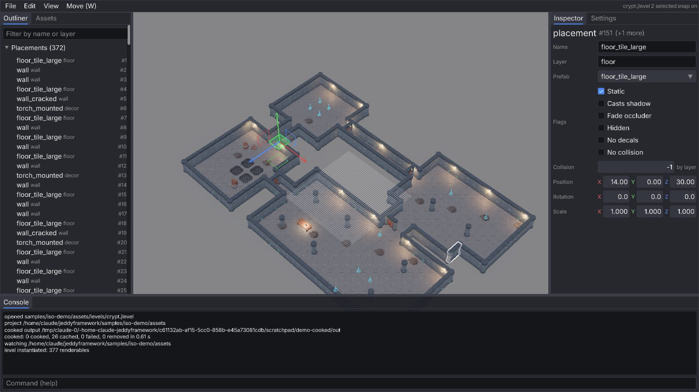
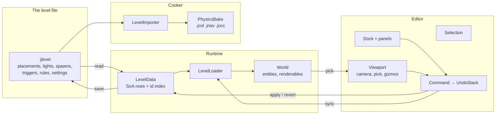

# 14. The level editor: a binary level format, commands with undo, picking, gizmos and docked panels

A level editor is where a game's content gets made, and it is also the best test an engine's
architecture can take: it has to show the live world, change it while it runs, undo anything,
and save a file the runtime loads straight back. Milestone M14 built one in pure Java on the UI of
[chapter 13](13-ui.md): a `.jlevel` file that is a *composition* of prefabs, lights, spawn points
and triggers; a `LevelLoader` that mirrors it into the running `World`; commands with explicit
inverse data on an undo stack; a viewport with an orbit camera, picking against the renderables'
real boxes, and translate, rotate and scale gizmos whose math this chapter derives; and panels
that dock over the scene. The same `editor` library runs inside the iso demo (press **F10**) and
as a standalone application (`tools/editor`) that keeps the cooker running next to it.

You will learn:

- why the level is a binary file of fixed-size rows and how `LevelData` keeps it editable (stable
  ids, O(1) lookups, a version counter);
- how a placement becomes a group of entities in the world and follows every edit;
- the command pattern with explicit inverse data: why a drag is one history entry, how merging
  works, and what "dirty" means;
- picking: the camera ray against oriented boxes (the inverse affine transform), markers as
  screen-sized spheres, box selection by projection;
- gizmo math from first principles: the closest point between a ray and an axis, ray–plane hits,
  signed angles about an axis, snapping, and sizing in pixels at any distance;
- how multi-selection rotates and scales about a pivot, and what a quaternion "world turn" means;
- how immediate-mode panels dock over the scene, why ids need scopes, and how a number field can
  both drag and be typed into;
- the standalone tool: a project, the cooker's watcher on its own thread, hot reload of the cooked
  output.

Where it lives:

| Area | Code |
|---|---|
| The level file and store | [`docs/formats/jlevel.md`](../formats/jlevel.md), [`LevelData`](../../modules/asset/src/main/java/dev/jeddy/asset/format/LevelData.java) |
| Runtime | [`LevelLoader`](../../modules/app/src/main/java/dev/jeddy/app/world/LevelLoader.java), [`World.instantiateNode`, `World.pick`](../../modules/app/src/main/java/dev/jeddy/app/world/World.java) |
| Cooking | [`LevelImporter`](../../tools/cooker/src/main/java/dev/jeddy/cooker/level/LevelImporter.java), [`PhysicsBake`](../../tools/cooker/src/main/java/dev/jeddy/cooker/physics/PhysicsBake.java) |
| Commands | `modules/editor/.../command`: [`Command`](../../modules/editor/src/main/java/dev/jeddy/editor/command/Command.java), [`TransformCommand`](../../modules/editor/src/main/java/dev/jeddy/editor/command/TransformCommand.java), [`AddObjectsCommand`](../../modules/editor/src/main/java/dev/jeddy/editor/command/AddObjectsCommand.java), [`DeleteObjectsCommand`](../../modules/editor/src/main/java/dev/jeddy/editor/command/DeleteObjectsCommand.java), [`ObjectRow`](../../modules/editor/src/main/java/dev/jeddy/editor/command/ObjectRow.java), [`SetFloatCommand`](../../modules/editor/src/main/java/dev/jeddy/editor/command/SetFloatCommand.java), [`TableCommand`](../../modules/editor/src/main/java/dev/jeddy/editor/command/TableCommand.java) |
| The controller | [`Editor`](../../modules/editor/src/main/java/dev/jeddy/editor/Editor.java), [`EditorContext`](../../modules/editor/src/main/java/dev/jeddy/editor/EditorContext.java), [`UndoStack`](../../modules/editor/src/main/java/dev/jeddy/editor/UndoStack.java), [`Selection`](../../modules/editor/src/main/java/dev/jeddy/editor/Selection.java), [`LevelObjects`](../../modules/editor/src/main/java/dev/jeddy/editor/LevelObjects.java), [`LevelFiles`](../../modules/editor/src/main/java/dev/jeddy/editor/LevelFiles.java) |
| The viewport | [`Viewport`](../../modules/editor/src/main/java/dev/jeddy/editor/Viewport.java), [`GizmoMath`](../../modules/editor/src/main/java/dev/jeddy/editor/GizmoMath.java), [`ViewportInput`](../../modules/editor/src/main/java/dev/jeddy/editor/ViewportInput.java) |
| Panels | `modules/editor/.../panel`: [`Dock`](../../modules/editor/src/main/java/dev/jeddy/editor/panel/Dock.java), [`OutlinerPanel`](../../modules/editor/src/main/java/dev/jeddy/editor/panel/OutlinerPanel.java), [`InspectorPanel`](../../modules/editor/src/main/java/dev/jeddy/editor/panel/InspectorPanel.java), [`EntitiesPanel`](../../modules/editor/src/main/java/dev/jeddy/editor/panel/EntitiesPanel.java), [`AssetsPanel`](../../modules/editor/src/main/java/dev/jeddy/editor/panel/AssetsPanel.java), [`ConsolePanel`](../../modules/editor/src/main/java/dev/jeddy/editor/panel/ConsolePanel.java), [`SettingsPanel`](../../modules/editor/src/main/java/dev/jeddy/editor/panel/SettingsPanel.java), [`HistoryPanel`](../../modules/editor/src/main/java/dev/jeddy/editor/panel/HistoryPanel.java) |
| New widgets | [`Widgets`](../../modules/ui/src/main/java/dev/jeddy/ui/Widgets.java) (`beginMenuBar`, `menu`, `splitter`, `numberField`, `vector3Field`, `colorField`, `listBox`, `beginProperty`) |
| The hosts | [`DemoGame`](../../samples/iso-demo/src/main/java/dev/jeddy/samples/iso/DemoGame.java) (F10), `tools/editor`: [`EditorMain`](../../tools/editor/src/main/java/dev/jeddy/editortool/EditorMain.java), [`EditorGame`](../../tools/editor/src/main/java/dev/jeddy/editortool/EditorGame.java), [`CookerService`](../../tools/editor/src/main/java/dev/jeddy/editortool/CookerService.java) |
| Tests | [`LevelDataTest`](../../modules/asset/src/test/java/dev/jeddy/asset/format/LevelDataTest.java), [`LevelLoaderTest`](../../modules/app/src/test/java/dev/jeddy/app/world/LevelLoaderTest.java), [`LevelImporterTest`](../../tools/cooker/src/test/java/dev/jeddy/cooker/level/LevelImporterTest.java), [`UndoStackTest`](../../modules/editor/src/test/java/dev/jeddy/editor/UndoStackTest.java), [`CommandsTest`](../../modules/editor/src/test/java/dev/jeddy/editor/CommandsTest.java), [`GizmoMathTest`](../../modules/editor/src/test/java/dev/jeddy/editor/GizmoMathTest.java), [`ViewportTest`](../../modules/editor/src/test/java/dev/jeddy/editor/ViewportTest.java), [`PanelsTest`](../../modules/editor/src/test/java/dev/jeddy/editor/PanelsTest.java), [`EditorWidgetsTest`](../../modules/ui/src/test/java/dev/jeddy/ui/EditorWidgetsTest.java) |

The design is in [DESIGN.md](../DESIGN.md) §19 and decisions D86 (a binary `.jlevel` of record),
D87 (prefabs are root nodes of a library scene), D88 (library plus a thin application, panels over
the live scene), D89 (commands with explicit inverse data), D90 (the cooker derives physics from
the level), and D91–D95 (made while building: the id index, overlay lines for the gizmo, picking
through the inverse transform, world-axis gizmos about a pivot, id scopes for panels). The work was
milestone M14 in [TASKS.md](../TASKS.md). It builds on cameras and rays from
[04 Cameras](04-cameras-and-projection.md), affine transforms and quaternions from
[02](02-math-foundations.md) and [03](03-rotations-and-transforms.md), the world of
[01](01-architecture.md) and [09](09-animation-and-skinning.md), the cooker of [10](10-assets.md),
the physics bakes of [11](11-physics-navigation-crowds.md) and the UI of [13](13-ui.md).



## The whole path at a glance



Everything the editor does is a change to `LevelData` wrapped in a command, followed by a small
"sync" call that moves the affected entities in the world. The file is the level; the world is a
view of it.

## The level format

### A composition, not a mesh

Before M14 the crypt was one glTF with 372 pieces flattened into it and two JSON files beside it
(physics rules and spawn points). That is fine to render and hopeless to edit: moving a wall meant
re-running the script that produced the glTF. The editor needs a level that is a *list of
placements*: "the `wall_doorway` prefab at (12, 0, 40), turned 90°". A placement names a prefab
and carries a transform; everything heavy (vertices, textures) lives in the prefab's scene, which
the cooker already produces from a glTF.

A **prefab** (D87) is a named root node of a cooked scene. The script that used to build one big
glTF now writes a *library* glTF, `levels/dungeon.glb`, with one root node per dungeon piece and
the piece's meshes as its children. One library means one texture set and one material table for
every piece; the level refers to `levels/dungeon.jscene` plus a node name. An empty node name
means "the whole scene", which is how a one-off model becomes a placement.

### Why binary

The owner asked for an engine-native format, and the runtime reads it on every level load, so the
file is a header and sections of fixed-size rows, little-endian, 16-byte aligned, with a string
table at the end ([`docs/formats/jlevel.md`](../formats/jlevel.md) has every offset). A
placement is 96 bytes:

| Offset | Field |
|---|---|
| 0 | id (`u32`) |
| 4 | prefab index |
| 8, 16 | name, layer (string references: offset and length into the string table) |
| 24 | flags (`STATIC`, `CASTS_SHADOW`, `FADE_OCCLUDER`, `HIDDEN`, `NO_DECALS`, `NO_COLLISION`) |
| 28 | collision override (`0xFFFFFFFF` for "by layer") |
| 32 | position, 3 floats |
| 44 | rotation quaternion `x y z w` |
| 60 | scale, 3 floats |
| 72 | 24 reserved bytes |

Reading it is a loop of `MemorySegment.get` calls into `LevelData`'s arrays; writing is the
reverse, and `LevelDataTest` proves a read-write round trip is byte for byte identical. A JSON
dump (`LevelData.toJson`, the console's `dump` command) exists for humans and code review, and
nothing reads it back: one format of record (D86).

Two decisions in the layout matter for editing:

- **Stable ids.** Every placement, light, spawn and trigger has a `u32` id unique across the four
  kinds, and the header stores `nextId`. The selection, the undo stack and (in M15–M17) triggers
  refer to ids, so a row can be deleted and reinserted, or sorted, and nothing dangles.
- **Rows keep their order.** Collision rules match in order (first match wins), and undo must put
  a deleted row back *where it was*, so every table has `insertXxx(index, …)` as well as
  `addXxx` and `removeXxx(index)`.

### `LevelData`: a store that can be edited

`LevelData` is struct-of-arrays, one array per column and a float array per kind for the
numeric row (10 floats per placement, 13 per light, 4 per spawn, 7 per trigger). The editor
needs three things a plain reader does not:

1. **A version counter.** Every mutator does `version++`. Panels compare it to the version they
   last saw and re-read their caches only when it changed; the editor's selection is pruned of
   dead ids only when it changed.
2. **O(1) lookup by id (D91).** The gizmo resolves the primary object every frame, the Inspector
   resolves the whole selection, and a linear scan over 400 placements per object would add up.
   The store keeps an `IntIntMap` from id to `kind << 28 | index`, updated by every insert and
   remove:

   ```java
   // modules/asset/src/main/java/dev/jeddy/asset/format/LevelData.java
   private void indexInsert(int id, int kind, int index, int[] rowIds, int count) {
       if (ids.containsKey(id)) {
           throw new IllegalArgumentException("duplicate object id " + id);
       }
       for (int i = index; i < count; i++) { // the rows after it moved up by one
           ids.put(rowIds[i], kind << 28 | i);
       }
   }
   ```

   An insert in the middle re-indexes the tail (O(tail), a cold path); an append touches one
   entry. `kindOf(id)` and `placementIndex(id)` became map lookups, and the file reader now
   rejects duplicate ids for free.
3. **Uniform access by id.** [`LevelObjects`](../../modules/editor/src/main/java/dev/jeddy/editor/LevelObjects.java)
   wraps the four tables so the editor can say "float `k` of object `id`" whatever its kind.
   The one convention that makes a shared translate gizmo possible: *every kind keeps its
   position in floats 0–2 of its row.* Rotation and scale differ by kind (`rotationOffset`,
   `scaleOffset`), which the gizmo code handles with a switch.

## From the file to the world

### Instantiating a subtree

`World.instantiate` used to put a whole scene into the world. A placement is the *subtree* of one
root node, so `World.instantiateNode(scene, rootNode, trs, …)` marks the nodes under the root,
creates a new root entity with the placement's transform, and instantiates the marked nodes
below it, flattened (their composed transforms relative to the prefab root). The child meshes
become renderables whose *group* is the new root, so `destroyGroup(root)` and
`setGroupTransform(root, trs)` act on the whole piece, and `groupOf(entity)` leads back from a
picked renderable to its placement.

### The loader

[`LevelLoader`](../../modules/app/src/main/java/dev/jeddy/app/world/LevelLoader.java) holds the
mapping both ways: `placementRoot[i]` (row index → root entity) and `rootToPlacement` (root
entity → id). `load(level)` requests the prefab scenes through the asset manager; `update()`
instantiates each placement once its scene is ready and returns `true` on the frame that
finishes the level. The editing entry points are small because the world already understands
groups:

```java
// modules/app/src/main/java/dev/jeddy/app/world/LevelLoader.java
public void syncTransform(int i) {
    int root = placementRoot[i];
    if (root != Handles.NULL) {
        world.setGroupTransform(root, level.placementData(), i * LevelData.PLACEMENT_FLOATS);
    }
}
```

`placementInserted(i)` and `placementRemoving(i)` shift the `placementRoot` array in step with
the level's rows (the loader is told *before* the level removes a row, so it can still find the
entity to destroy), and `placementReplaced(i)` re-instantiates one placement whose prefab
changed. Lights, spawns and triggers have no entities: `extractLights` reads the level's rows
into the render packet every frame (torches flicker from a sine of time and their index), so
moving a light is just a change of three floats.

One subtlety from [chapter 06](06-renderer-architecture.md): static renderables are cached on
the GPU (D49) and the cache ignores hiding. `renderFlags()` therefore drops `FLAG_STATIC` when a
placement is `HIDDEN`, and `World.setGroupTransform` and `setGroupHighlight` bump
`staticStructure` when they touch a static entity, so the renderer rebuilds its static set once.

### The cooker side

The runtime needs the collision BVH, the navmeshes and the occlusion grid of a level, and those
are derived data: the cooker's [`LevelImporter`](../../tools/cooker/src/main/java/dev/jeddy/cooker/level/LevelImporter.java)
reads the `.jlevel`, loads every prefab's glTF (a *dependency*, so an edited piece re-bakes the
level), composes each placed mesh's triangles with the placement transform, picks their flags from
the level's collision rules by the placement's *layer* (`floor*` walkable, `wall` blocks
movement and sight, `prop` blocks movement, `*` nothing), and hands the triangle soup to the same
[`PhysicsBake`](../../tools/cooker/src/main/java/dev/jeddy/cooker/physics/PhysicsBake.java) the
old `physics.json` path uses (D90). The `.jlevel` itself is copied through unchanged: the editor,
the cooker and the game read the same bytes.

A trap worth knowing: the library glTF writes a piece's children *before* its root node, so
`collectSubtree` cannot assume parents come first. It resolves each node's matrix relative to the
root recursively through its parent chain and memoizes the result — the first demo cook produced
"no collision triangles" until that was fixed.

## Commands and undo

### Explicit inverse data

Every edit is a [`Command`](../../modules/editor/src/main/java/dev/jeddy/editor/command/Command.java)
with `apply(ctx)` and `revert(ctx)`. The rule (D89) is that a command carries *exactly* the data
its two methods need, never a copy of the level: a move stores the ids it moved and their rows
before and after; a delete stores the whole rows with their indices; a rename stores the old
names. A drag of three placements costs 3 × 10 floats twice, and undoing a delete of ten objects
reinserts ten rows at the indices they had.

[`ObjectRow`](../../modules/editor/src/main/java/dev/jeddy/editor/command/ObjectRow.java) is the
snapshot of one object of any kind (`capture`, `insert`, `remove`), and it is what makes add,
delete and duplicate one implementation each: `DeleteObjectsCommand` sorts its rows by
`(kind, index)`, removes them in descending order (so the indices it captured stay valid) and
reinserts them in ascending order (so each one lands where it was). `AddObjectsCommand.duplicate`
captures the selection, copies each row with a *new* id allocated once, and appends; redo
reuses those ids, so a selection made of the copies survives an undo-redo pair.

Field edits are three small classes, `SetStringCommand`, `SetIntCommand` and `SetFloatCommand`,
each over a list of ids (the Inspector applies one value to the whole selection) with the old
value per id. `SetIntCommand.flag` is the per-object variant: "set bit 3 on each of these", where
the *after* value differs per object. `TableCommand` covers the tables without ids (rules, size
classes, areas, links) by index with a captured row, and `SetSettingsCommand` swaps the settings
block.

After changing the level, a command tells the world through the context: `syncTransform(id)`,
`syncFlags(id)` or `syncPrefab(id)`, which forward to the loader for placements and do nothing for
the other kinds. Commands run on the game thread between frames and may allocate: they are user
actions, a few per second at most.

### The stack

[`UndoStack`](../../modules/editor/src/main/java/dev/jeddy/editor/UndoStack.java) is a list and a
cursor: entries below the cursor are applied. `push` applies the command, throws away whatever
could have been redone, and either appends or merges:

```java
// modules/editor/src/main/java/dev/jeddy/editor/UndoStack.java
public void push(Command command, boolean merge) {
    command.apply(ctx);
    if (cursor < commands.size()) {
        commands.subList(cursor, commands.size()).clear(); // the redo tail is gone
        if (savedAt > cursor) {
            savedAt = -1;
        }
    }
    if (merge
            && cursor > 0
            && cursor != savedAt
            && commands.get(cursor - 1).mergeWith(command)) {
        return;
    }
    commands.add(command);
    cursor++;
    ...
}
```

Two things to notice. First, **merging**: typing `1`, `12`, `123` into a number field pushes
three `SetFloatCommand`s with `merge`; the previous entry absorbs each one (`mergeWith` keeps its
own *before* and takes the newcomer's *after*), so one Ctrl+Z goes back to the value before the
first digit. The command decides whether it can merge (same ids, same field), the stack only
asks. Second, **the saved mark**: `savedAt` is the cursor at the last save; the level is dirty
when the cursor is elsewhere, and a branch after an undo past the save sets `savedAt = -1` (that
state is unreachable now). A merge never crosses the saved mark, or the stack would say "clean"
after a change.

A gizmo drag uses the other way to make a continuous edit one entry: the viewport creates one
`TransformCommand` with *before* = the current rows, pushes it on the first frame that actually
changes something, and then mutates its `after` rows and calls `apply` again every frame of the
drag. Escape during a drag calls `cancelTop`, which reverts and *removes* the entry (unlike
`undo`, which would leave it to redo). The History panel is the same list drawn as rows, and
clicking one calls `seek`, undo or redo in a loop until the cursor is there.

## The viewport

The scene renders full-window underneath the panels (D88), so the viewport is a *region* of the
window where the pointer is the editor's: the dock computes it each frame and the panels own
whatever the pointer is over (`Ui.wantsMouse`). Input arrives as a
[`ViewportInput`](../../modules/editor/src/main/java/dev/jeddy/editor/ViewportInput.java), a plain
struct the editor fills from `Input` and the tests fill by hand.

### The camera

The editor camera is an `IsoCamera` ([chapter 04](04-cameras-and-projection.md)) the editor owns;
while the editor is shown, the host renders with it, and `takeCameraFrom(gameCamera)` copies the
game's view on opening so nothing jumps. Right drag orbits (yaw and pitch, pitch clamped to
5°–89°), the middle button or Shift+right pans, the wheel zooms by a factor per notch, and
**F** frames the selection (the centroid, at a distance where the selection's radius fits the
field of view: $d = r / \tan(\mathrm{fov}/2)$). Panning moves the target by one pixel's worth of
ground per pixel of mouse, using a quantity the whole viewport is built on:

$$\text{metersPerPixel}(z) = \frac{2\,z\,\tan(\mathrm{fov}_y/2)}{\text{height}_{px}}$$

The frustum is $2 z \tan(\mathrm{fov}_y/2)$ meters tall at depth $z$ and the window is
$\text{height}_{px}$ pixels tall, so that is the size of one pixel there. It sizes the gizmo (90
pixels whatever the distance), the marker spheres (10 pixels) and the hit tolerances (8 pixels).

### Picking against real boxes (D93)

A click casts the camera ray through the pointer (`IsoCamera.screenRay` unprojects two depths,
chapter 04) and asks two questions. The markers first: every light, spawn and trigger is a sphere
of 10 pixels' worth of meters at its depth, tested with `Intersect.raySphere`. Then the world:

```java
// modules/app/src/main/java/dev/jeddy/app/world/World.java (pick)
if (!AffineOps.invert(world, s * 12, pickInverse, 0)) {
    continue;
}
AffineOps.transformPoint(pickInverse, 0, ox, oy, oz, pickLocal, 0);
AffineOps.transformDirection(pickInverse, 0, dx, dy, dz, pickLocal, 3);
float t = Intersect.rayAabb(pickLocal[0], ..., mesh.bounds(0), ..., mesh.bounds(5), best);
```

Each renderable's mesh has a local axis-aligned box (`GpuMesh.bounds`, kept on the CPU for this).
Instead of transforming the box's eight corners into the world and testing a sloppy world-aligned
box around them, the ray is brought into the mesh's space with the inverse of its world transform
and tested against the local box with the slab method from [chapter 11](11-physics-navigation-crowds.md).
A turned wall is picked by its real outline. The parameter $t$ is the same in both spaces because
the direction is transformed linearly, not renormalized: $p = o + t d$ maps to $M^{-1}p = M^{-1}o +
t\,M^{-1}_{3\times3}d$. A sphere test first rejects almost everything for a few multiplies, and
the closest hit wins. From the entity, `groupOf` gives the placement's root and the loader gives
the id. Shift adds, Ctrl toggles.

A press that moves more than four pixels on empty space becomes a **box selection**: on release
every object's position is projected (`GizmoMath.project`, the `viewProjection` matrix and the
perspective divide, then a map from NDC to pixels) and the ones inside the rectangle are
selected. The rubber band is a floating UI box the viewport declares.

### Gizmo math (derived)

The gizmo sits on the *primary* selected object and acts in world axes (D94); the plane squares
and rings are in the planes spanned by pairs of axes. Hover tests are in screen space for axes
(distance from the pointer to the projected segment) and in world space for planes and rings.
Dragging needs three pieces of geometry, in
[`GizmoMath`](../../modules/editor/src/main/java/dev/jeddy/editor/GizmoMath.java), each checked by
`GizmoMathTest` against hand-computed cases.

**The closest point on an axis to the mouse ray.** The axis is the line $c + t\,a$ ($a$ unit), the
ray is $o + s\,d$ ($d$ unit). Write $w = o - c$ and minimize $f(s, t) = |w + s d - t a|^2$. Setting
both partial derivatives to zero:

$$\frac{\partial f}{\partial s} = 0:\; w\cdot d + s - t\,(a\cdot d) = 0, \qquad
\frac{\partial f}{\partial t} = 0:\; w\cdot a + s\,(a\cdot d) - t = 0.$$

Eliminate $s$ from the first equation, $s = t\,(a\cdot d) - w\cdot d$, substitute into the second
and solve for $t$:

$$t = \frac{w\cdot a - (a\cdot d)\,(w\cdot d)}{1 - (a\cdot d)^2}.$$

The denominator is $\sin^2$ of the angle between the ray and the axis: when you look straight
down an axis it goes to zero, the handle is useless, and the gizmo hides that axis. In code:

```java
// modules/editor/src/main/java/dev/jeddy/editor/GizmoMath.java
float b = ax * dx + ay * dy + az * dz;
float denom = 1 - b * b;
if (denom < 1e-4f) {
    return fallback;
}
float wa = wx * ax + wy * ay + wz * az;
float wd = wx * dx + wy * dy + wz * dz;
return (wa - b * wd) / denom;
```

A translate drag along an axis records $t_0$ at the press and moves every selected object by
$(t - t_0)\,a$ each frame. A scale drag along an axis uses the ratio $t / t_0$ as the factor
(grab the handle halfway out and drag to its end: ×2).

**A plane hit.** For the plane squares, the rotation rings and the pan, the ray meets the plane
through $c$ with unit normal $n$ where $n \cdot (o + s d) = n \cdot c$, so $s = n\cdot(c - o) /
(n\cdot d)$ (`Intersect.rayPlane`, rejecting parallel rays and hits behind the origin). A plane
drag is the difference of two such points; the component along the normal is zero by
construction.

**A signed angle.** The rotate ring about axis $a$ compares the lever at the press, $v_0 = p_0 -
c$, with the lever now, $v_1 = p - c$ (both plane hits, so both perpendicular to $a$):

$$\theta = \operatorname{atan2}\big((v_0 \times v_1)\cdot a,\; v_0 \cdot v_1\big).$$

The dot product is $|v_0||v_1|\cos\theta$ and the triple product is $|v_0||v_1|\sin\theta$ with
the sign of a right-handed turn about $a$, and `atan2` takes care of all four quadrants. Check:
from $+X$ to $+Z$ about $+Y$ is $-90°$, because $x \times z = -y$. The test
`rotateAroundTheYRing` drags exactly that and expects the quaternion $(0, \sin(-45°), 0,
\cos(-45°))$.

**Snapping** rounds to the nearest multiple of a step, `Math.round(v / step) * step`, applied to
the *delta* (not the absolute value, so a drag that starts off-grid still moves by whole steps),
to the angle, and to the scale factor. **X** toggles snapping and Ctrl inverts it for one drag.

### Applying a turn to a selection

With several objects selected, the rotation must turn them *as a group* about the pivot (the
primary's position), and each object's own orientation by the same amount:

```java
// modules/editor/src/main/java/dev/jeddy/editor/Viewport.java (writeRotate)
GizmoMath.rotate(qa, 0, tmp, 0, tmp, 3);          // the offset from the pivot, turned
after[o] = pivot[0] + tmp[3];
...
case LevelData.KIND_PLACEMENT -> {
    GizmoMath.mul(qa, 0, before, o + 3, after, o + 3); // world turn, then the old
    GizmoMath.normalize(after, o + 3);
}
case LevelData.KIND_SPAWN -> after[o + 3] = before[o + 3] + axis[1] * angle;
case LevelData.KIND_LIGHT -> GizmoMath.rotate(qa, 0, before, o + 3, after, o + 3);
```

`qa` is the axis-angle quaternion of the drag. Quaternion products apply right to left
([chapter 03](03-rotations-and-transforms.md)): `qa * q` means "the object's old rotation, then
the drag's turn in world space", which is what a world-axis gizmo promises. A spawn only has a yaw,
so a turn about Y adds to it and a turn about X or Z moves it but leaves it facing where it was;
a light's direction is a vector and is simply rotated. Scaling about the pivot is the same shape
with multiplication: offsets from the pivot and the object's own scale (placements) or extents
(triggers) are multiplied per axis.

The Inspector edits rotation as yaw, pitch and roll in degrees. `GizmoMath.toEuler` and
`fromEuler` convert for the composition $q = q_y(\psi)\,q_x(\theta)\,q_z(\phi)$ (roll applied
first). Writing the rotation matrix out (chapter 03), $R_{12} = -\sin\theta$ gives the pitch,
$\operatorname{atan2}(R_{02}, R_{22})$ the yaw and $\operatorname{atan2}(R_{10}, R_{11})$ the roll;
at $\theta = \pm 90°$ (gimbal lock) yaw and roll are not separable and the turn is attributed to
yaw. The quaternion-to-matrix entries, $R_{12} = 2(yz - wx)$ and friends, are what the code
evaluates directly. `GizmoMathTest` round-trips several triples.

### Drawing the gizmo (D92)

The handles are debug lines (`RenderPacket.addDebugLine`), the same path physics and navigation
use for their overlays, with one addition: lines added after `beginDebugOverlay()` are drawn
*without* the depth test by `DebugRenderer`, so the gizmo shows through walls while the grid and
the markers before it are depth-tested like everything else. Core-profile GL draws one-pixel
lines only, so the axes are drawn three times, offset by one pixel's worth along the camera's
right and up vectors (the first two rows of the view matrix): a cheap thickness. The alternative,
drawing the handles as UI triangles, would have put 3D geometry into the 2D draw list; lines kept
the gizmo in world space and under the same clipping and depth rules as the rest of the overlays.

## Panels over the scene

### The dock

[`Dock`](../../modules/editor/src/main/java/dev/jeddy/editor/panel/Dock.java) owns three zones,
left, right and bottom; each is a `tabs` row over a scrolling column that draws the visible panel,
with a `splitter` on its inner edge. The editor declares one full-window floating root that does
*not* block the pointer (`noHit()`, chapter 13: a box without a background is transparent to
hits), the menu bar across the top, the dock below it; the free space in the middle is a `grow`
spacer that lets clicks through to the viewport. The dock reports that free rectangle and the
editor hands it to the viewport as its region. The layout is one string the host keeps in its
settings file, `left=300:Outliner,Assets|right=340:Inspector,Settings|bottom=220:Console`,
and the View menu toggles panels in and out of it.

### Panels are immediate mode too

A [`Panel`](../../modules/editor/src/main/java/dev/jeddy/editor/panel/Panel.java) has a name and
`draw(ctx, widgets)`. There is no panel state to keep in sync with the level: the Outliner walks
the level's rows every frame and declares one selectable row each (a 372-row tree declares about
1,100 elements, well inside the budget measured in chapter 13), and the Inspector reads the
primary object's fields and declares widgets for them. What a panel keeps is *scratch*: a
`TextBuffer` per text field, a `StringBuilder` per counted heading, a label array for a dropdown.

The subtle part is **ids** (D95). Every widget needs an id that is stable across frames and unique
within the frame. Panels use small constants (`FILTER = 1`, `ROW = 3`), which would collide
between panels and between rows, so the dock pushes an id scope per zone and per panel, and a
panel pushes one per row (`ui.pushId(id)`), the mechanism from chapter 13. The new row widgets
scope their own components: `vector3Field` pushes its id before the three number fields, or a
vector field's X and a color field's R would share the id `(0, FIELD)` and drag together — the
first version did exactly that, and `EditorWidgetsTest` now checks it does not. `PanelsTest`
reaches an Inspector field by folding the same scopes: `id(Dock.RIGHT, 2, POSITION, 0, FIELD)`.

### Text buffers that mirror the level

The Inspector's name field edits a `TextBuffer`. When the user types, the panel pushes a
`SetStringCommand` (merged) and the level changes; when the *gizmo* moves the object, the level
changes too and the panel must re-read the position fields, but must not reset the name buffer
mid-typing. The rule: re-read a text buffer when the primary object changed or when the level's
version changed *and that field is not focused*. `syncedVersion` is set to the new version right
after the panel's own push, so its own edits never trigger a re-read.

### A number field that drags and types

`numberField` is `dragValue` with a second life: a double click copies the value into a shared
`TextBuffer` (formatted without allocating by `Widgets.appendFloat`), selects it, and focuses a
text field declared in the number field's own scope; from then on the text field edits the
buffer, Enter or a click elsewhere commits (`Widgets.parseFloat`, a small decimal parser that
returns NaN for nonsense, which is ignored), and Escape cancels. The same widget builds the
vector and color fields, which return a bit mask of changed components so the Inspector pushes
one command per component and nothing when nothing changed.

## The hosts

### Inside the iso demo

`DemoGame` creates the `Editor`, attaches the world and loader when the crypt is built, opens the
loaded level with its source path (`assets/levels/crypt.jlevel` when run from the repository),
and on **F10** takes the game camera into the editor and shows it. While shown, the editor gets
`update` (shortcuts, viewport), `declare` (panels, after the game's own UI) and `extract` (grid,
markers, gizmo, after the game's debug lines); the game skips its own input handling and camera,
hides its HUD, and lifts the fog of war so the whole level is visible. The simulation keeps
running: the Entities panel shows the party and the skeletons moving, and **Space** pauses as
usual. `--editor` starts with it open and `--editor-command "select 150 151"` runs a console
command at start, which is how the screenshot in this chapter was taken.

### The standalone tool

`tools/editor` is the same library over an almost empty game. `EditorMain` reads the level from
the *source* tree, starts the [`CookerService`](../../tools/editor/src/main/java/dev/jeddy/editortool/CookerService.java)
(the cooker on its own thread: a full cook, then `SourceWatcher` and `cook(affectedBy(changed))`
whenever a source changes, as `jeddy-cook --watch` does), and mounts the cooked directory into a
`Vfs` the way a game would. `EditorGame` adds what a game has: an asset manager with an
`AssetReloader` on that mount (chapter 10's hot reload: the cooker rewrites `levels/dungeon/*.jmesh`,
the watcher rescans, the loaded meshes swap behind their handles), the UI bridge and fonts, a
`World` and a `LevelLoader`, and the level's own sun, exposure and environment settings for the
view. Saving writes the source `.jlevel` (on a virtual thread, to a temporary file renamed over the
target); the cooker sees the change, re-bakes the physics, and the game's next run picks it up.

## Threads and performance

The editor runs on the game thread like any game system and never touches GL. Per frame it costs
the viewport (hover tests: a few dot products), the panels (about 1,500 elements with the
Outliner open, under 0.5 ms on the 2-vCPU box of chapter 13) and the overlay lines (a few hundred
`addDebugLine` calls). `ViewportTest.idleFramesAllocateNothing` and
`PanelsTest.everyPanelDrawsOverALiveWorldWithoutAllocating` hold the idle frame at 0 bytes; the
things that allocate are listed and cold: a command (per user action), a save (serialize, then a
virtual thread), a cook report, `Vfs.paths` for the asset browser, `Path.getFileName` (which is
why the menu bar caches the file name — the first version allocated 48 bytes a frame there).

The `World.pick` loop is O(renderables) per click with a sphere test per renderable; the crypt's
1,041 renderables take microseconds. Box selection projects every object once per release.

## Pitfalls

- **Rows shift, ids do not.** Anything stored across frames must be an id; a row index is valid
  until the next insert or remove. The loader is told *before* a row is removed for that reason.
- **Static means cached.** Moving, hiding or outlining a static placement must bump the world's
  `staticStructure`, or the renderer keeps drawing the old static set.
- **The redo tail and the saved mark.** Pushing after an undo discards the redo entries; if the
  saved state was among them, the level is dirty forever until the next save (`savedAt = -1`).
- **Merging across a save.** A merged step must not fold into an entry that is the saved state,
  or `isDirty()` lies.
- **Ids in rows of rows.** Any widget declared in a loop needs `pushId(i)`, and any widget that
  declares several children with fixed ids needs its own scope.
- **The pointer belongs to one of two owners.** The viewport ignores input while
  `Ui.wantsMouse()` is true (a press on a panel, a drag of a splitter); without that check a
  splitter drag would also orbit the camera.
- **The ray's parameter is the same in local space only if the direction is not renormalized.**
  Normalize it and the `t` from `rayAabb` is in local units.
- **Children before parents.** glTF node order is arbitrary; resolve matrices through the parent
  chain, memoized, never by index order.

## Try it

- `./gradlew :editor:test :ui:test` runs the editor's tests. `GizmoMathTest` is the place to
  check the derivations with your own numbers; `ViewportTest` drags through projected handles
  the way a user would.
- `./gradlew :iso-demo:run`, then **F10**. Click a tile, press **W**, **E**, **R**, drag the
  handles; **Ctrl+Z**; right-drag to orbit; type `help` in the console. `Ctrl+S` writes
  `assets/levels/crypt.jlevel`; the next `./gradlew :iso-demo:run` cooks it and the party walks
  on your new collision.
- `./gradlew :editor-tool:run --args="--project samples/iso-demo/assets --level levels/crypt.jlevel --shader-include modules/render/src/main/resources/dev/jeddy/render/shaders"`
  opens the standalone editor; watch the console as the cooker finishes, then edit
  `kaykit.py`'s output or a glTF in the source tree and see it reload.
- In the Settings panel, change the level's sun and exposure: the view follows at once because
  the standalone tool renders with the level's settings.
- `--editor-command dump` (demo) or `dump` in the console writes `crypt.json` next to the level
  for reading.

## Exercises

1. **Local-space gizmo.** Add a toggle that aligns the gizmo with the primary object's rotation
   instead of the world axes. Hint: rotate the three `AXES` by the primary's quaternion at the
   start of each frame (`GizmoMath.rotate`) and use those vectors everywhere the viewport reads
   `AXES[n]`; the math does not care which unit vectors it gets. Check: a scale drag along the
   local X of a turned wall changes the wall's `sx`, not its position.
2. **Snap to the surface.** When a placement is dragged with **Shift** held, drop it onto what is
   below: cast a ray down from its position with `World.pick` and move `y` to the hit. Hint: the
   pick ignores the dragged object only if you hide its group first (`setGroupHidden`) and show
   it again after.
3. **Duplicate along the drag.** Make **Ctrl+D** followed by a drag place the copies where the
   drag ends (Blender's Shift+D). Hint: push the duplicate, then begin a translate drag on the
   new selection in the same frame; the two commands stay separate entries, which is what users
   expect.
4. **Marquee with depth.** Box selection takes anything whose center projects inside the
   rectangle, including objects behind walls. Use the occlusion grid of chapter 11 (or a
   `World.pick` from the camera to each candidate) to drop hidden ones. Measure the cost on 372
   placements.
5. **An area volume tool.** Draw a polygon on the ground with clicks and push a `TableCommand`
   adding an area with it; draw existing areas as prisms with overlay lines. Hint: the ground
   point of a click is `rayPlanePoint` with the normal $+Y$ through the camera target.
6. **Undo the world.** The Entities panel edits local positions live and not through commands.
   Write a `WorldTransformCommand` that captures `TransformStore.position/rotation/scale` before
   and after, and decide what should happen when the entity has died by the time of the undo.
7. **Prefab previews.** Instantiate the scene chosen in the Assets panel in a corner of the world
   (or a second `World` rendered to a texture, which needs the render-target plumbing D88
   rejected for now) and draw it into the panel.

---

[← 13 The user interface](13-ui.md) · [Index](README.md) · [15 Rules →](15-rules.md)
