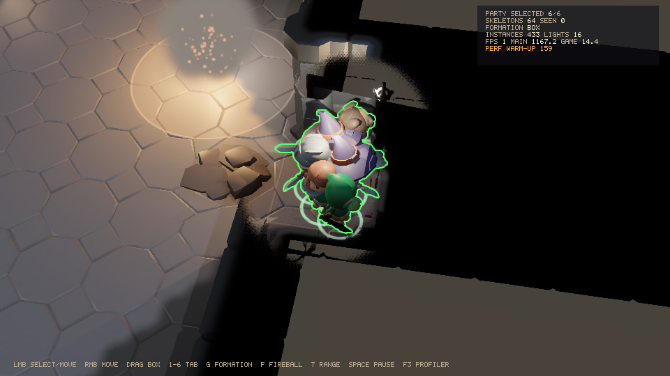

# M10 performance capture and fix list

TASKS M10-05 and M10-06. The perf scene is the iso demo with `--perf` (DESIGN §13.3): 300 agents
(the party and 294 skeletons pathing, avoiding and fighting), fog of war, a fireball every 1.5 s,
16k extra static props and 256 point lights (4 with shadows), with an orbiting camera.
`PerfCapture` measures after a warm-up in seconds, frames and gameplay, against the budgets of
DESIGN §14.

```
# game thread
./gradlew :iso-demo:run --args="--headless --perf 600 --warmup 60 --alloc-probe"
# rendered
./gradlew :iso-demo:run --args="--perf 600"
```

CI runs the headless capture for two minutes on every push (`perf` job, fails on allocation that
the JIT log does not explain, D70) and the rendered demo on Mesa llvmpipe for a smoke run and a
screenshot (`gpu` job).

## Results (2026-10-10)

Machine: a 2-vCPU Linux container, JDK 27+35, ZGC. The DESIGN reference PC is an 8-core desktop
with a GTX 1660 / RX 6600 class GPU, so CPU numbers here are pessimistic and GPU numbers come from
a software rasterizer.

### Game thread: 10 minutes headless

| Budget | Target | Measured | Pass |
|---|---|---|---|
| Game thread per frame (300 agents) | ≤ 8 ms | avg 2.18, p99 4.60, max 32.5 ms (35 966 frames) | yes |
| Steady-state allocation (game, main, workers) | 0 B/frame | 0 B in the second half; 0 frames allocating | yes |
| GC pauses | < 1 ms | no collection at all in 11 minutes (`-Xlog:gc*`) | yes |
| Area load (crypt + characters, CPU side) | ≤ 3 s | 464 ms | yes |

The whole window allocated 5.4 KB, all of it in its first minutes and none on the job workers.
The single max outlier (32 ms) is the container's scheduler: the p99 stays under 5 ms.

### Rendered on llvmpipe (reference only)

Mesa's software rasterizer takes seconds per frame for the full scene, so main-thread and GPU
times measure llvmpipe, not the engine, and the game thread competes with llvmpipe's threads for
the two cores. These budgets need the reference hardware (open item O1).

Five minutes at 960×540 on Mesa llvmpipe (92 frames):

| Budget | Target | Measured on llvmpipe |
|---|---|---|
| Game thread per frame | ≤ 8 ms | avg 11.6, p99 28.3 ms (sharing two cores with the rasterizer) |
| Main thread CPU (16 433 instances per frame) | ≤ 5 ms | avg 3 257 ms (GL calls wait for the software rasterizer) |
| GPU (256 lights, 4 shadowed) | ≤ 12 ms | avg 3 251 ms; sun shadows 1 458 ms and the lit pass 1 272 ms of it |
| GC pauses | < 1 ms | none |
| Area load | ≤ 3 s | 12.7 s (uploads paced by ~1 fps frames) |

With 92 frames the JIT never warms up, so this run's allocation figure (376 B in its second half)
says nothing about steady state; the headless run above does.



## Fix list

Found by the captures, the allocation probe (`--alloc-probe`) and JFR allocation events with
small TLABs, and burnt down in M10-06.

| # | Finding | Fix | Status |
|---|---|---|---|
| F1 | The engine's shaders could not be read on the module path: `ShaderSources.classpath` opened another module's encapsulated resource packages; tests on the class path hid it | `EngineShaders.sources()` in the render module (D64) | fixed |
| F2 | Idle asset IO (virtual) threads polled with a 50 ms timed park, allocating a stack chunk on every remount, about 1 MB/s with nothing to load | untimed park; `schedule()` already unparks (D65) | fixed |
| F3 | Method-handle customization compiled a hidden class (40–150 KB garbage) when a downcall reached its 127th call from interpreted or C1 code, minutes into a run for natives called a few times a second (audio 3D positions) | launchers set `java.lang.invoke.MethodHandle.CUSTOMIZE_THRESHOLD=-1` (D69) | fixed |
| F4 | The first positional sound and the first finished voice created SDL_mixer downcall handles mid-frame (lazy jextract holders) | `Audio.open` prelinks the per-frame handles and accessors (D65) | fixed |
| F5 | Render packets grew their light, decal and emitter arrays mid-game (fireball lights on top of 256 others) | `RenderPacket.reserve`; the demo sizes its packets for the peak | fixed |
| F6 | The crowd's neighbour candidate list grew in dense crowds (a new peak density, any time) | sized to the crowd; `QueryContext(expectedBodies)` for queries over crowds | fixed |
| F7 | Static renderables were copied as "previous tick" transforms every tick (16k props) | `World.beginTick` skips statics; extract passes their current transform twice | fixed |
| F8 | The profiler overlay overlapped long pass names and ran off a 540-pixel screen | label column from the longest pass name; `setScale` | fixed |
| F9 | The capture measured itself: `ManagementFactory.getThreadMXBean()` allocates about 1 KB per call, and snapshot branches deoptimized compiled code on first use | counters read on every recorded frame on the regular path; the bean looked up once (D66) | fixed |
| F10 | CI failed on 1.3 KB allocated once by the main thread about 80 s into the window, in a different place each run: the first C2 compile of a class resolves its string literals on the requesting thread (60 fps × 5000 calls). It is JIT warm-up, not per-frame allocation, and no warm-up length or AOT cache removes the tail | the capture logs compilations and reports frames at C2 compiles as JIT warm-up (D70); the CI gate stays at 0 B otherwise | fixed |
| F11 | The CI captures ran without the launcher flags: `-Pjeddy.jvmArgs` reached the run task through `JavaExec.jvmArgs`, which adds to `jvmArguments` and so drops its convention, the application's default JVM flags. The runs used G1 and method-handle customization, which spun customized LambdaForms in `Audio.update` 7–9 minutes into the nightly capture (96 KB and 32 KB, found with the probe's per-system events, the late class-load log and JFR stacks) | extra flags go through `jvmArgumentProviders`; the capture checks the launcher flags (`flags`, failing CI) | fixed |
| O1 | Main thread ≤ 5 ms with 20k instances and GPU ≤ 12 ms with 256 lights (4 shadowed) are unverified: no GPU here | run `--perf 600` on the reference PC (NVIDIA, AMD, Intel) | **open** |
| O2 | Area load with GPU uploads: frame-paced uploads take 5–12 s on llvmpipe at about 1 fps; 0.46 s on the CPU side | measure on the reference PC; raise the upload budget while a level loads if needed | **open** |
| O3 | Cold start to first frame ≤ 1.5 s | AOT cache, M11-02 | M11 |
